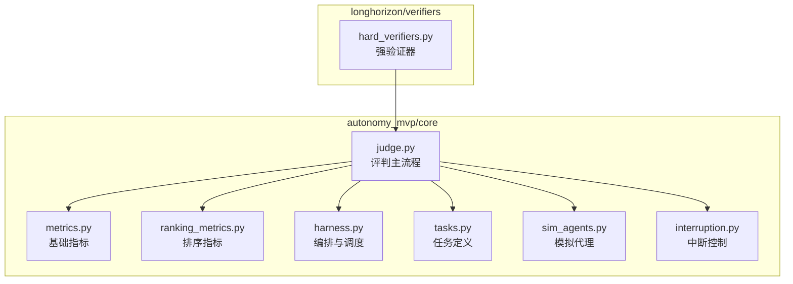
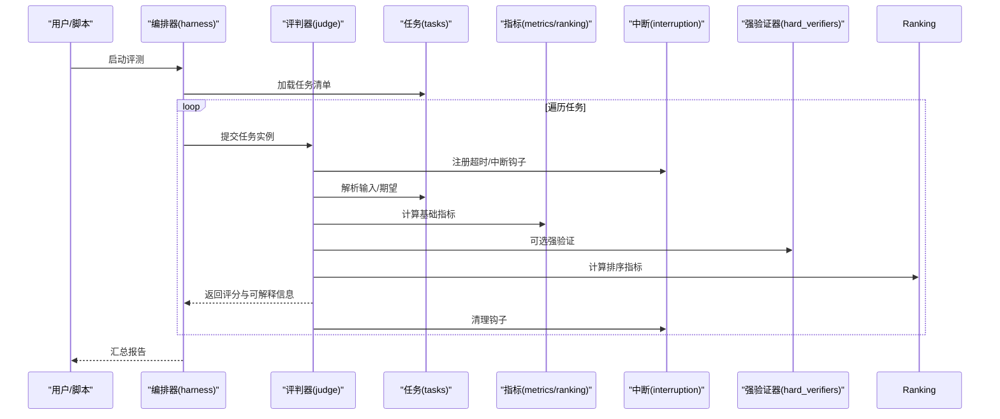
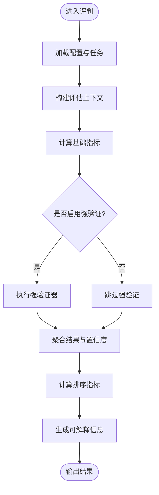
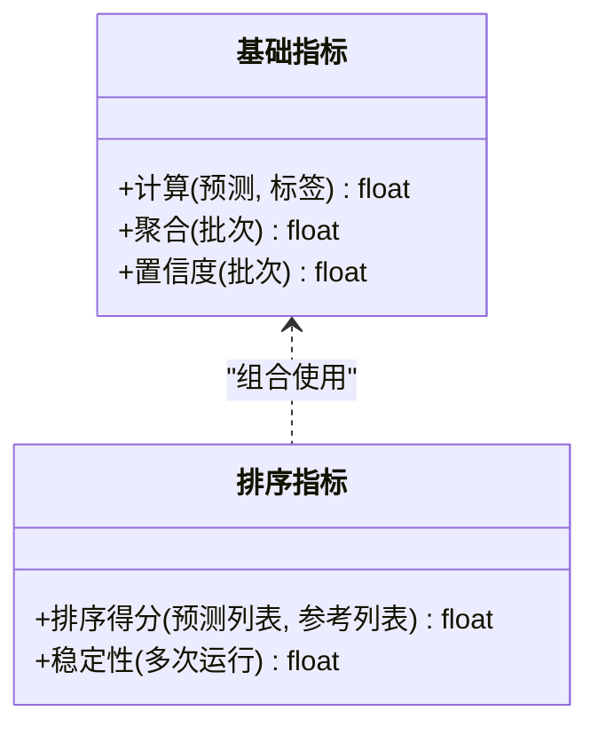
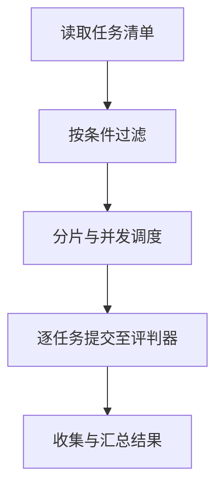
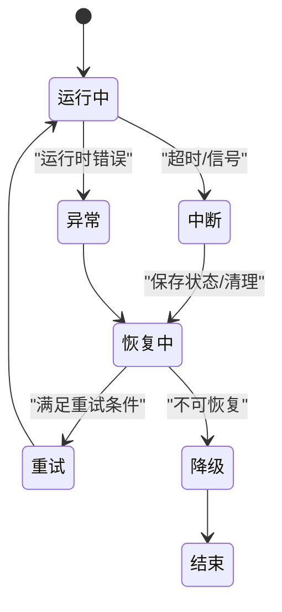
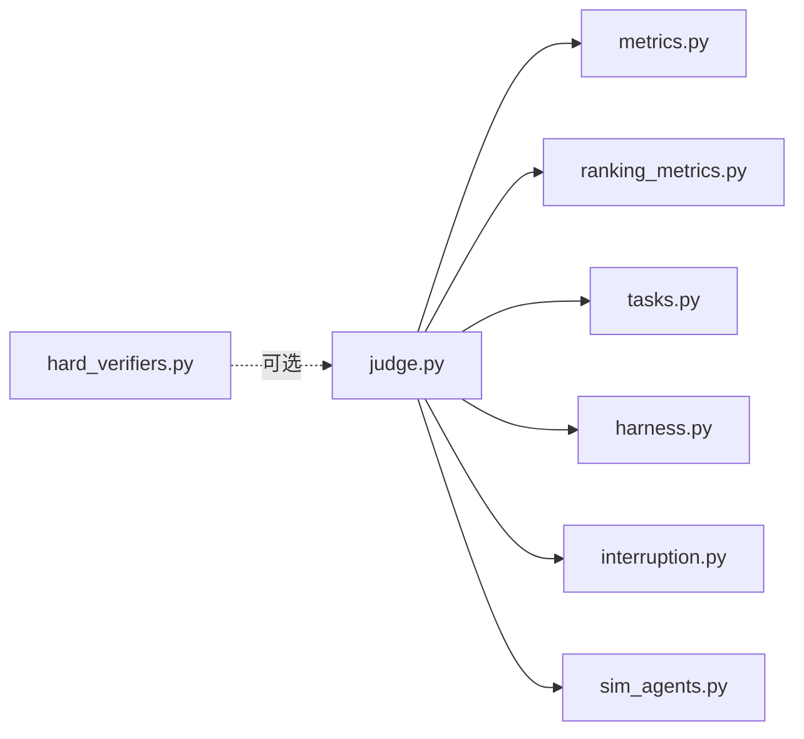

# 智能评判器系统

<cite>
**本文引用的文件**   
- [autonomy_mvp/core/judge.py](file://autonomy_mvp/core/judge.py)
- [autonomy_mvp/core/interruption.py](file://autonomy_mvp/core/interruption.py)
- [autonomy_mvp/core/metrics.py](file://autonomy_mvp/core/metrics.py)
- [autonomy_mvp/core/ranking_metrics.py](file://autonomy_mvp/core/ranking_metrics.py)
- [autonomy_mvp/core/harness.py](file://autonomy_mvp/core/harness.py)
- [autonomy_mvp/core/tasks.py](file://autonomy_mvp/core/tasks.py)
- [autonomy_mvp/core/sim_agents.py](file://autonomy_mvp/core/sim_agents.py)
- [autonomy_mvp/tests/test_core.py](file://autonomy_mvp/tests/test_core.py)
- [autonomy_mvp/run_validation.py](file://autonomy_mvp/run_validation.py)
- [longhorizon/verifiers/hard_verifiers.py](file://longhorizon/verifiers/hard_verifiers.py)
</cite>

## 目录
1. [简介](#简介)
2. [项目结构](#项目结构)
3. [核心组件](#核心组件)
4. [架构总览](#架构总览)
5. [详细组件分析](#详细组件分析)
6. [依赖关系分析](#依赖关系分析)
7. [性能考量](#性能考量)
8. [故障排查指南](#故障排查指南)
9. [结论](#结论)
10. [附录](#附录)

## 简介
本技术文档面向“智能评判器系统”，聚焦于评判器的核心算法、决策逻辑与中断处理机制，详细说明评判标准定义、置信度计算方法和错误恢复策略。同时覆盖配置选项、自定义评判规则的实现方式、性能调优方法，并提供实际评判案例与调试技巧，解释评判结果的可解释性分析方法。

## 项目结构
仓库围绕评测与评判能力组织代码，关键路径如下：
- autonomy_mvp/core：评判器核心实现（评判主流程、指标、排序指标、任务编排、模拟代理、中断控制）
- longhorizon/verifiers：面向长程任务的强验证器集合
- tests：单元测试与回归用例
- run_validation：端到端验证入口

图表来源
- [autonomy_mvp/core/judge.py](file://autonomy_mvp/core/judge.py)
- [autonomy_mvp/core/metrics.py](file://autonomy_mvp/core/metrics.py)
- [autonomy_mvp/core/ranking_metrics.py](file://autonomy_mvp/core/ranking_metrics.py)
- [autonomy_mvp/core/harness.py](file://autonomy_mvp/core/harness.py)
- [autonomy_mvp/core/tasks.py](file://autonomy_mvp/core/tasks.py)
- [autonomy_mvp/core/sim_agents.py](file://autonomy_mvp/core/sim_agents.py)
- [autonomy_mvp/core/interruption.py](file://autonomy_mvp/core/interruption.py)
- [longhorizon/verifiers/hard_verifiers.py](file://longhorizon/verifiers/hard_verifiers.py)

章节来源
- [autonomy_mvp/core/judge.py](file://autonomy_mvp/core/judge.py)
- [autonomy_mvp/core/metrics.py](file://autonomy_mvp/core/metrics.py)
- [autonomy_mvp/core/ranking_metrics.py](file://autonomy_mvp/core/ranking_metrics.py)
- [autonomy_mvp/core/harness.py](file://autonomy_mvp/core/harness.py)
- [autonomy_mvp/core/tasks.py](file://autonomy_mvp/core/tasks.py)
- [autonomy_mvp/core/sim_agents.py](file://autonomy_mvp/core/sim_agents.py)
- [autonomy_mvp/core/interruption.py](file://autonomy_mvp/core/interruption.py)
- [longhorizon/verifiers/hard_verifiers.py](file://longhorizon/verifiers/hard_verifiers.py)

## 核心组件
- 评判主流程（judge）：负责加载任务、执行评估、聚合指标、输出可解释结果，并协调中断与重试。
- 指标体系（metrics、ranking_metrics）：提供数值型与排序型指标的计算与汇总。
- 任务与编排（tasks、harness）：定义任务结构与执行上下文，管理并发与资源。
- 模拟代理（sim_agents）：为无真实环境时的快速验证提供替代执行体。
- 中断控制（interruption）：统一处理超时、外部中断与异常恢复。
- 强验证器（hard_verifiers）：面向复杂场景的严格判定逻辑，作为评判规则的扩展点。

章节来源
- [autonomy_mvp/core/judge.py](file://autonomy_mvp/core/judge.py)
- [autonomy_mvp/core/metrics.py](file://autonomy_mvp/core/metrics.py)
- [autonomy_mvp/core/ranking_metrics.py](file://autonomy_mvp/core/ranking_metrics.py)
- [autonomy_mvp/core/harness.py](file://autonomy_mvp/core/harness.py)
- [autonomy_mvp/core/tasks.py](file://autonomy_mvp/core/tasks.py)
- [autonomy_mvp/core/sim_agents.py](file://autonomy_mvp/core/sim_agents.py)
- [autonomy_mvp/core/interruption.py](file://autonomy_mvp/core/interruption.py)
- [longhorizon/verifiers/hard_verifiers.py](file://longhorizon/verifiers/hard_verifiers.py)

## 架构总览
评判器采用“任务驱动 + 指标可插拔”的架构。评判主流程从任务描述中解析输入与期望，调用指标模块进行打分，结合排序指标生成全局排名；通过中断控制器保障鲁棒性，并通过编排器管理并发与资源。

图表来源
- [autonomy_mvp/core/harness.py](file://autonomy_mvp/core/harness.py)
- [autonomy_mvp/core/judge.py](file://autonomy_mvp/core/judge.py)
- [autonomy_mvp/core/tasks.py](file://autonomy_mvp/core/tasks.py)
- [autonomy_mvp/core/metrics.py](file://autonomy_mvp/core/metrics.py)
- [autonomy_mvp/core/ranking_metrics.py](file://autonomy_mvp/core/ranking_metrics.py)
- [autonomy_mvp/core/interruption.py](file://autonomy_mvp/core/interruption.py)
- [longhorizon/verifiers/hard_verifiers.py](file://longhorizon/verifiers/hard_verifiers.py)

## 详细组件分析

### 评判主流程（judge）
- 职责
  - 解析任务输入与期望，组织评估上下文
  - 调用指标模块计算分数与置信度
  - 集成强验证器进行二次校验
  - 产出结构化结果与可解释字段（如证据、失败原因）
- 关键流程
  - 初始化与配置注入
  - 指标计算与聚合
  - 排序与排名生成
  - 中断与异常捕获、重试与降级
- 可解释性
  - 保留中间证据链（如匹配片段、阈值比较、排序依据）
  - 记录失败归因与修复建议

图表来源
- [autonomy_mvp/core/judge.py](file://autonomy_mvp/core/judge.py)
- [autonomy_mvp/core/metrics.py](file://autonomy_mvp/core/metrics.py)
- [autonomy_mvp/core/ranking_metrics.py](file://autonomy_mvp/core/ranking_metrics.py)
- [longhorizon/verifiers/hard_verifiers.py](file://longhorizon/verifiers/hard_verifiers.py)

章节来源
- [autonomy_mvp/core/judge.py](file://autonomy_mvp/core/judge.py)

### 指标体系（metrics、ranking_metrics）
- 基础指标（metrics）
  - 支持数值型、分类型、存在性/覆盖率等常见度量
  - 提供缺失值处理、平滑与标准化策略
- 排序指标（ranking_metrics）
  - 针对列表/序列结果的排序质量评估（如位置敏感度量）
  - 提供多目标加权与一致性检验
- 置信度计算
  - 基于样本方差、置信区间或Bootstrap采样估计不确定性
  - 对稀疏信号使用保守估计，避免过拟合噪声

图表来源
- [autonomy_mvp/core/metrics.py](file://autonomy_mvp/core/metrics.py)
- [autonomy_mvp/core/ranking_metrics.py](file://autonomy_mvp/core/ranking_metrics.py)

章节来源
- [autonomy_mvp/core/metrics.py](file://autonomy_mvp/core/metrics.py)
- [autonomy_mvp/core/ranking_metrics.py](file://autonomy_mvp/core/ranking_metrics.py)

### 任务与编排（tasks、harness）
- 任务定义（tasks）
  - 以结构化格式描述输入、期望、约束与元数据
  - 支持批量加载与过滤
- 编排器（harness）
  - 管理任务队列、并发度与资源上限
  - 提供进度追踪与断点续跑

图表来源
- [autonomy_mvp/core/tasks.py](file://autonomy_mvp/core/tasks.py)
- [autonomy_mvp/core/harness.py](file://autonomy_mvp/core/harness.py)

章节来源
- [autonomy_mvp/core/tasks.py](file://autonomy_mvp/core/tasks.py)
- [autonomy_mvp/core/harness.py](file://autonomy_mvp/core/harness.py)

### 中断与恢复（interruption）
- 功能
  - 统一注册超时、外部中断信号与异常钩子
  - 支持优雅退出、状态保存与自动重试
- 策略
  - 指数退避重试
  - 降级到轻量指标或缓存结果
  - 记录中断上下文以便复现

图表来源
- [autonomy_mvp/core/interruption.py](file://autonomy_mvp/core/interruption.py)

章节来源
- [autonomy_mvp/core/interruption.py](file://autonomy_mvp/core/interruption.py)

### 强验证器（hard_verifiers）
- 定位
  - 面向复杂场景的严格判定逻辑，作为评判规则的扩展点
- 用法
  - 在评判主流程中按需启用
  - 与基础指标互补，提升判定的稳健性与可解释性

章节来源
- [longhorizon/verifiers/hard_verifiers.py](file://longhorizon/verifiers/hard_verifiers.py)

### 模拟代理（sim_agents）
- 用途
  - 在无真实环境时提供快速验证与回归测试
- 特点
  - 轻量、可重复、便于构造边界用例

章节来源
- [autonomy_mvp/core/sim_agents.py](file://autonomy_mvp/core/sim_agents.py)

## 依赖关系分析
- 内聚与耦合
  - 评判主流程对指标与排序指标有直接依赖，保持松耦合接口
  - 中断控制被广泛引用，确保各阶段一致的中断语义
- 外部依赖
  - 强验证器作为可选扩展，不阻塞主流程
  - 编排器与任务定义解耦，便于替换数据源

图表来源
- [autonomy_mvp/core/judge.py](file://autonomy_mvp/core/judge.py)
- [autonomy_mvp/core/metrics.py](file://autonomy_mvp/core/metrics.py)
- [autonomy_mvp/core/ranking_metrics.py](file://autonomy_mvp/core/ranking_metrics.py)
- [autonomy_mvp/core/tasks.py](file://autonomy_mvp/core/tasks.py)
- [autonomy_mvp/core/harness.py](file://autonomy_mvp/core/harness.py)
- [autonomy_mvp/core/interruption.py](file://autonomy_mvp/core/interruption.py)
- [autonomy_mvp/core/sim_agents.py](file://autonomy_mvp/core/sim_agents.py)
- [longhorizon/verifiers/hard_verifiers.py](file://longhorizon/verifiers/hard_verifiers.py)

章节来源
- [autonomy_mvp/core/judge.py](file://autonomy_mvp/core/judge.py)
- [autonomy_mvp/core/metrics.py](file://autonomy_mvp/core/metrics.py)
- [autonomy_mvp/core/ranking_metrics.py](file://autonomy_mvp/core/ranking_metrics.py)
- [autonomy_mvp/core/tasks.py](file://autonomy_mvp/core/tasks.py)
- [autonomy_mvp/core/harness.py](file://autonomy_mvp/core/harness.py)
- [autonomy_mvp/core/interruption.py](file://autonomy_mvp/core/interruption.py)
- [autonomy_mvp/core/sim_agents.py](file://autonomy_mvp/core/sim_agents.py)
- [longhorizon/verifiers/hard_verifiers.py](file://longhorizon/verifiers/hard_verifiers.py)

## 性能考量
- 并发与批处理
  - 通过编排器调整并发度，平衡吞吐与内存占用
  - 对大任务进行分片，避免单次请求过大
- 指标计算优化
  - 向量化计算与惰性求值，减少中间对象创建
  - 对重复计算结果进行缓存
- 中断与重试
  - 合理设置超时与退避策略，降低抖动影响
- 可观测性
  - 记录耗时分布与失败率，辅助容量规划

[本节为通用指导，无需特定文件来源]

## 故障排查指南
- 常见问题
  - 指标缺失或NaN：检查输入对齐、空值处理与平滑参数
  - 排序不稳定：增加Bootstrap次数或引入稳定性惩罚项
  - 中断频繁：调整超时阈值与重试策略，检查外部依赖可用性
- 调试技巧
  - 启用最小化任务集进行回归测试
  - 打印中间证据链与置信区间，定位偏差来源
  - 使用模拟代理快速复现问题
- 恢复策略
  - 断点续跑与增量更新
  - 降级到轻量指标保证基本产出

章节来源
- [autonomy_mvp/tests/test_core.py](file://autonomy_mvp/tests/test_core.py)
- [autonomy_mvp/run_validation.py](file://autonomy_mvp/run_validation.py)
- [autonomy_mvp/core/interruption.py](file://autonomy_mvp/core/interruption.py)

## 结论
智能评判器系统以任务为中心、指标可插拔为核心设计，配合中断控制与强验证器，形成高可用、可扩展且具备良好可解释性的评测框架。通过合理的配置与调优，可在不同规模与复杂度场景下稳定输出高质量评判结果。

[本节为总结性内容，无需特定文件来源]

## 附录

### 配置选项（示例）
- 并发与资源
  - 最大并发数、单任务超时、重试次数与退避策略
- 指标与阈值
  - 基础指标开关、权重、平滑系数、置信度水平
- 排序与排名
  - 排序指标选择、一致性检验开关、稳定性阈值
- 中断与恢复
  - 中断信号处理、状态保存路径、降级策略

[本节为概念性说明，无需特定文件来源]

### 自定义评判规则实现方式
- 新增指标
  - 在指标模块中实现新度量函数，并在评判主流程中注册
- 扩展强验证器
  - 在强验证器模块中添加新的严格判定逻辑，按需启用
- 任务适配
  - 在任务定义中补充输入/期望/约束，确保与指标对齐

[本节为概念性说明，无需特定文件来源]

### 实际评判案例与可解释性分析
- 案例类型
  - 数值预测、分类判定、排序列表、覆盖率统计
- 可解释性要素
  - 证据片段、阈值对比、置信区间、失败归因与建议
- 分析方法
  - 按维度拆解指标贡献，识别薄弱环节
  - 对比不同配置的稳定性与一致性

[本节为概念性说明，无需特定文件来源]