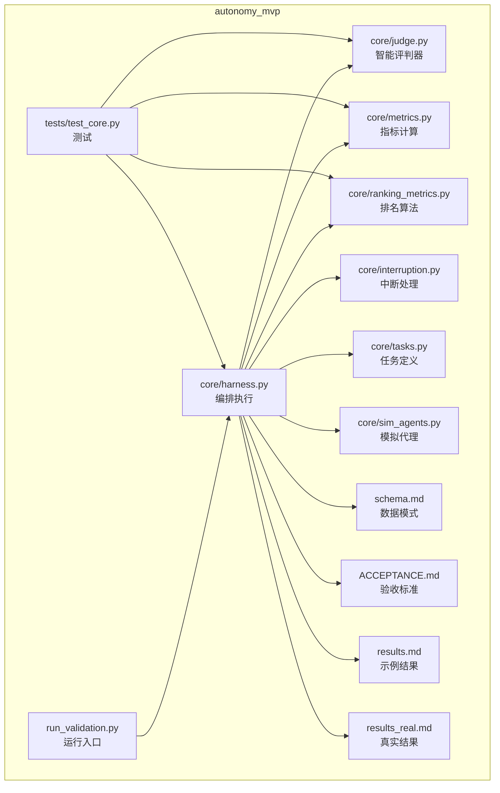
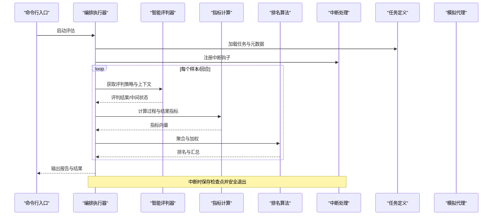
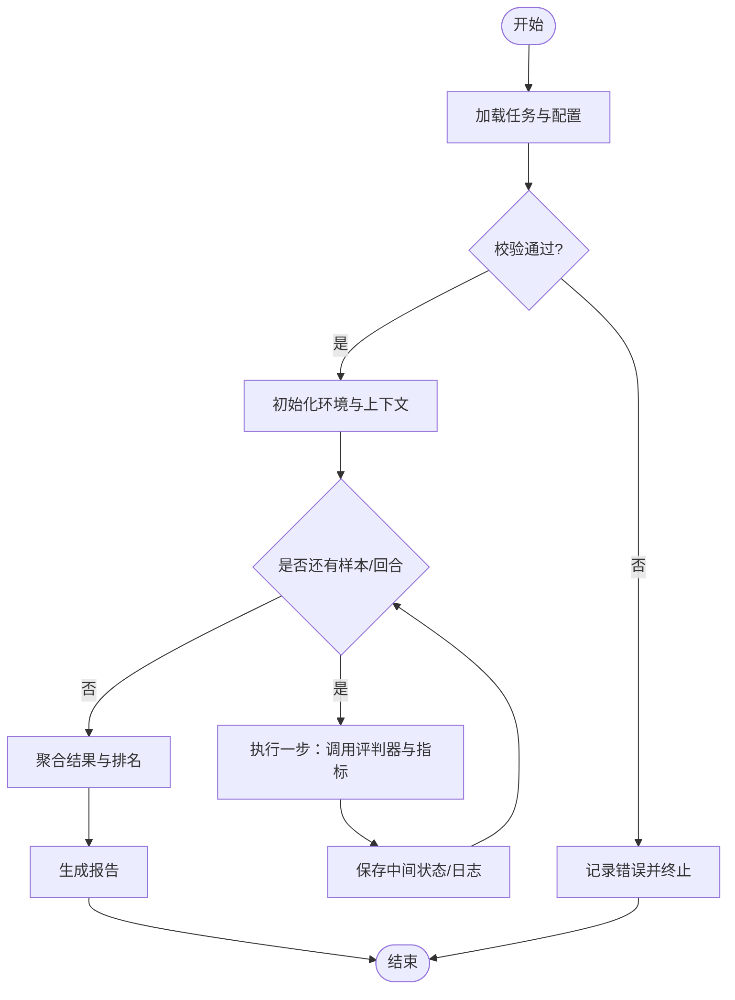
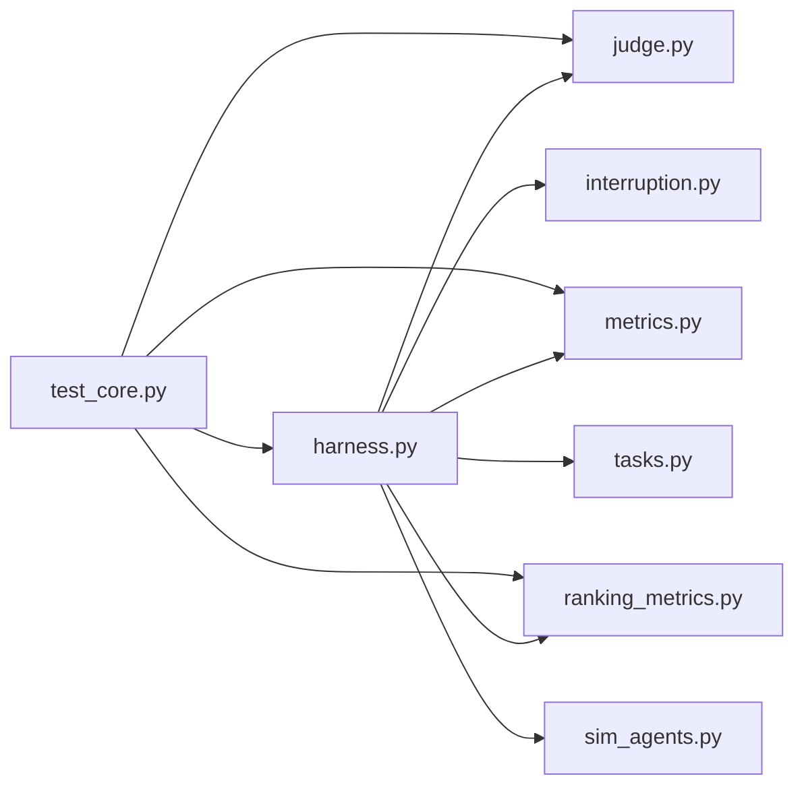

# 自主性评估系统

<cite>
**本文引用的文件**   
- [autonomy_mvp/core/harness.py](file://autonomy_mvp/core/harness.py)
- [autonomy_mvp/core/judge.py](file://autonomy_mvp/core/judge.py)
- [autonomy_mvp/core/metrics.py](file://autonomy_mvp/core/metrics.py)
- [autonomy_mvp/core/ranking_metrics.py](file://autonomy_mvp/core/ranking_metrics.py)
- [autonomy_mvp/core/interruption.py](file://autonomy_mvp/core/interruption.py)
- [autonomy_mvp/core/tasks.py](file://autonomy_mvp/core/tasks.py)
- [autonomy_mvp/core/sim_agents.py](file://autonomy_mvp/core/sim_agents.py)
- [autonomy_mvp/run_validation.py](file://autonomy_mvp/run_validation.py)
- [autonomy_mvp/schema.md](file://autonomy_mvp/schema.md)
- [autonomy_mvp/ACCEPTANCE.md](file://autonomy_mvp/ACCEPTANCE.md)
- [autonomy_mvp/results.md](file://autonomy_mvp/results.md)
- [autonomy_mvp/results_real.md](file://autonomy_mvp/results_real.md)
- [autonomy_mvp/tests/test_core.py](file://autonomy_mvp/tests/test_core.py)
</cite>

## 目录
1. [简介](#简介)
2. [项目结构](#项目结构)
3. [核心组件](#核心组件)
4. [架构总览](#架构总览)
5. [详细组件分析](#详细组件分析)
6. [依赖关系分析](#依赖关系分析)
7. [性能与可扩展性](#性能与可扩展性)
8. [故障排查指南](#故障排查指南)
9. [结论](#结论)
10. [附录](#附录)

## 简介
本文件面向“自主性评估系统”的架构与使用，聚焦以下目标：
- 智能评判器的工作原理与扩展方式
- 指标计算系统与排名算法的设计与实现
- 自主性评估维度定义、评分标准与权重分配机制
- 评估流程配置方法、自定义指标实现与结果分析方法
- 实际评估案例与最佳实践
- 评估结果解读方法与性能优化策略

该系统以任务驱动为核心，通过编排式执行（Harness）调用智能评判器（Judge），在运行过程中采集轨迹与状态，依据指标体系（Metrics）进行打分，并基于排名算法（Ranking Metrics）生成最终排序与报告。

## 项目结构
仓库中与自主性评估相关的核心代码位于 autonomy_mvp 目录，采用分层组织：
- core：评估内核（编排、评判、指标、排名、中断处理、任务与模拟代理）
- tasks：示例任务数据（JSON）
- tests：单元测试与夹具
- 顶层脚本：验证运行入口与文档说明

图表来源
- [autonomy_mvp/core/harness.py](file://autonomy_mvp/core/harness.py)
- [autonomy_mvp/core/judge.py](file://autonomy_mvp/core/judge.py)
- [autonomy_mvp/core/metrics.py](file://autonomy_mvp/core/metrics.py)
- [autonomy_mvp/core/ranking_metrics.py](file://autonomy_mvp/core/ranking_metrics.py)
- [autonomy_mvp/core/interruption.py](file://autonomy_mvp/core/interruption.py)
- [autonomy_mvp/core/tasks.py](file://autonomy_mvp/core/tasks.py)
- [autonomy_mvp/core/sim_agents.py](file://autonomy_mvp/core/sim_agents.py)
- [autonomy_mvp/run_validation.py](file://autonomy_mvp/run_validation.py)
- [autonomy_mvp/schema.md](file://autonomy_mvp/schema.md)
- [autonomy_mvp/ACCEPTANCE.md](file://autonomy_mvp/ACCEPTANCE.md)
- [autonomy_mvp/results.md](file://autonomy_mvp/results.md)
- [autonomy_mvp/results_real.md](file://autonomy_mvp/results_real.md)
- [autonomy_mvp/tests/test_core.py](file://autonomy_mvp/tests/test_core.py)

章节来源
- [autonomy_mvp/core/harness.py](file://autonomy_mvp/core/harness.py)
- [autonomy_mvp/core/judge.py](file://autonomy_mvp/core/judge.py)
- [autonomy_mvp/core/metrics.py](file://autonomy_mvp/core/metrics.py)
- [autonomy_mvp/core/ranking_metrics.py](file://autonomy_mvp/core/ranking_metrics.py)
- [autonomy_mvp/core/interruption.py](file://autonomy_mvp/core/interruption.py)
- [autonomy_mvp/core/tasks.py](file://autonomy_mvp/core/tasks.py)
- [autonomy_mvp/core/sim_agents.py](file://autonomy_mvp/core/sim_agents.py)
- [autonomy_mvp/run_validation.py](file://autonomy_mvp/run_validation.py)
- [autonomy_mvp/schema.md](file://autonomy_mvp/schema.md)
- [autonomy_mvp/ACCEPTANCE.md](file://autonomy_mvp/ACCEPTANCE.md)
- [autonomy_mvp/results.md](file://autonomy_mvp/results.md)
- [autonomy_mvp/results_real.md](file://autonomy_mvp/results_real.md)
- [autonomy_mvp/tests/test_core.py](file://autonomy_mvp/tests/test_core.py)

## 核心组件
- 编排执行器（Harness）：负责加载任务、管理生命周期、协调评判器与指标计算、处理中断与异常、输出结果。
- 智能评判器（Judge）：根据任务上下文与策略对模型行为进行打分或判定，支持规则与可插拔策略。
- 指标系统（Metrics）：提供通用指标计算能力，包括过程指标与结果指标，支持组合与归一化。
- 排名算法（Ranking Metrics）：聚合多指标得分，按权重与规则生成最终排名。
- 中断处理（Interruption）：统一捕获与恢复中断信号，保证评估的可控性与可观测性。
- 任务定义（Tasks）：描述任务输入、约束、期望输出与评估元数据。
- 模拟代理（Sim Agents）：用于离线验证与回归测试的轻量代理实现。

章节来源
- [autonomy_mvp/core/harness.py](file://autonomy_mvp/core/harness.py)
- [autonomy_mvp/core/judge.py](file://autonomy_mvp/core/judge.py)
- [autonomy_mvp/core/metrics.py](file://autonomy_mvp/core/metrics.py)
- [autonomy_mvp/core/ranking_metrics.py](file://autonomy_mvp/core/ranking_metrics.py)
- [autonomy_mvp/core/interruption.py](file://autonomy_mvp/core/interruption.py)
- [autonomy_mvp/core/tasks.py](file://autonomy_mvp/core/tasks.py)
- [autonomy_mvp/core/sim_agents.py](file://autonomy_mvp/core/sim_agents.py)

## 架构总览
整体架构围绕“任务—编排—评判—指标—排名”的主链路展开，辅以中断处理与模拟代理支撑稳定运行与快速验证。

图表来源
- [autonomy_mvp/core/harness.py](file://autonomy_mvp/core/harness.py)
- [autonomy_mvp/core/judge.py](file://autonomy_mvp/core/judge.py)
- [autonomy_mvp/core/metrics.py](file://autonomy_mvp/core/metrics.py)
- [autonomy_mvp/core/ranking_metrics.py](file://autonomy_mvp/core/ranking_metrics.py)
- [autonomy_mvp/core/interruption.py](file://autonomy_mvp/core/interruption.py)
- [autonomy_mvp/core/tasks.py](file://autonomy_mvp/core/tasks.py)
- [autonomy_mvp/core/sim_agents.py](file://autonomy_mvp/core/sim_agents.py)

## 详细组件分析

### 编排执行器（Harness）
职责与要点：
- 任务加载与校验：读取任务定义与元数据，确保输入格式与约束满足 schema。
- 生命周期管理：初始化环境、准备上下文、循环执行回合、收尾与持久化。
- 协同调用：调度评判器与指标计算，收集中间状态与日志。
- 中断与容错：注册中断钩子，支持断点续跑与异常恢复。
- 结果输出：生成结构化结果与可视化摘要。

关键流程（概念图）：

章节来源
- [autonomy_mvp/core/harness.py](file://autonomy_mvp/core/harness.py)
- [autonomy_mvp/schema.md](file://autonomy_mvp/schema.md)
- [autonomy_mvp/ACCEPTANCE.md](file://autonomy_mvp/ACCEPTANCE.md)

### 智能评判器（Judge）
工作原理：
- 输入：任务上下文、当前状态、历史轨迹、策略参数。
- 处理：应用规则或模型驱动的评判逻辑，产出分数、标签或判定结果。
- 输出：标准化评判对象，供指标系统消费。

扩展方式：
- 新增评判策略：实现统一接口，注册到评判器工厂或配置中。
- 条件分支：根据任务类型或阶段选择不同策略。
- 可观测性：记录评判依据与中间证据，便于审计与复现。

章节来源
- [autonomy_mvp/core/judge.py](file://autonomy_mvp/core/judge.py)

### 指标计算系统（Metrics）
设计要点：
- 指标分类：过程指标（如步骤数、工具调用次数）、结果指标（如准确率、收敛度）。
- 计算粒度：样本级、回合级、全局聚合。
- 归一化与组合：支持线性加权、非线性融合与阈值过滤。
- 可插拔：新增指标只需实现统一接口并声明依赖。

复杂度与性能：
- 时间复杂度：通常为 O(N) 或 O(N log N)，取决于排序与聚合操作。
- 空间复杂度：与轨迹长度与指标数量线性相关，建议流式计算与增量更新。

章节来源
- [autonomy_mvp/core/metrics.py](file://autonomy_mvp/core/metrics.py)

### 排名算法（Ranking Metrics）
算法特性：
- 多指标聚合：将多个指标映射为综合得分，考虑权重与优先级。
- 鲁棒性：对异常值与缺失值进行处理（如截尾均值、插补）。
- 公平性：对不同任务域进行归一化，避免尺度差异导致偏差。
- 可解释性：输出分项贡献与排名分解，便于诊断。

章节来源
- [autonomy_mvp/core/ranking_metrics.py](file://autonomy_mvp/core/ranking_metrics.py)

### 中断处理（Interruption）
功能：
- 捕获系统信号（如 Ctrl+C、超时），触发优雅退出。
- 保存检查点与日志，支持断点续跑。
- 清理资源，避免状态不一致。

章节来源
- [autonomy_mvp/core/interruption.py](file://autonomy_mvp/core/interruption.py)

### 任务定义（Tasks）
内容：
- 任务描述、输入输出规范、约束条件、评估元数据（权重、阈值等）。
- 与 schema 对齐，确保解析与校验一致性。

章节来源
- [autonomy_mvp/core/tasks.py](file://autonomy_mvp/core/tasks.py)
- [autonomy_mvp/schema.md](file://autonomy_mvp/schema.md)

### 模拟代理（Sim Agents）
用途：
- 提供轻量、确定性的代理实现，用于回归测试与快速验证。
- 覆盖常见路径与边界条件，辅助定位问题。

章节来源
- [autonomy_mvp/core/sim_agents.py](file://autonomy_mvp/core/sim_agents.py)

### 运行入口与验证（run_validation.py）
作用：
- 串联编排执行器与评测流程，提供命令行参数与配置文件。
- 支持批量运行、并行控制与结果汇总。

章节来源
- [autonomy_mvp/run_validation.py](file://autonomy_mvp/run_validation.py)

## 依赖关系分析
模块间依赖清晰，耦合度低，内聚度高。主要依赖方向如下：

图表来源
- [autonomy_mvp/core/harness.py](file://autonomy_mvp/core/harness.py)
- [autonomy_mvp/core/judge.py](file://autonomy_mvp/core/judge.py)
- [autonomy_mvp/core/metrics.py](file://autonomy_mvp/core/metrics.py)
- [autonomy_mvp/core/ranking_metrics.py](file://autonomy_mvp/core/ranking_metrics.py)
- [autonomy_mvp/core/interruption.py](file://autonomy_mvp/core/interruption.py)
- [autonomy_mvp/core/tasks.py](file://autonomy_mvp/core/tasks.py)
- [autonomy_mvp/core/sim_agents.py](file://autonomy_mvp/core/sim_agents.py)
- [autonomy_mvp/tests/test_core.py](file://autonomy_mvp/tests/test_core.py)

章节来源
- [autonomy_mvp/core/harness.py](file://autonomy_mvp/core/harness.py)
- [autonomy_mvp/tests/test_core.py](file://autonomy_mvp/tests/test_core.py)

## 性能与可扩展性
- 批处理与并行：在 run_validation.py 中启用并行选项，结合任务切分提升吞吐。
- 流式计算：指标计算尽量增量更新，减少内存峰值。
- 缓存与复用：对昂贵计算（如外部工具调用）引入缓存层。
- 降级策略：当某项指标失败时，按配置回退至默认值或跳过并记录告警。
- 监控与日志：结构化日志与指标埋点，便于追踪瓶颈。

[本节为通用指导，不直接分析具体文件]

## 故障排查指南
常见问题与定位：
- 任务加载失败：检查 schema 与任务 JSON 字段完整性与类型。
- 评判器报错：确认策略配置与上下文字段；查看评判日志与中间证据。
- 指标计算异常：核对指标依赖与输入范围；检查归一化与权重设置。
- 排名结果不稳定：检查缺失值处理与异常值剔除策略；对比分项贡献。
- 中断与崩溃：确认中断钩子注册与检查点写入；恢复后继续运行。

参考文件：
- 验收标准与结果样例有助于对照预期行为与输出格式。

章节来源
- [autonomy_mvp/ACCEPTANCE.md](file://autonomy_mvp/ACCEPTANCE.md)
- [autonomy_mvp/results.md](file://autonomy_mvp/results.md)
- [autonomy_mvp/results_real.md](file://autonomy_mvp/results_real.md)
- [autonomy_mvp/schema.md](file://autonomy_mvp/schema.md)

## 结论
本系统以模块化与可插拔为核心设计理念，通过编排执行器串联评判器与指标系统，并以排名算法形成最终评估结果。其优势在于：
- 高内聚低耦合：各组件职责清晰，易于替换与扩展。
- 可观测与可复现：完整日志与检查点支持回溯与调试。
- 灵活配置：任务、指标与权重均可按需定制，适配多领域场景。

建议在工程实践中：
- 明确维度与权重，保持评估一致性与可比性。
- 完善单元测试与回归用例，保障稳定性。
- 建立监控与告警机制，持续优化性能与可靠性。

[本节为总结性内容，不直接分析具体文件]

## 附录

### 评估维度、评分标准与权重分配
- 维度建议：
  - 目标达成度：任务完成质量与正确性。
  - 过程效率：步骤数、工具调用次数、重试率。
  - 鲁棒性：对噪声与异常的容忍度。
  - 可解释性：决策依据与证据充分性。
- 评分标准：
  - 量化指标优先，定性指标需转化为可度量形式。
  - 设定阈值与惩罚项，避免极端值影响总体排名。
- 权重分配：
  - 基于业务重要性确定初始权重，定期校准与敏感性分析。
  - 跨任务域进行归一化，确保公平比较。

[本节为概念性说明，不直接分析具体文件]

### 评估流程配置方法
- 任务清单：在任务定义中声明输入、约束与元数据。
- 评判策略：在评判器中注册新策略，并在配置中选择。
- 指标集：在指标系统中添加新指标，声明依赖与计算顺序。
- 排名规则：在排名算法中调整权重与聚合函数。
- 运行参数：在运行入口中指定并行度、输出路径与日志级别。

章节来源
- [autonomy_mvp/core/tasks.py](file://autonomy_mvp/core/tasks.py)
- [autonomy_mvp/core/judge.py](file://autonomy_mvp/core/judge.py)
- [autonomy_mvp/core/metrics.py](file://autonomy_mvp/core/metrics.py)
- [autonomy_mvp/core/ranking_metrics.py](file://autonomy_mvp/core/ranking_metrics.py)
- [autonomy_mvp/run_validation.py](file://autonomy_mvp/run_validation.py)

### 自定义指标的实现方式
- 实现统一接口：定义输入、输出与依赖。
- 增量计算：尽可能流式更新，降低内存占用。
- 单元测试：覆盖正常路径与边界条件。
- 文档与示例：提供使用说明与样例数据。

章节来源
- [autonomy_mvp/core/metrics.py](file://autonomy_mvp/core/metrics.py)
- [autonomy_mvp/tests/test_core.py](file://autonomy_mvp/tests/test_core.py)

### 结果分析方法
- 总分与分项：查看综合得分与各维度贡献。
- 趋势与对比：跨样本、跨任务的横向与纵向对比。
- 异常诊断：定位低分项与高风险环节。
- 报告生成：自动化导出结构化报告与可视化图表。

章节来源
- [autonomy_mvp/results.md](file://autonomy_mvp/results.md)
- [autonomy_mvp/results_real.md](file://autonomy_mvp/results_real.md)

### 实际评估案例与最佳实践
- 案例参考：
  - 使用模拟代理进行端到端回归测试。
  - 针对特定任务域定制评判策略与指标集。
- 最佳实践：
  - 先小批量验证，再全量运行。
  - 建立基线与对照组，持续迭代改进。
  - 关注可解释性与审计线索，确保评估可信。

章节来源
- [autonomy_mvp/core/sim_agents.py](file://autonomy_mvp/core/sim_agents.py)
- [autonomy_mvp/tests/test_core.py](file://autonomy_mvp/tests/test_core.py)

### 评估结果解读方法与性能优化策略
- 解读方法：
  - 从总分到分项逐层下钻，识别短板与机会点。
  - 结合业务背景理解指标含义与权衡。
- 优化策略：
  - 并行与批处理提升吞吐。
  - 缓存与惰性计算减少重复开销。
  - 监控与告警提前发现瓶颈与异常。

[本节为通用指导，不直接分析具体文件]