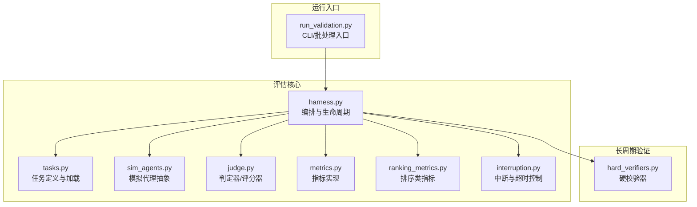
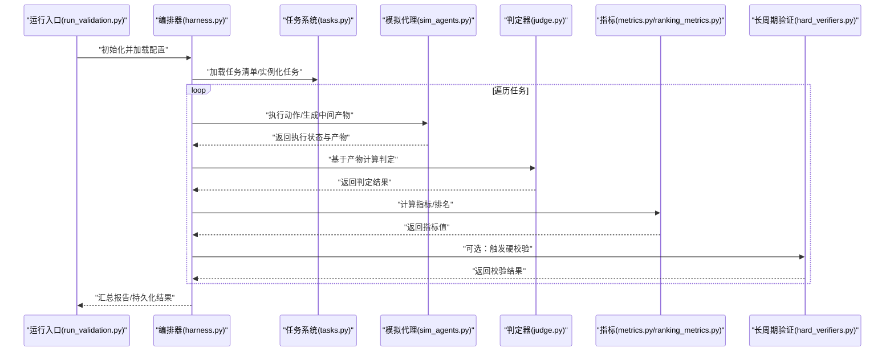
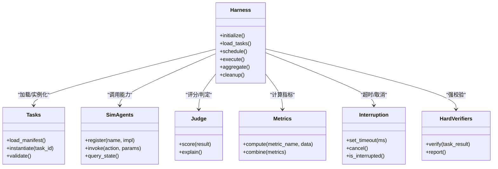

# 评估框架核心

<cite>
**本文引用的文件**   
- [autonomy_mvp/core/harness.py](file://autonomy_mvp/core/harness.py)
- [autonomy_mvp/core/judge.py](file://autonomy_mvp/core/judge.py)
- [autonomy_mvp/core/metrics.py](file://autonomy_mvp/core/metrics.py)
- [autonomy_mvp/core/ranking_metrics.py](file://autonomy_mvp/core/ranking_metrics.py)
- [autonomy_mvp/core/sim_agents.py](file://autonomy_mvp/core/sim_agents.py)
- [autonomy_mvp/core/tasks.py](file://autonomy_mvp/core/tasks.py)
- [autonomy_mvp/core/interruption.py](file://autonomy_mvp/core/interruption.py)
- [autonomy_mvp/run_validation.py](file://autonomy_mvp/run_validation.py)
- [longhorizon/verifiers/hard_verifiers.py](file://longhorizon/verifiers/hard_verifiers.py)
</cite>

## 目录
1. [简介](#简介)
2. [项目结构](#项目结构)
3. [核心组件](#核心组件)
4. [架构总览](#架构总览)
5. [详细组件分析](#详细组件分析)
6. [依赖关系分析](#依赖关系分析)
7. [性能与并发](#性能与并发)
8. [配置与扩展](#配置与扩展)
9. [监控与可观测性](#监控与可观测性)
10. [故障排除指南](#故障排除指南)
11. [结论](#结论)

## 简介
本文件面向“评估框架核心”的架构文档，聚焦以下目标：
- 解释评估引擎的工作流程、模拟代理交互模式与验证执行器的工作原理
- 说明评估任务的调度机制、资源管理与并发控制策略
- 提供框架的配置方法、扩展接口与插件开发指南
- 给出评估流程的监控方法与常见问题的排查技巧

该框架围绕“任务定义—模拟代理—评估执行—指标计算—结果汇总”的主线展开，支持多场景（如药物筛选、材料属性预测等）的可插拔式评估。

## 项目结构
仓库包含多个子项目与实验数据，其中评估框架的核心位于 autonomy_mvp/core 目录，配套运行脚本位于 autonomy_mvp/run_validation.py；长周期验证逻辑位于 longhorizon/verifiers。

图表来源
- [autonomy_mvp/core/harness.py](file://autonomy_mvp/core/harness.py)
- [autonomy_mvp/core/tasks.py](file://autonomy_mvp/core/tasks.py)
- [autonomy_mvp/core/sim_agents.py](file://autonomy_mvp/core/sim_agents.py)
- [autonomy_mvp/core/judge.py](file://autonomy_mvp/core/judge.py)
- [autonomy_mvp/core/metrics.py](file://autonomy_mvp/core/metrics.py)
- [autonomy_mvp/core/ranking_metrics.py](file://autonomy_mvp/core/ranking_metrics.py)
- [autonomy_mvp/core/interruption.py](file://autonomy_mvp/core/interruption.py)
- [autonomy_mvp/run_validation.py](file://autonomy_mvp/run_validation.py)
- [longhorizon/verifiers/hard_verifiers.py](file://longhorizon/verifiers/hard_verifiers.py)

章节来源
- [autonomy_mvp/core/harness.py](file://autonomy_mvp/core/harness.py)
- [autonomy_mvp/core/tasks.py](file://autonomy_mvp/core/tasks.py)
- [autonomy_mvp/core/sim_agents.py](file://autonomy_mvp/core/sim_agents.py)
- [autonomy_mvp/core/judge.py](file://autonomy_mvp/core/judge.py)
- [autonomy_mvp/core/metrics.py](file://autonomy_mvp/core/metrics.py)
- [autonomy_mvp/core/ranking_metrics.py](file://autonomy_mvp/core/ranking_metrics.py)
- [autonomy_mvp/core/interruption.py](file://autonomy_mvp/core/interruption.py)
- [autonomy_mvp/run_validation.py](file://autonomy_mvp/run_validation.py)
- [longhorizon/verifiers/hard_verifiers.py](file://longhorizon/verifiers/hard_verifiers.py)

## 核心组件
- 编排器（Harness）：负责评估生命周期管理、任务分发、资源协调、错误恢复与结果聚合。
- 任务系统（Tasks）：定义任务元数据、输入输出契约、依赖与约束，并提供加载与实例化能力。
- 模拟代理（Simulated Agents）：封装被测对象或外部系统的行为，提供统一交互接口。
- 判定器（Judge）：将执行结果映射为分数或布尔判定，支撑多种评分策略。
- 指标库（Metrics/Ranking Metrics）：提供通用指标与排序型指标的实现与组合。
- 中断与超时（Interruption）：提供任务级/步骤级的中断、超时与取消语义。
- 运行入口（Run Validation）：解析参数、加载配置、驱动批量评估并持久化结果。
- 长周期验证（Hard Verifiers）：对复杂/耗时任务进行强一致性或最终一致性的校验。

章节来源
- [autonomy_mvp/core/harness.py](file://autonomy_mvp/core/harness.py)
- [autonomy_mvp/core/tasks.py](file://autonomy_mvp/core/tasks.py)
- [autonomy_mvp/core/sim_agents.py](file://autonomy_mvp/core/sim_agents.py)
- [autonomy_mvp/core/judge.py](file://autonomy_mvp/core/judge.py)
- [autonomy_mvp/core/metrics.py](file://autonomy_mvp/core/metrics.py)
- [autonomy_mvp/core/ranking_metrics.py](file://autonomy_mvp/core/ranking_metrics.py)
- [autonomy_mvp/core/interruption.py](file://autonomy_mvp/core/interruption.py)
- [autonomy_mvp/run_validation.py](file://autonomy_mvp/run_validation.py)
- [longhorizon/verifiers/hard_verifiers.py](file://longhorizon/verifiers/hard_verifiers.py)

## 架构总览
评估引擎采用“编排器为中心”的分层架构：上层通过运行入口传入任务清单与配置，编排器根据任务依赖与资源配额进行调度，调用模拟代理执行动作，再由判定器与指标库完成打分与汇总，最后由长周期验证器进行二次校验。

图表来源
- [autonomy_mvp/run_validation.py](file://autonomy_mvp/run_validation.py)
- [autonomy_mvp/core/harness.py](file://autonomy_mvp/core/harness.py)
- [autonomy_mvp/core/tasks.py](file://autonomy_mvp/core/tasks.py)
- [autonomy_mvp/core/sim_agents.py](file://autonomy_mvp/core/sim_agents.py)
- [autonomy_mvp/core/judge.py](file://autonomy_mvp/core/judge.py)
- [autonomy_mvp/core/metrics.py](file://autonomy_mvp/core/metrics.py)
- [autonomy_mvp/core/ranking_metrics.py](file://autonomy_mvp/core/ranking_metrics.py)
- [longhorizon/verifiers/hard_verifiers.py](file://longhorizon/verifiers/hard_verifiers.py)

## 详细组件分析

### 编排器（Harness）
职责
- 生命周期管理：初始化、预热、执行、收尾与清理
- 任务调度：按依赖拓扑顺序或并行度限制分发任务
- 资源协调：CPU/GPU/IO配额、队列与限流
- 错误恢复：重试、回滚、断点续跑
- 结果聚合：合并各任务指标与日志，生成报告

关键设计
- 以“工作单元”为单位组织执行，每个单元包含任务上下文、中间产物与审计信息
- 通过事件钩子暴露进度、错误与指标变更，便于监控与可视化
- 支持可插拔的资源管理器与调度策略

章节来源
- [autonomy_mvp/core/harness.py](file://autonomy_mvp/core/harness.py)

### 任务系统（Tasks）
职责
- 定义任务元数据：名称、版本、输入输出契约、依赖项、资源需求
- 提供任务加载与实例化：从配置文件/数据集构建任务图
- 提供校验与约束：类型检查、必填字段、范围约束

关键设计
- 任务图有向无环图（DAG），支持分支与汇聚
- 输入输出采用结构化描述，便于跨模块复用与回放

章节来源
- [autonomy_mvp/core/tasks.py](file://autonomy_mvp/core/tasks.py)

### 模拟代理（Simulated Agents）
职责
- 封装被测对象或外部系统（如仿真环境、API、工具链）
- 提供统一的交互接口：动作调用、状态查询、资源申请
- 记录交互轨迹：用于审计、回放与调试

关键设计
- 抽象出“能力注册表”，按需加载与热更新
- 支持沙箱隔离与资源配额，避免相互干扰

章节来源
- [autonomy_mvp/core/sim_agents.py](file://autonomy_mvp/core/sim_agents.py)

### 判定器（Judge）
职责
- 将执行产物映射为分数或布尔判定
- 支持规则型、模型型与混合型判定策略
- 提供判定过程的可解释性与证据留存

关键设计
- 判定器可组合：基础判定→加权→阈值→排名
- 支持条件分支与动态权重

章节来源
- [autonomy_mvp/core/judge.py](file://autonomy_mvp/core/judge.py)

### 指标库（Metrics / Ranking Metrics）
职责
- 提供通用指标：准确率、召回率、F1、AUC、RMSE 等
- 提供排序型指标：NDCG、MRR、Top-K 命中率等
- 支持指标组合与归一化

关键设计
- 指标函数幂等且可缓存，便于增量计算
- 支持分组统计与分层切片

章节来源
- [autonomy_mvp/core/metrics.py](file://autonomy_mvp/core/metrics.py)
- [autonomy_mvp/core/ranking_metrics.py](file://autonomy_mvp/core/ranking_metrics.py)

### 中断与超时（Interruption）
职责
- 提供任务级/步骤级的中断、超时与取消语义
- 保证在异常退出时能安全释放资源

关键设计
- 基于信号/协程取消/线程中断的统一抽象
- 与编排器的重试与回滚联动

章节来源
- [autonomy_mvp/core/interruption.py](file://autonomy_mvp/core/interruption.py)

### 运行入口（Run Validation）
职责
- 解析命令行参数与环境变量
- 加载任务清单与评测配置
- 驱动编排器执行并持久化结果

关键设计
- 支持单任务、批量任务与分批重跑
- 结果落盘格式稳定，便于后续分析与对比

章节来源
- [autonomy_mvp/run_validation.py](file://autonomy_mvp/run_validation.py)

### 长周期验证（Hard Verifiers）
职责
- 对复杂/耗时任务进行强一致性或最终一致性校验
- 提供端到端回归测试与稳定性保障

关键设计
- 异步执行与超时保护
- 失败自动告警与人工复核通道

章节来源
- [longhorizon/verifiers/hard_verifiers.py](file://longhorizon/verifiers/hard_verifiers.py)

## 依赖关系分析
- 低耦合：编排器通过接口与任务、代理、判定器、指标解耦
- 可扩展：新增任务、代理、判定器与指标无需改动核心路径
- 可观测：通过事件与日志贯穿全流程

图表来源
- [autonomy_mvp/core/harness.py](file://autonomy_mvp/core/harness.py)
- [autonomy_mvp/core/tasks.py](file://autonomy_mvp/core/tasks.py)
- [autonomy_mvp/core/sim_agents.py](file://autonomy_mvp/core/sim_agents.py)
- [autonomy_mvp/core/judge.py](file://autonomy_mvp/core/judge.py)
- [autonomy_mvp/core/metrics.py](file://autonomy_mvp/core/metrics.py)
- [autonomy_mvp/core/ranking_metrics.py](file://autonomy_mvp/core/ranking_metrics.py)
- [autonomy_mvp/core/interruption.py](file://autonomy_mvp/core/interruption.py)
- [longhorizon/verifiers/hard_verifiers.py](file://longhorizon/verifiers/hard_verifiers.py)

## 性能与并发
- 并发模型
  - 任务级并行：依据任务图拓扑与资源上限并行执行
  - 步骤级并行：同一任务内可并行调用独立能力
  - 批处理：对相似任务进行批量化提交，降低调度开销
- 资源管理
  - CPU/GPU/IO 配额与池化，避免争用
  - 内存与临时文件回收，防止泄漏
- 限流与背压
  - 对外部服务进行速率限制与退避重试
  - 当下游拥塞时主动降速，保障整体稳定性
- 容错与恢复
  - 断点续跑：记录已完成的节点，跳过重复执行
  - 重试与熔断：针对不稳定依赖进行自适应重试与快速失败

[本节为通用指导，不直接分析具体文件]

## 配置与扩展
- 配置方式
  - 任务清单：以结构化清单定义任务集合、依赖与参数
  - 运行时参数：并发度、超时、重试次数、输出路径等
  - 指标与判定策略：选择默认或自定义策略
- 扩展接口
  - 新任务：实现任务描述与实例化逻辑，注册到任务系统
  - 新代理：实现能力接口，注册到代理注册表
  - 新判定器：实现评分与解释接口，接入判定管线
  - 新指标：实现计算与组合接口，纳入指标库
- 插件开发指南
  - 遵循最小依赖原则，避免引入全局状态
  - 提供单元测试与基准用例，确保幂等与可复现
  - 输出标准化日志与指标，便于监控与对比

章节来源
- [autonomy_mvp/core/tasks.py](file://autonomy_mvp/core/tasks.py)
- [autonomy_mvp/core/sim_agents.py](file://autonomy_mvp/core/sim_agents.py)
- [autonomy_mvp/core/judge.py](file://autonomy_mvp/core/judge.py)
- [autonomy_mvp/core/metrics.py](file://autonomy_mvp/core/metrics.py)
- [autonomy_mvp/core/ranking_metrics.py](file://autonomy_mvp/core/ranking_metrics.py)
- [autonomy_mvp/run_validation.py](file://autonomy_mvp/run_validation.py)

## 监控与可观测性
- 指标采集
  - 任务维度：开始/结束时间、耗时、重试次数、资源占用
  - 指标维度：业务指标、质量指标、稳定性指标
- 日志规范
  - 结构化日志：包含任务ID、步骤、上下文与追踪ID
  - 分级输出：DEBUG/INFO/WARN/ERROR，便于过滤与分析
- 可视化与告警
  - 实时看板：展示任务进度、成功率、P95/P99 耗时
  - 告警规则：失败率、超时率、资源饱和阈值

[本节为通用指导，不直接分析具体文件]

## 故障排除指南
- 常见问题
  - 任务挂起：检查超时设置与中断信号是否生效
  - 资源不足：调整并发度与资源配额，观察是否缓解
  - 外部依赖不稳定：启用重试与退避，必要时降级策略
  - 指标不一致：确认指标幂等与缓存失效策略
- 定位方法
  - 查看任务级日志与产物快照，定位失败步骤
  - 使用追踪ID串联上下游日志，还原完整链路
  - 开启更细粒度的调试日志，缩小问题范围
- 恢复策略
  - 断点续跑：仅重跑失败节点
  - 回滚与补偿：对副作用操作进行补偿
  - 灰度发布：先小流量验证新策略再全量

章节来源
- [autonomy_mvp/core/interruption.py](file://autonomy_mvp/core/interruption.py)
- [autonomy_mvp/core/harness.py](file://autonomy_mvp/core/harness.py)
- [autonomy_mvp/run_validation.py](file://autonomy_mvp/run_validation.py)

## 结论
本评估框架以编排器为核心，结合任务系统、模拟代理、判定器与指标库，形成高内聚、低耦合的可扩展架构。通过中断与超时控制、资源管理与并发策略，保障了大规模评估的稳定与高效。配合长周期验证器，可实现端到端的回归与稳定性保障。建议在新任务、新代理与新指标的接入中严格遵循最小依赖与幂等原则，完善日志与监控，以获得更好的可观测性与可维护性。