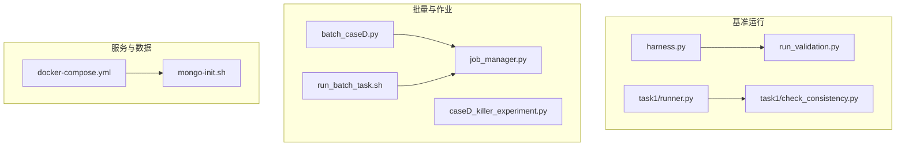
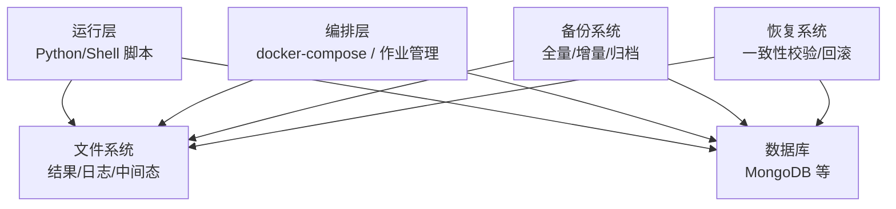
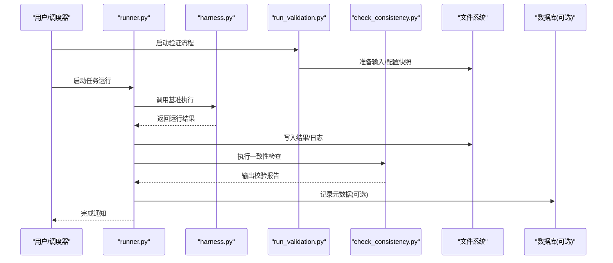
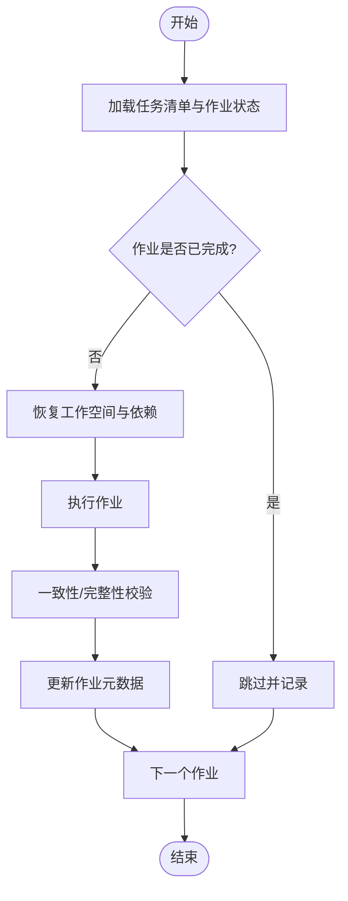
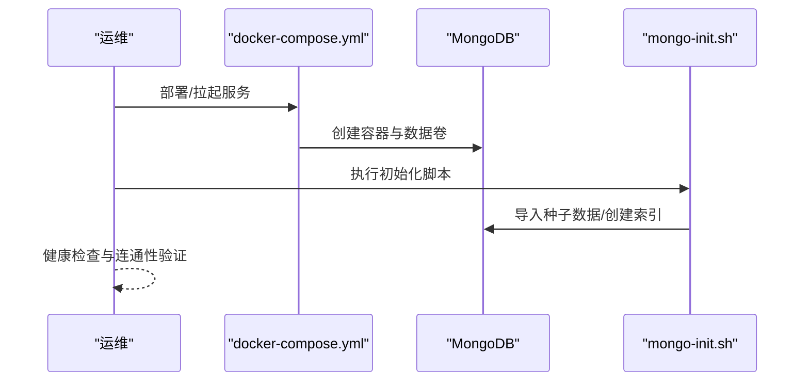
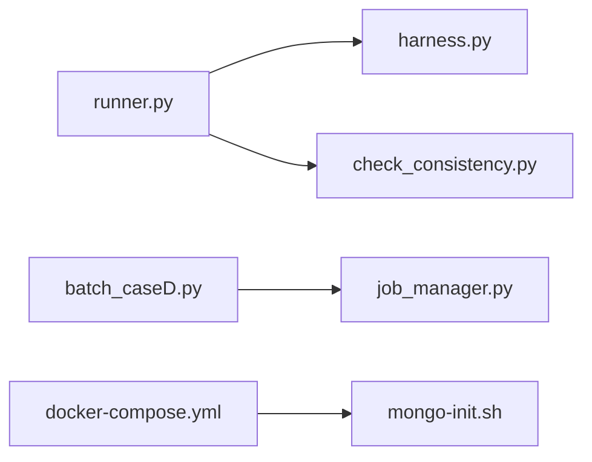

# 备份恢复

<cite>
**本文引用的文件**   
- [autonomy_mvp/core/harness.py](file://autonomy_mvp/core/harness.py)
- [autonomy_mvp/run_validation.py](file://autonomy_mvp/run_validation.py)
- [task1/runner.py](file://task1/runner.py)
- [task1/check_consistency.py](file://task1/check_consistency.py)
- [task4/poc1_do_challenge/do-events-challenge2025/server/docker-compose.yml](file://task4/poc1_do_challenge/do-events-challenge2025/server/docker-compose.yml)
- [task4/poc1_do_challenge/do-events-challenge2025/server/mongo-init.sh](file://task4/poc1_do_challenge/do-events-challenge2025/server/mongo-init.sh)
- [task7/poc3_physicianbench/PhysicianBench/scripts/run_batch_task.sh](file://task7/poc3_physicianbench/PhysicianBench/scripts/run_batch_task.sh)
- [task7/poc3_physicianbench/PhysicianBench/scripts/job_manager.py](file://task7/poc3_physicianbench/PhysicianBench/scripts/job_manager.py)
- [longhorizon/instantiate/batch_caseD.py](file://longhorizon/instantiate/batch_caseD.py)
- [longhorizon/instantiate/caseD_killer_experiment.py](file://longhorizon/instantiate/caseD_killer_experiment.py)
</cite>

## 目录
1. [简介](#简介)
2. [项目结构](#项目结构)
3. [核心组件](#核心组件)
4. [架构总览](#架构总览)
5. [详细组件分析](#详细组件分析)
6. [依赖分析](#依赖分析)
7. [性能考虑](#性能考虑)
8. [故障排查指南](#故障排查指南)
9. [结论](#结论)
10. [附录](#附录)

## 简介
本文件为科学计算基准测试框架的“备份与恢复”专项文档，覆盖数据备份策略、增量与全量备份配置、数据库与文件存储备份方案、灾难恢复流程、数据迁移与版本回滚机制、自动化脚本、恢复验证与一致性检查，以及高可用与容灾演练建议。内容基于仓库中现有脚本与配置进行梳理与归纳，并给出可操作的实践建议。

## 项目结构
仓库包含多个任务与实验子项目，涉及：
- 基准运行与结果产出（Python 脚本）
- 批量任务调度与作业管理（Shell/Python）
- 容器化服务与初始化脚本（MongoDB 等）
- 一致性校验与审计工具

图表来源
- [autonomy_mvp/core/harness.py](file://autonomy_mvp/core/harness.py)
- [autonomy_mvp/run_validation.py](file://autonomy_mvp/run_validation.py)
- [task1/runner.py](file://task1/runner.py)
- [task1/check_consistency.py](file://task1/check_consistency.py)
- [longhorizon/instantiate/batch_caseD.py](file://longhorizon/instantiate/batch_caseD.py)
- [longhorizon/instantiate/caseD_killer_experiment.py](file://longhorizon/instantiate/caseD_killer_experiment.py)
- [task4/poc1_do_challenge/do-events-challenge2025/server/docker-compose.yml](file://task4/poc1_do_challenge/do-events-challenge2025/server/docker-compose.yml)
- [task4/poc1_do_challenge/do-events-challenge2025/server/mongo-init.sh](file://task4/poc1_do_challenge/do-events-challenge2025/server/mongo-init.sh)
- [task7/poc3_physicianbench/PhysicianBench/scripts/run_batch_task.sh](file://task7/poc3_physicianbench/PhysicianBench/scripts/run_batch_task.sh)
- [task7/poc3_physicianbench/PhysicianBench/scripts/job_manager.py](file://task7/poc3_physicianbench/PhysicianBench/scripts/job_manager.py)

章节来源
- [autonomy_mvp/core/harness.py](file://autonomy_mvp/core/harness.py)
- [autonomy_mvp/run_validation.py](file://autonomy_mvp/run_validation.py)
- [task1/runner.py](file://task1/runner.py)
- [task1/check_consistency.py](file://task1/check_consistency.py)
- [task4/poc1_do_challenge/do-events-challenge2025/server/docker-compose.yml](file://task4/poc1_do_challenge/do-events-challenge2025/server/docker-compose.yml)
- [task4/poc1_do_challenge/do-events-challenge2025/server/mongo-init.sh](file://task4/poc1_do_challenge/do-events-challenge2025/server/mongo-init.sh)
- [task7/poc3_physicianbench/PhysicianBench/scripts/run_batch_task.sh](file://task7/poc3_physicianbench/PhysicianBench/scripts/run_batch_task.sh)
- [task7/poc3_physicianbench/PhysicianBench/scripts/job_manager.py](file://task7/poc3_physicianbench/PhysicianBench/scripts/job_manager.py)
- [longhorizon/instantiate/batch_caseD.py](file://longhorizon/instantiate/batch_caseD.py)
- [longhorizon/instantiate/caseD_killer_experiment.py](file://longhorizon/instantiate/caseD_killer_experiment.py)

## 核心组件
- 基准执行与验证
  - harness.py：基准任务编排与执行入口之一，负责加载任务、驱动评测与输出结果。
  - run_validation.py：验证流程入口，用于在运行前后进行必要的数据准备与校验。
- 任务运行与一致性检查
  - task1/runner.py：多轮对话/批处理任务的运行器，生成会话与结果文件。
  - task1/check_consistency.py：对产物进行一致性检查，保障结果完整性与格式正确性。
- 批量任务与作业管理
  - longhorizon/instantiate/batch_caseD.py：批量实例化与触发实验。
  - longhorizon/instantiate/caseD_killer_experiment.py：特定场景下的压力或回归用例。
  - task7/poc3_physicianbench/PhysicianBench/scripts/run_batch_task.sh：批量任务启动脚本。
  - task7/poc3_physicianbench/PhysicianBench/scripts/job_manager.py：作业管理与状态跟踪。
- 服务与数据持久化
  - task4/poc1_do_challenge/do-events-challenge2025/server/docker-compose.yml：容器编排与服务定义。
  - task4/poc1_do_challenge/do-events-challenge2025/server/mongo-init.sh：MongoDB 初始化脚本。

章节来源
- [autonomy_mvp/core/harness.py](file://autonomy_mvp/core/harness.py)
- [autonomy_mvp/run_validation.py](file://autonomy_mvp/run_validation.py)
- [task1/runner.py](file://task1/runner.py)
- [task1/check_consistency.py](file://task1/check_consistency.py)
- [longhorizon/instantiate/batch_caseD.py](file://longhorizon/instantiate/batch_caseD.py)
- [longhorizon/instantiate/caseD_killer_experiment.py](file://longhorizon/instantiate/caseD_killer_experiment.py)
- [task7/poc3_physicianbench/PhysicianBench/scripts/run_batch_task.sh](file://task7/poc3_physicianbench/PhysicianBench/scripts/run_batch_task.sh)
- [task7/poc3_physicianbench/PhysicianBench/scripts/job_manager.py](file://task7/poc3_physicianbench/PhysicianBench/scripts/job_manager.py)
- [task4/poc1_do_challenge/do-events-challenge2025/server/docker-compose.yml](file://task4/poc1_do_challenge/do-events-challenge2025/server/docker-compose.yml)
- [task4/poc1_do_challenge/do-events-challenge2025/server/mongo-init.sh](file://task4/poc1_do_challenge/do-events-challenge2025/server/mongo-init.sh)

## 架构总览
从备份与恢复视角，系统由“运行层（Python/Shell）— 存储层（文件系统 + 数据库）— 编排层（容器/作业）”构成。备份需覆盖三类对象：
- 代码与配置（含模板、任务定义、环境配置）
- 运行产物（结果、日志、中间态）
- 持久化数据（数据库快照、索引、元数据）

[此图为概念性架构图，不直接映射具体源码文件]

## 详细组件分析

### 组件A：基准运行与结果备份
- 目标
  - 确保每次基准运行的输入、参数、环境与输出均可追溯与恢复。
- 关键路径
  - 运行入口：autonomy_mvp/core/harness.py
  - 验证入口：autonomy_mvp/run_validation.py
  - 任务运行：task1/runner.py
  - 一致性检查：task1/check_consistency.py
- 备份要点
  - 输入与配置：任务定义、模板、环境变量、配置文件快照。
  - 运行产物：结果 JSON/CSV、日志、中间缓存。
  - 一致性证据：check_consistency.py 的输出与断言记录。
- 恢复要点
  - 按时间戳或版本号恢复对应产物目录。
  - 重新执行 check_consistency.py 以验证产物完整性。
- 自动化建议
  - 在 runner 完成后自动打包产物并上传至对象存储或归档盘。
  - 将一致性检查结果写入元数据索引，便于检索。

图表来源
- [autonomy_mvp/core/harness.py](file://autonomy_mvp/core/harness.py)
- [autonomy_mvp/run_validation.py](file://autonomy_mvp/run_validation.py)
- [task1/runner.py](file://task1/runner.py)
- [task1/check_consistency.py](file://task1/check_consistency.py)

章节来源
- [autonomy_mvp/core/harness.py](file://autonomy_mvp/core/harness.py)
- [autonomy_mvp/run_validation.py](file://autonomy_mvp/run_validation.py)
- [task1/runner.py](file://task1/runner.py)
- [task1/check_consistency.py](file://task1/check_consistency.py)

### 组件B：批量任务与作业管理备份
- 目标
  - 保证批量任务的任务清单、作业状态、运行日志与中间态可恢复。
- 关键路径
  - 批量实例化：longhorizon/instantiate/batch_caseD.py
  - 压力/回归用例：longhorizon/instantiate/caseD_killer_experiment.py
  - 批量启动脚本：task7/poc3_physicianbench/PhysicianBench/scripts/run_batch_task.sh
  - 作业管理：task7/poc3_physicianbench/PhysicianBench/scripts/job_manager.py
- 备份要点
  - 任务清单与参数快照（JSON/YAML）。
  - 作业状态与队列信息（若使用外部消息队列或数据库）。
  - 各作业的工作空间与输出目录。
- 恢复要点
  - 先恢复作业元数据与任务清单，再按顺序恢复工作空间。
  - 通过 job_manager 的状态机进行幂等恢复（支持重试与跳过已完成作业）。
- 自动化建议
  - 在 run_batch_task.sh 中集成打包步骤，按作业维度归档。
  - 将 job_manager 的状态持久化到数据库或共享存储，避免单点丢失。

图表来源
- [longhorizon/instantiate/batch_caseD.py](file://longhorizon/instantiate/batch_caseD.py)
- [longhorizon/instantiate/caseD_killer_experiment.py](file://longhorizon/instantiate/caseD_killer_experiment.py)
- [task7/poc3_physicianbench/PhysicianBench/scripts/run_batch_task.sh](file://task7/poc3_physicianbench/PhysicianBench/scripts/run_batch_task.sh)
- [task7/poc3_physicianbench/PhysicianBench/scripts/job_manager.py](file://task7/poc3_physicianbench/PhysicianBench/scripts/job_manager.py)

章节来源
- [longhorizon/instantiate/batch_caseD.py](file://longhorizon/instantiate/batch_caseD.py)
- [longhorizon/instantiate/caseD_killer_experiment.py](file://longhorizon/instantiate/caseD_killer_experiment.py)
- [task7/poc3_physicianbench/PhysicianBench/scripts/run_batch_task.sh](file://task7/poc3_physicianbench/PhysicianBench/scripts/run_batch_task.sh)
- [task7/poc3_physicianbench/PhysicianBench/scripts/job_manager.py](file://task7/poc3_physicianbench/PhysicianBench/scripts/job_manager.py)

### 组件C：数据库与容器化服务备份
- 目标
  - 确保 MongoDB 等数据库的快照与初始化脚本可恢复，且容器编排配置一致。
- 关键路径
  - 容器编排：task4/poc1_do_challenge/do-events-challenge2025/server/docker-compose.yml
  - 初始化脚本：task4/poc1_do_challenge/do-events-challenge2025/server/mongo-init.sh
- 备份要点
  - 数据库快照：使用 mongodump 或云厂商快照功能，保留事务一致性时间点。
  - 初始化脚本与种子数据：mongo-init.sh 及关联数据文件。
  - 容器配置：docker-compose.yml 及其环境变量、卷挂载映射。
- 恢复要点
  - 先恢复容器配置与环境变量，再导入数据库快照，最后执行初始化脚本。
  - 校验服务端口、网络与权限，确保应用可连接。
- 自动化建议
  - 在 docker-compose 中声明数据卷，便于快照与迁移。
  - 将 mongo-init.sh 纳入版本控制，并与镜像构建绑定。

图表来源
- [task4/poc1_do_challenge/do-events-challenge2025/server/docker-compose.yml](file://task4/poc1_do_challenge/do-events-challenge2025/server/docker-compose.yml)
- [task4/poc1_do_challenge/do-events-challenge2025/server/mongo-init.sh](file://task4/poc1_do_challenge/do-events-challenge2025/server/mongo-init.sh)

章节来源
- [task4/poc1_do_challenge/do-events-challenge2025/server/docker-compose.yml](file://task4/poc1_do_challenge/do-events-challenge2025/server/docker-compose.yml)
- [task4/poc1_do_challenge/do-events-challenge2025/server/mongo-init.sh](file://task4/poc1_do_challenge/do-events-challenge2025/server/mongo-init.sh)

## 依赖分析
- 组件耦合
  - runner.py 与 harness.py 存在调用关系；check_consistency.py 作为后置校验。
  - batch_caseD.py 与 job_manager.py 协作管理作业生命周期。
  - docker-compose.yml 与 mongo-init.sh 共同完成服务与数据初始化。
- 外部依赖
  - 数据库客户端（如 pymongo）、对象存储 SDK、容器运行时。
- 潜在风险
  - 作业状态与文件系统不一致导致重复执行或遗漏。
  - 数据库快照与应用日志时间戳不同步影响回溯。

图表来源
- [task1/runner.py](file://task1/runner.py)
- [autonomy_mvp/core/harness.py](file://autonomy_mvp/core/harness.py)
- [task1/check_consistency.py](file://task1/check_consistency.py)
- [longhorizon/instantiate/batch_caseD.py](file://longhorizon/instantiate/batch_caseD.py)
- [task7/poc3_physicianbench/PhysicianBench/scripts/job_manager.py](file://task7/poc3_physicianbench/PhysicianBench/scripts/job_manager.py)
- [task4/poc1_do_challenge/do-events-challenge2025/server/docker-compose.yml](file://task4/poc1_do_challenge/do-events-challenge2025/server/docker-compose.yml)
- [task4/poc1_do_challenge/do-events-challenge2025/server/mongo-init.sh](file://task4/poc1_do_challenge/do-events-challenge2025/server/mongo-init.sh)

章节来源
- [task1/runner.py](file://task1/runner.py)
- [autonomy_mvp/core/harness.py](file://autonomy_mvp/core/harness.py)
- [task1/check_consistency.py](file://task1/check_consistency.py)
- [longhorizon/instantiate/batch_caseD.py](file://longhorizon/instantiate/batch_caseD.py)
- [task7/poc3_physicianbench/PhysicianBench/scripts/job_manager.py](file://task7/poc3_physicianbench/PhysicianBench/scripts/job_manager.py)
- [task4/poc1_do_challenge/do-events-challenge2025/server/docker-compose.yml](file://task4/poc1_do_challenge/do-events-challenge2025/server/docker-compose.yml)
- [task4/poc1_do_challenge/do-events-challenge2025/server/mongo-init.sh](file://task4/poc1_do_challenge/do-events-challenge2025/server/mongo-init.sh)

## 性能考虑
- 备份窗口
  - 选择低峰期执行全量备份；增量备份尽量频繁但短小，降低锁竞争。
- I/O 优化
  - 使用并行压缩与分片传输；对大文件采用流式导出。
- 一致性
  - 数据库快照需与日志位点对齐；文件系统备份前暂停写入或使用快照卷。
- 恢复效率
  - 预分配存储空间；按模块并行恢复；优先恢复元数据与索引。

[本节为通用指导，无需源码引用]

## 故障排查指南
- 常见问题
  - 恢复后一致性检查失败：核对时间戳、校验和与元数据索引。
  - 作业重复执行：检查 job_manager 状态与幂等键。
  - 数据库无法连接：确认网络、端口、认证与初始化脚本是否执行。
- 定位手段
  - 查看 runner 与 job_manager 的日志。
  - 使用 check_consistency.py 输出定位缺失字段或损坏文件。
  - 对比 docker-compose 的环境变量与实际运行环境差异。

章节来源
- [task1/check_consistency.py](file://task1/check_consistency.py)
- [task7/poc3_physicianbench/PhysicianBench/scripts/job_manager.py](file://task7/poc3_physicianbench/PhysicianBench/scripts/job_manager.py)
- [task4/poc1_do_challenge/do-events-challenge2025/server/docker-compose.yml](file://task4/poc1_do_challenge/do-events-challenge2025/server/docker-compose.yml)
- [task4/poc1_do_challenge/do-events-challenge2025/server/mongo-init.sh](file://task4/poc1_do_challenge/do-events-challenge2025/server/mongo-init.sh)

## 结论
本框架的备份与恢复应围绕“运行产物、作业状态、数据库快照、容器配置”四大对象展开。通过自动化脚本与一致性校验，结合全量与增量策略，可实现快速恢复与业务连续性保障。建议在 CI/CD 中嵌入备份与恢复演练，定期验证 RPO/RTO 指标。

[本节为总结性内容，无需源码引用]

## 附录

### 备份策略与配置方法
- 全量备份
  - 频率：每周或重大变更前后。
  - 范围：代码与配置、运行产物、数据库快照、容器配置。
  - 存储：异地对象存储或冷归档。
- 增量备份
  - 频率：每日或每小时（依据数据变更率）。
  - 范围：仅变更的文件与数据库 WAL/Oplog。
  - 合并：定期合并增量以简化恢复链。
- 配置项建议
  - 保留周期：全量 30 天、增量 7 天、归档长期。
  - 加密与访问控制：启用静态加密与最小权限。
  - 校验与告警：SHA256 校验、失败告警与重试。

[本节为通用指导，无需源码引用]

### 灾难恢复流程
- 触发条件
  - 数据损坏、节点宕机、误删、勒索软件。
- 恢复步骤
  - 评估影响面与 RTO/RPO。
  - 拉取最近全量与所需增量。
  - 恢复数据库快照与初始化脚本。
  - 恢复运行产物与作业状态。
  - 执行一致性检查与冒烟测试。
- 回滚机制
  - 以版本号为锚点，切换容器镜像与配置。
  - 数据库回滚至指定时间点快照。

[本节为通用指导，无需源码引用]

### 数据迁移与版本回滚
- 数据迁移
  - 变更前导出 schema 与种子数据。
  - 变更后导入并执行迁移脚本，保持幂等。
- 版本回滚
  - 锁定镜像标签与配置分支。
  - 恢复对应版本的产物与数据库快照。
  - 重新执行一致性检查与回归用例。

[本节为通用指导，无需源码引用]

### 自动化备份脚本与恢复验证
- 备份脚本
  - 打包产物与配置，生成校验和与元数据索引。
  - 上传至对象存储并记录版本。
- 恢复验证
  - 下载指定版本，解压并校验。
  - 启动服务与作业，执行 check_consistency.py 与冒烟测试。
  - 输出恢复报告并告警。

[本节为通用指导，无需源码引用]

### 高可用架构与容灾演练
- 高可用
  - 多副本数据库与跨可用区部署。
  - 作业管理器无状态化，状态外置。
- 容灾演练
  - 定期模拟站点级故障，演练端到端恢复。
  - 记录 RTO/RPO 并持续优化。

[本节为通用指导，无需源码引用]