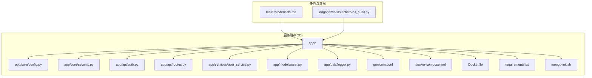
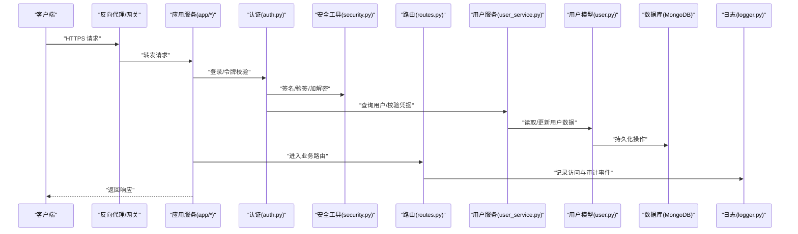
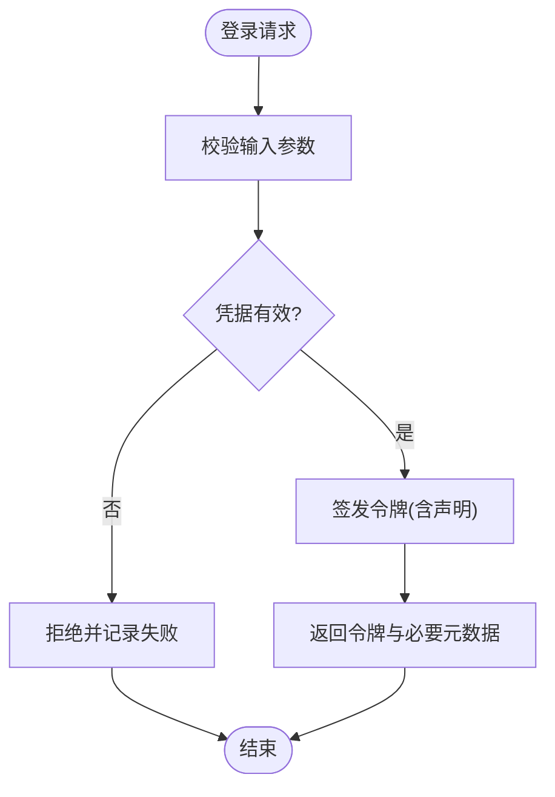
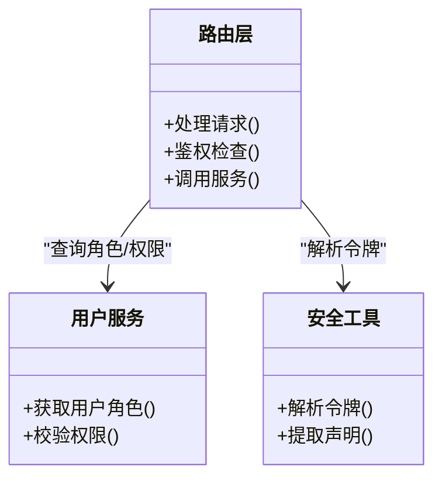
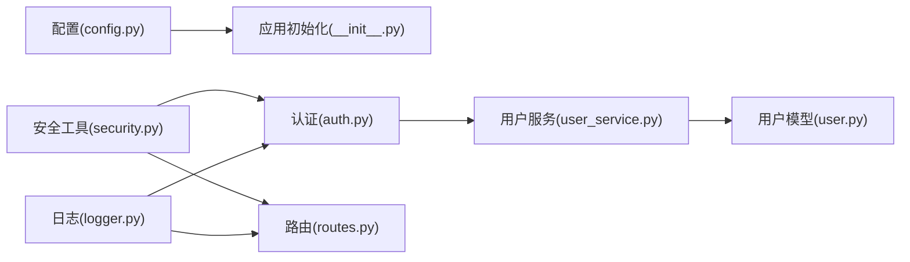

# 安全配置

<cite>
**本文引用的文件**   
- [task1/credentials.md](file://task1/credentials.md)
- [longhorizon/instantiate/b3_audit.py](file://longhorizon/instantiate/b3_audit.py)
- [task7/poc1_do_challenge/server/gunicorn.conf](file://task7/poc1_do_challenge/server/gunicorn.conf)
- [task7/poc1_do_challenge/server/docker-compose.yml](file://task7/poc1_do_challenge/server/docker-compose.yml)
- [task7/poc1_do_challenge/server/mongo-init.sh](file://task7/poc1_do_challenge/server/mongo-init.sh)
- [task7/poc1_do_challenge/server/Dockerfile](file://task7/poc1_do_challenge/server/Dockerfile)
- [task7/poc1_do_challenge/server/requirements.txt](file://task7/poc1_do_challenge/server/requirements.txt)
- [task7/poc1_do_challenge/server/app/__init__.py](file://task7/poc1_do_challenge/server/app/__init__.py)
- [task7/poc1_do_challenge/server/app/api/routes.py](file://task7/poc1_do_challenge/server/app/api/routes.py)
- [task7/poc1_do_challenge/server/app/api/auth.py](file://task7/poc1_do_challenge/server/app/api/auth.py)
- [task7/poc1_do_challenge/server/app/core/config.py](file://task7/poc1_do_challenge/server/app/core/config.py)
- [task7/poc1_do_challenge/server/app/core/security.py](file://task7/poc1_do_challenge/server/app/core/security.py)
- [task7/poc1_do_challenge/server/app/services/user_service.py](file://task7/poc1_do_challenge/server/app/services/user_service.py)
- [task7/poc1_do_challenge/server/app/models/user.py](file://task7/poc1_do_challenge/server/app/models/user.py)
- [task7/poc1_do_challenge/server/app/utils/logger.py](file://task7/poc1_do_challenge/server/app/utils/logger.py)
</cite>

## 目录
1. [简介](#简介)
2. [项目结构](#项目结构)
3. [核心组件](#核心组件)
4. [架构总览](#架构总览)
5. [详细组件分析](#详细组件分析)
6. [依赖分析](#依赖分析)
7. [性能考虑](#性能考虑)
8. [故障排查指南](#故障排查指南)
9. [结论](#结论)
10. [附录](#附录)

## 简介
本文件为科学计算基准测试框架的安全配置文档，聚焦身份认证、授权控制与访问权限管理；涵盖 API 密钥管理、数据加密传输与存储、审计日志与安全监控、威胁检测配置；并提供安全最佳实践、漏洞防护与合规指南、敏感信息管理、网络安全配置以及应急响应流程。内容基于仓库中现有实现进行梳理与扩展建议，确保可落地执行。

## 项目结构
本项目包含多个任务与 POC 示例，其中与“安全配置”直接相关的代码主要集中在：
- task1：凭证与凭据说明（credentials.md）
- longhorizon：审计脚本（b3_audit.py）
- task7/poc1_do_challenge/server：Web 服务与鉴权、配置、容器化部署等

图表来源
- [task1/credentials.md](file://task1/credentials.md)
- [longhorizon/instantiate/b3_audit.py](file://longhorizon/instantiate/b3_audit.py)
- [task7/poc1_do_challenge/server/app/core/config.py](file://task7/poc1_do_challenge/server/app/core/config.py)
- [task7/poc1_do_challenge/server/app/core/security.py](file://task7/poc1_do_challenge/server/app/core/security.py)
- [task7/poc1_do_challenge/server/app/api/auth.py](file://task7/poc1_do_challenge/server/app/api/auth.py)
- [task7/poc1_do_challenge/server/app/api/routes.py](file://task7/poc1_do_challenge/server/app/api/routes.py)
- [task7/poc1_do_challenge/server/app/services/user_service.py](file://task7/poc1_do_challenge/server/app/services/user_service.py)
- [task7/poc1_do_challenge/server/app/models/user.py](file://task7/poc1_do_challenge/server/app/models/user.py)
- [task7/poc1_do_challenge/server/app/utils/logger.py](file://task7/poc1_do_challenge/server/app/utils/logger.py)
- [task7/poc1_do_challenge/server/gunicorn.conf](file://task7/poc1_do_challenge/server/gunicorn.conf)
- [task7/poc1_do_challenge/server/docker-compose.yml](file://task7/poc1_do_challenge/server/docker-compose.yml)
- [task7/poc1_do_challenge/server/Dockerfile](file://task7/poc1_do_challenge/server/Dockerfile)
- [task7/poc1_do_challenge/server/requirements.txt](file://task7/poc1_do_challenge/server/requirements.txt)
- [task7/poc1_do_challenge/server/mongo-init.sh](file://task7/poc1_do_challenge/server/mongo-init.sh)

章节来源
- [task1/credentials.md](file://task1/credentials.md)
- [longhorizon/instantiate/b3_audit.py](file://longhorizon/instantiate/b3_audit.py)
- [task7/poc1_do_challenge/server/app/core/config.py](file://task7/poc1_do_challenge/server/app/core/config.py)
- [task7/poc1_do_challenge/server/app/core/security.py](file://task7/poc1_do_challenge/server/app/core/security.py)
- [task7/poc1_do_challenge/server/app/api/auth.py](file://task7/poc1_do_challenge/server/app/api/auth.py)
- [task7/poc1_do_challenge/server/app/api/routes.py](file://task7/poc1_do_challenge/server/app/api/routes.py)
- [task7/poc1_do_challenge/server/app/services/user_service.py](file://task7/poc1_do_challenge/server/app/services/user_service.py)
- [task7/poc1_do_challenge/server/app/models/user.py](file://task7/poc1_do_challenge/server/app/models/user.py)
- [task7/poc1_do_challenge/server/app/utils/logger.py](file://task7/poc1_do_challenge/server/app/utils/logger.py)
- [task7/poc1_do_challenge/server/gunicorn.conf](file://task7/poc1_do_challenge/server/gunicorn.conf)
- [task7/poc1_do_challenge/server/docker-compose.yml](file://task7/poc1_do_challenge/server/docker-compose.yml)
- [task7/poc1_do_challenge/server/Dockerfile](file://task7/poc1_do_challenge/server/Dockerfile)
- [task7/poc1_do_challenge/server/requirements.txt](file://task7/poc1_do_challenge/server/requirements.txt)
- [task7/poc1_do_challenge/server/mongo-init.sh](file://task7/poc1_do_challenge/server/mongo-init.sh)

## 核心组件
- 身份认证与令牌签发
  - 通过认证模块负责用户登录校验、令牌签发与刷新、令牌验证中间件集成。
  - 关键路径参考：[认证接口](file://task7/poc1_do_challenge/server/app/api/auth.py)、[安全工具](file://task7/poc1_do_challenge/server/app/core/security.py)。
- 授权与访问控制
  - 路由层结合角色/权限策略对资源访问进行鉴权，按最小权限原则放行请求。
  - 关键路径参考：[API 路由](file://task7/poc1_do_challenge/server/app/api/routes.py)。
- 配置与密钥管理
  - 集中式配置加载，支持环境变量注入，避免硬编码敏感信息。
  - 关键路径参考：[配置中心](file://task7/poc1_do_challenge/server/app/core/config.py)。
- 数据存储与加密
  - 用户模型与密码哈希策略，数据库初始化脚本提供基础库与集合创建。
  - 关键路径参考：[用户模型](file://task7/poc1_do_challenge/server/app/models/user.py)、[MongoDB 初始化](file://task7/poc1_do_challenge/server/mongo-init.sh)。
- 审计日志与可观测性
  - 统一日志记录器，结合审计脚本输出结构化审计事件。
  - 关键路径参考：[日志工具](file://task7/poc1_do_challenge/server/app/utils/logger.py)、[审计脚本](file://longhorizon/instantiate/b3_audit.py)。
- 运行与部署安全
  - Gunicorn 配置、Docker 镜像构建、Compose 编排与依赖清单。
  - 关键路径参考：[Gunicorn 配置](file://task7/poc1_do_challenge/server/gunicorn.conf)、[Dockerfile](file://task7/poc1_do_challenge/server/Dockerfile)、[Compose](file://task7/poc1_do_challenge/server/docker-compose.yml)、[依赖清单](file://task7/poc1_do_challenge/server/requirements.txt)。

章节来源
- [task7/poc1_do_challenge/server/app/api/auth.py](file://task7/poc1_do_challenge/server/app/api/auth.py)
- [task7/poc1_do_challenge/server/app/core/security.py](file://task7/poc1_do_challenge/server/app/core/security.py)
- [task7/poc1_do_challenge/server/app/api/routes.py](file://task7/poc1_do_challenge/server/app/api/routes.py)
- [task7/poc1_do_challenge/server/app/core/config.py](file://task7/poc1_do_challenge/server/app/core/config.py)
- [task7/poc1_do_challenge/server/app/models/user.py](file://task7/poc1_do_challenge/server/app/models/user.py)
- [task7/poc1_do_challenge/server/mongo-init.sh](file://task7/poc1_do_challenge/server/mongo-init.sh)
- [task7/poc1_do_challenge/server/app/utils/logger.py](file://task7/poc1_do_challenge/server/app/utils/logger.py)
- [longhorizon/instantiate/b3_audit.py](file://longhorizon/instantiate/b3_audit.py)
- [task7/poc1_do_challenge/server/gunicorn.conf](file://task7/poc1_do_challenge/server/gunicorn.conf)
- [task7/poc1_do_challenge/server/Dockerfile](file://task7/poc1_do_challenge/server/Dockerfile)
- [task7/poc1_do_challenge/server/docker-compose.yml](file://task7/poc1_do_challenge/server/docker-compose.yml)
- [task7/poc1_do_challenge/server/requirements.txt](file://task7/poc1_do_challenge/server/requirements.txt)

## 架构总览
下图展示从客户端到后端服务的典型安全交互流程，包括认证、授权、日志与外部依赖。

图表来源
- [task7/poc1_do_challenge/server/app/api/auth.py](file://task7/poc1_do_challenge/server/app/api/auth.py)
- [task7/poc1_do_challenge/server/app/core/security.py](file://task7/poc1_do_challenge/server/app/core/security.py)
- [task7/poc1_do_challenge/server/app/api/routes.py](file://task7/poc1_do_challenge/server/app/api/routes.py)
- [task7/poc1_do_challenge/server/app/services/user_service.py](file://task7/poc1_do_challenge/server/app/services/user_service.py)
- [task7/poc1_do_challenge/server/app/models/user.py](file://task7/poc1_do_challenge/server/app/models/user.py)
- [task7/poc1_do_challenge/server/app/utils/logger.py](file://task7/poc1_do_challenge/server/app/utils/logger.py)

## 详细组件分析

### 身份认证与令牌管理
- 功能要点
  - 登录接口校验用户名/密码或 API Key，签发短期有效令牌并支持刷新。
  - 令牌携带必要声明（如用户标识、角色），在后续请求中由中间件校验。
- 关键实现位置
  - 认证接口：[认证模块](file://task7/poc1_do_challenge/server/app/api/auth.py)
  - 安全工具（签名/验签/加解密）：[安全工具](file://task7/poc1_do_challenge/server/app/core/security.py)
- 安全建议
  - 强制使用 HTTPS，禁用明文传输。
  - 令牌采用强随机源生成，设置合理过期时间，支持撤销机制。
  - 对密码使用安全的哈希算法（如 bcrypt/argon2），禁止明文存储。
  - 限制登录尝试次数，启用账户锁定与验证码。

图表来源
- [task7/poc1_do_challenge/server/app/api/auth.py](file://task7/poc1_do_challenge/server/app/api/auth.py)
- [task7/poc1_do_challenge/server/app/core/security.py](file://task7/poc1_do_challenge/server/app/core/security.py)

章节来源
- [task7/poc1_do_challenge/server/app/api/auth.py](file://task7/poc1_do_challenge/server/app/api/auth.py)
- [task7/poc1_do_challenge/server/app/core/security.py](file://task7/poc1_do_challenge/server/app/core/security.py)

### 授权与访问控制
- 功能要点
  - 路由层根据令牌中的角色/权限决定是否允许访问特定资源。
  - 遵循最小权限原则，默认拒绝未明确放行的访问。
- 关键实现位置
  - 路由与鉴权装饰器：[API 路由](file://task7/poc1_do_challenge/server/app/api/routes.py)
- 安全建议
  - 将权限策略外置为配置文件或规则引擎，便于动态调整。
  - 对高敏接口增加二次确认或多因素认证。
  - 记录授权决策结果用于审计与回溯。

图表来源
- [task7/poc1_do_challenge/server/app/api/routes.py](file://task7/poc1_do_challenge/server/app/api/routes.py)
- [task7/poc1_do_challenge/server/app/services/user_service.py](file://task7/poc1_do_challenge/server/app/services/user_service.py)
- [task7/poc1_do_challenge/server/app/core/security.py](file://task7/poc1_do_challenge/server/app/core/security.py)

章节来源
- [task7/poc1_do_challenge/server/app/api/routes.py](file://task7/poc1_do_challenge/server/app/api/routes.py)
- [task7/poc1_do_challenge/server/app/services/user_service.py](file://task7/poc1_do_challenge/server/app/services/user_service.py)
- [task7/poc1_do_challenge/server/app/core/security.py](file://task7/poc1_do_challenge/server/app/core/security.py)

### 配置与密钥管理
- 功能要点
  - 集中加载配置项，优先从环境变量读取，避免硬编码。
  - 支持多环境（开发/测试/生产）差异化配置。
- 关键实现位置
  - 配置中心：[配置模块](file://task7/poc1_do_challenge/server/app/core/config.py)
- 安全建议
  - 使用专用密钥管理服务（KMS/Vault）注入敏感配置。
  - 对配置文件进行版本隔离与访问控制，禁止提交至代码仓库。
  - 定期轮换密钥与证书，建立失效与回滚流程。

章节来源
- [task7/poc1_do_challenge/server/app/core/config.py](file://task7/poc1_do_challenge/server/app/core/config.py)

### 数据存储与加密
- 功能要点
  - 用户模型定义字段与约束，密码以哈希形式存储。
  - MongoDB 初始化脚本创建必要的库与集合。
- 关键实现位置
  - 用户模型：[用户模型](file://task7/poc1_do_challenge/server/app/models/user.py)
  - 数据库初始化：[MongoDB 初始化](file://task7/poc1_do_challenge/server/mongo-init.sh)
- 安全建议
  - 启用数据库 TLS 连接与认证，限制网络访问白名单。
  - 对静态敏感数据（如备份、日志）进行磁盘加密。
  - 实施字段级加密策略，仅对必要字段进行加密。

章节来源
- [task7/poc1_do_challenge/server/app/models/user.py](file://task7/poc1_do_challenge/server/app/models/user.py)
- [task7/poc1_do_challenge/server/mongo-init.sh](file://task7/poc1_do_challenge/server/mongo-init.sh)

### 审计日志与安全监控
- 功能要点
  - 统一日志记录器输出结构化日志，包含请求 ID、用户标识、动作与结果。
  - 审计脚本汇总关键事件，便于追踪与合规审查。
- 关键实现位置
  - 日志工具：[日志模块](file://task7/poc1_do_challenge/server/app/utils/logger.py)
  - 审计脚本：[审计脚本](file://longhorizon/instantiate/b3_audit.py)
- 安全建议
  - 将日志写入只追加存储，防止篡改。
  - 对敏感字段脱敏后再落盘，避免泄露。
  - 接入 SIEM/SOAR 平台，实现告警与自动化响应。

章节来源
- [task7/poc1_do_challenge/server/app/utils/logger.py](file://task7/poc1_do_challenge/server/app/utils/logger.py)
- [longhorizon/instantiate/b3_audit.py](file://longhorizon/instantiate/b3_audit.py)

### 运行与部署安全
- 功能要点
  - Gunicorn 作为 WSGI 服务器，提供进程管理与并发控制。
  - Docker 镜像构建与 Compose 编排，标准化运行环境。
- 关键实现位置
  - Gunicorn 配置：[Gunicorn 配置](file://task7/poc1_do_challenge/server/gunicorn.conf)
  - Dockerfile：[Dockerfile](file://task7/poc1_do_challenge/server/Dockerfile)
  - Compose：[Compose](file://task7/poc1_do_challenge/server/docker-compose.yml)
  - 依赖清单：[requirements.txt](file://task7/poc1_do_challenge/server/requirements.txt)
- 安全建议
  - 使用非 root 用户运行容器，最小化镜像层与依赖。
  - 启用健康检查与资源限制，防止资源耗尽攻击。
  - 对外暴露端口最小化，仅开放必要服务。

章节来源
- [task7/poc1_do_challenge/server/gunicorn.conf](file://task7/poc1_do_challenge/server/gunicorn.conf)
- [task7/poc1_do_challenge/server/Dockerfile](file://task7/poc1_do_challenge/server/Dockerfile)
- [task7/poc1_do_challenge/server/docker-compose.yml](file://task7/poc1_do_challenge/server/docker-compose.yml)
- [task7/poc1_do_challenge/server/requirements.txt](file://task7/poc1_do_challenge/server/requirements.txt)

## 依赖分析
下图展示核心模块之间的依赖关系，突出安全相关组件的耦合点。

图表来源
- [task7/poc1_do_challenge/server/app/core/config.py](file://task7/poc1_do_challenge/server/app/core/config.py)
- [task7/poc1_do_challenge/server/app/__init__.py](file://task7/poc1_do_challenge/server/app/__init__.py)
- [task7/poc1_do_challenge/server/app/core/security.py](file://task7/poc1_do_challenge/server/app/core/security.py)
- [task7/poc1_do_challenge/server/app/api/auth.py](file://task7/poc1_do_challenge/server/app/api/auth.py)
- [task7/poc1_do_challenge/server/app/api/routes.py](file://task7/poc1_do_challenge/server/app/api/routes.py)
- [task7/poc1_do_challenge/server/app/services/user_service.py](file://task7/poc1_do_challenge/server/app/services/user_service.py)
- [task7/poc1_do_challenge/server/app/models/user.py](file://task7/poc1_do_challenge/server/app/models/user.py)
- [task7/poc1_do_challenge/server/app/utils/logger.py](file://task7/poc1_do_challenge/server/app/utils/logger.py)

章节来源
- [task7/poc1_do_challenge/server/app/core/config.py](file://task7/poc1_do_challenge/server/app/core/config.py)
- [task7/poc1_do_challenge/server/app/__init__.py](file://task7/poc1_do_challenge/server/app/__init__.py)
- [task7/poc1_do_challenge/server/app/core/security.py](file://task7/poc1_do_challenge/server/app/core/security.py)
- [task7/poc1_do_challenge/server/app/api/auth.py](file://task7/poc1_do_challenge/server/app/api/auth.py)
- [task7/poc1_do_challenge/server/app/api/routes.py](file://task7/poc1_do_challenge/server/app/api/routes.py)
- [task7/poc1_do_challenge/server/app/services/user_service.py](file://task7/poc1_do_challenge/server/app/services/user_service.py)
- [task7/poc1_do_challenge/server/app/models/user.py](file://task7/poc1_do_challenge/server/app/models/user.py)
- [task7/poc1_do_challenge/server/app/utils/logger.py](file://task7/poc1_do_challenge/server/app/utils/logger.py)

## 性能考虑
- 认证与鉴权开销
  - 令牌校验应缓存公钥/策略，减少重复计算。
  - 对高频接口启用短生命周期令牌与批量刷新。
- 日志与审计
  - 异步写入日志，避免阻塞主流程。
  - 对大体积日志进行采样与轮转，降低 I/O 压力。
- 数据库访问
  - 使用连接池与索引优化，减少慢查询。
  - 对敏感查询进行限流与熔断保护。

## 故障排查指南
- 常见问题定位
  - 认证失败：检查令牌签名、过期时间与密钥一致性。
  - 授权拒绝：核对角色/权限策略与路由守卫逻辑。
  - 日志缺失：确认日志级别、输出目标与权限。
- 诊断步骤
  - 开启调试日志并关联请求 ID，追踪完整链路。
  - 复核配置项与环境变量注入是否正确。
  - 检查容器网络与端口映射，确认外部依赖可达。
- 参考实现位置
  - 认证与鉴权：[认证模块](file://task7/poc1_do_challenge/server/app/api/auth.py)、[路由模块](file://task7/poc1_do_challenge/server/app/api/routes.py)
  - 配置与密钥：[配置模块](file://task7/poc1_do_challenge/server/app/core/config.py)
  - 日志与审计：[日志模块](file://task7/poc1_do_challenge/server/app/utils/logger.py)、[审计脚本](file://longhorizon/instantiate/b3_audit.py)

章节来源
- [task7/poc1_do_challenge/server/app/api/auth.py](file://task7/poc1_do_challenge/server/app/api/auth.py)
- [task7/poc1_do_challenge/server/app/api/routes.py](file://task7/poc1_do_challenge/server/app/api/routes.py)
- [task7/poc1_do_challenge/server/app/core/config.py](file://task7/poc1_do_challenge/server/app/core/config.py)
- [task7/poc1_do_challenge/server/app/utils/logger.py](file://task7/poc1_do_challenge/server/app/utils/logger.py)
- [longhorizon/instantiate/b3_audit.py](file://longhorizon/instantiate/b3_audit.py)

## 结论
本安全配置文档围绕认证、授权、密钥管理、数据传输与存储、审计与监控、部署与运行等方面提供了系统化指导。建议在现有实现基础上持续完善策略配置、强化密钥治理、提升可观测性与自动化响应能力，以满足科学计算基准测试场景下的安全与合规要求。

## 附录

### 安全最佳实践清单
- 身份认证
  - 强制 HTTPS，启用 HSTS。
  - 使用强随机令牌与短期有效期，支持撤销与刷新。
  - 密码使用安全哈希算法，禁止明文存储。
- 授权与访问控制
  - 最小权限原则，默认拒绝。
  - 对高敏接口启用多因素认证与二次确认。
- 密钥与配置管理
  - 使用 KMS/Vault 管理密钥，环境变量注入。
  - 定期轮换密钥，严格隔离开发/生产配置。
- 数据安全
  - 传输层 TLS，存储层磁盘与字段级加密。
  - 数据库启用认证与网络白名单。
- 审计与监控
  - 结构化日志，脱敏后落盘，只追加存储。
  - 接入 SIEM/SOAR，实现告警与自动处置。
- 运行与部署
  - 非 root 容器，最小镜像与依赖。
  - 健康检查、资源限制与端口最小化。

### 敏感信息管理
- 凭据存放
  - 使用专用凭据文件与权限控制，禁止提交至代码仓库。
  - 参考：[凭据说明](file://task1/credentials.md)
- 环境变量
  - 所有敏感配置通过环境变量注入，运行时挂载机密卷。
- 日志脱敏
  - 对敏感字段进行掩码或哈希化处理。

章节来源
- [task1/credentials.md](file://task1/credentials.md)

### 网络安全配置
- 反向代理与网关
  - 启用速率限制、IP 白名单与请求大小限制。
- 容器网络
  - 仅暴露必要端口，内部服务间使用内网通信。
- 参考实现位置
  - Gunicorn 配置：[Gunicorn 配置](file://task7/poc1_do_challenge/server/gunicorn.conf)
  - Compose 编排：[Compose](file://task7/poc1_do_challenge/server/docker-compose.yml)
  - Dockerfile：[Dockerfile](file://task7/poc1_do_challenge/server/Dockerfile)

章节来源
- [task7/poc1_do_challenge/server/gunicorn.conf](file://task7/poc1_do_challenge/server/gunicorn.conf)
- [task7/poc1_do_challenge/server/docker-compose.yml](file://task7/poc1_do_challenge/server/docker-compose.yml)
- [task7/poc1_do_challenge/server/Dockerfile](file://task7/poc1_do_challenge/server/Dockerfile)

### 应急响应流程
- 事件分级
  - 低：异常登录与轻微越权。
  - 中：批量失败与可疑扫描。
  - 高：数据泄露与系统入侵。
- 处置步骤
  - 发现与上报：日志与告警触发，立即通知责任人。
  - 隔离与遏制：封禁 IP、吊销令牌、下线受影响服务。
  - 取证与分析：收集日志、快照与内存镜像。
  - 恢复与加固：修复漏洞、轮换密钥、更新策略。
  - 复盘与改进：总结根因，完善监控与演练。
- 参考实现位置
  - 审计脚本：[审计脚本](file://longhorizon/instantiate/b3_audit.py)
  - 日志工具：[日志模块](file://task7/poc1_do_challenge/server/app/utils/logger.py)

章节来源
- [longhorizon/instantiate/b3_audit.py](file://longhorizon/instantiate/b3_audit.py)
- [task7/poc1_do_challenge/server/app/utils/logger.py](file://task7/poc1_do_challenge/server/app/utils/logger.py)