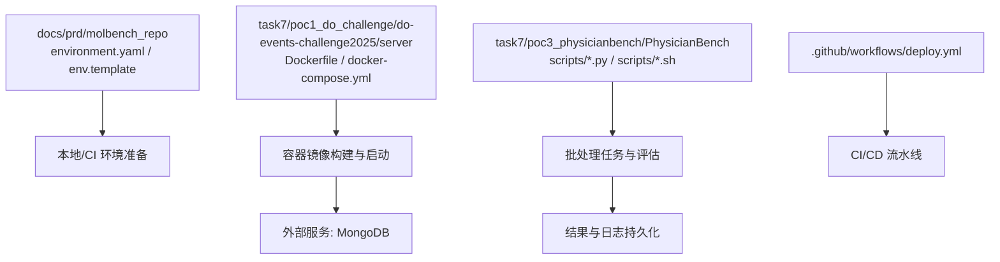
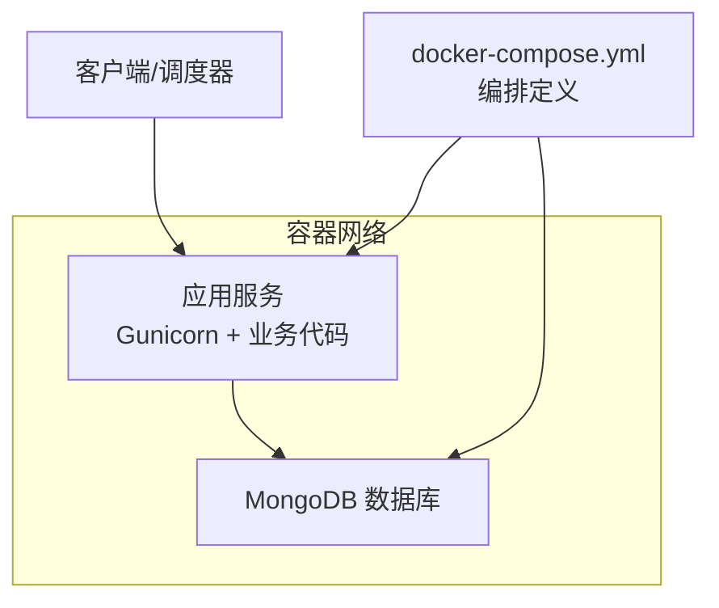
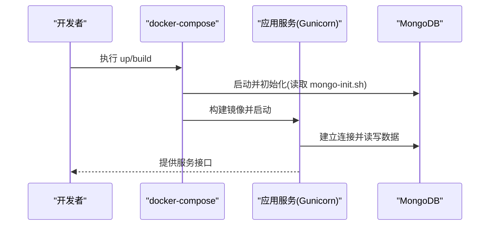
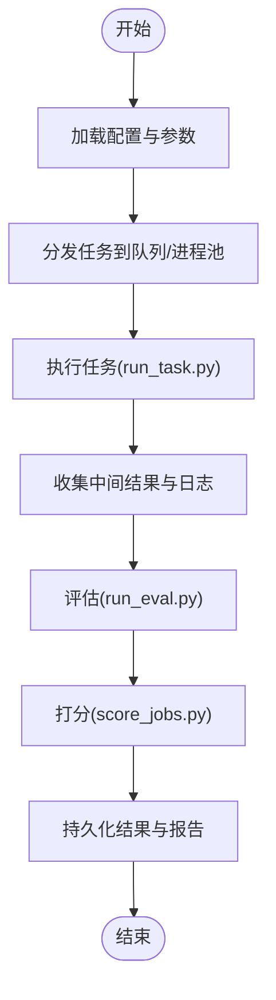
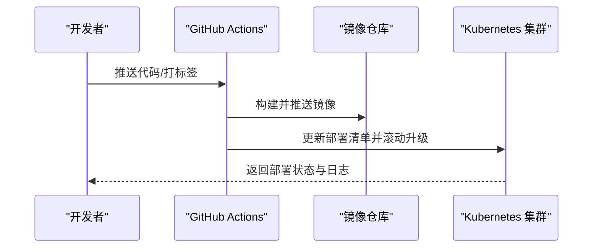
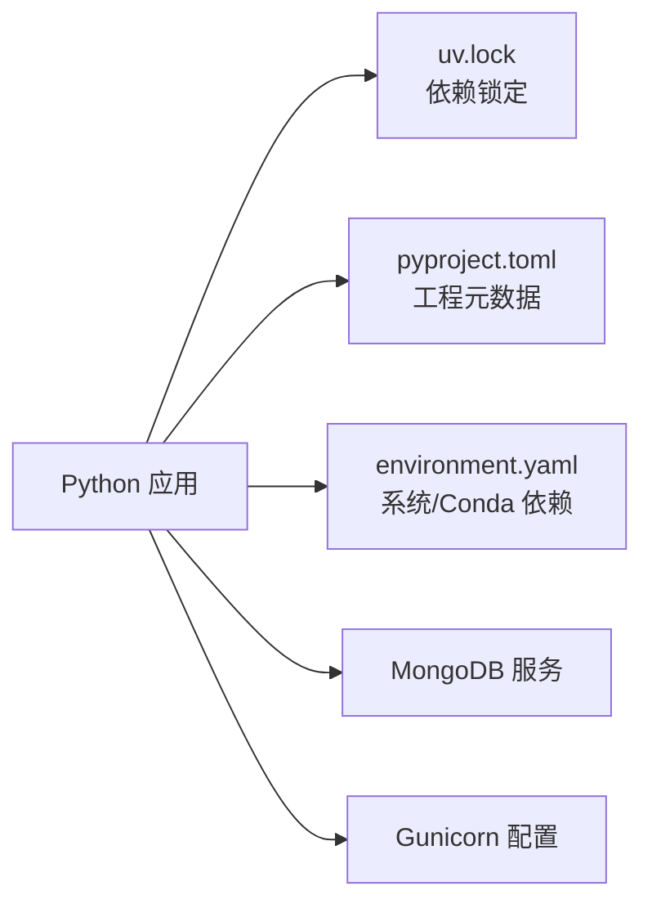

# 环境部署

<cite>
**本文引用的文件**   
- [environment.yaml](file://docs/prd/molbench_repo/environment.yaml)
- [env.template](file://docs/prd/molbench_repo/env.template)
- [Dockerfile](file://task7/poc1_do_challenge/do-events-challenge2025/server/Dockerfile)
- [docker-compose.yml](file://task7/poc1_do_challenge/do-events-challenge2025/server/docker-compose.yml)
- [gunicorn.conf](file://task7/poc1_do_challenge/do-events-challenge2025/server/gunicorn.conf)
- [mongo-init.sh](file://task7/poc1_do_challenge/do-events-challenge2025/server/mongo-init.sh)
- [requirements.txt](file://task7/poc1_do_challenge/do-events-challenge2025/server/requirements.txt)
- [start_time.json](file://task7/poc1_do_challenge/do-events-challenge2025/server/start_time.json)
- [run_batch_task.sh](file://task7/poc3_physicianbench/PhysicianBench/scripts/run_batch_task.sh)
- [job_manager.py](file://task7/poc3_physicianbench/PhysicianBench/scripts/job_manager.py)
- [run_eval.py](file://task7/poc3_physicianbench/PhysicianBench/scripts/run_eval.py)
- [run_task.py](file://task7/poc3_physicianbench/PhysicianBench/scripts/run_task.py)
- [score_jobs.py](file://task7/poc3_physicianbench/PhysicianBench/scripts/score_jobs.py)
- [pyproject.toml](file://task7/poc3_physicianbench/PhysicianBench/pyproject.toml)
- [uv.lock](file://task7/poc3_physicianbench/PhysicianBench/uv.lock)
- [deploy.yml](file://task7/poc3_physicianbench/PhysicianBench/.github/workflows/deploy.yml)
- [README.md](file://task7/poc1_do_challenge/do-events-challenge2025/server/README.md)
</cite>

## 目录
1. [简介](#简介)
2. [项目结构](#项目结构)
3. [核心组件](#核心组件)
4. [架构总览](#架构总览)
5. [详细组件分析](#详细组件分析)
6. [依赖分析](#依赖分析)
7. [性能考虑](#性能考虑)
8. [故障排查指南](#故障排查指南)
9. [结论](#结论)
10. [附录](#附录)

## 简介
本文件面向生产环境的科学计算基准测试框架，提供系统要求、依赖管理、环境变量与外部服务集成说明，并给出容器化（Docker）与编排（Kubernetes）部署方案。文档还涵盖自动化部署脚本、批量实例化、版本管理策略、环境验证与健康检查、以及故障恢复机制。内容基于仓库中现有配置与脚本进行整理与归纳，确保可落地执行。

## 项目结构
仓库包含多个任务与实验子项目，其中与环境部署直接相关的资产主要位于：
- docs/prd/molbench_repo：环境定义与模板（Conda 环境与示例环境变量模板）
- task7/poc1_do_challenge/do-events-challenge2025/server：服务端容器化与编排（Dockerfile、docker-compose、Gunicorn 配置、MongoDB 初始化脚本等）
- task7/poc3_physicianbench/PhysicianBench：批处理运行与评分脚本、Python 工程元数据与 GitHub Actions 部署工作流

图表来源
- [environment.yaml](file://docs/prd/molbench_repo/environment.yaml)
- [env.template](file://docs/prd/molbench_repo/env.template)
- [Dockerfile](file://task7/poc1_do_challenge/do-events-challenge2025/server/Dockerfile)
- [docker-compose.yml](file://task7/poc1_do_challenge/do-events-challenge2025/server/docker-compose.yml)
- [run_batch_task.sh](file://task7/poc3_physicianbench/PhysicianBench/scripts/run_batch_task.sh)
- [deploy.yml](file://task7/poc3_physicianbench/PhysicianBench/.github/workflows/deploy.yml)

章节来源
- [environment.yaml](file://docs/prd/molbench_repo/environment.yaml)
- [env.template](file://docs/prd/molbench_repo/env.template)
- [Dockerfile](file://task7/poc1_do_challenge/do-events-challenge2025/server/Dockerfile)
- [docker-compose.yml](file://task7/poc1_do_challenge/do-events-challenge2025/server/docker-compose.yml)
- [run_batch_task.sh](file://task7/poc3_physicianbench/PhysicianBench/scripts/run_batch_task.sh)
- [deploy.yml](file://task7/poc3_physicianbench/PhysicianBench/.github/workflows/deploy.yml)

## 核心组件
- 环境定义与模板
  - Conda 环境定义用于锁定 Python 与系统级依赖，便于在本地或 CI 快速复现。
  - 环境变量模板提供密钥与连接参数的占位符，避免硬编码敏感信息。
- 容器化与服务端
  - Dockerfile 定义应用镜像；docker-compose 编排 Web 服务与数据库；Gunicorn 作为 WSGI 服务器；MongoDB 通过初始化脚本完成库与集合的预置。
- 批处理与评估
  - 批处理脚本与 Python 管理器负责任务分发、执行与评分，支持大规模并行与结果汇总。
- CI/CD 与版本管理
  - GitHub Actions 工作流驱动部署流程；Python 工程使用 pyproject.toml 与 uv.lock 锁定依赖版本。

章节来源
- [environment.yaml](file://docs/prd/molbench_repo/environment.yaml)
- [env.template](file://docs/prd/molbench_repo/env.template)
- [Dockerfile](file://task7/poc1_do_challenge/do-events-challenge2025/server/Dockerfile)
- [docker-compose.yml](file://task7/poc1_do_challenge/do-events-challenge2025/server/docker-compose.yml)
- [gunicorn.conf](file://task7/poc1_do_challenge/do-events-challenge2025/server/gunicorn.conf)
- [mongo-init.sh](file://task7/poc1_do_challenge/do-events-challenge2025/server/mongo-init.sh)
- [requirements.txt](file://task7/poc1_do_challenge/do-events-challenge2025/server/requirements.txt)
- [run_batch_task.sh](file://task7/poc3_physicianbench/PhysicianBench/scripts/run_batch_task.sh)
- [job_manager.py](file://task7/poc3_physicianbench/PhysicianBench/scripts/job_manager.py)
- [run_eval.py](file://task7/poc3_physicianbench/PhysicianBench/scripts/run_eval.py)
- [run_task.py](file://task7/poc3_physicianbench/PhysicianBench/scripts/run_task.py)
- [score_jobs.py](file://task7/poc3_physicianbench/PhysicianBench/scripts/score_jobs.py)
- [pyproject.toml](file://task7/poc3_physicianbench/PhysicianBench/pyproject.toml)
- [uv.lock](file://task7/poc3_physicianbench/PhysicianBench/uv.lock)
- [deploy.yml](file://task7/poc3_physicianbench/PhysicianBench/.github/workflows/deploy.yml)

## 架构总览
下图展示了容器化部署的整体架构：Web 服务由 Gunicorn 承载，持久化存储为 MongoDB，并通过 docker-compose 统一编排。

图表来源
- [docker-compose.yml](file://task7/poc1_do_challenge/do-events-challenge2025/server/docker-compose.yml)
- [gunicorn.conf](file://task7/poc1_do_challenge/do-events-challenge2025/server/gunicorn.conf)
- [mongo-init.sh](file://task7/poc1_do_challenge/do-events-challenge2025/server/mongo-init.sh)

## 详细组件分析

### 容器化与服务编排（Docker）
- 镜像构建
  - 使用 Dockerfile 定义基础镜像、安装系统依赖与 Python 依赖，复制应用代码并设置入口命令。
- 服务编排
  - docker-compose 定义应用服务与数据库服务，挂载卷以持久化数据，暴露端口供外部访问。
- 进程管理与配置
  - gunicorn.conf 控制工作进程数、超时与日志输出，适配生产并发需求。
- 数据库初始化
  - mongo-init.sh 在数据库首次启动时创建库与集合，保证应用可用。

图表来源
- [Dockerfile](file://task7/poc1_do_challenge/do-events-challenge2025/server/Dockerfile)
- [docker-compose.yml](file://task7/poc1_do_challenge/do-events-challenge2025/server/docker-compose.yml)
- [gunicorn.conf](file://task7/poc1_do_challenge/do-events-challenge2025/server/gunicorn.conf)
- [mongo-init.sh](file://task7/poc1_do_challenge/do-events-challenge2025/server/mongo-init.sh)

章节来源
- [Dockerfile](file://task7/poc1_do_challenge/do-events-challenge2025/server/Dockerfile)
- [docker-compose.yml](file://task7/poc1_do_challenge/do-events-challenge2025/server/docker-compose.yml)
- [gunicorn.conf](file://task7/poc1_do_challenge/do-events-challenge2025/server/gunicorn.conf)
- [mongo-init.sh](file://task7/poc1_do_challenge/do-events-challenge2025/server/mongo-init.sh)
- [requirements.txt](file://task7/poc1_do_challenge/do-events-challenge2025/server/requirements.txt)
- [README.md](file://task7/poc1_do_challenge/do-events-challenge2025/server/README.md)

### 批处理与评估（PhysicianBench）
- 批处理脚本
  - run_batch_task.sh 负责批量触发任务执行，适合离线跑批与大规模评测。
- 作业管理
  - job_manager.py 提供作业生命周期管理（提交、监控、重试、清理）。
- 任务与评估
  - run_task.py 执行单个任务；run_eval.py 对结果进行评估与汇总；score_jobs.py 对作业进行打分与归档。
- 工程与依赖
  - pyproject.toml 声明包元数据与依赖；uv.lock 锁定具体版本，确保可重复构建。

图表来源
- [run_batch_task.sh](file://task7/poc3_physicianbench/PhysicianBench/scripts/run_batch_task.sh)
- [job_manager.py](file://task7/poc3_physicianbench/PhysicianBench/scripts/job_manager.py)
- [run_task.py](file://task7/poc3_physicianbench/PhysicianBench/scripts/run_task.py)
- [run_eval.py](file://task7/poc3_physicianbench/PhysicianBench/scripts/run_eval.py)
- [score_jobs.py](file://task7/poc3_physicianbench/PhysicianBench/scripts/score_jobs.py)
- [pyproject.toml](file://task7/poc3_physicianbench/PhysicianBench/pyproject.toml)
- [uv.lock](file://task7/poc3_physicianbench/PhysicianBench/uv.lock)

章节来源
- [run_batch_task.sh](file://task7/poc3_physicianbench/PhysicianBench/scripts/run_batch_task.sh)
- [job_manager.py](file://task7/poc3_physicianbench/PhysicianBench/scripts/job_manager.py)
- [run_task.py](file://task7/poc3_physicianbench/PhysicianBench/scripts/run_task.py)
- [run_eval.py](file://task7/poc3_physicianbench/PhysicianBench/scripts/run_eval.py)
- [score_jobs.py](file://task7/poc3_physicianbench/PhysicianBench/scripts/score_jobs.py)
- [pyproject.toml](file://task7/poc3_physicianbench/PhysicianBench/pyproject.toml)
- [uv.lock](file://task7/poc3_physicianbench/PhysicianBench/uv.lock)

### CI/CD 与版本管理
- 工作流
  - deploy.yml 定义构建、测试与部署步骤，可在推送或发布标签时自动触发。
- 版本策略
  - 使用 Git 标签与版本号绑定镜像与产物；Python 依赖通过 uv.lock 锁定，确保一致性。
- 制品管理
  - 将构建好的镜像推送到镜像仓库，并在目标集群拉取指定版本部署。

图表来源
- [deploy.yml](file://task7/poc3_physicianbench/PhysicianBench/.github/workflows/deploy.yml)

章节来源
- [deploy.yml](file://task7/poc3_physicianbench/PhysicianBench/.github/workflows/deploy.yml)

## 依赖分析
- 系统与环境
  - 操作系统：Linux（推荐主流发行版）
  - 运行时：Python（版本见 pyproject.toml 与 uv.lock）
  - 容器：Docker 与 docker-compose
- 外部服务
  - MongoDB：用于持久化任务与结果数据
- 依赖锁定
  - Python 依赖通过 uv.lock 锁定，避免漂移
  - 系统级依赖通过 environment.yaml 描述（Conda），便于跨平台复现

图表来源
- [pyproject.toml](file://task7/poc3_physicianbench/PhysicianBench/pyproject.toml)
- [uv.lock](file://task7/poc3_physicianbench/PhysicianBench/uv.lock)
- [environment.yaml](file://docs/prd/molbench_repo/environment.yaml)
- [gunicorn.conf](file://task7/poc1_do_challenge/do-events-challenge2025/server/gunicorn.conf)

章节来源
- [pyproject.toml](file://task7/poc3_physicianbench/PhysicianBench/pyproject.toml)
- [uv.lock](file://task7/poc3_physicianbench/PhysicianBench/uv.lock)
- [environment.yaml](file://docs/prd/molbench_repo/environment.yaml)
- [gunicorn.conf](file://task7/poc1_do_challenge/do-events-challenge2025/server/gunicorn.conf)

## 性能考虑
- 容器资源限制
  - 在 docker-compose 或 Kubernetes 中为应用与数据库设置 CPU/内存上限，避免争用。
- 并发与进程模型
  - 调整 Gunicorn 工作进程与线程数以匹配硬件与负载；合理设置超时与 keep-alive。
- 数据库优化
  - 为常用查询字段建立索引；定期备份与压缩历史数据；根据写入量选择合适的数据目录挂载方式。
- 批处理扩展
  - 使用分布式队列或作业管理器（如 job_manager.py）实现水平扩展；按任务粒度拆分以提高吞吐。
- 缓存与落盘
  - 对频繁读的数据引入缓存层；大结果集采用分片与异步落盘，减少主流程阻塞。

[本节为通用指导，不直接分析具体文件]

## 故障排查指南
- 健康检查
  - 应用层：对外暴露健康检查端点（例如 /health），返回服务就绪状态。
  - 数据库层：检查 MongoDB 连接与可用性，必要时重启容器或服务。
- 日志与追踪
  - 集中采集应用与数据库日志；结合时间戳与请求 ID 定位问题。
- 常见错误与恢复
  - 端口冲突：修改端口映射或释放占用端口。
  - 权限不足：确认挂载目录权限与用户上下文。
  - 依赖缺失：核对 requirements.txt 与 uv.lock 的一致性，重新构建镜像。
  - 数据库初始化失败：检查 mongo-init.sh 语法与集合创建逻辑。
- 回滚策略
  - 保留上一稳定版本镜像；在 Kubernetes 中使用滚动回滚；在 docker-compose 中切换镜像标签。

章节来源
- [gunicorn.conf](file://task7/poc1_do_challenge/do-events-challenge2025/server/gunicorn.conf)
- [mongo-init.sh](file://task7/poc1_do_challenge/do-events-challenge2025/server/mongo-init.sh)
- [requirements.txt](file://task7/poc1_do_challenge/do-events-challenge2025/server/requirements.txt)

## 结论
本环境部署文档基于仓库中的实际配置与脚本，提供了从本地环境到容器化与编排的完整路径。通过统一的依赖锁定、环境变量模板与自动化工作流，可实现可重复、可观测、可扩展的生产部署。建议在生产环境中完善健康检查、指标采集与告警机制，并结合云平台能力实现弹性伸缩与高可用。

[本节为总结性内容，不直接分析具体文件]

## 附录

### 环境变量与外部服务集成
- 环境变量
  - 参考 env.template 中的占位符，结合实际环境填写数据库连接、认证令牌与路径等。
- 数据库连接
  - 通过环境变量注入 MongoDB 主机、端口、用户名与密码；确保网络可达与安全组放行。
- 外部服务
  - 若集成第三方 API，需在环境变量中配置密钥与端点，并在应用启动时校验连通性。

章节来源
- [env.template](file://docs/prd/molbench_repo/env.template)

### 自动化部署脚本与批量实例化
- 批处理脚本
  - 使用 run_batch_task.sh 进行批量任务触发；结合 job_manager.py 管理作业生命周期。
- 实例化策略
  - 通过配置文件或参数化模板生成多实例任务；利用容器隔离与资源配额实现安全隔离。
- 版本管理
  - 以 Git 标签驱动镜像版本；在部署清单中固定镜像 digest，确保可追溯。

章节来源
- [run_batch_task.sh](file://task7/poc3_physicianbench/PhysicianBench/scripts/run_batch_task.sh)
- [job_manager.py](file://task7/poc3_physicianbench/PhysicianBench/scripts/job_manager.py)
- [deploy.yml](file://task7/poc3_physicianbench/PhysicianBench/.github/workflows/deploy.yml)

### 云平台部署方案（概念性指引）
- 容器编排
  - 将 docker-compose 转换为 Kubernetes Deployment/Service/ConfigMap/Secret，使用 Helm 或 Kustomize 管理。
- 存储与网络
  - 使用云厂商托管数据库替代自建 MongoDB；通过 Ingress 暴露服务并启用 TLS。
- 弹性与高可用
  - 配置 Horizontal Pod Autoscaler；多副本部署与跨可用区容灾。
- 监控与日志
  - 接入云原生监控（Prometheus/Grafana）与日志聚合（ELK/Cloud Logging）。

[本节为概念性内容，不直接分析具体文件]