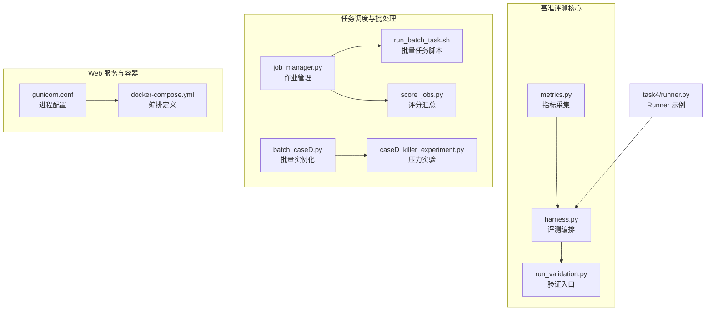
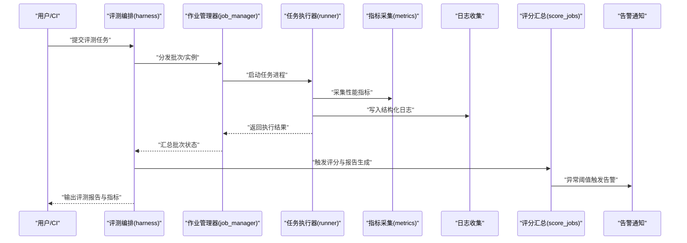
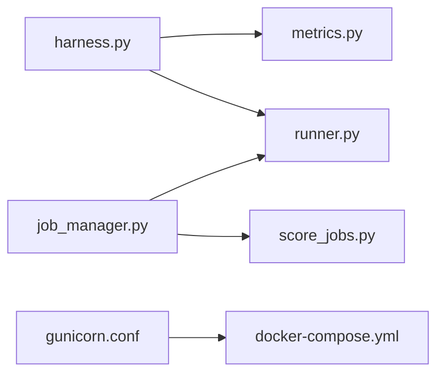

# 监控运维

<cite>
**本文引用的文件**   
- [autonomy_mvp/core/metrics.py](file://autonomy_mvp/core/metrics.py)
- [autonomy_mvp/core/harness.py](file://autonomy_mvp/core/harness.py)
- [autonomy_mvp/run_validation.py](file://autonomy_mvp/run_validation.py)
- [task4/runner.py](file://task4/runner.py)
- [task7/poc3_physicianbench/scripts/job_manager.py](file://task7/poc3_physicianbench/scripts/job_manager.py)
- [task7/poc3_physicianbench/scripts/run_batch_task.sh](file://task7/poc3_physicianbench/scripts/run_batch_task.sh)
- [task7/poc3_physicianbench/scripts/score_jobs.py](file://task7/poc3_physicianbench/scripts/score_jobs.py)
- [task7/poc1_do_challenge/server/gunicorn.conf](file://task7/poc1_do_challenge/server/gunicorn.conf)
- [task7/poc1_do_challenge/server/docker-compose.yml](file://task7/poc1_do_challenge/server/docker-compose.yml)
- [longhorizon/instantiate/batch_caseD.py](file://longhorizon/instantiate/batch_caseD.py)
- [longhorizon/instantiate/caseD_killer_experiment.py](file://longhorizon/instantiate/caseD_killer_experiment.py)
</cite>

## 目录
1. [简介](#简介)
2. [项目结构](#项目结构)
3. [核心组件](#核心组件)
4. [架构总览](#架构总览)
5. [详细组件分析](#详细组件分析)
6. [依赖分析](#依赖分析)
7. [性能考虑](#性能考虑)
8. [故障诊断指南](#故障诊断指南)
9. [结论](#结论)
10. [附录](#附录)

## 简介
本监控运维文档面向科学计算基准测试框架，聚焦系统性能监控、资源使用跟踪与任务执行状态监控的配置与实践。内容覆盖日志收集、错误追踪、告警通知机制，性能指标采集、趋势分析与容量规划策略，并提供故障诊断工具、问题排查流程与性能调优建议。同时给出运维自动化、批量操作与日常维护任务的实践方法，帮助团队在生产或准生产环境中稳定运行大规模基准评测任务。

## 项目结构
仓库包含多个子项目与实验用例，其中与监控运维相关的代码主要分布在以下位置：
- 基准评测核心与指标采集：autonomy_mvp 模块
- 任务调度与批处理脚本：task7/poc3_physicianbench/scripts 与 longhorizon/instantiate
- Web 服务与容器编排：task7/poc1_do_challenge/server
- 通用 Runner 与评估脚本：task4/runner.py

图表来源
- [autonomy_mvp/core/metrics.py](file://autonomy_mvp/core/metrics.py)
- [autonomy_mvp/core/harness.py](file://autonomy_mvp/core/harness.py)
- [autonomy_mvp/run_validation.py](file://autonomy_mvp/run_validation.py)
- [task7/poc3_physicianbench/scripts/job_manager.py](file://task7/poc3_physicianbench/scripts/job_manager.py)
- [task7/poc3_physicianbench/scripts/run_batch_task.sh](file://task7/poc3_physicianbench/scripts/run_batch_task.sh)
- [task7/poc3_physicianbench/scripts/score_jobs.py](file://task7/poc3_physicianbench/scripts/score_jobs.py)
- [longhorizon/instantiate/batch_caseD.py](file://longhorizon/instantiate/batch_caseD.py)
- [longhorizon/instantiate/caseD_killer_experiment.py](file://longhorizon/instantiate/caseD_killer_experiment.py)
- [task7/poc1_do_challenge/server/gunicorn.conf](file://task7/poc1_do_challenge/server/gunicorn.conf)
- [task7/poc1_do_challenge/server/docker-compose.yml](file://task7/poc1_do_challenge/server/docker-compose.yml)
- [task4/runner.py](file://task4/runner.py)

章节来源
- [autonomy_mvp/core/metrics.py](file://autonomy_mvp/core/metrics.py)
- [autonomy_mvp/core/harness.py](file://autonomy_mvp/core/harness.py)
- [autonomy_mvp/run_validation.py](file://autonomy_mvp/run_validation.py)
- [task7/poc3_physicianbench/scripts/job_manager.py](file://task7/poc3_physicianbench/scripts/job_manager.py)
- [task7/poc3_physicianbench/scripts/run_batch_task.sh](file://task7/poc3_physicianbench/scripts/run_batch_task.sh)
- [task7/poc3_physicianbench/scripts/score_jobs.py](file://task7/poc3_physicianbench/scripts/score_jobs.py)
- [longhorizon/instantiate/batch_caseD.py](file://longhorizon/instantiate/batch_caseD.py)
- [longhorizon/instantiate/caseD_killer_experiment.py](file://longhorizon/instantiate/caseD_killer_experiment.py)
- [task7/poc1_do_challenge/server/gunicorn.conf](file://task7/poc1_do_challenge/server/gunicorn.conf)
- [task7/poc1_do_challenge/server/docker-compose.yml](file://task7/poc1_do_challenge/server/docker-compose.yml)
- [task4/runner.py](file://task4/runner.py)

## 核心组件
- 指标采集与记录（metrics）
  - 负责在任务生命周期中采集关键性能指标（如耗时、吞吐、内存占用等），并持久化到结果文件或外部存储，供后续分析与可视化。
- 评测编排（harness）
  - 统一的任务执行入口，协调数据加载、模型推理、评估逻辑与指标上报，提供可复现的评测流程。
- 验证入口（run_validation）
  - 提供一键式验证与回归测试能力，便于在 CI/CD 中集成监控与质量门禁。
- 作业管理与批处理（job_manager、run_batch_task.sh、score_jobs.py）
  - 实现多任务并发调度、失败重试、结果聚合与评分汇总，支撑大规模评测与回归。
- 批量实例化与压力实验（batch_caseD.py、caseD_killer_experiment.py）
  - 用于生成大量评测实例与构造高负载场景，辅助容量规划与稳定性验证。
- Web 服务与容器编排（gunicorn.conf、docker-compose.yml）
  - 为评测平台或监控面板提供服务端能力，支持进程数、超时、日志输出等关键参数配置。
- Runner 示例（task4/runner.py）
  - 展示如何接入指标采集与日志输出，作为其他任务扩展的参考实现。

章节来源
- [autonomy_mvp/core/metrics.py](file://autonomy_mvp/core/metrics.py)
- [autonomy_mvp/core/harness.py](file://autonomy_mvp/core/harness.py)
- [autonomy_mvp/run_validation.py](file://autonomy_mvp/run_validation.py)
- [task7/poc3_physicianbench/scripts/job_manager.py](file://task7/poc3_physicianbench/scripts/job_manager.py)
- [task7/poc3_physicianbench/scripts/run_batch_task.sh](file://task7/poc3_physicianbench/scripts/run_batch_task.sh)
- [task7/poc3_physicianbench/scripts/score_jobs.py](file://task7/poc3_physicianbench/scripts/score_jobs.py)
- [longhorizon/instantiate/batch_caseD.py](file://longhorizon/instantiate/batch_caseD.py)
- [longhorizon/instantiate/caseD_killer_experiment.py](file://longhorizon/instantiate/caseD_killer_experiment.py)
- [task7/poc1_do_challenge/server/gunicorn.conf](file://task7/poc1_do_challenge/server/gunicorn.conf)
- [task7/poc1_do_challenge/server/docker-compose.yml](file://task7/poc1_do_challenge/server/docker-compose.yml)
- [task4/runner.py](file://task4/runner.py)

## 架构总览
下图展示了从任务提交到指标采集、日志落盘、结果汇总与可视化的端到端流程，以及监控告警的关键节点。

图表来源
- [autonomy_mvp/core/harness.py](file://autonomy_mvp/core/harness.py)
- [task7/poc3_physicianbench/scripts/job_manager.py](file://task7/poc3_physicianbench/scripts/job_manager.py)
- [task4/runner.py](file://task4/runner.py)
- [autonomy_mvp/core/metrics.py](file://autonomy_mvp/core/metrics.py)
- [task7/poc3_physicianbench/scripts/score_jobs.py](file://task7/poc3_physicianbench/scripts/score_jobs.py)

## 详细组件分析

### 指标采集与记录（metrics）
- 职责
  - 在任务关键阶段采集 CPU、内存、I/O、GPU 等指标，记录时间序列与摘要统计。
  - 将指标以结构化格式输出，便于后续聚合与可视化。
- 设计要点
  - 低开销采样：避免对主流程造成显著延迟。
  - 可扩展接口：支持新增指标类型与后端存储。
  - 容错与降级：采集失败不影响任务主流程。
- 典型用法
  - 在任务开始/结束处调用指标记录函数；在热点循环内周期性采样。
- 监控建议
  - 设置合理的采样频率与窗口大小。
  - 对异常值进行过滤与平滑处理。

章节来源
- [autonomy_mvp/core/metrics.py](file://autonomy_mvp/core/metrics.py)

### 评测编排（harness）
- 职责
  - 统一任务生命周期管理：初始化、执行、清理、结果归档。
  - 协调指标采集与日志输出，确保可观测性。
- 设计要点
  - 幂等与可恢复：支持断点续跑与重试。
  - 可插拔：支持不同数据集与评估器的接入。
- 监控建议
  - 在编排层增加关键路径埋点，记录阶段耗时与失败原因。
  - 输出标准化任务元数据（ID、版本、环境信息）。

章节来源
- [autonomy_mvp/core/harness.py](file://autonomy_mvp/core/harness.py)

### 验证入口（run_validation）
- 职责
  - 提供一键验证能力，常用于回归测试与质量门禁。
- 设计要点
  - 快速失败：遇到严重错误立即中止并输出诊断信息。
  - 可配置：通过参数控制样本规模与并行度。
- 监控建议
  - 将验证结果纳入持续集成看板，设置通过率与时长阈值。

章节来源
- [autonomy_mvp/run_validation.py](file://autonomy_mvp/run_validation.py)

### 作业管理与批处理（job_manager、run_batch_task.sh、score_jobs.py）
- 职责
  - job_manager：作业队列、并发控制、失败重试、状态同步。
  - run_batch_task.sh：批量任务启动、环境变量注入、日志归档。
  - score_jobs.py：结果聚合、评分规则应用、报告生成。
- 设计要点
  - 并发与限流：防止资源争用与过载。
  - 幂等与去重：避免重复执行与结果污染。
  - 可观测性：每个作业具备唯一标识与完整生命周期日志。
- 监控建议
  - 对作业队列长度、等待时间、失败率进行监控。
  - 对评分结果分布进行异常检测。

章节来源
- [task7/poc3_physicianbench/scripts/job_manager.py](file://task7/poc3_physicianbench/scripts/job_manager.py)
- [task7/poc3_physicianbench/scripts/run_batch_task.sh](file://task7/poc3_physicianbench/scripts/run_batch_task.sh)
- [task7/poc3_physicianbench/scripts/score_jobs.py](file://task7/poc3_physicianbench/scripts/score_jobs.py)

### 批量实例化与压力实验（batch_caseD.py、caseD_killer_experiment.py）
- 职责
  - 批量生成评测实例，构造高负载场景，用于容量规划与稳定性验证。
- 设计要点
  - 参数化：支持按规模、复杂度、分布特征生成实例。
  - 可控性：限制并发与资源配额，避免影响生产。
- 监控建议
  - 关注资源利用率峰值与尾部延迟，识别瓶颈。
  - 结合压测结果制定扩容策略。

章节来源
- [longhorizon/instantiate/batch_caseD.py](file://longhorizon/instantiate/batch_caseD.py)
- [longhorizon/instantiate/caseD_killer_experiment.py](file://longhorizon/instantiate/caseD_killer_experiment.py)

### Web 服务与容器编排（gunicorn.conf、docker-compose.yml）
- 职责
  - gunicorn.conf：配置进程数、超时、日志输出等运行时参数。
  - docker-compose.yml：定义服务依赖、端口映射、卷挂载与环境变量。
- 设计要点
  - 可伸缩：根据负载动态调整进程/副本数量。
  - 可观测：集中化日志与指标暴露。
- 监控建议
  - 监控进程存活、请求延迟、错误率与资源使用。
  - 设置健康检查与自动重启策略。

章节来源
- [task7/poc1_do_challenge/server/gunicorn.conf](file://task7/poc1_do_challenge/server/gunicorn.conf)
- [task7/poc1_do_challenge/server/docker-compose.yml](file://task7/poc1_do_challenge/server/docker-compose.yml)

### Runner 示例（task4/runner.py）
- 职责
  - 展示如何在任务执行过程中接入指标采集与日志输出。
- 设计要点
  - 标准化：遵循统一的指标命名与日志格式。
  - 可复用：封装常用模式，降低接入成本。
- 监控建议
  - 在关键步骤埋点，记录输入输出尺寸与耗时。
  - 输出结构化摘要，便于自动化分析。

章节来源
- [task4/runner.py](file://task4/runner.py)

## 依赖分析
- 组件耦合
  - harness 依赖 metrics 与 runner，形成“编排-采集-执行”的核心链路。
  - job_manager 驱动 runner 与 score_jobs，构成“调度-执行-汇总”闭环。
  - gunicorn 与 docker-compose 为服务层提供运行时与编排能力。
- 外部依赖
  - 指标采集可能依赖系统工具或库（如 psutil、nvidia-ml 等），需确保环境一致。
  - 日志与结果存储可能对接本地文件系统或对象存储。
- 潜在风险
  - 循环依赖：应通过接口解耦，避免直接相互导入。
  - 资源竞争：在高并发下需合理限流与隔离。

图表来源
- [autonomy_mvp/core/harness.py](file://autonomy_mvp/core/harness.py)
- [autonomy_mvp/core/metrics.py](file://autonomy_mvp/core/metrics.py)
- [task4/runner.py](file://task4/runner.py)
- [task7/poc3_physicianbench/scripts/job_manager.py](file://task7/poc3_physicianbench/scripts/job_manager.py)
- [task7/poc3_physicianbench/scripts/score_jobs.py](file://task7/poc3_physicianbench/scripts/score_jobs.py)
- [task7/poc1_do_challenge/server/gunicorn.conf](file://task7/poc1_do_challenge/server/gunicorn.conf)
- [task7/poc1_do_challenge/server/docker-compose.yml](file://task7/poc1_do_challenge/server/docker-compose.yml)

章节来源
- [autonomy_mvp/core/harness.py](file://autonomy_mvp/core/harness.py)
- [autonomy_mvp/core/metrics.py](file://autonomy_mvp/core/metrics.py)
- [task4/runner.py](file://task4/runner.py)
- [task7/poc3_physicianbench/scripts/job_manager.py](file://task7/poc3_physicianbench/scripts/job_manager.py)
- [task7/poc3_physicianbench/scripts/score_jobs.py](file://task7/poc3_physicianbench/scripts/score_jobs.py)
- [task7/poc1_do_challenge/server/gunicorn.conf](file://task7/poc1_do_challenge/server/gunicorn.conf)
- [task7/poc1_do_challenge/server/docker-compose.yml](file://task7/poc1_do_challenge/server/docker-compose.yml)

## 性能考虑
- 指标采集
  - 采用异步与缓冲写入，降低对主流程的影响。
  - 对高频指标进行降采样与聚合，减少存储与传输开销。
- 任务执行
  - 合理设置并发度与队列长度，避免资源争用。
  - 对长尾任务进行超时与熔断保护。
- 日志与结果
  - 使用结构化日志与分片存储，便于检索与分析。
  - 定期归档与压缩历史数据，控制存储成本。
- 容量规划
  - 基于压测与历史趋势，建立资源需求模型。
  - 预留弹性空间，应对突发流量与峰值负载。

[本节为通用指导，不直接分析具体文件]

## 故障诊断指南
- 常见问题定位
  - 任务失败：查看作业日志与指标快照，确认失败阶段与错误码。
  - 性能退化：对比基线指标，识别热点与瓶颈。
  - 资源不足：监控 CPU/GPU/内存/磁盘使用率，定位超限项。
- 诊断工具
  - 作业管理器：查询作业状态、重试历史与失败原因。
  - 评分汇总：核对结果一致性，发现异常评分。
  - 服务配置：检查进程数、超时与健康检查设置。
- 排查流程
  - 复现问题 -> 收集日志与指标 -> 定位根因 -> 修复与回归验证。
- 告警与通知
  - 对关键指标设置阈值，触发即时告警。
  - 将告警路由至协作平台，确保及时响应。

章节来源
- [task7/poc3_physicianbench/scripts/job_manager.py](file://task7/poc3_physicianbench/scripts/job_manager.py)
- [task7/poc3_physicianbench/scripts/score_jobs.py](file://task7/poc3_physicianbench/scripts/score_jobs.py)
- [task7/poc1_do_challenge/server/gunicorn.conf](file://task7/poc1_do_challenge/server/gunicorn.conf)

## 结论
通过统一的指标采集、标准化的编排与批处理、完善的日志与结果聚合，以及合理的容量规划与告警机制，该基准测试框架能够在复杂科学计算场景中保持稳定与高效。建议在持续集成中嵌入监控与质量门禁，结合压测与容量模型，持续提升系统的可靠性与可观测性。

[本节为总结性内容，不直接分析具体文件]

## 附录
- 运维自动化建议
  - 使用脚本与编排工具实现批量任务提交、扩缩容与巡检。
  - 将监控指标与告警规则纳入配置管理，支持灰度与回滚。
- 日常维护任务
  - 定期清理过期日志与结果，归档历史数据。
  - 更新依赖与镜像，修复安全漏洞。
  - 演练故障恢复与灾难恢复流程。

[本节为通用指导，不直接分析具体文件]