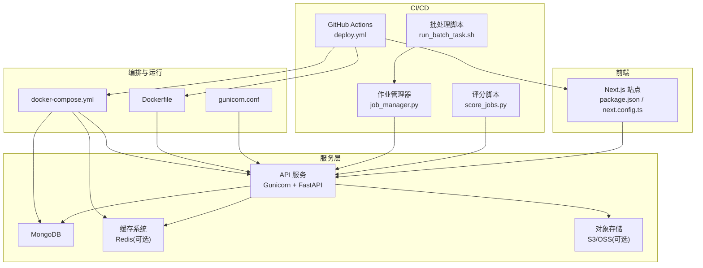
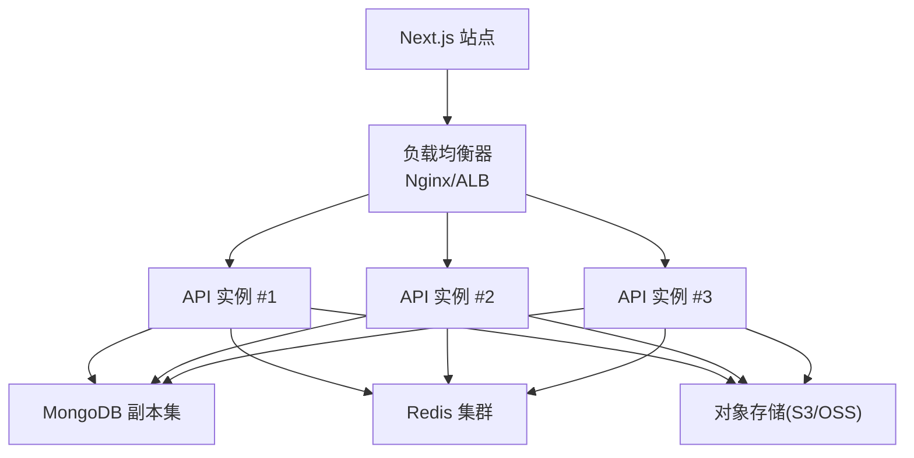
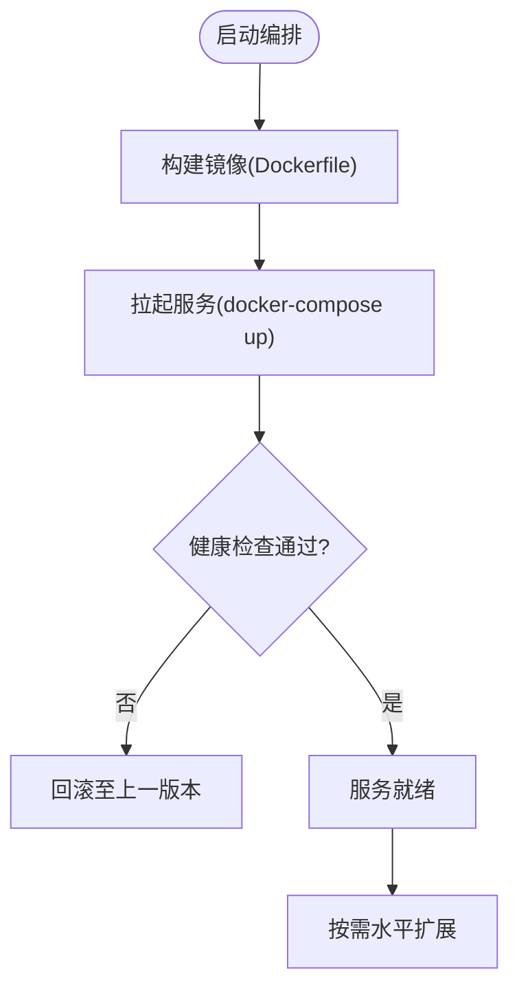
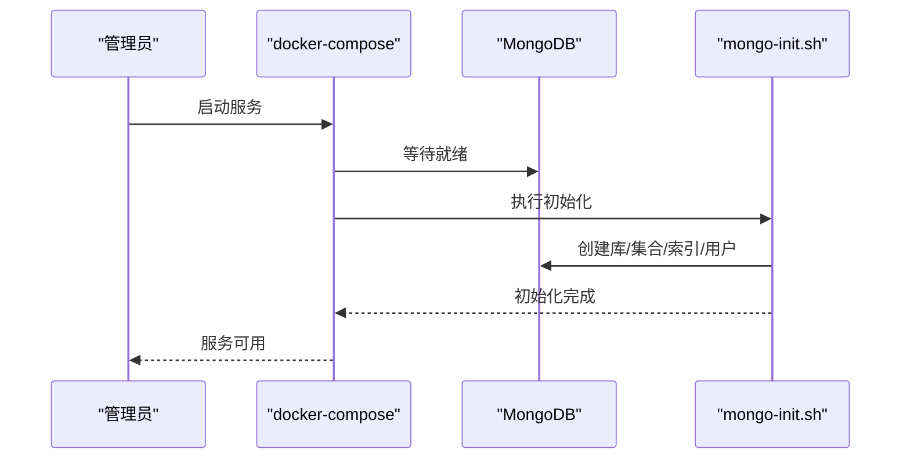
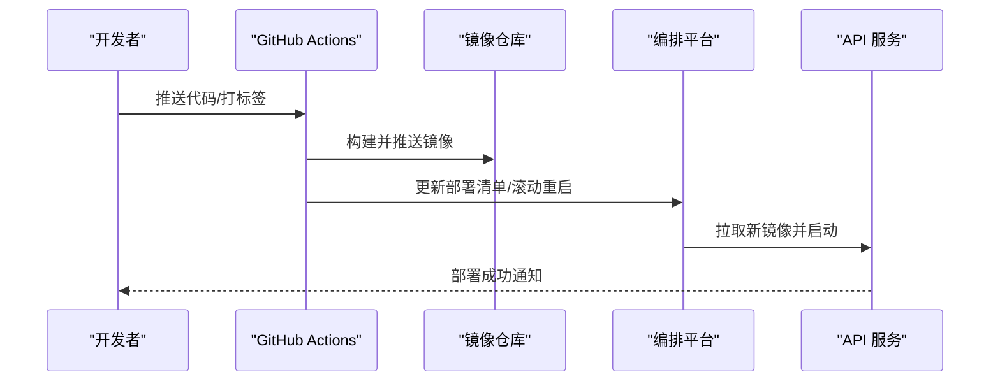
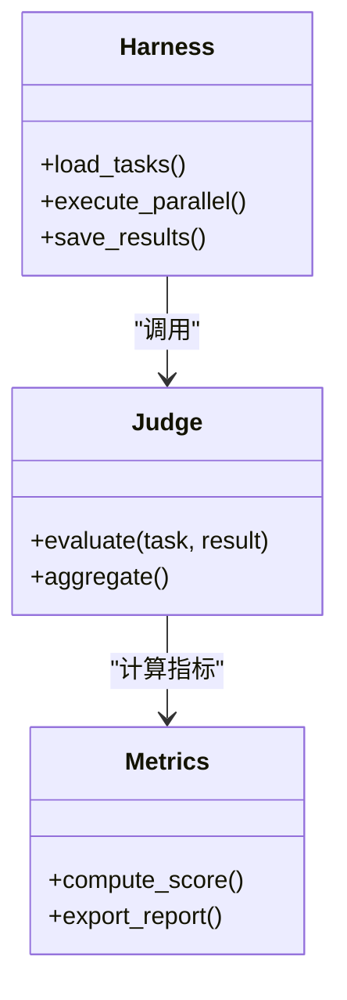
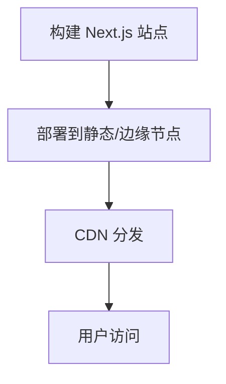
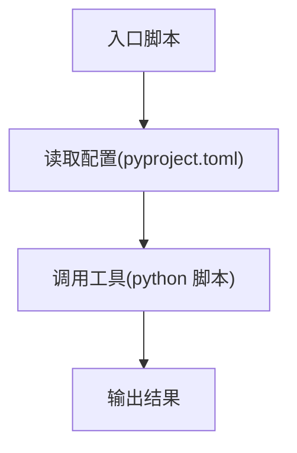
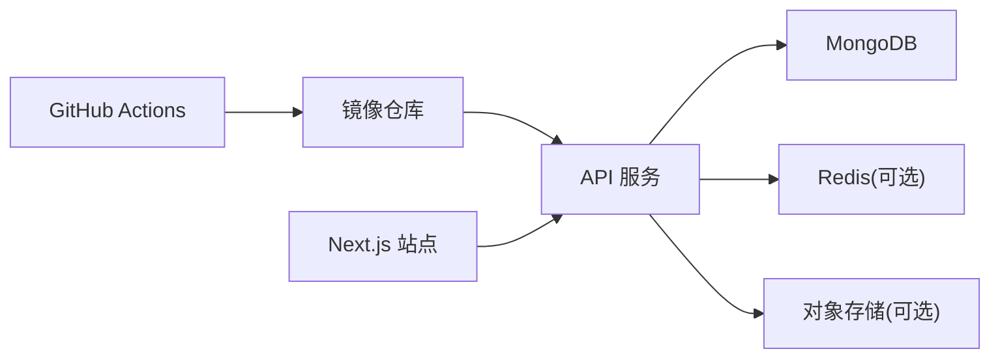

# 部署与运维

<cite>
**本文引用的文件**   
- [task7/poc1_do_challenge/server/docker-compose.yml](file://task7/poc1_do_challenge/server/docker-compose.yml)
- [task7/poc1_do_challenge/server/Dockerfile](file://task7/poc1_do_challenge/server/Dockerfile)
- [task7/poc1_do_challenge/server/gunicorn.conf](file://task7/poc1_do_challenge/server/gunicorn.conf)
- [task7/poc1_do_challenge/server/mongo-init.sh](file://task7/poc1_do_challenge/server/mongo-init.sh)
- [task7/poc3_physicianbench/.github/workflows/deploy.yml](file://task7/poc3_physicianbench/.github/workflows/deploy.yml)
- [task7/poc3_physicianbench/scripts/run_batch_task.sh](file://task7/poc3_physicianbench/scripts/run_batch_task.sh)
- [task7/poc3_physicianbench/scripts/job_manager.py](file://task7/poc3_physicianbench/scripts/job_manager.py)
- [task7/poc3_physicianbench/scripts/score_jobs.py](file://task7/poc3_physicianbench/scripts/score_jobs.py)
- [task7/poc3_physicianbench/website/package.json](file://task7/poc3_physicianbench/website/package.json)
- [task7/poc3_physicianbench/website/next.config.ts](file://task7/poc3_physicianbench/website/next.config.ts)
- [task7/poc4_pharmabench/pyproject.toml](file://task7/poc4_pharmabench/pyproject.toml)
- [task7/poc4_pharmabench/tools/predict_logd_oracle.py](file://task7/poc4_pharmabench/tools/predict_logd_oracle.py)
- [autonomy_mvp/core/harness.py](file://autonomy_mvp/core/harness.py)
- [autonomy_mvp/core/judge.py](file://autonomy_mvp/core/judge.py)
- [autonomy_mvp/core/metrics.py](file://autonomy_mvp/core/metrics.py)
- [longhorizon/instantiate/batch_caseD.py](file://longhorizon/instantiate/batch_caseD.py)
- [longhorizon/instantiate/caseD_killer_experiment.py](file://longhorizon/instantiate/caseD_killer_experiment.py)
</cite>

## 目录
1. [简介](#简介)
2. [项目结构](#项目结构)
3. [核心组件](#核心组件)
4. [架构总览](#架构总览)
5. [详细组件分析](#详细组件分析)
6. [依赖关系分析](#依赖关系分析)
7. [性能考虑](#性能考虑)
8. [故障排查指南](#故障排查指南)
9. [结论](#结论)
10. [附录](#附录)

## 简介
本文件面向生产环境，提供科学计算基准测试框架的部署与运维指南。内容覆盖：
- 生产部署架构、容器化配置与负载均衡策略
- 数据库（MongoDB）、对象存储与缓存系统的配置建议
- 安全配置、权限管理与审计日志
- 自动化部署脚本、CI/CD流水线与版本升级流程
- 备份恢复、灾难恢复与高可用保障方案
- 运维监控、故障排查与性能调优实践

## 项目结构
仓库包含多个独立子项目与任务示例，其中与部署和运维直接相关的资产主要集中在以下位置：
- task7/poc1_do_challenge/server：基于 Docker Compose 的服务编排与 Gunicorn 配置
- task7/poc3_physicianbench：GitHub Actions 部署工作流、批处理与评分脚本、Next.js 前端工程
- task7/poc4_pharmabench：Python 工程元数据与工具脚本
- autonomy_mvp/core：基准测试执行与评估核心逻辑
- longhorizon/instantiate：批量实例化与实验调度脚本

图表来源
- [task7/poc1_do_challenge/server/docker-compose.yml](file://task7/poc1_do_challenge/server/docker-compose.yml)
- [task7/poc1_do_challenge/server/Dockerfile](file://task7/poc1_do_challenge/server/Dockerfile)
- [task7/poc1_do_challenge/server/gunicorn.conf](file://task7/poc1_do_challenge/server/gunicorn.conf)
- [task7/poc3_physicianbench/.github/workflows/deploy.yml](file://task7/poc3_physicianbench/.github/workflows/deploy.yml)
- [task7/poc3_physicianbench/scripts/run_batch_task.sh](file://task7/poc3_physicianbench/scripts/run_batch_task.sh)
- [task7/poc3_physicianbench/scripts/job_manager.py](file://task7/poc3_physicianbench/scripts/job_manager.py)
- [task7/poc3_physicianbench/scripts/score_jobs.py](file://task7/poc3_physicianbench/scripts/score_jobs.py)
- [task7/poc3_physicianbench/website/package.json](file://task7/poc3_physicianbench/website/package.json)
- [task7/poc3_physicianbench/website/next.config.ts](file://task7/poc3_physicianbench/website/next.config.ts)

章节来源
- [task7/poc1_do_challenge/server/docker-compose.yml](file://task7/poc1_do_challenge/server/docker-compose.yml)
- [task7/poc1_do_challenge/server/Dockerfile](file://task7/poc1_do_challenge/server/Dockerfile)
- [task7/poc1_do_challenge/server/gunicorn.conf](file://task7/poc1_do_challenge/server/gunicorn.conf)
- [task7/poc3_physicianbench/.github/workflows/deploy.yml](file://task7/poc3_physicianbench/.github/workflows/deploy.yml)
- [task7/poc3_physicianbench/scripts/run_batch_task.sh](file://task7/poc3_physicianbench/scripts/run_batch_task.sh)
- [task7/poc3_physicianbench/scripts/job_manager.py](file://task7/poc3_physicianbench/scripts/job_manager.py)
- [task7/poc3_physicianbench/scripts/score_jobs.py](file://task7/poc3_physicianbench/scripts/score_jobs.py)
- [task7/poc3_physicianbench/website/package.json](file://task7/poc3_physicianbench/website/package.json)
- [task7/poc3_physicianbench/website/next.config.ts](file://task7/poc3_physicianbench/website/next.config.ts)

## 核心组件
- 服务编排与容器镜像
  - docker-compose.yml：定义 API 服务、MongoDB 及可选缓存等服务的启动参数、网络与卷挂载
  - Dockerfile：构建 API 服务镜像，安装依赖并设置运行时入口
  - gunicorn.conf：进程数、超时、日志输出等 WSGI/ASGI 服务器参数
- CI/CD 与自动化
  - GitHub Actions deploy.yml：触发构建、推送镜像、更新编排配置与服务滚动重启
  - run_batch_task.sh：批量提交评测任务到作业队列或 API
  - job_manager.py：作业生命周期管理、重试与状态同步
  - score_jobs.py：对已完成作业进行评分与结果聚合
- 前端站点
  - package.json 与 next.config.ts：Next.js 应用依赖与构建/代理配置
- 基准测试核心
  - harness.py、judge.py、metrics.py：任务编排、评判与指标计算
- 批量实例化与实验调度
  - batch_caseD.py、caseD_killer_experiment.py：大规模任务实例化与压力场景

章节来源
- [task7/poc1_do_challenge/server/docker-compose.yml](file://task7/poc1_do_challenge/server/docker-compose.yml)
- [task7/poc1_do_challenge/server/Dockerfile](file://task7/poc1_do_challenge/server/Dockerfile)
- [task7/poc1_do_challenge/server/gunicorn.conf](file://task7/poc1_do_challenge/server/gunicorn.conf)
- [task7/poc3_physicianbench/.github/workflows/deploy.yml](file://task7/poc3_physicianbench/.github/workflows/deploy.yml)
- [task7/poc3_physicianbench/scripts/run_batch_task.sh](file://task7/poc3_physicianbench/scripts/run_batch_task.sh)
- [task7/poc3_physicianbench/scripts/job_manager.py](file://task7/poc3_physicianbench/scripts/job_manager.py)
- [task7/poc3_physicianbench/scripts/score_jobs.py](file://task7/poc3_physicianbench/scripts/score_jobs.py)
- [task7/poc3_physicianbench/website/package.json](file://task7/poc3_physicianbench/website/package.json)
- [task7/poc3_physicianbench/website/next.config.ts](file://task7/poc3_physicianbench/website/next.config.ts)
- [autonomy_mvp/core/harness.py](file://autonomy_mvp/core/harness.py)
- [autonomy_mvp/core/judge.py](file://autonomy_mvp/core/judge.py)
- [autonomy_mvp/core/metrics.py](file://autonomy_mvp/core/metrics.py)
- [longhorizon/instantiate/batch_caseD.py](file://longhorizon/instantiate/batch_caseD.py)
- [longhorizon/instantiate/caseD_killer_experiment.py](file://longhorizon/instantiate/caseD_killer_experiment.py)

## 架构总览
生产环境推荐采用“容器化微服务 + 外部持久化”的架构：
- API 服务：无状态，多副本部署，通过反向代理/负载均衡对外暴露
- MongoDB：有状态，使用持久卷或云托管数据库，主从/副本集提升可用性
- 缓存（可选）：Redis 集群用于热点数据与速率限制
- 对象存储（可选）：S3/OSS 用于评测产物与中间文件归档
- 前端：Next.js 静态/服务端渲染站点，可 CDN 加速

[此图为概念性架构图，不映射具体源码文件]

## 详细组件分析

### 服务编排与容器化
- docker-compose.yml
  - 定义 API 服务、MongoDB、缓存等服务的端口映射、环境变量、数据卷挂载与健康检查
  - 支持按环境切换配置（开发/预发/生产）
- Dockerfile
  - 基础镜像选择、依赖安装、代码复制、时区与语言环境设置、健康检查命令
- gunicorn.conf
  - worker 数量、超时时间、访问日志与错误日志路径、优雅关闭与信号处理

图表来源
- [task7/poc1_do_challenge/server/docker-compose.yml](file://task7/poc1_do_challenge/server/docker-compose.yml)
- [task7/poc1_do_challenge/server/Dockerfile](file://task7/poc1_do_challenge/server/Dockerfile)
- [task7/poc1_do_challenge/server/gunicorn.conf](file://task7/poc1_do_challenge/server/gunicorn.conf)

章节来源
- [task7/poc1_do_challenge/server/docker-compose.yml](file://task7/poc1_do_challenge/server/docker-compose.yml)
- [task7/poc1_do_challenge/server/Dockerfile](file://task7/poc1_do_challenge/server/Dockerfile)
- [task7/poc1_do_challenge/server/gunicorn.conf](file://task7/poc1_do_challenge/server/gunicorn.conf)

### 数据库管理（MongoDB）
- 初始化脚本 mongo-init.sh
  - 创建数据库、集合、索引与初始用户/角色
- 生产建议
  - 使用副本集模式，开启认证与 TLS
  - 定期快照与增量备份，跨地域复制
  - 连接池与读写偏好配置，避免热点瓶颈

图表来源
- [task7/poc1_do_challenge/server/docker-compose.yml](file://task7/poc1_do_challenge/server/docker-compose.yml)
- [task7/poc1_do_challenge/server/mongo-init.sh](file://task7/poc1_do_challenge/server/mongo-init.sh)

章节来源
- [task7/poc1_do_challenge/server/docker-compose.yml](file://task7/poc1_do_challenge/server/docker-compose.yml)
- [task7/poc1_do_challenge/server/mongo-init.sh](file://task7/poc1_do_challenge/server/mongo-init.sh)

### 缓存系统（Redis，可选）
- 用途：会话/令牌缓存、速率限制、热点结果缓存
- 配置要点：内存上限、淘汰策略、持久化（AOF/RDB）、主从复制
- 与 API 集成：连接地址、密码、超时与重试策略

[本节为通用配置建议，未直接分析具体源码文件]

### 对象存储（S3/OSS，可选）
- 用途：评测产物、模型权重、中间文件归档
- 配置要点：桶策略、最小权限、加密与生命周期管理
- 与 API 集成：SDK 配置、分片上传、断点续传

[本节为通用配置建议，未直接分析具体源码文件]

### 安全配置、权限管理与审计日志
- 容器与镜像
  - 非 root 运行、最小镜像、漏洞扫描与签名校验
- 服务安全
  - HTTPS 终止于负载均衡器；内部通信启用 mTLS（可选）
  - 敏感信息通过密钥管理服务注入，避免硬编码
- 数据库与缓存
  - 强口令、最小权限账户、网络白名单、传输加密
- 审计日志
  - 统一结构化日志（JSON），集中采集（ELK/Loki）
  - 关键操作留痕：登录、授权变更、数据导出、任务提交与评分

[本节为通用安全实践，未直接分析具体源码文件]

### 自动化部署脚本与 CI/CD 流水线
- GitHub Actions deploy.yml
  - 触发条件（分支/标签）、构建镜像、推送镜像仓库、更新编排配置、滚动重启
- 本地与远端脚本
  - run_batch_task.sh：批量提交评测任务
  - job_manager.py：作业调度、重试、失败告警
  - score_jobs.py：评分与结果汇总

图表来源
- [task7/poc3_physicianbench/.github/workflows/deploy.yml](file://task7/poc3_physicianbench/.github/workflows/deploy.yml)
- [task7/poc1_do_challenge/server/docker-compose.yml](file://task7/poc1_do_challenge/server/docker-compose.yml)
- [task7/poc1_do_challenge/server/Dockerfile](file://task7/poc1_do_challenge/server/Dockerfile)

章节来源
- [task7/poc3_physicianbench/.github/workflows/deploy.yml](file://task7/poc3_physicianbench/.github/workflows/deploy.yml)
- [task7/poc3_physicianbench/scripts/run_batch_task.sh](file://task7/poc3_physicianbench/scripts/run_batch_task.sh)
- [task7/poc3_physicianbench/scripts/job_manager.py](file://task7/poc3_physicianbench/scripts/job_manager.py)
- [task7/poc3_physicianbench/scripts/score_jobs.py](file://task7/poc3_physicianbench/scripts/score_jobs.py)

### 版本升级流程
- 灰度发布
  - 先扩容新版本实例，逐步切流，观察错误率与延迟
- 回滚策略
  - 保留上一版本镜像与配置，一键回滚
- 数据迁移
  - 兼容旧结构的迁移脚本在启动前执行，失败则中止升级

[本节为通用升级流程，未直接分析具体源码文件]

### 备份恢复与灾难恢复
- 备份策略
  - MongoDB：全量快照 + 增量 WAL；对象存储：版本控制 + 跨区域复制
- 恢复演练
  - 定期演练 RTO/RPO 目标，验证恢复流程
- 灾难恢复
  - 多可用区部署，自动故障转移与流量切换

[本节为通用灾备策略，未直接分析具体源码文件]

### 高可用性保障
- 多副本与无状态设计
- 健康检查与自愈
- 限流与熔断
- 幂等性与重试

[本节为通用 HA 策略，未直接分析具体源码文件]

### 运维监控、告警与可观测性
- 指标
  - 服务 QPS、延迟分布、错误率、资源使用率、数据库连接池、缓存命中率
- 日志
  - 统一格式、分级收集、检索与告警规则
- 链路追踪
  - 关键请求 ID 贯穿前后端与下游服务

[本节为通用可观测性建议，未直接分析具体源码文件]

### 基准测试与评估子系统
- 任务编排与执行
  - harness.py：任务加载、并行执行、结果落盘
- 评判与指标
  - judge.py：判定逻辑封装
  - metrics.py：指标计算与汇总
- 批量实例化与压力测试
  - batch_caseD.py、caseD_killer_experiment.py：生成大规模任务与压测场景

图表来源
- [autonomy_mvp/core/harness.py](file://autonomy_mvp/core/harness.py)
- [autonomy_mvp/core/judge.py](file://autonomy_mvp/core/judge.py)
- [autonomy_mvp/core/metrics.py](file://autonomy_mvp/core/metrics.py)

章节来源
- [autonomy_mvp/core/harness.py](file://autonomy_mvp/core/harness.py)
- [autonomy_mvp/core/judge.py](file://autonomy_mvp/core/judge.py)
- [autonomy_mvp/core/metrics.py](file://autonomy_mvp/core/metrics.py)
- [longhorizon/instantiate/batch_caseD.py](file://longhorizon/instantiate/batch_caseD.py)
- [longhorizon/instantiate/caseD_killer_experiment.py](file://longhorizon/instantiate/caseD_killer_experiment.py)

### 前端站点（Next.js）
- package.json：依赖与脚本定义
- next.config.ts：构建选项、代理与运行时配置

图表来源
- [task7/poc3_physicianbench/website/package.json](file://task7/poc3_physicianbench/website/package.json)
- [task7/poc3_physicianbench/website/next.config.ts](file://task7/poc3_physicianbench/website/next.config.ts)

章节来源
- [task7/poc3_physicianbench/website/package.json](file://task7/poc3_physicianbench/website/package.json)
- [task7/poc3_physicianbench/website/next.config.ts](file://task7/poc3_physicianbench/website/next.config.ts)

### Python 工程与工具脚本
- pyproject.toml：工程元数据、依赖与构建配置
- predict_logd_oracle.py：预测工具示例，展示外部工具集成方式

图表来源
- [task7/poc4_pharmabench/pyproject.toml](file://task7/poc4_pharmabench/pyproject.toml)
- [task7/poc4_pharmabench/tools/predict_logd_oracle.py](file://task7/poc4_pharmabench/tools/predict_logd_oracle.py)

章节来源
- [task7/poc4_pharmabench/pyproject.toml](file://task7/poc4_pharmabench/pyproject.toml)
- [task7/poc4_pharmabench/tools/predict_logd_oracle.py](file://task7/poc4_pharmabench/tools/predict_logd_oracle.py)

## 依赖关系分析
- 服务间依赖
  - API 服务依赖 MongoDB 与可选 Redis/S3
  - 前端站点通过反向代理访问 API
- 构建与部署依赖
  - GitHub Actions 依赖镜像仓库与编排平台
  - 批处理脚本依赖 API 接口与作业队列

图表来源
- [task7/poc3_physicianbench/.github/workflows/deploy.yml](file://task7/poc3_physicianbench/.github/workflows/deploy.yml)
- [task7/poc1_do_challenge/server/docker-compose.yml](file://task7/poc1_do_challenge/server/docker-compose.yml)

章节来源
- [task7/poc3_physicianbench/.github/workflows/deploy.yml](file://task7/poc3_physicianbench/.github/workflows/deploy.yml)
- [task7/poc1_do_challenge/server/docker-compose.yml](file://task7/poc1_do_challenge/server/docker-compose.yml)

## 性能考虑
- 容器与运行时
  - 合理设置 CPU/内存限制与请求超时，避免雪崩
  - 使用多进程/多线程 Worker，结合 I/O 密集型优化
- 数据库与缓存
  - 索引优化、查询计划审查、连接池大小调整
  - 缓存穿透/击穿/雪崩防护，热点键拆分
- 对象存储
  - 分片上传、并发下载、压缩与去重
- 基准测试
  - 并行度与资源隔离，避免相互干扰
  - 结果增量写入与异步聚合

[本节为通用性能建议，未直接分析具体源码文件]

## 故障排查指南
- 常见问题定位
  - 服务不可用：检查健康检查、日志与依赖连通性
  - 数据库慢查询：查看慢查询日志与索引命中
  - 缓存失效：核对 TTL、容量与淘汰策略
  - 对象存储异常：检查权限、配额与网络连通
- 日志与追踪
  - 统一日志格式，关联请求 ID
  - 关键路径埋点，快速定位瓶颈
- 回滚与应急
  - 一键回滚到稳定版本
  - 降级策略与熔断保护

[本节为通用排障建议，未直接分析具体源码文件]

## 结论
通过将服务容器化、引入外部持久化与缓存、完善 CI/CD 与自动化脚本，并结合监控与灾备策略，可实现高可用、可扩展且易维护的科学计算基准测试平台。建议在上线前完成压测与演练，持续优化资源配置与流程效率。

## 附录
- 术语
  - RTO：恢复时间目标
  - RPO：恢复点目标
  - SLI/SLO：服务等级指标/目标
- 参考清单
  - 容器镜像安全扫描
  - 密钥管理与轮换
  - 合规与审计要求

[本节为补充说明，未直接分析具体源码文件]