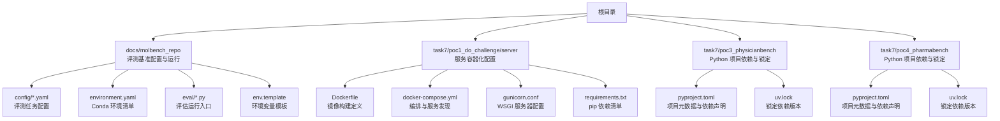
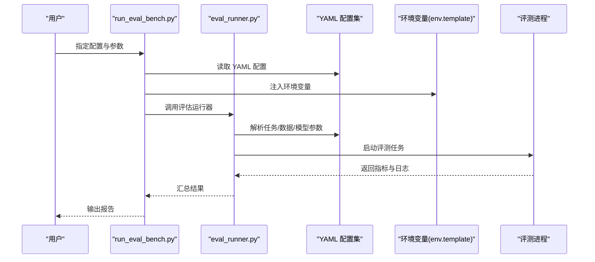
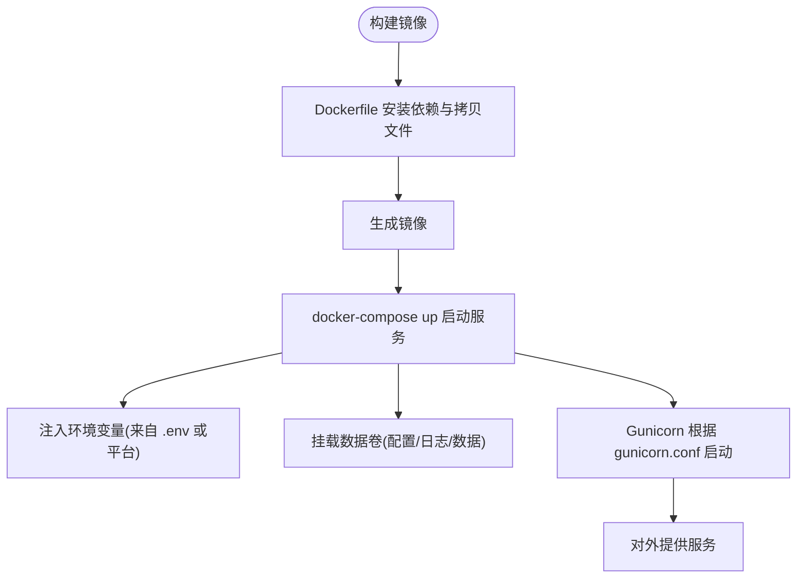
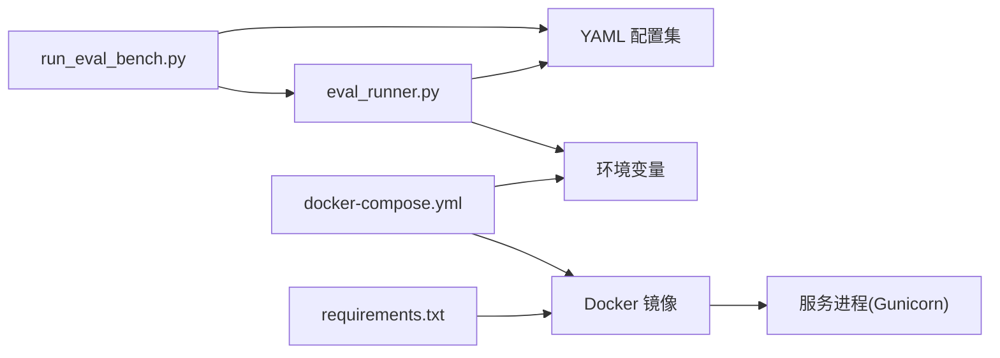

# 配置与环境管理

<cite>
**本文引用的文件**   
- [env.template](file://docs/molbench_repo/env.template)
- [environment.yaml](file://docs/molbench_repo/environment.yaml)
- [baseline_molbench-ms-1.yaml](file://docs/molbench_repo/config/baseline_molbench-ms-1.yaml)
- [baseline_molbench-ms-2.yaml](file://docs/molbench_repo/config/baseline_molbench-ms-2.yaml)
- [baseline_molbench-ms-3.yaml](file://docs/molbench_repo/config/baseline_molbench-ms-3.yaml)
- [chemcot_mo_edit.yaml](file://docs/molbench_repo/config/chemcot_mo_edit.yaml)
- [chemcot_mo_opt.yaml](file://docs/molbench_repo/config/chemcot_mo_opt.yaml)
- [claude_template.yaml](file://docs/molbench_repo/config/claude_template.yaml)
- [README.md](file://docs/molbench_repo/README.md)
- [eval_runner.py](file://docs/molbench_repo/eval/eval_runner.py)
- [run_eval_bench.py](file://docs/molbench_repo/eval/run_eval_bench.py)
- [Dockerfile](file://task7/poc1_do_challenge/do-events-challenge2025/server/Dockerfile)
- [docker-compose.yml](file://task7/poc1_do_challenge/do-events-challenge2025/server/docker-compose.yml)
- [gunicorn.conf](file://task7/poc1_do_challenge/do-events-challenge2025/server/gunicorn.conf)
- [requirements.txt](file://task7/poc1_do_challenge/do-events-challenge2025/server/requirements.txt)
- [pyproject.toml](file://task7/poc3_physicianbench/PhysicianBench/pyproject.toml)
- [uv.lock](file://task7/poc3_physicianbench/PhysicianBench/uv.lock)
- [pyproject.toml](file://task7/poc4_pharmabench/pyproject.toml)
- [uv.lock](file://task7/poc4_pharmabench/uv.lock)
</cite>

## 目录
1. [简介](#简介)
2. [项目结构](#项目结构)
3. [核心组件](#核心组件)
4. [架构总览](#架构总览)
5. [详细组件分析](#详细组件分析)
6. [依赖关系分析](#依赖关系分析)
7. [性能考虑](#性能考虑)
8. [故障排除指南](#故障排除指南)
9. [结论](#结论)
10. [附录](#附录)

## 简介
本文件面向配置与环境管理系统，聚焦以下目标：
- 解释各类配置文件的作用、语法与优先级规则
- 说明环境变量设置方法、依赖包管理与版本控制策略
- 提供不同部署环境的配置模板与容器化配置
- 给出生产环境优化建议
- 提供配置验证工具、环境诊断脚本与故障排除指南
- 说明配置热重载、动态更新与备份恢复机制

## 项目结构
仓库采用“按任务/子项目组织”的目录结构。与配置和环境管理直接相关的资源主要分布在：
- docs/molbench_repo：评测基准的配置与运行入口（YAML 配置、环境清单、评估脚本）
- task7/poc1_do_challenge/server：服务容器化与运行时配置（Docker、Compose、Gunicorn）
- task7/poc3_physicianbench 与 poc4_pharmabench：Python 项目级依赖与锁定文件（pyproject.toml、uv.lock）

图表来源
- [environment.yaml](file://docs/molbench_repo/environment.yaml)
- [eval_runner.py](file://docs/molbench_repo/eval/eval_runner.py)
- [run_eval_bench.py](file://docs/molbench_repo/eval/run_eval_bench.py)
- [Dockerfile](file://task7/poc1_do_challenge/do-events-challenge2025/server/Dockerfile)
- [docker-compose.yml](file://task7/poc1_do_challenge/do-events-challenge2025/server/docker-compose.yml)
- [gunicorn.conf](file://task7/poc1_do_challenge/do-events-challenge2025/server/gunicorn.conf)
- [requirements.txt](file://task7/poc1_do_challenge/do-events-challenge2025/server/requirements.txt)
- [pyproject.toml](file://task7/poc3_physicianbench/PhysicianBench/pyproject.toml)
- [uv.lock](file://task7/poc3_physicianbench/PhysicianBench/uv.lock)
- [pyproject.toml](file://task7/poc4_pharmabench/pyproject.toml)
- [uv.lock](file://task7/poc4_pharmabench/uv.lock)

章节来源
- [README.md](file://docs/molbench_repo/README.md)

## 核心组件
- YAML 评测配置集：用于描述不同基准任务的参数、数据路径、模型选择与评测指标等。典型文件包括 baseline_molbench-ms-*.yaml、chemcot_mo_*.yaml、claude_template.yaml。
- Conda 环境清单：environment.yaml 用于声明系统/Python 依赖及可选通道，便于在本地或 CI 中复现一致环境。
- 环境变量模板：env.template 提供关键密钥与运行时开关的占位符，指导用户填充实际值。
- 评估运行器：eval_runner.py 与 run_eval_bench.py 负责加载配置、解析参数、驱动评测流程并输出结果。
- 容器化配置：Dockerfile、docker-compose.yml、gunicorn.conf、requirements.txt 共同构成服务镜像与运行时的基础。
- Python 项目依赖与锁定：pyproject.toml 声明依赖，uv.lock 锁定具体版本，确保可重复构建与部署。

章节来源
- [baseline_molbench-ms-1.yaml](file://docs/molbench_repo/config/baseline_molbench-ms-1.yaml)
- [baseline_molbench-ms-2.yaml](file://docs/molbench_repo/config/baseline_molbench-ms-2.yaml)
- [baseline_molbench-ms-3.yaml](file://docs/molbench_repo/config/baseline_molbench-ms-3.yaml)
- [chemcot_mo_edit.yaml](file://docs/molbench_repo/config/chemcot_mo_edit.yaml)
- [chemcot_mo_opt.yaml](file://docs/molbench_repo/config/chemcot_mo_opt.yaml)
- [claude_template.yaml](file://docs/molbench_repo/config/claude_template.yaml)
- [environment.yaml](file://docs/molbench_repo/environment.yaml)
- [eval_runner.py](file://docs/molbench_repo/eval/eval_runner.py)
- [run_eval_bench.py](file://docs/molbench_repo/eval/run_eval_bench.py)
- [Dockerfile](file://task7/poc1_do_challenge/do-events-challenge2025/server/Dockerfile)
- [docker-compose.yml](file://task7/poc1_do_challenge/do-events-challenge2025/server/docker-compose.yml)
- [gunicorn.conf](file://task7/poc1_do_challenge/do-events-challenge2025/server/gunicorn.conf)
- [requirements.txt](file://task7/poc1_do_challenge/do-events-challenge2025/server/requirements.txt)
- [pyproject.toml](file://task7/poc3_physicianbench/PhysicianBench/pyproject.toml)
- [uv.lock](file://task7/poc3_physicianbench/PhysicianBench/uv.lock)
- [pyproject.toml](file://task7/poc4_pharmabench/pyproject.toml)
- [uv.lock](file://task7/poc4_pharmabench/uv.lock)

## 架构总览
下图展示了从“配置加载”到“评测执行”的关键路径，以及容器化服务启动时配置与依赖的装配过程。

图表来源
- [run_eval_bench.py](file://docs/molbench_repo/eval/run_eval_bench.py)
- [eval_runner.py](file://docs/molbench_repo/eval/eval_runner.py)
- [baseline_molbench-ms-1.yaml](file://docs/molbench_repo/config/baseline_molbench-ms-1.yaml)
- [environment.yaml](file://docs/molbench_repo/environment.yaml)
- [env.template](file://docs/molbench_repo/env.template)

## 详细组件分析

### YAML 评测配置集
- 作用：集中描述各基准任务的输入数据、模型/工具选择、评测指标、并行度、超时与重试等。
- 语法：标准 YAML；键名与层级由运行器解析逻辑决定。
- 优先级规则（通用建议）：
  - 命令行参数 > 环境变量 > 模板配置 > 默认值
  - 多配置合并时，后加载覆盖先加载的同名字段
- 使用建议：
  - 将敏感信息（如 API Key）放入环境变量，不在 YAML 中硬编码
  - 为不同环境准备独立配置（dev/test/prod），通过环境变量切换

章节来源
- [baseline_molbench-ms-1.yaml](file://docs/molbench_repo/config/baseline_molbench-ms-1.yaml)
- [baseline_molbench-ms-2.yaml](file://docs/molbench_repo/config/baseline_molbench-ms-2.yaml)
- [baseline_molbench-ms-3.yaml](file://docs/molbench_repo/config/baseline_molbench-ms-3.yaml)
- [chemcot_mo_edit.yaml](file://docs/molbench_repo/config/chemcot_mo_edit.yaml)
- [chemcot_mo_opt.yaml](file://docs/molbench_repo/config/chemcot_mo_opt.yaml)
- [claude_template.yaml](file://docs/molbench_repo/config/claude_template.yaml)

### Conda 环境清单 environment.yaml
- 作用：声明 Python 与系统依赖，保证跨机器一致性。
- 语法：标准 conda env 格式，包含 channels、dependencies、name 等。
- 使用方式：
  - 创建环境：conda env create -f environment.yaml
  - 激活环境：conda activate <name>
- 注意事项：
  - 若网络受限，提前缓存 channel 或使用私有镜像源
  - 对 GPU 相关依赖，需匹配 CUDA/cuDNN 版本

章节来源
- [environment.yaml](file://docs/molbench_repo/environment.yaml)

### 环境变量模板 env.template
- 作用：列出必需的环境变量占位符，指导用户填写密钥、端点、路径等。
- 最佳实践：
  - 复制为 .env 或写入宿主/容器环境变量
  - 不要提交真实密钥到版本库
  - 在 CI 中使用安全变量注入

章节来源
- [env.template](file://docs/molbench_repo/env.template)

### 评估运行器 eval_runner.py 与 run_eval_bench.py
- 职责：
  - 解析命令行参数与配置
  - 加载 YAML 配置与环境变量
  - 驱动评测流水线、聚合结果与日志
- 扩展点：
  - 新增评测任务通常只需添加新 YAML 并在入口注册
  - 可通过环境变量覆盖部分运行时行为（如并发度、超时）

章节来源
- [eval_runner.py](file://docs/molbench_repo/eval/eval_runner.py)
- [run_eval_bench.py](file://docs/molbench_repo/eval/run_eval_bench.py)

### 容器化配置（Docker + Compose + Gunicorn）
- Dockerfile：定义镜像构建步骤、安装依赖、拷贝代码与配置。
- docker-compose.yml：编排服务、挂载卷、注入环境变量、暴露端口。
- gunicorn.conf：WSGI 服务器的进程数、工作线程、日志与超时等。
- requirements.txt：pip 依赖清单，供镜像构建阶段安装。

图表来源
- [Dockerfile](file://task7/poc1_do_challenge/do-events-challenge2025/server/Dockerfile)
- [docker-compose.yml](file://task7/poc1_do_challenge/do-events-challenge2025/server/docker-compose.yml)
- [gunicorn.conf](file://task7/poc1_do_challenge/do-events-challenge2025/server/gunicorn.conf)
- [requirements.txt](file://task7/poc1_do_challenge/do-events-challenge2025/server/requirements.txt)

章节来源
- [Dockerfile](file://task7/poc1_do_challenge/do-events-challenge2025/server/Dockerfile)
- [docker-compose.yml](file://task7/poc1_do_challenge/do-events-challenge2025/server/docker-compose.yml)
- [gunicorn.conf](file://task7/poc1_do_challenge/do-events-challenge2025/server/gunicorn.conf)
- [requirements.txt](file://task7/poc1_do_challenge/do-events-challenge2025/server/requirements.txt)

### Python 项目依赖与锁定（pyproject.toml 与 uv.lock）
- pyproject.toml：声明项目元数据与依赖（含可选组）。
- uv.lock：锁定依赖的具体版本，确保可重复构建。
- 使用建议：
  - 开发环境与生产环境共用同一份锁定文件
  - 变更依赖后重新生成锁定文件并提交
  - 在 CI 中校验锁定文件是否最新

章节来源
- [pyproject.toml](file://task7/poc3_physicianbench/PhysicianBench/pyproject.toml)
- [uv.lock](file://task7/poc3_physicianbench/PhysicianBench/uv.lock)
- [pyproject.toml](file://task7/poc4_pharmabench/pyproject.toml)
- [uv.lock](file://task7/poc4_pharmabench/uv.lock)

## 依赖关系分析
- 评测链路依赖：
  - run_eval_bench.py 依赖 eval_runner.py 与 YAML 配置
  - 运行期依赖由 environment.yaml 或容器镜像中的 requirements.txt 提供
- 服务链路依赖：
  - docker-compose.yml 驱动 Dockerfile 构建的镜像
  - Gunicorn 依据 gunicorn.conf 初始化进程与工作线程
  - requirements.txt 作为 pip 安装源

图表来源
- [run_eval_bench.py](file://docs/molbench_repo/eval/run_eval_bench.py)
- [eval_runner.py](file://docs/molbench_repo/eval/eval_runner.py)
- [environment.yaml](file://docs/molbench_repo/environment.yaml)
- [Dockerfile](file://task7/poc1_do_challenge/do-events-challenge2025/server/Dockerfile)
- [docker-compose.yml](file://task7/poc1_do_challenge/do-events-challenge2025/server/docker-compose.yml)
- [gunicorn.conf](file://task7/poc1_do_challenge/do-events-challenge2025/server/gunicorn.conf)
- [requirements.txt](file://task7/poc1_do_challenge/do-events-challenge2025/server/requirements.txt)

章节来源
- [run_eval_bench.py](file://docs/molbench_repo/eval/run_eval_bench.py)
- [eval_runner.py](file://docs/molbench_repo/eval/eval_runner.py)
- [Dockerfile](file://task7/poc1_do_challenge/do-events-challenge2025/server/Dockerfile)
- [docker-compose.yml](file://task7/poc1_do_challenge/do-events-challenge2025/server/docker-compose.yml)
- [gunicorn.conf](file://task7/poc1_do_challenge/do-events-challenge2025/server/gunicorn.conf)
- [requirements.txt](file://task7/poc1_do_challenge/do-events-challenge2025/server/requirements.txt)

## 性能考虑
- 评测并行度：通过配置或环境变量调整并发任务数，避免超出资源上限导致 OOM 或调度抖动。
- I/O 与缓存：将数据集与中间产物置于高性能存储（如本地 SSD 或共享盘），减少网络延迟。
- 容器资源限制：在 docker-compose 中为服务设置 CPU/内存限制，防止单实例抢占资源。
- Gunicorn 调优：根据 CPU 核数与任务类型设置 worker 数量与超时时间，平衡吞吐与稳定性。
- 依赖安装：优先使用预编译二进制与镜像缓存层，缩短构建时间。

## 故障排除指南
- 环境变量缺失或错误
  - 现象：启动时报错找不到密钥或端点
  - 排查：对照 env.template 检查所有必填项；确认 CI/平台已正确注入
- 依赖不匹配
  - 现象：导入失败或运行时异常
  - 排查：核对 environment.yaml 或 requirements.txt 的版本；必要时重建环境/镜像
- 容器无法访问外部资源
  - 现象：服务内无法连接数据库或第三方 API
  - 排查：检查 docker-compose 的网络模式与 DNS；确认防火墙与安全组
- 评测结果不一致
  - 现象：多次运行结果波动较大
  - 排查：固定随机种子；检查并发与资源竞争；确认数据未因并发写入而损坏
- 日志定位问题
  - 建议：开启详细日志级别；将日志持久化到卷；结合时间戳与请求 ID 追踪

章节来源
- [env.template](file://docs/molbench_repo/env.template)
- [environment.yaml](file://docs/molbench_repo/environment.yaml)
- [requirements.txt](file://task7/poc1_do_challenge/do-events-challenge2025/server/requirements.txt)
- [docker-compose.yml](file://task7/poc1_do_challenge/do-events-challenge2025/server/docker-compose.yml)

## 结论
通过分层配置（YAML + 环境变量）、统一环境清单（environment.yaml）与容器化封装（Docker/Compose/Gunicorn），本项目实现了可复现、可移植且易于运维的配置与环境管理体系。配合依赖锁定（uv.lock）与清晰的运行入口（eval 脚本），可在多环境中稳定交付一致的评测与服务能力。

## 附录

### 配置优先级与合并策略（建议）
- 优先级顺序：命令行参数 > 环境变量 > 模板配置 > 默认值
- 合并策略：同名键以高优先级覆盖低优先级；嵌套对象建议逐层合并而非整体替换

### 不同部署环境的配置模板
- 开发环境
  - 使用最小依赖与调试日志
  - 关闭严格的安全限制
- 测试环境
  - 启用完整日志与断言
  - 使用隔离的数据与凭据
- 生产环境
  - 仅保留必要依赖
  - 启用健康检查、限流与熔断
  - 使用只读挂载与最小权限原则

### 容器化配置要点
- 镜像分层：将大依赖前置以减少重建成本
- 多阶段构建：分离构建与运行阶段，减小最终镜像体积
- 环境变量注入：通过 Compose 或编排平台注入，避免写死在镜像中
- 健康检查：在 Compose 中配置 healthcheck，提升可用性

### 配置验证工具与环境诊断脚本（建议）
- 配置校验
  - 使用 JSON Schema/YAML Schema 校验配置结构与必填字段
  - 在 CI 中加入配置 lint 与 schema 校验步骤
- 环境诊断
  - 打印 Python 版本、CUDA 版本、GPU 可用性与内存
  - 检查关键环境变量是否存在且非空
  - 探测外部依赖连通性（数据库、对象存储、API 网关）

### 配置热重载与动态更新
- 轻量方案：监听配置文件变化，进程内热加载（注意线程安全）
- 容器方案：通过滚动更新或 Sidecar 推送配置变更，触发应用优雅重启
- 服务治理：结合健康检查与就绪探针，确保无中断更新

### 备份与恢复机制
- 配置备份：将 YAML 与 .env 纳入版本控制与制品库
- 数据备份：定期快照数据集与中间结果，保留回滚点
- 恢复演练：在测试环境定期演练恢复流程，验证完整性与一致性