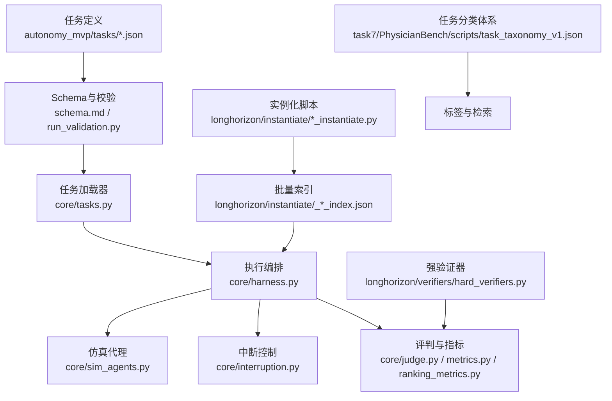
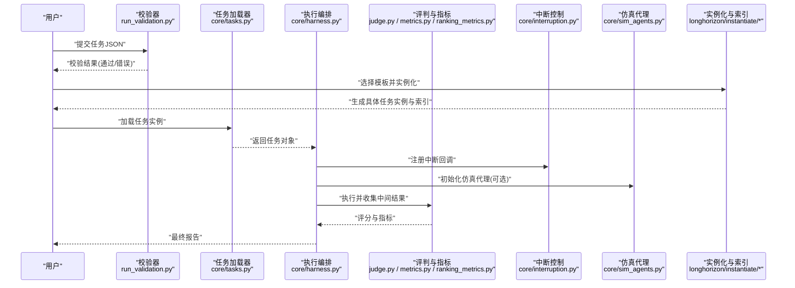
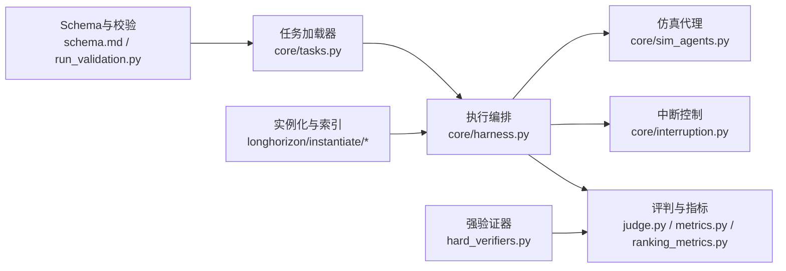

# 任务定义规范

<cite>
**本文引用的文件**   
- [autonomy_mvp/schema.md](file://autonomy_mvp/schema.md)
- [autonomy_mvp/run_validation.py](file://autonomy_mvp/run_validation.py)
- [autonomy_mvp/core/tasks.py](file://autonomy_mvp/core/tasks.py)
- [autonomy_mvp/core/harness.py](file://autonomy_mvp/core/harness.py)
- [autonomy_mvp/core/judge.py](file://autonomy_mvp/core/judge.py)
- [autonomy_mvp/core/metrics.py](file://autonomy_mvp/core/metrics.py)
- [autonomy_mvp/core/ranking_metrics.py](file://autonomy_mvp/core/ranking_metrics.py)
- [autonomy_mvp/core/interruption.py](file://autonomy_mvp/core/interruption.py)
- [autonomy_mvp/core/sim_agents.py](file://autonomy_mvp/core/sim_agents.py)
- [autonomy_mvp/tasks/drug_admet.json](file://autonomy_mvp/tasks/drug_admet.json)
- [autonomy_mvp/tasks/drug_screen_ms3.json](file://autonomy_mvp/tasks/drug_screen_ms3.json)
- [autonomy_mvp/tasks/materials_semiconductor_bandgap.json](file://autonomy_mvp/tasks/materials_semiconductor_bandgap.json)
- [autonomy_mvp/tests/fixtures/fixture_drugscreen.json](file://autonomy_mvp/tests/fixtures/fixture_drugscreen.json)
- [autonomy_mvp/tests/fixtures/fixture_materials.json](file://autonomy_mvp/tests/fixtures/fixture_materials.json)
- [longhorizon/instantiate/instances/_batch_index.json](file://longhorizon/instantiate/instances/_batch_index.json)
- [longhorizon/instantiate/instances/_case2_index.json](file://longhorizon/instantiate/instances/_case2_index.json)
- [longhorizon/instantiate/instances/_case3_index.json](file://longhorizon/instantiate/instances/_case3_index.json)
- [longhorizon/instantiate/instances/_caseE_index.json](file://longhorizon/instantiate/instances/_caseE_index.json)
- [longhorizon/instantiate/instances/_caseF_index.json](file://longhorizon/instantiate/instances/_caseF_index.json)
- [longhorizon/instantiate/case1_instantiate.py](file://longhorizon/instantiate/case1_instantiate.py)
- [longhorizon/instantiate/case2_instantiate.py](file://longhorizon/instantiate/case2_instantiate.py)
- [longhorizon/instantiate/case3_instantiate.py](file://longhorizon/instantiate/case3_instantiate.py)
- [longhorizon/instantiate/caseD_instantiate.py](file://longhorizon/instantiate/caseD_instantiate.py)
- [longhorizon/instantiate/caseE_instantiate.py](file://longhorizon/instantiate/caseE_instantiate.py)
- [longhorizon/instantiate/caseF_instantiate.py](file://longhorizon/instantiate/caseF_instantiate.py)
- [longhorizon/instantiate/batch_caseD.py](file://longhorizon/instantiate/batch_caseD.py)
- [longhorizon/verifiers/hard_verifiers.py](file://longhorizon/verifiers/hard_verifiers.py)
- [task7/PhysicianBench/scripts/task_taxonomy_v1.json](file://task7/PhysicianBench/scripts/task_taxonomy_v1.json)
</cite>

## 目录
1. [简介](#简介)
2. [项目结构](#项目结构)
3. [核心组件](#核心组件)
4. [架构总览](#架构总览)
5. [详细组件分析](#详细组件分析)
6. [依赖关系分析](#依赖关系分析)
7. [性能与可扩展性](#性能与可扩展性)
8. [故障排查指南](#故障排查指南)
9. [结论](#结论)
10. [附录：示例与迁移策略](#附录示例与迁移策略)

## 简介
本规范面向“长视域任务”的任务定义，目标是为任务的JSON Schema、字段语义、验证规则、元数据与环境配置、依赖声明与约束条件提供统一标准；同时给出版本管理、向后兼容与迁移策略，并覆盖从简单到复杂多步骤任务的完整配置模式。文档还说明任务分类体系、标签系统与搜索索引机制，帮助使用者快速构建、检索与演进任务集。

## 项目结构
仓库围绕“任务定义—实例化—执行—评估—归档”的流水线组织。关键位置如下：
- 任务定义与Schema：autonomy_mvp/schema.md、autonomy_mvp/tasks/*.json
- 任务加载与校验：autonomy_mvp/run_validation.py、autonomy_mvp/core/tasks.py
- 执行与评测：autonomy_mvp/core/harness.py、judge.py、metrics.py、ranking_metrics.py
- 中断与仿真代理：autonomy_mvp/core/interruption.py、sim_agents.py
- 长视域实例生成与批处理：longhorizon/instantiate/*_instantiate.py、*_index.json、batch_caseD.py
- 强验证器：longhorizon/verifiers/hard_verifiers.py
- 任务分类体系（医疗领域）：task7/PhysicianBench/scripts/task_taxonomy_v1.json

图表来源
- [autonomy_mvp/schema.md](file://autonomy_mvp/schema.md)
- [autonomy_mvp/run_validation.py](file://autonomy_mvp/run_validation.py)
- [autonomy_mvp/core/tasks.py](file://autonomy_mvp/core/tasks.py)
- [autonomy_mvp/core/harness.py](file://autonomy_mvp/core/harness.py)
- [autonomy_mvp/core/judge.py](file://autonomy_mvp/core/judge.py)
- [autonomy_mvp/core/metrics.py](file://autonomy_mvp/core/metrics.py)
- [autonomy_mvp/core/ranking_metrics.py](file://autonomy_mvp/core/ranking_metrics.py)
- [autonomy_mvp/core/interruption.py](file://autonomy_mvp/core/interruption.py)
- [autonomy_mvp/core/sim_agents.py](file://autonomy_mvp/core/sim_agents.py)
- [longhorizon/instantiate/case1_instantiate.py](file://longhorizon/instantiate/case1_instantiate.py)
- [longhorizon/instantiate/case2_instantiate.py](file://longhorizon/instantiate/case2_instantiate.py)
- [longhorizon/instantiate/case3_instantiate.py](file://longhorizon/instantiate/case3_instantiate.py)
- [longhorizon/instantiate/caseD_instantiate.py](file://longhorizon/instantiate/caseD_instantiate.py)
- [longhorizon/instantiate/caseE_instantiate.py](file://longhorizon/instantiate/caseE_instantiate.py)
- [longhorizon/instantiate/caseF_instantiate.py](file://longhorizon/instantiate/caseF_instantiate.py)
- [longhorizon/instantiate/batch_caseD.py](file://longhorizon/instantiate/batch_caseD.py)
- [longhorizon/instantiate/instances/_batch_index.json](file://longhorizon/instantiate/instances/_batch_index.json)
- [longhorizon/instantiate/instances/_case2_index.json](file://longhorizon/instantiate/instances/_case2_index.json)
- [longhorizon/instantiate/instances/_case3_index.json](file://longhorizon/instantiate/instances/_case3_index.json)
- [longhorizon/instantiate/instances/_caseE_index.json](file://longhorizon/instantiate/instances/_caseE_index.json)
- [longhorizon/instantiate/instances/_caseF_index.json](file://longhorizon/instantiate/instances/_caseF_index.json)
- [longhorizon/verifiers/hard_verifiers.py](file://longhorizon/verifiers/hard_verifiers.py)
- [task7/PhysicianBench/scripts/task_taxonomy_v1.json](file://task7/PhysicianBench/scripts/task_taxonomy_v1.json)

章节来源
- [autonomy_mvp/schema.md](file://autonomy_mvp/schema.md)
- [autonomy_mvp/run_validation.py](file://autonomy_mvp/run_validation.py)
- [autonomy_mvp/core/tasks.py](file://autonomy_mvp/core/tasks.py)
- [autonomy_mvp/core/harness.py](file://autonomy_mvp/core/harness.py)
- [autonomy_mvp/core/judge.py](file://autonomy_mvp/core/judge.py)
- [autonomy_mvp/core/metrics.py](file://autonomy_mvp/core/metrics.py)
- [autonomy_mvp/core/ranking_metrics.py](file://autonomy_mvp/core/ranking_metrics.py)
- [autonomy_mvp/core/interruption.py](file://autonomy_mvp/core/interruption.py)
- [autonomy_mvp/core/sim_agents.py](file://autonomy_mvp/core/sim_agents.py)
- [longhorizon/instantiate/case1_instantiate.py](file://longhorizon/instantiate/case1_instantiate.py)
- [longhorizon/instantiate/case2_instantiate.py](file://longhorizon/instantiate/case2_instantiate.py)
- [longhorizon/instantiate/case3_instantiate.py](file://longhorizon/instantiate/case3_instantiate.py)
- [longhorizon/instantiate/caseD_instantiate.py](file://longhorizon/instantiate/caseD_instantiate.py)
- [longhorizon/instantiate/caseE_instantiate.py](file://longhorizon/instantiate/caseE_instantiate.py)
- [longhorizon/instantiate/caseF_instantiate.py](file://longhorizon/instantiate/caseF_instantiate.py)
- [longhorizon/instantiate/batch_caseD.py](file://longhorizon/instantiate/batch_caseD.py)
- [longhorizon/instantiate/instances/_batch_index.json](file://longhorizon/instantiate/instances/_batch_index.json)
- [longhorizon/instantiate/instances/_case2_index.json](file://longhorizon/instantiate/instances/_case2_index.json)
- [longhorizon/instantiate/instances/_case3_index.json](file://longhorizon/instantiate/instances/_case3_index.json)
- [longhorizon/instantiate/instances/_caseE_index.json](file://longhorizon/instantiate/instances/_caseE_index.json)
- [longhorizon/instantiate/instances/_caseF_index.json](file://longhorizon/instantiate/instances/_caseF_index.json)
- [longhorizon/verifiers/hard_verifiers.py](file://longhorizon/verifiers/hard_verifiers.py)
- [task7/PhysicianBench/scripts/task_taxonomy_v1.json](file://task7/PhysicianBench/scripts/task_taxonomy_v1.json)

## 核心组件
- 任务定义与Schema
  - 以JSON描述任务的结构、元数据、输入输出、环境、依赖、约束与评测方式。
  - 通过独立的Schema文档与校验脚本进行一致性保障。
- 任务加载与校验
  - 负责读取任务JSON、应用Schema校验、解析字段、构造运行时对象。
- 执行编排
  - 根据任务定义组装工作流、调度子步骤、管理资源与上下文、处理中断与重试。
- 评判与指标
  - 将模型或Agent的输出与期望结果对比，计算单步与整体指标，支持排序与汇总。
- 中断与仿真
  - 提供外部中断信号与仿真代理能力，便于在长视域任务中模拟用户交互与外部事件。
- 实例化与批处理
  - 将通用任务模板实例化为具体案例，生成批量索引，驱动大规模运行。
- 强验证器
  - 对关键路径进行严格验证，确保结果可复现与可信。
- 分类与标签
  - 基于分类体系为任务打标签，支撑检索与筛选。

章节来源
- [autonomy_mvp/schema.md](file://autonomy_mvp/schema.md)
- [autonomy_mvp/run_validation.py](file://autonomy_mvp/run_validation.py)
- [autonomy_mvp/core/tasks.py](file://autonomy_mvp/core/tasks.py)
- [autonomy_mvp/core/harness.py](file://autonomy_mvp/core/harness.py)
- [autonomy_mvp/core/judge.py](file://autonomy_mvp/core/judge.py)
- [autonomy_mvp/core/metrics.py](file://autonomy_mvp/core/metrics.py)
- [autonomy_mvp/core/ranking_metrics.py](file://autonomy_mvp/core/ranking_metrics.py)
- [autonomy_mvp/core/interruption.py](file://autonomy_mvp/core/interruption.py)
- [autonomy_mvp/core/sim_agents.py](file://autonomy_mvp/core/sim_agents.py)
- [longhorizon/instantiate/case1_instantiate.py](file://longhorizon/instantiate/case1_instantiate.py)
- [longhorizon/instantiate/case2_instantiate.py](file://longhorizon/instantiate/case2_instantiate.py)
- [longhorizon/instantiate/case3_instantiate.py](file://longhorizon/instantiate/case3_instantiate.py)
- [longhorizon/instantiate/caseD_instantiate.py](file://longhorizon/instantiate/caseD_instantiate.py)
- [longhorizon/instantiate/caseE_instantiate.py](file://longhorizon/instantiate/caseE_instantiate.py)
- [longhorizon/instantiate/caseF_instantiate.py](file://longhorizon/instantiate/caseF_instantiate.py)
- [longhorizon/instantiate/batch_caseD.py](file://longhorizon/instantiate/batch_caseD.py)
- [longhorizon/instantiate/instances/_batch_index.json](file://longhorizon/instantiate/instances/_batch_index.json)
- [longhorizon/instantiate/instances/_case2_index.json](file://longhorizon/instantiate/instances/_case2_index.json)
- [longhorizon/instantiate/instances/_case3_index.json](file://longhorizon/instantiate/instances/_case3_index.json)
- [longhorizon/instantiate/instances/_caseE_index.json](file://longhorizon/instantiate/instances/_caseE_index.json)
- [longhorizon/instantiate/instances/_caseF_index.json](file://longhorizon/instantiate/instances/_caseF_index.json)
- [longhorizon/verifiers/hard_verifiers.py](file://longhorizon/verifiers/hard_verifiers.py)
- [task7/PhysicianBench/scripts/task_taxonomy_v1.json](file://task7/PhysicianBench/scripts/task_taxonomy_v1.json)

## 架构总览
下图展示了从任务定义到执行与评估的整体流程，以及实例化与批处理的参与点。

图表来源
- [autonomy_mvp/run_validation.py](file://autonomy_mvp/run_validation.py)
- [autonomy_mvp/core/tasks.py](file://autonomy_mvp/core/tasks.py)
- [autonomy_mvp/core/harness.py](file://autonomy_mvp/core/harness.py)
- [autonomy_mvp/core/judge.py](file://autonomy_mvp/core/judge.py)
- [autonomy_mvp/core/metrics.py](file://autonomy_mvp/core/metrics.py)
- [autonomy_mvp/core/ranking_metrics.py](file://autonomy_mvp/core/ranking_metrics.py)
- [autonomy_mvp/core/interruption.py](file://autonomy_mvp/core/interruption.py)
- [autonomy_mvp/core/sim_agents.py](file://autonomy_mvp/core/sim_agents.py)
- [longhorizon/instantiate/case1_instantiate.py](file://longhorizon/instantiate/case1_instantiate.py)
- [longhorizon/instantiate/case2_instantiate.py](file://longhorizon/instantiate/case2_instantiate.py)
- [longhorizon/instantiate/case3_instantiate.py](file://longhorizon/instantiate/case3_instantiate.py)
- [longhorizon/instantiate/caseD_instantiate.py](file://longhorizon/instantiate/caseD_instantiate.py)
- [longhorizon/instantiate/caseE_instantiate.py](file://longhorizon/instantiate/caseE_instantiate.py)
- [longhorizon/instantiate/caseF_instantiate.py](file://longhorizon/instantiate/caseF_instantiate.py)
- [longhorizon/instantiate/batch_caseD.py](file://longhorizon/instantiate/batch_caseD.py)
- [longhorizon/instantiate/instances/_batch_index.json](file://longhorizon/instantiate/instances/_batch_index.json)
- [longhorizon/instantiate/instances/_case2_index.json](file://longhorizon/instantiate/instances/_case2_index.json)
- [longhorizon/instantiate/instances/_case3_index.json](file://longhorizon/instantiate/instances/_case3_index.json)
- [longhorizon/instantiate/instances/_caseE_index.json](file://longhorizon/instantiate/instances/_caseE_index.json)
- [longhorizon/instantiate/instances/_caseF_index.json](file://longhorizon/instantiate/instances/_caseF_index.json)

## 详细组件分析

### 任务JSON Schema与字段定义
- 目的
  - 用统一的JSON结构描述任务元数据、输入输出、执行环境、依赖、约束与评测方法。
- 关键字段类别
  - 元数据：任务标识、名称、版本、作者、许可证、创建时间等。
  - 输入输出：输入参数、期望输出、中间产物、文件格式与编码。
  - 执行环境：运行语言、依赖包、环境变量、容器镜像、硬件要求。
  - 依赖关系：外部工具、API、数据集、模型权重、服务地址。
  - 约束条件：超时、内存/CPU上限、重试次数、失败策略、安全限制。
  - 评测与指标：评判函数、阈值、评分公式、排序规则。
  - 标签与分类：领域、难度、复杂度、适用场景、关键词。
- 验证规则
  - 必填字段检查、类型校验、枚举值校验、范围与格式校验、引用完整性校验。
  - 跨字段一致性校验（如依赖存在性与可用性）。
- 参考实现
  - Schema文档与校验脚本位于autonomy_mvp目录下，任务样例位于tasks目录。

章节来源
- [autonomy_mvp/schema.md](file://autonomy_mvp/schema.md)
- [autonomy_mvp/run_validation.py](file://autonomy_mvp/run_validation.py)
- [autonomy_mvp/tasks/drug_admet.json](file://autonomy_mvp/tasks/drug_admet.json)
- [autonomy_mvp/tasks/drug_screen_ms3.json](file://autonomy_mvp/tasks/drug_screen_ms3.json)
- [autonomy_mvp/tasks/materials_semiconductor_bandgap.json](file://autonomy_mvp/tasks/materials_semiconductor_bandgap.json)

### 任务加载与解析
- 职责
  - 读取任务JSON，应用Schema校验，解析字段，构建任务对象供执行器使用。
- 关键点
  - 容错与提示：当校验失败时，返回清晰的错误定位与修复建议。
  - 扩展点：允许新增字段并通过向后兼容策略保持旧任务可用。
- 参考实现
  - 任务加载逻辑位于core/tasks.py。

章节来源
- [autonomy_mvp/core/tasks.py](file://autonomy_mvp/core/tasks.py)

### 执行编排与生命周期
- 职责
  - 根据任务定义组装步骤、管理上下文、调度资源、处理中断与重试、记录日志。
- 关键点
  - 步骤编排：支持顺序、并行、条件分支与循环。
  - 资源隔离：按任务粒度隔离环境与依赖。
  - 中断与恢复：支持外部中断信号与断点续跑。
- 参考实现
  - 执行编排位于core/harness.py，中断控制位于core/interruption.py。

章节来源
- [autonomy_mvp/core/harness.py](file://autonomy_mvp/core/harness.py)
- [autonomy_mvp/core/interruption.py](file://autonomy_mvp/core/interruption.py)

### 评判与指标
- 职责
  - 将输出与期望对比，计算单步与整体指标，支持排序与汇总。
- 关键点
  - 指标可组合：基础指标与复合指标。
  - 排序规则：支持多目标排序与权重配置。
- 参考实现
  - 评判与指标分别位于core/judge.py、core/metrics.py、core/ranking_metrics.py。

章节来源
- [autonomy_mvp/core/judge.py](file://autonomy_mvp/core/judge.py)
- [autonomy_mvp/core/metrics.py](file://autonomy_mvp/core/metrics.py)
- [autonomy_mvp/core/ranking_metrics.py](file://autonomy_mvp/core/ranking_metrics.py)

### 仿真代理与外部交互
- 职责
  - 提供仿真代理能力，模拟用户交互、外部系统响应与异步事件。
- 关键点
  - 可插拔：不同场景可替换仿真策略。
  - 可观测：记录交互轨迹与状态变化。
- 参考实现
  - 仿真代理位于core/sim_agents.py。

章节来源
- [autonomy_mvp/core/sim_agents.py](file://autonomy_mvp/core/sim_agents.py)

### 实例化与批处理
- 职责
  - 将通用任务模板实例化为具体案例，生成批量索引，驱动大规模运行。
- 关键点
  - 模板变量：通过参数化生成多样化实例。
  - 索引管理：集中维护实例清单与元信息。
- 参考实现
  - 各场景实例化脚本位于longhorizon/instantiate下，索引文件位于instances目录。

章节来源
- [longhorizon/instantiate/case1_instantiate.py](file://longhorizon/instantiate/case1_instantiate.py)
- [longhorizon/instantiate/case2_instantiate.py](file://longhorizon/instantiate/case2_instantiate.py)
- [longhorizon/instantiate/case3_instantiate.py](file://longhorizon/instantiate/case3_instantiate.py)
- [longhorizon/instantiate/caseD_instantiate.py](file://longhorizon/instantiate/caseD_instantiate.py)
- [longhorizon/instantiate/caseE_instantiate.py](file://longhorizon/instantiate/caseE_instantiate.py)
- [longhorizon/instantiate/caseF_instantiate.py](file://longhorizon/instantiate/caseF_instantiate.py)
- [longhorizon/instantiate/batch_caseD.py](file://longhorizon/instantiate/batch_caseD.py)
- [longhorizon/instantiate/instances/_batch_index.json](file://longhorizon/instantiate/instances/_batch_index.json)
- [longhorizon/instantiate/instances/_case2_index.json](file://longhorizon/instantiate/instances/_case2_index.json)
- [longhorizon/instantiate/instances/_case3_index.json](file://longhorizon/instantiate/instances/_case3_index.json)
- [longhorizon/instantiate/instances/_caseE_index.json](file://longhorizon/instantiate/instances/_caseE_index.json)
- [longhorizon/instantiate/instances/_caseF_index.json](file://longhorizon/instantiate/instances/_caseF_index.json)

### 强验证器
- 职责
  - 对关键路径进行严格验证，确保结果可复现与可信。
- 关键点
  - 独立于主流程，可在必要时启用以提升置信度。
- 参考实现
  - 强验证器位于longhorizon/verifiers/hard_verifiers.py。

章节来源
- [longhorizon/verifiers/hard_verifiers.py](file://longhorizon/verifiers/hard_verifiers.py)

### 任务分类体系、标签系统与搜索索引
- 分类体系
  - 以结构化分类树组织任务，便于管理与检索。
- 标签系统
  - 为任务附加多维标签（领域、难度、复杂度、适用场景等），支持组合查询。
- 搜索索引
  - 基于分类与标签建立索引，支持全文与过滤检索。
- 参考实现
  - 分类体系示例位于task7/PhysicianBench/scripts/task_taxonomy_v1.json。

章节来源
- [task7/PhysicianBench/scripts/task_taxonomy_v1.json](file://task7/PhysicianBench/scripts/task_taxonomy_v1.json)

## 依赖关系分析
- 组件耦合
  - 任务加载器依赖Schema与校验器；执行编排依赖任务加载器、中断控制与仿真代理；评判与指标被执行编排调用。
- 外部依赖
  - 任务定义中的依赖声明需与实际环境一致，否则会在加载或执行阶段报错。
- 潜在循环
  - 当前设计避免循环依赖，所有模块单向调用。
- 接口契约
  - 任务对象的字段与方法由Schema与加载器约定，变更需遵循向后兼容策略。

图表来源
- [autonomy_mvp/schema.md](file://autonomy_mvp/schema.md)
- [autonomy_mvp/run_validation.py](file://autonomy_mvp/run_validation.py)
- [autonomy_mvp/core/tasks.py](file://autonomy_mvp/core/tasks.py)
- [autonomy_mvp/core/harness.py](file://autonomy_mvp/core/harness.py)
- [autonomy_mvp/core/judge.py](file://autonomy_mvp/core/judge.py)
- [autonomy_mvp/core/metrics.py](file://autonomy_mvp/core/metrics.py)
- [autonomy_mvp/core/ranking_metrics.py](file://autonomy_mvp/core/ranking_metrics.py)
- [autonomy_mvp/core/interruption.py](file://autonomy_mvp/core/interruption.py)
- [autonomy_mvp/core/sim_agents.py](file://autonomy_mvp/core/sim_agents.py)
- [longhorizon/instantiate/case1_instantiate.py](file://longhorizon/instantiate/case1_instantiate.py)
- [longhorizon/instantiate/case2_instantiate.py](file://longhorizon/instantiate/case2_instantiate.py)
- [longhorizon/instantiate/case3_instantiate.py](file://longhorizon/instantiate/case3_instantiate.py)
- [longhorizon/instantiate/caseD_instantiate.py](file://longhorizon/instantiate/caseD_instantiate.py)
- [longhorizon/instantiate/caseE_instantiate.py](file://longhorizon/instantiate/caseE_instantiate.py)
- [longhorizon/instantiate/caseF_instantiate.py](file://longhorizon/instantiate/caseF_instantiate.py)
- [longhorizon/instantiate/batch_caseD.py](file://longhorizon/instantiate/batch_caseD.py)
- [longhorizon/verifiers/hard_verifiers.py](file://longhorizon/verifiers/hard_verifiers.py)

## 性能与可扩展性
- 性能
  - 实例化阶段应缓存模板解析结果，减少重复开销。
  - 执行编排支持并行与批处理，注意资源配额与I/O瓶颈。
  - 指标计算可增量更新，避免全量重算。
- 可扩展性
  - 通过插件化扩展评判与指标、仿真代理与验证器。
  - 任务Schema采用向后兼容策略，新增字段默认可选并提供默认值。

[本节为通用指导，不直接分析具体文件]

## 故障排查指南
- 常见错误
  - Schema校验失败：检查必填字段、类型与枚举值。
  - 依赖缺失：核对任务定义中的依赖声明与实际环境。
  - 执行超时或资源不足：调整约束条件与资源配置。
  - 指标异常：确认评判函数与阈值设置。
- 诊断建议
  - 使用校验脚本先行验证任务JSON。
  - 启用详细日志，定位失败步骤。
  - 使用强验证器对关键路径进行二次确认。

章节来源
- [autonomy_mvp/run_validation.py](file://autonomy_mvp/run_validation.py)
- [longhorizon/verifiers/hard_verifiers.py](file://longhorizon/verifiers/hard_verifiers.py)

## 结论
本规范为长视域任务提供了统一的JSON Schema、字段语义与验证规则，明确了元数据、环境配置、依赖与约束的定义方式，并给出了版本管理、向后兼容与迁移策略。通过实例化与批处理机制，可从模板高效生成大量任务实例；结合分类体系与标签系统，可实现高效的检索与管理。建议在新增任务时优先遵循本规范，并在迭代过程中保持Schema的向后兼容。

[本节为总结，不直接分析具体文件]

## 附录：示例与迁移策略

### 任务定义示例（从简单到复杂）
- 简单任务
  - 单一输入输出、无外部依赖、轻量指标。
  - 参考：autonomy_mvp/tasks下的示例任务。
- 中等复杂度任务
  - 多步骤、条件分支、外部工具调用、资源约束。
  - 参考：longhorizon/instantiate下的各场景实例化脚本与索引。
- 复杂多步骤任务
  - 并行与串行混合、仿真代理、强验证器、批处理与索引管理。
  - 参考：longhorizon/instantiate/batch_caseD.py与对应索引文件。

章节来源
- [autonomy_mvp/tasks/drug_admet.json](file://autonomy_mvp/tasks/drug_admet.json)
- [autonomy_mvp/tasks/drug_screen_ms3.json](file://autonomy_mvp/tasks/drug_screen_ms3.json)
- [autonomy_mvp/tasks/materials_semiconductor_bandgap.json](file://autonomy_mvp/tasks/materials_semiconductor_bandgap.json)
- [longhorizon/instantiate/case1_instantiate.py](file://longhorizon/instantiate/case1_instantiate.py)
- [longhorizon/instantiate/case2_instantiate.py](file://longhorizon/instantiate/case2_instantiate.py)
- [longhorizon/instantiate/case3_instantiate.py](file://longhorizon/instantiate/case3_instantiate.py)
- [longhorizon/instantiate/caseD_instantiate.py](file://longhorizon/instantiate/caseD_instantiate.py)
- [longhorizon/instantiate/caseE_instantiate.py](file://longhorizon/instantiate/caseE_instantiate.py)
- [longhorizon/instantiate/caseF_instantiate.py](file://longhorizon/instantiate/caseF_instantiate.py)
- [longhorizon/instantiate/batch_caseD.py](file://longhorizon/instantiate/batch_caseD.py)
- [longhorizon/instantiate/instances/_batch_index.json](file://longhorizon/instantiate/instances/_batch_index.json)
- [longhorizon/instantiate/instances/_case2_index.json](file://longhorizon/instantiate/instances/_case2_index.json)
- [longhorizon/instantiate/instances/_case3_index.json](file://longhorizon/instantiate/instances/_case3_index.json)
- [longhorizon/instantiate/instances/_caseE_index.json](file://longhorizon/instantiate/instances/_caseE_index.json)
- [longhorizon/instantiate/instances/_caseF_index.json](file://longhorizon/instantiate/instances/_caseF_index.json)

### 版本管理与向后兼容
- 版本策略
  - 使用语义化版本号，主版本变更可能破坏兼容性，次版本与修订版本应保持兼容。
- 兼容保证
  - 新增字段默认可选并提供默认值；废弃字段保留但标记为弃用。
- 迁移策略
  - 提供迁移脚本与对照表，逐步淘汰旧字段；在加载器中实现字段映射与降级逻辑。

章节来源
- [autonomy_mvp/schema.md](file://autonomy_mvp/schema.md)
- [autonomy_mvp/core/tasks.py](file://autonomy_mvp/core/tasks.py)

### 测试与回归
- 单元测试
  - 针对Schema校验、任务加载、指标计算编写用例。
- 回归测试
  - 使用固定夹具确保历史任务在新版本下仍可运行。
- 参考实现
  - 测试夹具位于autonomy_mvp/tests/fixtures。

章节来源
- [autonomy_mvp/tests/fixtures/fixture_drugscreen.json](file://autonomy_mvp/tests/fixtures/fixture_drugscreen.json)
- [autonomy_mvp/tests/fixtures/fixture_materials.json](file://autonomy_mvp/tests/fixtures/fixture_materials.json)