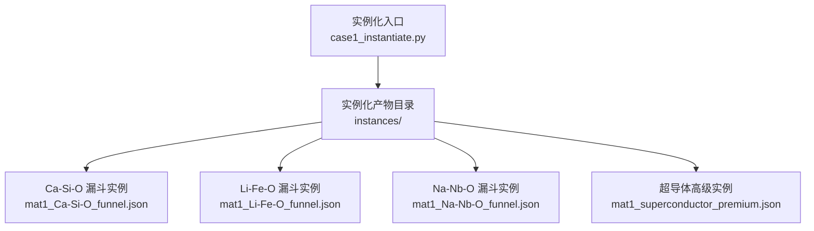
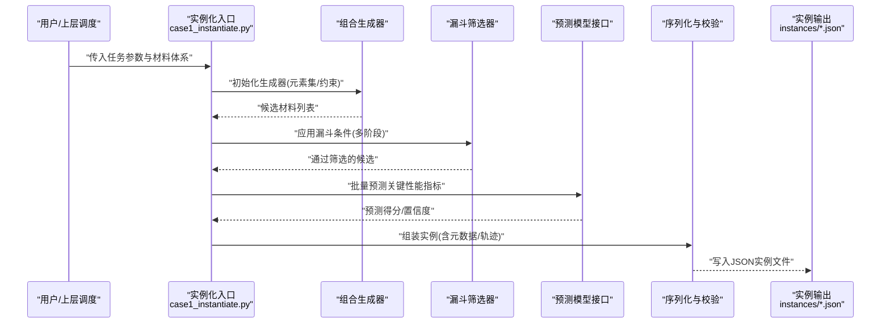
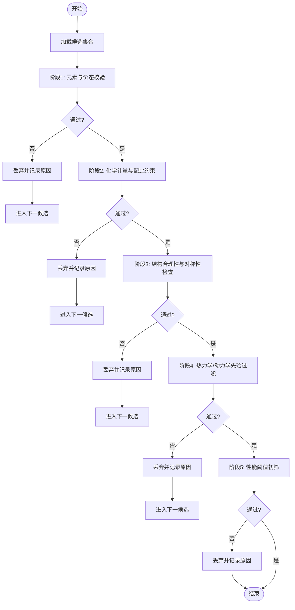
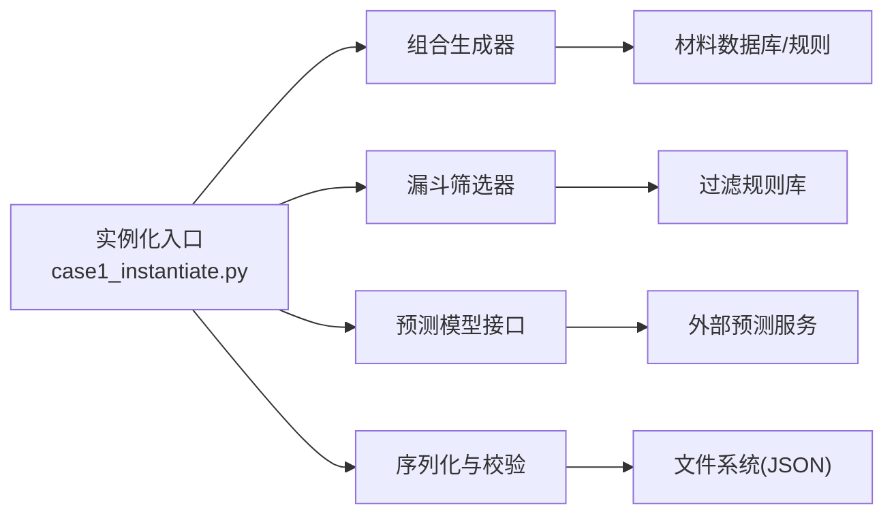

# Case1材料发现实例化

<cite>
**本文引用的文件**   
- [case1_instantiate.py](file://longhorizon/instantiate/case1_instantiate.py)
- [mat1_Ca-Si-O_funnel.json](file://longhorizon/instantiate/instances/mat1_Ca-Si-O_funnel.json)
- [mat1_Li-Fe-O_funnel.json](file://longhorizon/instantiate/instances/mat1_Li-Fe-O_funnel.json)
- [mat1_Na-Nb-O_funnel.json](file://longhorizon/instantiate/instances/mat1_Na-Nb-O_funnel.json)
- [mat1_superconductor_premium.json](file://longhorizon/instantiate/instances/mat1_superconductor_premium.json)
- [README_case3_机理模拟.md](file://longhorizon/instantiate/README_case3_机理模拟.md)
</cite>

## 目录
1. [简介](#简介)
2. [项目结构](#项目结构)
3. [核心组件](#核心组件)
4. [架构总览](#架构总览)
5. [详细组件分析](#详细组件分析)
6. [依赖关系分析](#依赖关系分析)
7. [性能考量](#性能考量)
8. [故障排查指南](#故障排查指南)
9. [结论](#结论)
10. [附录](#附录)

## 简介
本文件面向Case1“材料发现”任务，聚焦于实例化器（instantiator）的设计与实现。文档围绕以下目标展开：
- 说明材料发现任务的实例化逻辑，包括漏斗式筛选算法、材料组合生成策略和性能预测模型集成；
- 解释不同材料体系（Ca-Si-O、Li-Fe-O、Na-Nb-O）的特定参数配置和数据格式；
- 描述超导体发现的特殊处理逻辑与高级材料的实例化流程；
- 提供实例化参数的详细说明、数据验证规则与错误处理机制。

该实例化器用于将高层任务描述转化为可执行的候选材料集合与评估流程，为后续自动化探索或评测提供标准化输入。

## 项目结构
与Case1材料发现相关的代码与数据主要位于以下路径：
- 实例化主程序：longhorizon/instantiate/case1_instantiate.py
- 实例化产物（按材料体系与任务类型组织）：longhorizon/instantiate/instances/*
- 相关说明文档：longhorizon/instantiate/README_case3_机理模拟.md（作为参考）

图表来源
- [case1_instantiate.py](file://longhorizon/instantiate/case1_instantiate.py)
- [mat1_Ca-Si-O_funnel.json](file://longhorizon/instantiate/instances/mat1_Ca-Si-O_funnel.json)
- [mat1_Li-Fe-O_funnel.json](file://longhorizon/instantiate/instances/mat1_Li-Fe-O_funnel.json)
- [mat1_Na-Nb-O_funnel.json](file://longhorizon/instantiate/instances/mat1_Na-Nb-O_funnel.json)
- [mat1_superconductor_premium.json](file://longhorizon/instantiate/instances/mat1_superconductor_premium.json)

章节来源
- [case1_instantiate.py](file://longhorizon/instantiate/case1_instantiate.py)
- [mat1_Ca-Si-O_funnel.json](file://longhorizon/instantiate/instances/mat1_Ca-Si-O_funnel.json)
- [mat1_Li-Fe-O_funnel.json](file://longhorizon/instantiate/instances/mat1_Li-Fe-O_funnel.json)
- [mat1_Na-Nb-O_funnel.json](file://longhorizon/instantiate/instances/mat1_Na-Nb-O_funnel.json)
- [mat1_superconductor_premium.json](file://longhorizon/instantiate/instances/mat1_superconductor_premium.json)

## 核心组件
- 实例化入口与编排
  - 负责解析任务参数、加载材料体系配置、执行组合生成与漏斗筛选、调用预测模型并输出结构化实例。
- 漏斗式筛选模块
  - 定义多级过滤条件（如元素存在性、化学计量约束、稳定性先验等），逐级缩小候选空间。
- 材料组合生成器
  - 基于元素集与价态/配位规则生成候选化学式或结构片段，支持限定搜索范围与多样性控制。
- 性能预测模型集成
  - 通过统一接口接入外部预测服务（如带隙、超导转变温度Tc、形成能等），对候选进行快速打分与排序。
- 结果序列化与校验
  - 将最终实例序列化为JSON，包含元数据、筛选轨迹、评分与版本信息，便于复现与审计。

章节来源
- [case1_instantiate.py](file://longhorizon/instantiate/case1_instantiate.py)

## 架构总览
下图展示了从任务到实例产物的端到端流程，以及各组件之间的交互关系。

图表来源
- [case1_instantiate.py](file://longhorizon/instantiate/case1_instantiate.py)

## 详细组件分析

### 漏斗式筛选算法
- 设计要点
  - 多级过滤：元素存在性→化学计量比→结构合理性→热力学/动力学先验→性能阈值。
  - 短路策略：任一阶段失败即丢弃候选，减少后续计算开销。
  - 可插拔：每级过滤器以函数或配置对象形式注册，便于扩展新规则。
- 典型流程
  - 输入：候选材料集合
  - 步骤：逐层应用过滤条件，记录通过/拒绝原因
  - 输出：通过筛选的候选及筛选轨迹

图表来源
- [case1_instantiate.py](file://longhorizon/instantiate/case1_instantiate.py)

章节来源
- [case1_instantiate.py](file://longhorizon/instantiate/case1_instantiate.py)

### 材料组合生成策略
- 生成原则
  - 基于目标体系的元素集与常见价态，枚举可能的化学式片段；
  - 引入化合价平衡与电荷中性约束，避免无效组合；
  - 控制搜索空间大小，兼顾覆盖率与效率。
- 多样性控制
  - 使用去重与相似度阈值，避免高度重复的候选；
  - 可选地引入随机扰动或采样策略提升覆盖。
- 输出规范
  - 每个候选包含：元素组成、化学式、生成来源、约束满足情况。

章节来源
- [case1_instantiate.py](file://longhorizon/instantiate/case1_instantiate.py)

### 性能预测模型集成
- 集成方式
  - 统一预测接口：封装外部模型调用，返回标准化字段（如预测值、置信度、耗时）。
  - 批处理：对候选进行批量预测，降低网络/IO开销。
  - 容错：单条预测失败不影响整体流程，记录异常并继续。
- 常用指标
  - 半导体：带隙、有效质量、迁移率；
  - 超导体：Tc估计、临界场；
  - 通用：形成能、稳定性评分。
- 结果融合
  - 将预测分数纳入漏斗最后阶段或后处理排序，辅助选择Top-K候选。

章节来源
- [case1_instantiate.py](file://longhorizon/instantiate/case1_instantiate.py)

### 材料体系特定配置与数据格式
- Ca-Si-O体系
  - 关注点：硅酸盐网络构建、氧配位环境、钙占位；
  - 典型约束：Si/O比例区间、Ca/Si比值范围、电荷平衡；
  - 输出字段：元素占比、结构片段、稳定性评分。
- Li-Fe-O体系
  - 关注点：过渡金属氧化态、层状/尖晶石结构倾向；
  - 典型约束：Li/Fe比例、氧空位容忍度、相稳定性；
  - 输出字段：相类型、带隙/电导率预估、能量评分。
- Na-Nb-O体系
  - 关注点：Nb高氧化态稳定域、钠通道连通性；
  - 典型约束：Na/Nb比例、氧八面体连接模式；
  - 输出字段：离子迁移路径、介电/铁电特性预估。

上述体系的实例化产物均以JSON形式保存，包含元数据、筛选轨迹、预测结果与版本信息，便于追溯与对比。

章节来源
- [mat1_Ca-Si-O_funnel.json](file://longhorizon/instantiate/instances/mat1_Ca-Si-O_funnel.json)
- [mat1_Li-Fe-O_funnel.json](file://longhorizon/instantiate/instances/mat1_Li-Fe-O_funnel.json)
- [mat1_Na-Nb-O_funnel.json](file://longhorizon/instantiate/instances/mat1_Na-Nb-O_funnel.json)

### 超导体发现的特殊处理逻辑
- 特殊流程
  - 在常规漏斗基础上增加“超导先验”阶段：基于文献统计特征（如元素种类、电子浓度、晶系偏好）进行初筛；
  - 引入“高级材料”分支：对潜在超导候选启用更精细的结构建模与更高成本的预测；
  - 结果标注：明确标记“超导体候选”，附带Tc估计与不确定性。
- 高级材料实例化
  - 针对少数高价值候选，触发增强型工作流（如高精度计算、多尺度模拟）；
  - 产出更丰富的属性集与可视化摘要，供专家审阅。

章节来源
- [mat1_superconductor_premium.json](file://longhorizon/instantiate/instances/mat1_superconductor_premium.json)
- [case1_instantiate.py](file://longhorizon/instantiate/case1_instantiate.py)

### 实例化参数说明
- 任务参数
  - 材料体系标识（如Ca-Si-O、Li-Fe-O、Na-Nb-O、superconductor）；
  - 搜索范围（元素子集、化学计量区间、结构类型）；
  - 漏斗阈值（各级过滤的数值或布尔条件）；
  - 预测模型选择（带隙/Tc/形成能等）与批大小。
- 输出控制
  - Top-K数量、是否保留筛选轨迹、是否导出中间结果。
- 运行选项
  - 并行度、重试次数、超时设置、日志级别。

章节来源
- [case1_instantiate.py](file://longhorizon/instantiate/case1_instantiate.py)

### 数据验证规则
- 必填字段
  - 任务ID、材料体系、版本、时间戳、作者/来源；
  - 候选列表、筛选轨迹、预测结果。
- 类型与范围
  - 数值字段需满足上下界（如比例∈[0,1]、Tc≥0）；
  - 枚举字段需在允许集合内（如结构类型、相类别）。
- 一致性检查
  - 元素总量归一化、电荷平衡、化学式与元素表一致；
  - 预测结果与候选一一对应，无缺失或错位。
- 失败处理
  - 校验失败时中止写入并返回错误码，附带具体字段与原因。

章节来源
- [case1_instantiate.py](file://longhorizon/instantiate/case1_instantiate.py)

### 错误处理机制
- 分类
  - 参数错误：缺失/非法参数，立即终止并提示修正；
  - 数据错误：输入数据不合法或损坏，记录详情并跳过；
  - 模型错误：预测服务不可用或超时，降级策略（跳过或回退默认值）；
  - IO错误：读写失败，重试与告警。
- 恢复策略
  - 断点续跑：记录已处理进度，支持从中断处继续；
  - 幂等性：重复运行不会产生重复实例；
  - 审计日志：完整记录每一步决策与异常。

章节来源
- [case1_instantiate.py](file://longhorizon/instantiate/case1_instantiate.py)

## 依赖关系分析
- 内部依赖
  - 实例化入口依赖组合生成器、漏斗筛选器、预测接口与序列化模块；
  - 各模块通过清晰接口通信，降低耦合度。
- 外部依赖
  - 预测模型服务（HTTP/gRPC/本地库）；
  - 文件系统（JSON读写）、日志系统。
- 循环依赖
  - 当前设计避免循环导入，模块职责单一且边界清晰。

图表来源
- [case1_instantiate.py](file://longhorizon/instantiate/case1_instantiate.py)

章节来源
- [case1_instantiate.py](file://longhorizon/instantiate/case1_instantiate.py)

## 性能考量
- 生成阶段
  - 使用约束剪枝与早期失效，显著减少候选规模；
  - 采用去重与相似度过滤，避免冗余计算。
- 筛选阶段
  - 短路与并行化：独立候选可并行过滤，提高吞吐；
  - 缓存命中：对相同输入复用历史结果。
- 预测阶段
  - 批处理与连接池：降低网络往返；
  - 自适应批大小：根据资源动态调整。
- 存储与IO
  - 增量写入与压缩：减少磁盘占用与传输成本；
  - 索引与检索：对实例建立轻量索引，便于查询。

## 故障排查指南
- 常见问题
  - 参数缺失或类型错误：检查任务参数与配置文件；
  - 预测服务超时：确认网络与服务状态，调整超时与重试；
  - JSON校验失败：核对必填字段与取值范围；
  - 结果不一致：比对筛选轨迹与预测结果映射。
- 定位方法
  - 查看日志中的错误码与堆栈；
  - 使用最小复现实例隔离问题；
  - 逐步关闭过滤阶段定位瓶颈。
- 恢复建议
  - 修正参数后重新运行；
  - 启用断点续跑避免重复工作；
  - 必要时回滚至上一稳定版本。

章节来源
- [case1_instantiate.py](file://longhorizon/instantiate/case1_instantiate.py)

## 结论
Case1材料发现实例化器通过“组合生成—漏斗筛选—预测集成—序列化校验”的流水线，实现了高效、可扩展的材料候选发现流程。针对不同材料体系提供了专用约束与输出规范，并对超导体这一高价值场景设计了增强型处理路径。完善的参数配置、数据验证与错误处理机制保障了系统的鲁棒性与可维护性。

## 附录
- 参考文档
  - 机理模拟与案例说明可作为理解复杂工作流的补充材料。

章节来源
- [README_case3_机理模拟.md](file://longhorizon/instantiate/README_case3_机理模拟.md)