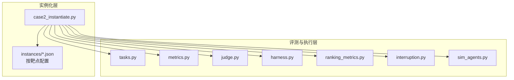
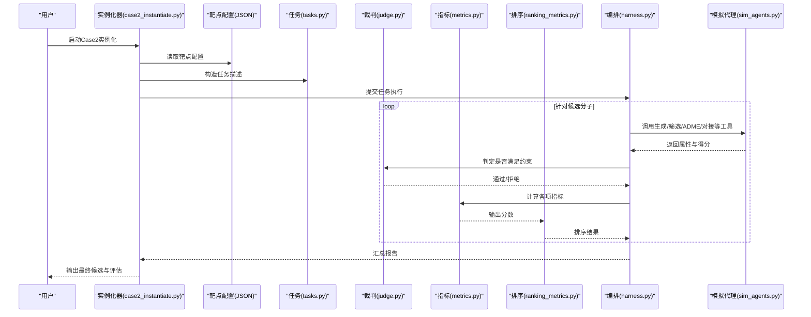
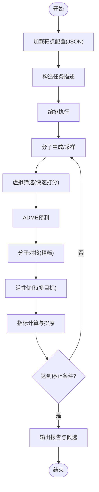
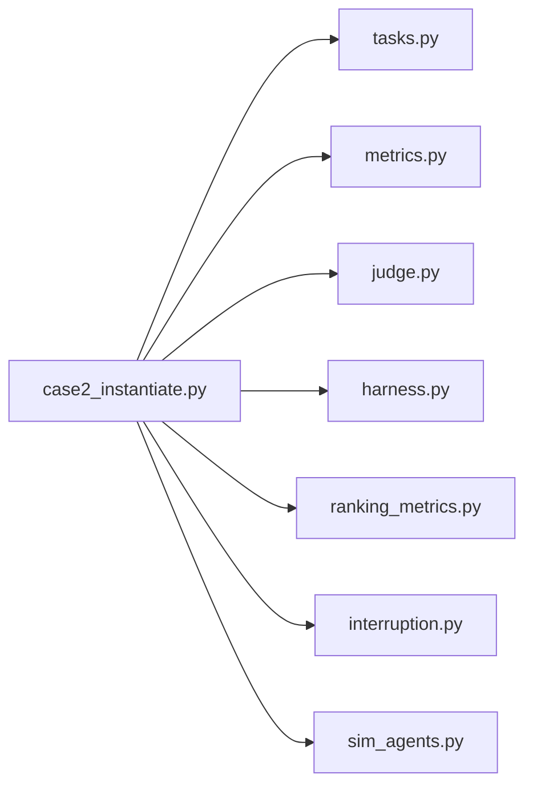

# Case2药物发现实例化

<cite>
**本文引用的文件**   
- [longhorizon/instantiate/case2_instantiate.py](file://longhorizon/instantiate/case2_instantiate.py)
- [longhorizon/instantiate/instances/drug2_BACE1.json](file://longhorizon/instantiate/instances/drug2_BACE1.json)
- [longhorizon/instantiate/instances/drug2_DPP-4.json](file://longhorizon/instantiate/instances/drug2_DPP-4.json)
- [longhorizon/instantiate/instances/drug2_EGFR.json](file://longhorizon/instantiate/instances/drug2_EGFR.json)
- [longhorizon/instantiate/instances/drug2_GLP-1R.json](file://longhorizon/instantiate/instances/drug2_GLP-1R.json)
- [longhorizon/instantiate/instances/drug2_mTOR.json](file://longhorizon/instantiate/instances/drug2_mTOR.json)
- [autonomy_mvp/core/tasks.py](file://autonomy_mvp/core/tasks.py)
- [autonomy_mvp/core/metrics.py](file://autonomy_mvp/core/metrics.py)
- [autonomy_mvp/core/judge.py](file://autonomy_mvp/core/judge.py)
- [autonomy_mvp/core/harness.py](file://autonomy_mvp/core/harness.py)
- [autonomy_mvp/core/ranking_metrics.py](file://autonomy_mvp/core/ranking_metrics.py)
- [autonomy_mvp/core/interruption.py](file://autonomy_mvp/core/interruption.py)
- [autonomy_mvp/core/sim_agents.py](file://autonomy_mvp/core/sim_agents.py)
</cite>

## 目录
1. [简介](#简介)
2. [项目结构](#项目结构)
3. [核心组件](#核心组件)
4. [架构总览](#架构总览)
5. [详细组件分析](#详细组件分析)
6. [依赖关系分析](#依赖关系分析)
7. [性能考量](#性能考量)
8. [故障排查指南](#故障排查指南)
9. [结论](#结论)
10. [附录](#附录)

## 简介
本文件面向“Case2药物发现实例化器”，聚焦于药物靶点相关的实例化逻辑与配置，覆盖BACE1、DPP-4、EGFR等关键靶点的特定参数；并说明分子结构生成、ADME性质预测与药效评估的集成方式，以及药物相似性计算、虚拟筛选与活性优化的实现细节。文档同时给出靶点特异性参数配置、分子库构建策略与评估指标定义，帮助读者快速理解与扩展该实例化流程。

## 项目结构
Case2药物发现实例化位于 longhorizon/instantiate 目录下，核心入口为 case2_instantiate.py，并通过 instances 目录下的 JSON 配置文件为不同靶点提供差异化参数。评测与执行框架位于 autonomy_mvp/core 中，包含任务定义、指标、裁判、编排与中断处理等模块。

图表来源
- [longhorizon/instantiate/case2_instantiate.py](file://longhorizon/instantiate/case2_instantiate.py)
- [autonomy_mvp/core/tasks.py](file://autonomy_mvp/core/tasks.py)
- [autonomy_mvp/core/metrics.py](file://autonomy_mvp/core/metrics.py)
- [autonomy_mvp/core/judge.py](file://autonomy_mvp/core/judge.py)
- [autonomy_mvp/core/harness.py](file://autonomy_mvp/core/harness.py)
- [autonomy_mvp/core/ranking_metrics.py](file://autonomy_mvp/core/ranking_metrics.py)
- [autonomy_mvp/core/interruption.py](file://autonomy_mvp/core/interruption.py)
- [autonomy_mvp/core/sim_agents.py](file://autonomy_mvp/core/sim_agents.py)

章节来源
- [longhorizon/instantiate/case2_instantiate.py](file://longhorizon/instantiate/case2_instantiate.py)
- [autonomy_mvp/core/tasks.py](file://autonomy_mvp/core/tasks.py)
- [autonomy_mvp/core/metrics.py](file://autonomy_mvp/core/metrics.py)
- [autonomy_mvp/core/judge.py](file://autonomy_mvp/core/judge.py)
- [autonomy_mvp/core/harness.py](file://autonomy_mvp/core/harness.py)
- [autonomy_mvp/core/ranking_metrics.py](file://autonomy_mvp/core/ranking_metrics.py)
- [autonomy_mvp/core/interruption.py](file://autonomy_mvp/core/interruption.py)
- [autonomy_mvp/core/sim_agents.py](file://autonomy_mvp/core/sim_agents.py)

## 核心组件
- 实例化入口：负责加载靶点配置、组装任务、驱动评测与结果汇总。
- 靶点配置：每个靶点一个JSON文件，定义目标蛋白、筛选阈值、优化目标、分子库范围与评估指标权重等。
- 任务与指标：统一的任务描述与评分函数，支持多目标权衡与排序。
- 裁判与编排：对候选分子进行判定、打分与排名，支持中断与重试。
- 模拟代理：在需要时调用外部工具或模型完成分子生成、对接、ADME预测等步骤。

章节来源
- [longhorizon/instantiate/case2_instantiate.py](file://longhorizon/instantiate/case2_instantiate.py)
- [autonomy_mvp/core/tasks.py](file://autonomy_mvp/core/tasks.py)
- [autonomy_mvp/core/metrics.py](file://autonomy_mvp/core/metrics.py)
- [autonomy_mvp/core/judge.py](file://autonomy_mvp/core/judge.py)
- [autonomy_mvp/core/harness.py](file://autonomy_mvp/core/harness.py)
- [autonomy_mvp/core/ranking_metrics.py](file://autonomy_mvp/core/ranking_metrics.py)
- [autonomy_mvp/core/interruption.py](file://autonomy_mvp/core/interruption.py)
- [autonomy_mvp/core/sim_agents.py](file://autonomy_mvp/core/sim_agents.py)

## 架构总览
下图展示了从实例化到评测的整体数据流与控制流。

图表来源
- [longhorizon/instantiate/case2_instantiate.py](file://longhorizon/instantiate/case2_instantiate.py)
- [autonomy_mvp/core/tasks.py](file://autonomy_mvp/core/tasks.py)
- [autonomy_mvp/core/judge.py](file://autonomy_mvp/core/judge.py)
- [autonomy_mvp/core/metrics.py](file://autonomy_mvp/core/metrics.py)
- [autonomy_mvp/core/ranking_metrics.py](file://autonomy_mvp/core/ranking_metrics.py)
- [autonomy_mvp/core/harness.py](file://autonomy_mvp/core/harness.py)
- [autonomy_mvp/core/sim_agents.py](file://autonomy_mvp/core/sim_agents.py)

## 详细组件分析

### 实例化入口与流程控制
- 功能要点
  - 解析命令行参数与环境变量，选择具体靶点与运行模式。
  - 加载对应靶点的JSON配置，合并默认参数与覆盖项。
  - 根据配置生成任务对象，交由编排器执行。
  - 收集中间结果与最终报告，写入日志与输出目录。
- 关键路径
  - 实例化主流程与参数解析
  - 配置加载与校验
  - 任务构造与分发
  - 结果聚合与导出

章节来源
- [longhorizon/instantiate/case2_instantiate.py](file://longhorizon/instantiate/case2_instantiate.py)

### 靶点配置（BACE1、DPP-4、EGFR、GLP-1R、mTOR）
- 配置内容通常包括
  - 靶点标识与参考结构信息（如PDB ID或序列片段）
  - 结合口袋定义与对接参数（网格尺寸、采样步数、评分函数）
  - ADME阈值（如LogP、TPSA、HBA/HBD、MW、溶解度等）
  - 分子库来源与过滤规则（可及化学空间、合成可及性、多样性）
  - 评估指标与权重（亲和力、选择性、类药性、安全性）
  - 终止条件与迭代上限（用于活性优化循环）
- 示例文件
  - BACE1、DPP-4、EGFR、GLP-1R、mTOR 各一份独立配置

章节来源
- [longhorizon/instantiate/instances/drug2_BACE1.json](file://longhorizon/instantiate/instances/drug2_BACE1.json)
- [longhorizon/instantiate/instances/drug2_DPP-4.json](file://longhorizon/instantiate/instances/drug2_DPP-4.json)
- [longhorizon/instantiate/instances/drug2_EGFR.json](file://longhorizon/instantiate/instances/drug2_EGFR.json)
- [longhorizon/instantiate/instances/drug2_GLP-1R.json](file://longhorizon/instantiate/instances/drug2_GLP-1R.json)
- [longhorizon/instantiate/instances/drug2_mTOR.json](file://longhorizon/instantiate/instances/drug2_mTOR.json)

### 任务定义与指标体系
- 任务定义
  - 明确输入（靶点、初始种子分子、库范围）、过程（生成/筛选/优化）、输出（候选清单与评分）。
  - 支持多阶段流水线：初筛→精筛→优化→验证。
- 指标体系
  - 药效相关：对接评分、结合自由能估计、活性相关性。
  - ADME相关：吸收、分布、代谢、排泄与毒性风险。
  - 类药性与可合成性：Lipinski规则、Veber规则、合成可及性评分。
  - 多样性与新颖性：Tanimoto相似度、骨架差异、结构熵。
  - 综合评分：加权融合与排序。

章节来源
- [autonomy_mvp/core/tasks.py](file://autonomy_mvp/core/tasks.py)
- [autonomy_mvp/core/metrics.py](file://autonomy_mvp/core/metrics.py)
- [autonomy_mvp/core/ranking_metrics.py](file://autonomy_mvp/core/ranking_metrics.py)

### 裁判与编排
- 裁判（judge）
  - 基于阈值与规则判定候选是否通过（硬约束与软约束）。
  - 记录失败原因与改进建议，辅助后续优化。
- 编排（harness）
  - 管理并发与重试、资源分配与超时控制。
  - 串联生成、筛选、ADME、对接、优化等子流程。
  - 维护状态机与断点续跑能力。

章节来源
- [autonomy_mvp/core/judge.py](file://autonomy_mvp/core/judge.py)
- [autonomy_mvp/core/harness.py](file://autonomy_mvp/core/harness.py)

### 中断与恢复
- 支持在执行过程中捕获异常与中断信号。
- 保存检查点，便于恢复与继续执行。
- 提供细粒度错误分类与告警。

章节来源
- [autonomy_mvp/core/interruption.py](file://autonomy_mvp/core/interruption.py)

### 模拟代理与工具集成
- 模拟代理（sim_agents）
  - 封装对外部工具的调用接口（分子生成、对接、ADME预测、相似性计算等）。
  - 提供统一的输入输出契约与错误处理。
- 典型工具链
  - 分子生成：基于规则或模型的de novo设计。
  - 虚拟筛选：快速打分与预过滤。
  - 分子对接：精确结合构象与评分。
  - ADME预测：理化与成药性评估。
  - 相似性计算：指纹与图核方法。

章节来源
- [autonomy_mvp/core/sim_agents.py](file://autonomy_mvp/core/sim_agents.py)

### 分子结构生成与虚拟筛选
- 生成策略
  - 以种子分子或骨架为基础，结合靶点口袋信息进行引导生成。
  - 引入多样性约束与合成可及性评估，避免落入局部最优。
- 虚拟筛选
  - 两阶段筛选：快速打分→精细评估。
  - 使用多指标联合过滤，兼顾亲和力与类药性。

章节来源
- [autonomy_mvp/core/sim_agents.py](file://autonomy_mvp/core/sim_agents.py)
- [autonomy_mvp/core/metrics.py](file://autonomy_mvp/core/metrics.py)

### ADME性质预测与整合
- 预测维度
  - 吸收（渗透性、溶解度）、分布（血浆蛋白结合）、代谢（CYP抑制/诱导）、排泄（清除率）、毒性（肝毒、心脏毒性等）。
- 整合方式
  - 将ADME评分纳入综合评分函数，作为筛选与优化的重要依据。
  - 设置硬性阈值与软性惩罚，平衡活性与成药性。

章节来源
- [autonomy_mvp/core/metrics.py](file://autonomy_mvp/core/metrics.py)
- [autonomy_mvp/core/judge.py](file://autonomy_mvp/core/judge.py)

### 药效评估与活性优化
- 评估
  - 对接评分、结合自由能估算、实验活性相关性（若有）。
- 优化
  - 基于梯度或启发式的局部修饰，提升亲和力与ADME。
  - 多目标优化：活性、类药性、多样性、可合成性。

章节来源
- [autonomy_mvp/core/metrics.py](file://autonomy_mvp/core/metrics.py)
- [autonomy_mvp/core/ranking_metrics.py](file://autonomy_mvp/core/ranking_metrics.py)

### 药物相似性计算
- 常用方法
  - Tanimoto系数（ECFP/Morgan指纹）、MACCS键指纹、图核。
- 用途
  - 去重与多样性控制、邻近搜索、结构迁移学习。

章节来源
- [autonomy_mvp/core/sim_agents.py](file://autonomy_mvp/core/sim_agents.py)
- [autonomy_mvp/core/metrics.py](file://autonomy_mvp/core/metrics.py)

### 靶点特异性参数与分子库构建策略
- 靶点特异性
  - BACE1：关注跨膜区附近口袋与酸性残基相互作用。
  - DPP-4：强调S1/S2亚口袋匹配与柔性环适配。
  - EGFR：考虑激酶ATP结合位点与突变敏感性。
  - GLP-1R：GPCR大口袋与变构调节可能性。
  - mTOR：大口袋与疏水核心适配。
- 分子库构建
  - 组合库、可及化学空间、已知活性类似物、骨架跃迁集合。
  - 引入多样性与新颖性度量，避免同质化。

章节来源
- [longhorizon/instantiate/instances/drug2_BACE1.json](file://longhorizon/instantiate/instances/drug2_BACE1.json)
- [longhorizon/instantiate/instances/drug2_DPP-4.json](file://longhorizon/instantiate/instances/drug2_DPP-4.json)
- [longhorizon/instantiate/instances/drug2_EGFR.json](file://longhorizon/instantiate/instances/drug2_EGFR.json)
- [longhorizon/instantiate/instances/drug2_GLP-1R.json](file://longhorizon/instantiate/instances/drug2_GLP-1R.json)
- [longhorizon/instantiate/instances/drug2_mTOR.json](file://longhorizon/instantiate/instances/drug2_mTOR.json)

### 评估指标定义与排序
- 指标定义
  - 亲和力度量、ADME健康度、类药性、多样性、新颖性。
- 排序策略
  - 线性加权、层次分析、帕累托前沿筛选。
  - 支持动态权重调整以适配不同阶段目标。

章节来源
- [autonomy_mvp/core/metrics.py](file://autonomy_mvp/core/metrics.py)
- [autonomy_mvp/core/ranking_metrics.py](file://autonomy_mvp/core/ranking_metrics.py)

### 流程图：Case2实例化主流程

图表来源
- [longhorizon/instantiate/case2_instantiate.py](file://longhorizon/instantiate/case2_instantiate.py)
- [autonomy_mvp/core/harness.py](file://autonomy_mvp/core/harness.py)
- [autonomy_mvp/core/metrics.py](file://autonomy_mvp/core/metrics.py)
- [autonomy_mvp/core/ranking_metrics.py](file://autonomy_mvp/core/ranking_metrics.py)

## 依赖关系分析
- 内部依赖
  - 实例化入口依赖任务、指标、裁判、编排、排序与中断模块。
  - 模拟代理作为工具集成的抽象层，被编排器调用。
- 外部依赖
  - 分子生成、对接、ADME预测等工具可能由外部服务或本地库提供，通过模拟代理统一接入。

图表来源
- [longhorizon/instantiate/case2_instantiate.py](file://longhorizon/instantiate/case2_instantiate.py)
- [autonomy_mvp/core/tasks.py](file://autonomy_mvp/core/tasks.py)
- [autonomy_mvp/core/metrics.py](file://autonomy_mvp/core/metrics.py)
- [autonomy_mvp/core/judge.py](file://autonomy_mvp/core/judge.py)
- [autonomy_mvp/core/harness.py](file://autonomy_mvp/core/harness.py)
- [autonomy_mvp/core/ranking_metrics.py](file://autonomy_mvp/core/ranking_metrics.py)
- [autonomy_mvp/core/interruption.py](file://autonomy_mvp/core/interruption.py)
- [autonomy_mvp/core/sim_agents.py](file://autonomy_mvp/core/sim_agents.py)

章节来源
- [longhorizon/instantiate/case2_instantiate.py](file://longhorizon/instantiate/case2_instantiate.py)
- [autonomy_mvp/core/tasks.py](file://autonomy_mvp/core/tasks.py)
- [autonomy_mvp/core/metrics.py](file://autonomy_mvp/core/metrics.py)
- [autonomy_mvp/core/judge.py](file://autonomy_mvp/core/judge.py)
- [autonomy_mvp/core/harness.py](file://autonomy_mvp/core/harness.py)
- [autonomy_mvp/core/ranking_metrics.py](file://autonomy_mvp/core/ranking_metrics.py)
- [autonomy_mvp/core/interruption.py](file://autonomy_mvp/core/interruption.py)
- [autonomy_mvp/core/sim_agents.py](file://autonomy_mvp/core/sim_agents.py)

## 性能考量
- 并行与批处理
  - 利用编排器并发执行生成与筛选，提高吞吐。
  - 对接与ADME预测采用批处理与缓存策略减少重复计算。
- 内存与I/O
  - 分块读写分子库，避免一次性加载导致内存溢出。
  - 使用高效序列化格式存储中间结果。
- 算法选择
  - 快速打分优先，降低整体时间成本。
  - 对高价值候选进行高精度评估，平衡精度与效率。

[本节为通用指导，不直接分析具体文件]

## 故障排查指南
- 常见问题
  - 配置缺失或字段类型错误：检查JSON结构与必填字段。
  - 工具不可用或超时：确认外部服务状态与网络连通性。
  - 指标计算异常：核对输入分子有效性（SMILES合法性、三维构象合理性）。
  - 中断与恢复：查看检查点文件与日志定位失败阶段。
- 诊断手段
  - 启用详细日志与中间产物输出。
  - 使用最小复现用例逐步隔离问题。
  - 借助裁判反馈的错误分类进行针对性修复。

章节来源
- [autonomy_mvp/core/judge.py](file://autonomy_mvp/core/judge.py)
- [autonomy_mvp/core/interruption.py](file://autonomy_mvp/core/interruption.py)
- [autonomy_mvp/core/harness.py](file://autonomy_mvp/core/harness.py)

## 结论
Case2药物发现实例化器通过清晰的模块化设计与灵活的靶点配置，实现了从分子生成、虚拟筛选、ADME预测到对接与活性优化的完整闭环。其指标体系与排序策略支持多目标权衡，配合编排与中断机制保障稳定性与可恢复性。针对不同靶点的专用配置使得系统具备较强的可扩展性与工程落地能力。

[本节为总结性内容，不直接分析具体文件]

## 附录
- 术语表
  - 虚拟筛选：通过计算模型对大规模化合物库进行快速评估与筛选。
  - 分子对接：预测小分子与靶标蛋白的结合构象与亲和力。
  - ADME：吸收、分布、代谢、排泄的综合成药性评估。
  - 相似性：基于指纹或结构的分子间相似度度量。
- 最佳实践
  - 合理设置阈值与权重，避免过度优化单一指标。
  - 定期更新分子库与工具版本，保持评估一致性。
  - 建立回归测试与基准数据集，确保结果可复现。

[本节为概念性内容，不直接分析具体文件]