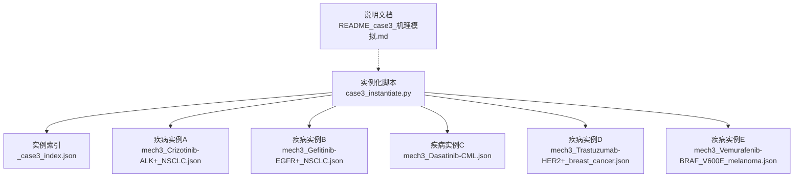
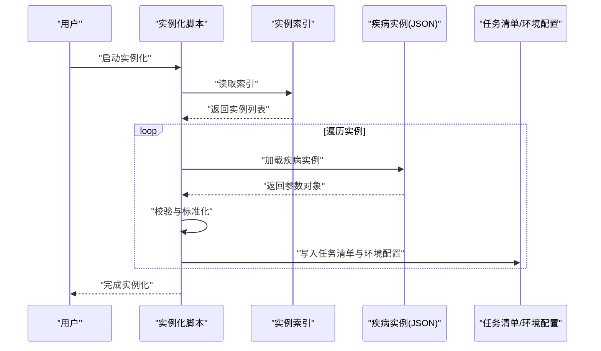
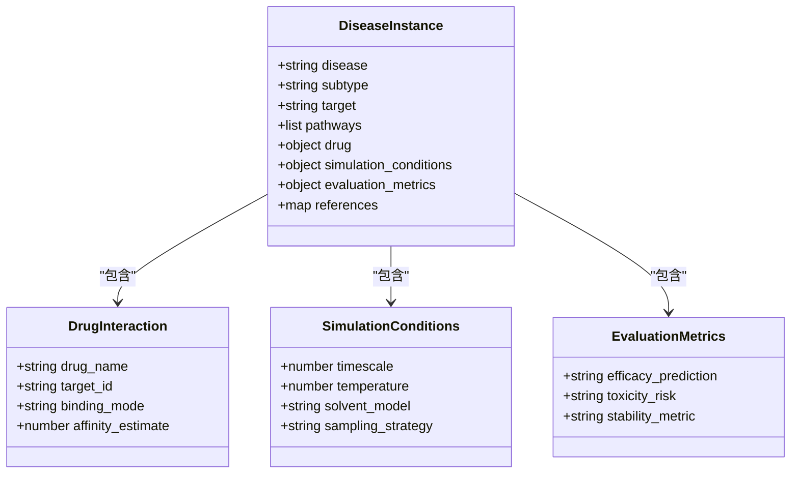
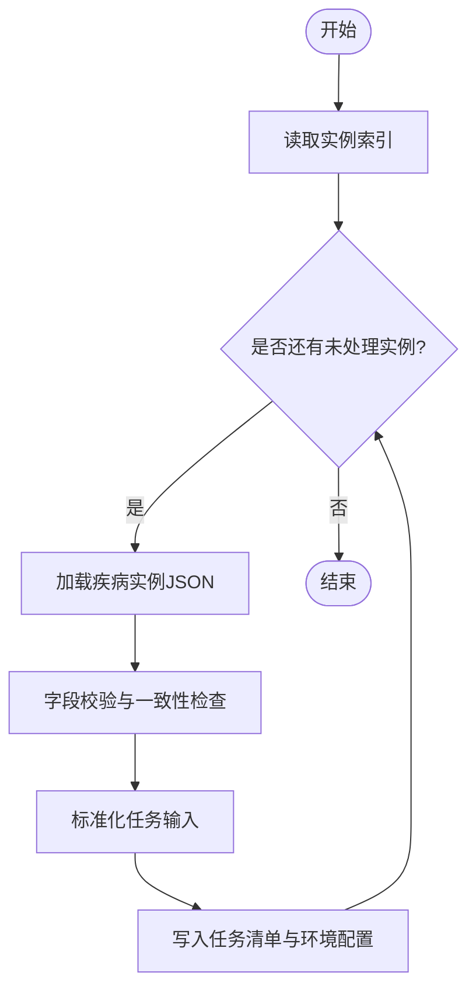
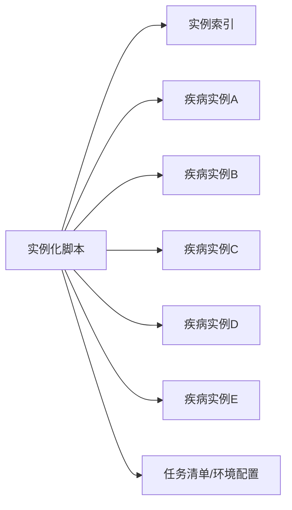

# Case3机理模拟实例化

<cite>
**本文引用的文件**   
- [case3_instantiate.py](file://longhorizon/instantiate/case3_instantiate.py)
- [README_case3_机理模拟.md](file://longhorizon/instantiate/README_case3_机理模拟.md)
- [_case3_index.json](file://longhorizon/instantiate/instances/_case3_index.json)
- [mech3_Crizotinib-ALK+_NSCLC.json](file://longhorizon/instantiate/instances/mech3_Crizotinib-ALK+_NSCLC.json)
- [mech3_Gefitinib-EGFR+_NSCLC.json](file://longhorizon/instantiate/instances/mech3_Gefitinib-EGFR+_NSCLC.json)
- [mech3_Dasatinib-CML.json](file://longhorizon/instantiate/instances/mech3_Dasatinib-CML.json)
- [mech3_Trastuzumab-HER2+_breast_cancer.json](file://longhorizon/instantiate/instances/mech3_Trastuzumab-HER2+_breast_cancer.json)
- [mech3_Vemurafenib-BRAF_V600E_melanoma.json](file://longhorizon/instantiate/instances/mech3_Vemurafenib-BRAF_V600E_melanoma.json)
</cite>

## 目录
1. [简介](#简介)
2. [项目结构](#项目结构)
3. [核心组件](#核心组件)
4. [架构总览](#架构总览)
5. [详细组件分析](#详细组件分析)
6. [依赖关系分析](#依赖关系分析)
7. [性能考虑](#性能考虑)
8. [故障排查指南](#故障排查指南)
9. [结论](#结论)
10. [附录](#附录)

## 简介
本文件面向“Case3 机理模拟实例化器”，聚焦复杂疾病机理模拟的实例化逻辑与工程实现。文档围绕以下目标展开：
- 解释非小细胞肺癌（NSCLC）、慢性髓性白血病（CML）、乳腺癌、黑色素瘤等疾病的特定建模方法；
- 说明药物-靶点相互作用模拟、信号通路分析与治疗效果预测的实现思路；
- 描述分子动力学模拟、量子化学计算与生物信息学分析的集成方式；
- 给出疾病特异性参数、模拟条件配置与结果验证机制的设计要点。

该实例化器通过统一的实例定义与索引组织，将不同疾病场景的参数化配置集中管理，为后续仿真与评估提供一致的数据入口。

## 项目结构
Case3 相关代码与数据位于 longhorizon/instantiate 目录下，核心包括：
- 实例化脚本：负责读取索引、加载并校验各疾病实例的配置；
- 实例索引：集中列出所有 Case3 实例及其元信息；
- 疾病实例：每个 JSON 文件对应一种疾病-药物组合的完整建模参数与流程定义；
- 说明文档：对 Case3 的目标、范围与使用方式进行概述。

图表来源
- [case3_instantiate.py](file://longhorizon/instantiate/case3_instantiate.py)
- [_case3_index.json](file://longhorizon/instantiate/instances/_case3_index.json)
- [mech3_Crizotinib-ALK+_NSCLC.json](file://longhorizon/instantiate/instances/mech3_Crizotinib-ALK+_NSCLC.json)
- [mech3_Gefitinib-EGFR+_NSCLC.json](file://longhorizon/instantiate/instances/mech3_Gefitinib-EGFR+_NSCLC.json)
- [mech3_Dasatinib-CML.json](file://longhorizon/instantiate/instances/mech3_Dasatinib-CML.json)
- [mech3_Trastuzumab-HER2+_breast_cancer.json](file://longhorizon/instantiate/instances/mech3_Trastuzumab-HER2+_breast_cancer.json)
- [mech3_Vemurafenib-BRAF_V600E_melanoma.json](file://longhorizon/instantiate/instances/mech3_Vemurafenib-BRAF_V600E_melanoma.json)
- [README_case3_机理模拟.md](file://longhorizon/instantiate/README_case3_机理模拟.md)

章节来源
- [README_case3_机理模拟.md](file://longhorizon/instantiate/README_case3_机理模拟.md)
- [_case3_index.json](file://longhorizon/instantiate/instances/_case3_index.json)
- [case3_instantiate.py](file://longhorizon/instantiate/case3_instantiate.py)

## 核心组件
- 实例化脚本
  - 职责：解析索引、加载实例、执行校验、输出运行所需的环境与任务清单。
  - 关键行为：遍历索引条目，按疾病类型选择相应模板或默认值，组装统一的任务输入结构。
- 实例索引
  - 职责：维护所有 Case3 实例的元数据（如疾病、靶点、药物、版本、路径等），供实例化脚本批量读取。
- 疾病实例（JSON）
  - 职责：以结构化形式描述每种疾病-药物的建模参数，包括靶点信息、通路节点、药物属性、模拟条件、评估指标等。
  - 覆盖疾病：NSCLC（EGFR/ALK）、CML、乳腺癌（HER2）、黑色素瘤（BRAF V600E）。

章节来源
- [case3_instantiate.py](file://longhorizon/instantiate/case3_instantiate.py)
- [_case3_index.json](file://longhorizon/instantiate/instances/_case3_index.json)
- [mech3_Crizotinib-ALK+_NSCLC.json](file://longhorizon/instantiate/instances/mech3_Crizotinib-ALK+_NSCLC.json)
- [mech3_Gefitinib-EGFR+_NSCLC.json](file://longhorizon/instantiate/instances/mech3_Gefitinib-EGFR+_NSCLC.json)
- [mech3_Dasatinib-CML.json](file://longhorizon/instantiate/instances/mech3_Dasatinib-CML.json)
- [mech3_Trastuzumab-HER2+_breast_cancer.json](file://longhorizon/instantiate/instances/mech3_Trastuzumab-HER2+_breast_cancer.json)
- [mech3_Vemurafenib-BRAF_V600E_melanoma.json](file://longhorizon/instantiate/instances/mech3_Vemurafenib-BRAF_V600E_melanoma.json)

## 架构总览
Case3 实例化器的整体流程如下：
- 读取索引文件，获取待处理的实例列表；
- 逐个加载疾病实例 JSON，进行字段完整性与一致性校验；
- 根据疾病类型与靶点信息，生成标准化的任务输入；
- 输出任务清单与运行环境配置，供下游仿真与评估模块消费。

图表来源
- [case3_instantiate.py](file://longhorizon/instantiate/case3_instantiate.py)
- [_case3_index.json](file://longhorizon/instantiate/instances/_case3_index.json)
- [mech3_Crizotinib-ALK+_NSCLC.json](file://longhorizon/instantiate/instances/mech3_Crizotinib-ALK+_NSCLC.json)
- [mech3_Gefitinib-EGFR+_NSCLC.json](file://longhorizon/instantiate/instances/mech3_Gefitinib-EGFR+_NSCLC.json)
- [mech3_Dasatinib-CML.json](file://longhorizon/instantiate/instances/mech3_Dasatinib-CML.json)
- [mech3_Trastuzumab-HER2+_breast_cancer.json](file://longhorizon/instantiate/instances/mech3_Trastuzumab-HER2+_breast_cancer.json)
- [mech3_Vemurafenib-BRAF_V600E_melanoma.json](file://longhorizon/instantiate/instances/mech3_Vemurafenib-BRAF_V600E_melanoma.json)

## 详细组件分析

### 疾病实例数据结构与关系
每个疾病实例 JSON 文件包含以下关键维度（具体字段以实际文件为准）：
- 疾病与亚型：如 NSCLC（EGFR+、ALK+）、CML、乳腺癌（HER2+）、黑色素瘤（BRAF V600E）；
- 靶点与通路：靶点标识、关键通路节点、调控关系；
- 药物与相互作用：药物名称、作用靶点、结合模式、亲和力估计；
- 模拟条件：时间尺度、温度、溶剂模型、采样策略；
- 评估指标：疗效预测、毒性风险、稳定性指标；
- 数据来源与引用：序列、结构、文献依据。

图表来源
- [mech3_Crizotinib-ALK+_NSCLC.json](file://longhorizon/instantiate/instances/mech3_Crizotinib-ALK+_NSCLC.json)
- [mech3_Gefitinib-EGFR+_NSCLC.json](file://longhorizon/instantiate/instances/mech3_Gefitinib-EGFR+_NSCLC.json)
- [mech3_Dasatinib-CML.json](file://longhorizon/instantiate/instances/mech3_Dasatinib-CML.json)
- [mech3_Trastuzumab-HER2+_breast_cancer.json](file://longhorizon/instantiate/instances/mech3_Trastuzumab-HER2+_breast_cancer.json)
- [mech3_Vemurafenib-BRAF_V600E_melanoma.json](file://longhorizon/instantiate/instances/mech3_Vemurafenib-BRAF_V600E_melanoma.json)

章节来源
- [mech3_Crizotinib-ALK+_NSCLC.json](file://longhorizon/instantiate/instances/mech3_Crizotinib-ALK+_NSCLC.json)
- [mech3_Gefitinib-EGFR+_NSCLC.json](file://longhorizon/instantiate/instances/mech3_Gefitinib-EGFR+_NSCLC.json)
- [mech3_Dasatinib-CML.json](file://longhorizon/instantiate/instances/mech3_Dasatinib-CML.json)
- [mech3_Trastuzumab-HER2+_breast_cancer.json](file://longhorizon/instantiate/instances/mech3_Trastuzumab-HER2+_breast_cancer.json)
- [mech3_Vemurafenib-BRAF_V600E_melanoma.json](file://longhorizon/instantiate/instances/mech3_Vemurafenib-BRAF_V600E_melanoma.json)

### 疾病建模方法与参数要点
- 非小细胞肺癌（NSCLC）
  - EGFR+：关注激酶活性抑制、下游 MAPK/PI3K-AKT 通路抑制；
  - ALK+：强调融合蛋白阻断与凋亡通路激活；
  - 参数重点：结合亲和力、构象变化阈值、通路抑制率。
- 慢性髓性白血病（CML）
  - 靶点：ABL1 激酶；
  - 参数重点：抑制剂选择性、耐药突变敏感性、细胞周期阻滞效应。
- 乳腺癌（HER2+）
  - 靶点：ERBB2；
  - 参数重点：抗体介导的内吞与降解、受体二聚化抑制、免疫微环境响应。
- 黑色素瘤（BRAF V600E）
  - 靶点：BRAF V600E；
  - 参数重点：变体特异性抑制、MEK/ERK 通路反馈调节、皮肤毒性风险。

章节来源
- [mech3_Crizotinib-ALK+_NSCLC.json](file://longhorizon/instantiate/instances/mech3_Crizotinib-ALK+_NSCLC.json)
- [mech3_Gefitinib-EGFR+_NSCLC.json](file://longhorizon/instantiate/instances/mech3_Gefitinib-EGFR+_NSCLC.json)
- [mech3_Dasatinib-CML.json](file://longhorizon/instantiate/instances/mech3_Dasatinib-CML.json)
- [mech3_Trastuzumab-HER2+_breast_cancer.json](file://longhorizon/instantiate/instances/mech3_Trastuzumab-HER2+_breast_cancer.json)
- [mech3_Vemurafenib-BRAF_V600E_melanoma.json](file://longhorizon/instantiate/instances/mech3_Vemurafenib-BRAF_V600E_melanoma.json)

### 药物-靶点相互作用模拟
- 结合模式与亲和力
  - 通过实例中的药物与靶点字段定义结合位点、相互作用类型与亲和力估计；
  - 用于筛选候选药物与排序。
- 构象采样与稳定性
  - 在模拟条件中指定采样策略与时间尺度，评估复合物稳定性；
  - 结合自由能估算作为辅助指标。
- 多尺度整合
  - 将原子级相互作用与细胞通路抑制效果关联，形成跨尺度预测。

章节来源
- [mech3_Crizotinib-ALK+_NSCLC.json](file://longhorizon/instantiate/instances/mech3_Crizotinib-ALK+_NSCLC.json)
- [mech3_Gefitinib-EGFR+_NSCLC.json](file://longhorizon/instantiate/instances/mech3_Gefitinib-EGFR+_NSCLC.json)
- [mech3_Dasatinib-CML.json](file://longhorizon/instantiate/instances/mech3_Dasatinib-CML.json)
- [mech3_Trastuzumab-HER2+_breast_cancer.json](file://longhorizon/instantiate/instances/mech3_Trastuzumab-HER2+_breast_cancer.json)
- [mech3_Vemurafenib-BRAF_V600E_melanoma.json](file://longhorizon/instantiate/instances/mech3_Vemurafenib-BRAF_V600E_melanoma.json)

### 信号通路分析与治疗效果预测
- 通路建模
  - 基于实例中的通路节点与调控关系，构建有向图或布尔网络；
  - 注入药物干预后，观察关键节点状态变化。
- 治疗效应量化
  - 使用评估指标（如通路抑制率、细胞增殖抑制、凋亡指数）进行量化；
  - 与临床前数据或文献基准对比，进行一致性检验。
- 反馈与耐药
  - 引入负反馈环路与旁路激活，评估长期抑制效果与耐药风险。

章节来源
- [mech3_Crizotinib-ALK+_NSCLC.json](file://longhorizon/instantiate/instances/mech3_Crizotinib-ALK+_NSCLC.json)
- [mech3_Gefitinib-EGFR+_NSCLC.json](file://longhorizon/instantiate/instances/mech3_Gefitinib-EGFR+_NSCLC.json)
- [mech3_Dasatinib-CML.json](file://longhorizon/instantiate/instances/mech3_Dasatinib-CML.json)
- [mech3_Trastuzumab-HER2+_breast_cancer.json](file://longhorizon/instantiate/instances/mech3_Trastuzumab-HER2+_breast_cancer.json)
- [mech3_Vemurafenib-BRAF_V600E_melanoma.json](file://longhorizon/instantiate/instances/mech3_Vemurafenib-BRAF_V600E_melanoma.json)

### 分子动力学、量子化学与生物信息学集成
- 分子动力学模拟
  - 在模拟条件中定义时间步长、温度、溶剂模型与采样策略；
  - 用于评估复合物稳定性、结合口袋动态与构象分布。
- 量子化学计算
  - 针对关键相互作用位点进行电子结构计算，获得结合能贡献分解；
  - 与实验或高精度基准对齐，校准力场参数。
- 生物信息学分析
  - 利用序列与结构数据库进行同源比对、变异注释与功能预测；
  - 将变异影响映射到通路层面，指导个体化用药策略。

章节来源
- [mech3_Crizotinib-ALK+_NSCLC.json](file://longhorizon/instantiate/instances/mech3_Crizotinib-ALK+_NSCLC.json)
- [mech3_Gefitinib-EGFR+_NSCLC.json](file://longhorizon/instantiate/instances/mech3_Gefitinib-EGFR+_NSCLC.json)
- [mech3_Dasatinib-CML.json](file://longhorizon/instantiate/instances/mech3_Dasatinib-CML.json)
- [mech3_Trastuzumab-HER2+_breast_cancer.json](file://longhorizon/instantiate/instances/mech3_Trastuzumab-HER2+_breast_cancer.json)
- [mech3_Vemurafenib-BRAF_V600E_melanoma.json](file://longhorizon/instantiate/instances/mech3_Vemurafenib-BRAF_V600E_melanoma.json)

### 实例化流程与控制流

图表来源
- [case3_instantiate.py](file://longhorizon/instantiate/case3_instantiate.py)
- [_case3_index.json](file://longhorizon/instantiate/instances/_case3_index.json)

章节来源
- [case3_instantiate.py](file://longhorizon/instantiate/case3_instantiate.py)
- [_case3_index.json](file://longhorizon/instantiate/instances/_case3_index.json)

## 依赖关系分析
- 内部依赖
  - 实例化脚本依赖索引与疾病实例 JSON；
  - 疾病实例之间无直接耦合，通过统一结构解耦。
- 外部依赖
  - 下游仿真与评估模块依赖实例化输出的任务清单与环境配置；
  - 生物信息学与计算工具链通过环境变量或配置文件接入。

图表来源
- [case3_instantiate.py](file://longhorizon/instantiate/case3_instantiate.py)
- [_case3_index.json](file://longhorizon/instantiate/instances/_case3_index.json)
- [mech3_Crizotinib-ALK+_NSCLC.json](file://longhorizon/instantiate/instances/mech3_Crizotinib-ALK+_NSCLC.json)
- [mech3_Gefitinib-EGFR+_NSCLC.json](file://longhorizon/instantiate/instances/mech3_Gefitinib-EGFR+_NSCLC.json)
- [mech3_Dasatinib-CML.json](file://longhorizon/instantiate/instances/mech3_Dasatinib-CML.json)
- [mech3_Trastuzumab-HER2+_breast_cancer.json](file://longhorizon/instantiate/instances/mech3_Trastuzumab-HER2+_breast_cancer.json)
- [mech3_Vemurafenib-BRAF_V600E_melanoma.json](file://longhorizon/instantiate/instances/mech3_Vemurafenib-BRAF_V600E_melanoma.json)

章节来源
- [case3_instantiate.py](file://longhorizon/instantiate/case3_instantiate.py)
- [_case3_index.json](file://longhorizon/instantiate/instances/_case3_index.json)

## 性能考虑
- 并行实例化
  - 对独立疾病实例可并行加载与校验，提升吞吐；
  - 注意资源隔离与内存占用控制。
- I/O 优化
  - 预读索引与缓存常用字段，减少重复解析开销；
  - 批量写入任务清单，降低文件系统压力。
- 计算资源调度
  - 根据实例复杂度分配 CPU/GPU 资源；
  - 对高成本步骤（如 MD/QM）采用队列与重试机制。

[本节为通用建议，不直接分析具体文件]

## 故障排查指南
- 索引缺失或损坏
  - 现象：无法读取实例列表或条目不完整；
  - 处理：核对索引文件格式与路径，确保所有实例文件存在且可读。
- 字段校验失败
  - 现象：必填字段缺失或类型不一致；
  - 处理：对照实例结构要求补全字段，修正数据类型。
- 下游运行异常
  - 现象：任务清单生成后仿真失败；
  - 处理：检查环境配置与工具链可用性，确认依赖库版本兼容。

章节来源
- [case3_instantiate.py](file://longhorizon/instantiate/case3_instantiate.py)
- [_case3_index.json](file://longhorizon/instantiate/instances/_case3_index.json)

## 结论
Case3 机理模拟实例化器通过统一的索引与实例结构，实现了多疾病-药物组合的可扩展建模与批量化运行。其设计兼顾了灵活性（疾病特异性参数）与一致性（标准化任务输入），为后续的信号通路分析、多尺度模拟与疗效预测提供了坚实基础。

[本节为总结性内容，不直接分析具体文件]

## 附录
- 快速上手
  - 准备环境：安装必要依赖，配置工具链路径；
  - 运行实例化：执行实例化脚本，查看生成的任务清单与环境配置；
  - 启动仿真：依据任务清单调用下游仿真与评估模块。
- 参考文档
  - 参见 README_case3_机理模拟.md 了解总体目标与使用说明。

章节来源
- [README_case3_机理模拟.md](file://longhorizon/instantiate/README_case3_机理模拟.md)