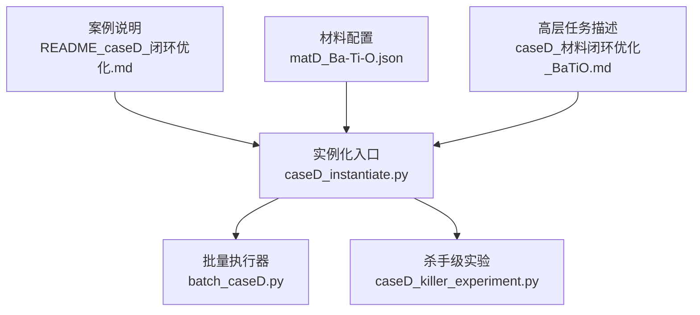
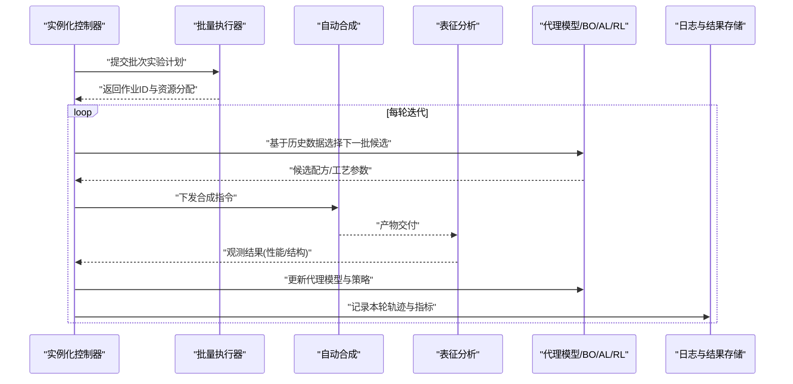
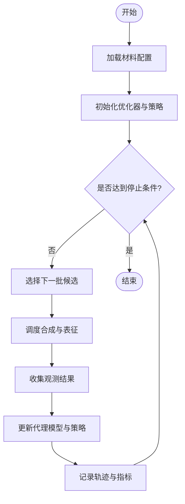
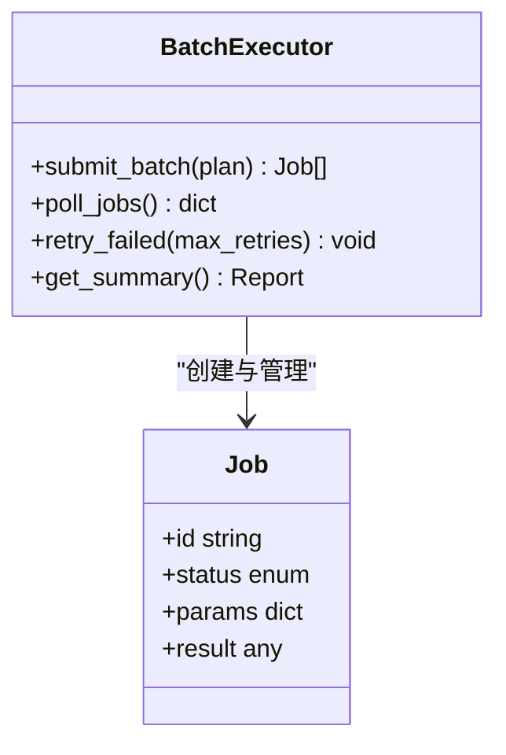
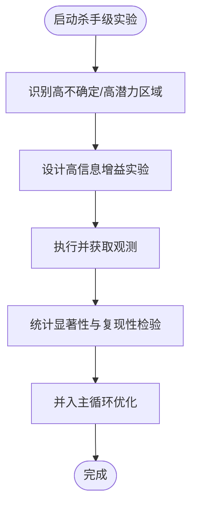
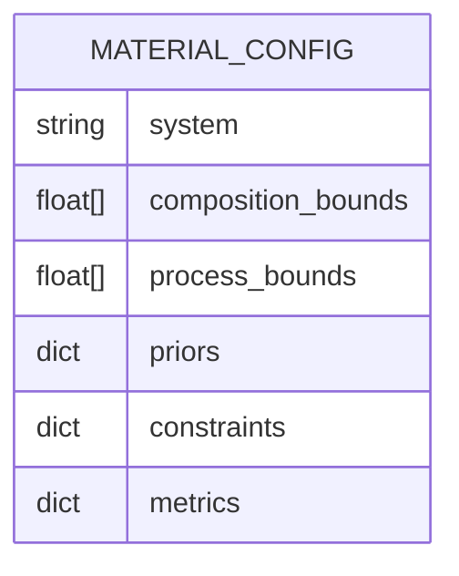
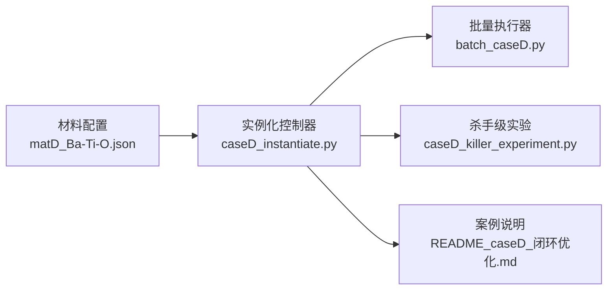

# CaseD闭环优化实例化

<cite>
**本文引用的文件**   
- [caseD_instantiate.py](file://longhorizon/instantiate/caseD_instantiate.py)
- [batch_caseD.py](file://longhorizon/instantiate/batch_caseD.py)
- [caseD_killer_experiment.py](file://longhorizon/instantiate/caseD_killer_experiment.py)
- [README_caseD_闭环优化.md](file://longhorizon/instantiate/README_caseD_闭环优化.md)
- [matD_Ba-Ti-O.json](file://longhorizon/instantiate/instances/matD_Ba-Ti-O.json)
- [caseD_材料闭环优化_BaTiO.md](file://longhorizon/caseD_材料闭环优化_BaTiO.md)
</cite>

## 目录
1. [简介](#简介)
2. [项目结构](#项目结构)
3. [核心组件](#核心组件)
4. [架构总览](#架构总览)
5. [详细组件分析](#详细组件分析)
6. [依赖关系分析](#依赖关系分析)
7. [性能与并行调度](#性能与并行调度)
8. [目标、约束与收敛标准](#目标约束与收敛标准)
9. [杀手级实验设计与验证](#杀手级实验设计与验证)
10. [故障排查指南](#故障排查指南)
11. [结论](#结论)

## 简介
本文件面向CaseD闭环优化实例化器，聚焦BaTiO3等材料的“实验设计—自动合成—表征分析—模型更新”的完整闭环。文档系统性阐述贝叶斯优化、主动学习与强化学习在材料优化中的应用方式，并给出批量实验调度、并行处理与资源管理的实现要点；同时明确优化目标定义、约束条件设置与收敛判断标准，并提供杀手级实验的设计原理与验证方法。

## 项目结构
围绕CaseD的材料闭环优化，仓库中相关代码与说明集中在以下位置：
- 实例化与执行脚本：长周期任务实例化入口、批量执行与杀手级实验脚本
- 案例说明与数据：BaTiO3案例说明、材料参数与搜索空间配置
- 高层任务描述：材料闭环优化的总体目标与流程说明

图示来源
- [caseD_instantiate.py](file://longhorizon/instantiate/caseD_instantiate.py)
- [batch_caseD.py](file://longhorizon/instantiate/batch_caseD.py)
- [caseD_killer_experiment.py](file://longhorizon/instantiate/caseD_killer_experiment.py)
- [README_caseD_闭环优化.md](file://longhorizon/instantiate/README_caseD_闭环优化.md)
- [matD_Ba-Ti-O.json](file://longhorizon/instantiate/instances/matD_Ba-Ti-O.json)
- [caseD_材料闭环优化_BaTiO.md](file://longhorizon/caseD_材料闭环优化_BaTiO.md)

章节来源
- [README_caseD_闭环优化.md](file://longhorizon/instantiate/README_caseD_闭环优化.md)
- [caseD_材料闭环优化_BaTiO.md](file://longhorizon/caseD_材料闭环优化_BaTiO.md)

## 核心组件
- 实例化控制器（caseD_instantiate.py）
  - 负责加载材料配置、初始化优化器与环境、编排闭环迭代、记录日志与结果。
- 批量执行器（batch_caseD.py）
  - 负责多实例并发运行、作业队列管理、失败重试与资源配额控制。
- 杀手级实验（caseD_killer_experiment.py）
  - 针对关键假设或高风险区域进行定向验证，提供强信息增益的实验序列。
- 材料配置（matD_Ba-Ti-O.json）
  - 定义BaTiO3体系的搜索空间、先验知识、约束与评估指标。
- 案例说明（README_caseD_闭环优化.md, caseD_材料闭环优化_BaTiO.md）
  - 描述闭环流程、目标函数、约束与收敛策略，以及整体方法论。

章节来源
- [caseD_instantiate.py](file://longhorizon/instantiate/caseD_instantiate.py)
- [batch_caseD.py](file://longhorizon/instantiate/batch_caseD.py)
- [caseD_killer_experiment.py](file://longhorizon/instantiate/caseD_killer_experiment.py)
- [matD_Ba-Ti-O.json](file://longhorizon/instantiate/instances/matD_Ba-Ti-O.json)
- [README_caseD_闭环优化.md](file://longhorizon/instantiate/README_caseD_闭环优化.md)
- [caseD_材料闭环优化_BaTiO.md](file://longhorizon/caseD_材料闭环优化_BaTiO.md)

## 架构总览
CaseD闭环优化由“规划—执行—观测—建模—决策”五阶段构成，形成持续迭代的智能体驱动系统。

图示来源
- [caseD_instantiate.py](file://longhorizon/instantiate/caseD_instantiate.py)
- [batch_caseD.py](file://longhorizon/instantiate/batch_caseD.py)
- [caseD_killer_experiment.py](file://longhorizon/instantiate/caseD_killer_experiment.py)
- [README_caseD_闭环优化.md](file://longhorizon/instantiate/README_caseD_闭环优化.md)
- [caseD_材料闭环优化_BaTiO.md](file://longhorizon/caseD_材料闭环优化_BaTiO.md)

## 详细组件分析

### 实例化控制器（caseD_instantiate.py）
职责与流程
- 读取材料配置（搜索空间、先验、约束、指标）。
- 初始化优化器（贝叶斯优化、主动学习、强化学习策略）。
- 编排闭环迭代：选择候选→调度合成→触发表征→收集观测→更新模型。
- 输出中间检查点与最终报告。

关键交互
- 与批量执行器协作，按批次提交实验。
- 与杀手级实验模块协作，在探索不足或高风险区域插入高价值实验。
- 与日志系统对接，持久化轨迹以供回放与审计。

图示来源
- [caseD_instantiate.py](file://longhorizon/instantiate/caseD_instantiate.py)
- [README_caseD_闭环优化.md](file://longhorizon/instantiate/README_caseD_闭环优化.md)

章节来源
- [caseD_instantiate.py](file://longhorizon/instantiate/caseD_instantiate.py)
- [README_caseD_闭环优化.md](file://longhorizon/instantiate/README_caseD_闭环优化.md)

### 批量执行器（batch_caseD.py）
职责与流程
- 接收来自实例化控制器的批次计划，生成可执行的作业列表。
- 维护作业状态机（待执行/执行中/成功/失败/重试）。
- 管理并发度、超时与重试策略，保障资源公平使用。
- 汇总执行结果，回传至控制器用于模型更新。

并发与资源管理要点
- 通过进程/线程池或外部作业管理器实现并行。
- 支持动态扩缩容与资源上限保护，避免过载。
- 对失败作业实施指数退避重试与熔断机制。

图示来源
- [batch_caseD.py](file://longhorizon/instantiate/batch_caseD.py)

章节来源
- [batch_caseD.py](file://longhorizon/instantiate/batch_caseD.py)

### 杀手级实验（caseD_killer_experiment.py）
设计原则
- 针对不确定性高、潜在收益大的区域进行定向采样。
- 结合主动学习的最大方差/期望改进准则，优先覆盖未知区域。
- 引入领域先验（如相图边界、热力学稳定性）提升命中率。

验证方法
- 对比基线随机/网格搜索，统计信息增益与收敛速度。
- 通过消融实验验证不同采集函数的贡献。
- 在独立测试集上评估泛化性与鲁棒性。

图示来源
- [caseD_killer_experiment.py](file://longhorizon/instantiate/caseD_killer_experiment.py)

章节来源
- [caseD_killer_experiment.py](file://longhorizon/instantiate/caseD_killer_experiment.py)

### 材料配置（matD_Ba-Ti-O.json）
内容要点
- 搜索空间：元素比例、掺杂浓度、烧结温度/时间窗口等。
- 先验知识：已知稳定相、经验配方区间、文献参考范围。
- 约束条件：热力学可行性、成本上限、设备能力限制。
- 评估指标：介电常数、居里温度、损耗角正切等。

图示来源
- [matD_Ba-Ti-O.json](file://longhorizon/instantiate/instances/matD_Ba-Ti-O.json)

章节来源
- [matD_Ba-Ti-O.json](file://longhorizon/instantiate/instances/matD_Ba-Ti-O.json)

## 依赖关系分析
- 实例化控制器依赖材料配置与优化策略，协调批量执行器与杀手级实验。
- 批量执行器依赖底层合成与表征工具链，向上汇报执行结果。
- 杀手级实验依赖代理模型的置信度估计与不确定性量化。

图示来源
- [caseD_instantiate.py](file://longhorizon/instantiate/caseD_instantiate.py)
- [batch_caseD.py](file://longhorizon/instantiate/batch_caseD.py)
- [caseD_killer_experiment.py](file://longhorizon/instantiate/caseD_killer_experiment.py)
- [matD_Ba-Ti-O.json](file://longhorizon/instantiate/instances/matD_Ba-Ti-O.json)
- [README_caseD_闭环优化.md](file://longhorizon/instantiate/README_caseD_闭环优化.md)

章节来源
- [caseD_instantiate.py](file://longhorizon/instantiate/caseD_instantiate.py)
- [batch_caseD.py](file://longhorizon/instantiate/batch_caseD.py)
- [caseD_killer_experiment.py](file://longhorizon/instantiate/caseD_killer_experiment.py)
- [matD_Ba-Ti-O.json](file://longhorizon/instantiate/instances/matD_Ba-Ti-O.json)
- [README_caseD_闭环优化.md](file://longhorizon/instantiate/README_caseD_闭环优化.md)

## 性能与并行调度
- 批大小自适应：根据不确定性分布与资源可用性动态调整批次规模。
- 流水线并行：合成与表征解耦，允许重叠执行以提升吞吐。
- 资源隔离：为每个作业分配独立工作区与临时资源，避免干扰。
- 监控与告警：实时跟踪作业健康度、错误率与延迟，触发降级策略。

[本节为通用指导，不直接分析具体文件]

## 目标、约束与收敛标准
- 优化目标：最大化关键性能指标（如介电常数），同时兼顾稳定性与可制造性。
- 约束条件：成分必须在热力学稳定区内；工艺参数受设备能力限制；成本不超过预算。
- 收敛判断：
  - 目标值连续若干轮未显著提升（阈值与窗口可配置）。
  - 候选空间被充分探索（不确定性低于阈值）。
  - 计算/实验预算耗尽。

章节来源
- [README_caseD_闭环优化.md](file://longhorizon/instantiate/README_caseD_闭环优化.md)
- [caseD_材料闭环优化_BaTiO.md](file://longhorizon/caseD_材料闭环优化_BaTiO.md)

## 杀手级实验设计与验证
- 设计原理：
  - 利用代理模型的不确定性估计定位“最需了解”的区域。
  - 结合物理先验（如相变临界点附近）提高命中概率。
  - 采用多样化采集函数（EI、PI、UCB）平衡探索与利用。
- 验证方法：
  - 与随机/网格/传统DOE对比，评估信息增益与收敛效率。
  - 在独立数据集上进行外推测试，验证泛化能力。
  - 通过敏感性分析确认关键因素与交互效应。

章节来源
- [caseD_killer_experiment.py](file://longhorizon/instantiate/caseD_killer_experiment.py)
- [README_caseD_闭环优化.md](file://longhorizon/instantiate/README_caseD_闭环优化.md)

## 故障排查指南
- 常见问题
  - 作业长时间挂起：检查资源配额与超时配置，必要时重启作业。
  - 表征结果缺失：校验仪器接口与数据路径权限，确认数据落盘。
  - 模型更新失败：核查输入数据格式与异常值处理逻辑。
- 诊断步骤
  - 查看作业日志与中间检查点，定位失败阶段。
  - 降低并发度以排除资源竞争问题。
  - 启用更详细的调试输出，捕获异常堆栈。

章节来源
- [batch_caseD.py](file://longhorizon/instantiate/batch_caseD.py)
- [caseD_instantiate.py](file://longhorizon/instantiate/caseD_instantiate.py)

## 结论
CaseD闭环优化实例化器将贝叶斯优化、主动学习与强化学习有机整合到材料发现与优化流程中，通过批量调度与并行执行提升效率，并以杀手级实验加速关键区域的探索。明确的优化目标、约束与收敛标准为工程落地提供了可靠保障。建议在实际部署中结合领域先验与在线监控，持续优化策略与资源配置，以获得更稳健的性能与更快的收敛速度。