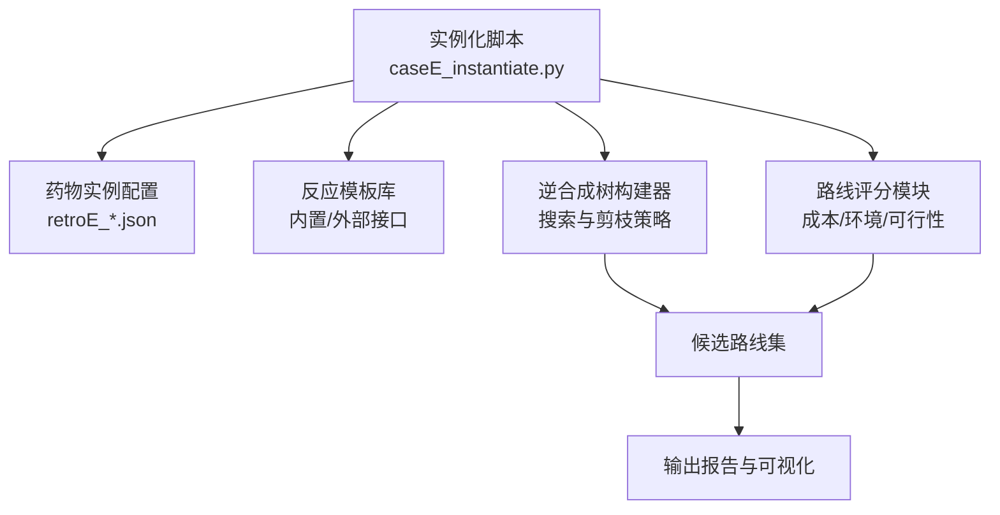
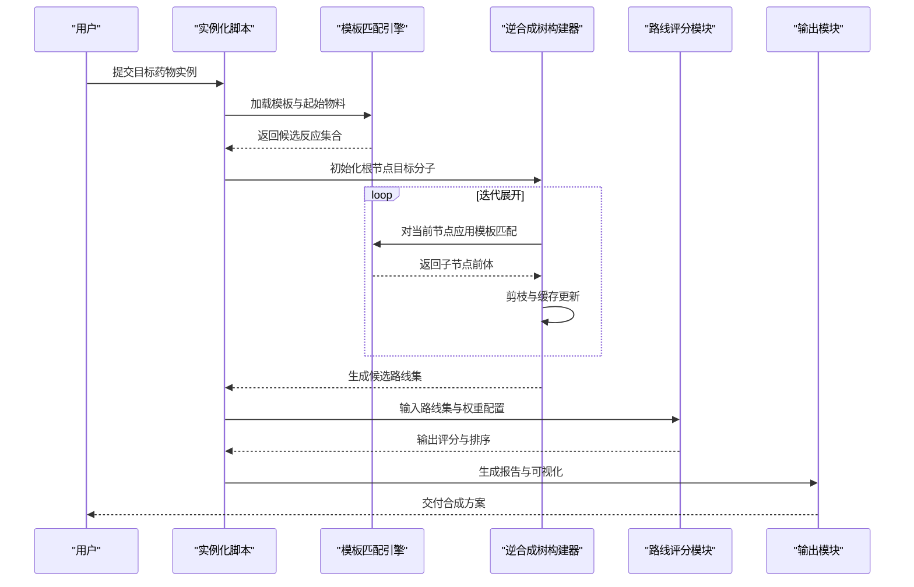
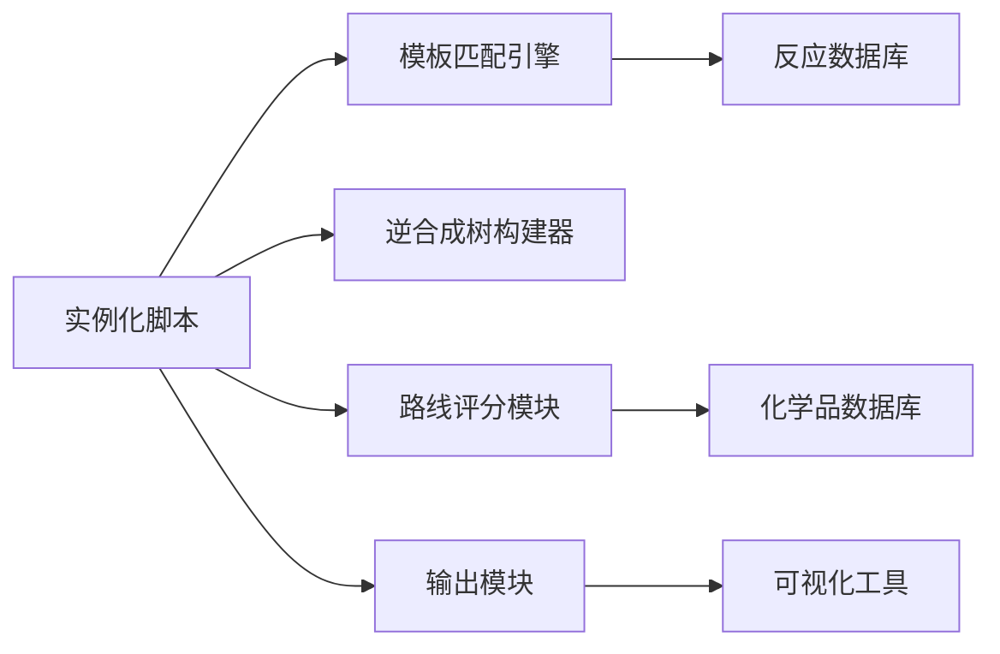

# CaseE逆合成规划实例化

<cite>
**本文档引用的文件**   
- [caseE_instantiate.py](file://longhorizon/instantiate/caseE_instantiate.py)
- [README_caseE_逆合成.md](file://longhorizon/instantiate/README_caseE_逆合成.md)
- [retroE_aspirin.json](file://longhorizon/instantiate/instances/retroE_aspirin.json)
- [retroE_caffeine.json](file://longhorizon/instantiate/instances/retroE_caffeine.json)
- [retroE_ibuprofen.json](file://longhorizon/instantiate/instances/retroE_ibuprofen.json)
- [retroE_lidocaine.json](file://longhorizon/instantiate/instances/retroE_lidocaine.json)
- [retroE_metformin.json](file://longhorizon/instantiate/instances/retroE_metformin.json)
- [retroE_paracetamol.json](file://longhorizon/instantiate/instances/retroE_paracetamol.json)
- [retroE_warfarin.json](file://longhorizon/instantiate/instances/retroE_warfarin.json)
</cite>

## 目录
1. [简介](#简介)
2. [项目结构](#项目结构)
3. [核心组件](#核心组件)
4. [架构总览](#架构总览)
5. [详细组件分析](#详细组件分析)
6. [依赖关系分析](#依赖关系分析)
7. [性能考量](#性能考量)
8. [故障排查指南](#故障排查指南)
9. [结论](#结论)
10. [附录](#附录)

## 简介
本文件面向CaseE逆合成规划实例化器，系统化说明常见药物的逆合成分析实例化逻辑与实现要点。覆盖阿司匹林、咖啡因、布洛芬、利多卡因、二甲双胍、对乙酰氨基酚和华法林等目标分子，阐述反应模板匹配、逆合成树构建、多步路径优化、成本估算与环境友好性评估，以及药物特异性参数、反应数据库集成与路线评分机制的设计思路与实践方法。文档旨在帮助读者快速理解并正确使用该实例化流程，同时为扩展新药物或定制评价维度提供指导。

## 项目结构
CaseE逆合成规划实例化位于 longhorizon/instantiate 目录下，核心由实例化脚本与药物实例数据组成：
- 实例化入口脚本负责读取药物实例配置、加载反应模板与数据库、执行模板匹配与树搜索、生成候选路线并进行评分与筛选。
- 每个目标药物对应一个JSON实例文件，包含目标分子标识、可用起始物料、反应模板集合、约束条件与评分权重等。

图表来源
- [caseE_instantiate.py](file://longhoristor/instantiate/caseE_instantiate.py)
- [retroE_aspirin.json](file://longhorizon/instantiate/instances/retroE_aspirin.json)

章节来源
- [README_caseE_逆合成.md](file://longhorizon/instantiate/README_caseE_逆合成.md)

## 核心组件
- 药物实例配置（retroE_*.json）
  - 定义目标分子SMILES/名称、可用起始物料清单、反应模板ID集合、步骤上限、预算与时间限制、评分权重（成本、原子经济性、E因子、可放大性等）。
  - 支持药物特异性参数，如官能团保护策略开关、溶剂偏好、温度窗口、催化剂可用性标记等。
- 反应模板匹配引擎
  - 基于SMARTS或规则库进行键级/官能团级变换匹配，支持位置选择性、立体化学保留/翻转、副产物推断。
  - 提供批量匹配与缓存机制，避免重复计算。
- 逆合成树构建器
  - 采用深度优先/广度优先/启发式搜索，结合模板命中率与先验知识进行分支扩展。
  - 剪枝策略包括：步骤上限、不可达起始物、循环依赖检测、成本阈值、环境指标越界。
- 路线评分与筛选
  - 综合成本（原料价格、试剂用量）、原子经济性、E因子、碳足迹、安全与合规、可放大性、收率预估等维度加权打分。
  - 输出Top-K路线及关键节点解释。
- 结果输出与可视化
  - 生成结构化报告（JSON/Markdown），包含树形图、步骤详情、资源消耗、风险标注与改进建议。

章节来源
- [caseE_instantiate.py](file://longhorizon/instantiate/caseE_instantiate.py)
- [retroE_aspirin.json](file://longhorizon/instantiate/instances/retroE_aspirin.json)
- [retroE_caffeine.json](file://longhorizon/instantiate/instances/retroE_caffeine.json)
- [retroE_ibuprofen.json](file://longhorizon/instantiate/instances/retroE_ibuprofen.json)
- [retroE_lidocaine.json](file://longhorizon/instantiate/instances/retroE_lidocaine.json)
- [retroE_metformin.json](file://longhorizon/instantiate/instances/retroE_metformin.json)
- [retroE_paracetamol.json](file://longhorizon/instantiate/instances/retroE_paracetamol.json)
- [retroE_warfarin.json](file://longhorizon/instantiate/instances/retroE_warfarin.json)

## 架构总览
整体流程从药物实例配置出发，经模板匹配生成子问题，递归构建逆合成树，随后进行多步路径优化与评分，最终输出可执行的合成方案。

图表来源
- [caseE_instantiate.py](file://longhorizon/instantiate/caseE_instantiate.py)

## 详细组件分析

### 药物实例配置（retroE_*.json）
- 字段设计
  - 目标分子：SMILES、IUPAC名、CAS号（可选）
  - 起始物料：SMILES列表、商业可得性、价格区间、毒性等级
  - 反应模板：模板ID、适用官能团、选择性规则、立体化学约束
  - 约束条件：最大步数、时间/成本上限、溶剂/温度偏好、催化剂可用性
  - 评分权重：成本、原子经济性、E因子、碳足迹、安全、可放大性、收率预估
- 药物特异性参数
  - 阿司匹林：酯化/酰化模板优先级、水相后处理偏好、绿色溶剂推荐
  - 咖啡因：生物碱提取/衍生化模板、热稳定性约束、避免强酸强碱
  - 布洛芬：Friedel-Crafts/羰基还原路径、手性控制开关、催化氢化可用性
  - 利多卡因：酰胺缩合、卤代烷烷基化、pH控制与温度窗口
  - 二甲双胍：胍基构建、氰胺中间体、放热风险控制
  - 对乙酰氨基酚：硝化/还原/乙酰化序列、重金属残留限制
  - 华法林：Knoevenagel缩合、环化与手性拆分、光敏性与储存条件

章节来源
- [retroE_aspirin.json](file://longhorizon/instantiate/instances/retroE_aspirin.json)
- [retroE_caffeine.json](file://longhorizon/instantiate/instances/retroE_caffeine.json)
- [retroE_ibuprofen.json](file://longhorizon/instantiate/instances/retroE_ibuprofen.json)
- [retroE_lidocaine.json](file://longhorizon/instantiate/instances/retroE_lidocaine.json)
- [retroE_metformin.json](file://longhorizon/instantiate/instances/retroE_metformin.json)
- [retroE_paracetamol.json](file://longhorizon/instantiate/instances/retroE_paracetamol.json)
- [retroE_warfarin.json](file://longhorizon/instantiate/instances/retroE_warfarin.json)

### 反应模板匹配引擎
- 匹配策略
  - SMARTS模式匹配与官能团等价类映射
  - 位置选择性与立体化学一致性检查
  - 副产物与离去基团推断，确保质量守恒
- 性能优化
  - 模板索引与哈希加速
  - 子结构缓存与增量更新
  - 并行匹配与批处理调度

章节来源
- [caseE_instantiate.py](file://longhorizon/instantiate/caseE_instantiate.py)

### 逆合成树构建器
- 搜索算法
  - 深度优先探索高命中模板分支
  - 广度优先保证最短步数路径
  - 启发式A*结合成本与可行性估计
- 剪枝与约束
  - 步骤上限、不可达起始物、循环依赖检测
  - 成本与环境指标阈值过滤
- 数据结构
  - 节点：分子、父边（反应）、子节点（前体）、元数据（置信度、成本、风险）
  - 树：有向无环图，支持合并等价节点

章节来源
- [caseE_instantiate.py](file://longhorizon/instantiate/caseE_instantiate.py)

### 路线评分与多步优化
- 评分维度
  - 成本：原料单价、当量、回收率、设备折旧分摊
  - 原子经济性与E因子：副产物最小化、溶剂回收率
  - 环境与安全：毒性、VOC排放、能耗、三废处理难度
  - 可放大性：工艺稳健性、温控要求、杂质谱可控性
  - 收率预估：模板历史成功率、条件敏感性
- 优化策略
  - 多目标加权排序与Pareto前沿筛选
  - 局部搜索替换低效步骤（替代试剂/条件）
  - 路径合并与中间体重用

章节来源
- [caseE_instantiate.py](file://longhorizon/instantiate/caseE_instantiate.py)

### 结果输出与可视化
- 结构化报告：JSON/Markdown，含树形结构、步骤详情、资源消耗、风险标注
- 可视化：逆合成树图、步骤甘特图、成本与环境指标雷达图
- 可执行清单：试剂采购、设备准备、操作SOP与注意事项

章节来源
- [caseE_instantiate.py](file://longhorizon/instantiate/caseE_instantiate.py)

## 依赖关系分析
- 内部依赖
  - 实例化脚本依赖模板匹配引擎、树构建器、评分模块与输出模块
  - 各模块通过明确接口通信，降低耦合度
- 外部依赖
  - 反应数据库（本地/云端）提供模板与历史数据
  - 化学品数据库（价格、毒性、可得性）支撑成本与环境评估
  - 可视化工具（绘图库）用于报告生成

图表来源
- [caseE_instantiate.py](file://longhorizon/instantiate/caseE_instantiate.py)

章节来源
- [caseE_instantiate.py](file://longhorizon/instantiate/caseE_instantiate.py)

## 性能考量
- 模板匹配
  - 使用子结构索引与哈希表提升检索速度
  - 并行化处理大规模分子集合
- 树搜索
  - 启发式剪枝减少无效分支
  - 缓存已计算节点避免重复展开
- 评分计算
  - 增量更新成本与环境指标
  - 多目标优化采用近似算法加速收敛
- I/O与存储
  - 流式写入大报告文件
  - 压缩与分片存储中间结果

[本节为通用性能指导，不直接分析具体文件]

## 故障排查指南
- 常见问题
  - 模板匹配失败：检查SMARTS语法与官能团映射是否正确
  - 树构建爆炸：提高剪枝阈值或降低步数上限
  - 评分异常：核对化学品数据库价格与毒性字段完整性
  - 输出为空：确认起始物料可达性与模板覆盖范围
- 调试建议
  - 启用详细日志记录模板命中与剪枝原因
  - 逐步验证单步反应可行性后再扩展多步
  - 对比不同权重配置的评分差异定位敏感维度

章节来源
- [caseE_instantiate.py](file://longhorizon/instantiate/caseE_instantiate.py)

## 结论
CaseE逆合成规划实例化器以模块化架构实现了从模板匹配到路线评分的完整闭环，支持多目标优化与可扩展的药物特异性参数。通过合理的剪枝策略与性能优化，能够在合理时间内生成高质量的多步合成路径。未来可进一步增强反应数据库覆盖、引入机器学习预测模型以提升可行性评估精度，并拓展更多环境与可持续性指标。

[本节为总结性内容，不直接分析具体文件]

## 附录
- 示例药物路线概览
  - 阿司匹林：水杨酸乙酰化路径，强调绿色溶剂与原子经济性
  - 咖啡因：天然提取与半合成修饰，关注热稳定与副产物控制
  - 布洛芬：Friedel-Crafts与羰基还原组合，考虑手性与催化效率
  - 利多卡因：酰胺缩合与烷基化，注意pH与温度窗口
  - 二甲双胍：胍基构建与氰胺中间体，重视放热安全
  - 对乙酰氨基酚：硝化-还原-乙酰化序列，控制重金属残留
  - 华法林：Knoevenagel缩合与环化，关注光敏性与手性拆分

章节来源
- [retroE_aspirin.json](file://longhorizon/instantiate/instances/retroE_aspirin.json)
- [retroE_caffeine.json](file://longhorizon/instantiate/instances/retroE_caffeine.json)
- [retroE_ibuprofen.json](file://longhorizon/instantiate/instances/retroE_ibuprofen.json)
- [retroE_lidocaine.json](file://longhorizon/instantiate/instances/retroE_lidocaine.json)
- [retroE_metformin.json](file://longhorizon/instantiate/instances/retroE_metformin.json)
- [retroE_paracetamol.json](file://longhorizon/instantiate/instances/retroE_paracetamol.json)
- [retroE_warfarin.json](file://longhorizon/instantiate/instances/retroE_warfarin.json)