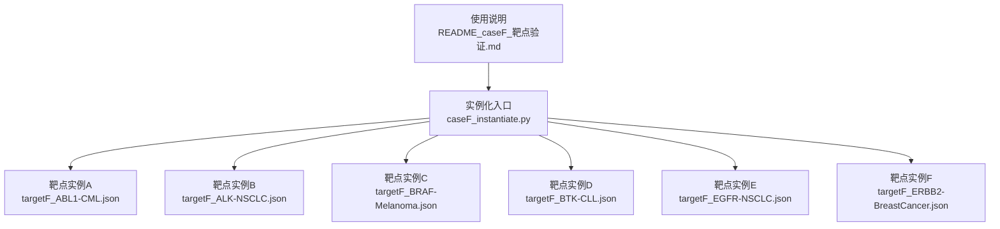
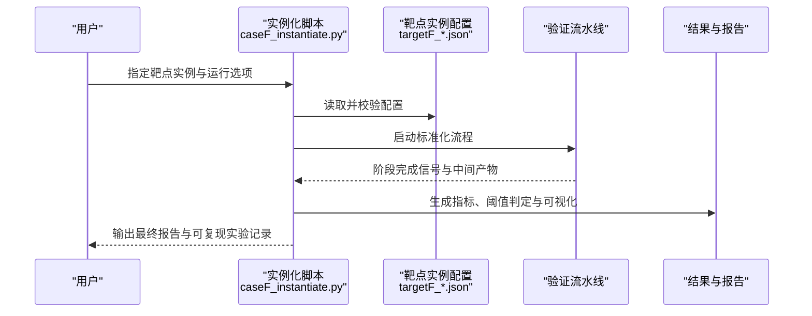
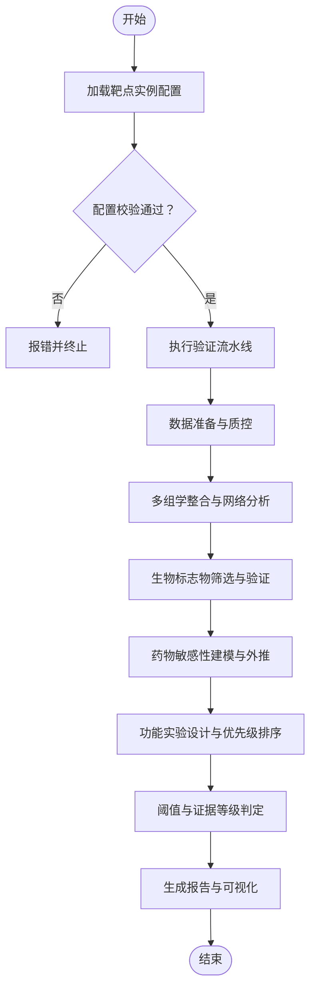
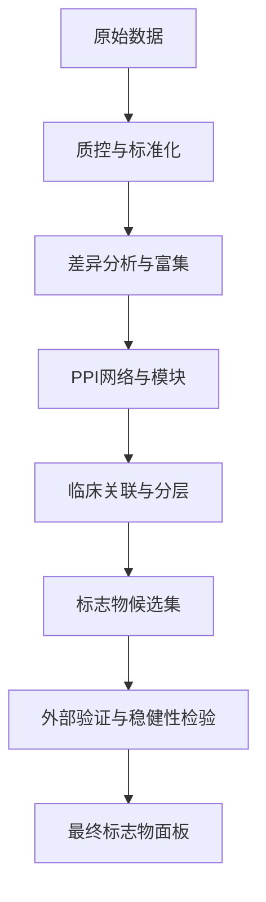
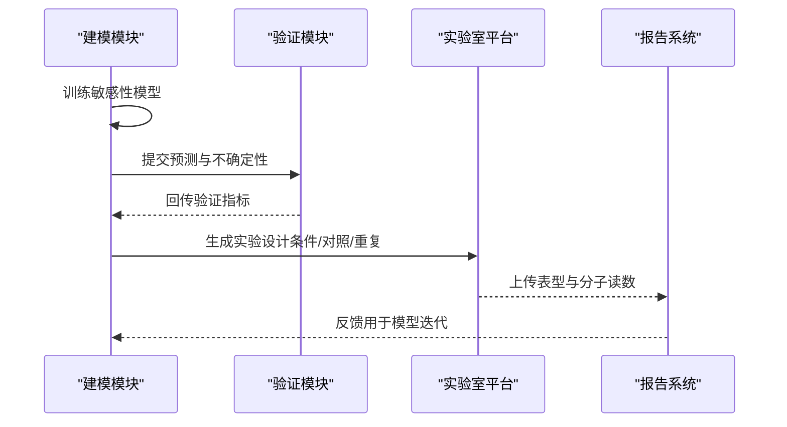
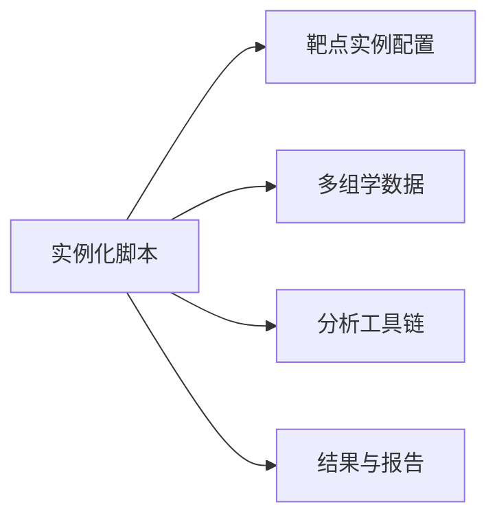

# CaseF靶点验证实例化

<cite>
**本文引用的文件**   
- [longhorizon/instantiate/caseF_instantiate.py](file://longhorizon/instantiate/caseF_instantiate.py)
- [longhorizon/instantiate/instances/targetF_ABL1-CML.json](file://longhorizon/instantiate/instances/targetF_ABL1-CML.json)
- [longhorizon/instantiate/instances/targetF_ALK-NSCLC.json](file://longhorizon/instantiate/instances/targetF_ALK-NSCLC.json)
- [longhorizon/instantiate/instances/targetF_BRAF-Melanoma.json](file://longhorizon/instantiate/instances/targetF_BRAF-Melanoma.json)
- [longhorizon/instantiate/instances/targetF_BTK-CLL.json](file://longhorizon/instantiate/instances/targetF_BTK-CLL.json)
- [longhorizon/instantiate/instances/targetF_EGFR-NSCLC.json](file://longhorizon/instantiate/instances/targetF_EGFR-NSCLC.json)
- [longhorizon/instantiate/instances/targetF_ERBB2-BreastCancer.json](file://longhorizon/instantiate/instances/targetF_ERBB2-BreastCancer.json)
- [longhorizon/instantiate/README_caseF_靶点验证.md](file://longhorizon/instantiate/README_caseF_靶点验证.md)
</cite>

## 目录
1. [引言](#引言)
2. [项目结构](#项目结构)
3. [核心组件](#核心组件)
4. [架构总览](#架构总览)
5. [详细组件分析](#详细组件分析)
6. [依赖关系分析](#依赖关系分析)
7. [性能与可扩展性](#性能与可扩展性)
8. [故障排查指南](#故障排查指南)
9. [结论](#结论)
10. [附录](#附录)

## 引言
本文件面向“CaseF靶点验证实例化”的完整说明，聚焦于癌症相关关键靶点（ABL1、ALK、BRAF、BTK、EGFR、ERBB2）的生物学验证流程实例化。文档覆盖以下方面：
- 靶点验证流程的实例化机制与参数化配置
- 多组学数据整合（基因表达、蛋白质互作网络、临床样本关联）
- 生物标志物发现与药物敏感性预测的实现思路
- 靶点特异性参数、验证标准定义与结果解读指南
- 功能实验设计与闭环评估策略

## 项目结构
CaseF相关的代码与数据主要位于 longhorizon/instantiate 目录下，包含：
- 实例化脚本：caseF_instantiate.py
- 靶点实例配置文件：targetF_*.json（每个靶点一个实例）
- 使用说明文档：README_caseF_靶点验证.md

图表来源
- [longhorizon/instantiate/caseF_instantiate.py](file://longhorizon/instantiate/caseF_instantiate.py)
- [longhorizon/instantiate/instances/targetF_ABL1-CML.json](file://longhorizon/instantiate/instances/targetF_ABL1-CML.json)
- [longhorizon/instantiate/instances/targetF_ALK-NSCLC.json](file://longhorizon/instantiate/instances/targetF_ALK-NSCLC.json)
- [longhorizon/instantiate/instances/targetF_BRAF-Melanoma.json](file://longhorizon/instantiate/instances/targetF_BRAF-Melanoma.json)
- [longhorizon/instantiate/instances/targetF_BTK-CLL.json](file://longhorizon/instantiate/instances/targetF_BTK-CLL.json)
- [longhorizon/instantiate/instances/targetF_EGFR-NSCLC.json](file://longhorizon/instantiate/instances/targetF_EGFR-NSCLC.json)
- [longhorizon/instantiate/instances/targetF_ERBB2-BreastCancer.json](file://longhorizon/instantiate/instances/targetF_ERBB2-BreastCancer.json)
- [longhorizon/instantiate/README_caseF_靶点验证.md](file://longhorizon/instantiate/README_caseF_靶点验证.md)

章节来源
- [longhorizon/instantiate/caseF_instantiate.py](file://longhorizon/instantiate/caseF_instantiate.py)
- [longhorizon/instantiate/README_caseF_靶点验证.md](file://longhorizon/instantiate/README_caseF_靶点验证.md)

## 核心组件
- 实例化入口脚本：负责加载靶点实例配置、解析参数、编排验证流程、输出结果与报告。
- 靶点实例配置：每个JSON文件描述一个具体靶点-疾病组合的验证任务，包括目标蛋白、突变位点、数据来源、分析步骤、阈值与判定规则等。
- 使用说明文档：提供运行方式、输入输出约定、字段含义与最佳实践。

章节来源
- [longhorizon/instantiate/caseF_instantiate.py](file://longhorizon/instantiate/caseF_instantiate.py)
- [longhorizon/instantiate/README_caseF_靶点验证.md](file://longhorizon/instantiate/README_caseF_靶点验证.md)

## 架构总览
CaseF采用“配置驱动+流水线编排”的架构模式。每个靶点由独立的JSON实例定义，实例化脚本统一读取并执行标准化流程。整体流程涵盖：
- 数据准备与校验（基因组、转录组、蛋白质组、临床表型）
- 多组学整合（表达差异、通路富集、PPI网络、共表达模块）
- 生物标志物筛选（统计显著性、效应量、外部队列验证）
- 药物敏感性建模（体外IC50/EC50、患者队列响应、模型可解释性）
- 功能实验设计（CRISPR敲除/过表达、小分子抑制、表型读出）
- 结果汇总与可视化（指标、阈值、证据等级）

图表来源
- [longhorizon/instantiate/caseF_instantiate.py](file://longhorizon/instantiate/caseF_instantiate.py)
- [longhorizon/instantiate/instances/targetF_ABL1-CML.json](file://longhorizon/instantiate/instances/targetF_ABL1-CML.json)
- [longhorizon/instantiate/instances/targetF_ALK-NSCLC.json](file://longhorizon/instantiate/instances/targetF_ALK-NSCLC.json)
- [longhorizon/instantiate/instances/targetF_BRAF-Melanoma.json](file://longhorizon/instantiate/instances/targetF_BRAF-Melanoma.json)
- [longhorizon/instantiate/instances/targetF_BTK-CLL.json](file://longhorizon/instantiate/instances/targetF_BTK-CLL.json)
- [longhorizon/instantiate/instances/targetF_EGFR-NSCLC.json](file://longhorizon/instantiate/instances/targetF_EGFR-NSCLC.json)
- [longhorizon/instantiate/instances/targetF_ERBB2-BreastCancer.json](file://longhorizon/instantiate/instances/targetF_ERBB2-BreastCancer.json)

## 详细组件分析

### 实例化入口脚本（caseF_instantiate.py）
职责与行为
- 解析命令行参数与全局配置
- 加载对应靶点的JSON实例，进行字段完整性与类型校验
- 按阶段调用数据处理、分析与建模函数
- 聚合各阶段结果，应用阈值与证据等级规则，生成报告

关键流程要点
- 配置加载与校验：确保必填字段存在且取值合理（如靶点符号、突变位点、数据集路径、阈值等）
- 流水线编排：顺序或并行执行数据预处理、多组学整合、标志物筛选、敏感性建模、功能实验设计
- 结果持久化：保存中间产物与最终报告，便于复现与审计

图表来源
- [longhorizon/instantiate/caseF_instantiate.py](file://longhorizon/instantiate/caseF_instantiate.py)

章节来源
- [longhorizon/instantiate/caseF_instantiate.py](file://longhorizon/instantiate/caseF_instantiate.py)

### 靶点实例配置（targetF_*.json）
通用字段建议（以实际JSON为准）
- 基本信息：靶点符号、疾病类型、突变位点、参考序列/结构
- 数据来源：基因组/转录组/蛋白质组/临床队列的路径或标识符
- 分析步骤：数据预处理、差异分析、富集分析、PPI网络构建、共表达模块识别
- 标志物筛选：统计方法、显著性阈值、效应量阈值、外部验证队列
- 敏感性建模：训练/测试集划分、模型选择、评价指标、交叉验证策略
- 功能实验：CRISPR/过表达设计、抑制剂浓度梯度、表型读数与重复数
- 阈值与判定：阳性/阴性判定规则、证据等级、置信区间要求
- 输出规范：指标清单、可视化模板、报告格式

示例靶点
- ABL1-CML：聚焦激酶活性与耐药突变谱，结合表达与拷贝数变异，评估靶向药敏感性与联合用药策略
- ALK-NSCLC：关注融合事件与下游通路激活，整合组织学与液体活检数据，建立预后与疗效预测模型
- BRAF-Melanoma：V600E突变主导，结合MAPK通路状态与免疫微环境特征，优化抑制方案
- BTK-CLL：B细胞受体信号通路调控，评估BTK抑制剂疗效与获得性耐药机制
- EGFR-NSCLC：常见激活突变与T790M/C797S耐药位点，指导三代TKI使用与联合治疗
- ERBB2-BreastCancer：扩增/过表达与HER2异质性，结合抗体偶联药物与双抗策略

章节来源
- [longhorizon/instantiate/instances/targetF_ABL1-CML.json](file://longhorizon/instantiate/instances/targetF_ABL1-CML.json)
- [longhorizon/instantiate/instances/targetF_ALK-NSCLC.json](file://longhorizon/instantiate/instances/targetF_ALK-NSCLC.json)
- [longhorizon/instantiate/instances/targetF_BRAF-Melanoma.json](file://longhorizon/instantiate/instances/targetF_BRAF-Melanoma.json)
- [longhorizon/instantiate/instances/targetF_BTK-CLL.json](file://longhorizon/instantiate/instances/targetF_BTK-CLL.json)
- [longhorizon/instantiate/instances/targetF_EGFR-NSCLC.json](file://longhorizon/instantiate/instances/targetF_EGFR-NSCLC.json)
- [longhorizon/instantiate/instances/targetF_ERBB2-BreastCancer.json](file://longhorizon/instantiate/instances/targetF_ERBB2-BreastCancer.json)

### 多组学数据整合与生物标志物发现
- 基因表达分析：差异表达、聚类与分型、生存相关性分析
- 蛋白质互作网络：PPI构建、模块识别、枢纽节点筛选、通路富集
- 临床样本关联：基因型-表型映射、剂量-反应曲线拟合、亚群分层
- 标志物筛选：多变量回归、机器学习特征选择、独立队列验证
- 不确定性量化：置信区间、Bootstrap重采样、贝叶斯后验概率

[此图为概念性流程图，不直接映射到具体源码文件]

### 药物敏感性预测与功能实验设计
- 敏感性建模：基于细胞系/类器官/患者来源样本的IC50/EC50数据，训练回归或分类模型，结合分子特征与通路状态
- 外推与泛化：跨队列验证、迁移学习、不确定性估计
- 功能实验：CRISPR筛选、小分子抑制、表型读出（增殖、凋亡、周期、迁移侵袭）、时间序列动态监测
- 优先级排序：综合证据强度、可转化性、风险收益比，形成下一步开发路线

[此图为概念性序列图，不直接映射到具体源码文件]

## 依赖关系分析
- 实例化脚本对靶点实例配置的强依赖：字段缺失或类型错误将导致流程中断
- 数据源的可访问性与一致性：路径、格式、版本需与配置一致
- 工具链与库版本：分析流程依赖的第三方包需锁定版本以保证可复现性
- 计算资源：大规模网络分析与深度学习建模需要足够的CPU/GPU与内存

图表来源
- [longhorizon/instantiate/caseF_instantiate.py](file://longhorizon/instantiate/caseF_instantiate.py)
- [longhorizon/instantiate/instances/targetF_ABL1-CML.json](file://longhorizon/instantiate/instances/targetF_ABL1-CML.json)

章节来源
- [longhorizon/instantiate/caseF_instantiate.py](file://longhorizon/instantiate/caseF_instantiate.py)

## 性能与可扩展性
- 并行化：不同靶点实例可并行执行；同一实例内无依赖的阶段可并发处理
- 缓存与增量更新：中间产物缓存避免重复计算；新增数据仅触发受影响阶段
- 资源管理：根据任务规模动态分配资源，限制峰值内存与GPU占用
- 扩展性：新增靶点仅需添加对应JSON实例；新增分析步骤通过插件式扩展

[本节为通用指导，不直接分析具体文件]

## 故障排查指南
常见问题与定位
- 配置校验失败：检查必填字段、数据类型与取值范围
- 数据路径错误：确认相对/绝对路径、权限与文件格式
- 工具链异常：核对依赖版本与环境变量
- 结果不符合预期：回溯中间产物，检查阈值与统计方法设置

定位步骤
- 查看实例化日志与错误堆栈
- 逐步运行流水线阶段，隔离问题
- 对比基准实例与当前实例的差异
- 使用最小数据集快速复现问题

章节来源
- [longhorizon/instantiate/caseF_instantiate.py](file://longhorizon/instantiate/caseF_instantiate.py)
- [longhorizon/instantiate/README_caseF_靶点验证.md](file://longhorizon/instantiate/README_caseF_靶点验证.md)

## 结论
CaseF靶点验证实例化通过配置驱动的标准化流程，实现了从多组学数据整合到功能实验设计的端到端闭环。该框架支持多种癌症相关靶点的快速验证与比较，具备良好可扩展性与可复现性。建议在后续工作中完善阈值体系与证据等级标准，强化外部验证与不确定性量化，提升临床转化价值。

[本节为总结性内容，不直接分析具体文件]

## 附录
- 术语表：靶点、生物标志物、PPI网络、IC50/EC50、CRISPR、TKI、ADC等
- 运行示例：如何指定靶点实例、调整阈值、查看报告
- 最佳实践：数据治理、版本控制、结果归档与共享

[本节为补充信息，不直接分析具体文件]