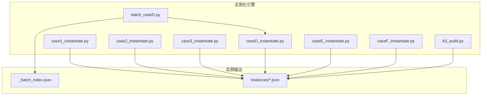
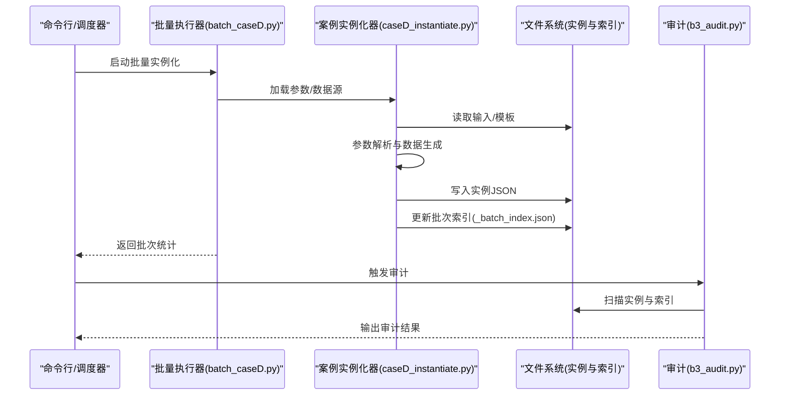
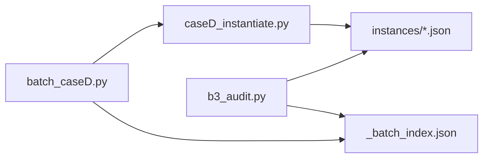
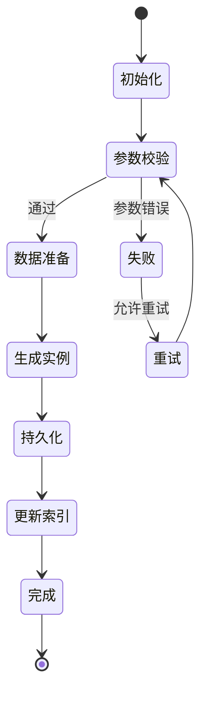

# 任务实例化引擎

<cite>
**本文引用的文件**   
- [longhorizon/instantiate/case1_instantiate.py](file://longhorizon/instantiate/case1_instantiate.py)
- [longhorizon/instantiate/case2_instantiate.py](file://longhorizon/instantiate/case2_instantiate.py)
- [longhorizon/instantiate/case3_instantiate.py](file://longhorizon/instantiate/case3_instantiate.py)
- [longhorizon/instantiate/caseD_instantiate.py](file://longhorizon/instantiate/caseD_instantiate.py)
- [longhorizon/instantiate/caseE_instantiate.py](file://longhorizon/instantiate/caseE_instantiate.py)
- [longhorizon/instantiate/caseF_instantiate.py](file://longhorizon/instantiate/caseF_instantiate.py)
- [longhorizon/instantiate/batch_caseD.py](file://longhorizon/instantiate/batch_caseD.py)
- [longhorizon/instantiate/b3_audit.py](file://longhorizon/instantiate/b3_audit.py)
- [longhorizon/instantiate/instances/_batch_index.json](file://longhorizon/instantiate/instances/_batch_index.json)
- [longhorizon/instantiate/README_case3_机理模拟.md](file://longhorizon/instantiate/README_case3_机理模拟.md)
- [longhorizon/instantiate/README_caseD_闭环优化.md](file://longhorizon/instantiate/README_caseD_闭环优化.md)
- [longhorizon/instantiate/README_caseE_逆合成.md](file://longhorizon/instantiate/README_caseE_逆合成.md)
- [longhorizon/instantiate/README_caseF_靶点验证.md](file://longhorizon/instantiate/README_caseF_靶点验证.md)
</cite>

## 目录
1. [简介](#简介)
2. [项目结构](#项目结构)
3. [核心组件](#核心组件)
4. [架构总览](#架构总览)
5. [详细组件分析](#详细组件分析)
6. [依赖关系分析](#依赖关系分析)
7. [性能与并发](#性能与并发)
8. [故障排查指南](#故障排查指南)
9. [结论](#结论)
10. [附录](#附录)

## 简介
本文件面向“任务实例化引擎”的实现文档，聚焦于不同案例类型（Case）的实例化逻辑、参数解析与数据生成算法；阐述实例化流程的状态机设计、错误处理与重试机制；说明批量实例化、并行处理与资源管理策略；并提供自定义实例化器的开发指南与扩展点。同时给出实例缓存、增量更新与版本控制策略建议，帮助读者在现有工程基础上进行二次开发与规模化运行。

## 项目结构
该仓库包含多个任务域与实验产物，其中与“任务实例化引擎”直接相关的代码位于 longhorizon/instantiate 目录：
- 各案例类型的实例化脚本：case1~caseF 系列
- 批量执行与审计工具：batch_caseD.py、b3_audit.py
- 实例输出目录 instances：每个实例以 JSON 文件形式落地，并维护索引文件
- 案例说明文档：README_caseX_*.md

图表来源
- [longhorizon/instantiate/case1_instantiate.py](file://longhorizon/instantiate/case1_instantiate.py)
- [longhorizon/instantiate/case2_instantiate.py](file://longhorizon/instantiate/case2_instantiate.py)
- [longhorizon/instantiate/case3_instantiate.py](file://longhorizon/instantiate/case3_instantiate.py)
- [longhorizon/instantiate/caseD_instantiate.py](file://longhorizon/instantiate/caseD_instantiate.py)
- [longhorizon/instantiate/caseE_instantiate.py](file://longhorizon/instantiate/caseE_instantiate.py)
- [longhorizon/instantiate/caseF_instantiate.py](file://longhorizon/instantiate/caseF_instantiate.py)
- [longhorizon/instantiate/batch_caseD.py](file://longhorizon/instantiate/batch_caseD.py)
- [longhorizon/instantiate/b3_audit.py](file://longhorizon/instantiate/b3_audit.py)
- [longhorizon/instantiate/instances/_batch_index.json](file://longhorizon/instantiate/instances/_batch_index.json)

章节来源
- [longhorizon/instantiate/case1_instantiate.py](file://longhorizon/instantiate/case1_instantiate.py)
- [longhorizon/instantiate/case2_instantiate.py](file://longhorizon/instantiate/case2_instantiate.py)
- [longhorizon/instantiate/case3_instantiate.py](file://longhorizon/instantiate/case3_instantiate.py)
- [longhorizon/instantiate/caseD_instantiate.py](file://longhorizon/instantiate/caseD_instantiate.py)
- [longhorizon/instantiate/caseE_instantiate.py](file://longhorizon/instantiate/caseE_instantiate.py)
- [longhorizon/instantiate/caseF_instantiate.py](file://longhorizon/instantiate/caseF_instantiate.py)
- [longhorizon/instantiate/batch_caseD.py](file://longhorizon/instantiate/batch_caseD.py)
- [longhorizon/instantiate/b3_audit.py](file://longhorizon/instantiate/b3_audit.py)
- [longhorizon/instantiate/instances/_batch_index.json](file://longhorizon/instantiate/instances/_batch_index.json)

## 核心组件
- 案例实例化器（按 Case 分类）
  - case1~caseF 各自负责对应业务场景的参数解析、数据准备与实例落盘。
- 批量执行器
  - batch_caseD.py 用于对 Case D 进行批量化实例化，协调输入源、并发度与结果索引。
- 审计与校验
  - b3_audit.py 提供对已生成实例的审计能力，便于质量回溯与一致性检查。
- 实例存储与索引
  - instances 目录存放具体实例 JSON；_batch_index.json 记录批次级元信息，支持增量与去重。

章节来源
- [longhorizon/instantiate/case1_instantiate.py](file://longhorizon/instantiate/case1_instantiate.py)
- [longhorizon/instantiate/case2_instantiate.py](file://longhorizon/instantiate/case2_instantiate.py)
- [longhorizon/instantiate/case3_instantiate.py](file://longhorizon/instantiate/case3_instantiate.py)
- [longhorizon/instantiate/caseD_instantiate.py](file://longhorizon/instantiate/caseD_instantiate.py)
- [longhorizon/instantiate/caseE_instantiate.py](file://longhorizon/instantiate/caseE_instantiate.py)
- [longhorizon/instantiate/caseF_instantiate.py](file://longhorizon/instantiate/caseF_instantiate.py)
- [longhorizon/instantiate/batch_caseD.py](file://longhorizon/instantiate/batch_caseD.py)
- [longhorizon/instantiate/b3_audit.py](file://longhorizon/instantiate/b3_audit.py)
- [longhorizon/instantiate/instances/_batch_index.json](file://longhorizon/instantiate/instances/_batch_index.json)

## 架构总览
整体采用“多入口 + 统一输出”的架构：每个案例类型一个独立入口脚本，负责将领域配置或种子数据转换为标准化的实例 JSON；批量执行器聚合调用特定案例的实例化器，实现高吞吐与可观测性；审计器对产出进行一致性校验与统计。

图表来源
- [longhorizon/instantiate/batch_caseD.py](file://longhorizon/instantiate/batch_caseD.py)
- [longhorizon/instantiate/caseD_instantiate.py](file://longhorizon/instantiate/caseD_instantiate.py)
- [longhorizon/instantiate/b3_audit.py](file://longhorizon/instantiate/b3_audit.py)
- [longhorizon/instantiate/instances/_batch_index.json](file://longhorizon/instantiate/instances/_batch_index.json)

## 详细组件分析

### Case 1：材料发现（超导体）
- 职责
  - 从材料/超导体相关输入中抽取关键特征，构造目标属性与搜索空间，生成可执行的实例描述。
- 参数解析
  - 典型参数包括：材料体系、目标带隙/临界温度范围、采样规模、随机种子等。
- 数据生成
  - 基于规则或外部数据集映射，构建候选结构与性质标签，确保字段一致性与完整性。
- 输出
  - 单个实例 JSON，命名遵循 mat1_* 约定，便于后续检索与可视化。

章节来源
- [longhorizon/instantiate/case1_instantiate.py](file://longhorizon/instantiate/case1_instantiate.py)
- [longhorizon/instantiate/README_case3_机理模拟.md](file://longhorizon/instantiate/README_case3_机理模拟.md)

### Case 2：药物筛选（MS3）
- 职责
  - 针对质谱碎裂模式（MS3）筛选任务，构建分子集合与评估指标，驱动下游评测。
- 参数解析
  - 常见参数：化合物池来源、碎裂通道、阈值过滤、样本上限等。
- 数据生成
  - 依据谱库或计算预测，生成待测分子列表及预期响应，保证与评测脚本对齐。
- 输出
  - 单例 JSON，命名遵循 drug2_* 约定。

章节来源
- [longhorizon/instantiate/case2_instantiate.py](file://longhorizon/instantiate/case2_instantiate.py)

### Case 3：机理模拟
- 职责
  - 围绕机理建模与仿真，构造初始条件、边界条件与观测变量，形成可复现实验的实例。
- 参数解析
  - 典型参数：模型方程、初始态、时间步长、收敛容差、随机扰动强度等。
- 数据生成
  - 通过数值方法或外部求解器接口，生成轨迹或快照序列，附带元数据与版本标记。
- 输出
  - 单例 JSON，命名遵循 mech3_* 约定。

章节来源
- [longhorizon/instantiate/case3_instantiate.py](file://longhorizon/instantiate/case3_instantiate.py)
- [longhorizon/instantiate/README_case3_机理模拟.md](file://longhorizon/instantiate/README_case3_机理模拟.md)

### Case D：材料闭环优化（BaTiO 示例）
- 职责
  - 构建“设计-合成-表征-反馈”的闭环优化任务实例，驱动迭代式探索。
- 参数解析
  - 关键参数：候选配方空间、评价函数、采样策略、最大迭代次数、早停条件等。
- 数据生成
  - 根据历史结果与当前状态，动态生成下一轮候选集，并记录过程日志与中间产物。
- 输出
  - 单例 JSON，命名遵循 matD_* 约定；批量执行时维护 _batch_index.json。

章节来源
- [longhorizon/instantiate/caseD_instantiate.py](file://longhorizon/instantiate/caseD_instantiate.py)
- [longhorizon/instantiate/batch_caseD.py](file://longhorizon/instantiate/batch_caseD.py)
- [longhorizon/instantiate/README_caseD_闭环优化.md](file://longhorizon/instantiate/README_caseD_闭环优化.md)
- [longhorizon/instantiate/instances/_batch_index.json](file://longhorizon/instantiate/instances/_batch_index.json)

### Case E：逆合成规划
- 职责
  - 为给定目标分子生成逆合成路线，组织反应步骤与可用试剂，形成可执行计划。
- 参数解析
  - 常见参数：目标分子 SMILES、深度限制、分支因子、评分函数权重等。
- 数据生成
  - 基于规则库或模型预测，展开候选树，剪枝后输出可行路径。
- 输出
  - 单例 JSON，命名遵循 retroE_* 约定。

章节来源
- [longhorizon/instantiate/caseE_instantiate.py](file://longhorizon/instantiate/caseE_instantiate.py)
- [longhorizon/instantiate/README_caseE_逆合成.md](file://longhorizon/instantiate/README_caseE_逆合成.md)

### Case F：靶点验证
- 职责
  - 围绕特定生物靶点，构建验证任务实例，包括结合位点、探针分子与评估协议。
- 参数解析
  - 典型参数：靶点标识、配体集合、对接参数、打分阈值等。
- 数据生成
  - 整合 PDB/序列信息与配体库，生成结构化验证包。
- 输出
  - 单例 JSON，命名遵循 targetF_* 约定。

章节来源
- [longhorizon/instantiate/caseF_instantiate.py](file://longhorizon/instantiate/caseF_instantiate.py)
- [longhorizon/instantiate/README_caseF_靶点验证.md](file://longhorizon/instantiate/README_caseF_靶点验证.md)

### 批量执行与审计
- 批量执行器（batch_caseD.py）
  - 功能：遍历输入清单，调用 Case D 实例化器，控制并发度，汇总统计，更新批次索引。
  - 关键点：幂等写入、失败重试、进度上报、异常隔离。
- 审计器（b3_audit.py）
  - 功能：扫描 instances 目录与 _batch_index.json，进行一致性校验、缺失检测与报告生成。

章节来源
- [longhorizon/instantiate/batch_caseD.py](file://longhorizon/instantiate/batch_caseD.py)
- [longhorizon/instantiate/b3_audit.py](file://longhorizon/instantiate/b3_audit.py)
- [longhorizon/instantiate/instances/_batch_index.json](file://longhorizon/instantiate/instances/_batch_index.json)

## 依赖关系分析
- 模块内聚与耦合
  - 各 Case 实例化器相对独立，仅共享实例输出目录与索引格式，降低耦合度。
  - 批量执行器与审计器作为横切关注点，分别承担编排与校验职责。
- 外部依赖
  - 文件 I/O：读写实例 JSON 与索引。
  - 可选：外部数据源（数据库/对象存储）、第三方求解器或 API（视具体 Case 而定）。

图表来源
- [longhorizon/instantiate/batch_caseD.py](file://longhorizon/instantiate/batch_caseD.py)
- [longhorizon/instantiate/caseD_instantiate.py](file://longhorizon/instantiate/caseD_instantiate.py)
- [longhorizon/instantiate/b3_audit.py](file://longhorizon/instantiate/b3_audit.py)
- [longhorizon/instantiate/instances/_batch_index.json](file://longhorizon/instantiate/instances/_batch_index.json)

## 性能与并发
- 并发策略
  - 批量执行器应使用进程/线程池或异步队列，按 CPU/IO 密集型特性选择合适并发模型。
  - 对 IO 密集（大量小文件）建议使用多线程或协程；对 CPU 密集（复杂计算）建议使用多进程。
- 资源管理
  - 设置最大并发数与内存上限，避免 OOM；对大对象及时释放引用。
  - 使用临时目录与原子写入，减少部分写入导致的损坏风险。
- 缓存与增量
  - 基于输入指纹（如哈希）与版本号判断是否跳过已有实例，实现增量更新。
  - 对昂贵计算结果进行本地缓存，键由输入参数派生。
- 重试与退避
  - 对网络/外部服务调用实施指数退避重试；对瞬时错误（超时、限流）自动恢复。
- 监控与可观测性
  - 记录每步耗时、成功率、失败原因；暴露批次级指标供外部系统采集。

[本节为通用指导，不直接分析具体文件]

## 故障排查指南
- 常见问题定位
  - 实例缺失：检查 _batch_index.json 与实际 instances 目录的一致性。
  - 重复生成：确认输入指纹与版本控制是否生效。
  - 并发冲突：检查文件锁与原子写入策略。
- 审计与诊断
  - 使用审计器快速发现不一致项与异常分布。
  - 结合日志定位失败用例，必要时启用更详细的调试输出。
- 回滚与修复
  - 保留历史批次索引与中间产物，支持按批次回滚与局部修复。

章节来源
- [longhorizon/instantiate/b3_audit.py](file://longhorizon/instantiate/b3_audit.py)
- [longhorizon/instantiate/instances/_batch_index.json](file://longhorizon/instantiate/instances/_batch_index.json)

## 结论
本引擎通过按案例类型划分的实例化器与统一的批量执行/审计工具，实现了可扩展、可观测、可回滚的任务实例化流水线。建议在后续演进中完善并发与缓存策略、强化错误恢复与版本控制，以提升大规模运行的稳定性与效率。

[本节为总结性内容，不直接分析具体文件]

## 附录

### 实例化流程状态机（概念图）

[此图为概念性流程图，未直接映射到具体源码文件]

### 自定义实例化器开发指南
- 新增 Case 的步骤
  - 创建新脚本：例如 caseX_instantiate.py，定义参数解析、数据生成与落盘逻辑。
  - 遵循命名规范：实例文件命名与字段结构与其他 Case 保持一致。
  - 注册到批量执行器：在批量执行器中添加对新 Case 的支持（若需要）。
  - 编写测试与样例：提供最小可运行样例与断言。
- 扩展点
  - 参数解析层：支持 CLI 参数与环境变量注入。
  - 数据源适配：抽象出数据加载接口，便于接入不同后端。
  - 输出适配器：统一序列化与压缩策略。
- 最佳实践
  - 幂等性：相同输入产生相同输出，支持断点续跑。
  - 可观测性：记录关键指标与中间状态。
  - 可组合性：将复杂流程拆分为可复用子步骤。

[本节为通用指导，不直接分析具体文件]

### 实例缓存、增量更新与版本控制策略
- 实例缓存
  - 键设计：输入参数哈希 + 版本 + 环境指纹。
  - 失效策略：当上游数据或模板变更时，强制刷新缓存。
- 增量更新
  - 基于批次索引识别新增/变更条目，仅重新生成受影响实例。
- 版本控制
  - 在实例 JSON 中嵌入 schema_version 与生成时间戳。
  - 对外暴露版本迁移脚本，兼容旧格式。

[本节为通用指导，不直接分析具体文件]