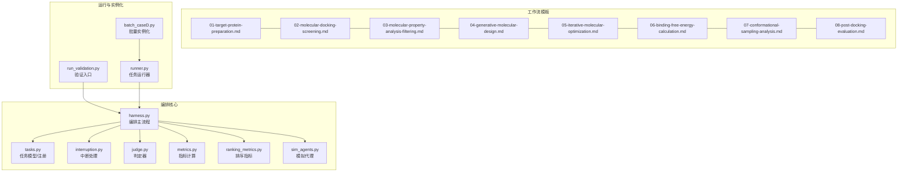
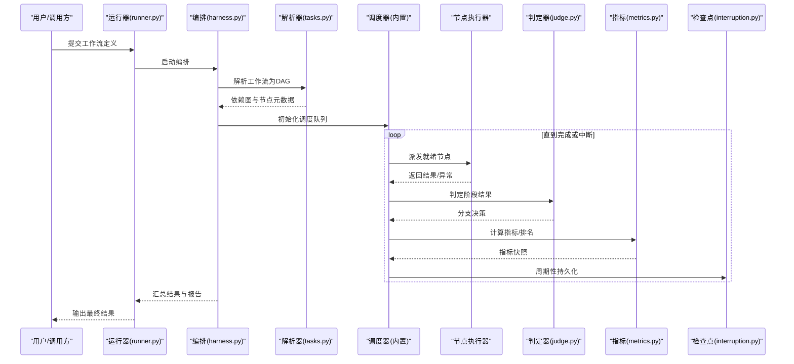
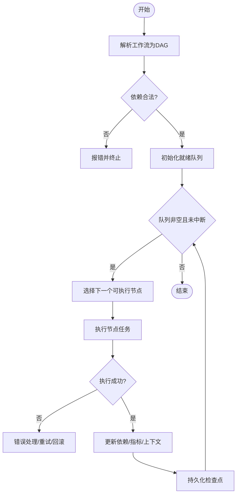
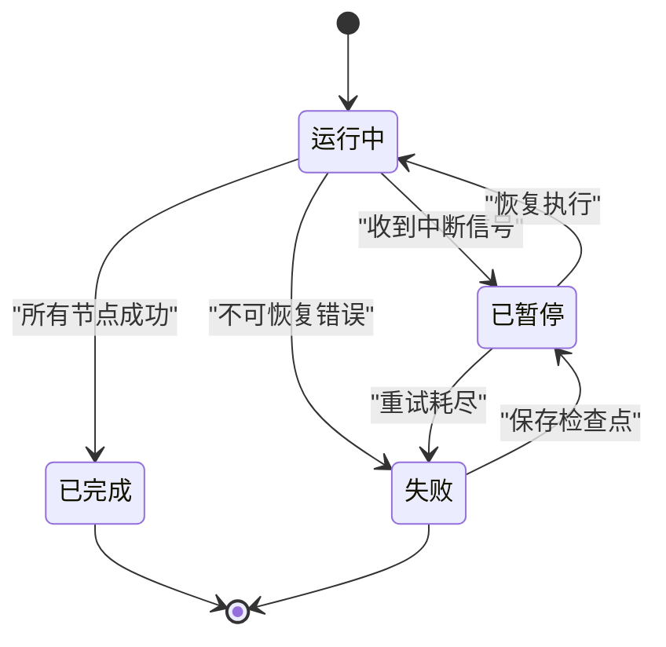
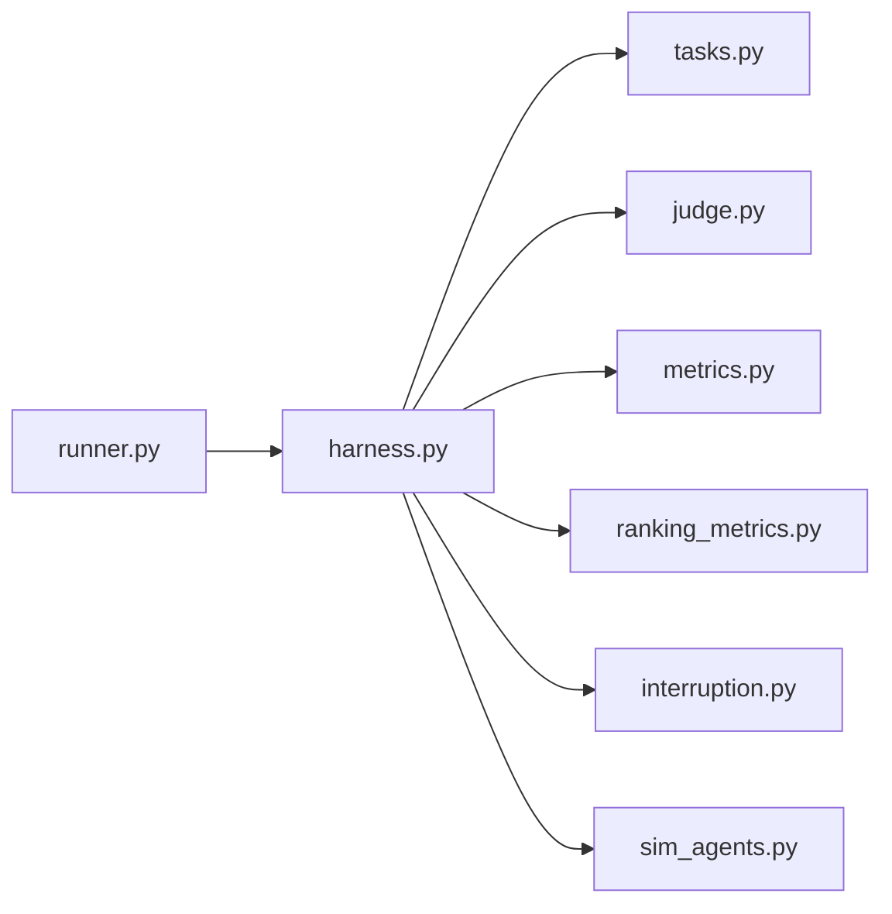

# 工作流编排系统

<cite>
**本文档引用的文件**   
- [autonomy_mvp/core/harness.py](file://autonomy_mvp/core/harness.py)
- [autonomy_mvp/core/interruption.py](file://autonomy_mvp/core/interruption.py)
- [autonomy_mvp/core/judge.py](file://autonomy_mvp/core/judge.py)
- [autonomy_mvp/core/metrics.py](file://autonomy_mvp/core/metrics.py)
- [autonomy_mvp/core/ranking_metrics.py](file://autonomy_mvp/core/ranking_metrics.py)
- [autonomy_mvp/core/sim_agents.py](file://autonomy_mvp/core/sim_agents.py)
- [autonomy_mvp/core/tasks.py](file://autonomy_mvp/core/tasks.py)
- [autonomy_mvp/run_validation.py](file://autonomy_mvp/run_validation.py)
- [autonomy_mvp/schema.md](file://autonomy_mvp/schema.md)
- [autonomy_mvp/ACCEPTANCE.md](file://autonomy_mvp/ACCEPTANCE.md)
- [docs/prd/molbench_repo/skills/L2_workflows/01-target-protein-preparation.md](file://docs/prd/molbench_repo/skills/L2_workflows/01-target-protein-preparation.md)
- [docs/prd/molbench_repo/skills/L2_workflows/02-molecular-docking-screening.md](file://docs/prd/molbench_repo/skills/L2_workflows/02-molecular-docking-screening.md)
- [docs/prd/molbench_repo/skills/L2_workflows/03-molecular-property-analysis-filtering.md](file://docs/prd/molbench_repo/skills/L2_workflows/03-molecular-property-analysis-filtering.md)
- [docs/prd/molbench_repo/skills/L2_workflows/04-generative-molecular-design.md](file://docs/prd/molbench_repo/skills/L2_workflows/04-generative-molecular-design.md)
- [docs/prd/molbench_repo/skills/L2_workflows/05-iterative-molecular-optimization.md](file://docs/prd/molbench_repo/skills/L2_workflows/05-iterative-molecular-optimization.md)
- [docs/prd/molbench_repo/skills/L2_workflows/06-binding-free-energy-calculation.md](file://docs/prd/molbench_repo/skills/L2_workflows/06-binding-free-energy-calculation.md)
- [docs/prd/molbench_repo/skills/L2_workflows/07-conformational-sampling-analysis.md](file://docs/prd/molbench_repo/skills/L2_workflows/07-conformational-sampling-analysis.md)
- [docs/prd/molbench_repo/skills/L2_workflows/08-post-docking-evaluation.md](file://docs/prd/molbench_repo/skills/L2_workflows/08-post-docking-evaluation.md)
- [longhorizon/instantiate/batch_caseD.py](file://longhorizon/instantiate/batch_caseD.py)
- [task5/runner.py](file://task5/runner.py)
</cite>

## 目录
1. [简介](#简介)
2. [项目结构](#项目结构)
3. [核心组件](#核心组件)
4. [架构总览](#架构总览)
5. [详细组件分析](#详细组件分析)
6. [依赖关系分析](#依赖关系分析)
7. [性能考量](#性能考量)
8. [故障排查指南](#故障排查指南)
9. [结论](#结论)
10. [附录](#附录)

## 简介
本文件面向“工作流编排系统”的架构与实现，聚焦以下目标：
- 工作流定义语法、节点类型与连接关系的规范说明
- 执行引擎的任务调度、依赖解析与并发控制机制
- 中断处理、状态恢复与故障转移策略
- 工作流模板、条件分支与循环结构的配置示例
- 性能监控、日志记录与调试工具使用指南

本仓库包含多套任务与工作流样例（如分子对接筛选、性质分析与迭代优化等），以及用于验证与评测的核心模块。文档将结合代码与文档材料，给出从概念到实现的完整视图。

## 项目结构
整体结构以“能力域+任务集+评测/运行脚本”组织：
- autonomy_mvp：核心编排与评测框架，包含任务定义、中断处理、指标计算、模拟代理与验证入口
- docs/prd/molbench_repo/skills/L2_workflows：工作流模板与步骤说明（目标蛋白准备、对接筛选、性质分析、生成设计、迭代优化、自由能计算、构象采样、对接后评估）
- longhorizon/instantiate：批量实例化与批处理脚本
- task5：并行与单线程对比运行的示例脚本

图表来源
- [autonomy_mvp/core/harness.py](file://autonomy_mvp/core/harness.py)
- [autonomy_mvp/core/tasks.py](file://autonomy_mvp/core/tasks.py)
- [autonomy_mvp/core/interruption.py](file://autonomy_mvp/core/interruption.py)
- [autonomy_mvp/core/judge.py](file://autonomy_mvp/core/judge.py)
- [autonomy_mvp/core/metrics.py](file://autonomy_mvp/core/metrics.py)
- [autonomy_mvp/core/ranking_metrics.py](file://autonomy_mvp/core/ranking_metrics.py)
- [autonomy_mvp/core/sim_agents.py](file://autonomy_mvp/core/sim_agents.py)
- [autonomy_mvp/run_validation.py](file://autonomy_mvp/run_validation.py)
- [longhorizon/instantiate/batch_caseD.py](file://longhorizon/instantiate/batch_caseD.py)
- [task5/runner.py](file://task5/runner.py)

章节来源
- [autonomy_mvp/schema.md](file://autonomy_mvp/schema.md)
- [autonomy_mvp/ACCEPTANCE.md](file://autonomy_mvp/ACCEPTANCE.md)

## 核心组件
- 编排主流程（harness）：负责加载工作流定义、构建依赖图、调度执行、管理上下文与结果聚合
- 任务模型（tasks）：定义节点类型、输入输出契约、参数校验与可序列化格式
- 中断处理（interruption）：捕获外部中断信号，保存检查点并安全退出
- 判定器（judge）：对阶段结果进行通过/失败判定，驱动分支逻辑
- 指标计算（metrics/ranking_metrics）：统一度量标准，支持多维评分与排序
- 模拟代理（sim_agents）：在离线场景下模拟外部服务或环境行为，便于回归测试

章节来源
- [autonomy_mvp/core/harness.py](file://autonomy_mvp/core/harness.py)
- [autonomy_mvp/core/tasks.py](file://autonomy_mvp/core/tasks.py)
- [autonomy_mvp/core/interruption.py](file://autonomy_mvp/core/interruption.py)
- [autonomy_mvp/core/judge.py](file://autonomy_mvp/core/judge.py)
- [autonomy_mvp/core/metrics.py](file://autonomy_mvp/core/metrics.py)
- [autonomy_mvp/core/ranking_metrics.py](file://autonomy_mvp/core/ranking_metrics.py)
- [autonomy_mvp/core/sim_agents.py](file://autonomy_mvp/core/sim_agents.py)

## 架构总览
工作流编排系统采用“声明式定义 + 运行时调度”的模式：
- 声明层：以结构化文档/JSON描述工作流拓扑、节点类型、连接关系与条件规则
- 解析层：将声明转换为有向无环图（DAG），并进行依赖解析与合法性校验
- 调度层：基于依赖就绪度进行任务派发，支持并发执行与资源限流
- 执行层：节点执行器调用具体工具或服务，产出中间产物与指标
- 观测层：日志、指标与检查点持久化，支持断点续跑与回溯

图表来源
- [autonomy_mvp/core/harness.py](file://autonomy_mvp/core/harness.py)
- [autonomy_mvp/core/tasks.py](file://autonomy_mvp/core/tasks.py)
- [autonomy_mvp/core/judge.py](file://autonomy_mvp/core/judge.py)
- [autonomy_mvp/core/metrics.py](file://autonomy_mvp/core/metrics.py)
- [autonomy_mvp/core/interruption.py](file://autonomy_mvp/core/interruption.py)
- [task5/runner.py](file://task5/runner.py)

## 详细组件分析

### 工作流定义语法与节点类型
- 节点类型
  - 工具节点：调用外部工具或服务（如分子对接、性质计算）
  - 数据节点：读取/写入数据集或中间产物
  - 判断节点：基于阈值或规则决定后续分支
  - 循环节点：按条件或固定次数重复执行子图
- 连接关系
  - 顺序连接：前驱完成后触发后继
  - 并行连接：多个后继同时就绪即并发执行
  - 条件连接：根据判定结果选择不同路径
- 变量与上下文
  - 节点间通过上下文传递数据，支持表达式求值与映射

章节来源
- [autonomy_mvp/schema.md](file://autonomy_mvp/schema.md)
- [autonomy_mvp/core/tasks.py](file://autonomy_mvp/core/tasks.py)

### 执行引擎：任务调度、依赖解析与并发控制
- 依赖解析
  - 构建DAG，检测环路与不可达节点
  - 计算每个节点的入度与就绪条件
- 任务调度
  - 基于就绪队列的优先级调度（例如按资源需求或预估耗时）
  - 支持最大并发数限制与资源池管理
- 并发控制
  - 线程/进程级并发，避免I/O阻塞
  - 背压与限流，防止下游过载

图表来源
- [autonomy_mvp/core/harness.py](file://autonomy_mvp/core/harness.py)
- [autonomy_mvp/core/interruption.py](file://autonomy_mvp/core/interruption.py)

章节来源
- [autonomy_mvp/core/harness.py](file://autonomy_mvp/core/harness.py)

### 中断处理、状态恢复与故障转移
- 中断处理
  - 捕获系统信号（如Ctrl+C、SIGTERM），触发优雅关闭
  - 保存当前上下文与指标快照，确保可恢复性
- 状态恢复
  - 从最近检查点恢复执行，跳过已完成节点
  - 支持增量重跑与部分失败重试
- 故障转移
  - 节点级重试策略（指数退避、上限控制）
  - 降级路径：当关键服务不可用时切换到备用实现或模拟代理

图表来源
- [autonomy_mvp/core/interruption.py](file://autonomy_mvp/core/interruption.py)

章节来源
- [autonomy_mvp/core/interruption.py](file://autonomy_mvp/core/interruption.py)

### 工作流模板、条件分支与循环结构
- 模板示例
  - 目标蛋白准备 → 分子对接筛选 → 性质分析过滤 → 生成分子设计 → 迭代优化 → 自由能计算 → 构象采样分析 → 对接后评估
- 条件分支
  - 基于指标阈值（如打分、收敛条件）选择继续或终止
- 循环结构
  - 固定轮次或动态条件（如改进幅度小于阈值）终止

章节来源
- [docs/prd/molbench_repo/skills/L2_workflows/01-target-protein-preparation.md](file://docs/prd/molbench_repo/skills/L2_workflows/01-target-protein-preparation.md)
- [docs/prd/molbench_repo/skills/L2_workflows/02-molecular-docking-screening.md](file://docs/prd/molbench_repo/skills/L2_workflows/02-molecular-docking-screening.md)
- [docs/prd/molbench_repo/skills/L2_workflows/03-molecular-property-analysis-filtering.md](file://docs/prd/molbench_repo/skills/L2_workflows/03-molecular-property-analysis-filtering.md)
- [docs/prd/molbench_repo/skills/L2_workflows/04-generative-molecular-design.md](file://docs/prd/molbench_repo/skills/L2_workflows/04-generative-molecular-design.md)
- [docs/prd/molbench_repo/skills/L2_workflows/05-iterative-molecular-optimization.md](file://docs/prd/molbench_repo/skills/L2_workflows/05-iterative-molecular-optimization.md)
- [docs/prd/molbench_repo/skills/L2_workflows/06-binding-free-energy-calculation.md](file://docs/prd/molbench_repo/skills/L2_workflows/06-binding-free-energy-calculation.md)
- [docs/prd/molbench_repo/skills/L2_workflows/07-conformational-sampling-analysis.md](file://docs/prd/molbench_repo/skills/L2_workflows/07-conformational-sampling-analysis.md)
- [docs/prd/molbench_repo/skills/L2_workflows/08-post-docking-evaluation.md](file://docs/prd/molbench_repo/skills/L2_workflows/08-post-docking-evaluation.md)

### 指标与判定：度量、排名与分支决策
- 指标计算
  - 标准化度量（如AUC、RMSE、富集因子）
  - 多维度评分与加权汇总
- 排名与排序
  - 基于指标对候选对象排序，支持Top-K筛选
- 判定器
  - 阈值判定、趋势判定（单调性）、一致性检验

章节来源
- [autonomy_mvp/core/metrics.py](file://autonomy_mvp/core/metrics.py)
- [autonomy_mvp/core/ranking_metrics.py](file://autonomy_mvp/core/ranking_metrics.py)
- [autonomy_mvp/core/judge.py](file://autonomy_mvp/core/judge.py)

### 模拟代理与离线验证
- 模拟代理
  - 在无外部依赖环境下提供确定性输出，便于回归测试
- 离线验证
  - 使用fixtures与最小数据集快速验证工作流正确性

章节来源
- [autonomy_mvp/core/sim_agents.py](file://autonomy_mvp/core/sim_agents.py)
- [autonomy_mvp/tests/fixtures/fixture_drugscreen.json](file://autonomy_mvp/tests/fixtures/fixture_drugscreen.json)
- [autonomy_mvp/tests/fixtures/fixture_materials.json](file://autonomy_mvp/tests/fixtures/fixture_materials.json)

## 依赖关系分析
- 模块耦合
  - harness依赖tasks、judge、metrics、ranking_metrics、interruption与sim_agents
  - runner作为上层入口，协调harness与外部参数
- 外部依赖
  - 工作流模板引用领域工具与服务（如对接软件、性质预测API）
- 潜在环路
  - DAG构建时检测并拒绝循环依赖

图表来源
- [task5/runner.py](file://task5/runner.py)
- [autonomy_mvp/core/harness.py](file://autonomy_mvp/core/harness.py)
- [autonomy_mvp/core/tasks.py](file://autonomy_mvp/core/tasks.py)
- [autonomy_mvp/core/judge.py](file://autonomy_mvp/core/judge.py)
- [autonomy_mvp/core/metrics.py](file://autonomy_mvp/core/metrics.py)
- [autonomy_mvp/core/ranking_metrics.py](file://autonomy_mvp/core/ranking_metrics.py)
- [autonomy_mvp/core/interruption.py](file://autonomy_mvp/core/interruption.py)
- [autonomy_mvp/core/sim_agents.py](file://autonomy_mvp/core/sim_agents.py)

章节来源
- [autonomy_mvp/run_validation.py](file://autonomy_mvp/run_validation.py)
- [longhorizon/instantiate/batch_caseD.py](file://longhorizon/instantiate/batch_caseD.py)

## 性能考量
- 并发与资源
  - 合理设置最大并发数，避免CPU/内存峰值过高
  - I/O密集型任务优先使用异步或进程隔离
- 缓存与复用
  - 中间产物缓存，减少重复计算
  - 预取与流水线化提升吞吐
- 监控与诊断
  - 关键指标埋点（延迟、吞吐、错误率）
  - 分布式追踪与采样日志

[本节为通用指导，不直接分析具体文件]

## 故障排查指南
- 常见问题
  - 依赖解析失败：检查节点ID与连接关系是否一致
  - 节点执行超时：调整超时阈值或增加重试策略
  - 指标计算异常：确认输入数据格式与阈值范围
- 定位方法
  - 查看检查点与日志时间线，确定失败节点
  - 使用模拟代理复现问题，隔离外部依赖影响
- 恢复策略
  - 从最近检查点恢复，仅重跑失败分支
  - 启用降级路径或备用服务

章节来源
- [autonomy_mvp/core/interruption.py](file://autonomy_mvp/core/interruption.py)
- [autonomy_mvp/core/judge.py](file://autonomy_mvp/core/judge.py)
- [autonomy_mvp/core/metrics.py](file://autonomy_mvp/core/metrics.py)

## 结论
本工作流编排系统通过声明式定义与强约束的DAG调度，实现了高内聚、低耦合的可扩展编排能力。配合中断恢复、指标判定与模拟代理，能够在复杂科学计算场景中稳定运行。建议在生产环境中加强监控与容量规划，持续优化并发与缓存策略以提升整体吞吐与稳定性。

[本节为总结，不直接分析具体文件]

## 附录
- 术语表
  - 工作流：由节点与边构成的有向图，描述任务执行顺序与依赖
  - 节点：最小执行单元，具有输入输出与副作用
  - 检查点：运行时状态的持久化快照，支持恢复与回溯
- 参考文档
  - 工作流模板与步骤说明见skills/L2_workflows目录
  - 验收标准与Schema定义见schema.md与ACCEPTANCE.md

[本节为补充信息，不直接分析具体文件]