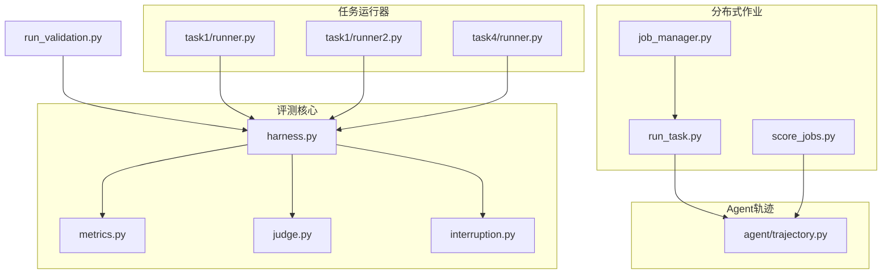
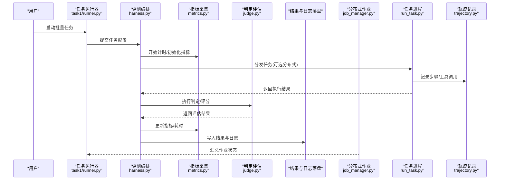
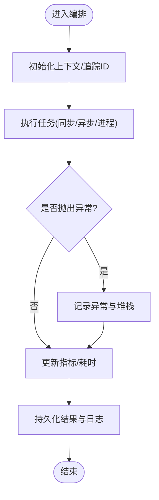
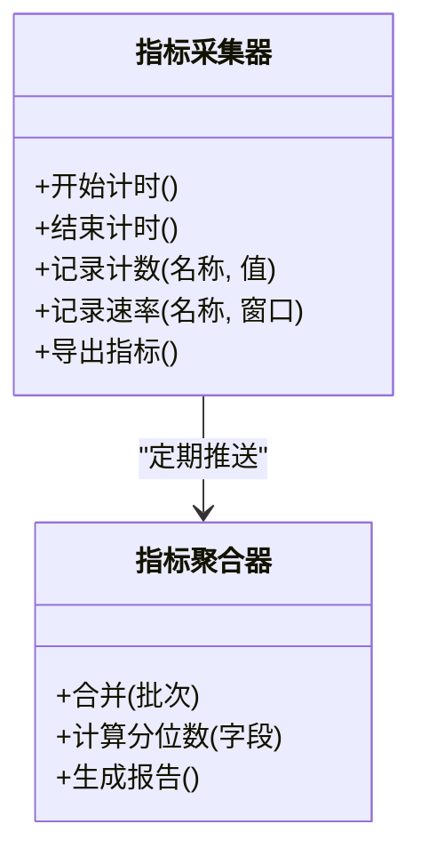
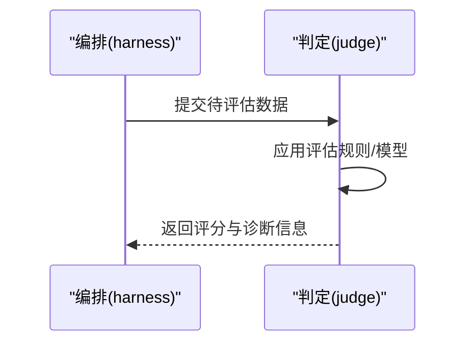
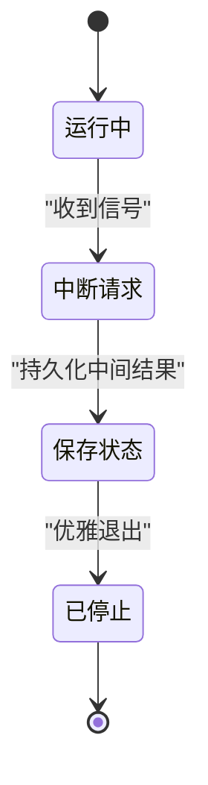
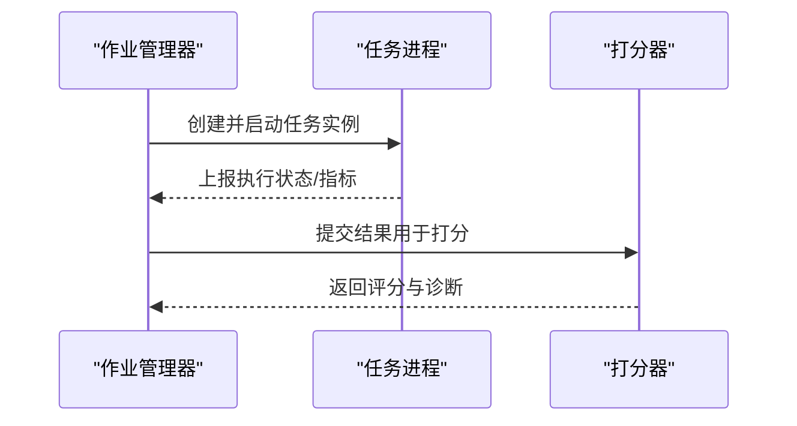
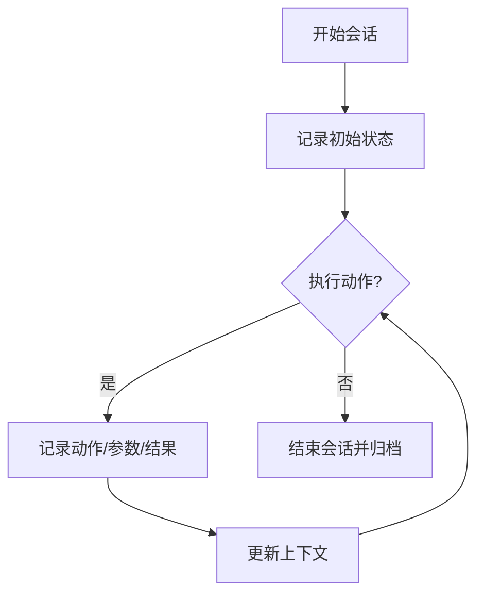
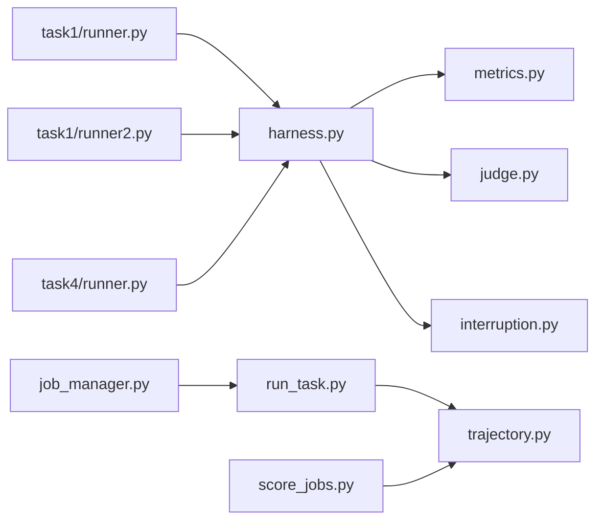

# 执行监控与调试

<cite>
**本文引用的文件**   
- [autonomy_mvp/core/harness.py](file://autonomy_mvp/core/harness.py)
- [autonomy_mvp/core/metrics.py](file://autonomy_mvp/core/metrics.py)
- [autonomy_mvp/core/judge.py](file://autonomy_mvp/core/judge.py)
- [autonomy_mvp/core/interruption.py](file://autonomy_mvp/core/interruption.py)
- [autonomy_mvp/run_validation.py](file://autonomy_mvp/run_validation.py)
- [task1/runner.py](file://task1/runner.py)
- [task1/runner2.py](file://task1/runner2.py)
- [task4/runner.py](file://task4/runner.py)
- [task7/poc3_physicianbench/scripts/job_manager.py](file://task7/poc3_physicianbench/scripts/job_manager.py)
- [task7/poc3_physicianbench/scripts/run_task.py](file://task7/poc3_physicianbench/scripts/run_task.py)
- [task7/poc3_physicianbench/scripts/score_jobs.py](file://task7/poc3_physicianbench/scripts/score_jobs.py)
- [task7/poc3_physicianbench/agent/trajectory.py](file://task7/poc3_physicianbench/agent/trajectory.py)
</cite>

## 目录
1. [简介](#简介)
2. [项目结构](#项目结构)
3. [核心组件](#核心组件)
4. [架构总览](#架构总览)
5. [详细组件分析](#详细组件分析)
6. [依赖关系分析](#依赖关系分析)
7. [性能考量](#性能考量)
8. [故障排查指南](#故障排查指南)
9. [结论](#结论)
10. [附录](#附录)

## 简介
本使用文档面向“执行监控与调试系统”，聚焦以下目标：
- 任务执行的实时监控、性能指标收集与异常检测机制
- 调试工具使用方法（断点设置、变量检查、调用栈分析）
- 日志记录策略、追踪ID管理与分布式调试技术
- 性能分析工具使用指南（CPU分析、内存泄漏检测、瓶颈识别）
- 监控数据的存储、查询与可视化展示方法

本仓库包含多个子任务与实验脚本，其中与执行监控与调试相关的代码主要集中在自动化评测框架与任务运行器中。本文基于这些源码进行系统化梳理，帮助读者快速搭建并高效使用监控与调试能力。

## 项目结构
从仓库视角看，与“执行监控与调试”直接相关的模块主要分布在：
- 自动化评测核心：harness、metrics、judge、interruption
- 评测入口与验证流程：run_validation
- 多任务运行器：task1/runner.py、task1/runner2.py、task4/runner.py
- 分布式作业管理：task7/poc3_physicianbench/scripts/job_manager.py、run_task.py、score_jobs.py
- Agent轨迹记录：task7/poc3_physicianbench/agent/trajectory.py

图表来源
- [autonomy_mvp/core/harness.py](file://autonomy_mvp/core/harness.py)
- [autonomy_mvp/core/metrics.py](file://autonomy_mvp/core/metrics.py)
- [autonomy_mvp/core/judge.py](file://autonomy_mvp/core/judge.py)
- [autonomy_mvp/core/interruption.py](file://autonomy_mvp/core/interruption.py)
- [autonomy_mvp/run_validation.py](file://autonomy_mvp/run_validation.py)
- [task1/runner.py](file://task1/runner.py)
- [task1/runner2.py](file://task1/runner2.py)
- [task4/runner.py](file://task4/runner.py)
- [task7/poc3_physicianbench/scripts/job_manager.py](file://task7/poc3_physicianbench/scripts/job_manager.py)
- [task7/poc3_physicianbench/scripts/run_task.py](file://task7/poc3_physicianbench/scripts/run_task.py)
- [task7/poc3_physicianbench/scripts/score_jobs.py](file://task7/poc3_physicianbench/scripts/score_jobs.py)
- [task7/poc3_physicianbench/agent/trajectory.py](file://task7/poc3_physicianbench/agent/trajectory.py)

章节来源
- [autonomy_mvp/core/harness.py](file://autonomy_mvp/core/harness.py)
- [autonomy_mvp/core/metrics.py](file://autonomy_mvp/core/metrics.py)
- [autonomy_mvp/core/judge.py](file://autonomy_mvp/core/judge.py)
- [autonomy_mvp/core/interruption.py](file://autonomy_mvp/core/interruption.py)
- [autonomy_mvp/run_validation.py](file://autonomy_mvp/run_validation.py)
- [task1/runner.py](file://task1/runner.py)
- [task1/runner2.py](file://task1/runner2.py)
- [task4/runner.py](file://task4/runner.py)
- [task7/poc3_physicianbench/scripts/job_manager.py](file://task7/poc3_physicianbench/scripts/job_manager.py)
- [task7/poc3_physicianbench/scripts/run_task.py](file://task7/poc3_physicianbench/scripts/run_task.py)
- [task7/poc3_physicianbench/scripts/score_jobs.py](file://task7/poc3_physicianbench/scripts/score_jobs.py)
- [task7/poc3_physicianbench/agent/trajectory.py](file://task7/poc3_physicianbench/agent/trajectory.py)

## 核心组件
- 任务编排与执行控制
  - 负责加载任务、调度执行、捕获异常、记录结果与指标。
  - 关键职责包括：生命周期钩子、中断处理、指标采集、判定逻辑。
- 指标与度量
  - 提供计时、计数、错误率、资源占用等指标的采集与聚合。
- 判定与评估
  - 对任务输出进行校验与评分，支持多种评估策略。
- 中断与可观测性
  - 支持外部中断信号、优雅退出、状态上报。
- 分布式作业管理
  - 作业分发、任务实例化、结果汇总与打分。
- Agent轨迹记录
  - 记录Agent交互步骤、工具调用、中间结果，便于回溯与调试。

章节来源
- [autonomy_mvp/core/harness.py](file://autonomy_mvp/core/harness.py)
- [autonomy_mvp/core/metrics.py](file://autonomy_mvp/core/metrics.py)
- [autonomy_mvp/core/judge.py](file://autonomy_mvp/core/judge.py)
- [autonomy_mvp/core/interruption.py](file://autonomy_mvp/core/interruption.py)
- [task7/poc3_physicianbench/scripts/job_manager.py](file://task7/poc3_physicianbench/scripts/job_manager.py)
- [task7/poc3_physicianbench/scripts/run_task.py](file://task7/poc3_physicianbench/scripts/run_task.py)
- [task7/poc3_physicianbench/scripts/score_jobs.py](file://task7/poc3_physicianbench/scripts/score_jobs.py)
- [task7/poc3_physicianbench/agent/trajectory.py](file://task7/poc3_physicianbench/agent/trajectory.py)

## 架构总览
下图展示了从评测入口到任务执行、指标采集、判定与结果落盘的端到端流程，以及分布式场景下的作业管理与轨迹记录。

图表来源
- [autonomy_mvp/core/harness.py](file://autonomy_mvp/core/harness.py)
- [autonomy_mvp/core/metrics.py](file://autonomy_mvp/core/metrics.py)
- [autonomy_mvp/core/judge.py](file://autonomy_mvp/core/judge.py)
- [task1/runner.py](file://task1/runner.py)
- [task7/poc3_physicianbench/scripts/job_manager.py](file://task7/poc3_physicianbench/scripts/job_manager.py)
- [task7/poc3_physicianbench/scripts/run_task.py](file://task7/poc3_physicianbench/scripts/run_task.py)
- [task7/poc3_physicianbench/agent/trajectory.py](file://task7/poc3_physicianbench/agent/trajectory.py)

## 详细组件分析

### 组件A：评测编排与执行控制（harness）
- 职责
  - 统一的任务生命周期管理：准备、执行、清理、上报。
  - 集成指标采集与异常捕获，保证失败路径的可观测性。
  - 与判定器对接，完成结果评分与报告生成。
- 关键流程
  - 初始化上下文与追踪ID
  - 执行任务函数或进程
  - 捕获异常并记录堆栈
  - 更新指标并持久化结果
- 建议
  - 在关键路径增加结构化日志与指标打点
  - 为长耗时操作添加进度回调与心跳上报

图表来源
- [autonomy_mvp/core/harness.py](file://autonomy_mvp/core/harness.py)
- [autonomy_mvp/core/metrics.py](file://autonomy_mvp/core/metrics.py)
- [autonomy_mvp/core/judge.py](file://autonomy_mvp/core/judge.py)

章节来源
- [autonomy_mvp/core/harness.py](file://autonomy_mvp/core/harness.py)
- [autonomy_mvp/core/metrics.py](file://autonomy_mvp/core/metrics.py)
- [autonomy_mvp/core/judge.py](file://autonomy_mvp/core/judge.py)

### 组件B：指标与度量（metrics）
- 功能
  - 计时器、计数器、速率统计、分位数汇总
  - 指标聚合与导出（JSON/CSV/时序数据库）
- 使用要点
  - 在任务边界处开启/关闭计时
  - 对关键分支与异常路径打点
  - 避免高频采样导致开销过大

图表来源
- [autonomy_mvp/core/metrics.py](file://autonomy_mvp/core/metrics.py)

章节来源
- [autonomy_mvp/core/metrics.py](file://autonomy_mvp/core/metrics.py)

### 组件C：判定与评估（judge）
- 功能
  - 根据规则或模型对任务输出进行评分
  - 支持多策略组合与权重加权
- 使用要点
  - 明确输入契约与输出格式
  - 将判定过程纳入指标与日志体系

图表来源
- [autonomy_mvp/core/judge.py](file://autonomy_mvp/core/judge.py)

章节来源
- [autonomy_mvp/core/judge.py](file://autonomy_mvp/core/judge.py)

### 组件D：中断与可观测性（interruption）
- 功能
  - 监听外部中断信号，触发优雅退出
  - 保存中间状态，确保可恢复性
- 使用要点
  - 在长时间运行的任务中注册中断处理器
  - 结合指标上报，记录中断原因与时间点

图表来源
- [autonomy_mvp/core/interruption.py](file://autonomy_mvp/core/interruption.py)

章节来源
- [autonomy_mvp/core/interruption.py](file://autonomy_mvp/core/interruption.py)

### 组件E：分布式作业管理（job_manager / run_task / score_jobs）
- 功能
  - 作业分发与实例化
  - 任务进程生命周期管理
  - 结果汇总与打分
- 使用要点
  - 为每个作业分配唯一追踪ID
  - 跨进程传递上下文（环境变量/配置文件）
  - 通过统一接口上报指标与日志

图表来源
- [task7/poc3_physicianbench/scripts/job_manager.py](file://task7/poc3_physicianbench/scripts/job_manager.py)
- [task7/poc3_physicianbench/scripts/run_task.py](file://task7/poc3_physicianbench/scripts/run_task.py)
- [task7/poc3_physicianbench/scripts/score_jobs.py](file://task7/poc3_physicianbench/scripts/score_jobs.py)

章节来源
- [task7/poc3_physicianbench/scripts/job_manager.py](file://task7/poc3_physicianbench/scripts/job_manager.py)
- [task7/poc3_physicianbench/scripts/run_task.py](file://task7/poc3_physicianbench/scripts/run_task.py)
- [task7/poc3_physicianbench/scripts/score_jobs.py](file://task7/poc3_physicianbench/scripts/score_jobs.py)

### 组件F：Agent轨迹记录（trajectory）
- 功能
  - 记录Agent的每一步动作、工具调用、输入输出摘要
  - 支持按会话/任务维度组织轨迹数据
- 使用要点
  - 在关键节点追加轨迹条目
  - 对敏感信息进行脱敏后再落盘

图表来源
- [task7/poc3_physicianbench/agent/trajectory.py](file://task7/poc3_physicianbench/agent/trajectory.py)

章节来源
- [task7/poc3_physicianbench/agent/trajectory.py](file://task7/poc3_physicianbench/agent/trajectory.py)

## 依赖关系分析
- 耦合度
  - harness 与 metrics、judge、interruption 存在强耦合，需保持接口稳定
  - 分布式模块通过消息/文件/共享存储解耦，降低进程间依赖
- 外部依赖
  - 文件系统用于结果与日志持久化
  - 可选：时序数据库/对象存储用于指标与轨迹长期保存
- 潜在循环依赖
  - 应避免 judge 反向依赖 metrics 的写路径，防止循环导入

图表来源
- [autonomy_mvp/core/harness.py](file://autonomy_mvp/core/harness.py)
- [autonomy_mvp/core/metrics.py](file://autonomy_mvp/core/metrics.py)
- [autonomy_mvp/core/judge.py](file://autonomy_mvp/core/judge.py)
- [autonomy_mvp/core/interruption.py](file://autonomy_mvp/core/interruption.py)
- [task1/runner.py](file://task1/runner.py)
- [task1/runner2.py](file://task1/runner2.py)
- [task4/runner.py](file://task4/runner.py)
- [task7/poc3_physicianbench/scripts/job_manager.py](file://task7/poc3_physicianbench/scripts/job_manager.py)
- [task7/poc3_physicianbench/scripts/run_task.py](file://task7/poc3_physicianbench/scripts/run_task.py)
- [task7/poc3_physicianbench/scripts/score_jobs.py](file://task7/poc3_physicianbench/scripts/score_jobs.py)
- [task7/poc3_physicianbench/agent/trajectory.py](file://task7/poc3_physicianbench/agent/trajectory.py)

章节来源
- [autonomy_mvp/core/harness.py](file://autonomy_mvp/core/harness.py)
- [autonomy_mvp/core/metrics.py](file://autonomy_mvp/core/metrics.py)
- [autonomy_mvp/core/judge.py](file://autonomy_mvp/core/judge.py)
- [autonomy_mvp/core/interruption.py](file://autonomy_mvp/core/interruption.py)
- [task1/runner.py](file://task1/runner.py)
- [task1/runner2.py](file://task1/runner2.py)
- [task4/runner.py](file://task4/runner.py)
- [task7/poc3_physicianbench/scripts/job_manager.py](file://task7/poc3_physicianbench/scripts/job_manager.py)
- [task7/poc3_physicianbench/scripts/run_task.py](file://task7/poc3_physicianbench/scripts/run_task.py)
- [task7/poc3_physicianbench/scripts/score_jobs.py](file://task7/poc3_physicianbench/scripts/score_jobs.py)
- [task7/poc3_physicianbench/agent/trajectory.py](file://task7/poc3_physicianbench/agent/trajectory.py)

## 性能考量
- CPU分析
  - 使用内置剖析器或第三方工具对热点函数进行采样
  - 在关键路径前后打点，定位慢调用
- 内存泄漏检测
  - 定期快照内存使用情况，对比增量变化
  - 关注大对象与缓存未释放的场景
- 瓶颈识别
  - 结合指标与日志，识别I/O阻塞、网络延迟、锁竞争
  - 对长尾任务进行抽样分析与重放

[本节为通用指导，不直接分析具体文件]

## 故障排查指南
- 断点设置
  - 在编排入口与判定器边界设置断点，观察输入输出契约
  - 针对异常分支与重试逻辑增加条件断点
- 变量检查
  - 在指标打点前后检查关键变量，确认数值范围与类型
  - 对分布式上下文（如追踪ID、任务标识）进行一致性校验
- 调用栈分析
  - 捕获异常时打印完整堆栈，关联追踪ID以便跨进程定位
  - 对长调用链进行分段堆栈采集，缩小问题范围
- 日志记录策略
  - 采用结构化日志（含时间戳、级别、追踪ID、任务ID）
  - 分级输出：DEBUG/INFO/WARN/ERROR，避免在生产环境输出过多敏感信息
- 追踪ID管理
  - 为每次任务/作业分配全局唯一ID，贯穿所有子系统
  - 在分布式场景中通过环境变量或消息头传递追踪ID
- 分布式调试技术
  - 使用集中式日志收集与检索平台，按追踪ID聚合日志
  - 对跨进程通信进行超时与重试监控，记录失败原因

章节来源
- [autonomy_mvp/core/harness.py](file://autonomy_mvp/core/harness.py)
- [autonomy_mvp/core/metrics.py](file://autonomy_mvp/core/metrics.py)
- [autonomy_mvp/core/judge.py](file://autonomy_mvp/core/judge.py)
- [autonomy_mvp/core/interruption.py](file://autonomy_mvp/core/interruption.py)
- [task7/poc3_physicianbench/scripts/job_manager.py](file://task7/poc3_physicianbench/scripts/job_manager.py)
- [task7/poc3_physicianbench/scripts/run_task.py](file://task7/poc3_physicianbench/scripts/run_task.py)
- [task7/poc3_physicianbench/scripts/score_jobs.py](file://task7/poc3_physicianbench/scripts/score_jobs.py)
- [task7/poc3_physicianbench/agent/trajectory.py](file://task7/poc3_physicianbench/agent/trajectory.py)

## 结论
通过将编排、指标、判定、中断、分布式作业与轨迹记录整合为一套可观测体系，可在复杂任务执行过程中实现：
- 实时可见：关键指标与状态即时上报
- 可追溯：以追踪ID串联全流程日志与轨迹
- 可诊断：完善的异常捕获、堆栈与变量检查手段
- 可扩展：模块化设计便于接入新的评估策略与存储后端

[本节为总结性内容，不直接分析具体文件]

## 附录
- 监控数据存储与查询
  - 本地文件：JSON/CSV，适合小规模与离线分析
  - 时序数据库：适合大规模指标与趋势分析
  - 对象存储：适合轨迹与大结果集归档
- 可视化展示
  - 仪表盘：展示成功率、耗时分布、错误率
  - 轨迹回放：按追踪ID回放Agent步骤与工具调用
  - 报告生成：自动汇总评分与诊断信息

[本节为通用指导，不直接分析具体文件]