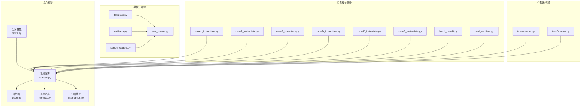
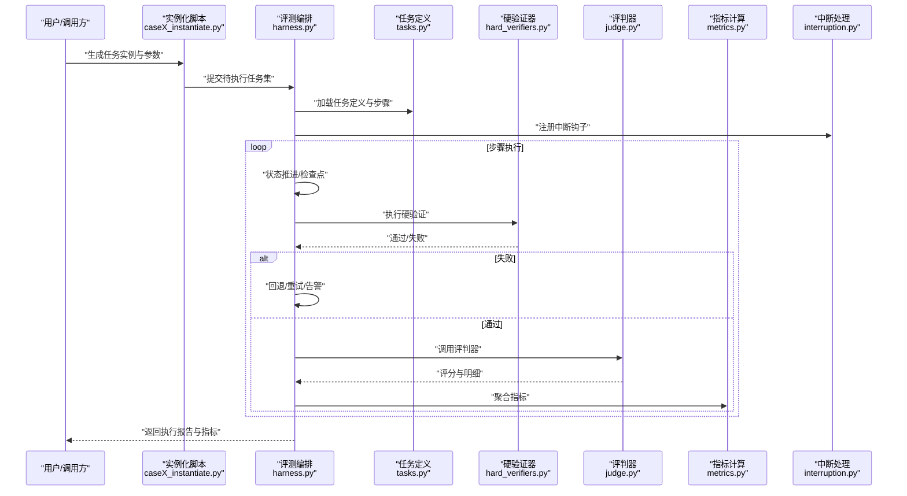
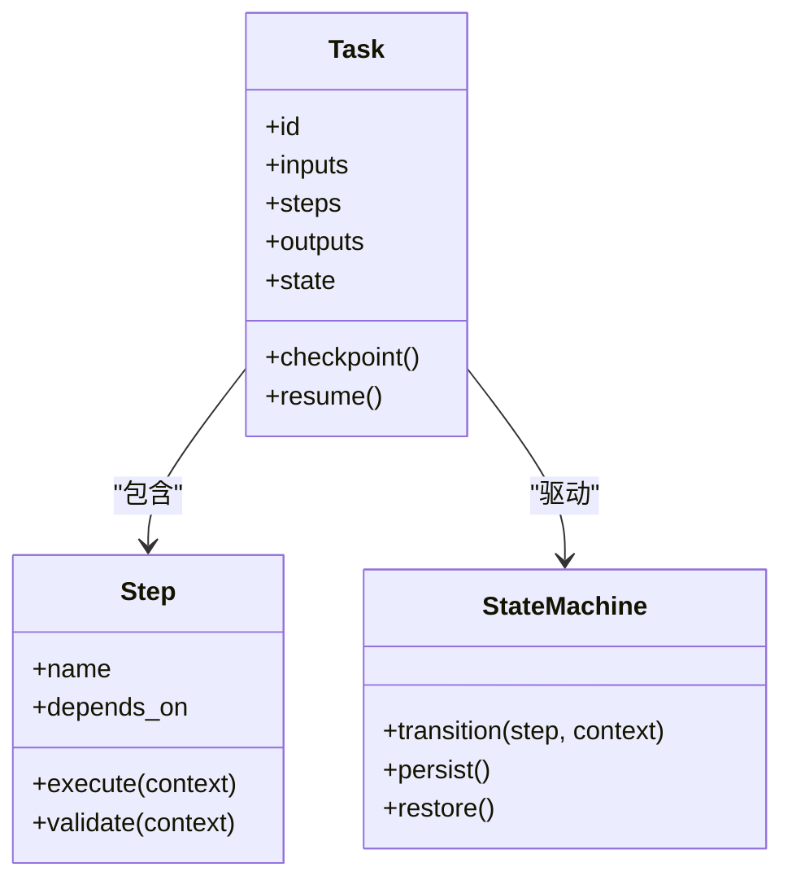
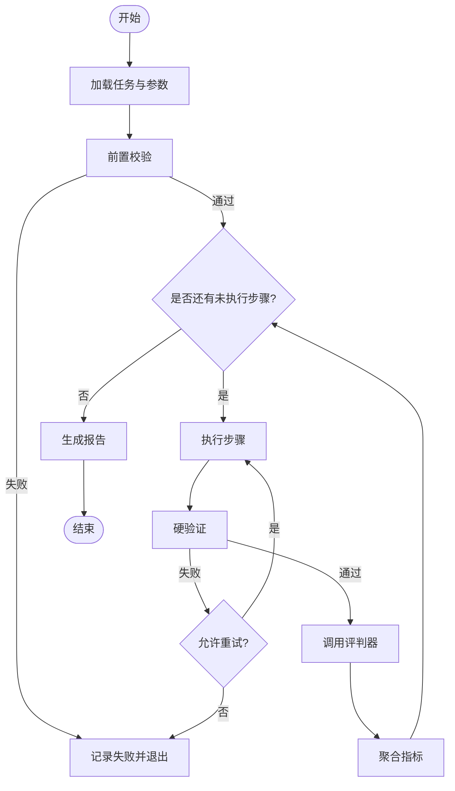
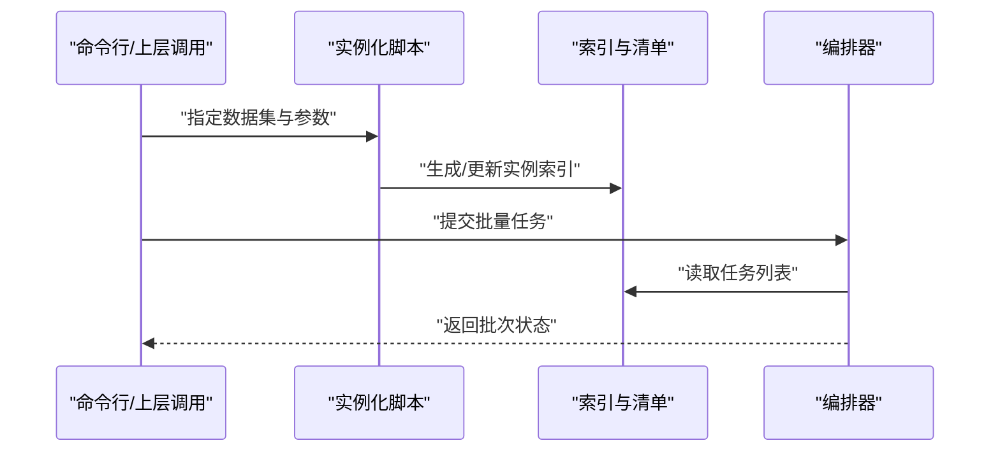
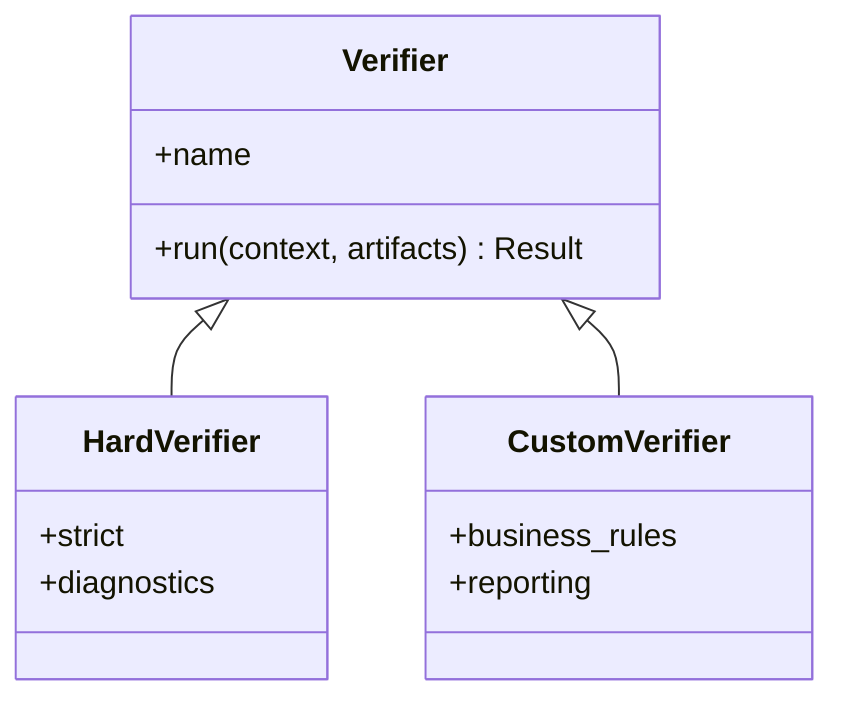
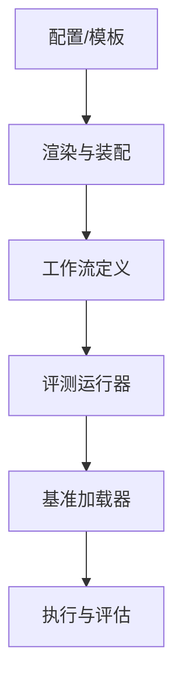
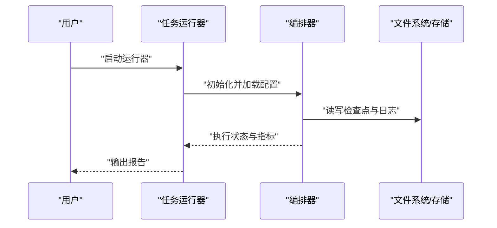
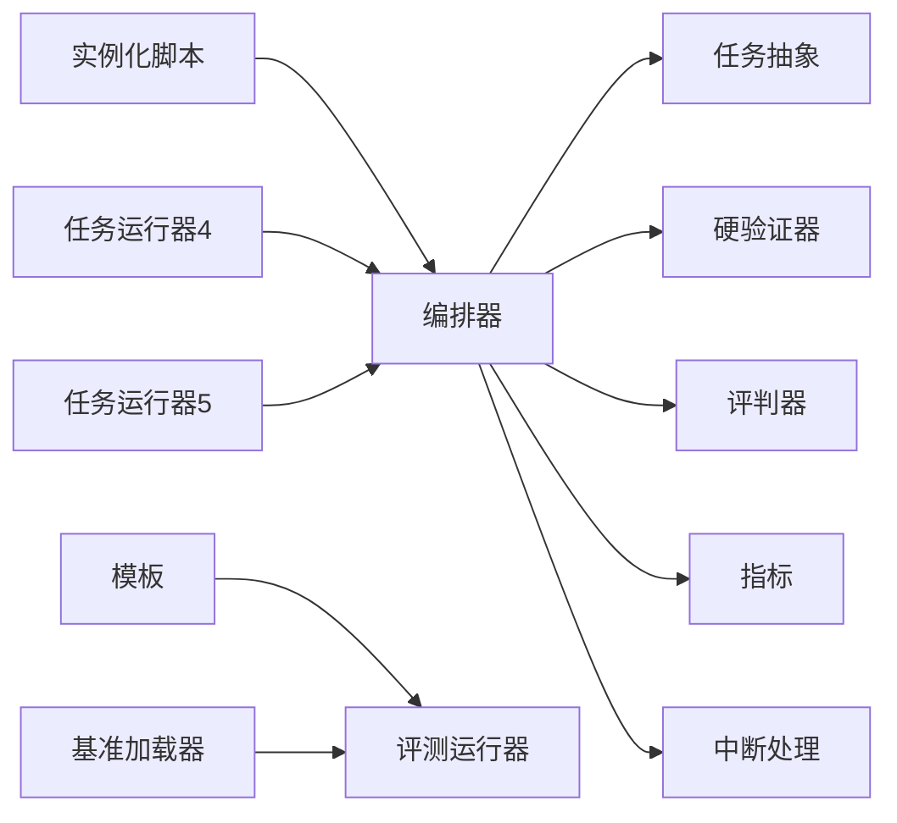

# 长视域任务平台

<cite>
**本文引用的文件**   
- [autonomy_mvp/core/tasks.py](file://autonomy_mvp/core/tasks.py)
- [autonomy_mvp/core/harness.py](file://autonomy_mvp/core/harness.py)
- [autonomy_mvp/core/judge.py](file://autonomy_mvp/core/judge.py)
- [autonomy_mvp/core/metrics.py](file://autonomy_mvp/core/metrics.py)
- [autonomy_mvp/core/interruption.py](file://autonomy_mvp/core/interruption.py)
- [autonomy_mvp/run_validation.py](file://autonomy_mvp/run_validation.py)
- [longhorizon/instantiate/case1_instantiate.py](file://longhorizon/instantiate/case1_instantiate.py)
- [longhorizon/instantiate/case2_instantiate.py](file://longhorizon/instantiate/case2_instantiate.py)
- [longhorizon/instantiate/case3_instantiate.py](file://longhorizon/instantiate/case3_instantiate.py)
- [longhorizon/instantiate/caseD_instantiate.py](file://longhorizon/instantiate/caseD_instantiate.py)
- [longhorizon/instantiate/caseE_instantiate.py](file://longhorizon/instantiate/caseE_instantiate.py)
- [longhorizon/instantiate/caseF_instantiate.py](file://longhorizon/instantiate/caseF_instantiate.py)
- [longhorizon/instantiate/batch_caseD.py](file://longhorizon/instantiate/batch_caseD.py)
- [longhorizon/verifiers/hard_verifiers.py](file://longhorizon/verifiers/hard_verifiers.py)
- [docs/prd/molbench_repo/templates/template.py](file://docs/prd/molbench_repo/templates/template.py)
- [docs/prd/molbench_repo/templates/outliners.py](file://docs/prd/molbench_repo/templates/outliners.py)
- [docs/prd/molbench_repo/eval/eval_runner.py](file://docs/prd/molbench_repo/eval/eval_runner.py)
- [docs/prd/molbench_repo/eval/bench_loaders.py](file://docs/prd/molbench_repo/eval/bench_loaders.py)
- [task4/runner.py](file://task4/runner.py)
- [task5/runner.py](file://task5/runner.py)
</cite>

## 目录
1. [简介](#简介)
2. [项目结构](#项目结构)
3. [核心组件](#核心组件)
4. [架构总览](#架构总览)
5. [详细组件分析](#详细组件分析)
6. [依赖关系分析](#依赖关系分析)
7. [性能与可扩展性](#性能与可扩展性)
8. [故障排查指南](#故障排查指南)
9. [结论](#结论)
10. [附录：示例与最佳实践](#附录示例与最佳实践)

## 简介
本仓库围绕“长视域任务”的建模、实例化、编排与验证展开，提供从任务定义到执行、监控与评估的一体化能力。其目标包括：
- 明确长视域任务的定义规范与数据结构
- 提供可复用的实例化机制与工作流编排
- 支持任务分解策略、状态管理与执行控制
- 构建验证器系统（含硬验证器与自定义扩展）
- 提供模板、配置与批量执行示例
- 给出监控、调试与性能分析的使用建议

## 项目结构
仓库采用按领域与阶段划分的组织方式：
- autonomy_mvp：最小可行实现，包含任务抽象、评测框架、中断处理与指标计算等核心能力
- longhorizon：面向长视域场景的实例化脚本与硬验证器
- docs/prd/molbench_repo：模板体系、评测运行器与基准加载器
- task4/task5：不同任务类型的运行器与实验记录
- deep_research_longhorizon：数据集与样例数据
- 其他目录：各任务会话、结果与分析文档

图表来源
- [autonomy_mvp/core/tasks.py](file://autonomy_mvp/core/tasks.py)
- [autonomy_mvp/core/harness.py](file://autonomy_mvp/core/harness.py)
- [autonomy_mvp/core/judge.py](file://autonomy_mvp/core/judge.py)
- [autonomy_mvp/core/metrics.py](file://autonomy_mvp/core/metrics.py)
- [autonomy_mvp/core/interruption.py](file://autonomy_mvp/core/interruption.py)
- [longhorizon/instantiate/case1_instantiate.py](file://longhorizon/instantiate/case1_instantiate.py)
- [longhorizon/instantiate/case2_instantiate.py](file://longhorizon/instantiate/case2_instantiate.py)
- [longhorizon/instantiate/case3_instantiate.py](file://longhorizon/instantiate/case3_instantiate.py)
- [longhorizon/instantiate/caseD_instantiate.py](file://longhorizon/instantiate/caseD_instantiate.py)
- [longhorizon/instantiate/caseE_instantiate.py](file://longhorizon/instantiate/caseE_instantiate.py)
- [longhorizon/instantiate/caseF_instantiate.py](file://longhorizon/instantiate/caseF_instantiate.py)
- [longhorizon/instantiate/batch_caseD.py](file://longhorizon/instantiate/batch_caseD.py)
- [longhorizon/verifiers/hard_verifiers.py](file://longhorizon/verifiers/hard_verifiers.py)
- [docs/prd/molbench_repo/templates/template.py](file://docs/prd/molbench_repo/templates/template.py)
- [docs/prd/molbench_repo/templates/outliners.py](file://docs/prd/molbench_repo/templates/outliners.py)
- [docs/prd/molbench_repo/eval/eval_runner.py](file://docs/prd/molbench_repo/eval/eval_runner.py)
- [docs/prd/molbench_repo/eval/bench_loaders.py](file://docs/prd/molbench_repo/eval/bench_loaders.py)
- [task4/runner.py](file://task4/runner.py)
- [task5/runner.py](file://task5/runner.py)

章节来源
- [autonomy_mvp/core/tasks.py](file://autonomy_mvp/core/tasks.py)
- [autonomy_mvp/core/harness.py](file://autonomy_mvp/core/harness.py)
- [autonomy_mvp/core/judge.py](file://autonomy_mvp/core/judge.py)
- [autonomy_mvp/core/metrics.py](file://autonomy_mvp/core/metrics.py)
- [autonomy_mvp/core/interruption.py](file://autonomy_mvp/core/interruption.py)
- [longhorizon/instantiate/case1_instantiate.py](file://longhorizon/instantiate/case1_instantiate.py)
- [longhorizon/instantiate/case2_instantiate.py](file://longhorizon/instantiate/case2_instantiate.py)
- [longhorizon/instantiate/case3_instantiate.py](file://longhorizon/instantiate/case3_instantiate.py)
- [longhorizon/instantiate/caseD_instantiate.py](file://longhorizon/instantiate/caseD_instantiate.py)
- [longhorizon/instantiate/caseE_instantiate.py](file://longhorizon/instantiate/caseE_instantiate.py)
- [longhorizon/instantiate/caseF_instantiate.py](file://longhorizon/instantiate/caseF_instantiate.py)
- [longhorizon/instantiate/batch_caseD.py](file://longhorizon/instantiate/batch_caseD.py)
- [longhorizon/verifiers/hard_verifiers.py](file://longhorizon/verifiers/hard_verifiers.py)
- [docs/prd/molbench_repo/templates/template.py](file://docs/prd/molbench_repo/templates/template.py)
- [docs/prd/molbench_repo/templates/outliners.py](file://docs/prd/molbench_repo/templates/outliners.py)
- [docs/prd/molbench_repo/eval/eval_runner.py](file://docs/prd/molbench_repo/eval/eval_runner.py)
- [docs/prd/molbench_repo/eval/bench_loaders.py](file://docs/prd/molbench_repo/eval/bench_loaders.py)
- [task4/runner.py](file://task4/runner.py)
- [task5/runner.py](file://task5/runner.py)

## 核心组件
- 任务抽象与生命周期
  - 通过统一的任务模型描述输入、步骤、中间产物与输出约束，支撑多阶段长流程执行
  - 提供状态机式推进与检查点持久化，便于恢复与审计
- 评测编排与执行控制
  - 统一的调度入口负责解析任务、驱动步骤执行、收集日志与指标
  - 支持并行度控制、超时与重试策略
- 评判器与指标
  - 将最终结果与期望进行比对，产出结构化评分与明细
  - 聚合指标用于跨任务横向对比
- 中断与容错
  - 捕获外部中断信号，安全保存状态并退出
  - 对异常步骤进行隔离与上报，避免级联失败
- 验证器系统
  - 内置硬验证器用于强一致性校验（如格式、约束、边界条件）
  - 提供扩展点以接入业务自定义验证逻辑

章节来源
- [autonomy_mvp/core/tasks.py](file://autonomy_mvp/core/tasks.py)
- [autonomy_mvp/core/harness.py](file://autonomy_mvp/core/harness.py)
- [autonomy_mvp/core/judge.py](file://autonomy_mvp/core/judge.py)
- [autonomy_mvp/core/metrics.py](file://autonomy_mvp/core/metrics.py)
- [autonomy_mvp/core/interruption.py](file://autonomy_mvp/core/interruption.py)
- [longhorizon/verifiers/hard_verifiers.py](file://longhorizon/verifiers/hard_verifiers.py)

## 架构总览
下图展示了从任务定义到执行、验证与评估的整体流程，以及关键模块之间的交互关系。

图表来源
- [autonomy_mvp/core/harness.py](file://autonomy_mvp/core/harness.py)
- [autonomy_mvp/core/tasks.py](file://autonomy_mvp/core/tasks.py)
- [autonomy_mvp/core/judge.py](file://autonomy_mvp/core/judge.py)
- [autonomy_mvp/core/metrics.py](file://autonomy_mvp/core/metrics.py)
- [autonomy_mvp/core/interruption.py](file://autonomy_mvp/core/interruption.py)
- [longhorizon/verifiers/hard_verifiers.py](file://longhorizon/verifiers/hard_verifiers.py)
- [longhorizon/instantiate/case1_instantiate.py](file://longhorizon/instantiate/case1_instantiate.py)
- [longhorizon/instantiate/case2_instantiate.py](file://longhorizon/instantiate/case2_instantiate.py)
- [longhorizon/instantiate/case3_instantiate.py](file://longhorizon/instantiate/case3_instantiate.py)
- [longhorizon/instantiate/caseD_instantiate.py](file://longhorizon/instantiate/caseD_instantiate.py)
- [longhorizon/instantiate/caseE_instantiate.py](file://longhorizon/instantiate/caseE_instantiate.py)
- [longhorizon/instantiate/caseF_instantiate.py](file://longhorizon/instantiate/caseF_instantiate.py)

## 详细组件分析

### 任务抽象与生命周期
- 设计要点
  - 以声明式方式描述任务：输入、步骤序列、中间产物、输出约束
  - 支持检查点与断点续跑，保证长流程的可观测性与可恢复性
- 关键职责
  - 任务解析与校验
  - 步骤图构建与拓扑排序
  - 状态迁移与事件发布
- 复杂度与优化
  - 步骤图规模线性增长；可通过缓存中间产物减少重复计算
  - 对I/O密集型步骤引入异步或批处理

图表来源
- [autonomy_mvp/core/tasks.py](file://autonomy_mvp/core/tasks.py)

章节来源
- [autonomy_mvp/core/tasks.py](file://autonomy_mvp/core/tasks.py)

### 评测编排与执行控制
- 设计要点
  - 统一入口负责任务加载、步骤调度、资源管理、错误处理与结果汇总
  - 支持并发度、超时、重试与熔断策略
- 关键职责
  - 解析任务实例与参数
  - 维护执行上下文与日志
  - 协调验证器与评判器
- 流程图（简化）

图表来源
- [autonomy_mvp/core/harness.py](file://autonomy_mvp/core/harness.py)
- [autonomy_mvp/core/judge.py](file://autonomy_mvp/core/judge.py)
- [autonomy_mvp/core/metrics.py](file://autonomy_mvp/core/metrics.py)
- [autonomy_mvp/core/interruption.py](file://autonomy_mvp/core/interruption.py)
- [longhorizon/verifiers/hard_verifiers.py](file://longhorizon/verifiers/hard_verifiers.py)

章节来源
- [autonomy_mvp/core/harness.py](file://autonomy_mvp/core/harness.py)
- [autonomy_mvp/core/judge.py](file://autonomy_mvp/core/judge.py)
- [autonomy_mvp/core/metrics.py](file://autonomy_mvp/core/metrics.py)
- [autonomy_mvp/core/interruption.py](file://autonomy_mvp/core/interruption.py)
- [longhorizon/verifiers/hard_verifiers.py](file://longhorizon/verifiers/hard_verifiers.py)

### 实例化机制与工作流编排
- 实例化脚本
  - case1~case3、caseD~caseF 分别对应不同领域的长视域任务实例化流程
  - 负责读取原始数据、构造任务实例、写入索引与中间产物
- 批量执行
  - batch_caseD.py 提供批量任务提交与进度跟踪能力
- 工作流编排
  - 通过 harness 统一调度，结合中断处理与检查点，保障大规模任务稳定运行

图表来源
- [longhorizon/instantiate/case1_instantiate.py](file://longhorizon/instantiate/case1_instantiate.py)
- [longhorizon/instantiate/case2_instantiate.py](file://longhorizon/instantiate/case2_instantiate.py)
- [longhorizon/instantiate/case3_instantiate.py](file://longhorizon/instantiate/case3_instantiate.py)
- [longhorizon/instantiate/caseD_instantiate.py](file://longhorizon/instantiate/caseD_instantiate.py)
- [longhorizon/instantiate/caseE_instantiate.py](file://longhorizon/instantiate/caseE_instantiate.py)
- [longhorizon/instantiate/caseF_instantiate.py](file://longhorizon/instantiate/caseF_instantiate.py)
- [longhorizon/instantiate/batch_caseD.py](file://longhorizon/instantiate/batch_caseD.py)
- [autonomy_mvp/core/harness.py](file://autonomy_mvp/core/harness.py)

章节来源
- [longhorizon/instantiate/case1_instantiate.py](file://longhorizon/instantiate/case1_instantiate.py)
- [longhorizon/instantiate/case2_instantiate.py](file://longhorizon/instantiate/case2_instantiate.py)
- [longhorizon/instantiate/case3_instantiate.py](file://longhorizon/instantiate/case3_instantiate.py)
- [longhorizon/instantiate/caseD_instantiate.py](file://longhorizon/instantiate/caseD_instantiate.py)
- [longhorizon/instantiate/caseE_instantiate.py](file://longhorizon/instantiate/caseE_instantiate.py)
- [longhorizon/instantiate/caseF_instantiate.py](file://longhorizon/instantiate/caseF_instantiate.py)
- [longhorizon/instantiate/batch_caseD.py](file://longhorizon/instantiate/batch_caseD.py)
- [autonomy_mvp/core/harness.py](file://autonomy_mvp/core/harness.py)

### 验证器系统：设计与扩展
- 设计原理
  - 将“强约束校验”与“弱约束评估”解耦：硬验证器确保不可妥协的约束满足，评判器负责质量打分
  - 验证器以插件形式挂载，编排器在步骤完成后按需调用
- 硬验证器实现
  - 覆盖格式、类型、范围、唯一性、依赖完整性等基础约束
  - 失败时立即阻断后续流程，并记录定位信息
- 自定义验证器开发指南
  - 遵循统一接口：接收上下文与中间产物，返回通过/失败及诊断信息
  - 注册到验证器表，由编排器在合适时机触发
  - 建议为每个验证器提供单元测试与回归用例

图表来源
- [longhorizon/verifiers/hard_verifiers.py](file://longhorizon/verifiers/hard_verifiers.py)
- [autonomy_mvp/core/harness.py](file://autonomy_mvp/core/harness.py)

章节来源
- [longhorizon/verifiers/hard_verifiers.py](file://longhorizon/verifiers/hard_verifiers.py)
- [autonomy_mvp/core/harness.py](file://autonomy_mvp/core/harness.py)

### 模板体系与工作流配置
- 模板
  - template.py 提供通用模板渲染与变量注入能力
  - outliners.py 提供大纲生成与结构化提示词组装
- 工作流配置
  - 通过 YAML/JSON 配置任务链、工具路由与变量映射
  - 结合 eval_runner 与 bench_loaders 完成端到端评测

图表来源
- [docs/prd/molbench_repo/templates/template.py](file://docs/prd/molbench_repo/templates/template.py)
- [docs/prd/molbench_repo/templates/outliners.py](file://docs/prd/molbench_repo/templates/outliners.py)
- [docs/prd/molbench_repo/eval/eval_runner.py](file://docs/prd/molbench_repo/eval/eval_runner.py)
- [docs/prd/molbench_repo/eval/bench_loaders.py](file://docs/prd/molbench_repo/eval/bench_loaders.py)

章节来源
- [docs/prd/molbench_repo/templates/template.py](file://docs/prd/molbench_repo/templates/template.py)
- [docs/prd/molbench_repo/templates/outliners.py](file://docs/prd/molbench_repo/templates/outliners.py)
- [docs/prd/molbench_repo/eval/eval_runner.py](file://docs/prd/molbench_repo/eval/eval_runner.py)
- [docs/prd/molbench_repo/eval/bench_loaders.py](file://docs/prd/molbench_repo/eval/bench_loaders.py)

### 任务运行器与监控
- 运行器
  - task4/runner.py 与 task5/runner.py 分别承载不同任务类型的执行入口
  - 负责参数解析、环境准备、任务提交与结果落盘
- 监控与调试
  - 利用 harness 的统一日志与检查点，结合中断处理，实现可观测与可恢复
  - 建议在关键步骤埋点时间、内存与I/O指标，便于性能分析

图表来源
- [task4/runner.py](file://task4/runner.py)
- [task5/runner.py](file://task5/runner.py)
- [autonomy_mvp/core/harness.py](file://autonomy_mvp/core/harness.py)

章节来源
- [task4/runner.py](file://task4/runner.py)
- [task5/runner.py](file://task5/runner.py)
- [autonomy_mvp/core/harness.py](file://autonomy_mvp/core/harness.py)

## 依赖关系分析
- 模块耦合
  - 编排器为核心枢纽，依赖任务抽象、验证器、评判器与指标模块
  - 实例化脚本仅关注数据到任务实例的转换，降低与执行层的耦合
- 外部依赖
  - 模板与评测运行器依赖配置与基准加载器
  - 运行器依赖文件系统与可能的远程服务（如数据库、对象存储）
- 潜在循环依赖
  - 当前结构清晰，未见明显循环依赖；建议保持“实例化→编排→评估”单向依赖

图表来源
- [autonomy_mvp/core/harness.py](file://autonomy_mvp/core/harness.py)
- [autonomy_mvp/core/tasks.py](file://autonomy_mvp/core/tasks.py)
- [autonomy_mvp/core/judge.py](file://autonomy_mvp/core/judge.py)
- [autonomy_mvp/core/metrics.py](file://autonomy_mvp/core/metrics.py)
- [autonomy_mvp/core/interruption.py](file://autonomy_mvp/core/interruption.py)
- [longhorizon/verifiers/hard_verifiers.py](file://longhorizon/verifiers/hard_verifiers.py)
- [docs/prd/molbench_repo/templates/template.py](file://docs/prd/molbench_repo/templates/template.py)
- [docs/prd/molbench_repo/eval/eval_runner.py](file://docs/prd/molbench_repo/eval/eval_runner.py)
- [docs/prd/molbench_repo/eval/bench_loaders.py](file://docs/prd/molbench_repo/eval/bench_loaders.py)
- [task4/runner.py](file://task4/runner.py)
- [task5/runner.py](file://task5/runner.py)

章节来源
- [autonomy_mvp/core/harness.py](file://autonomy_mvp/core/harness.py)
- [autonomy_mvp/core/tasks.py](file://autonomy_mvp/core/tasks.py)
- [autonomy_mvp/core/judge.py](file://autonomy_mvp/core/judge.py)
- [autonomy_mvp/core/metrics.py](file://autonomy_mvp/core/metrics.py)
- [autonomy_mvp/core/interruption.py](file://autonomy_mvp/core/interruption.py)
- [longhorizon/verifiers/hard_verifiers.py](file://longhorizon/verifiers/hard_verifiers.py)
- [docs/prd/molbench_repo/templates/template.py](file://docs/prd/molbench_repo/templates/template.py)
- [docs/prd/molbench_repo/eval/eval_runner.py](file://docs/prd/molbench_repo/eval/eval_runner.py)
- [docs/prd/molbench_repo/eval/bench_loaders.py](file://docs/prd/molbench_repo/eval/bench_loaders.py)
- [task4/runner.py](file://task4/runner.py)
- [task5/runner.py](file://task5/runner.py)

## 性能与可扩展性
- 并发与吞吐
  - 合理设置并行度，避免资源争用；对CPU密集与I/O密集任务区分调度
- 缓存与增量
  - 对稳定中间产物启用缓存；支持增量重跑，缩短反馈周期
- 资源治理
  - 限制单任务资源上限，防止长尾任务拖垮整体队列
- 可观测性
  - 采集关键路径耗时、错误率与资源使用，建立基线与告警

[本节为通用指导，不直接分析具体文件]

## 故障排查指南
- 常见问题
  - 任务卡死：检查中断钩子与超时配置，确认检查点是否定期落盘
  - 验证失败：查看硬验证器的诊断信息，定位字段缺失或约束冲突
  - 指标异常：核对评判器输入结构与阈值设定
- 定位手段
  - 启用详细日志与TraceID，关联步骤与中间产物
  - 使用最小复现用例快速定位问题
- 恢复策略
  - 基于检查点恢复；必要时回滚到上一稳定版本

章节来源
- [autonomy_mvp/core/interruption.py](file://autonomy_mvp/core/interruption.py)
- [autonomy_mvp/core/harness.py](file://autonomy_mvp/core/harness.py)
- [longhorizon/verifiers/hard_verifiers.py](file://longhorizon/verifiers/hard_verifiers.py)

## 结论
本平台以“任务抽象—编排执行—验证评估”为主线，提供了长视域任务从定义到落地的完整闭环。通过硬验证器与评判器解耦、模板与配置驱动、以及完善的监控与恢复机制，平台具备良好的稳定性与可扩展性。建议在实际使用中结合业务特性完善自定义验证器与指标体系，持续沉淀最佳实践。

[本节为总结性内容，不直接分析具体文件]

## 附录：示例与最佳实践
- 任务模板
  - 使用模板引擎生成标准化任务描述，统一变量命名与结构
- 工作流配置
  - 以YAML/JSON声明式定义任务链、工具路由与变量映射
- 批量执行
  - 通过批量脚本提交任务集，配合编排器进行进度跟踪与失败重试
- 监控与调试
  - 开启细粒度日志，结合检查点与中断处理，提升可观测性与可恢复性
- 性能调优
  - 根据任务特征调整并发度与资源配额，引入缓存与增量执行

[本节为概念性说明，不直接分析具体文件]