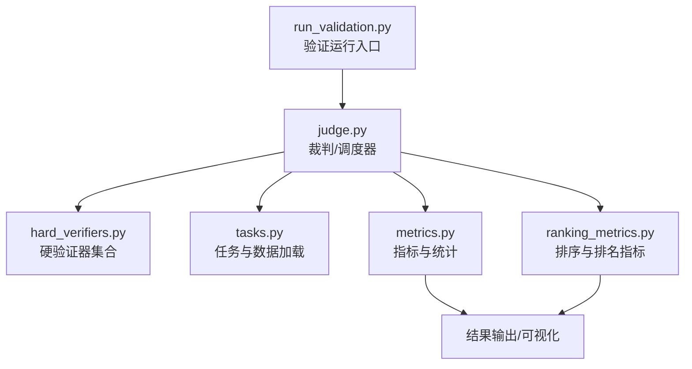
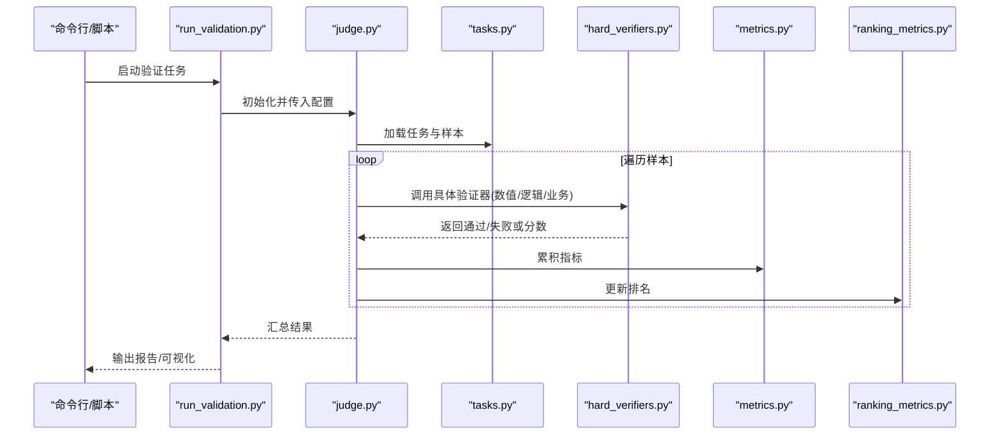
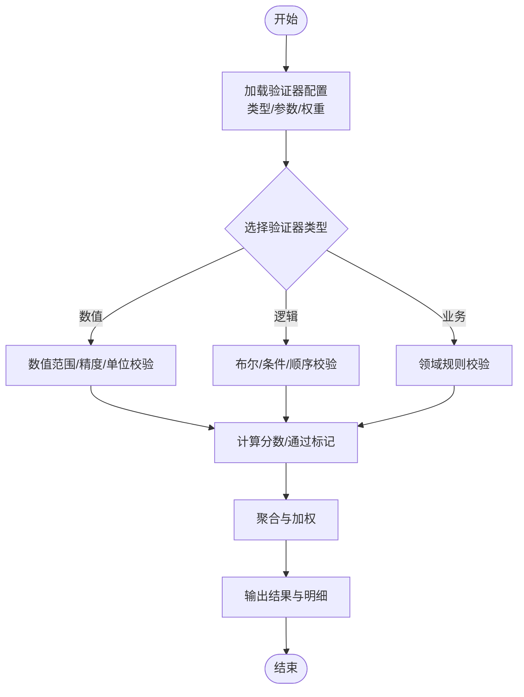
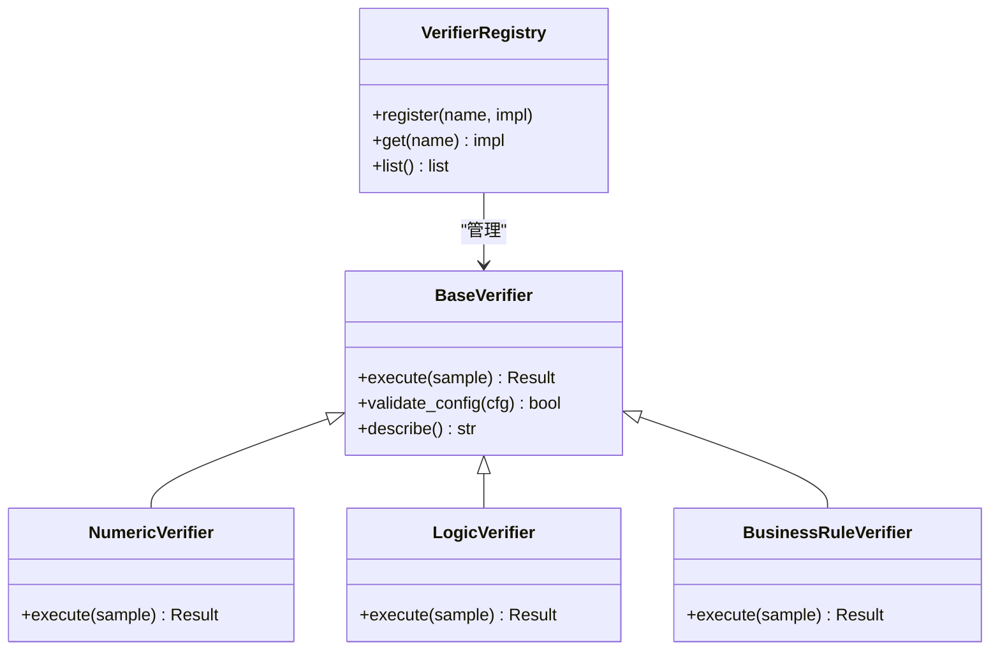
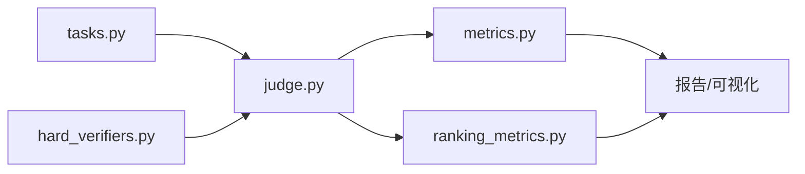

# 验证器系统

<cite>
**本文引用的文件**   
- [longhorizon/verifiers/hard_verifiers.py](file://longhorizon/verifiers/hard_verifiers.py)
- [autonomy_mvp/core/judge.py](file://autonomy_mvp/core/judge.py)
- [autonomy_mvp/core/metrics.py](file://autonomy_mvp/core/metrics.py)
- [autonomy_mvp/core/ranking_metrics.py](file://autonomy_mvp/core/ranking_metrics.py)
- [autonomy_mvp/core/tasks.py](file://autonomy_mvp/core/tasks.py)
- [autonomy_mvp/run_validation.py](file://autonomy_mvp/run_validation.py)
- [autonomy_mvp/tests/test_core.py](file://autonomy_mvp/tests/test_core.py)
</cite>

## 目录
1. [简介](#简介)
2. [项目结构](#项目结构)
3. [核心组件](#核心组件)
4. [架构总览](#架构总览)
5. [详细组件分析](#详细组件分析)
6. [依赖关系分析](#依赖关系分析)
7. [性能考量](#性能考量)
8. [故障排查指南](#故障排查指南)
9. [结论](#结论)
10. [附录](#附录)

## 简介
本技术文档围绕“验证器系统”展开，聚焦硬验证器的设计原理、评估算法与评分标准；阐述验证器的注册机制、插件化扩展接口；提供自定义验证器的开发指南、测试方法与部署流程；并给出数值验证、逻辑验证与业务规则验证的配置示例。同时说明验证结果的统计分析、报告生成与可视化展示能力，帮助读者快速理解与落地使用。

## 项目结构
仓库中与验证器系统直接相关的代码主要分布在以下位置：
- longhorizon/verifiers/hard_verifiers.py：硬验证器实现（数值、逻辑、业务规则等）
- autonomy_mvp/core/judge.py：裁判/调度器，负责编排任务与调用验证器
- autonomy_mvp/core/metrics.py：指标计算与统计汇总
- autonomy_mvp/core/ranking_metrics.py：排序与排名相关指标
- autonomy_mvp/core/tasks.py：任务定义与数据加载
- autonomy_mvp/run_validation.py：验证运行入口与批处理流程
- autonomy_mvp/tests/test_core.py：单元测试与回归用例

图示来源
- [autonomy_mvp/run_validation.py](file://autonomy_mvp/run_validation.py)
- [autonomy_mvp/core/judge.py](file://autonomy_mvp/core/judge.py)
- [longhorizon/verifiers/hard_verifiers.py](file://longhorizon/verifiers/hard_verifiers.py)
- [autonomy_mvp/core/tasks.py](file://autonomy_mvp/core/tasks.py)
- [autonomy_mvp/core/metrics.py](file://autonomy_mvp/core/metrics.py)
- [autonomy_mvp/core/ranking_metrics.py](file://autonomy_mvp/core/ranking_metrics.py)

章节来源
- [autonomy_mvp/run_validation.py](file://autonomy_mvp/run_validation.py)
- [autonomy_mvp/core/judge.py](file://autonomy_mvp/core/judge.py)
- [longhorizon/verifiers/hard_verifiers.py](file://longhorizon/verifiers/hard_verifiers.py)
- [autonomy_mvp/core/tasks.py](file://autonomy_mvp/core/tasks.py)
- [autonomy_mvp/core/metrics.py](file://autonomy_mvp/core/metrics.py)
- [autonomy_mvp/core/ranking_metrics.py](file://autonomy_mvp/core/ranking_metrics.py)

## 核心组件
- 硬验证器（Hard Verifiers）
  - 职责：对模型或系统的输出进行确定性判定，返回布尔通过/失败或离散分数，用于严格约束输出质量。
  - 典型类别：数值范围校验、单位与量纲一致性、阈值比较、逻辑表达式满足性、业务规则合规性。
  - 特点：可组合、可插拔、可配置参数化。
- 裁判/调度器（Judge）
  - 职责：根据任务配置加载数据、选择并执行对应验证器、收集中间结果与最终得分、触发统计与报告。
- 指标与统计（Metrics）
  - 职责：聚合通过/失败计数、计算通过率、均值方差、置信区间、分布统计等。
- 排序与排名（Ranking Metrics）
  - 职责：基于多指标对候选方案或模型进行排序与对比。
- 任务与数据（Tasks）
  - 职责：定义输入数据格式、期望输出结构与元信息，驱动验证流程。
- 运行入口（Run Validation）
  - 职责：解析命令行参数、读取配置、批量执行验证、持久化结果与日志。

章节来源
- [longhorizon/verifiers/hard_verifiers.py](file://longhorizon/verifiers/hard_verifiers.py)
- [autonomy_mvp/core/judge.py](file://autonomy_mvp/core/judge.py)
- [autonomy_mvp/core/metrics.py](file://autonomy_mvp/core/metrics.py)
- [autonomy_mvp/core/ranking_metrics.py](file://autonomy_mvp/core/ranking_metrics.py)
- [autonomy_mvp/core/tasks.py](file://autonomy_mvp/core/tasks.py)
- [autonomy_mvp/run_validation.py](file://autonomy_mvp/run_validation.py)

## 架构总览
验证器系统采用“任务驱动 + 插件式验证器 + 统一裁判编排”的架构。运行入口加载任务与配置后，由裁判按序调用相应硬验证器完成判定，随后由指标模块汇总统计，并可结合排序指标生成对比报告。

图示来源
- [autonomy_mvp/run_validation.py](file://autonomy_mvp/run_validation.py)
- [autonomy_mvp/core/judge.py](file://autonomy_mvp/core/judge.py)
- [autonomy_mvp/core/tasks.py](file://autonomy_mvp/core/tasks.py)
- [longhorizon/verifiers/hard_verifiers.py](file://longhorizon/verifiers/hard_verifiers.py)
- [autonomy_mvp/core/metrics.py](file://autonomy_mvp/core/metrics.py)
- [autonomy_mvp/core/ranking_metrics.py](file://autonomy_mvp/core/ranking_metrics.py)

## 详细组件分析

### 硬验证器设计与评估算法
- 设计原则
  - 确定性：相同输入产生相同输出，便于复现与审计。
  - 可组合：支持将多个验证器串联或并联，形成复合规则。
  - 可配置：通过参数控制阈值、容差、单位、优先级等。
- 评估算法
  - 数值验证：范围检查、精度/有效数字、单位换算与一致性、异常值检测。
  - 逻辑验证：布尔表达式、条件分支、时序/顺序约束、互斥/包含关系。
  - 业务规则：领域特定约束（如药代动力学、材料物性、工程规范）。
- 评分标准
  - 二元评分：通过/失败（布尔），适合硬性门槛。
  - 分级评分：多级通过（如完全符合/部分符合/不符合），便于细粒度度量。
  - 加权评分：不同规则赋予权重，综合为总分或等级。

图示来源
- [longhorizon/verifiers/hard_verifiers.py](file://longhorizon/verifiers/hard_verifiers.py)
- [autonomy_mvp/core/judge.py](file://autonomy_mvp/core/judge.py)

章节来源
- [longhorizon/verifiers/hard_verifiers.py](file://longhorizon/verifiers/hard_verifiers.py)
- [autonomy_mvp/core/judge.py](file://autonomy_mvp/core/judge.py)

### 注册机制与插件架构
- 注册机制
  - 集中注册表：维护验证器名称到实现的映射，支持动态发现与按需加载。
  - 声明式注册：通过装饰器或显式注册函数将新验证器加入全局表。
- 插件架构
  - 接口契约：统一的输入输出协议（输入样例、期望字段、错误码、诊断信息）。
  - 生命周期：初始化（加载外部资源）、执行（判定）、清理（释放资源）。
  - 版本兼容：向后兼容的字段与默认值策略，避免破坏现有任务。
- 扩展接口
  - 新增验证器：实现接口方法并在注册表中登记。
  - 覆盖行为：在特定任务中替换默认实现或注入钩子。
  - 配置驱动：通过配置文件指定启用/禁用、参数与优先级。

图示来源
- [longhorizon/verifiers/hard_verifiers.py](file://longhorizon/verifiers/hard_verifiers.py)
- [autonomy_mvp/core/judge.py](file://autonomy_mvp/core/judge.py)

章节来源
- [longhorizon/verifiers/hard_verifiers.py](file://longhorizon/verifiers/hard_verifiers.py)
- [autonomy_mvp/core/judge.py](file://autonomy_mvp/core/judge.py)

### 自定义验证器开发指南
- 步骤概览
  - 定义输入输出：明确样本结构、必填字段、错误码与诊断信息。
  - 实现接口：继承基类或遵循约定，实现执行与配置校验方法。
  - 注册与配置：在注册表中登记，编写任务配置启用该验证器。
  - 单元测试：覆盖正常路径、边界条件与异常场景。
  - 集成测试：在真实任务中端到端验证。
- 最佳实践
  - 幂等性与可复现：避免随机性与外部状态依赖。
  - 可观测性：记录关键断言与中间变量，便于定位问题。
  - 性能优化：缓存昂贵计算、批量处理、惰性加载。
  - 安全与健壮性：输入清洗、越界保护、超时与重试策略。

章节来源
- [longhorizon/verifiers/hard_verifiers.py](file://longhorizon/verifiers/hard_verifiers.py)
- [autonomy_mvp/tests/test_core.py](file://autonomy_mvp/tests/test_core.py)

### 测试方法与用例组织
- 单元层面
  - 针对每个验证器编写最小用例集，覆盖典型与异常输入。
  - 使用固定种子与静态数据，确保可重复。
- 集成层面
  - 以任务为单位，端到端验证从数据加载到结果输出的完整链路。
- 回归与持续集成
  - 将关键用例纳入CI，防止回归。
  - 对指标阈值设置告警，避免隐性退化。

章节来源
- [autonomy_mvp/tests/test_core.py](file://autonomy_mvp/tests/test_core.py)

### 部署流程
- 环境准备
  - 安装依赖、配置环境变量（如外部工具路径、密钥）。
- 配置管理
  - 使用配置文件描述任务、验证器与参数，支持多环境切换。
- 运行与监控
  - 通过运行入口启动批处理，输出结构化结果与日志。
  - 将结果写入存储，供后续分析与可视化。
- 发布与回滚
  - 对验证器版本打标签，灰度发布，必要时快速回滚。

章节来源
- [autonomy_mvp/run_validation.py](file://autonomy_mvp/run_validation.py)
- [autonomy_mvp/core/judge.py](file://autonomy_mvp/core/judge.py)

### 多种验证场景的配置示例
- 数值验证
  - 场景：药物ADME指标、半导体带隙、超导临界温度等。
  - 要点：范围、单位、有效数字、异常值过滤。
- 逻辑验证
  - 场景：实验步骤顺序、条件分支、互斥约束。
  - 要点：布尔表达式、时序关系、依赖图校验。
- 业务规则验证
  - 场景：药理学合理性、材料稳定性、工程规范。
  - 要点：领域知识库、阈值策略、可解释性。

章节来源
- [autonomy_mvp/core/tasks.py](file://autonomy_mvp/core/tasks.py)
- [longhorizon/verifiers/hard_verifiers.py](file://longhorizon/verifiers/hard_verifiers.py)

### 验证结果的统计分析、报告生成与可视化
- 统计分析
  - 基础统计：通过率、均值、方差、分位数、缺失率。
  - 高级统计：置信区间、显著性检验、分布拟合。
- 报告生成
  - 结构化摘要：按任务/验证器维度汇总。
  - 明细追踪：逐样本通过/失败原因与证据链。
- 可视化展示
  - 图表：柱状图（通过率）、箱线图（指标分布）、热力图（相关性）。
  - 交互：筛选、钻取、对比视图。

章节来源
- [autonomy_mvp/core/metrics.py](file://autonomy_mvp/core/metrics.py)
- [autonomy_mvp/core/ranking_metrics.py](file://autonomy_mvp/core/ranking_metrics.py)

## 依赖关系分析
- 组件耦合
  - 裁判与验证器松耦合：通过注册表与统一接口解耦。
  - 指标与排序独立：便于替换与扩展。
- 外部依赖
  - 数据源：任务定义与数据集。
  - 工具库：统计与可视化（可选）。
- 潜在循环依赖
  - 应避免指标模块反向依赖验证器实现，保持单向依赖。

图示来源
- [autonomy_mvp/core/tasks.py](file://autonomy_mvp/core/tasks.py)
- [autonomy_mvp/core/judge.py](file://autonomy_mvp/core/judge.py)
- [longhorizon/verifiers/hard_verifiers.py](file://longhorizon/verifiers/hard_verifiers.py)
- [autonomy_mvp/core/metrics.py](file://autonomy_mvp/core/metrics.py)
- [autonomy_mvp/core/ranking_metrics.py](file://autonomy_mvp/core/ranking_metrics.py)

章节来源
- [autonomy_mvp/core/judge.py](file://autonomy_mvp/core/judge.py)
- [autonomy_mvp/core/metrics.py](file://autonomy_mvp/core/metrics.py)
- [autonomy_mvp/core/ranking_metrics.py](file://autonomy_mvp/core/ranking_metrics.py)
- [autonomy_mvp/core/tasks.py](file://autonomy_mvp/core/tasks.py)
- [longhorizon/verifiers/hard_verifiers.py](file://longhorizon/verifiers/hard_verifiers.py)

## 性能考量
- 并行与批处理
  - 样本级并行：利用多进程/多线程提升吞吐。
  - 验证器批处理：合并IO与计算，减少开销。
- 缓存与复用
  - 结果缓存：对相同输入命中缓存，避免重复计算。
  - 资源预热：外部工具与模型预加载。
- 内存与I/O
  - 流式读取：大文件分块处理。
  - 压缩与索引：加速检索与传输。
- 监控与调优
  - 埋点与指标：CPU/内存/耗时/命中率。
  - 瓶颈定位：火焰图、热点分析。

[本节为通用指导，不直接分析具体文件]

## 故障排查指南
- 常见问题
  - 配置错误：字段缺失、类型不符、阈值不合理。
  - 数据异常：缺失值、格式不一致、单位不匹配。
  - 验证器崩溃：未捕获异常、外部依赖不可用。
- 定位方法
  - 查看裁判日志：确认调用链路与参数。
  - 检查验证器诊断：获取失败原因与上下文。
  - 复现实例：最小化用例还原问题。
- 恢复策略
  - 降级模式：跳过失败验证器或启用默认规则。
  - 重试与熔断：对外部依赖进行容错。
  - 回滚版本：快速恢复到稳定态。

章节来源
- [autonomy_mvp/core/judge.py](file://autonomy_mvp/core/judge.py)
- [autonomy_mvp/tests/test_core.py](file://autonomy_mvp/tests/test_core.py)

## 结论
本验证器系统以硬验证器为核心，结合裁判编排、指标统计与排序能力，形成了可扩展、可配置、可观测的验证流水线。通过插件化注册与统一接口，用户可便捷地扩展新的验证器以满足多样化需求。配合完善的测试与部署流程，系统可在复杂场景中稳定运行并提供高质量的评估结果。

[本节为总结性内容，不直接分析具体文件]

## 附录
- 术语表
  - 硬验证器：确定性判定器，返回通过/失败或离散分数。
  - 裁判：任务编排与结果汇聚中心。
  - 指标：统计与度量工具。
  - 排序：基于多指标的排名方法。
- 参考实现路径
  - 硬验证器实现：[longhorizon/verifiers/hard_verifiers.py](file://longhorizon/verifiers/hard_verifiers.py)
  - 裁判与调度：[autonomy_mvp/core/judge.py](file://autonomy_mvp/core/judge.py)
  - 指标与排名：[autonomy_mvp/core/metrics.py](file://autonomy_mvp/core/metrics.py)、[autonomy_mvp/core/ranking_metrics.py](file://autonomy_mvp/core/ranking_metrics.py)
  - 任务与数据：[autonomy_mvp/core/tasks.py](file://autonomy_mvp/core/tasks.py)
  - 运行入口：[autonomy_mvp/run_validation.py](file://autonomy_mvp/run_validation.py)
  - 测试用例：[autonomy_mvp/tests/test_core.py](file://autonomy_mvp/tests/test_core.py)