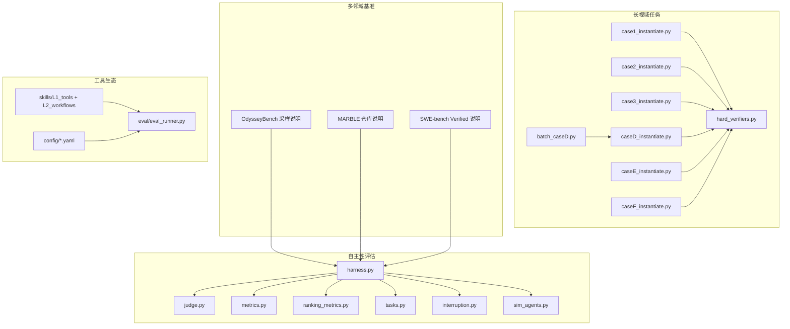
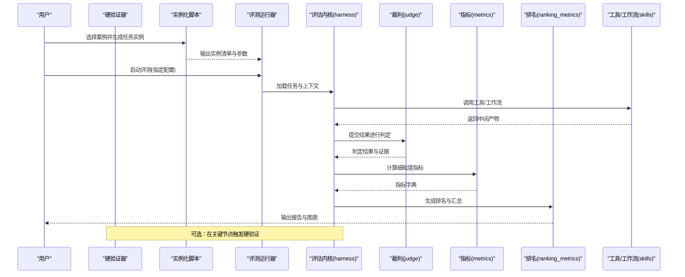
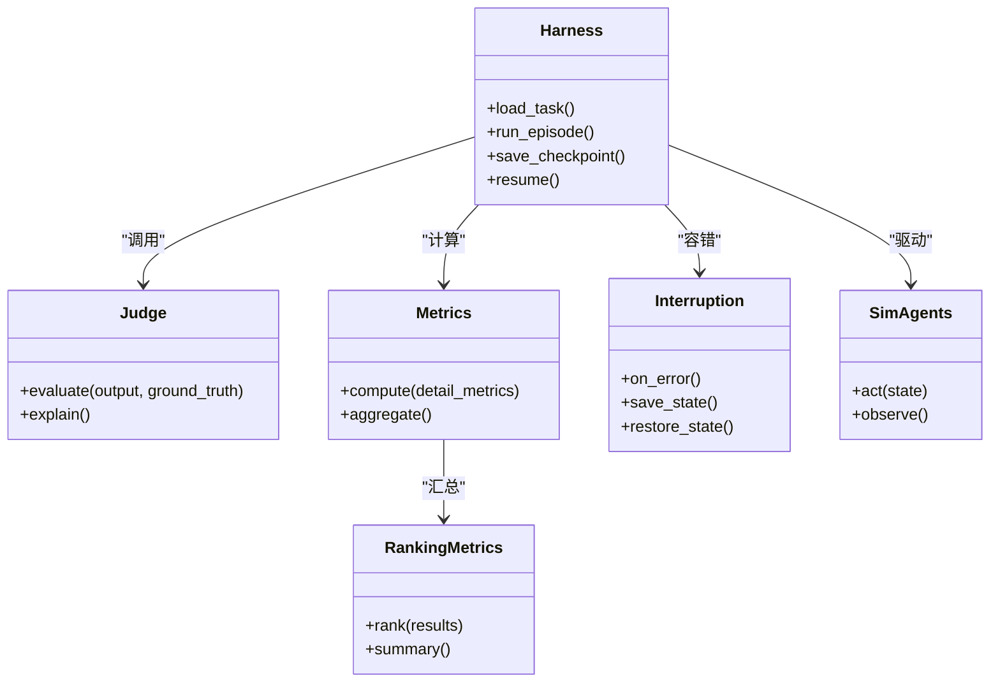
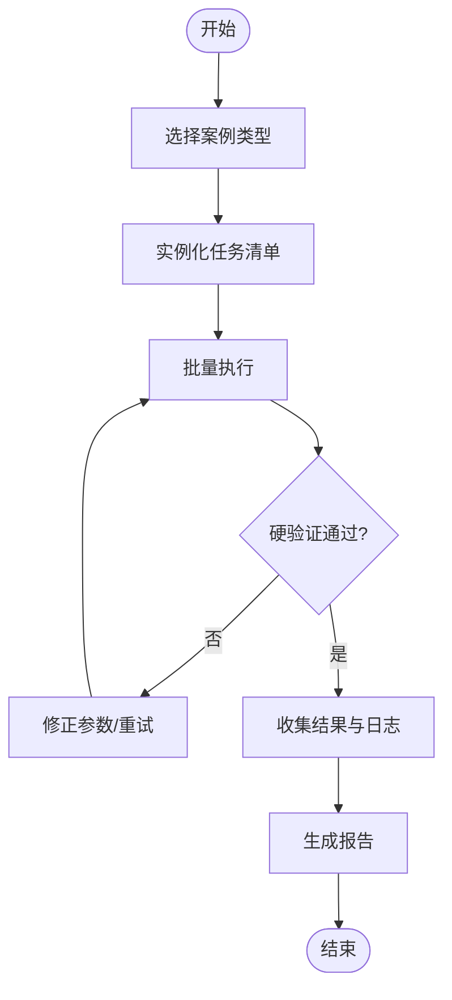
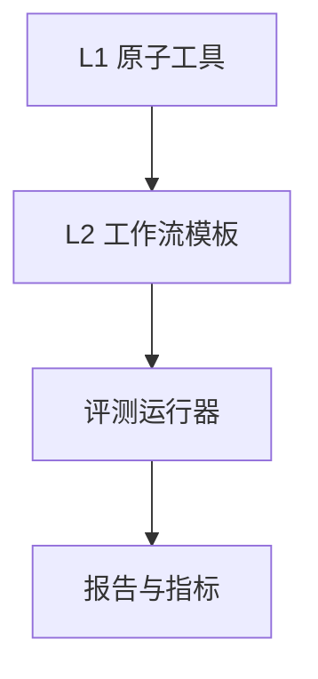
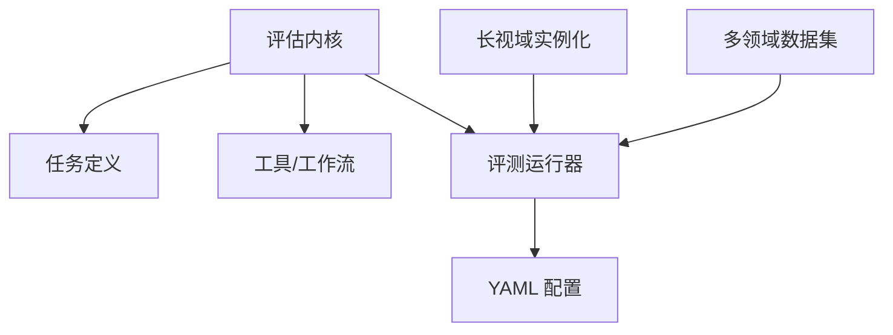

# 主要功能特性

<cite>
**本文引用的文件**   
- [autonomy_mvp/core/harness.py](file://autonomy_mvp/core/harness.py)
- [autonomy_mvp/core/judge.py](file://autonomy_mvp/core/judge.py)
- [autonomy_mvp/core/metrics.py](file://autonomy_mvp/core/metrics.py)
- [autonomy_mvp/core/ranking_metrics.py](file://autonomy_mvp/core/ranking_metrics.py)
- [autonomy_mvp/core/tasks.py](file://autonomy_mvp/core/tasks.py)
- [autonomy_mvp/core/interruption.py](file://autonomy_mvp/core/interruption.py)
- [autonomy_mvp/core/sim_agents.py](file://autonomy_mvp/core/sim_agents.py)
- [autonomy_mvp/run_validation.py](file://autonomy_mvp/run_validation.py)
- [autonomy_mvp/ACCEPTANCE.md](file://autonomy_mvp/ACCEPTANCE.md)
- [autonomy_mvp/schema.md](file://autonomy_mvp/schema.md)
- [longhorizon/instantiate/case1_instantiate.py](file://longhorizon/instantiate/case1_instantiate.py)
- [longhorizon/instantiate/case2_instantiate.py](file://longhorizon/instantiate/case2_instantiate.py)
- [longhorizon/instantiate/case3_instantiate.py](file://longhorizon/instantiate/case3_instantiate.py)
- [longhorizon/instantiate/caseD_instantiate.py](file://longhorizon/instantiate/caseD_instantiate.py)
- [longhorizon/instantiate/caseE_instantiate.py](file://longhorizon/instantiate/caseE_instantiate.py)
- [longhorizon/instantiate/caseF_instantiate.py](file://longhorizon/instantiate/caseF_instantiate.py)
- [longhorizon/instantiate/batch_caseD.py](file://longhorizon/instantiate/batch_caseD.py)
- [longhorizon/verifiers/hard_verifiers.py](file://longhorizon/verifiers/hard_verifiers.py)
- [deep_research_longhorizon/datasets/OdysseyBench/README_采样说明.md](file://deep_research_longhorizon/datasets/OdysseyBench/README_采样说明.md)
- [deep_research_longhorizon/datasets/MultiAgentBench_MARBLE/REPO_README.md](file://deep_research_longhorizon/datasets/MultiAgentBench_MARBLE/REPO_README.md)
- [deep_research_longhorizon/datasets/SWE-bench_Verified/README.md](file://deep_research_longhorizon/datasets/SWE-bench_Verified/README.md)
- [task4_papers/2304.05376.xml](file://docs/prd/task4_papers/2304.05376.xml)
- [task6_papers/2308.14920.xml](file://docs/prd/task6_papers/2308.14920.xml)
- [task4_papers/2405.16205.xml](file://docs/prd/task4_papers/2405.16205.xml)
- [task4_papers/2407.01725.html](file://docs/prd/task4_papers/2407.01725.html)
- [task4_papers/2407.10362.xml](file://docs/prd/task4_papers/2407.10362.xml)
- [task4_papers/2410.05080.html](file://docs/prd/task4_papers/2410.05080.html)
- [task4_papers/2412.14161.html](file://docs/prd/task4_papers/2412.14161.html)
- [task4_papers/2501.14654.xml](file://docs/prd/task4_papers/2501.14654.xml)
- [task6_papers/2310.19796.xml](file://docs/prd/task6_papers/2310.19796.xml)
- [task6_papers/2401.13178.xml](file://docs/prd/task6_papers/2401.13178.xml)
- [task6_papers/2409.07314.xml](file://docs/prd/task6_papers/2409.07314.xml)
- [task6_papers/2411.00177.xml](file://docs/prd/task6_papers/2411.00177.xml)
- [task6_papers/2505.23802.xml](file://docs/prd/task6_papers/2505.23802.xml)
- [task6_papers/2512.13930.html](file://docs/prd/task6_papers/2512.13930.html)
- [task6_papers/2601.21800.xml](file://docs/prd/task6_papers/2601.21800.xml)
- [task6_papers/2602.00663.xml](file://docs/prd/task6_papers/2602.00663.xml)
- [task6_papers/2602.21230.xml](file://docs/prd/task6_papers/2602.21230.xml)
- [task6_papers/2604.27470.xml](file://docs/prd/task6_papers/2604.27470.xml)
- [task6_papers/2605.00803.xml](file://docs/prd/task6_papers/2605.00803.xml)
- [task6_papers/2605.02240.xml](file://docs/prd/task6_papers/2605.02240.xml)
- [task6_papers/2605.15461.xml](file://docs/prd/task6_papers/2605.15461.xml)
- [task6_papers/2605.15766.xml](file://docs/prd/task6_papers/2605.15766.xml)
</cite>

## 目录
1. [简介](#简介)
2. [项目结构](#项目结构)
3. [核心组件](#核心组件)
4. [架构总览](#架构总览)
5. [详细组件分析](#详细组件分析)
6. [依赖分析](#依赖分析)
7. [性能考量](#性能考量)
8. [故障排查指南](#故障排查指南)
9. [结论](#结论)
10. [附录](#附录)

## 简介
本框架面向科学计算与发现场景，提供四大核心能力：
- 自主性评估系统：对智能体在开放、动态环境中的“计划—执行—反思—再规划”闭环进行可重复评估，支持中断恢复、指标聚合与排名。
- 长视域任务平台：以多阶段、跨会话的复杂任务为主线，覆盖材料发现、药物筛选、逆合成、靶点验证等典型科研流程。
- 多领域基准测试：统一的数据与评测协议，支撑化学、材料、生物医学、软件工程等多学科基准。
- 工具生态系统：围绕分子建模、对接、性质预测、可视化、工作流编排等能力的工具集与工作流模板，形成“技能即服务”的可组合生态。

这些能力协同工作，使研究团队能够以标准化方式快速开展大规模实验、沉淀可复现实验轨迹、加速从假设到验证的科研闭环。

## 项目结构
仓库采用按能力域划分的模块化组织：
- autonomy_mvp：自主性评估最小可用实现（HaaS），包含调度器、裁判、指标、任务定义、中断处理与模拟代理。
- longhorizon：长视域任务实例化与验证器，提供材料发现、闭环优化、逆合成、靶点验证等案例脚本与硬校验器。
- deep_research_longhorizon：长视域数据集与采样说明，涵盖 AgentBoard、OdysseyBench、SWE-bench Verified 等子集。
- docs/prd：产品需求文档与论文素材，含 MolBench 配置、技能索引、模板与评测运行脚本。
- taskN：各任务阶段的产物、提示词、结果与分析脚本。
- 决议与目标文档：记录关键决策与阶段性目标。

图示来源
- [autonomy_mvp/core/harness.py](file://autonomy_mvp/core/harness.py)
- [autonomy_mvp/core/judge.py](file://autonomy_mvp/core/judge.py)
- [autonomy_mvp/core/metrics.py](file://autonomy_mvp/core/metrics.py)
- [autonomy_mvp/core/ranking_metrics.py](file://autonomy_mvp/core/ranking_metrics.py)
- [autonomy_mvp/core/tasks.py](file://autonomy_mvp/core/tasks.py)
- [autonomy_mvp/core/interruption.py](file://autonomy_mvp/core/interruption.py)
- [autonomy_mvp/core/sim_agents.py](file://autonomy_mvp/core/sim_agents.py)
- [longhorizon/instantiate/case1_instantiate.py](file://longhorizon/instantiate/case1_instantiate.py)
- [longhorizon/instantiate/case2_instantiate.py](file://longhorizon/instantiate/case2_instantiate.py)
- [longhorizon/instantiate/case3_instantiate.py](file://longhorizon/instantiate/case3_instantiate.py)
- [longhorizon/instantiate/caseD_instantiate.py](file://longhorizon/instantiate/caseD_instantiate.py)
- [longhorizon/instantiate/caseE_instantiate.py](file://longhorizon/instantiate/caseE_instantiate.py)
- [longhorizon/instantiate/caseF_instantiate.py](file://longhorizon/instantiate/caseF_instantiate.py)
- [longhorizon/instantiate/batch_caseD.py](file://longhorizon/instantiate/batch_caseD.py)
- [longhorizon/verifiers/hard_verifiers.py](file://longhorizon/verifiers/hard_verifiers.py)
- [deep_research_longhorizon/datasets/OdysseyBench/README_采样说明.md](file://deep_research_longhorizon/datasets/OdysseyBench/README_采样说明.md)
- [deep_research_longhorizon/datasets/MultiAgentBench_MARBLE/REPO_README.md](file://deep_research_longhorizon/datasets/MultiAgentBench_MARBLE/REPO_README.md)
- [deep_research_longhorizon/datasets/SWE-bench_Verified/README.md](file://deep_research_longhorizon/datasets/SWE-bench_Verified/README.md)
- [docs/prd/molbench_repo/eval/eval_runner.py](file://docs/prd/molbench_repo/eval/eval_runner.py)
- [docs/prd/molbench_repo/config/baseline_molbench-ms-1.yaml](file://docs/prd/molbench_repo/config/baseline_molbench-ms-1.yaml)

章节来源
- [autonomy_mvp/ACCEPTANCE.md](file://autonomy_mvp/ACCEPTANCE.md)
- [autonomy_mvp/schema.md](file://autonomy_mvp/schema.md)

## 核心组件
- 自主性评估系统
  - 调度与编排：通过主调度器加载任务、驱动智能体执行、收集中间状态与最终结果。
  - 裁判与度量：将任务输出与标准答案或规则进行比对，产出细粒度与综合指标；支持排名统计。
  - 中断与恢复：在长时间运行中捕获异常并保存断点，支持续跑与一致性校验。
  - 模拟代理：在无外部依赖时提供轻量代理用于回归与冒烟测试。
- 长视域任务平台
  - 案例实例化：为不同科学问题生成结构化任务实例（如材料体系、药物靶点、逆合成路径）。
  - 批量执行：按批次提交与追踪任务，便于横向对比与资源管理。
  - 硬验证器：对关键步骤进行强约束检查（如结构合法性、能量范围、收敛条件）。
- 多领域基准测试
  - 数据与说明：提供多数据集的采样说明与仓库说明，确保可复现与可追溯。
  - 评测入口：统一的评测运行脚本与配置文件，屏蔽底层差异。
- 工具生态系统
  - 技能库：L1 原子工具（分子操作、对接、性质预测、可视化）与 L2 工作流（端到端流程编排）。
  - 评测集成：评测器通过配置加载技能与数据，自动执行并汇总结果。

章节来源
- [autonomy_mvp/core/harness.py](file://autonomy_mvp/core/harness.py)
- [autonomy_mvp/core/judge.py](file://autonomy_mvp/core/judge.py)
- [autonomy_mvp/core/metrics.py](file://autonomy_mvp/core/metrics.py)
- [autonomy_mvp/core/ranking_metrics.py](file://autonomy_mvp/core/ranking_metrics.py)
- [autonomy_mvp/core/tasks.py](file://autonomy_mvp/core/tasks.py)
- [autonomy_mvp/core/interruption.py](file://autonomy_mvp/core/interruption.py)
- [autonomy_mvp/core/sim_agents.py](file://autonomy_mvp/core/sim_agents.py)
- [longhorizon/instantiate/case1_instantiate.py](file://longhorizon/instantiate/case1_instantiate.py)
- [longhorizon/instantiate/case2_instantiate.py](file://longhorizon/instantiate/case2_instantiate.py)
- [longhorizon/instantiate/case3_instantiate.py](file://longhorizon/instantiate/case3_instantiate.py)
- [longhorizon/instantiate/caseD_instantiate.py](file://longhorizon/instantiate/caseD_instantiate.py)
- [longhorizon/instantiate/caseE_instantiate.py](file://longhorizon/instantiate/caseE_instantiate.py)
- [longhorizon/instantiate/caseF_instantiate.py](file://longhorizon/instantiate/caseF_instantiate.py)
- [longhorizon/instantiate/batch_caseD.py](file://longhorizon/instantiate/batch_caseD.py)
- [longhorizon/verifiers/hard_verifiers.py](file://longhorizon/verifiers/hard_verifiers.py)
- [deep_research_longhorizon/datasets/OdysseyBench/README_采样说明.md](file://deep_research_longhorizon/datasets/OdysseyBench/README_采样说明.md)
- [deep_research_longhorizon/datasets/MultiAgentBench_MARBLE/REPO_README.md](file://deep_research_longhorizon/datasets/MultiAgentBench_MARBLE/REPO_README.md)
- [deep_research_longhorizon/datasets/SWE-bench_Verified/README.md](file://deep_research_longhorizon/datasets/SWE-bench_Verified/README.md)
- [docs/prd/molbench_repo/eval/eval_runner.py](file://docs/prd/molbench_repo/eval/eval_runner.py)
- [docs/prd/molbench_repo/config/baseline_molbench-ms-1.yaml](file://docs/prd/molbench_repo/config/baseline_molbench-ms-1.yaml)

## 架构总览
整体架构由“评估内核—任务实例—评测与工具”三层构成：
- 评估内核负责生命周期管理、指标计算与排名。
- 任务实例层将具体科学问题抽象为可执行的长视域任务。
- 评测与工具层提供数据、配置与技能，支撑端到端评测。

图示来源
- [autonomy_mvp/core/harness.py](file://autonomy_mvp/core/harness.py)
- [autonomy_mvp/core/judge.py](file://autonomy_mvp/core/judge.py)
- [autonomy_mvp/core/metrics.py](file://autonomy_mvp/core/metrics.py)
- [autonomy_mvp/core/ranking_metrics.py](file://autonomy_mvp/core/ranking_metrics.py)
- [longhorizon/instantiate/case1_instantiate.py](file://longhorizon/instantiate/case1_instantiate.py)
- [longhorizon/instantiate/case2_instantiate.py](file://longhorizon/instantiate/case2_instantiate.py)
- [longhorizon/instantiate/case3_instantiate.py](file://longhorizon/instantiate/case3_instantiate.py)
- [longhorizon/instantiate/caseD_instantiate.py](file://longhorizon/instantiate/caseD_instantiate.py)
- [longhorizon/instantiate/caseE_instantiate.py](file://longhorizon/instantiate/caseE_instantiate.py)
- [longhorizon/instantiate/caseF_instantiate.py](file://longhorizon/instantiate/caseF_instantiate.py)
- [longhorizon/verifiers/hard_verifiers.py](file://longhorizon/verifiers/hard_verifiers.py)
- [docs/prd/molbench_repo/eval/eval_runner.py](file://docs/prd/molbench_repo/eval/eval_runner.py)

## 详细组件分析

### 自主性评估系统
- 职责边界
  - 调度器：负责任务加载、执行循环、状态持久化与中断恢复。
  - 裁判：基于规则或模型对输出进行判定，产出布尔/分数及解释。
  - 指标：计算准确率、鲁棒性、效率等维度指标。
  - 排名：对多组实验进行排序与显著性分析。
  - 中断：捕获异常、保存断点、支持续跑。
  - 模拟代理：在无外部依赖时提供最小可运行代理。
- 关键交互
  - 调度器调用任务接口获取环境与初始状态。
  - 驱动智能体执行动作，收集轨迹。
  - 将轨迹与期望对齐，交由裁判与指标模块。
  - 输出结构化结果与排名。

图示来源
- [autonomy_mvp/core/harness.py](file://autonomy_mvp/core/harness.py)
- [autonomy_mvp/core/judge.py](file://autonomy_mvp/core/judge.py)
- [autonomy_mvp/core/metrics.py](file://autonomy_mvp/core/metrics.py)
- [autonomy_mvp/core/ranking_metrics.py](file://autonomy_mvp/core/ranking_metrics.py)
- [autonomy_mvp/core/interruption.py](file://autonomy_mvp/core/interruption.py)
- [autonomy_mvp/core/sim_agents.py](file://autonomy_mvp/core/sim_agents.py)

章节来源
- [autonomy_mvp/core/harness.py](file://autonomy_mvp/core/harness.py)
- [autonomy_mvp/core/judge.py](file://autonomy_mvp/core/judge.py)
- [autonomy_mvp/core/metrics.py](file://autonomy_mvp/core/metrics.py)
- [autonomy_mvp/core/ranking_metrics.py](file://autonomy_mvp/core/ranking_metrics.py)
- [autonomy_mvp/core/interruption.py](file://autonomy_mvp/core/interruption.py)
- [autonomy_mvp/core/sim_agents.py](file://autonomy_mvp/core/sim_agents.py)

### 长视域任务平台
- 案例类型
  - 材料发现：超导体/半导体带隙等属性预测与筛选。
  - 闭环优化：以性质为目标的多步迭代优化。
  - 逆合成：从目标分子推导可行合成路线。
  - 靶点验证：结合文献与数据库进行机制验证。
- 实例化与批处理
  - 每个案例提供实例化脚本，生成结构化任务清单与参数。
  - 批处理脚本支持并发提交与进度跟踪。
- 硬验证器
  - 在关键节点进行强约束检查，保证结果可信度。

图示来源
- [longhorizon/instantiate/case1_instantiate.py](file://longhorizon/instantiate/case1_instantiate.py)
- [longhorizon/instantiate/case2_instantiate.py](file://longhorizon/instantiate/case2_instantiate.py)
- [longhorizon/instantiate/case3_instantiate.py](file://longhorizon/instantiate/case3_instantiate.py)
- [longhorizon/instantiate/caseD_instantiate.py](file://longhorizon/instantiate/caseD_instantiate.py)
- [longhorizon/instantiate/caseE_instantiate.py](file://longhorizon/instantiate/caseE_instantiate.py)
- [longhorizon/instantiate/caseF_instantiate.py](file://longhorizon/instantiate/caseF_instantiate.py)
- [longhorizon/instantiate/batch_caseD.py](file://longhorizon/instantiate/batch_caseD.py)
- [longhorizon/verifiers/hard_verifiers.py](file://longhorizon/verifiers/hard_verifiers.py)

章节来源
- [longhorizon/instantiate/case1_instantiate.py](file://longhorizon/instantiate/case1_instantiate.py)
- [longhorizon/instantiate/case2_instantiate.py](file://longhorizon/instantiate/case2_instantiate.py)
- [longhorizon/instantiate/case3_instantiate.py](file://longhorizon/instantiate/case3_instantiate.py)
- [longhorizon/instantiate/caseD_instantiate.py](file://longhorizon/instantiate/caseD_instantiate.py)
- [longhorizon/instantiate/caseE_instantiate.py](file://longhorizon/instantiate/caseE_instantiate.py)
- [longhorizon/instantiate/caseF_instantiate.py](file://longhorizon/instantiate/caseF_instantiate.py)
- [longhorizon/instantiate/batch_caseD.py](file://longhorizon/instantiate/batch_caseD.py)
- [longhorizon/verifiers/hard_verifiers.py](file://longhorizon/verifiers/hard_verifiers.py)

### 多领域基准测试
- 数据集与说明
  - OdysseyBench：长视域对话/任务序列的采样说明。
  - MultiAgentBench (MARBLE)：多智能体协作任务的仓库说明。
  - SWE-bench Verified：经人工核验的软件工程任务集说明。
- 评测入口
  - 使用统一评测运行器与 YAML 配置，屏蔽数据与工具差异。
  - 支持多基线对比与结果汇总。

图示来源
- [deep_research_longhorizon/datasets/OdysseyBench/README_采样说明.md](file://deep_research_longhorizon/datasets/OdysseyBench/README_采样说明.md)
- [deep_research_longhorizon/datasets/MultiAgentBench_MARBLE/REPO_README.md](file://deep_research_longhorizon/datasets/MultiAgentBench_MARBLE/REPO_README.md)
- [deep_research_longhorizon/datasets/SWE-bench_Verified/README.md](file://deep_research_longhorizon/datasets/SWE-bench_Verified/README.md)
- [docs/prd/molbench_repo/eval/eval_runner.py](file://docs/prd/molbench_repo/eval/eval_runner.py)
- [docs/prd/molbench_repo/config/baseline_molbench-ms-1.yaml](file://docs/prd/molbench_repo/config/baseline_molbench-ms-1.yaml)

章节来源
- [deep_research_longhorizon/datasets/OdysseyBench/README_采样说明.md](file://deep_research_longhorizon/datasets/OdysseyBench/README_采样说明.md)
- [deep_research_longhorizon/datasets/MultiAgentBench_MARBLE/REPO_README.md](file://deep_research_longhorizon/datasets/MultiAgentBench_MARBLE/REPO_README.md)
- [deep_research_longhorizon/datasets/SWE-bench_Verified/README.md](file://deep_research_longhorizon/datasets/SWE-bench_Verified/README.md)
- [docs/prd/molbench_repo/eval/eval_runner.py](file://docs/prd/molbench_repo/eval/eval_runner.py)
- [docs/prd/molbench_repo/config/baseline_molbench-ms-1.yaml](file://docs/prd/molbench_repo/config/baseline_molbench-ms-1.yaml)

### 工具生态系统
- 技能分层
  - L1 原子工具：分子基础操作、对接、性质预测、可视化、文件传输等。
  - L2 工作流：端到端流程编排（如“问题发现—靶点准备—对接筛选—性质分析—生成设计—自由能计算—构象采样—后评估”）。
- 评测集成
  - 评测运行器根据配置加载技能与数据，自动执行并汇总结果。
  - 支持多基线与模板化提示，提升可复用性与一致性。

图示来源
- [docs/prd/molbench_repo/skills/L1_tools](file://docs/prd/molbench_repo/skills/L1_tools)
- [docs/prd/molbench_repo/skills/L2_workflows](file://docs/prd/molbench_repo/skills/L2_workflows)
- [docs/prd/molbench_repo/eval/eval_runner.py](file://docs/prd/molbench_repo/eval/eval_runner.py)
- [docs/prd/molbench_repo/config/baseline_molbench-ms-1.yaml](file://docs/prd/molbench_repo/config/baseline_molbench-ms-1.yaml)

章节来源
- [docs/prd/molbench_repo/skills/L1_tools](file://docs/prd/molbench_repo/skills/L1_tools)
- [docs/prd/molbench_repo/skills/L2_workflows](file://docs/prd/molbench_repo/skills/L2_workflows)
- [docs/prd/molbench_repo/eval/eval_runner.py](file://docs/prd/molbench_repo/eval/eval_runner.py)
- [docs/prd/molbench_repo/config/baseline_molbench-ms-1.yaml](file://docs/prd/molbench_repo/config/baseline_molbench-ms-1.yaml)

## 依赖分析
- 模块内聚与耦合
  - 评估内核内部高内聚：调度、裁判、指标、排名、中断、模拟代理职责清晰。
  - 长视域任务与评测运行器通过配置与数据结构解耦，降低耦合度。
- 外部依赖与集成点
  - 工具生态通过技能注册与配置注入被评测器调用。
  - 多领域基准通过统一入口接入，避免重复适配。
- 潜在循环依赖
  - 当前结构未见明显循环依赖；建议保持评测器不直接依赖具体案例实现，仅通过配置与接口交互。

图示来源
- [autonomy_mvp/core/harness.py](file://autonomy_mvp/core/harness.py)
- [autonomy_mvp/core/tasks.py](file://autonomy_mvp/core/tasks.py)
- [docs/prd/molbench_repo/eval/eval_runner.py](file://docs/prd/molbench_repo/eval/eval_runner.py)
- [docs/prd/molbench_repo/config/baseline_molbench-ms-1.yaml](file://docs/prd/molbench_repo/config/baseline_molbench-ms-1.yaml)
- [longhorizon/instantiate/case1_instantiate.py](file://longhorizon/instantiate/case1_instantiate.py)

章节来源
- [autonomy_mvp/core/harness.py](file://autonomy_mvp/core/harness.py)
- [autonomy_mvp/core/tasks.py](file://autonomy_mvp/core/tasks.py)
- [docs/prd/molbench_repo/eval/eval_runner.py](file://docs/prd/molbench_repo/eval/eval_runner.py)
- [docs/prd/molbench_repo/config/baseline_molbench-ms-1.yaml](file://docs/prd/molbench_repo/config/baseline_molbench-ms-1.yaml)
- [longhorizon/instantiate/case1_instantiate.py](file://longhorizon/instantiate/case1_instantiate.py)

## 性能考量
- 并行与批处理
  - 长视域任务支持批量提交，建议结合任务粒度与资源配额进行并行度控制。
- 缓存与复用
  - 对昂贵计算（如对接、自由能）的结果进行缓存，减少重复计算。
- 指标计算开销
  - 指标计算尽量向量化与增量更新，避免全量重算。
- 中断与恢复
  - 合理设置检查点频率，平衡可靠性与写入开销。

[本节为通用指导，无需特定文件引用]

## 故障排查指南
- 常见问题定位
  - 任务实例化失败：检查输入参数与数据格式是否符合要求。
  - 评测运行异常：确认配置路径、工具依赖与环境变量。
  - 指标不一致：核对裁判规则与阈值设置，查看中间产物与日志。
- 诊断手段
  - 启用更详细的日志输出，定位失败步骤。
  - 使用硬验证器在关键节点进行强约束检查，快速发现问题。
  - 利用中断恢复功能续跑，避免从头开始。

章节来源
- [autonomy_mvp/core/interruption.py](file://autonomy_mvp/core/interruption.py)
- [autonomy_mvp/core/judge.py](file://autonomy_mvp/core/judge.py)
- [autonomy_mvp/core/metrics.py](file://autonomy_mvp/core/metrics.py)
- [longhorizon/verifiers/hard_verifiers.py](file://longhorizon/verifiers/hard_verifiers.py)

## 结论
本框架以“评估内核—任务实例—评测与工具”的分层架构，将自主性评估、长视域任务、多领域基准与工具生态有机整合。通过标准化接口与配置化评测，显著提升了科学发现的复现性与可扩展性，有助于缩短从假设到验证的周期，提高研究效率与成果质量。

[本节为总结性内容，无需特定文件引用]

## 附录
- 使用示例与最佳实践
  - 选择案例并实例化任务清单，随后用评测运行器加载配置执行。
  - 在关键节点开启硬验证，确保结果可信。
  - 对昂贵计算启用缓存，合理设置并行度与检查点频率。
  - 使用模板与技能组合构建新工作流，复用已有能力。
- 参考文档与论文素材
  - 多领域基准与任务背景可参考相关论文素材与仓库说明。

章节来源
- [autonomy_mvp/run_validation.py](file://autonomy_mvp/run_validation.py)
- [docs/prd/molbench_repo/eval/eval_runner.py](file://docs/prd/molbench_repo/eval/eval_runner.py)
- [docs/prd/molbench_repo/config/baseline_molbench-ms-1.yaml](file://docs/prd/molbench_repo/config/baseline_molbench-ms-1.yaml)
- [task4_papers/2304.05376.xml](file://docs/prd/task4_papers/2304.05376.xml)
- [task6_papers/2308.14920.xml](file://docs/prd/task6_papers/2308.14920.xml)
- [task4_papers/2405.16205.xml](file://docs/prd/task4_papers/2405.16205.xml)
- [task4_papers/2407.01725.html](file://docs/prd/task4_papers/2407.01725.html)
- [task4_papers/2407.10362.xml](file://docs/prd/task4_papers/2407.10362.xml)
- [task4_papers/2410.05080.html](file://docs/prd/task4_papers/2410.05080.html)
- [task4_papers/2412.14161.html](file://docs/prd/task4_papers/2412.14161.html)
- [task4_papers/2501.14654.xml](file://docs/prd/task4_papers/2501.14654.xml)
- [task6_papers/2310.19796.xml](file://docs/prd/task6_papers/2310.19796.xml)
- [task6_papers/2401.13178.xml](file://docs/prd/task6_papers/2401.13178.xml)
- [task6_papers/2409.07314.xml](file://docs/prd/task6_papers/2409.07314.xml)
- [task6_papers/2411.00177.xml](file://docs/prd/task6_papers/2411.00177.xml)
- [task6_papers/2505.23802.xml](file://docs/prd/task6_papers/2505.23802.xml)
- [task6_papers/2512.13930.html](file://docs/prd/task6_papers/2512.13930.html)
- [task6_papers/2601.21800.xml](file://docs/prd/task6_papers/2601.21800.xml)
- [task6_papers/2602.00663.xml](file://docs/prd/task6_papers/2602.00663.xml)
- [task6_papers/2602.21230.xml](file://docs/prd/task6_papers/2602.21230.xml)
- [task6_papers/2604.27470.xml](file://docs/prd/task6_papers/2604.27470.xml)
- [task6_papers/2605.00803.xml](file://docs/prd/task6_papers/2605.00803.xml)
- [task6_papers/2605.02240.xml](file://docs/prd/task6_papers/2605.02240.xml)
- [task6_papers/2605.15461.xml](file://docs/prd/task6_papers/2605.15461.xml)
- [task6_papers/2605.15766.xml](file://docs/prd/task6_papers/2605.15766.xml)