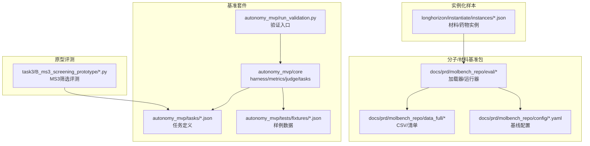
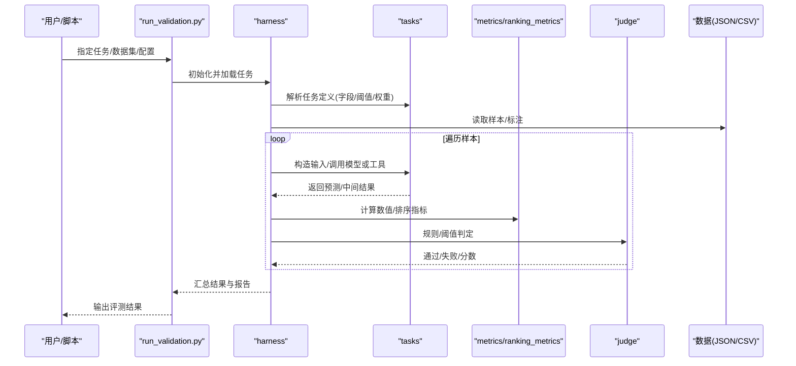
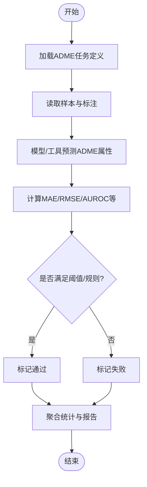
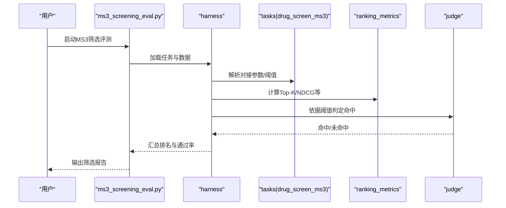
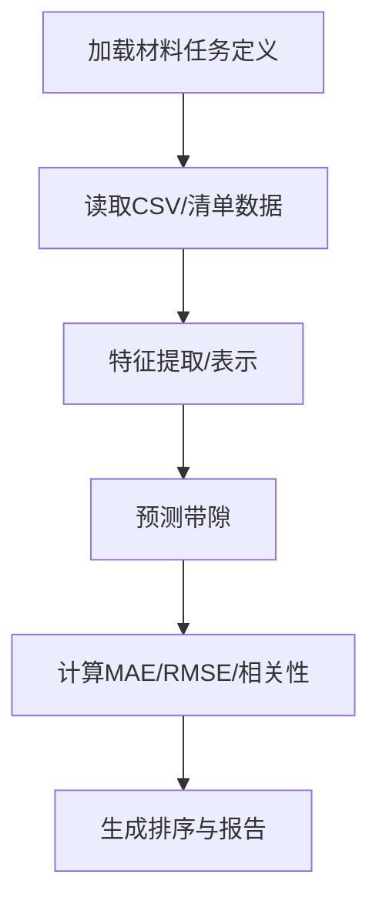
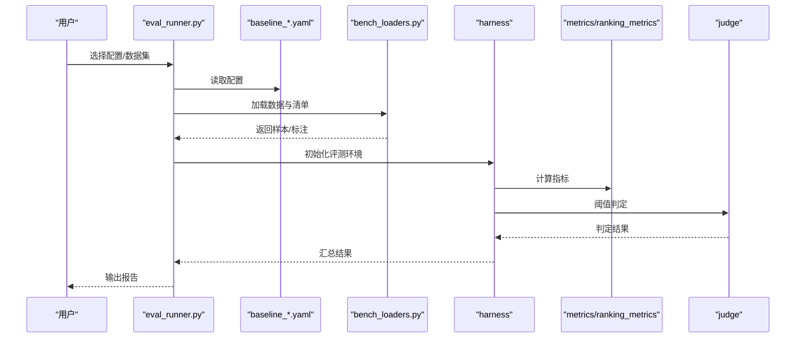
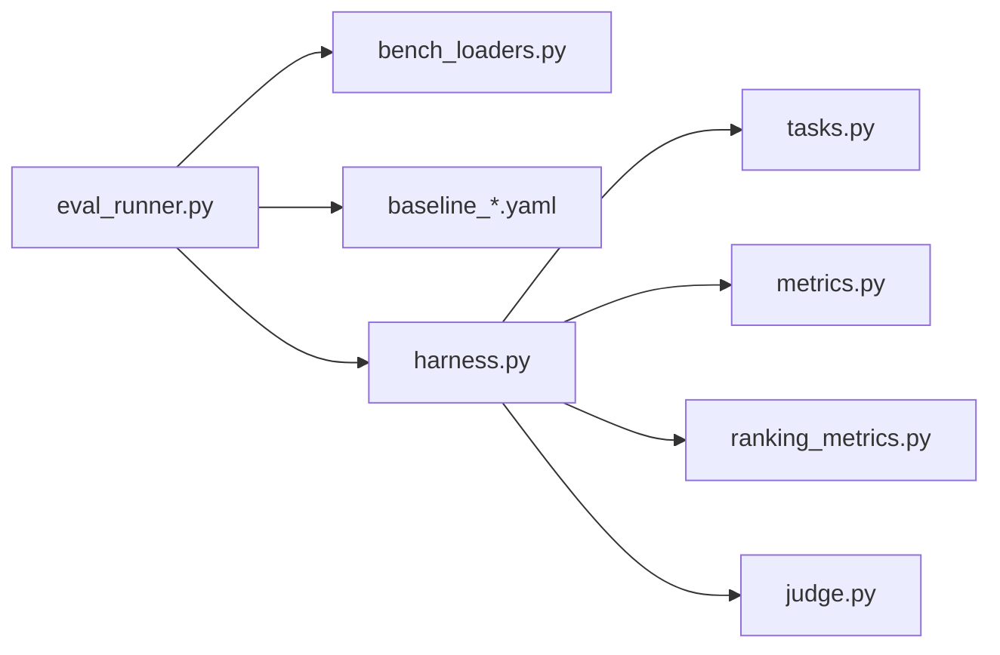

# 多领域基准测试

<cite>
**本文引用的文件**   
- [autonomy_mvp/core/harness.py](file://autonomy_mvp/core/harness.py)
- [autonomy_mvp/core/metrics.py](file://autonomy_mvp/core/metrics.py)
- [autonomy_mvp/core/ranking_metrics.py](file://autonomy_mvp/core/ranking_metrics.py)
- [autonomy_mvp/core/judge.py](file://autonomy_mvp/core/judge.py)
- [autonomy_mvp/core/tasks.py](file://autonomy_mvp/core/tasks.py)
- [autonomy_mvp/tasks/drug_admet.json](file://autonomy_mvp/tasks/drug_admet.json)
- [autonomy_mvp/tasks/drug_screen_ms3.json](file://autonomy_mvp/tasks/drug_screen_ms3.json)
- [autonomy_mvp/tasks/materials_semiconductor_bandgap.json](file://autonomy_mvp/tasks/materials_semiconductor_bandgap.json)
- [autonomy_mvp/tests/fixtures/fixture_drugscreen.json](file://autonomy_mvp/tests/fixtures/fixture_drugscreen.json)
- [autonomy_mvp/tests/fixtures/fixture_materials.json](file://autonomy_mvp/tests/fixtures/fixture_materials.json)
- [autonomy_mvp/run_validation.py](file://autonomy_mvp/run_validation.py)
- [autonomy_mvp/schema.md](file://autonomy_mvp/schema.md)
- [autonomy_mvp/ACCEPTANCE.md](file://autonomy_mvp/ACCEPTANCE.md)
- [docs/prd/molbench_repo/config/baseline_molbench-ms-1.yaml](file://docs/prd/molbench_repo/config/baseline_molbench-ms-1.yaml)
- [docs/prd/molbench_repo/config/baseline_molbench-ms-2.yaml](file://docs/prd/molbench_repo/config/baseline_molbench-ms-2.yaml)
- [docs/prd/molbench_repo/config/baseline_molbench-ms-3.yaml](file://docs/prd/molbench_repo/config/baseline_molbench-ms-3.yaml)
- [docs/prd/molbench_repo/data_full/molbench-mo/manifest.json](file://docs/prd/molbench_repo/data_full/molbench-mo/manifest.json)
- [docs/prd/molbench_repo/data_full/molbench-ms-1/molbench-ms-1.csv](file://docs/prd/molbench_repo/data_full/molbench-ms-1/molbench-ms-1.csv)
- [docs/prd/molbench_repo/data_full/molbench-ms-2/molbench-ms-2.csv](file://docs/prd/molbench_repo/data_full/molbench-ms-2/molbench-ms-2.csv)
- [docs/prd/molbench_repo/data_full/molbench-ms-3/molbench-ms-3.csv](file://docs/prd/molbench_repo/data_full/molbench-ms-3/molbench-ms-3.csv)
- [docs/prd/molbench_repo/eval/eval_runner.py](file://docs/prd/molbench_repo/eval/eval_runner.py)
- [docs/prd/molbench_repo/eval/bench_loaders.py](file://docs/prd/molbench_repo/eval/bench_loaders.py)
- [longhorizon/instantiate/instances/mat1_Ca-Si-O_funnel.json](file://longhorizon/instantiate/instances/mat1_Ca-Si-O_funnel.json)
- [longhorizon/instantiate/instances/mat1_Li-Fe-O_funnel.json](file://longhorizon/instantiate/instances/mat1_Li-Fe-O_funnel.json)
- [longhorizon/instantiate/instances/matD_Al-Ti-O.json](file://longhorizon/instantiate/instances/matD_Al-Ti-O.json)
- [longhorizon/instantiate/instances/drug2_BACE1.json](file://longhorizon/instantiate/instances/drug2_BACE1.json)
- [task3/B_ms3_screening_prototype/ms3_screening_eval.py](file://task3/B_ms3_screening_prototype/ms3_screening_eval.py)
</cite>

## 目录
1. [引言](#引言)
2. [项目结构](#项目结构)
3. [核心组件](#核心组件)
4. [架构总览](#架构总览)
5. [详细组件分析](#详细组件分析)
6. [依赖关系分析](#依赖关系分析)
7. [性能与可扩展性](#性能与可扩展性)
8. [故障排查指南](#故障排查指南)
9. [结论](#结论)
10. [附录](#附录)

## 引言
本仓库围绕“多领域基准测试”构建，覆盖药物发现、材料科学、生物医学等方向，提供标准化的任务定义、数据组织、评估指标与运行流程。重点包括：
- 药物发现：ADME性质预测、分子对接筛选（MS3）
- 材料科学：半导体带隙预测
- 生物医学：以工具链与评测脚本为支撑的通用评测范式

通过统一的Schema与Runner，确保不同模型/方法在相同数据与度量下可比、可复现。

## 项目结构
仓库采用“任务定义 + 评测内核 + 数据集 + 配置 + 示例运行”的分层组织方式：
- autonomy_mvp：最小可用基准套件，包含任务JSON、评测内核、验证脚本与样例数据
- docs/prd/molbench_repo：面向分子/材料的完整基准包，含配置、数据清单、加载器与评测运行器
- longhorizon/instantiate/instances：具体实例化样本（材料漏斗、药物靶点等）
- task3/B_ms3_screening_prototype：对接筛选原型评测脚本

图表来源
- [autonomy_mvp/core/harness.py](file://autonomy_mvp/core/harness.py)
- [autonomy_mvp/core/metrics.py](file://autonomy_mvp/core/metrics.py)
- [autonomy_mvp/core/judge.py](file://autonomy_mvp/core/judge.py)
- [autonomy_mvp/core/tasks.py](file://autonomy_mvp/core/tasks.py)
- [autonomy_mvp/tasks/drug_admet.json](file://autonomy_mvp/tasks/drug_admet.json)
- [autonomy_mvp/tasks/drug_screen_ms3.json](file://autonomy_mvp/tasks/drug_screen_ms3.json)
- [autonomy_mvp/tasks/materials_semiconductor_bandgap.json](file://autonomy_mvp/tasks/materials_semiconductor_bandgap.json)
- [autonomy_mvp/tests/fixtures/fixture_drugscreen.json](file://autonomy_mvp/tests/fixtures/fixture_drugscreen.json)
- [autonomy_mvp/tests/fixtures/fixture_materials.json](file://autonomy_mvp/tests/fixtures/fixture_materials.json)
- [autonomy_mvp/run_validation.py](file://autonomy_mvp/run_validation.py)
- [docs/prd/molbench_repo/config/baseline_molbench-ms-1.yaml](file://docs/prd/molbench_repo/config/baseline_molbench-ms-1.yaml)
- [docs/prd/molbench_repo/config/baseline_molbench-ms-2.yaml](file://docs/prd/molbench_repo/config/baseline_molbench-ms-2.yaml)
- [docs/prd/molbench_repo/config/baseline_molbench-ms-3.yaml](file://docs/prd/molbench_repo/config/baseline_molbench-ms-3.yaml)
- [docs/prd/molbench_repo/data_full/molbench-mo/manifest.json](file://docs/prd/molbench_repo/data_full/molbench-mo/manifest.json)
- [docs/prd/molbench_repo/data_full/molbench-ms-1/molbench-ms-1.csv](file://docs/prd/molbench_repo/data_full/molbench-ms-1/molbench-ms-1.csv)
- [docs/prd/molbench_repo/data_full/molbench-ms-2/molbench-ms-2.csv](file://docs/prd/molbench_repo/data_full/molbench-ms-2/molbench-ms-2.csv)
- [docs/prd/molbench_repo/data_full/molbench-ms-3/molbench-ms-3.csv](file://docs/prd/molbench_repo/data_full/molbench-ms-3/molbench-ms-3.csv)
- [docs/prd/molbench_repo/eval/eval_runner.py](file://docs/prd/molbench_repo/eval/eval_runner.py)
- [docs/prd/molbench_repo/eval/bench_loaders.py](file://docs/prd/molbench_repo/eval/bench_loaders.py)
- [longhorizon/instantiate/instances/mat1_Ca-Si-O_funnel.json](file://longhorizon/instantiate/instances/mat1_Ca-Si-O_funnel.json)
- [longhorizon/instantiate/instances/mat1_Li-Fe-O_funnel.json](file://longhorizon/instantiate/instances/mat1_Li-Fe-O_funnel.json)
- [longhorizon/instantiate/instances/matD_Al-Ti-O.json](file://longhorizon/instantiate/instances/matD_Al-Ti-O.json)
- [longhorizon/instantiate/instances/drug2_BACE1.json](file://longhorizon/instantiate/instances/drug2_BACE1.json)
- [task3/B_ms3_screening_prototype/ms3_screening_eval.py](file://task3/B_ms3_screening_prototype/ms3_screening_eval.py)

章节来源
- [autonomy_mvp/schema.md](file://autonomy_mvp/schema.md)
- [autonomy_mvp/ACCEPTANCE.md](file://autonomy_mvp/ACCEPTANCE.md)

## 核心组件
- 任务编排与执行
  - harness：统一的任务加载、执行与结果收集接口
  - tasks：领域任务抽象与注册机制
- 指标与评判
  - metrics：数值型指标（如MAE/RMSE/AUROC等）
  - ranking_metrics：排序类指标（如Top-K命中率、NDCG等）
  - judge：规则/阈值判定或LLM辅助判定的裁判逻辑
- 任务定义与样例
  - tasks/*.json：各领域的任务描述、输入输出字段、阈值/权重
  - tests/fixtures/*.json：轻量级样例，便于快速回归验证
- 运行与验证
  - run_validation.py：端到端验证入口，串联任务、数据、指标与报告生成

章节来源
- [autonomy_mvp/core/harness.py](file://autonomy_mvp/core/harness.py)
- [autonomy_mvp/core/metrics.py](file://autonomy_mvp/core/metrics.py)
- [autonomy_mvp/core/ranking_metrics.py](file://autonomy_mvp/core/ranking_metrics.py)
- [autonomy_mvp/core/judge.py](file://autonomy_mvp/core/judge.py)
- [autonomy_mvp/core/tasks.py](file://autonomy_mvp/core/tasks.py)
- [autonomy_mvp/run_validation.py](file://autonomy_mvp/run_validation.py)

## 架构总览
下图展示了从任务定义到评测输出的整体流程，以及多领域任务的统一接入方式。

图表来源
- [autonomy_mvp/run_validation.py](file://autonomy_mvp/run_validation.py)
- [autonomy_mvp/core/harness.py](file://autonomy_mvp/core/harness.py)
- [autonomy_mvp/core/tasks.py](file://autonomy_mvp/core/tasks.py)
- [autonomy_mvp/core/metrics.py](file://autonomy_mvp/core/metrics.py)
- [autonomy_mvp/core/ranking_metrics.py](file://autonomy_mvp/core/ranking_metrics.py)
- [autonomy_mvp/core/judge.py](file://autonomy_mvp/core/judge.py)

## 详细组件分析

### 任务定义格式与数据结构
- 任务JSON规范
  - 字段通常包含：任务ID、领域标签、输入模式（如SMILES/化学式/序列）、目标属性、评估指标、阈值/权重、数据路径、随机种子等
  - 支持多子任务组合与加权聚合
- 样例数据
  - fixture_drugscreen.json：用于对接筛选的快速验证集
  - fixture_materials.json：用于材料属性的快速验证集
- 参考文档
  - schema.md：字段说明、约束与校验规则
  - ACCEPTANCE.md：验收标准与通过条件

章节来源
- [autonomy_mvp/tasks/drug_admet.json](file://autonomy_mvp/tasks/drug_admet.json)
- [autonomy_mvp/tasks/drug_screen_ms3.json](file://autonomy_mvp/tasks/drug_screen_ms3.json)
- [autonomy_mvp/tasks/materials_semiconductor_bandgap.json](file://autonomy_mvp/tasks/materials_semiconductor_bandgap.json)
- [autonomy_mvp/tests/fixtures/fixture_drugscreen.json](file://autonomy_mvp/tests/fixtures/fixture_drugscreen.json)
- [autonomy_mvp/tests/fixtures/fixture_materials.json](file://autonomy_mvp/tests/fixtures/fixture_materials.json)
- [autonomy_mvp/schema.md](file://autonomy_mvp/schema.md)
- [autonomy_mvp/ACCEPTANCE.md](file://autonomy_mvp/ACCEPTANCE.md)

### ADME性质预测任务
- 任务目标
  - 基于分子表征预测吸收、分布、代谢、排泄等关键药代动力学性质
- 输入/输出
  - 输入：分子标识（如SMILES/InChI）及可选上下文
  - 输出：连续值或分类概率，按任务JSON中定义的字段映射
- 评估
  - 常用指标：MAE、RMSE、AUROC、AUPRC等
  - 阈值策略：结合judge进行临床/成药性门槛判定
- 实现要点
  - 使用metrics计算误差/区分度
  - 使用ranking_metrics对候选分子排序（Top-K命中）
  - 使用judge将连续预测转换为合格/不合格决策

图表来源
- [autonomy_mvp/tasks/drug_admet.json](file://autonomy_mvp/tasks/drug_admet.json)
- [autonomy_mvp/core/metrics.py](file://autonomy_mvp/core/metrics.py)
- [autonomy_mvp/core/ranking_metrics.py](file://autonomy_mvp/core/ranking_metrics.py)
- [autonomy_mvp/core/judge.py](file://autonomy_mvp/core/judge.py)

章节来源
- [autonomy_mvp/tasks/drug_admet.json](file://autonomy_mvp/tasks/drug_admet.json)
- [autonomy_mvp/core/metrics.py](file://autonomy_mvp/core/metrics.py)
- [autonomy_mvp/core/judge.py](file://autonomy_mvp/core/judge.py)

### 分子对接筛选（MS3）任务
- 任务目标
  - 针对给定靶点蛋白与化合物库，进行虚拟筛选与打分排序，识别潜在活性分子
- 输入/输出
  - 输入：靶点信息、配体集合、对接参数（由任务JSON或配置指定）
  - 输出：结合亲和力评分、排名、命中列表
- 评估
  - 排序指标：Top-K命中率、NDCG、富集因子等
  - 阈值：结合生物学活性阈值或富集要求
- 原型评测
  - ms3_screening_eval.py：封装了MS3筛选的端到端评测流程，便于快速验证

图表来源
- [task3/B_ms3_screening_prototype/ms3_screening_eval.py](file://task3/B_ms3_screening_prototype/ms3_screening_eval.py)
- [autonomy_mvp/tasks/drug_screen_ms3.json](file://autonomy_mvp/tasks/drug_screen_ms3.json)
- [autonomy_mvp/core/harness.py](file://autonomy_mvp/core/harness.py)
- [autonomy_mvp/core/ranking_metrics.py](file://autonomy_mvp/core/ranking_metrics.py)
- [autonomy_mvp/core/judge.py](file://autonomy_mvp/core/judge.py)

章节来源
- [task3/B_ms3_screening_prototype/ms3_screening_eval.py](file://task3/B_ms3_screening_prototype/ms3_screening_eval.py)
- [autonomy_mvp/tasks/drug_screen_ms3.json](file://autonomy_mvp/tasks/drug_screen_ms3.json)

### 半导体带隙预测任务
- 任务目标
  - 基于材料组成/结构特征预测半导体带隙，指导新材料设计
- 输入/输出
  - 输入：材料化学式/晶体信息等
  - 输出：带隙数值（eV），并与真实值比较
- 评估
  - 主要指标：MAE、RMSE、相关系数等
  - 可结合排序指标对候选材料进行优先级排序
- 数据与实例
  - data_full中的CSV清单与manifest提供数据索引
  - longhorizon实例中包含多种材料体系（Ca-Si-O、Li-Fe-O等）

图表来源
- [autonomy_mvp/tasks/materials_semiconductor_bandgap.json](file://autonomy_mvp/tasks/materials_semiconductor_bandgap.json)
- [docs/prd/molbench_repo/data_full/molbench-mo/manifest.json](file://docs/prd/molbench_repo/data_full/molbench-mo/manifest.json)
- [docs/prd/molbench_repo/data_full/molbench-ms-1/molbench-ms-1.csv](file://docs/prd/molbench_repo/data_full/molbench-ms-1/molbench-ms-1.csv)
- [docs/prd/molbench_repo/data_full/molbench-ms-2/molbench-ms-2.csv](file://docs/prd/molbench_repo/data_full/molbench-ms-2/molbench-ms-2.csv)
- [docs/prd/molbench_repo/data_full/molbench-ms-3/molbench-ms-3.csv](file://docs/prd/molbench_repo/data_full/molbench-ms-3/molbench-ms-3.csv)
- [longhorizon/instantiate/instances/mat1_Ca-Si-O_funnel.json](file://longhorizon/instantiate/instances/mat1_Ca-Si-O_funnel.json)
- [longhorizon/instantiate/instances/mat1_Li-Fe-O_funnel.json](file://longhorizon/instantiate/instances/mat1_Li-Fe-O_funnel.json)
- [longhorizon/instantiate/instances/matD_Al-Ti-O.json](file://longhorizon/instantiate/instances/matD_Al-Ti-O.json)

章节来源
- [autonomy_mvp/tasks/materials_semiconductor_bandgap.json](file://autonomy_mvp/tasks/materials_semiconductor_bandgap.json)
- [docs/prd/molbench_repo/data_full/molbench-mo/manifest.json](file://docs/prd/molbench_repo/data_full/molbench-mo/manifest.json)
- [docs/prd/molbench_repo/data_full/molbench-ms-1/molbench-ms-1.csv](file://docs/prd/molbench_repo/data_full/molbench-ms-1/molbench-ms-1.csv)
- [docs/prd/molbench_repo/data_full/molbench-ms-2/molbench-ms-2.csv](file://docs/prd/molbench_repo/data_full/molbench-ms-2/molbench-ms-2.csv)
- [docs/prd/molbench_repo/data_full/molbench-ms-3/molbench-ms-3.csv](file://docs/prd/molbench_repo/data_full/molbench-ms-3/molbench-ms-3.csv)
- [longhorizon/instantiate/instances/mat1_Ca-Si-O_funnel.json](file://longhorizon/instantiate/instances/mat1_Ca-Si-O_funnel.json)
- [longhorizon/instantiate/instances/mat1_Li-Fe-O_funnel.json](file://longhorizon/instantiate/instances/mat1_Li-Fe-O_funnel.json)
- [longhorizon/instantiate/instances/matD_Al-Ti-O.json](file://longhorizon/instantiate/instances/matD_Al-Ti-O.json)

### 基准数据集组织结构与质量控制
- 组织方式
  - manifest.json：数据清单与版本管理
  - CSV文件：结构化样本与标注
  - JSON任务定义：统一输入输出与评估协议
- 质量控制
  - 通过schema校验字段完整性与类型
  - 使用fixtures进行回归测试，保证评测链路稳定
  - 通过judge与阈值控制避免误报/漏报

章节来源
- [docs/prd/molbench_repo/data_full/molbench-mo/manifest.json](file://docs/prd/molbench_repo/data_full/molbench-mo/manifest.json)
- [autonomy_mvp/schema.md](file://autonomy_mvp/schema.md)
- [autonomy_mvp/tests/fixtures/fixture_drugscreen.json](file://autonomy_mvp/tests/fixtures/fixture_drugscreen.json)
- [autonomy_mvp/tests/fixtures/fixture_materials.json](file://autonomy_mvp/tests/fixtures/fixture_materials.json)

### 配置方法与运行流程
- 配置
  - baseline_molbench-ms-*.yaml：不同难度/规模的基线配置，指定数据路径、指标权重、阈值等
- 运行
  - eval_runner.py：统一评测入口，加载配置与数据，驱动指标计算与报告生成
  - run_validation.py：最小可用验证入口，适合快速自检
- 解读
  - 关注总体得分、分域得分、Top-K命中率、阈值通过率等关键指标
  - 对比不同配置的差异，定位薄弱环节

图表来源
- [docs/prd/molbench_repo/config/baseline_molbench-ms-1.yaml](file://docs/prd/molbench_repo/config/baseline_molbench-ms-1.yaml)
- [docs/prd/molbench_repo/config/baseline_molbench-ms-2.yaml](file://docs/prd/molbench_repo/config/baseline_molbench-ms-2.yaml)
- [docs/prd/molbench_repo/config/baseline_molbench-ms-3.yaml](file://docs/prd/molbench_repo/config/baseline_molbench-ms-3.yaml)
- [docs/prd/molbench_repo/eval/eval_runner.py](file://docs/prd/molbench_repo/eval/eval_runner.py)
- [docs/prd/molbench_repo/eval/bench_loaders.py](file://docs/prd/molbench_repo/eval/bench_loaders.py)
- [autonomy_mvp/core/harness.py](file://autonomy_mvp/core/harness.py)
- [autonomy_mvp/core/metrics.py](file://autonomy_mvp/core/metrics.py)
- [autonomy_mvp/core/ranking_metrics.py](file://autonomy_mvp/core/ranking_metrics.py)
- [autonomy_mvp/core/judge.py](file://autonomy_mvp/core/judge.py)

章节来源
- [docs/prd/molbench_repo/config/baseline_molbench-ms-1.yaml](file://docs/prd/molbench_repo/config/baseline_molbench-ms-1.yaml)
- [docs/prd/molbench_repo/config/baseline_molbench-ms-2.yaml](file://docs/prd/molbench_repo/config/baseline_molbench-ms-2.yaml)
- [docs/prd/molbench_repo/config/baseline_molbench-ms-3.yaml](file://docs/prd/molbench_repo/config/baseline_molbench-ms-3.yaml)
- [docs/prd/molbench_repo/eval/eval_runner.py](file://docs/prd/molbench_repo/eval/eval_runner.py)
- [docs/prd/molbench_repo/eval/bench_loaders.py](file://docs/prd/molbench_repo/eval/bench_loaders.py)
- [autonomy_mvp/run_validation.py](file://autonomy_mvp/run_validation.py)

## 依赖关系分析
- 模块耦合
  - harness作为中枢，依赖tasks、metrics、ranking_metrics、judge
  - eval_runner与bench_loaders负责数据与配置加载，降低上层耦合
- 外部依赖
  - 数据格式：JSON/CSV/YAML
  - 指标库：数值与排序指标函数
  - 工具链：对接筛选原型脚本

图表来源
- [docs/prd/molbench_repo/eval/eval_runner.py](file://docs/prd/molbench_repo/eval/eval_runner.py)
- [docs/prd/molbench_repo/eval/bench_loaders.py](file://docs/prd/molbench_repo/eval/bench_loaders.py)
- [docs/prd/molbench_repo/config/baseline_molbench-ms-1.yaml](file://docs/prd/molbench_repo/config/baseline_molbench-ms-1.yaml)
- [autonomy_mvp/core/harness.py](file://autonomy_mvp/core/harness.py)
- [autonomy_mvp/core/tasks.py](file://autonomy_mvp/core/tasks.py)
- [autonomy_mvp/core/metrics.py](file://autonomy_mvp/core/metrics.py)
- [autonomy_mvp/core/ranking_metrics.py](file://autonomy_mvp/core/ranking_metrics.py)
- [autonomy_mvp/core/judge.py](file://autonomy_mvp/core/judge.py)

章节来源
- [docs/prd/molbench_repo/eval/eval_runner.py](file://docs/prd/molbench_repo/eval/eval_runner.py)
- [docs/prd/molbench_repo/eval/bench_loaders.py](file://docs/prd/molbench_repo/eval/bench_loaders.py)
- [autonomy_mvp/core/harness.py](file://autonomy_mvp/core/harness.py)

## 性能与可扩展性
- 并行与批处理
  - 建议对独立样本进行并行评测，提升吞吐
  - 对接筛选等重型任务可按批次提交，避免资源争用
- 缓存与复用
  - 对中间结果（如分子表征、对接构象）进行缓存，减少重复计算
- 指标计算优化
  - 向量化计算数值指标；排序指标尽量一次性计算
- 扩展新任务
  - 新增任务JSON，遵循schema；在tasks中注册；在harness中适配输入输出映射

[本节为通用指导，不直接分析具体文件]

## 故障排查指南
- 常见错误
  - 任务JSON字段缺失或类型不符：检查schema与fixtures
  - 数据路径错误或清单不一致：核对manifest与CSV路径
  - 指标计算异常：确认输入范围与缺失值处理
  - 阈值判定不稳定：检查judge规则与随机种子
- 定位步骤
  - 使用run_validation.py最小化复现
  - 逐步关闭并行，缩小问题范围
  - 打印中间结果，定位失败样本

章节来源
- [autonomy_mvp/schema.md](file://autonomy_mvp/schema.md)
- [autonomy_mvp/run_validation.py](file://autonomy_mvp/run_validation.py)
- [autonomy_mvp/ACCEPTANCE.md](file://autonomy_mvp/ACCEPTANCE.md)

## 结论
本基准套件通过统一的任务定义、数据组织与评测内核，实现了跨领域（药物发现、材料科学、生物医学）的可比性与可复现性。标准化评估不仅提升了研究透明度，也为方法迭代与工程落地提供了可靠依据。建议在实际使用中严格遵循schema与配置，并结合fixtures进行持续集成与回归测试。

[本节为总结性内容，不直接分析具体文件]

## 附录
- 术语
  - ADME：吸收、分布、代谢、排泄
  - MS3：分子对接筛选（第三阶段）
  - Top-K命中率：前K个候选中包含真实活性的比例
- 参考路径
  - 任务定义：autonomy_mvp/tasks/*.json
  - 评测内核：autonomy_mvp/core/*.py
  - 数据清单：docs/prd/molbench_repo/data_full/*/manifest.json
  - 配置：docs/prd/molbench_repo/config/baseline_molbench-ms-*.yaml
  - 运行器：docs/prd/molbench_repo/eval/eval_runner.py

[本节为补充信息，不直接分析具体文件]