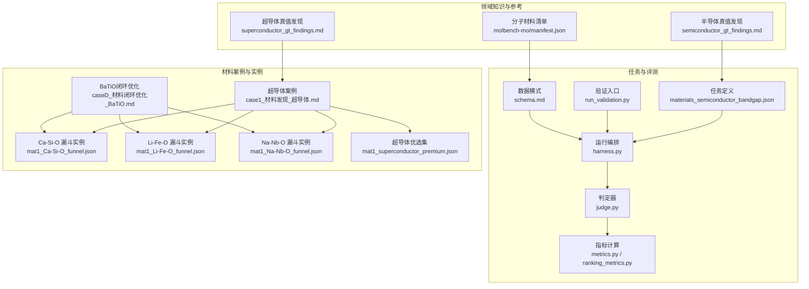
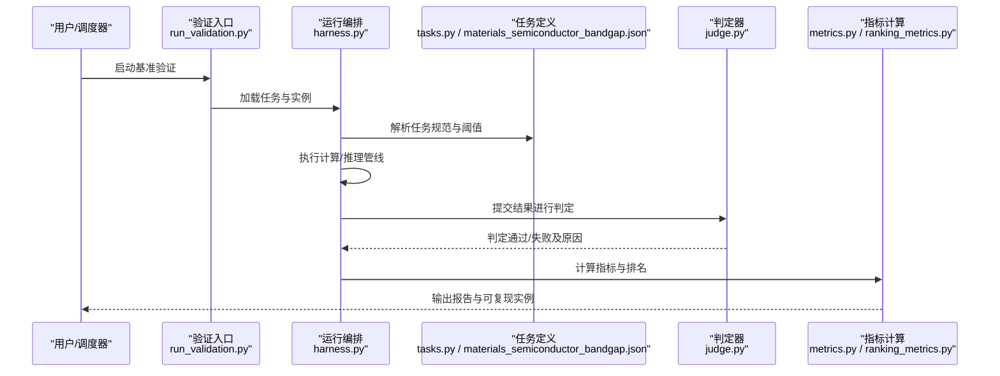
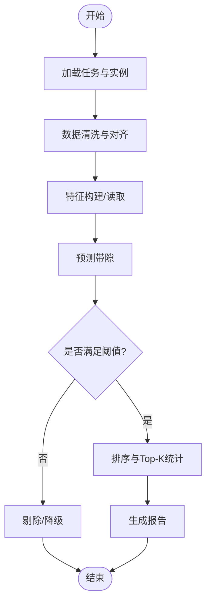
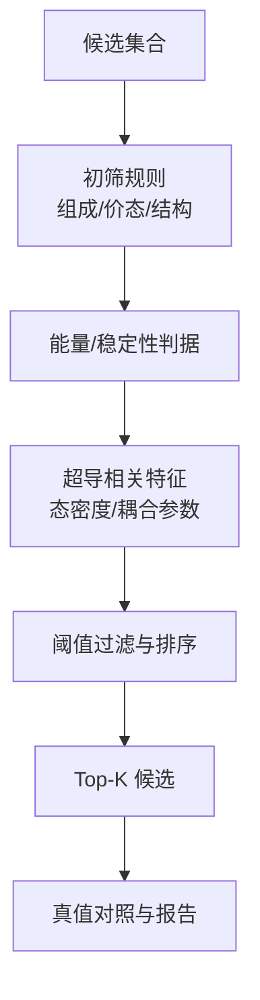
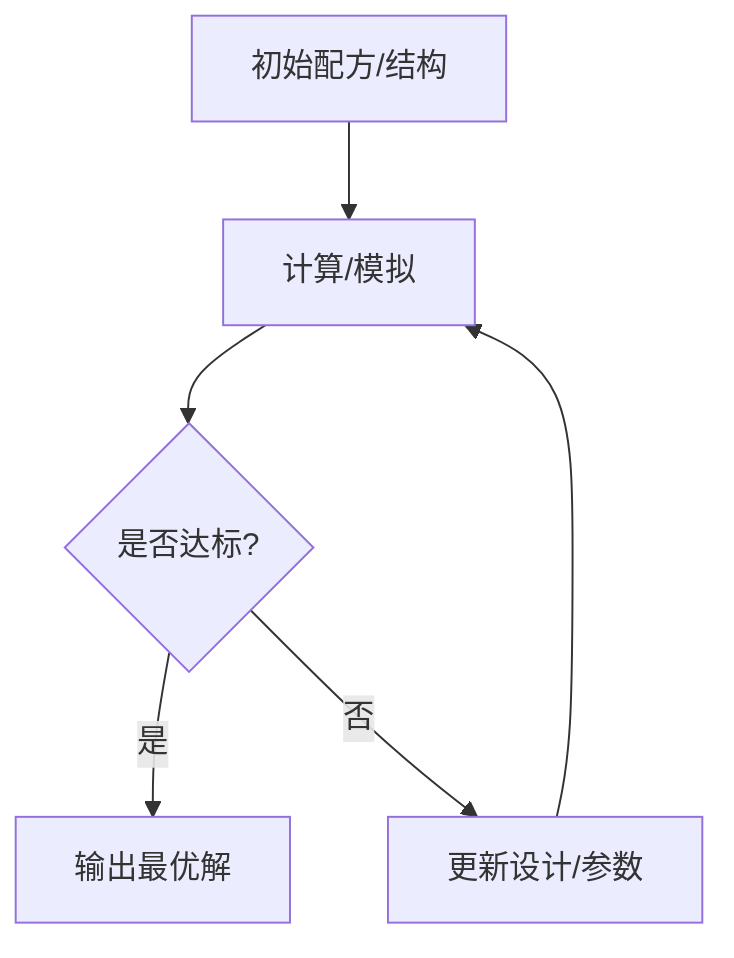
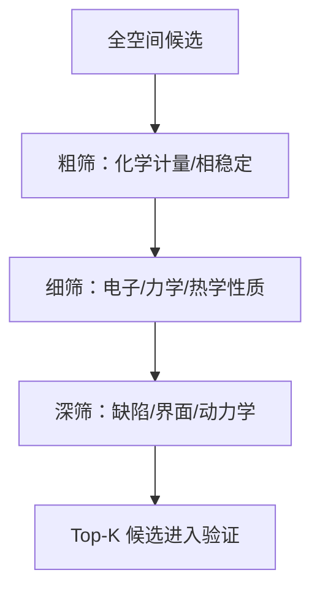
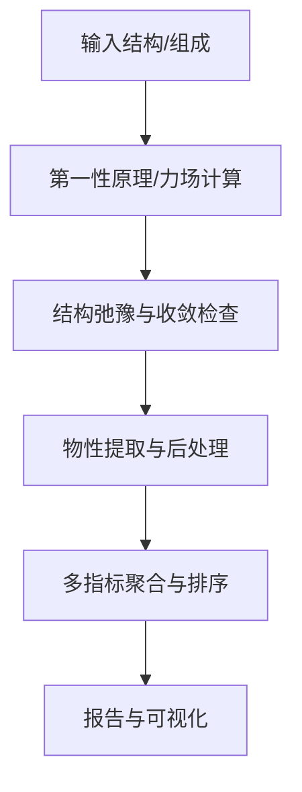
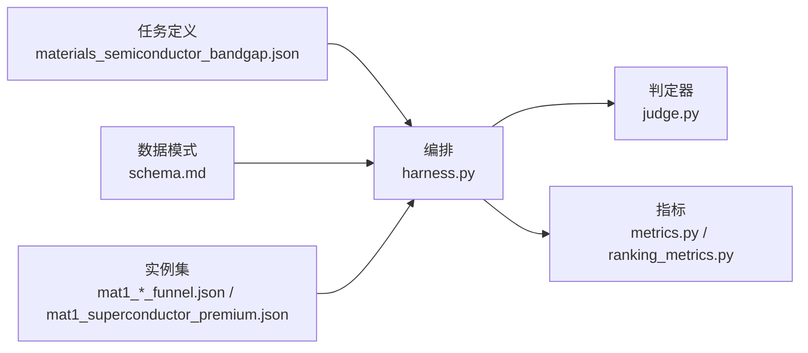

# 材料科学基准测试

<cite>
**本文引用的文件**   
- [longhorizon/case1_材料发现_超导体.md](file://longhorizon/case1_材料发现_超导体.md)
- [longhorizon/caseD_材料闭环优化_BaTiO.md](file://longhorizon/caseD_材料闭环优化_BaTiO.md)
- [longhorizon/instantiate/instances/mat1_Ca-Si-O_funnel.json](file://longhorizon/instantiate/instances/mat1_Ca-Si-O_funnel.json)
- [longhorizon/instantiate/instances/mat1_Li-Fe-O_funnel.json](file://longhorizon/instantiate/instances/mat1_Li-Fe-O_funnel.json)
- [longhorizon/instantiate/instances/mat1_Na-Nb-O_funnel.json](file://longhorizon/instantiate/instances/mat1_Na-Nb-O_funnel.json)
- [longhorizon/instantiate/instances/mat1_superconductor_premium.json](file://longhorizon/instantiate/instances/mat1_superconductor_premium.json)
- [autonomy_mvp/tasks/materials_semiconductor_bandgap.json](file://autonomy_mvp/tasks/materials_semiconductor_bandgap.json)
- [autonomy_mvp/core/harness.py](file://autonomy_mvp/core/harness.py)
- [autonomy_mvp/core/judge.py](file://autonomy_mvp/core/judge.py)
- [autonomy_mvp/core/metrics.py](file://autonomy_mvp/core/metrics.py)
- [autonomy_mvp/core/ranking_metrics.py](file://autonomy_mvp/core/ranking_metrics.py)
- [autonomy_mvp/core/tasks.py](file://autonomy_mvp/core/tasks.py)
- [autonomy_mvp/run_validation.py](file://autonomy_mvp/run_validation.py)
- [autonomy_mvp/schema.md](file://autonomy_mvp/schema.md)
- [docs/prd/molbench_repo/data_full/molbench-mo/manifest.json](file://docs/prd/molbench_repo/data_full/molbench-mo/manifest.json)
- [docs/search/semiconductor_gt_findings.md](file://docs/search/semiconductor_gt_findings.md)
- [docs/search/superconductor_gt_findings.md](file://docs/search/superconductor_gt_findings.md)
</cite>

## 目录
1. [引言](#引言)
2. [项目结构](#项目结构)
3. [核心组件](#核心组件)
4. [架构总览](#架构总览)
5. [详细组件分析](#详细组件分析)
6. [依赖关系分析](#依赖关系分析)
7. [性能考量](#性能考量)
8. [故障排查指南](#故障排查指南)
9. [结论](#结论)
10. [附录](#附录)

## 引言
本文件面向材料科学基准测试，聚焦以下关键任务：半导体带隙预测、超导体发现、材料性能优化。文档从理论基础与实现方法出发，系统阐述不同材料体系（Ca-Si-O、Li-Fe-O、Na-Nb-O等）的任务实例化与验证机制；解释漏斗式筛选策略在材料发现中的应用与优势；给出材料属性计算、晶体结构分析与性能评估的标准流程；并说明基准数据集的组织结构、样本特征与质量控制方法。最后强调计算材料学在加速新材料发现中的重要作用。

## 项目结构
仓库围绕“任务定义—数据实例—运行与评测”的流水线组织，材料相关的关键位置包括：
- 任务与评测核心：autonomy_mvp 下的 tasks、core、run_validation 与 schema
- 材料案例与实例：longhorizon 下的 case1（超导体）、caseD（BaTiO 闭环优化），以及 instantiate/instances 下按元素体系划分的 JSON 实例
- 领域知识补充：docs/search 下的半导体与超导体真值发现笔记
- 分子材料参考：docs/prd/molbench_repo 的数据清单与配置（用于理解数据组织范式）

图表来源
- [autonomy_mvp/tasks/materials_semiconductor_bandgap.json](file://autonomy_mvp/tasks/materials_semiconductor_bandgap.json)
- [autonomy_mvp/core/harness.py](file://autonomy_mvp/core/harness.py)
- [autonomy_mvp/core/judge.py](file://autonomy_mvp/core/judge.py)
- [autonomy_mvp/core/metrics.py](file://autonomy_mvp/core/metrics.py)
- [autonomy_mvp/core/ranking_metrics.py](file://autonomy_mvp/core/ranking_metrics.py)
- [autonomy_mvp/run_validation.py](file://autonomy_mvp/run_validation.py)
- [autonomy_mvp/schema.md](file://autonomy_mvp/schema.md)
- [longhorizon/case1_材料发现_超导体.md](file://longhorizon/case1_材料发现_超导体.md)
- [longhorizon/caseD_材料闭环优化_BaTiO.md](file://longhorizon/caseD_材料闭环优化_BaTiO.md)
- [longhorizon/instantiate/instances/mat1_Ca-Si-O_funnel.json](file://longhorizon/instantiate/instances/mat1_Ca-Si-O_funnel.json)
- [longhorizon/instantiate/instances/mat1_Li-Fe-O_funnel.json](file://longhorizon/instantiate/instances/mat1_Li-Fe-O_funnel.json)
- [longhorizon/instantiate/instances/mat1_Na-Nb-O_funnel.json](file://longhorizon/instantiate/instances/mat1_Na-Nb-O_funnel.json)
- [longhorizon/instantiate/instances/mat1_superconductor_premium.json](file://longhorizon/instantiate/instances/mat1_superconductor_premium.json)
- [docs/search/semiconductor_gt_findings.md](file://docs/search/semiconductor_gt_findings.md)
- [docs/search/superconductor_gt_findings.md](file://docs/search/superconductor_gt_findings.md)
- [docs/prd/molbench_repo/data_full/molbench-mo/manifest.json](file://docs/prd/molbench_repo/data_full/molbench-mo/manifest.json)

章节来源
- [autonomy_mvp/tasks/materials_semiconductor_bandgap.json](file://autonomy_mvp/tasks/materials_semiconductor_bandgap.json)
- [autonomy_mvp/core/harness.py](file://autonomy_mvp/core/harness.py)
- [autonomy_mvp/core/judge.py](file://autonomy_mvp/core/judge.py)
- [autonomy_mvp/core/metrics.py](file://autonomy_mvp/core/metrics.py)
- [autonomy_mvp/core/ranking_metrics.py](file://autonomy_mvp/core/ranking_metrics.py)
- [autonomy_mvp/run_validation.py](file://autonomy_mvp/run_validation.py)
- [autonomy_mvp/schema.md](file://autonomy_mvp/schema.md)
- [longhorizon/case1_材料发现_超导体.md](file://longhorizon/case1_材料发现_超导体.md)
- [longhorizon/caseD_材料闭环优化_BaTiO.md](file://longhorizon/caseD_材料闭环优化_BaTiO.md)
- [longhorizon/instantiate/instances/mat1_Ca-Si-O_funnel.json](file://longhorizon/instantiate/instances/mat1_Ca-Si-O_funnel.json)
- [longhorizon/instantiate/instances/mat1_Li-Fe-O_funnel.json](file://longhorizon/instantiate/instances/mat1_Li-Fe-O_funnel.json)
- [longhorizon/instantiate/instances/mat1_Na-Nb-O_funnel.json](file://longhorizon/instantiate/instances/mat1_Na-Nb-O_funnel.json)
- [longhorizon/instantiate/instances/mat1_superconductor_premium.json](file://longhorizon/instantiate/instances/mat1_superconductor_premium.json)
- [docs/search/semiconductor_gt_findings.md](file://docs/search/semiconductor_gt_findings.md)
- [docs/search/superconductor_gt_findings.md](file://docs/search/superconductor_gt_findings.md)
- [docs/prd/molbench_repo/data_full/molbench-mo/manifest.json](file://docs/prd/molbench_repo/data_full/molbench-mo/manifest.json)

## 核心组件
- 任务定义层：以 JSON 描述任务目标、输入输出规范、评价阈值与数据来源，支撑多任务复用与扩展。
- 运行编排层：负责加载任务与实例、驱动工具链、收集中间结果、触发判定与指标计算。
- 判定与指标层：将模型或工作流输出与真值/规则进行比对，产出可复现的评分与排名。
- 数据模式与校验：通过 schema 约束字段类型、必填项与取值范围，保障数据一致性与可追溯性。
- 材料实例库：按元素体系与任务类型组织 JSON 实例，包含候选材料、筛选阈值、期望输出与验证信息。

章节来源
- [autonomy_mvp/core/tasks.py](file://autonomy_mvp/core/tasks.py)
- [autonomy_mvp/core/harness.py](file://autonomy_mvp/core/harness.py)
- [autonomy_mvp/core/judge.py](file://autonomy_mvp/core/judge.py)
- [autonomy_mvp/core/metrics.py](file://autonomy_mvp/core/metrics.py)
- [autonomy_mvp/core/ranking_metrics.py](file://autonomy_mvp/core/ranking_metrics.py)
- [autonomy_mvp/schema.md](file://autonomy_mvp/schema.md)

## 架构总览
整体采用“任务—实例—执行—判定—指标”的分层架构。任务定义提供统一接口，实例层承载具体材料体系与参数，执行层串联计算与推理步骤，判定与指标层完成质量度量与排序。

图表来源
- [autonomy_mvp/run_validation.py](file://autonomy_mvp/run_validation.py)
- [autonomy_mvp/core/harness.py](file://autonomy_mvp/core/harness.py)
- [autonomy_mvp/core/tasks.py](file://autonomy_mvp/core/tasks.py)
- [autonomy_mvp/tasks/materials_semiconductor_bandgap.json](file://autonomy_mvp/tasks/materials_semiconductor_bandgap.json)
- [autonomy_mvp/core/judge.py](file://autonomy_mvp/core/judge.py)
- [autonomy_mvp/core/metrics.py](file://autonomy_mvp/core/metrics.py)
- [autonomy_mvp/core/ranking_metrics.py](file://autonomy_mvp/core/ranking_metrics.py)

## 详细组件分析

### 半导体带隙预测任务
- 任务目标：基于给定材料描述（如组成、结构或表征）预测带隙，并与真值对比评估误差与排序能力。
- 数据与真值：结合领域搜索笔记中关于半导体真值的整理，构建高质量标签集与边界条件。
- 评价指标：常用回归误差（如 MAE/RMSE）与排序指标（如 Top-K 命中率、AUC）。
- 典型流程：数据清洗→特征工程→模型训练/推理→阈值过滤→排序与报告。

图表来源
- [autonomy_mvp/tasks/materials_semiconductor_bandgap.json](file://autonomy_mvp/tasks/materials_semiconductor_bandgap.json)
- [autonomy_mvp/core/harness.py](file://autonomy_mvp/core/harness.py)
- [autonomy_mvp/core/judge.py](file://autonomy_mvp/core/judge.py)
- [autonomy_mvp/core/metrics.py](file://autonomy_mvp/core/metrics.py)
- [autonomy_mvp/core/ranking_metrics.py](file://autonomy_mvp/core/ranking_metrics.py)
- [docs/search/semiconductor_gt_findings.md](file://docs/search/semiconductor_gt_findings.md)

章节来源
- [autonomy_mvp/tasks/materials_semiconductor_bandgap.json](file://autonomy_mvp/tasks/materials_semiconductor_bandgap.json)
- [autonomy_mvp/core/harness.py](file://autonomy_mvp/core/harness.py)
- [autonomy_mvp/core/judge.py](file://autonomy_mvp/core/judge.py)
- [autonomy_mvp/core/metrics.py](file://autonomy_mvp/core/metrics.py)
- [autonomy_mvp/core/ranking_metrics.py](file://autonomy_mvp/core/ranking_metrics.py)
- [docs/search/semiconductor_gt_findings.md](file://docs/search/semiconductor_gt_findings.md)

### 超导体发现任务
- 任务目标：在候选空间中识别潜在超导体，依据临界温度、稳定性与合成可行性进行筛选与排序。
- 实例与优选集：使用“超导体优选集”作为高价值子集，配合漏斗式筛选逐步缩小候选空间。
- 评价指标：命中率、召回率、F1、Top-K 准确率、成本效益比（计算/实验成本加权）。
- 典型流程：初筛（组成/对称性/电子结构）→精筛（能量/声子谱/耦合强度）→验证（文献/实验对照）。

图表来源
- [longhorizon/instantiate/instances/mat1_superconductor_premium.json](file://longhorizon/instantiate/instances/mat1_superconductor_premium.json)
- [longhorizon/case1_材料发现_超导体.md](file://longhorizon/case1_材料发现_超导体.md)
- [autonomy_mvp/core/judge.py](file://autonomy_mvp/core/judge.py)
- [autonomy_mvp/core/metrics.py](file://autonomy_mvp/core/metrics.py)
- [autonomy_mvp/core/ranking_metrics.py](file://autonomy_mvp/core/ranking_metrics.py)
- [docs/search/superconductor_gt_findings.md](file://docs/search/superconductor_gt_findings.md)

章节来源
- [longhorizon/case1_材料发现_超导体.md](file://longhorizon/case1_材料发现_超导体.md)
- [longhorizon/instantiate/instances/mat1_superconductor_premium.json](file://longhorizon/instantiate/instances/mat1_superconductor_premium.json)
- [autonomy_mvp/core/judge.py](file://autonomy_mvp/core/judge.py)
- [autonomy_mvp/core/metrics.py](file://autonomy_mvp/core/metrics.py)
- [autonomy_mvp/core/ranking_metrics.py](file://autonomy_mvp/core/ranking_metrics.py)
- [docs/search/superconductor_gt_findings.md](file://docs/search/superconductor_gt_findings.md)

### 材料性能优化（以 BaTiO 为例）
- 任务目标：在给定材料体系内迭代优化性能（如介电常数、铁电性、热稳定性），形成闭环优化路径。
- 实例与流程：结合漏斗式筛选与反馈回路，利用计算结果指导下一轮设计，直至收敛或达到预算上限。
- 评价指标：性能提升幅度、收敛步数、资源消耗、鲁棒性（对扰动/噪声的稳定性）。

图表来源
- [longhorizon/caseD_材料闭环优化_BaTiO.md](file://longhorizon/caseD_材料闭环优化_BaTiO.md)
- [autonomy_mvp/core/harness.py](file://autonomy_mvp/core/harness.py)
- [autonomy_mvp/core/judge.py](file://autonomy_mvp/core/judge.py)
- [autonomy_mvp/core/metrics.py](file://autonomy_mvp/core/metrics.py)

章节来源
- [longhorizon/caseD_材料闭环优化_BaTiO.md](file://longhorizon/caseD_材料闭环优化_BaTiO.md)
- [autonomy_mvp/core/harness.py](file://autonomy_mvp/core/harness.py)
- [autonomy_mvp/core/judge.py](file://autonomy_mvp/core/judge.py)
- [autonomy_mvp/core/metrics.py](file://autonomy_mvp/core/metrics.py)

### 漏斗式筛选策略在各材料体系中的应用
- Ca-Si-O、Li-Fe-O、Na-Nb-O 等体系均通过“宽泛初筛→严格精筛→最终验证”的漏斗式流程，显著降低计算与实验成本，提高命中率。
- 各体系实例文件定义了阶段阈值、筛选规则与期望输出，便于跨体系比较与迁移学习。

图表来源
- [longhorizon/instantiate/instances/mat1_Ca-Si-O_funnel.json](file://longhorizon/instantiate/instances/mat1_Ca-Si-O_funnel.json)
- [longhorizon/instantiate/instances/mat1_Li-Fe-O_funnel.json](file://longhorizon/instantiate/instances/mat1_Li-Fe-O_funnel.json)
- [longhorizon/instantiate/instances/mat1_Na-Nb-O_funnel.json](file://longhorizon/instantiate/instances/mat1_Na-Nb-O_funnel.json)
- [autonomy_mvp/core/harness.py](file://autonomy_mvp/core/harness.py)
- [autonomy_mvp/core/judge.py](file://autonomy_mvp/core/judge.py)
- [autonomy_mvp/core/metrics.py](file://autonomy_mvp/core/metrics.py)

章节来源
- [longhorizon/instantiate/instances/mat1_Ca-Si-O_funnel.json](file://longhorizon/instantiate/instances/mat1_Ca-Si-O_funnel.json)
- [longhorizon/instantiate/instances/mat1_Li-Fe-O_funnel.json](file://longhorizon/instantiate/instances/mat1_Li-Fe-O_funnel.json)
- [longhorizon/instantiate/instances/mat1_Na-Nb-O_funnel.json](file://longhorizon/instantiate/instances/mat1_Na-Nb-O_funnel.json)
- [autonomy_mvp/core/harness.py](file://autonomy_mvp/core/harness.py)
- [autonomy_mvp/core/judge.py](file://autonomy_mvp/core/judge.py)
- [autonomy_mvp/core/metrics.py](file://autonomy_mvp/core/metrics.py)

### 标准流程：材料属性计算、晶体结构分析与性能评估
- 属性计算：从结构到物性的映射（能带、态密度、弹性模量、介电常数等），需保证收敛与一致性。
- 结构分析：空间群、配位环境、缺陷与界面处理，确保物理合理性与数值稳定性。
- 性能评估：多目标权衡与排序，结合成本与不确定性量化，输出可解释的报告。

图表来源
- [autonomy_mvp/core/harness.py](file://autonomy_mvp/core/harness.py)
- [autonomy_mvp/core/judge.py](file://autonomy_mvp/core/judge.py)
- [autonomy_mvp/core/metrics.py](file://autonomy_mvp/core/metrics.py)
- [autonomy_mvp/core/ranking_metrics.py](file://autonomy_mvp/core/ranking_metrics.py)

章节来源
- [autonomy_mvp/core/harness.py](file://autonomy_mvp/core/harness.py)
- [autonomy_mvp/core/judge.py](file://autonomy_mvp/core/judge.py)
- [autonomy_mvp/core/metrics.py](file://autonomy_mvp/core/metrics.py)
- [autonomy_mvp/core/ranking_metrics.py](file://autonomy_mvp/core/ranking_metrics.py)

## 依赖关系分析
- 任务与实例：任务定义文件为上层编排提供统一接口，实例文件承载具体材料与参数。
- 运行与判定：编排模块调用判定器与指标模块，形成端到端评测链路。
- 数据模式：schema 约束所有输入输出，确保跨任务与跨实例的一致性。

图表来源
- [autonomy_mvp/tasks/materials_semiconductor_bandgap.json](file://autonomy_mvp/tasks/materials_semiconductor_bandgap.json)
- [autonomy_mvp/core/harness.py](file://autonomy_mvp/core/harness.py)
- [autonomy_mvp/core/judge.py](file://autonomy_mvp/core/judge.py)
- [autonomy_mvp/core/metrics.py](file://autonomy_mvp/core/metrics.py)
- [autonomy_mvp/core/ranking_metrics.py](file://autonomy_mvp/core/ranking_metrics.py)
- [autonomy_mvp/schema.md](file://autonomy_mvp/schema.md)
- [longhorizon/instantiate/instances/mat1_Ca-Si-O_funnel.json](file://longhorizon/instantiate/instances/mat1_Ca-Si-O_funnel.json)
- [longhorizon/instantiate/instances/mat1_Li-Fe-O_funnel.json](file://longhorizon/instantiate/instances/mat1_Li-Fe-O_funnel.json)
- [longhorizon/instantiate/instances/mat1_Na-Nb-O_funnel.json](file://longhorizon/instantiate/instances/mat1_Na-Nb-O_funnel.json)
- [longhorizon/instantiate/instances/mat1_superconductor_premium.json](file://longhorizon/instantiate/instances/mat1_superconductor_premium.json)

章节来源
- [autonomy_mvp/tasks/materials_semiconductor_bandgap.json](file://autonomy_mvp/tasks/materials_semiconductor_bandgap.json)
- [autonomy_mvp/core/harness.py](file://autonomy_mvp/core/harness.py)
- [autonomy_mvp/core/judge.py](file://autonomy_mvp/core/judge.py)
- [autonomy_mvp/core/metrics.py](file://autonomy_mvp/core/metrics.py)
- [autonomy_mvp/core/ranking_metrics.py](file://autonomy_mvp/core/ranking_metrics.py)
- [autonomy_mvp/schema.md](file://autonomy_mvp/schema.md)
- [longhorizon/instantiate/instances/mat1_Ca-Si-O_funnel.json](file://longhorizon/instantiate/instances/mat1_Ca-Si-O_funnel.json)
- [longhorizon/instantiate/instances/mat1_Li-Fe-O_funnel.json](file://longhorizon/instantiate/instances/mat1_Li-Fe-O_funnel.json)
- [longhorizon/instantiate/instances/mat1_Na-Nb-O_funnel.json](file://longhorizon/instantiate/instances/mat1_Na-Nb-O_funnel.json)
- [longhorizon/instantiate/instances/mat1_superconductor_premium.json](file://longhorizon/instantiate/instances/mat1_superconductor_premium.json)

## 性能考量
- 计算成本：优先使用低成本快速筛选（如经验规则/机器学习代理模型），再对高分候选进行高精度计算。
- 并行与批处理：在编排层支持并行执行，缩短整体评测时间。
- 缓存与去重：对重复结构与等价计算进行缓存，避免冗余。
- 早停与自适应阈值：根据中间结果动态调整阈值，减少无效计算。

[本节为通用建议，不直接分析具体文件]

## 故障排查指南
- 数据不一致：核对 schema 约束与实例字段，确保类型、单位与命名一致。
- 判定失败：查看判定器日志，定位阈值设置、缺失字段或异常值。
- 指标异常：检查指标计算逻辑与排序规则，确认权重与归一化方式。
- 运行中断：检查编排层错误捕获与重试策略，必要时拆分任务粒度。

章节来源
- [autonomy_mvp/schema.md](file://autonomy_mvp/schema.md)
- [autonomy_mvp/core/judge.py](file://autonomy_mvp/core/judge.py)
- [autonomy_mvp/core/metrics.py](file://autonomy_mvp/core/metrics.py)
- [autonomy_mvp/core/ranking_metrics.py](file://autonomy_mvp/core/ranking_metrics.py)
- [autonomy_mvp/core/harness.py](file://autonomy_mvp/core/harness.py)

## 结论
本基准测试通过统一的“任务—实例—执行—判定—指标”架构，覆盖半导体带隙预测、超导体发现与材料性能优化三大关键任务。漏斗式筛选策略在多材料体系中显著提升效率与命中率；标准化的属性计算、结构分析与评估流程保障了结果的可复现性与可比性。计算材料学与自动化评测的结合，为加速新材料发现提供了系统化、可扩展的基础设施。

[本节为总结性内容，不直接分析具体文件]

## 附录
- 数据集组织结构：以 manifest 与实例 JSON 为主，分层管理任务、样本与元数据，便于检索与版本控制。
- 样本特征与质量控制：通过 schema 强制校验、阈值过滤与交叉验证，确保数据质量与一致性。
- 最佳实践：明确任务边界、标准化输入输出、记录随机种子与依赖版本，提升可复现性。

章节来源
- [docs/prd/molbench_repo/data_full/molbench-mo/manifest.json](file://docs/prd/molbench_repo/data_full/molbench-mo/manifest.json)
- [autonomy_mvp/schema.md](file://autonomy_mvp/schema.md)
- [autonomy_mvp/run_validation.py](file://autonomy_mvp/run_validation.py)