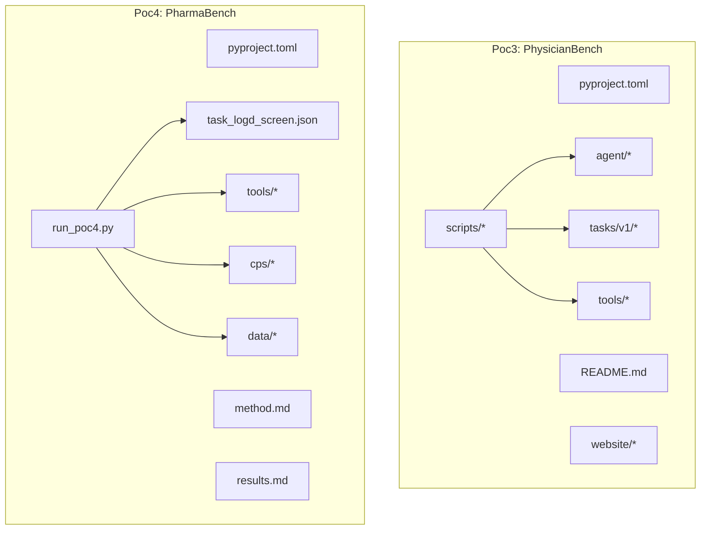
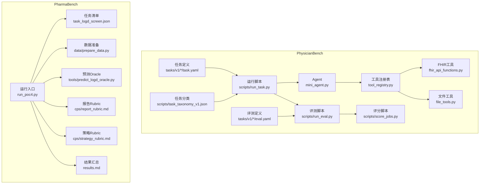
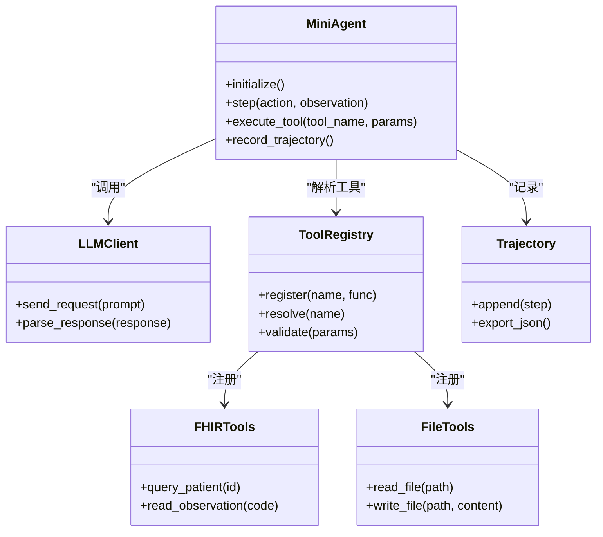
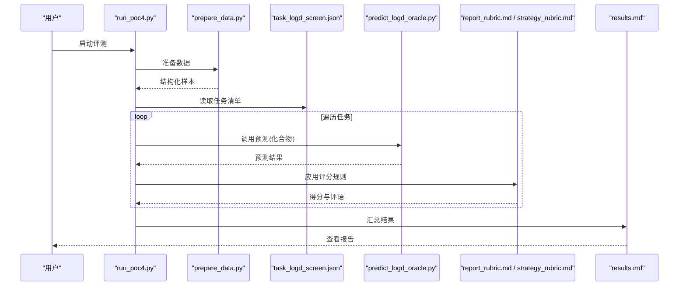
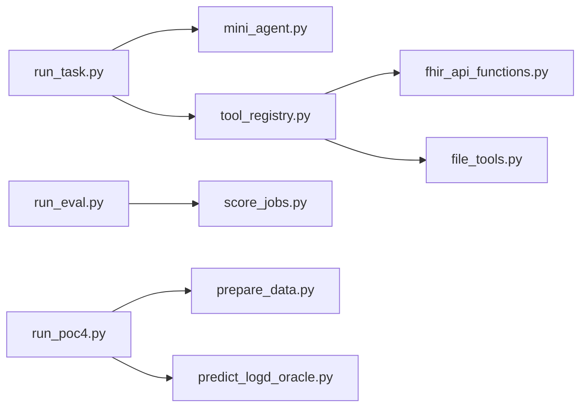

# 生物医学基准测试

<cite>
**本文引用的文件**   
- [task7/poc3_physicianbench/PhysicianBench/pyproject.toml](file://task7/poc3_physicianbench/PhysicianBench/pyproject.toml)
- [task7/poc3_physicianbench/PhysicianBench/README.md](file://task7/poc3_physicianbench/PhysicianBench/README.md)
- [task7/poc3_physicianbench/PhysicianBench/scripts/run_task.py](file://task7/poc3_physicianbench/PhysicianBench/scripts/run_task.py)
- [task7/poc3_physicianbench/PhysicianBench/scripts/run_eval.py](file://task7/poc3_physicianbench/PhysicianBench/scripts/run_eval.py)
- [task7/poc3_physicianbench/PhysicianBench/scripts/score_jobs.py](file://task7/poc3_physicianbench/PhysicianBench/scripts/score_jobs.py)
- [task7/poc3_physicianbench/PhysicianBench/scripts/task_taxonomy_v1.json](file://task7/poc3_physicianbench/PhysicianBench/scripts/task_taxonomy_v1.json)
- [task7/poc3_physicianbench/PhysicianBench/agent/llm_client.py](file://task7/poc3_physicianbench/PhysicianBench/agent/llm_client.py)
- [task7/poc3_physicianbench/PhysicianBench/agent/mini_agent.py](file://task7/poc3_physicianbench/PhysicianBench/agent/mini_agent.py)
- [task7/poc3_physicianbench/PhysicianBench/agent/prompts.py](file://task7/poc3_physicianbench/PhysicianBench/agent/prompts.py)
- [task7/poc3_physicianbench/PhysicianBench/agent/tool_registry.py](file://task7/poc3_physicianbench/PhysicianBench/agent/tool_registry.py)
- [task7/poc3_physicianbench/PhysicianBench/agent/trajectory.py](file://task7/poc3_physicianbench/PhysicianBench/agent/trajectory.py)
- [task7/poc3_physicianbench/PhysicianBench/tools/fhir_api_functions.py](file://task7/poc3_physicianbench/PhysicianBench/tools/fhir_api_functions.py)
- [task7/poc3_physicianbench/PhysicianBench/tools/file_tools.py](file://task7/poc3_physicianbench/PhysicianBench/tools/file_tools.py)
- [task7/poc3_physicianbench/PhysicianBench/tasks/v1/abnormal_uterine_bleeding/task.yaml](file://task7/poc3_physicianbench/PhysicianBench/tasks/v1/abnormal_uterine_bleeding/task.yaml)
- [task7/poc3_physicianbench/PhysicianBench/tasks/v1/abnormal_uterine_bleeding/eval.yaml](file://task7/poc3_physicianbench/PhysicianBench/tasks/v1/abnormal_uterine_bleeding/eval.yaml)
- [task7/poc4_pharmabench/pyproject.toml](file://task7/poc4_pharmabench/pyproject.toml)
- [task7/poc4_pharmabench/run_poc4.py](file://task7/poc4_pharmabench/run_poc4.py)
- [task7/poc4_pharmabench/task_logd_screen.json](file://task7/poc4_pharmabench/task_logd_screen.json)
- [task7/poc4_pharmabench/method.md](file://task7/poc4_pharmabench/method.md)
- [task7/poc4_pharmabench/results.md](file://task7/poc4_pharmabench/results.md)
- [task7/poc4_pharmabench/cps/report_rubric.md](file://task7/poc4_pharmabench/cps/report_rubric.md)
- [task7/poc4_pharmabench/cps/strategy_rubric.md](file://task7/poc4_pharmabench/cps/strategy_rubric.md)
- [task7/poc4_pharmabench/data/prepare_data.py](file://task7/poc4_pharmabench/data/prepare_data.py)
- [task7/poc4_pharmabench/tools/predict_logd_oracle.py](file://task7/poc4_pharmabench/tools/predict_logd_oracle.py)
</cite>

## 目录
1. [引言](#引言)
2. [项目结构](#项目结构)
3. [核心组件](#核心组件)
4. [架构总览](#架构总览)
5. [详细组件分析](#详细组件分析)
6. [依赖关系分析](#依赖关系分析)
7. [性能与可扩展性](#性能与可扩展性)
8. [故障排查指南](#故障排查指南)
9. [结论](#结论)
10. [附录](#附录)

## 引言
本文件面向生物医学领域的基准评测，聚焦医疗诊断辅助、临床试验设计与药物相互作用分析等任务。仓库中包含两个关键基准套件：
- PhysicianBench：以临床决策路径建模为核心，围绕真实世界病例开展端到端评估，强调工具调用（如FHIR）、轨迹记录与评分一致性。
- PharmaBench：以药物筛选与性质预测为切入点，提供可复现的评测流程、策略与报告规范，支持多工具链协同与结果汇总。

此外，仓库还包含材料科学、分子发现、长程推理等子任务，但本文重点围绕生物医学相关基准展开，帮助读者理解其设计理念、评估框架与实现细节，并给出隐私保护与伦理合规建议。

## 项目结构
从顶层看，本项目采用“按任务/POC组织”的结构，其中与生物医学相关的核心位于 task7 下的 poc3 与 poc4 目录：
- poc3_physicianbench：包含完整的Agent运行、评测脚本、任务定义与工具集，体现“任务-工具-评测”闭环。
- poc4_pharmabench：包含数据准备、工具封装、评测脚本与Rubric，体现“数据-工具-评测-报告”闭环。

图表来源
- [task7/poc3_physicianbench/PhysicianBench/pyproject.toml](file://task7/poc3_physicianbench/PhysicianBench/pyproject.toml)
- [task7/poc3_physicianbench/PhysicianBench/README.md](file://task7/poc3_physicianbench/PhysicianBench/README.md)
- [task7/poc3_physicianbench/PhysicianBench/scripts/run_task.py](file://task7/poc3_physicianbench/PhysicianBench/scripts/run_task.py)
- [task7/poc3_physicianbench/PhysicianBench/scripts/run_eval.py](file://task7/poc3_physicianbench/PhysicianBench/scripts/run_eval.py)
- [task7/poc3_physicianbench/PhysicianBench/scripts/score_jobs.py](file://task7/poc3_physicianbench/PhysicianBench/scripts/score_jobs.py)
- [task7/poc3_physicianbench/PhysicianBench/agent/llm_client.py](file://task7/poc3_physicianbench/PhysicianBench/agent/llm_client.py)
- [task7/poc3_physicianbench/PhysicianBench/agent/mini_agent.py](file://task7/poc3_physicianbench/PhysicianBench/agent/mini_agent.py)
- [task7/poc3_physicianbench/PhysicianBench/agent/prompts.py](file://task7/poc3_physicianbench/PhysicianBench/agent/prompts.py)
- [task7/poc3_physicianbench/PhysicianBench/agent/tool_registry.py](file://task7/poc3_physicianbench/PhysicianBench/agent/tool_registry.py)
- [task7/poc3_physicianbench/PhysicianBench/agent/trajectory.py](file://task7/poc3_physicianbench/PhysicianBench/agent/trajectory.py)
- [task7/poc3_physicianbench/PhysicianBench/tools/fhir_api_functions.py](file://task7/poc3_physicianbench/PhysicianBench/tools/fhir_api_functions.py)
- [task7/poc3_physicianbench/PhysicianBench/tools/file_tools.py](file://task7/poc3_physicianbench/PhysicianBench/tools/file_tools.py)
- [task7/poc3_physicianbench/PhysicianBench/tasks/v1/abnormal_uterine_bleeding/task.yaml](file://task7/poc3_physicianbench/PhysicianBench/tasks/v1/abnormal_uterine_bleeding/task.yaml)
- [task7/poc3_physicianbench/PhysicianBench/tasks/v1/abnormal_uterine_bleeding/eval.yaml](file://task7/poc3_physicianbench/PhysicianBench/tasks/v1/abnormal_uterine_bleeding/eval.yaml)
- [task7/poc4_pharmabench/pyproject.toml](file://task7/poc4_pharmabench/pyproject.toml)
- [task7/poc4_pharmabench/run_poc4.py](file://task7/poc4_pharmabench/run_poc4.py)
- [task7/poc4_pharmabench/task_logd_screen.json](file://task7/poc4_pharmabench/task_logd_screen.json)
- [task7/poc4_pharmabench/method.md](file://task7/poc4_pharmabench/method.md)
- [task7/poc4_pharmabench/results.md](file://task7/poc4_pharmabench/results.md)
- [task7/poc4_pharmabench/cps/report_rubric.md](file://task7/poc4_pharmabench/cps/report_rubric.md)
- [task7/poc4_pharmabench/cps/strategy_rubric.md](file://task7/poc4_pharmabench/cps/strategy_rubric.md)
- [task7/poc4_pharmabench/data/prepare_data.py](file://task7/poc4_pharmabench/data/prepare_data.py)
- [task7/poc4_pharmabench/tools/predict_logd_oracle.py](file://task7/poc4_pharmabench/tools/predict_logd_oracle.py)

章节来源
- [task7/poc3_physicianbench/PhysicianBench/pyproject.toml](file://task7/poc3_physicianbench/PhysicianBench/pyproject.toml)
- [task7/poc3_physicianbench/PhysicianBench/README.md](file://task7/poc3_physicianbench/PhysicianBench/README.md)
- [task7/poc4_pharmabench/pyproject.toml](file://task7/poc4_pharmabench/pyproject.toml)

## 核心组件
本节概述两大基准套件的核心能力与职责划分。

- PhysicianBench
  - Agent层：负责对话式交互、工具路由与轨迹记录，支撑复杂临床决策路径的多步推理。
  - 工具层：封装FHIR API与文件操作等工具，便于在任务中检索患者信息、读写工作区。
  - 任务层：以YAML定义任务与评测规则，覆盖大量真实临床场景。
  - 运行与评测：提供统一脚本执行任务、收集轨迹、计算分数与汇总报告。

- PharmaBench
  - 数据层：提供数据准备脚本与样例数据集，用于药物性质预测（如logD）等任务。
  - 工具层：封装预测Oracle，供Agent在评测过程中调用。
  - 评测层：通过JSON任务清单驱动批量运行，结合Rubric进行策略与报告质量评估。
  - 文档层：方法说明与结果汇总，确保可复现与可审计。

章节来源
- [task7/poc3_physicianbench/PhysicianBench/agent/mini_agent.py](file://task7/poc3_physicianbench/PhysicianBench/agent/mini_agent.py)
- [task7/poc3_physicianbench/PhysicianBench/agent/tool_registry.py](file://task7/poc3_physicianbench/PhysicianBench/agent/tool_registry.py)
- [task7/poc3_physicianbench/PhysicianBench/agent/trajectory.py](file://task7/poc3_physicianbench/PhysicianBench/agent/trajectory.py)
- [task7/poc3_physicianbench/PhysicianBench/tools/fhir_api_functions.py](file://task7/poc3_physicianbench/PhysicianBench/tools/fhir_api_functions.py)
- [task7/poc3_physicianbench/PhysicianBench/tools/file_tools.py](file://task7/poc3_physicianbench/PhysicianBench/tools/file_tools.py)
- [task7/poc3_physicianbench/PhysicianBench/tasks/v1/abnormal_uterine_bleeding/task.yaml](file://task7/poc3_physicianbench/PhysicianBench/tasks/v1/abnormal_uterine_bleeding/task.yaml)
- [task7/poc3_physicianbench/PhysicianBench/tasks/v1/abnormal_uterine_bleeding/eval.yaml](file://task7/poc3_physicianbench/PhysicianBench/tasks/v1/abnormal_uterine_bleeding/eval.yaml)
- [task7/poc4_pharmabench/data/prepare_data.py](file://task7/poc4_pharmabench/data/prepare_data.py)
- [task7/poc4_pharmabench/tools/predict_logd_oracle.py](file://task7/poc4_pharmabench/tools/predict_logd_oracle.py)
- [task7/poc4_pharmabench/task_logd_screen.json](file://task7/poc4_pharmabench/task_logd_screen.json)
- [task7/poc4_pharmabench/cps/report_rubric.md](file://task7/poc4_pharmabench/cps/report_rubric.md)
- [task7/poc4_pharmabench/cps/strategy_rubric.md](file://task7/poc4_pharmabench/cps/strategy_rubric.md)

## 架构总览
下图展示了两套基准的整体架构与数据流：任务定义驱动Agent运行，Agent通过工具访问外部资源或执行计算，最终由评测脚本依据Rubric打分并生成报告。

图表来源
- [task7/poc3_physicianbench/PhysicianBench/scripts/run_task.py](file://task7/poc3_physicianbench/PhysicianBench/scripts/run_task.py)
- [task7/poc3_physicianbench/PhysicianBench/scripts/run_eval.py](file://task7/poc3_physicianbench/PhysicianBench/scripts/run_eval.py)
- [task7/poc3_physicianbench/PhysicianBench/scripts/score_jobs.py](file://task7/poc3_physicianbench/PhysicianBench/scripts/score_jobs.py)
- [task7/poc3_physicianbench/PhysicianBench/agent/mini_agent.py](file://task7/poc3_physicianbench/PhysicianBench/agent/mini_agent.py)
- [task7/poc3_physicianbench/PhysicianBench/agent/tool_registry.py](file://task7/poc3_physicianbench/PhysicianBench/agent/tool_registry.py)
- [task7/poc3_physicianbench/PhysicianBench/tools/fhir_api_functions.py](file://task7/poc3_physicianbench/PhysicianBench/tools/fhir_api_functions.py)
- [task7/poc3_physicianbench/PhysicianBench/tools/file_tools.py](file://task7/poc3_physicianbench/PhysicianBench/tools/file_tools.py)
- [task7/poc3_physicianbench/PhysicianBench/tasks/v1/abnormal_uterine_bleeding/task.yaml](file://task7/poc3_physicianbench/PhysicianBench/tasks/v1/abnormal_uterine_bleeding/task.yaml)
- [task7/poc3_physicianbench/PhysicianBench/tasks/v1/abnormal_uterine_bleeding/eval.yaml](file://task7/poc3_physicianbench/PhysicianBench/tasks/v1/abnormal_uterine_bleeding/eval.yaml)
- [task7/poc3_physicianbench/PhysicianBench/scripts/task_taxonomy_v1.json](file://task7/poc3_physicianbench/PhysicianBench/scripts/task_taxonomy_v1.json)
- [task7/poc4_pharmabench/run_poc4.py](file://task7/poc4_pharmabench/run_poc4.py)
- [task7/poc4_pharmabench/task_logd_screen.json](file://task7/poc4_pharmabench/task_logd_screen.json)
- [task7/poc4_pharmabench/data/prepare_data.py](file://task7/poc4_pharmabench/data/prepare_data.py)
- [task7/poc4_pharmabench/tools/predict_logd_oracle.py](file://task7/poc4_pharmabench/tools/predict_logd_oracle.py)
- [task7/poc4_pharmabench/cps/report_rubric.md](file://task7/poc4_pharmabench/cps/report_rubric.md)
- [task7/poc4_pharmabench/cps/strategy_rubric.md](file://task7/poc4_pharmabench/cps/strategy_rubric.md)

## 详细组件分析

### PhysicianBench：Agent与工具链
- Agent核心
  - mini_agent：承载对话状态、工具选择与执行逻辑，驱动多轮交互与决策。
  - llm_client：抽象大模型客户端，屏蔽不同后端差异，提供统一的请求/响应接口。
  - prompts：管理提示词模板，保证任务一致性与可维护性。
  - trajectory：记录Agent每一步动作、输入输出与时间戳，形成可审计轨迹。
- 工具注册与调用
  - tool_registry：集中注册可用工具，提供动态路由与参数校验。
  - fhir_api_functions：封装FHIR查询与更新操作，支持在任务中检索患者信息与病历片段。
  - file_tools：提供工作区内文件的读取、写入与归档能力。
- 任务与评测
  - tasks/v1：每个疾病/场景一个目录，包含task.yaml与eval.yaml，分别定义任务目标、约束与评分细则。
  - scripts：run_task.py负责实例化Agent并执行；run_eval.py加载评测定义并计算指标；score_jobs.py汇总多任务结果。
  - task_taxonomy_v1.json：对任务进行分类与标签，便于分层评测与可视化。

图表来源
- [task7/poc3_physicianbench/PhysicianBench/agent/mini_agent.py](file://task7/poc3_physicianbench/PhysicianBench/agent/mini_agent.py)
- [task7/poc3_physicianbench/PhysicianBench/agent/llm_client.py](file://task7/poc3_physicianbench/PhysicianBench/agent/llm_client.py)
- [task7/poc3_physicianbench/PhysicianBench/agent/tool_registry.py](file://task7/poc3_physicianbench/PhysicianBench/agent/tool_registry.py)
- [task7/poc3_physicianbench/PhysicianBench/tools/fhir_api_functions.py](file://task7/poc3_physicianbench/PhysicianBench/tools/fhir_api_functions.py)
- [task7/poc3_physicianbench/PhysicianBench/tools/file_tools.py](file://task7/poc3_physicianbench/PhysicianBench/tools/file_tools.py)
- [task7/poc3_physicianbench/PhysicianBench/agent/trajectory.py](file://task7/poc3_physicianbench/PhysicianBench/agent/trajectory.py)

章节来源
- [task7/poc3_physicianbench/PhysicianBench/agent/mini_agent.py](file://task7/poc3_physicianbench/PhysicianBench/agent/mini_agent.py)
- [task7/poc3_physicianbench/PhysicianBench/agent/llm_client.py](file://task7/poc3_physicianbench/PhysicianBench/agent/llm_client.py)
- [task7/poc3_physicianbench/PhysicianBench/agent/prompts.py](file://task7/poc3_physicianbench/PhysicianBench/agent/prompts.py)
- [task7/poc3_physicianbench/PhysicianBench/agent/tool_registry.py](file://task7/poc3_physicianbench/PhysicianBench/agent/tool_registry.py)
- [task7/poc3_physicianbench/PhysicianBench/agent/trajectory.py](file://task7/poc3_physicianbench/PhysicianBench/agent/trajectory.py)
- [task7/poc3_physicianbench/PhysicianBench/tools/fhir_api_functions.py](file://task7/poc3_physicianbench/PhysicianBench/tools/fhir_api_functions.py)
- [task7/poc3_physicianbench/PhysicianBench/tools/file_tools.py](file://task7/poc3_physicianbench/PhysicianBench/tools/file_tools.py)
- [task7/poc3_physicianbench/PhysicianBench/tasks/v1/abnormal_uterine_bleeding/task.yaml](file://task7/poc3_physicianbench/PhysicianBench/tasks/v1/abnormal_uterine_bleeding/task.yaml)
- [task7/poc3_physicianbench/PhysicianBench/tasks/v1/abnormal_uterine_bleeding/eval.yaml](file://task7/poc3_physicianbench/PhysicianBench/tasks/v1/abnormal_uterine_bleeding/eval.yaml)
- [task7/poc3_physicianbench/PhysicianBench/scripts/run_task.py](file://task7/poc3_physicianbench/PhysicianBench/scripts/run_task.py)
- [task7/poc3_physicianbench/PhysicianBench/scripts/run_eval.py](file://task7/poc3_physicianbench/PhysicianBench/scripts/run_eval.py)
- [task7/poc3_physicianbench/PhysicianBench/scripts/score_jobs.py](file://task7/poc3_physicianbench/PhysicianBench/scripts/score_jobs.py)
- [task7/poc3_physicianbench/PhysicianBench/scripts/task_taxonomy_v1.json](file://task7/poc3_physicianbench/PhysicianBench/scripts/task_taxonomy_v1.json)

### PharmaBench：数据-工具-评测闭环
- 数据准备
  - prepare_data.py：清洗与格式化原始数据，生成评测所需的结构化样本。
- 工具封装
  - predict_logd_oracle.py：封装logD预测Oracle，作为Agent可调用的黑盒函数。
- 任务驱动
  - task_logd_screen.json：列出待测化合物与期望输出格式，驱动批量运行。
- 评测与报告
  - run_poc4.py：串联数据、工具与评测流程，产出中间结果与最终报告。
  - report_rubric.md / strategy_rubric.md：定义报告质量与策略合理性评分标准。
  - results.md：汇总各次运行的关键指标与对比。

图表来源
- [task7/poc4_pharmabench/run_poc4.py](file://task7/poc4_pharmabench/run_poc4.py)
- [task7/poc4_pharmabench/data/prepare_data.py](file://task7/poc4_pharmabench/data/prepare_data.py)
- [task7/poc4_pharmabench/task_logd_screen.json](file://task7/poc4_pharmabench/task_logd_screen.json)
- [task7/poc4_pharmabench/tools/predict_logd_oracle.py](file://task7/poc4_pharmabench/tools/predict_logd_oracle.py)
- [task7/poc4_pharmabench/cps/report_rubric.md](file://task7/poc4_pharmabench/cps/report_rubric.md)
- [task7/poc4_pharmabench/cps/strategy_rubric.md](file://task7/poc4_pharmabench/cps/strategy_rubric.md)
- [task7/poc4_pharmabench/results.md](file://task7/poc4_pharmabench/results.md)

章节来源
- [task7/poc4_pharmabench/pyproject.toml](file://task7/poc4_pharmabench/pyproject.toml)
- [task7/poc4_pharmabench/run_poc4.py](file://task7/poc4_pharmabench/run_poc4.py)
- [task7/poc4_pharmabench/task_logd_screen.json](file://task7/poc4_pharmabench/task_logd_screen.json)
- [task7/poc4_pharmabench/method.md](file://task7/poc4_pharmabench/method.md)
- [task7/poc4_pharmabench/results.md](file://task7/poc4_pharmabench/results.md)
- [task7/poc4_pharmabench/cps/report_rubric.md](file://task7/poc4_pharmabench/cps/report_rubric.md)
- [task7/poc4_pharmabench/cps/strategy_rubric.md](file://task7/poc4_pharmabench/cps/strategy_rubric.md)
- [task7/poc4_pharmabench/data/prepare_data.py](file://task7/poc4_pharmabench/data/prepare_data.py)
- [task7/poc4_pharmabench/tools/predict_logd_oracle.py](file://task7/poc4_pharmabench/tools/predict_logd_oracle.py)

### 复杂临床决策路径建模与多模态数据整合
- 决策路径建模
  - 通过任务YAML明确目标、约束与步骤，Agent在多轮交互中逐步完成问诊、检查、鉴别诊断与治疗计划制定。
  - 工具注册表将FHIR查询、文件处理等能力暴露给Agent，使其能基于真实世界数据进行推理。
- 多模态数据整合
  - 当前实现以文本与结构化数据为主，可通过扩展工具层接入影像、病理等多模态数据源，并在轨迹中记录数据来源与版本。
- 医疗知识图谱与临床指南遵循
  - 可在工具层集成知识图谱查询API，使Agent在推理时引用权威指南与证据等级，提升可解释性与合规性。
- 个性化治疗推荐
  - 借助FHIR中的患者特征与历史用药，Agent可生成个性化方案，并通过Rubric评估安全性与有效性。

[本节为概念性内容，不直接分析具体文件]

## 依赖关系分析
- 内部依赖
  - PhysicianBench：run_task.py依赖agent与tools模块；run_eval.py与score_jobs.py依赖任务与评测定义。
  - PharmaBench：run_poc4.py依赖数据准备与预测Oracle；Rubric文档作为评测依据。
- 外部依赖
  - FHIR API：需要网络访问与认证配置。
  - 大模型客户端：需配置密钥与速率限制。
  - 文件系统：工作区读写权限与路径约定。

图表来源
- [task7/poc3_physicianbench/PhysicianBench/scripts/run_task.py](file://task7/poc3_physicianbench/PhysicianBench/scripts/run_task.py)
- [task7/poc3_physicianbench/PhysicianBench/scripts/run_eval.py](file://task7/poc3_physicianbench/PhysicianBench/scripts/run_eval.py)
- [task7/poc3_physicianbench/PhysicianBench/scripts/score_jobs.py](file://task7/poc3_physicianbench/PhysicianBench/scripts/score_jobs.py)
- [task7/poc3_physicianbench/PhysicianBench/agent/mini_agent.py](file://task7/poc3_physicianbench/PhysicianBench/agent/mini_agent.py)
- [task7/poc3_physicianbench/PhysicianBench/agent/tool_registry.py](file://task7/poc3_physicianbench/PhysicianBench/agent/tool_registry.py)
- [task7/poc3_physicianbench/PhysicianBench/tools/fhir_api_functions.py](file://task7/poc3_physicianbench/PhysicianBench/tools/fhir_api_functions.py)
- [task7/poc3_physicianbench/PhysicianBench/tools/file_tools.py](file://task7/poc3_physicianbench/PhysicianBench/tools/file_tools.py)
- [task7/poc4_pharmabench/run_poc4.py](file://task7/poc4_pharmabench/run_poc4.py)
- [task7/poc4_pharmabench/data/prepare_data.py](file://task7/poc4_pharmabench/data/prepare_data.py)
- [task7/poc4_pharmabench/tools/predict_logd_oracle.py](file://task7/poc4_pharmabench/tools/predict_logd_oracle.py)

章节来源
- [task7/poc3_physicianbench/PhysicianBench/scripts/run_task.py](file://task7/poc3_physicianbench/PhysicianBench/scripts/run_task.py)
- [task7/poc3_physicianbench/PhysicianBench/scripts/run_eval.py](file://task7/poc3_physicianbench/PhysicianBench/scripts/run_eval.py)
- [task7/poc3_physicianbench/PhysicianBench/scripts/score_jobs.py](file://task7/poc3_physicianbench/PhysicianBench/scripts/score_jobs.py)
- [task7/poc4_pharmabench/run_poc4.py](file://task7/poc4_pharmabench/run_poc4.py)

## 性能与可扩展性
- 并行与批处理
  - 通过任务清单与作业管理器可实现并行执行，缩短整体评测时间。
- 缓存与复用
  - 对频繁调用的工具（如FHIR查询）引入结果缓存，减少重复开销。
- 模块化扩展
  - 新增任务只需添加YAML定义与可选评测规则；新增工具仅需在注册表中声明。
- 资源隔离
  - 使用独立工作区与容器化环境，避免跨任务污染。

[本节提供通用指导，不直接分析具体文件]

## 故障排查指南
- 常见问题
  - 工具未找到：检查tool_registry是否已注册对应工具名称。
  - FHIR连接失败：确认网络可达与认证凭据配置正确。
  - 文件权限错误：检查工作区路径与读写权限。
  - 评测指标异常：核对eval.yaml与Rubric定义是否与任务目标一致。
- 定位方法
  - 查看Agent轨迹文件，定位失败步骤与输入输出。
  - 启用更详细的日志输出，观察工具调用栈与错误堆栈。
  - 使用最小任务样例复现问题，逐步缩小范围。

章节来源
- [task7/poc3_physicianbench/PhysicianBench/agent/trajectory.py](file://task7/poc3_physicianbench/PhysicianBench/agent/trajectory.py)
- [task7/poc3_physicianbench/PhysicianBench/agent/tool_registry.py](file://task7/poc3_physicianbench/PhysicianBench/agent/tool_registry.py)
- [task7/poc3_physicianbench/PhysicianBench/tools/fhir_api_functions.py](file://task7/poc3_physicianbench/PhysicianBench/tools/fhir_api_functions.py)
- [task7/poc3_physicianbench/PhysicianBench/tools/file_tools.py](file://task7/poc3_physicianbench/PhysicianBench/tools/file_tools.py)
- [task7/poc3_physicianbench/PhysicianBench/tasks/v1/abnormal_uterine_bleeding/eval.yaml](file://task7/poc3_physicianbench/PhysicianBench/tasks/v1/abnormal_uterine_bleeding/eval.yaml)

## 结论
本仓库提供了两套面向生物医学的基准套件：
- PhysicianBench以临床决策路径建模为核心，强调工具链与轨迹可审计，适合评估AI在真实世界医疗场景中的表现。
- PharmaBench以药物筛选与性质预测为切入点，提供完整的数据-工具-评测闭环与Rubric体系，便于比较不同方法与策略。

未来可进一步扩展多模态数据整合、知识图谱与指南遵循机制，并完善隐私保护与伦理合规要求，推动AI在提升医疗质量与可及性方面的应用潜力。

[本节为总结性内容，不直接分析具体文件]

## 附录
- 隐私保护与伦理考虑
  - 去标识化：对患者信息进行脱敏处理，避免泄露敏感字段。
  - 访问控制：最小权限原则与审计日志，确保数据访问可追溯。
  - 合规要求：遵循HIPAA/GDPR等法规，建立数据使用审批流程。
  - 伦理审查：涉及人类受试者数据的任务需通过伦理委员会审核。
- 安全与合规
  - 网络安全：加密传输与强认证，防止中间人攻击。
  - 模型安全：限制输出敏感信息，避免提示注入与越权调用。
  - 数据治理：版本化管理与变更追踪，保障评测可复现。

[本节为通用指导，不直接分析具体文件]