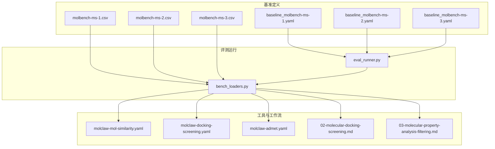
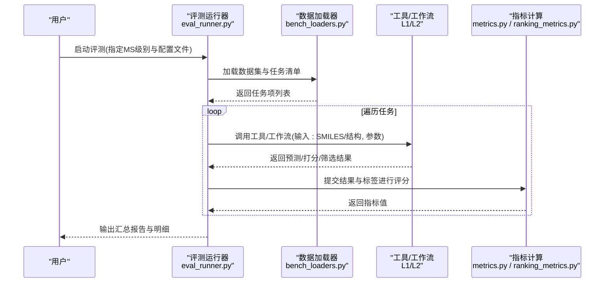
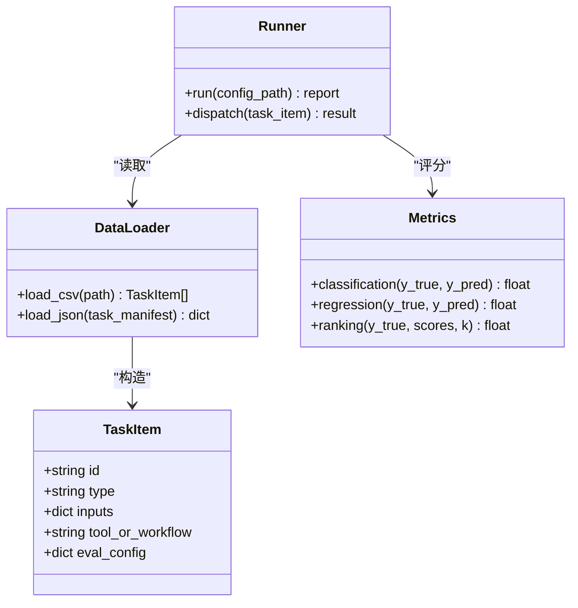
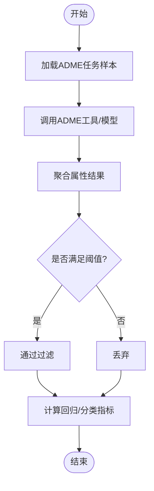
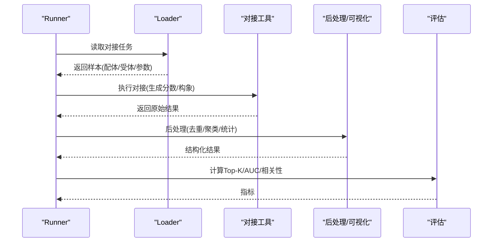
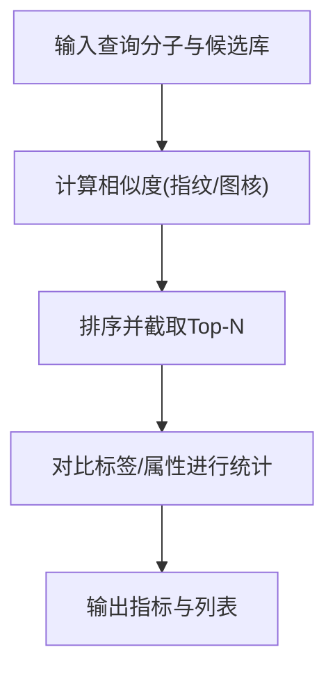
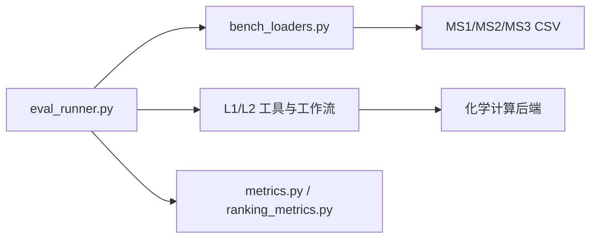

# 药物发现基准测试

<cite>
**本文引用的文件**   
- [autonomy_mvp/core/harness.py](file://autonomy_mvp/core/harness.py)
- [autonomy_mvp/core/metrics.py](file://autonomy_mvp/core/metrics.py)
- [autonomy_mvp/core/ranking_metrics.py](file://autonomy_mvp/core/ranking_metrics.py)
- [autonomy_mvp/core/tasks.py](file://autonomy_mvp/core/tasks.py)
- [autonomy_mvp/tasks/drug_admet.json](file://autonomy_mvp/tasks/drug_admet.json)
- [autonomy_mvp/tasks/drug_screen_ms3.json](file://autonomy_mvp/tasks/drug_screen_ms3.json)
- [docs/prd/molbench_repo/config/README.md](file://docs/prd/molbench_repo/config/README.md)
- [docs/prd/molbench_repo/config/baseline_molbench-ms-1.yaml](file://docs/prd/molbench_repo/config/baseline_molbench-ms-1.yaml)
- [docs/prd/molbench_repo/config/baseline_molbench-ms-2.yaml](file://docs/prd/molbench_repo/config/baseline_molbench-ms-2.yaml)
- [docs/prd/molbench_repo/config/baseline_molbench-ms-3.yaml](file://docs/prd/molbench_repo/config/baseline_molbench-ms-3.yaml)
- [docs/prd/molbench_repo/data_full/molbench-ms-1/molbench-ms-1.csv](file://docs/prd/molbench_repo/data_full/molbench-ms-1/molbench-ms-1.csv)
- [docs/prd/molbench_repo/data_full/molbench-ms-2/molbench-ms-2.csv](file://docs/prd/molbench_repo/data_full/molbench-ms-2/molbench-ms-2.csv)
- [docs/prd/molbench_repo/data_full/molbench-ms-3/molbench-ms-3.csv](file://docs/prd/molbench_repo/data_full/molbench-ms-3/molbench-ms-3.csv)
- [docs/prd/molbench_repo/eval/eval_runner.py](file://docs/prd/molbench_repo/eval/eval_runner.py)
- [docs/prd/molbench_repo/eval/bench_loaders.py](file://docs/prd/molbench_repo/eval/bench_loaders.py)
- [docs/prd/molbench_repo/skills/L1_tools/molclaw-mol-similarity/molclaw-mol-similarity.yaml](file://docs/prd/molbench_repo/skills/L1_tools/molclaw-mol-similarity/molclaw-mol-similarity.yaml)
- [docs/prd/molbench_repo/skills/L1_tools/molclaw-docking-screening/molclaw-docking-screening.yaml](file://docs/prd/molbench_repo/skills/L1_tools/molclaw-docking-screening/molclaw-docking-screening.yaml)
- [docs/prd/molbench_repo/skills/L1_tools/molclaw-admet/molclaw-admet.yaml](file://docs/prd/molbench_repo/skills/L1_tools/molclaw-admet/molclaw-admet.yaml)
- [docs/prd/molbench_repo/skills/L2_workflows/02-molecular-docking-screening.md](file://docs/prd/molbench_repo/skills/L2_workflows/02-molecular-docking-screening.md)
- [docs/prd/molbench_repo/skills/L2_workflows/03-molecular-property-analysis-filtering.md](file://docs/prd/molbench_repo/skills/L2_workflows/03-molecular-property-analysis-filtering.md)
- [docs/prd/molbench_repo/templates/outliners.py](file://docs/prd/molbench_repo/templates/outliners.py)
- [docs/prd/molbench_repo/templates/template.py](file://docs/prd/molbench_repo/templates/template.py)
</cite>

## 目录
1. [引言](#引言)
2. [项目结构](#项目结构)
3. [核心组件](#核心组件)
4. [架构总览](#架构总览)
5. [详细组件分析](#详细组件分析)
6. [依赖关系分析](#依赖关系分析)
7. [性能与可重复性](#性能与可重复性)
8. [故障排查指南](#故障排查指南)
9. [结论](#结论)
10. [附录：任务规范与配置示例](#附录任务规范与配置示例)

## 引言
本文件面向药物发现领域的研究者与工程团队，系统化阐述MolBench基准套件在ADME性质预测、分子对接筛选、药物相似性分析等核心任务上的实现原理、数据结构、评估标准与运行流程。文档同时解释MS1、MS2、MS3三个难度级别的差异与适用场景，并提供输入输出规范、评分指标、结果解读方法以及环境配置与性能优化建议，强调标准化评估对药物研发可重复性与可比性的价值。

## 项目结构
仓库围绕“基准定义—工具技能—评测运行”三层组织：
- 基准定义层：以CSV/JSON描述数据集与任务元信息（MS1/MS2/MS3），并配套YAML基线配置。
- 工具技能层：L1原子工具（如ADME预测、分子相似性、对接筛选）与L2工作流（如对接筛选流水线、性质分析与过滤）。
- 评测运行层：统一的加载器与Runner，负责读取数据、调用工具/工作流、计算指标并汇总报告。

图表来源
- [docs/prd/molbench_repo/data_full/molbench-ms-1/molbench-ms-1.csv](file://docs/prd/molbench_repo/data_full/molbench-ms-1/molbench-ms-1.csv)
- [docs/prd/molbench_repo/data_full/molbench-ms-2/molbench-ms-2.csv](file://docs/prd/molbench_repo/data_full/molbench-ms-2/molbench-ms-2.csv)
- [docs/prd/molbench_repo/data_full/molbench-ms-3/molbench-ms-3.csv](file://docs/prd/molbench_repo/data_full/molbench-ms-3/molbench-ms-3.csv)
- [docs/prd/molbench_repo/config/baseline_molbench-ms-1.yaml](file://docs/prd/molbench_repo/config/baseline_molbench-ms-1.yaml)
- [docs/prd/molbench_repo/config/baseline_molbench-ms-2.yaml](file://docs/prd/molbench_repo/config/baseline_molbench-ms-2.yaml)
- [docs/prd/molbench_repo/config/baseline_molbench-ms-3.yaml](file://docs/prd/molbench_repo/config/baseline_molbench-ms-3.yaml)
- [docs/prd/molbench_repo/eval/eval_runner.py](file://docs/prd/molbench_repo/eval/eval_runner.py)
- [docs/prd/molbench_repo/eval/bench_loaders.py](file://docs/prd/molbench_repo/eval/bench_loaders.py)
- [docs/prd/molbench_repo/skills/L1_tools/molclaw-mol-similarity/molclaw-mol-similarity.yaml](file://docs/prd/molbench_repo/skills/L1_tools/molclaw-mol-similarity/molclaw-mol-similarity.yaml)
- [docs/prd/molbench_repo/skills/L1_tools/molclaw-docking-screening/molclaw-docking-screening.yaml](file://docs/prd/molbench_repo/skills/L1_tools/molclaw-docking-screening/molclaw-docking-screening.yaml)
- [docs/prd/molbench_repo/skills/L1_tools/molclaw-admet/molclaw-admet.yaml](file://docs/prd/molbench_repo/skills/L1_tools/molclaw-admet/molclaw-admet.yaml)
- [docs/prd/molbench_repo/skills/L2_workflows/02-molecular-docking-screening.md](file://docs/prd/molbench_repo/skills/L2_workflows/02-molecular-docking-screening.md)
- [docs/prd/molbench_repo/skills/L2_workflows/03-molecular-property-analysis-filtering.md](file://docs/prd/molbench_repo/skills/L2_workflows/03-molecular-property-analysis-filtering.md)

章节来源
- [docs/prd/molbench_repo/eval/eval_runner.py](file://docs/prd/molbench_repo/eval/eval_runner.py)
- [docs/prd/molbench_repo/eval/bench_loaders.py](file://docs/prd/molbench_repo/eval/bench_loaders.py)
- [docs/prd/molbench_repo/config/README.md](file://docs/prd/molbench_repo/config/README.md)

## 核心组件
- 基准数据与任务定义
  - MS1/MS2/MS3三套CSV数据集，分别对应不同复杂度与约束的任务集合；每个样本包含分子标识、目标蛋白或属性字段、以及可选的参考标签/阈值。
  - 任务清单JSON用于将具体任务映射到工具/工作流与评估函数。
- 工具与工作流
  - L1原子工具：分子相似性、对接筛选、ADME预测等，提供标准化的输入输出契约。
  - L2工作流：组合多个L1工具形成端到端流程（如“对接筛选+性质分析过滤”）。
- 评测运行器
  - 统一入口：解析配置与数据，调度工具/工作流，收集中间产物，计算指标并生成报告。
- 指标体系
  - 分类/回归/排序三类指标，支持Top-K富集、AUC、Pearson/Spearman相关系数、F1/准确率等。

章节来源
- [docs/prd/molbench_repo/data_full/molbench-ms-1/molbench-ms-1.csv](file://docs/prd/molbench_repo/data_full/molbench-ms-1/molbench-ms-1.csv)
- [docs/prd/molbench_repo/data_full/molbench-ms-2/molbench-ms-2.csv](file://docs/prd/molbench_repo/data_full/molbench-ms-2/molbench-ms-2.csv)
- [docs/prd/molbench_repo/data_full/molbench-ms-3/molbench-ms-3.csv](file://docs/prd/molbench_repo/data_full/molbench-ms-3/molbench-ms-3.csv)
- [autonomy_mvp/tasks/drug_admet.json](file://autonomy_mvp/tasks/drug_admet.json)
- [autonomy_mvp/tasks/drug_screen_ms3.json](file://autonomy_mvp/tasks/drug_screen_ms3.json)
- [docs/prd/molbench_repo/skills/L1_tools/molclaw-mol-similarity/molclaw-mol-similarity.yaml](file://docs/prd/molbench_repo/skills/L1_tools/molclaw-mol-similarity/molclaw-mol-similarity.yaml)
- [docs/prd/molbench_repo/skills/L1_tools/molclaw-docking-screening/molclaw-docking-screening.yaml](file://docs/prd/molbench_repo/skills/L1_tools/molclaw-docking-screening/molclaw-docking-screening.yaml)
- [docs/prd/molbench_repo/skills/L1_tools/molclaw-admet/molclaw-admet.yaml](file://docs/prd/molbench_repo/skills/L1_tools/molclaw-admet/molclaw-admet.yaml)
- [docs/prd/molbench_repo/skills/L2_workflows/02-molecular-docking-screening.md](file://docs/prd/molbench_repo/skills/L2_workflows/02-molecular-docking-screening.md)
- [docs/prd/molbench_repo/skills/L2_workflows/03-molecular-property-analysis-filtering.md](file://docs/prd/molbench_repo/skills/L2_workflows/03-molecular-property-analysis-filtering.md)
- [autonomy_mvp/core/metrics.py](file://autonomy_mvp/core/metrics.py)
- [autonomy_mvp/core/ranking_metrics.py](file://autonomy_mvp/core/ranking_metrics.py)

## 架构总览
下图展示从配置到评测运行的端到端流程：Runner读取配置与数据，Loader按任务类型选择工具/工作流，执行后由指标模块计算得分并汇总。

图表来源
- [docs/prd/molbench_repo/eval/eval_runner.py](file://docs/prd/molbench_repo/eval/eval_runner.py)
- [docs/prd/molbench_repo/eval/bench_loaders.py](file://docs/prd/molbench_repo/eval/bench_loaders.py)
- [autonomy_mvp/core/metrics.py](file://autonomy_mvp/core/metrics.py)
- [autonomy_mvp/core/ranking_metrics.py](file://autonomy_mvp/core/ranking_metrics.py)

## 详细组件分析

### 任务与数据模型
- 数据集格式（CSV）
  - 典型列：样本ID、分子表示（SMILES/结构路径）、任务类型、目标/条件、参考标签（如有）、难度等级（MS1/MS2/MS3）。
  - 通过Loader解析为内部任务对象，供Runner调度。
- 任务清单（JSON）
  - 将具体任务名映射到工具/工作流名称、输入键、输出键、评估函数名及阈值/Top-K等超参。
- 模板与大纲
  - 模板系统用于生成任务提示与输出格式，保证跨工具的一致性。

图表来源
- [docs/prd/molbench_repo/data_full/molbench-ms-1/molbench-ms-1.csv](file://docs/prd/molbench_repo/data_full/molbench-ms-1/molbench-ms-1.csv)
- [docs/prd/molbench_repo/data_full/molbench-ms-2/molbench-ms-2.csv](file://docs/prd/molbench_repo/data_full/molbench-ms-2/molbench-ms-2.csv)
- [docs/prd/molbench_repo/data_full/molbench-ms-3/molbench-ms-3.csv](file://docs/prd/molbench_repo/data_full/molbench-ms-3/molbench-ms-3.csv)
- [autonomy_mvp/tasks/drug_admet.json](file://autonomy_mvp/tasks/drug_admet.json)
- [autonomy_mvp/tasks/drug_screen_ms3.json](file://autonomy_mvp/tasks/drug_screen_ms3.json)
- [docs/prd/molbench_repo/eval/bench_loaders.py](file://docs/prd/molbench_repo/eval/bench_loaders.py)
- [docs/prd/molbench_repo/eval/eval_runner.py](file://docs/prd/molbench_repo/eval/eval_runner.py)
- [autonomy_mvp/core/metrics.py](file://autonomy_mvp/core/metrics.py)
- [autonomy_mvp/core/ranking_metrics.py](file://autonomy_mvp/core/ranking_metrics.py)
- [docs/prd/molbench_repo/templates/outliners.py](file://docs/prd/molbench_repo/templates/outliners.py)
- [docs/prd/molbench_repo/templates/template.py](file://docs/prd/molbench_repo/templates/template.py)

章节来源
- [docs/prd/molbench_repo/data_full/molbench-ms-1/molbench-ms-1.csv](file://docs/prd/molbench_repo/data_full/molbench-ms-1/molbench-ms-1.csv)
- [docs/prd/molbench_repo/data_full/molbench-ms-2/molbench-ms-2.csv](file://docs/prd/molbench_repo/data_full/molbench-ms-2/molbench-ms-2.csv)
- [docs/prd/molbench_repo/data_full/molbench-ms-3/molbench-ms-3.csv](file://docs/prd/molbench_repo/data_full/molbench-ms-3/molbench-ms-3.csv)
- [autonomy_mvp/tasks/drug_admet.json](file://autonomy_mvp/tasks/drug_admet.json)
- [autonomy_mvp/tasks/drug_screen_ms3.json](file://autonomy_mvp/tasks/drug_screen_ms3.json)
- [docs/prd/molbench_repo/eval/bench_loaders.py](file://docs/prd/molbench_repo/eval/bench_loaders.py)
- [docs/prd/molbench_repo/eval/eval_runner.py](file://docs/prd/molbench_repo/eval/eval_runner.py)
- [docs/prd/molbench_repo/templates/outliners.py](file://docs/prd/molbench_repo/templates/outliners.py)
- [docs/prd/molbench_repo/templates/template.py](file://docs/prd/molbench_repo/templates/template.py)

### ADME性质预测
- 任务说明
  - 输入：分子SMILES或结构文件；可选靶点/细胞系上下文。
  - 输出：吸收、分布、代谢、排泄、毒性等属性的数值或类别预测。
  - 评估：回归任务常用Pearson/Spearman相关系数、MAE/RMSE；分类任务用AUC/F1。
- 工具与工作流
  - L1工具：molclaw-admet.yaml定义输入键、模型后端、阈值与输出字段。
  - L2工作流：03-molecular-property-analysis-filtering.md串联多属性预测与规则过滤。
- 结果解读
  - 关注各子任务的指标均值与方差；结合领域阈值判断候选是否进入下一轮。

图表来源
- [docs/prd/molbench_repo/skills/L1_tools/molclaw-admet/molclaw-admet.yaml](file://docs/prd/molbench_repo/skills/L1_tools/molclaw-admet/molclaw-admet.yaml)
- [docs/prd/molbench_repo/skills/L2_workflows/03-molecular-property-analysis-filtering.md](file://docs/prd/molbench_repo/skills/L2_workflows/03-molecular-property-analysis-filtering.md)
- [autonomy_mvp/core/metrics.py](file://autonomy_mvp/core/metrics.py)

章节来源
- [docs/prd/molbench_repo/skills/L1_tools/molclaw-admet/molclaw-admet.yaml](file://docs/prd/molbench_repo/skills/L1_tools/molclaw-admet/molclaw-admet.yaml)
- [docs/prd/molbench_repo/skills/L2_workflows/03-molecular-property-analysis-filtering.md](file://docs/prd/molbench_repo/skills/L2_workflows/03-molecular-property-analysis-filtering.md)
- [autonomy_mvp/core/metrics.py](file://autonomy_mvp/core/metrics.py)

### 分子对接筛选
- 任务说明
  - 输入：配体SMILES/结构、受体PDB/复合物、结合口袋参数。
  - 输出：对接分数、排名、构象集合、相互作用特征。
  - 评估：Top-K富集率、AUC、命中率、与实验活性相关性。
- 工具与工作流
  - L1工具：molclaw-docking-screening.yaml定义对接引擎、搜索空间与输出字段。
  - L2工作流：02-molecular-docking-screening.md编排预处理、对接、后处理与筛选。
- 结果解读
  - 结合Top-K富集与相关性指标综合评估；注意不同对接引擎的系统偏差。

图表来源
- [docs/prd/molbench_repo/skills/L1_tools/molclaw-docking-screening/molclaw-docking-screening.yaml](file://docs/prd/molbench_repo/skills/L1_tools/molclaw-docking-screening/molclaw-docking-screening.yaml)
- [docs/prd/molbench_repo/skills/L2_workflows/02-molecular-docking-screening.md](file://docs/prd/molbench_repo/skills/L2_workflows/02-molecular-docking-screening.md)
- [autonomy_mvp/core/ranking_metrics.py](file://autonomy_mvp/core/ranking_metrics.py)

章节来源
- [docs/prd/molbench_repo/skills/L1_tools/molclaw-docking-screening/molclaw-docking-screening.yaml](file://docs/prd/molbench_repo/skills/L1_tools/molclaw-docking-screening/molclaw-docking-screening.yaml)
- [docs/prd/molbench_repo/skills/L2_workflows/02-molecular-docking-screening.md](file://docs/prd/molbench_repo/skills/L2_workflows/02-molecular-docking-screening.md)
- [autonomy_mvp/core/ranking_metrics.py](file://autonomy_mvp/core/ranking_metrics.py)

### 药物相似性分析
- 任务说明
  - 输入：查询分子与候选库（SMILES/结构）。
  - 输出：相似度矩阵或Top-N相似分子列表。
  - 评估：Top-N命中已知活性/类药性分子的比率、平均相似度、多样性保持度。
- 工具与工作流
  - L1工具：molclaw-mol-similarity.yaml定义指纹/图核方法与距离度量。
- 结果解读
  - 结合化学空间覆盖与活性富集双重视角评估。

图表来源
- [docs/prd/molbench_repo/skills/L1_tools/molclaw-mol-similarity/molclaw-mol-similarity.yaml](file://docs/prd/molbench_repo/skills/L1_tools/molclaw-mol-similarity/molclaw-mol-similarity.yaml)
- [autonomy_mvp/core/metrics.py](file://autonomy_mvp/core/metrics.py)

章节来源
- [docs/prd/molbench_repo/skills/L1_tools/molclaw-mol-similarity/molclaw-mol-similarity.yaml](file://docs/prd/molbench_repo/skills/L1_tools/molclaw-mol-similarity/molclaw-mol-similarity.yaml)
- [autonomy_mvp/core/metrics.py](file://autonomy_mvp/core/metrics.py)

### MS1/MS2/MS3难度分级与适用场景
- MS1（基础）
  - 单步任务为主，输入输出明确，适合快速验证工具可用性与基本准确性。
- MS2（进阶）
  - 引入多步骤与简单决策（如阈值过滤、Top-K选择），贴近真实筛选管线。
- MS3（复杂）
  - 多工具协作、长链工作流与更严格的评估，适用于端到端能力与鲁棒性检验。
- 适用场景
  - 教学与入门：MS1
  - 方法对比与调参：MS2
  - 系统集成与压力测试：MS3

章节来源
- [docs/prd/molbench_repo/data_full/molbench-ms-1/molbench-ms-1.csv](file://docs/prd/molbench_repo/data_full/molbench-ms-1/molbench-ms-1.csv)
- [docs/prd/molbench_repo/data_full/molbench-ms-2/molbench-ms-2.csv](file://docs/prd/molbench_repo/data_full/molbench-ms-2/molbench-ms-2.csv)
- [docs/prd/molbench_repo/data_full/molbench-ms-3/molbench-ms-3.csv](file://docs/prd/molbench_repo/data_full/molbench-ms-3/molbench-ms-3.csv)
- [autonomy_mvp/tasks/drug_screen_ms3.json](file://autonomy_mvp/tasks/drug_screen_ms3.json)

## 依赖关系分析
- 组件耦合
  - Runner与Loader松耦合：通过配置与任务清单解耦数据源与调度逻辑。
  - 工具/工作流与指标分离：工具仅负责产生结构化结果，指标模块独立计算。
- 外部依赖
  - 化学信息学工具（对接、性质预测、相似性）通过YAML声明式接入，便于替换与扩展。
- 潜在循环依赖
  - 当前分层清晰，未见循环导入；新增工具应遵循“只读数据、写结果”的契约。

图表来源
- [docs/prd/molbench_repo/eval/eval_runner.py](file://docs/prd/molbench_repo/eval/eval_runner.py)
- [docs/prd/molbench_repo/eval/bench_loaders.py](file://docs/prd/molbench_repo/eval/bench_loaders.py)
- [autonomy_mvp/core/metrics.py](file://autonomy_mvp/core/metrics.py)
- [autonomy_mvp/core/ranking_metrics.py](file://autonomy_mvp/core/ranking_metrics.py)

章节来源
- [docs/prd/molbench_repo/eval/eval_runner.py](file://docs/prd/molbench_repo/eval/eval_runner.py)
- [docs/prd/molbench_repo/eval/bench_loaders.py](file://docs/prd/molbench_repo/eval/bench_loaders.py)
- [autonomy_mvp/core/metrics.py](file://autonomy_mvp/core/metrics.py)
- [autonomy_mvp/core/ranking_metrics.py](file://autonomy_mvp/core/ranking_metrics.py)

## 性能与可重复性
- 并行与批处理
  - 对I/O密集型任务（如批量对接）采用并发执行；合理设置批次大小以避免内存峰值。
- 缓存与复用
  - 对确定性工具（如相似性计算）启用结果缓存，减少重复计算。
- 随机种子与版本锁定
  - 固定随机种子与依赖版本，确保跨平台可重复。
- 资源监控
  - 记录CPU/GPU/内存占用与耗时，定位瓶颈并进行针对性优化。

[本节为通用指导，不直接分析具体文件]

## 故障排查指南
- 常见问题
  - 数据缺失或列名不一致：检查CSV表头与Loader期望字段。
  - 工具参数错误：核对YAML中键名、单位与取值范围。
  - 指标计算异常：确认标签类型（连续/离散）与评估函数匹配。
- 诊断步骤
  - 缩小范围：使用MS1小样本复现问题。
  - 日志定位：查看Runner与工具的中间输出与错误堆栈。
  - 隔离变量：逐一替换工具/工作流定位根因。

章节来源
- [docs/prd/molbench_repo/eval/eval_runner.py](file://docs/prd/molbench_repo/eval/eval_runner.py)
- [docs/prd/molbench_repo/eval/bench_loaders.py](file://docs/prd/molbench_repo/eval/bench_loaders.py)

## 结论
MolBench通过“数据—工具—评测”的分层设计，实现了ADME预测、对接筛选与相似性分析等关键任务的标准化评估。MS1/MS2/MS3三级难度覆盖从入门到复杂的完整谱系，配合明确的输入输出契约与指标体系，显著提升药物发现研究的可重复性与可比性。建议在团队内推广统一配置与报告格式，沉淀最佳实践与工具生态。

## 附录：任务规范与配置示例
- 配置要点
  - 基线配置YAML：指定MS级别、数据路径、工具/工作流、评估指标与超参。
  - 任务清单JSON：定义任务名、输入/输出键、评估函数与阈值。
- 运行流程
  - 准备环境（安装依赖、下载数据）→ 编写/选择配置 → 启动Runner → 查看报告。
- 结果解读
  - 关注总体指标与分任务指标；结合Top-K富集与相关性进行综合判断。

章节来源
- [docs/prd/molbench_repo/config/README.md](file://docs/prd/molbench_repo/config/README.md)
- [docs/prd/molbench_repo/config/baseline_molbench-ms-1.yaml](file://docs/prd/molbench_repo/config/baseline_molbench-ms-1.yaml)
- [docs/prd/molbench_repo/config/baseline_molbench-ms-2.yaml](file://docs/prd/molbench_repo/config/baseline_molbench-ms-2.yaml)
- [docs/prd/molbench_repo/config/baseline_molbench-ms-3.yaml](file://docs/prd/molbench_repo/config/baseline_molbench-ms-3.yaml)
- [docs/prd/molbench_repo/eval/eval_runner.py](file://docs/prd/molbench_repo/eval/eval_runner.py)
- [docs/prd/molbench_repo/eval/bench_loaders.py](file://docs/prd/molbench_repo/eval/bench_loaders.py)