# L1基础工具

<cite>
**本文引用的文件**   
- [molclaw-mol-basic-metrics](file://docs/prd/molbench_repo/skills/L1_tools/molclaw-mol-basic-metrics)
- [molclaw-mol-opt-physchem](file://docs/prd/molbench_repo/skills/L1_tools/molclaw-mol-opt-physchem)
- [molclaw-mol-similarity](file://docs/prd/molbench_repo/skills/L1_tools/molclaw-mol-similarity)
- [molclaw-mol-structure-metrics](file://docs/prd/molbench_repo/skills/L1_tools/molclaw-mol-structure-metrics)
- [molclaw-mol-topology-metrics](file://docs/prd/molbench_repo/skills/L1_tools/molclaw-mol-topology-metrics)
- [molclaw-mol-hbond-metrics](file://docs/prd/molbench_repo/skills/L1_tools/molclaw-mol-hbond-metrics)
- [molclaw-mol-hydrophobicity-metrics](file://docs/prd/molbench_repo/skills/L1_tools/molclaw-mol-hydrophobicity-metrics)
- [molclaw-mol-complexity-metrics](file://docs/prd/molbench_repo/skills/L1_tools/molclaw-mol-complexity-metrics)
- [molclaw-mol-charge-metrics](file://docs/prd/molbench_repo/skills/L1_tools/molclaw-mol-charge-metrics)
- [molclaw-smiles-valid-check](file://docs/prd/molbench_repo/skills/L1_tools/molclaw-smiles-valid-check)
- [molclaw-smiles-fg-editor](file://docs/prd/molbench_repo/skills/L1_tools/molclaw-smiles-fg-editor)
- [molclaw-chroma-toolkit](file://docs/prd/molbench_repo/skills/L1_tools/molclaw-chroma-toolkit)
- [molclaw-compound-retrieve](file://docs/prd/molbench_repo/skills/L1_tools/molclaw-compound-retrieve)
- [molclaw-drug-likeness](file://docs/prd/molbench_repo/skills/L1_tools/molclaw-drug-likeness)
- [molclaw-equiscore-tool](file://docs/prd/molbench_repo/skills/L1_tools/molclaw-equiscore-tool)
- [molclaw-prolif-tool](file://docs/prd/molbench_repo/skills/L1_tools/molclaw-prolif-tool)
- [molclaw-p2rank](file://docs/prd/molbench_repo/skills/L1_tools/molclaw-p2rank)
- [molclaw-docking-screening](file://docs/prd/molbench_repo/skills/L1_tools/molclaw-docking-screening)
- [molclaw-quickvina-docking](file://docs/prd/molbench_repo/skills/L1_tools/molclaw-quickvina-docking)
- [molclaw-prolif-md](file://docs/prd/molbench_repo/skills/L1_tools/molclaw-prolif-md)
- [molclaw-prolif-pdb](file://docs/prd/molbench_repo/skills/L1_tools/molclaw-prolif-pdb)
- [molclaw-prolif-docking](file://docs/prd/molbench_repo/skills/L1_tools/molclaw-prolif-docking)
- [molclaw-protein-openmm](file://docs/prd/molbench_repo/skills/L1_tools/molclaw-protein-openmm)
- [molclaw-protein-sequence-retrieve](file://docs/prd/molbench_repo/skills/L1_tools/molclaw-protein-sequence-retrieve)
- [molclaw-protein-structure-retrieve](file://docs/prd/molbench_repo/skills/L1_tools/molclaw-protein-structure-retrieve)
- [molclaw-interaction-visualizer](file://docs/prd/molbench_repo/skills/L1_tools/molclaw-interaction-visualizer)
- [molclaw-file-transfer](file://docs/prd/molbench_repo/skills/L1_tools/molclaw-file-transfer)
- [molclaw-fix-pdb](file://docs/prd/molbench_repo/skills/L1_tools/molclaw-fix-pdb)
- [molclaw-extract-chains](file://docs/prd/molbench_repo/skills/L1_tools/molclaw-extract-chains)
- [molclaw-pack-sidechains](file://docs/prd/molbench_repo/skills/L1_tools/molclaw-pack-sidechains)
- [molclaw-pulchura-rebuild](file://docs/prd/molbench_repo/skills/L1_tools/molclaw-pulchura-rebuild)
- [molclaw-run-bioemu](file://docs/prd/molbench_repo/skills/L1_tools/molclaw-run-bioemu)
- [molclaw-goca-tool](file://docs/prd/molbench_repo/skills/L1_tools/molclaw-goca-tool)
- [molclaw-evobind-tool](file://docs/prd/molbench_repo/skills/L1_tools/molclaw-evobind-tool)
- [molclaw-karmadock-tool](file://docs/prd/molbench_repo/skills/L1_tools/molclaw-karmadock-tool)
- [molclaw-hdock-tool](file://docs/prd/molbench_repo/skills/L1_tools/molclaw-hdock-tool)
- [molclaw-foldx-tool](file://docs/prd/molbench_repo/skills/L1_tools/molclaw-foldx-tool)
- [molclaw-fpocket-toolkit-base](file://docs/prd/molbench_repo/skills/L1_tools/molclaw-fpocket-toolkit-base)
- [molclaw-fpocket](file://docs/prd/molbench_repo/skills/L1_tools/molclaw-fpocket)
- [molclaw-linker-sampling](file://docs/prd/molbench_repo/skills/L1_tools/molclaw-linker-sampling)
- [molclaw-rgroup-sampling](file://docs/prd/molbench_repo/skills/L1_tools/molclaw-rgroup-sampling)
- [molclaw-mol2mol-sampling](file://docs/prd/molbench_repo/skills/L1_tools/molclaw-mol2mol-sampling)
- [molclaw-denovo-sampling](file://docs/prd/molbench_repo/skills/L1_tools/molclaw-denovo-sampling)
- [molclaw-peptide-sampling](file://docs/prd/molbench_repo/skills/L1_tools/molclaw-peptide-sampling)
- [molclaw-protein-ligand-mmpbsa](file://docs/prd/molbench_repo/skills/L1_tools/molclaw-protein-ligand-mmpbsa)
- [molclaw-protein-protein-mmpbsa](file://docs/prd/molbench_repo/skills/L1_tools/molclaw-protein-protein-mmpbsa)
- [molclaw-admet](file://docs/prd/molbench_repo/skills/L1_tools/molclaw-admet)
- [molclaw-boltz2-affinity](file://docs/prd/molbench_repo/skills/L1_tools/molclaw-boltz2-affinity)
- [molclaw-chai1-predict](file://docs/prd/molbench_repo/skills/L1_tools/molclaw-chai1-predict)
- [molclaw-esmfold](file://docs/prd/molbench_repo/skills/L1_tools/molclaw-esmfold)
- [molclaw-proteinmpnn-tool](file://docs/prd/molbench_repo/skills/L1_tools/molclaw-proteinmpnn-tool)
- [molclaw-scp-server](file://docs/prd/molbench_repo/skills/L1_tools/molclaw-scp-server)
- [molclaw-sequence-valid-check](file://docs/prd/molbench_repo/skills/L1_tools/molclaw-sequence-valid-check)
- [molclaw-skill-template-writer](file://docs/prd/molbench_repo/skills/L1_tools/molclaw-skill-template-writer)
</cite>

## 目录
1. [简介](#简介)
2. [项目结构](#项目结构)
3. [核心组件](#核心组件)
4. [架构总览](#架构总览)
5. [详细组件分析](#详细组件分析)
6. [依赖分析](#依赖分析)
7. [性能考虑](#性能考虑)
8. [故障排查指南](#故障排查指南)
9. [结论](#结论)
10. [附录](#附录)

## 简介
本文件面向L1基础工具的开发者与使用者，系统性梳理分子操作、物理化学计算、数据结构转换等底层科学计算工具的API接口与使用方法。内容覆盖：
- 分子SMILES/PDB/序列的校验、编辑与转换
- 分子描述符与理化性质计算（基于RDKit/OpenBabel）
- 相似性、拓扑、氢键、疏水性、电荷、复杂度等指标
- 对接、口袋识别、相互作用分析与可视化
- 蛋白质序列/结构检索、折叠与突变设计
- 自由能计算（MM-PBSA）、采样与生成
- 工具注册机制、依赖管理与错误处理策略
- 作为上层工作流构建块的最佳实践与性能优化技巧

## 项目结构
L1工具以“技能”为单位组织在统一目录下，每个技能对应一个独立的可复用能力，便于组合成L2工作流。典型结构如下：
- 根目录：skills/L1_tools
- 子目录：按功能域划分（如分子属性、对接、蛋白处理、采样生成等）
- 每个技能包含：入口脚本、参数配置、依赖声明、示例与文档

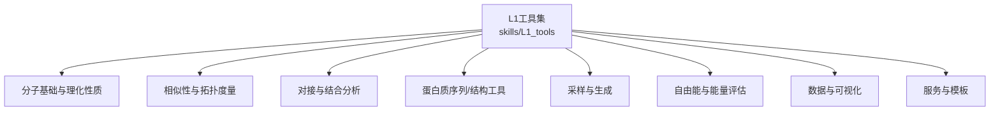

[本节为概念性结构说明，无需来源]

## 核心组件
以下对关键L1工具进行分层解析，涵盖功能特性、输入输出约定、参数要点与调用模式。为避免泄露具体实现细节，本节提供路径引用与使用建议，实际代码请参考各技能目录下的入口文件与README。

- 分子SMILES校验与编辑
  - 功能：SMILES合法性检查、官能团编辑、标准化
  - 输入：SMILES字符串或文件路径；可选过滤规则
  - 输出：布尔结果或经编辑后的SMILES列表
  - 参考路径：
    - [molclaw-smiles-valid-check](file://docs/prd/molbench_repo/skills/L1_tools/molclaw-smiles-valid-check)
    - [molclaw-smiles-fg-editor](file://docs/prd/molbench_repo/skills/L1_tools/molclaw-smiles-fg-editor)

- 分子基础与理化性质
  - 功能：分子量、LogP、HBA/HBD、TPSA、旋转键数、芳香环比例等
  - 输入：SMILES或SDF；可选原子/键级别筛选
  - 输出：结构化JSON（字段名与单位见各工具README）
  - 参考路径：
    - [molclaw-mol-basic-metrics](file://docs/prd/molbench_repo/skills/L1_tools/molclaw-mol-basic-metrics)
    - [molclaw-mol-opt-physchem](file://docs/prd/molbench_repo/skills/L1_tools/molclaw-mol-opt-physchem)

- 相似性与拓扑度量
  - 功能：Tanimoto相似性、指纹类型选择、拓扑指数
  - 输入：一对或多对SMILES/SDF；指纹参数
  - 输出：相似度矩阵或单值
  - 参考路径：
    - [molclaw-mol-similarity](file://docs/prd/molbench_repo/skills/L1_tools/molclaw-mol-similarity)
    - [molclaw-mol-topology-metrics](file://docs/prd/molbench_repo/skills/L1_tools/molclaw-mol-topology-metrics)

- 氢键、疏水性与电荷
  - 功能：氢键供体/受体计数、疏水片段统计、形式电荷分布
  - 输入：分子集合；可选阈值与统计粒度
  - 输出：汇总统计与明细记录
  - 参考路径：
    - [molclaw-mol-hbond-metrics](file://docs/prd/molbench_repo/skills/L1_tools/molclaw-mol-hbond-metrics)
    - [molclaw-mol-hydrophobicity-metrics](file://docs/prd/molbench_repo/skills/L1_tools/molclaw-mol-hydrophobicity-metrics)
    - [molclaw-mol-charge-metrics](file://docs/prd/molbench_repo/skills/L1_tools/molclaw-mol-charge-metrics)

- 复杂度与类药性
  - 功能：合成复杂度评分、类药性规则过滤（如Lipinski）
  - 输入：分子集合；规则阈值
  - 输出：评分与通过/失败标记
  - 参考路径：
    - [molclaw-mol-complexity-metrics](file://docs/prd/molbench_repo/skills/L1_tools/molclaw-mol-complexity-metrics)
    - [molclaw-drug-likeness](file://docs/prd/molbench_repo/skills/L1_tools/molclaw-drug-likeness)

- 化合物检索与外部集成
  - 功能：从数据库/网络源检索化合物信息并转换为内部格式
  - 输入：查询词、ID或批量列表；认证凭据
  - 输出：标准化分子记录
  - 参考路径：
    - [molclaw-compound-retrieve](file://docs/prd/molbench_repo/skills/L1_tools/molclaw-compound-retrieve)
    - [molclaw-chroma-toolkit](file://docs/prd/molbench_repo/skills/L1_tools/molclaw-chroma-toolkit)

- 对接与结合分析
  - 功能：小分子对接、打分、构象搜索、相互作用分析
  - 输入：配体与受体文件；对接参数
  - 输出：对接结果、得分、复合物结构与交互图
  - 参考路径：
    - [molclaw-docking-screening](file://docs/prd/molbench_repo/skills/L1_tools/molclaw-docking-screening)
    - [molclaw-quickvina-docking](file://docs/prd/molbench_repo/skills/L1_tools/molclaw-quickvina-docking)
    - [molclaw-prolif-docking](file://docs/prd/molbench_repo/skills/L1_tools/molclaw-prolif-docking)
    - [molclaw-prolif-tool](file://docs/prd/molbench_repo/skills/L1_tools/molclaw-prolif-tool)
    - [molclaw-equiscore-tool](file://docs/prd/molbench_repo/skills/L1_tools/molclaw-equiscore-tool)

- 蛋白质序列/结构工具
  - 功能：序列/结构检索、修复、链提取、侧链打包、重建
  - 输入：PDB/FASTA；修复/重建选项
  - 输出：清洗后的结构文件或序列
  - 参考路径：
    - [molclaw-protein-sequence-retrieve](file://docs/prd/molbench_repo/skills/L1_tools/molclaw-protein-sequence-retrieve)
    - [molclaw-protein-structure-retrieve](file://docs/prd/molbench_repo/skills/L1_tools/molclaw-protein-structure-retrieve)
    - [molclaw-fix-pdb](file://docs/prd/molbench_repo/skills/L1_tools/molclaw-fix-pdb)
    - [molclaw-extract-chains](file://docs/prd/molbench_repo/skills/L1_tools/molclaw-extract-chains)
    - [molclaw-pack-sidechains](file://docs/prd/molbench_repo/skills/L1_tools/molclaw-pack-sidechains)
    - [molclaw-pulchura-rebuild](file://docs/prd/molbench_repo/skills/L1_tools/molclaw-pulchura-rebuild)

- 采样与生成
  - 功能：连接子/末端基团采样、分子到分子变换、从头设计与多肽采样
  - 输入：骨架/片段定义；约束与采样参数
  - 输出：候选分子集合及质量指标
  - 参考路径：
    - [molclaw-linker-sampling](file://docs/prd/molbench_repo/skills/L1_tools/molclaw-linker-sampling)
    - [molclaw-rgroup-sampling](file://docs/prd/molbench_repo/skills/L1_tools/molclaw-rgroup-sampling)
    - [molclaw-mol2mol-sampling](file://docs/prd/molbench_repo/skills/L1_tools/molclaw-mol2mol-sampling)
    - [molclaw-denovo-sampling](file://docs/prd/molbench_repo/skills/L1_tools/molclaw-denovo-sampling)
    - [molclaw-peptide-sampling](file://docs/prd/molbench_repo/skills/L1_tools/molclaw-peptide-sampling)

- 自由能与能量评估
  - 功能：蛋白-配体/蛋白-蛋白复合物的MM-PBSA计算
  - 输入：轨迹与端点结构；力场与离子强度设置
  - 输出：结合自由能估计与分解报告
  - 参考路径：
    - [molclaw-protein-ligand-mmpbsa](file://docs/prd/molbench_repo/skills/L1_tools/molclaw-protein-ligand-mmpbsa)
    - [molclaw-protein-protein-mmpbsa](file://docs/prd/molbench_repo/skills/L1_tools/molclaw-protein-protein-mmpbsa)

- 预测与建模
  - 功能：亲和力预测、AlphaFold/EsmFold结构预测、MPNN设计
  - 输入：序列或结构；模型权重路径
  - 输出：预测分数或结构文件
  - 参考路径：
    - [molclaw-boltz2-affinity](file://docs/prd/molbench_repo/skills/L1_tools/molclaw-boltz2-affinity)
    - [molclaw-chai1-predict](file://docs/prd/molbench_repo/skills/L1_tools/molclaw-chai1-predict)
    - [molclaw-esmfold](file://docs/prd/molbench_repo/skills/L1_tools/molclaw-esmfold)
    - [molclaw-proteinmpnn-tool](file://docs/prd/molbench_repo/skills/L1_tools/molclaw-proteinmpnn-tool)

- 辅助与服务
  - 功能：文件传输、SCP服务、序列有效性检查、模板生成器
  - 参考路径：
    - [molclaw-file-transfer](file://docs/prd/molbench_repo/skills/L1_tools/molclaw-file-transfer)
    - [molclaw-scp-server](file://docs/prd/molbench_repo/skills/L1_tools/molclaw-scp-server)
    - [molclaw-sequence-valid-check](file://docs/prd/molbench_repo/skills/L1_tools/molclaw-sequence-valid-check)
    - [molclaw-skill-template-writer](file://docs/prd/molbench_repo/skills/L1_tools/molclaw-skill-template-writer)

**章节来源**
- [molclaw-smiles-valid-check](file://docs/prd/molbench_repo/skills/L1_tools/molclaw-smiles-valid-check)
- [molclaw-smiles-fg-editor](file://docs/prd/molbench_repo/skills/L1_tools/molclaw-smiles-fg-editor)
- [molclaw-mol-basic-metrics](file://docs/prd/molbench_repo/skills/L1_tools/molclaw-mol-basic-metrics)
- [molclaw-mol-opt-physchem](file://docs/prd/molbench_repo/skills/L1_tools/molclaw-mol-opt-physchem)
- [molclaw-mol-similarity](file://docs/prd/molbench_repo/skills/L1_tools/molclaw-mol-similarity)
- [molclaw-mol-topology-metrics](file://docs/prd/molbench_repo/skills/L1_tools/molclaw-mol-topology-metrics)
- [molclaw-mol-hbond-metrics](file://docs/prd/molbench_repo/skills/L1_tools/molclaw-mol-hbond-metrics)
- [molclaw-mol-hydrophobicity-metrics](file://docs/prd/molbench_repo/skills/L1_tools/molclaw-mol-hydrophobicity-metrics)
- [molclaw-mol-charge-metrics](file://docs/prd/molbench_repo/skills/L1_tools/molclaw-mol-charge-metrics)
- [molclaw-mol-complexity-metrics](file://docs/prd/molbench_repo/skills/L1_tools/molclaw-mol-complexity-metrics)
- [molclaw-drug-likeness](file://docs/prd/molbench_repo/skills/L1_tools/molclaw-drug-likeness)
- [molclaw-compound-retrieve](file://docs/prd/molbench_repo/skills/L1_tools/molclaw-compound-retrieve)
- [molclaw-chroma-toolkit](file://docs/prd/molbench_repo/skills/L1_tools/molclaw-chroma-toolkit)
- [molclaw-docking-screening](file://docs/prd/molbench_repo/skills/L1_tools/molclaw-docking-screening)
- [molclaw-quickvina-docking](file://docs/prd/molbench_repo/skills/L1_tools/molclaw-quickvina-docking)
- [molclaw-prolif-docking](file://docs/prd/molbench_repo/skills/L1_tools/molclaw-prolif-docking)
- [molclaw-prolif-tool](file://docs/prd/molbench_repo/skills/L1_tools/molclaw-prolif-tool)
- [molclaw-equiscore-tool](file://docs/prd/molbench_repo/skills/L1_tools/molclaw-equiscore-tool)
- [molclaw-protein-sequence-retrieve](file://docs/prd/molbench_repo/skills/L1_tools/molclaw-protein-sequence-retrieve)
- [molclaw-protein-structure-retrieve](file://docs/prd/molbench_repo/skills/L1_tools/molclaw-protein-structure-retrieve)
- [molclaw-fix-pdb](file://docs/prd/molbench_repo/skills/L1_tools/molclaw-fix-pdb)
- [molclaw-extract-chains](file://docs/prd/molbench_repo/skills/L1_tools/molclaw-extract-chains)
- [molclaw-pack-sidechains](file://docs/prd/molbench_repo/skills/L1_tools/molclaw-pack-sidechains)
- [molclaw-pulchura-rebuild](file://docs/prd/molbench_repo/skills/L1_tools/molclaw-pulchura-rebuild)
- [molclaw-linker-sampling](file://docs/prd/molbench_repo/skills/L1_tools/molclaw-linker-sampling)
- [molclaw-rgroup-sampling](file://docs/prd/molbench_repo/skills/L1_tools/molclaw-rgroup-sampling)
- [molclaw-mol2mol-sampling](file://docs/prd/molbench_repo/skills/L1_tools/molclaw-mol2mol-sampling)
- [molclaw-denovo-sampling](file://docs/prd/molbench_repo/skills/L1_tools/molclaw-denovo-sampling)
- [molclaw-peptide-sampling](file://docs/prd/molbench_repo/skills/L1_tools/molclaw-peptide-sampling)
- [molclaw-protein-ligand-mmpbsa](file://docs/prd/molbench_repo/skills/L1_tools/molclaw-protein-ligand-mmpbsa)
- [molclaw-protein-protein-mmpbsa](file://docs/prd/molbench_repo/skills/L1_tools/molclaw-protein-protein-mmpbsa)
- [molclaw-boltz2-affinity](file://docs/prd/molbench_repo/skills/L1_tools/molclaw-boltz2-affinity)
- [molclaw-chai1-predict](file://docs/prd/molbench_repo/skills/L1_tools/molclaw-chai1-predict)
- [molclaw-esmfold](file://docs/prd/molbench_repo/skills/L1_tools/molclaw-esmfold)
- [molclaw-proteinmpnn-tool](file://docs/prd/molbench_repo/skills/L1_tools/molclaw-proteinmpnn-tool)
- [molclaw-file-transfer](file://docs/prd/molbench_repo/skills/L1_tools/molclaw-file-transfer)
- [molclaw-scp-server](file://docs/prd/molbench_repo/skills/L1_tools/molclaw-scp-server)
- [molclaw-sequence-valid-check](file://docs/prd/molbench_repo/skills/L1_tools/molclaw-sequence-valid-check)
- [molclaw-skill-template-writer](file://docs/prd/molbench_repo/skills/L1_tools/molclaw-skill-template-writer)

## 架构总览
L1工具遵循“单一职责、可组合”的设计原则，通过统一的输入输出契约与参数规范，形成稳定的构建块。上层工作流（L2）通过编排这些工具完成端到端任务。

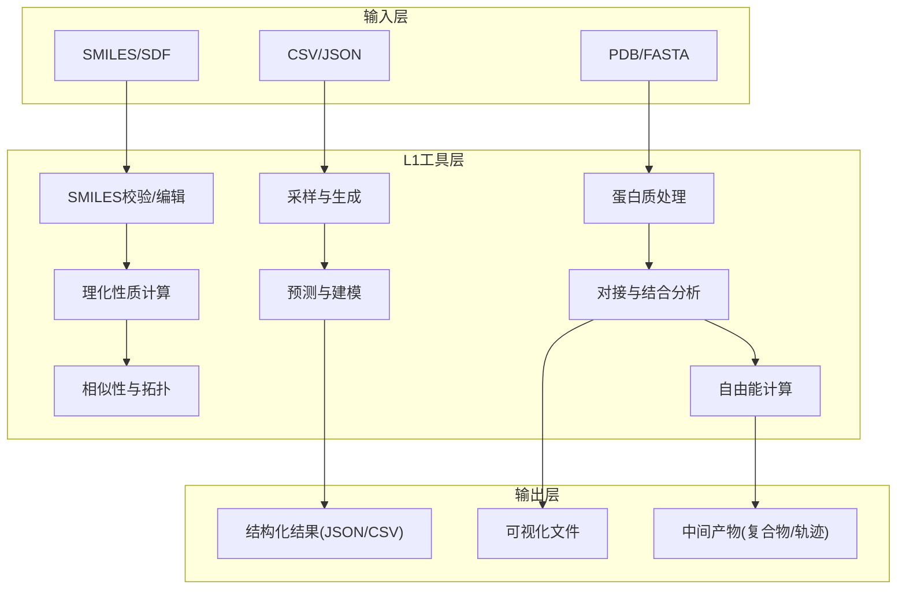

[本节为概念性架构图，无需来源]

## 详细组件分析

### 分子SMILES校验与编辑
- 目标：确保输入分子的合法性并进行必要的编辑（去盐、加氢、价态修正、官能团替换）
- 关键流程
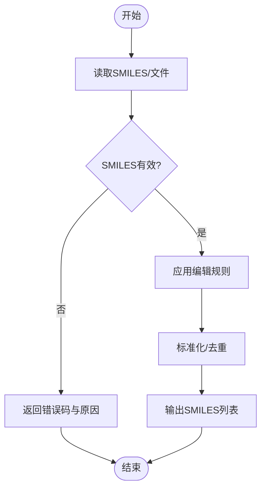

- 参数要点
  - 输入格式：单条SMILES或批量文件
  - 编辑策略：加氢、去溶剂、价态修正、官能团映射
  - 输出：成功/失败状态与结果列表
- 错误处理
  - 非法字符/不合法价态：返回明确错误码
  - 批量处理：跳过失败项并记录日志
- 性能优化
  - 批处理与并行化
  - 缓存已验证的SMILES哈希

**章节来源**
- [molclaw-smiles-valid-check](file://docs/prd/molbench_repo/skills/L1_tools/molclaw-smiles-valid-check)
- [molclaw-smiles-fg-editor](file://docs/prd/molbench_repo/skills/L1_tools/molclaw-smiles-fg-editor)

### 分子基础与理化性质计算
- 目标：计算分子量、LogP、HBA/HBD、TPSA、旋转键数、芳香环比例等
- 关键流程
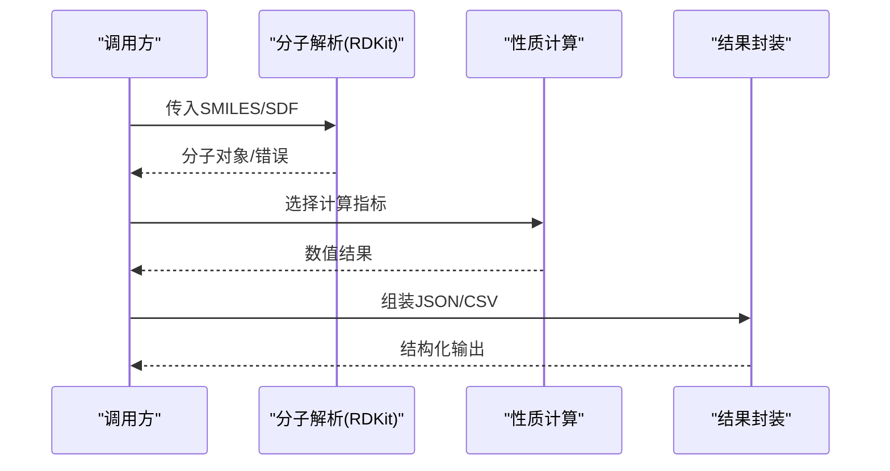

- 参数要点
  - 指标开关：按需启用，减少不必要计算
  - 精度与单位：统一单位与小数位
- 错误处理
  - 解析失败：记录失败条目并继续
  - 缺失属性：填充默认值或标记NaN
- 性能优化
  - 预计算常用描述符
  - 向量化计算与内存池

**章节来源**
- [molclaw-mol-basic-metrics](file://docs/prd/molbench_repo/skills/L1_tools/molclaw-mol-basic-metrics)
- [molclaw-mol-opt-physchem](file://docs/prd/molbench_repo/skills/L1_tools/molclaw-mol-opt-physchem)

### 相似性与拓扑度量
- 目标：计算分子间相似性（Tanimoto等）与拓扑指数
- 关键流程
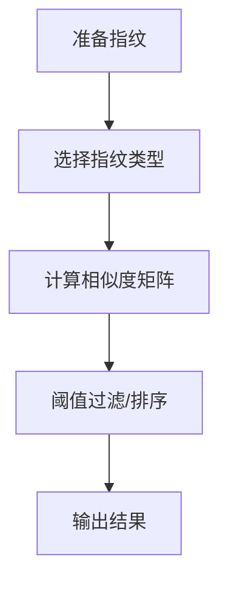

- 参数要点
  - 指纹类型：ECFP/Morgan、MACCS、PubChem等
  - 半径/长度：影响区分度与速度
- 错误处理
  - 空分子/无效指纹：跳过并记录
- 性能优化
  - 分块计算与并行
  - 近似最近邻加速大规模比较

**章节来源**
- [molclaw-mol-similarity](file://docs/prd/molbench_repo/skills/L1_tools/molclaw-mol-similarity)
- [molclaw-mol-topology-metrics](file://docs/prd/molbench_repo/skills/L1_tools/molclaw-mol-topology-metrics)

### 氢键、疏水性与电荷
- 目标：统计氢键供体/受体、疏水片段、形式电荷分布
- 关键流程
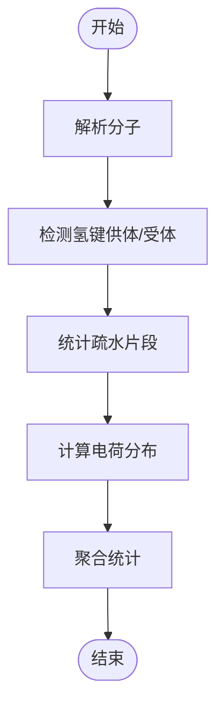

- 参数要点
  - 距离/角度阈值：控制HB判定
  - 疏水片段定义：依据规则或自定义
- 错误处理
  - 异常价态/缺失坐标：回退到默认规则
- 性能优化
  - 向量化的几何判断
  - 增量更新避免重复计算

**章节来源**
- [molclaw-mol-hbond-metrics](file://docs/prd/molbench_repo/skills/L1_tools/molclaw-mol-hbond-metrics)
- [molclaw-mol-hydrophobicity-metrics](file://docs/prd/molbench_repo/skills/L1_tools/molclaw-mol-hydrophobicity-metrics)
- [molclaw-mol-charge-metrics](file://docs/prd/molbench_repo/skills/L1_tools/molclaw-mol-charge-metrics)

### 复杂度与类药性
- 目标：评估合成复杂度与类药性规则符合度
- 关键流程
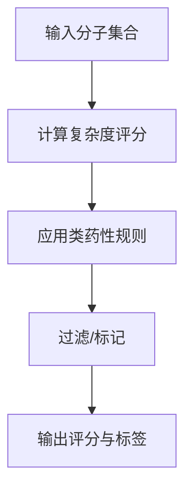

- 参数要点
  - 复杂度算法：基于拓扑/合成树
  - 规则阈值：Lipinski等
- 错误处理
  - 非法结构：跳过并记录
- 性能优化
  - 规则短路评估
  - 批量预处理

**章节来源**
- [molclaw-mol-complexity-metrics](file://docs/prd/molbench_repo/skills/L1_tools/molclaw-mol-complexity-metrics)
- [molclaw-drug-likeness](file://docs/prd/molbench_repo/skills/L1_tools/molclaw-drug-likeness)

### 对接与结合分析
- 目标：执行小分子对接、打分、构象搜索与相互作用分析
- 关键流程
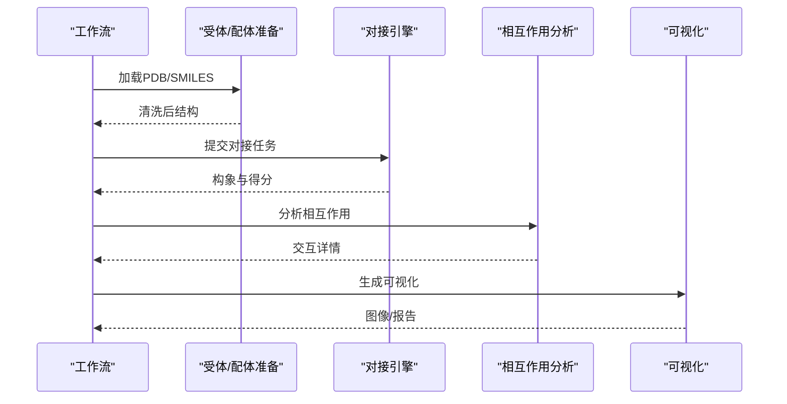

- 参数要点
  - 搜索空间/步长/构象上限
  - 打分函数与力场
- 错误处理
  - 缺原子/冲突：自动修复或报错
- 性能优化
  - 并行对接与结果合并
  - 缓存中间结构

**章节来源**
- [molclaw-docking-screening](file://docs/prd/molbench_repo/skills/L1_tools/molclaw-docking-screening)
- [molclaw-quickvina-docking](file://docs/prd/molbench_repo/skills/L1_tools/molclaw-quickvina-docking)
- [molclaw-prolif-docking](file://docs/prd/molbench_repo/skills/L1_tools/molclaw-prolif-docking)
- [molclaw-prolif-tool](file://docs/prd/molbench_repo/skills/L1_tools/molclaw-prolif-tool)
- [molclaw-equiscore-tool](file://docs/prd/molbench_repo/skills/L1_tools/molclaw-equiscore-tool)

### 蛋白质序列/结构工具
- 目标：序列/结构检索、修复、链提取、侧链打包与重建
- 关键流程
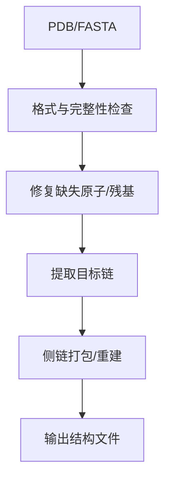

- 参数要点
  - 修复策略：最小扰动优先
  - 链选择：按命名或索引
- 错误处理
  - 严重损坏：提示人工干预
- 性能优化
  - 惰性加载大文件
  - 并行处理多链

**章节来源**
- [molclaw-protein-sequence-retrieve](file://docs/prd/molbench_repo/skills/L1_tools/molclaw-protein-sequence-retrieve)
- [molclaw-protein-structure-retrieve](file://docs/prd/molbench_repo/skills/L1_tools/molclaw-protein-structure-retrieve)
- [molclaw-fix-pdb](file://docs/prd/molbench_repo/skills/L1_tools/molclaw-fix-pdb)
- [molclaw-extract-chains](file://docs/prd/molbench_repo/skills/L1_tools/molclaw-extract-chains)
- [molclaw-pack-sidechains](file://docs/prd/molbench_repo/skills/L1_tools/molclaw-pack-sidechains)
- [molclaw-pulchura-rebuild](file://docs/prd/molbench_repo/skills/L1_tools/molclaw-pulchura-rebuild)

### 采样与生成
- 目标：连接子/末端基团采样、分子到分子变换、从头设计与多肽采样
- 关键流程
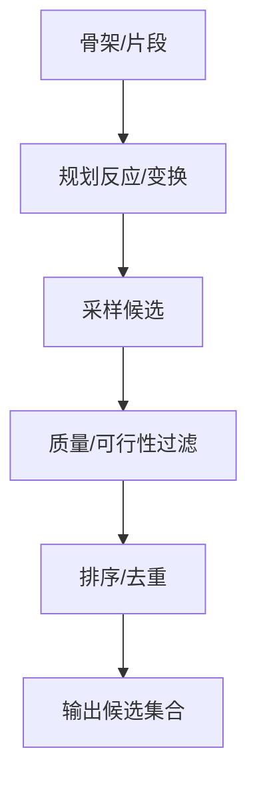

- 参数要点
  - 反应库/模板
  - 多样性与新颖性约束
- 错误处理
  - 无效反应：回退或跳过
- 性能优化
  - 并行采样与早停策略

**章节来源**
- [molclaw-linker-sampling](file://docs/prd/molbench_repo/skills/L1_tools/molclaw-linker-sampling)
- [molclaw-rgroup-sampling](file://docs/prd/molbench_repo/skills/L1_tools/molclaw-rgroup-sampling)
- [molclaw-mol2mol-sampling](file://docs/prd/molbench_repo/skills/L1_tools/molclaw-mol2mol-sampling)
- [molclaw-denovo-sampling](file://docs/prd/molbench_repo/skills/L1_tools/molclaw-denovo-sampling)
- [molclaw-peptide-sampling](file://docs/prd/molbench_repo/skills/L1_tools/molclaw-peptide-sampling)

### 自由能与能量评估
- 目标：MM-PBSA计算结合自由能与分解
- 关键流程
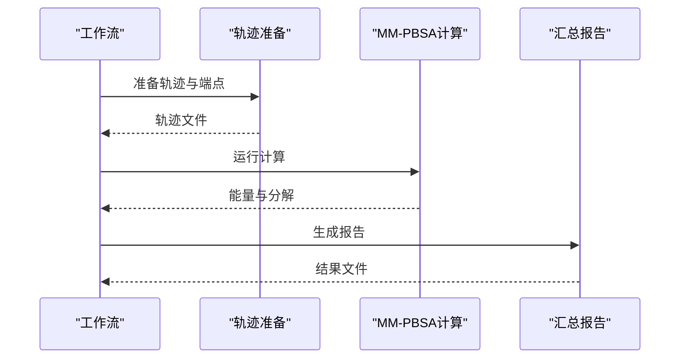

- 参数要点
  - 采样间隔、介电常数、离子强度
- 错误处理
  - 轨迹断裂：插值或丢弃
- 性能优化
  - 分布式计算与I/O缓冲

**章节来源**
- [molclaw-protein-ligand-mmpbsa](file://docs/prd/molbench_repo/skills/L1_tools/molclaw-protein-ligand-mmpbsa)
- [molclaw-protein-protein-mmpbsa](file://docs/prd/molbench_repo/skills/L1_tools/molclaw-protein-protein-mmpbsa)

### 预测与建模
- 目标：亲和力预测、结构预测与序列设计
- 关键流程
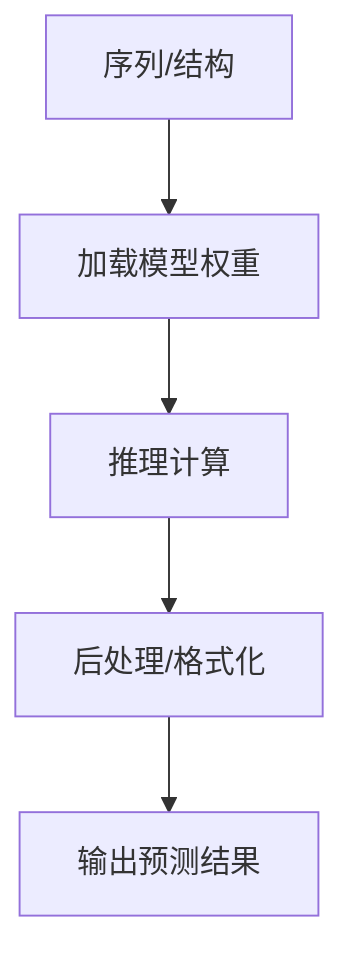

- 参数要点
  - 设备/GPU选择、批次大小
- 错误处理
  - 权重缺失：回退或报错
- 性能优化
  - 批推理与混合精度

**章节来源**
- [molclaw-boltz2-affinity](file://docs/prd/molbench_repo/skills/L1_tools/molclaw-boltz2-affinity)
- [molclaw-chai1-predict](file://docs/prd/molbench_repo/skills/L1_tools/molclaw-chai1-predict)
- [molclaw-esmfold](file://docs/prd/molbench_repo/skills/L1_tools/molclaw-esmfold)
- [molclaw-proteinmpnn-tool](file://docs/prd/molbench_repo/skills/L1_tools/molclaw-proteinmpnn-tool)

### 辅助与服务
- 目标：文件传输、SCP服务、序列有效性检查、模板生成
- 关键点
  - 安全传输与权限控制
  - 模板自动化生成以提升一致性
- 参考路径：
  - [molclaw-file-transfer](file://docs/prd/molbench_repo/skills/L1_tools/molclaw-file-transfer)
  - [molclaw-scp-server](file://docs/prd/molbench_repo/skills/L1_tools/molclaw-scp-server)
  - [molclaw-sequence-valid-check](file://docs/prd/molbench_repo/skills/L1_tools/molclaw-sequence-valid-check)
  - [molclaw-skill-template-writer](file://docs/prd/molbench_repo/skills/L1_tools/molclaw-skill-template-writer)

**章节来源**
- [molclaw-file-transfer](file://docs/prd/molbench_repo/skills/L1_tools/molclaw-file-transfer)
- [molclaw-scp-server](file://docs/prd/molbench_repo/skills/L1_tools/molclaw-scp-server)
- [molclaw-sequence-valid-check](file://docs/prd/molbench_repo/skills/L1_tools/molclaw-sequence-valid-check)
- [molclaw-skill-template-writer](file://docs/prd/molbench_repo/skills/L1_tools/molclaw-skill-template-writer)

## 依赖分析
- 外部依赖
  - RDKit：分子解析、描述符、指纹、基本操作
  - OpenBabel：格式转换、补充计算
  - 对接/动力学/预测工具：QuickVina、PROLIF、EQuiScore、OpenMM、ESMFold等
- 依赖管理方式
  - 每技能独立环境声明与版本锁定
  - 共享依赖通过容器或虚拟环境统一管理
- 耦合与内聚
  - 低耦合：工具间通过标准输入输出契约通信
  - 高内聚：每个技能聚焦单一领域能力

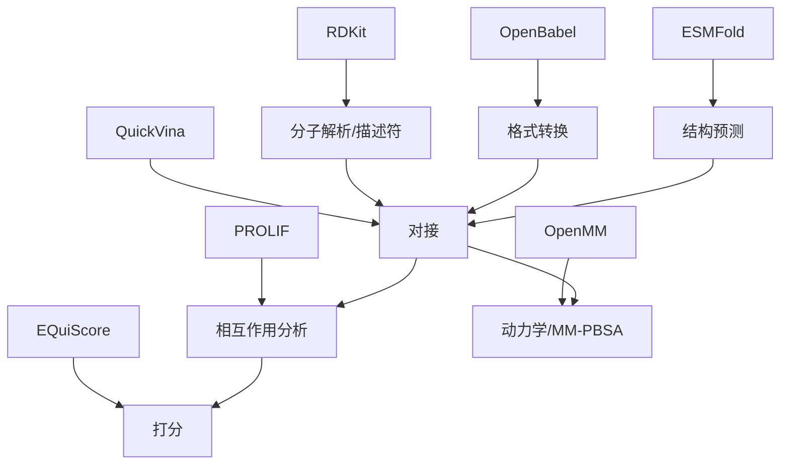

**章节来源**
- [molclaw-mol-basic-metrics](file://docs/prd/molbench_repo/skills/L1_tools/molclaw-mol-basic-metrics)
- [molclaw-mol-opt-physchem](file://docs/prd/molbench_repo/skills/L1_tools/molclaw-mol-opt-physchem)
- [molclaw-mol-similarity](file://docs/prd/molbench_repo/skills/L1_tools/molclaw-mol-similarity)
- [molclaw-mol-topology-metrics](file://docs/prd/molbench_repo/skills/L1_tools/molclaw-mol-topology-metrics)
- [molclaw-mol-hbond-metrics](file://docs/prd/molbench_repo/skills/L1_tools/molclaw-mol-hbond-metrics)
- [molclaw-mol-hydrophobicity-metrics](file://docs/prd/molbench_repo/skills/L1_tools/molclaw-mol-hydrophobicity-metrics)
- [molclaw-mol-charge-metrics](file://docs/prd/molbench_repo/skills/L1_tools/molclaw-mol-charge-metrics)
- [molclaw-mol-complexity-metrics](file://docs/prd/molbench_repo/skills/L1_tools/molclaw-mol-complexity-metrics)
- [molclaw-drug-likeness](file://docs/prd/molbench_repo/skills/L1_tools/molclaw-drug-likeness)
- [molclaw-docking-screening](file://docs/prd/molbench_repo/skills/L1_tools/molclaw-docking-screening)
- [molclaw-quickvina-docking](file://docs/prd/molbench_repo/skills/L1_tools/molclaw-quickvina-docking)
- [molclaw-prolif-docking](file://docs/prd/molbench_repo/skills/L1_tools/molclaw-prolif-docking)
- [molclaw-prolif-tool](file://docs/prd/molbench_repo/skills/L1_tools/molclaw-prolif-tool)
- [molclaw-equiscore-tool](file://docs/prd/molbench_repo/skills/L1_tools/molclaw-equiscore-tool)
- [molclaw-protein-ligand-mmpbsa](file://docs/prd/molbench_repo/skills/L1_tools/molclaw-protein-ligand-mmpbsa)
- [molclaw-protein-protein-mmpbsa](file://docs/prd/molbench_repo/skills/L1_tools/molclaw-protein-protein-mmpbsa)
- [molclaw-esmfold](file://docs/prd/molbench_repo/skills/L1_tools/molclaw-esmfold)

## 性能考虑
- 批处理与并行化
  - 分子级任务采用并行队列与进程池
  - 对接/动力学任务按节点/GPU资源分配
- 缓存与去重
  - SMILES哈希缓存避免重复计算
  - 中间结构/轨迹复用
- I/O优化
  - 流式读写大文件
  - 压缩与异步传输
- 内存管理
  - 对象池与惰性加载
  - 及时释放临时对象
- 精度与速度权衡
  - 快速初筛+精算二次筛选
  - 近似算法用于大规模比较

[本节为通用指导，无需来源]

## 故障排查指南
- 常见错误
  - 输入格式不合法：检查SMILES/PDB语法与编码
  - 依赖缺失：确认环境安装与版本兼容
  - 资源不足：调整批次大小与并发度
- 诊断步骤
  - 查看工具日志与错误码
  - 最小化输入复现问题
  - 逐步禁用非必需计算定位瓶颈
- 恢复策略
  - 自动重试与断点续跑
  - 降级模式与回退算法

**章节来源**
- [molclaw-smiles-valid-check](file://docs/prd/molbench_repo/skills/L1_tools/molclaw-smiles-valid-check)
- [molclaw-sequence-valid-check](file://docs/prd/molbench_repo/skills/L1_tools/molclaw-sequence-valid-check)
- [molclaw-file-transfer](file://docs/prd/molbench_repo/skills/L1_tools/molclaw-file-transfer)

## 结论
L1基础工具以模块化、标准化的方式提供分子操作、理化计算、对接与分析等核心能力，构成上层工作流的稳定基石。通过清晰的输入输出契约、完善的错误处理与性能优化策略，这些工具能够高效组合，支撑从初筛到精算的完整科研闭环。

[本节为总结性内容，无需来源]

## 附录
- 工具注册机制
  - 统一注册表：每个技能暴露元数据（名称、版本、参数、依赖）
  - 动态发现：工作流启动时扫描并加载可用工具
  - 版本兼容：语义化版本与向后兼容策略
- 依赖管理方式
  - 环境隔离：容器/虚拟环境
  - 依赖锁定：固定第三方包版本
  - 共享库：公共模块集中维护与升级
- 最佳实践
  - 幂等设计：相同输入产生相同输出
  - 可观测性：结构化日志与指标上报
  - 可测试性：单元测试与回归用例

[本节为概念性指导，无需来源]