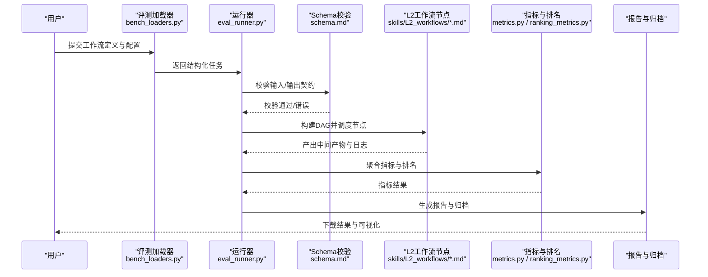
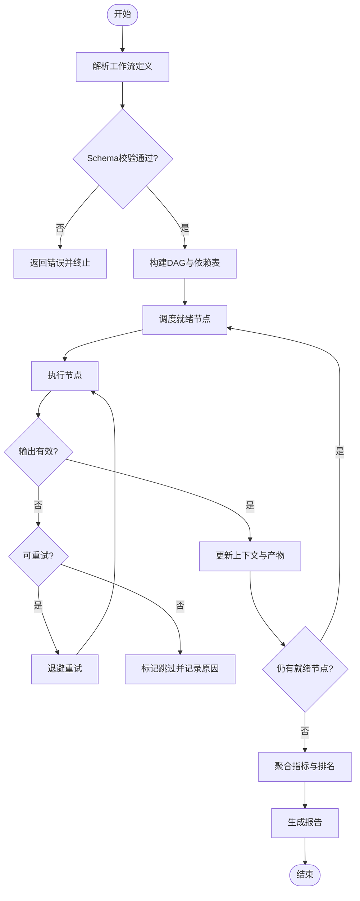
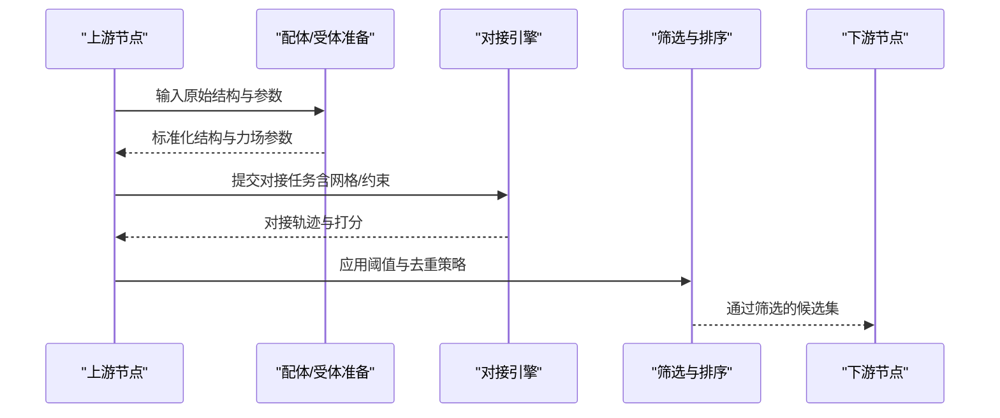
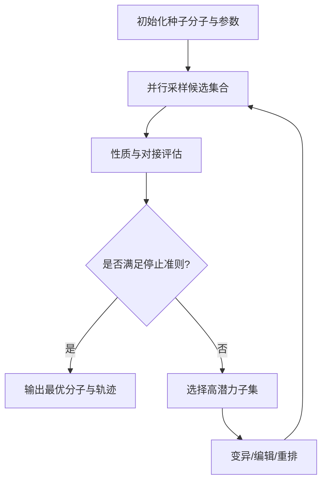
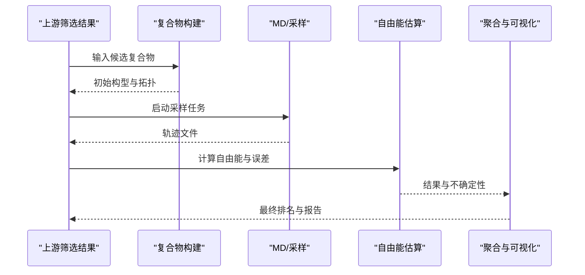
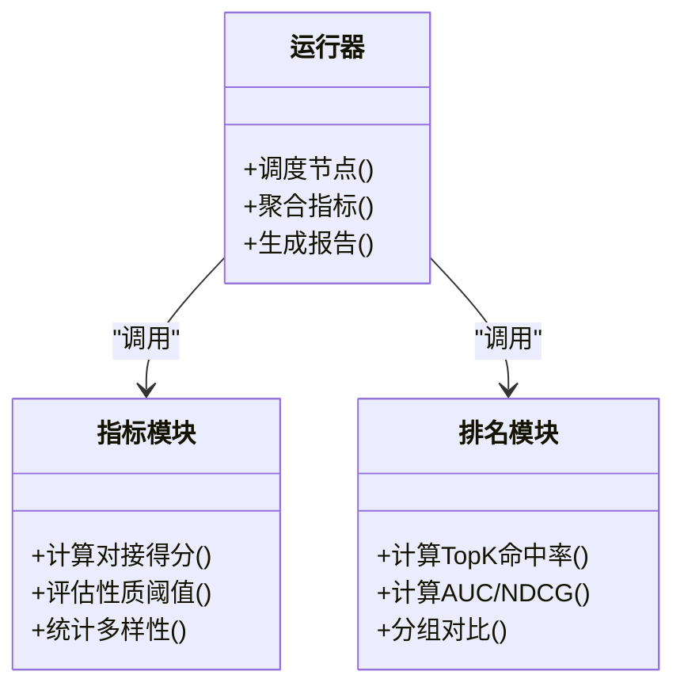
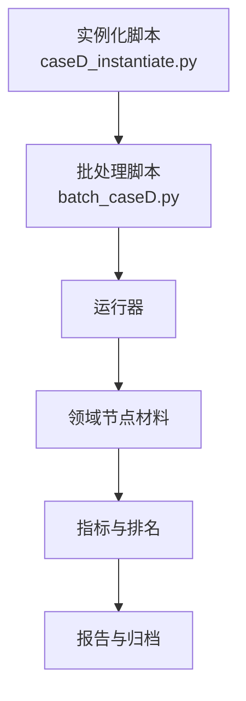
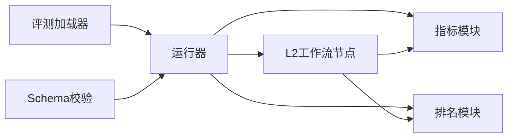

# L2工作流工具

<cite>
**本文引用的文件**   
- [autonomy_mvp/core/harness.py](file://autonomy_mvp/core/harness.py)
- [autonomy_mvp/core/interruption.py](file://autonomy_mvp/core/interruption.py)
- [autonomy_mvp/core/judge.py](file://autonomy_mvp/core/judge.py)
- [autonomy_mvp/core/metrics.py](file://autonomy_mvp/core/metrics.py)
- [autonomy_mvp/core/ranking_metrics.py](file://autonomy_mvp/core/ranking_metrics.py)
- [autonomy_mvp/core/sim_agents.py](file://autonomy_mvp/core/sim_agents.py)
- [autonomy_mvp/core/tasks.py](file://autonomy_mvp/core/tasks.py)
- [autonomy_mvp/run_validation.py](file://autonomy_mvp/run_validation.py)
- [autonomy_mvp/schema.md](file://autonomy_mvp/schema.md)
- [autonomy_mvp/ACCEPTANCE.md](file://autonomy_mvp/ACCEPTANCE.md)
- [docs/prd/molbench_repo/skills/L2_workflows/01-target-protein-preparation.md](file://docs/prd/molbench_repo/skills/L2_workflows/01-target-protein-preparation.md)
- [docs/prd/molbench_repo/skills/L2_workflows/02-molecular-docking-screening.md](file://docs/prd/molbench_repo/skills/L2_workflows/02-molecular-docking-screening.md)
- [docs/prd/molbench_repo/skills/L2_workflows/03-molecular-property-analysis-filtering.md](file://docs/prd/molbench_repo/skills/L2_workflows/03-molecular-property-analysis-filtering.md)
- [docs/prd/molbench_repo/skills/L2_workflows/04-generative-molecular-design.md](file://docs/prd/molbench_repo/skills/L2_workflows/04-generative-molecular-design.md)
- [docs/prd/molbench_repo/skills/L2_workflows/05-iterative-molecular-optimization.md](file://docs/prd/molbench_repo/skills/L2_workflows/05-iterative-molecular-optimization.md)
- [docs/prd/molbench_repo/skills/L2_workflows/06-binding-free-energy-calculation.md](file://docs/prd/molbench_repo/skills/L2_workflows/06-binding-free-energy-calculation.md)
- [docs/prd/molbench_repo/skills/L2_workflows/07-conformational-sampling-analysis.md](file://docs/prd/molbench_repo/skills/L2_workflows/07-conformational-sampling-analysis.md)
- [docs/prd/molbench_repo/skills/L2_workflows/08-post-docking-evaluation.md](file://docs/prd/molbench_repo/skills/L2_workflows/08-post-docking-evaluation.md)
- [docs/prd/molbench_repo/config/baseline_molbench-ms-1.yaml](file://docs/prd/molbench_repo/config/baseline_molbench-ms-1.yaml)
- [docs/prd/molbench_repo/config/baseline_molbench-ms-2.yaml](file://docs/prd/molbench_repo/config/baseline_molbench-ms-2.yaml)
- [docs/prd/molbench_repo/config/baseline_molbench-ms-3.yaml](file://docs/prd/molbench_repo/config/baseline_molbench-ms-3.yaml)
- [docs/prd/molbench_repo/config/chemcot_mo_edit.yaml](file://docs/prd/molbench_repo/config/chemcot_mo_edit.yaml)
- [docs/prd/molbench_repo/config/chemcot_mo_opt.yaml](file://docs/prd/molbench_repo/config/chemcot_mo_opt.yaml)
- [docs/prd/molbench_repo/config/claude_template.yaml](file://docs/prd/molbench_repo/config/claude_template.yaml)
- [docs/prd/molbench_repo/eval/eval_runner.py](file://docs/prd/molbench_repo/eval/eval_runner.py)
- [docs/prd/molbench_repo/eval/bench_loaders.py](file://docs/prd/molbench_repo/eval/bench_loaders.py)
- [docs/prd/molbench_repo/eval/run_eval_bench.py](file://docs/prd/molbench_repo/eval/run_eval_bench.py)
- [longhorizon/instantiate/caseD_instantiate.py](file://longhorizon/instantiate/caseD_instantiate.py)
- [longhorizon/instantiate/batch_caseD.py](file://longhorizon/instantiate/batch_caseD.py)
</cite>

## 目录
1. [引言](#引言)
2. [项目结构](#项目结构)
3. [核心组件](#核心组件)
4. [架构总览](#架构总览)
5. [详细组件分析](#详细组件分析)
6. [依赖关系分析](#依赖关系分析)
7. [性能考虑](#性能考虑)
8. [故障排查指南](#故障排查指南)
9. [结论](#结论)
10. [附录](#附录)

## 引言
本文件面向L2工作流工具，聚焦于分子对接筛选、迭代分子优化、结合自由能计算等高级科学工作流的编排与执行机制。文档从系统架构、数据流转、条件分支与并行执行入手，给出工作流定义格式、节点连接规则与状态管理机制的说明，并提供从需求分析到部署上线的全流程开发指南，以及监控、调试与性能调优的最佳实践。通过标准化与自动化，提升科学研究的可重复性与效率。

## 项目结构
仓库围绕“能力层（L1技能）—编排层（L2工作流）—评测与基准（MolBench）—长周期案例（LongHorizon）”组织：
- 编排与评测内核位于 autonomy_mvp 与 docs/prd/molbench_repo/eval 下，提供任务加载、运行器、指标与排名评估能力。
- L2工作流定义集中于 docs/prd/molbench_repo/skills/L2_workflows，覆盖靶点准备、对接筛选、性质过滤、生成设计、迭代优化、自由能计算、构象采样与后处理评估等步骤。
- 配置与模板位于 docs/prd/molbench_repo/config，包含多套基线与模板化参数。
- 长周期闭环案例位于 longhorizon/instantiate，展示复杂实验场景的实例化与批处理。

```mermaid
graph TB
subgraph "编排与评测内核"
H["harness.py"]
J["judge.py"]
M["metrics.py"]
RM["ranking_metrics.py"]
T["tasks.py"]
SA["sim_agents.py"]
INT["interruption.py"]
RV["run_validation.py"]
end
subgraph "L2工作流定义"
W1["01-靶点蛋白准备.md"]
W2["02-分子对接筛选.md"]
W3["03-分子性质分析与过滤.md"]
W4["04-生成式分子设计.md"]
W5["05-迭代分子优化.md"]
W6["06-结合自由能计算.md"]
W7["07-构象采样分析.md"]
W8["08-对接后评估.md"]
end
subgraph "配置与模板"
C1["baseline_molbench-ms-1.yaml"]
C2["baseline_molbench-ms-2.yaml"]
C3["baseline_molbench-ms-3.yaml"]
CE["chemcot_mo_edit.yaml"]
CO["chemcot_mo_opt.yaml"]
CT["claude_template.yaml"]
end
subgraph "评测与基准"
ER["eval_runner.py"]
BL["bench_loaders.py"]
RE["run_eval_bench.py"]
end
subgraph "长周期案例"
CD["caseD_instantiate.py"]
BCD["batch_caseD.py"]
end
H --> ER
J --> ER
M --> ER
RM --> ER
T --> ER
SA --> ER
INT --> ER
RV --> ER
W1 --> ER
W2 --> ER
W3 --> ER
W4 --> ER
W5 --> ER
W6 --> ER
W7 --> ER
W8 --> ER
C1 --> ER
C2 --> ER
C3 --> ER
CE --> ER
CO --> ER
CT --> ER
CD --> ER
BCD --> ER
```

图表来源
- [autonomy_mvp/core/harness.py](file://autonomy_mvp/core/harness.py)
- [autonomy_mvp/core/judge.py](file://autonomy_mvp/core/judge.py)
- [autonomy_mvp/core/metrics.py](file://autonomy_mvp/core/metrics.py)
- [autonomy_mvp/core/ranking_metrics.py](file://autonomy_mvp/core/ranking_metrics.py)
- [autonomy_mvp/core/tasks.py](file://autonomy_mvp/core/tasks.py)
- [autonomy_mvp/core/sim_agents.py](file://autonomy_mvp/core/sim_agents.py)
- [autonomy_mvp/core/interruption.py](file://autonomy_mvp/core/interruption.py)
- [autonomy_mvp/run_validation.py](file://autonomy_mvp/run_validation.py)
- [docs/prd/molbench_repo/skills/L2_workflows/01-target-protein-preparation.md](file://docs/prd/molbench_repo/skills/L2_workflows/01-target-protein-preparation.md)
- [docs/prd/molbench_repo/skills/L2_workflows/02-molecular-docking-screening.md](file://docs/prd/molbench_repo/skills/L2_workflows/02-molecular-docking-screening.md)
- [docs/prd/molbench_repo/skills/L2_workflows/03-molecular-property-analysis-filtering.md](file://docs/prd/molbench_repo/skills/L2_workflows/03-molecular-property-analysis-filtering.md)
- [docs/prd/molbench_repo/skills/L2_workflows/04-generative-molecular-design.md](file://docs/prd/molbench_repo/skills/L2_workflows/04-generative-molecular-design.md)
- [docs/prd/molbench_repo/skills/L2_workflows/05-iterative-molecular-optimization.md](file://docs/prd/molbench_repo/skills/L2_workflows/05-iterative-molecular-optimization.md)
- [docs/prd/molbench_repo/skills/L2_workflows/06-binding-free-energy-calculation.md](file://docs/prd/molbench_repo/skills/L2_workflows/06-binding-free-energy-calculation.md)
- [docs/prd/molbench_repo/skills/L2_workflows/07-conformational-sampling-analysis.md](file://docs/prd/molbench_repo/skills/L2_workflows/07-conformational-sampling-analysis.md)
- [docs/prd/molbench_repo/skills/L2_workflows/08-post-docking-evaluation.md](file://docs/prd/molbench_repo/skills/L2_workflows/08-post-docking-evaluation.md)
- [docs/prd/molbench_repo/config/baseline_molbench-ms-1.yaml](file://docs/prd/molbench_repo/config/baseline_molbench-ms-1.yaml)
- [docs/prd/molbench_repo/config/baseline_molbench-ms-2.yaml](file://docs/prd/molbench_repo/config/baseline_molbench-ms-2.yaml)
- [docs/prd/molbench_repo/config/baseline_molbench-ms-3.yaml](file://docs/prd/molbench_repo/config/baseline_molbench-ms-3.yaml)
- [docs/prd/molbench_repo/config/chemcot_mo_edit.yaml](file://docs/prd/molbench_repo/config/chemcot_mo_edit.yaml)
- [docs/prd/molbench_repo/config/chemcot_mo_opt.yaml](file://docs/prd/molbench_repo/config/chemcot_mo_opt.yaml)
- [docs/prd/molbench_repo/config/claude_template.yaml](file://docs/prd/molbench_repo/config/claude_template.yaml)
- [docs/prd/molbench_repo/eval/eval_runner.py](file://docs/prd/molbench_repo/eval/eval_runner.py)
- [docs/prd/molbench_repo/eval/bench_loaders.py](file://docs/prd/molbench_repo/eval/bench_loaders.py)
- [docs/prd/molbench_repo/eval/run_eval_bench.py](file://docs/prd/molbench_repo/eval/run_eval_bench.py)
- [longhorizon/instantiate/caseD_instantiate.py](file://longhorizon/instantiate/caseD_instantiate.py)
- [longhorizon/instantiate/batch_caseD.py](file://longhorizon/instantiate/batch_caseD.py)

章节来源
- [autonomy_mvp/schema.md](file://autonomy_mvp/schema.md)
- [autonomy_mvp/ACCEPTANCE.md](file://autonomy_mvp/ACCEPTANCE.md)
- [docs/prd/molbench_repo/eval/eval_runner.py](file://docs/prd/molbench_repo/eval/eval_runner.py)
- [docs/prd/molbench_repo/eval/bench_loaders.py](file://docs/prd/molbench_repo/eval/bench_loaders.py)
- [docs/prd/molbench_repo/eval/run_eval_bench.py](file://docs/prd/molbench_repo/eval/run_eval_bench.py)

## 核心组件
- 编排与调度
  - 运行器负责解析工作流定义、构建有向无环图（DAG）、管理节点生命周期与状态机、协调输入输出与资源分配。
  - 中断与恢复支持在长时间运行的科学计算中安全暂停与续跑。
- 评测与指标
  - 指标模块提供对接打分、性质阈值、排序与排名统计；评测加载器统一读取基准数据集与任务描述。
- 模拟智能体
  - 用于在离线或沙箱环境中回放与验证工作流行为，便于回归测试与可重复性保障。
- 任务与规范
  - 任务定义与工作流Schema共同约束输入输出契约、节点连接规则与校验逻辑。

章节来源
- [autonomy_mvp/core/harness.py](file://autonomy_mvp/core/harness.py)
- [autonomy_mvp/core/interruption.py](file://autonomy_mvp/core/interruption.py)
- [autonomy_mvp/core/judge.py](file://autonomy_mvp/core/judge.py)
- [autonomy_mvp/core/metrics.py](file://autonomy_mvp/core/metrics.py)
- [autonomy_mvp/core/ranking_metrics.py](file://autonomy_mvp/core/ranking_metrics.py)
- [autonomy_mvp/core/sim_agents.py](file://autonomy_mvp/core/sim_agents.py)
- [autonomy_mvp/core/tasks.py](file://autonomy_mvp/core/tasks.py)
- [autonomy_mvp/run_validation.py](file://autonomy_mvp/run_validation.py)
- [autonomy_mvp/schema.md](file://autonomy_mvp/schema.md)

## 架构总览
下图展示了从工作流定义到执行的端到端路径：工作流定义（Markdown）经评测加载器解析为结构化任务，运行器根据Schema进行校验并构建DAG，随后按依赖顺序调度节点执行，期间由指标与排名模块收集结果，最终汇总报告。

图表来源
- [docs/prd/molbench_repo/eval/bench_loaders.py](file://docs/prd/molbench_repo/eval/bench_loaders.py)
- [docs/prd/molbench_repo/eval/eval_runner.py](file://docs/prd/molbench_repo/eval/eval_runner.py)
- [autonomy_mvp/schema.md](file://autonomy_mvp/schema.md)
- [docs/prd/molbench_repo/skills/L2_workflows/02-molecular-docking-screening.md](file://docs/prd/molbench_repo/skills/L2_workflows/02-molecular-docking-screening.md)
- [docs/prd/molbench_repo/skills/L2_workflows/05-iterative-molecular-optimization.md](file://docs/prd/molbench_repo/skills/L2_workflows/05-iterative-molecular-optimization.md)
- [docs/prd/molbench_repo/skills/L2_workflows/06-binding-free-energy-calculation.md](file://docs/prd/molbench_repo/skills/L2_workflows/06-binding-free-energy-calculation.md)
- [autonomy_mvp/core/metrics.py](file://autonomy_mvp/core/metrics.py)
- [autonomy_mvp/core/ranking_metrics.py](file://autonomy_mvp/core/ranking_metrics.py)

## 详细组件分析

### 工作流定义与节点连接规则
- 定义格式
  - 每个L2工作流以Markdown文档形式描述，包括目标、前置条件、输入/输出、步骤、参数与环境要求。
  - 节点间通过明确的输入/输出字段进行连接，形成DAG。
- 连接规则
  - 上游节点的输出字段需与下游节点的输入字段类型与语义一致。
  - 可选分支通过条件字段触发，如“是否满足阈值”、“是否通过质量检查”。
- 状态管理
  - 节点状态包括待执行、执行中、成功、失败、跳过、重试等。
  - 运行器维护全局上下文，持久化中间产物与日志，支持断点续跑。

图表来源
- [autonomy_mvp/schema.md](file://autonomy_mvp/schema.md)
- [docs/prd/molbench_repo/eval/eval_runner.py](file://docs/prd/molbench_repo/eval/eval_runner.py)
- [docs/prd/molbench_repo/skills/L2_workflows/02-molecular-docking-screening.md](file://docs/prd/molbench_repo/skills/L2_workflows/02-molecular-docking-screening.md)
- [docs/prd/molbench_repo/skills/L2_workflows/05-iterative-molecular-optimization.md](file://docs/prd/molbench_repo/skills/L2_workflows/05-iterative-molecular-optimization.md)
- [docs/prd/molbench_repo/skills/L2_workflows/06-binding-free-energy-calculation.md](file://docs/prd/molbench_repo/skills/L2_workflows/06-binding-free-energy-calculation.md)

章节来源
- [autonomy_mvp/schema.md](file://autonomy_mvp/schema.md)
- [docs/prd/molbench_repo/skills/L2_workflows/01-target-protein-preparation.md](file://docs/prd/molbench_repo/skills/L2_workflows/01-target-protein-preparation.md)
- [docs/prd/molbench_repo/skills/L2_workflows/02-molecular-docking-screening.md](file://docs/prd/molbench_repo/skills/L2_workflows/02-molecular-docking-screening.md)
- [docs/prd/molbench_repo/skills/L2_workflows/03-molecular-property-analysis-filtering.md](file://docs/prd/molbench_repo/skills/L2_workflows/03-molecular-property-analysis-filtering.md)
- [docs/prd/molbench_repo/skills/L2_workflows/04-generative-molecular-design.md](file://docs/prd/molbench_repo/skills/L2_workflows/04-generative-molecular-design.md)
- [docs/prd/molbench_repo/skills/L2_workflows/05-iterative-molecular-optimization.md](file://docs/prd/molbench_repo/skills/L2_workflows/05-iterative-molecular-optimization.md)
- [docs/prd/molbench_repo/skills/L2_workflows/06-binding-free-energy-calculation.md](file://docs/prd/molbench_repo/skills/L2_workflows/06-binding-free-energy-calculation.md)
- [docs/prd/molbench_repo/skills/L2_workflows/07-conformational-sampling-analysis.md](file://docs/prd/molbench_repo/skills/L2_workflows/07-conformational-sampling-analysis.md)
- [docs/prd/molbench_repo/skills/L2_workflows/08-post-docking-evaluation.md](file://docs/prd/molbench_repo/skills/L2_workflows/08-post-docking-evaluation.md)

### 分子对接筛选工作流
- 目标
  - 对候选小分子库进行快速对接，依据得分与几何约束进行初筛。
- 关键节点
  - 配体预处理、受体准备、对接参数设置、批量对接、结果排序与过滤。
- 数据流转
  - 输入SMILES/PDB → 预处理产物 → 对接轨迹与打分 → 筛选列表。
- 条件分支
  - 若得分低于阈值或存在冲突，则进入重排或剔除分支。

图表来源
- [docs/prd/molbench_repo/skills/L2_workflows/02-molecular-docking-screening.md](file://docs/prd/molbench_repo/skills/L2_workflows/02-molecular-docking-screening.md)
- [docs/prd/molbench_repo/skills/L2_workflows/03-molecular-property-analysis-filtering.md](file://docs/prd/molbench_repo/skills/L2_workflows/03-molecular-property-analysis-filtering.md)

章节来源
- [docs/prd/molbench_repo/skills/L2_workflows/02-molecular-docking-screening.md](file://docs/prd/molbench_repo/skills/L2_workflows/02-molecular-docking-screening.md)
- [docs/prd/molbench_repo/skills/L2_workflows/03-molecular-property-analysis-filtering.md](file://docs/prd/molbench_repo/skills/L2_workflows/03-molecular-property-analysis-filtering.md)

### 迭代分子优化工作流
- 目标
  - 基于性质评分与对接反馈，循环生成与优化分子结构，直至达到收敛或预算上限。
- 关键节点
  - 生成模型采样、性质评估、对接再评估、决策与回溯。
- 并行与条件
  - 并行采样多个子空间；当改进幅度小于阈值时提前终止。

图表来源
- [docs/prd/molbench_repo/skills/L2_workflows/04-generative-molecular-design.md](file://docs/prd/molbench_repo/skills/L2_workflows/04-generative-molecular-design.md)
- [docs/prd/molbench_repo/skills/L2_workflows/05-iterative-molecular-optimization.md](file://docs/prd/molbench_repo/skills/L2_workflows/05-iterative-molecular-optimization.md)

章节来源
- [docs/prd/molbench_repo/skills/L2_workflows/04-generative-molecular-design.md](file://docs/prd/molbench_repo/skills/L2_workflows/04-generative-molecular-design.md)
- [docs/prd/molbench_repo/skills/L2_workflows/05-iterative-molecular-optimization.md](file://docs/prd/molbench_repo/skills/L2_workflows/05-iterative-molecular-optimization.md)

### 结合自由能计算工作流
- 目标
  - 对候选复合物进行更精确的结合自由能估算，作为最终决策依据。
- 关键节点
  - 复合物构建、平衡采样、能量分解与误差估计。
- 数据流转
  - 对接最佳构象 → MD采样轨迹 → MM-PBSA/GBSA或类似方法 → 自由能与置信区间。

图表来源
- [docs/prd/molbench_repo/skills/L2_workflows/06-binding-free-energy-calculation.md](file://docs/prd/molbench_repo/skills/L2_workflows/06-binding-free-energy-calculation.md)
- [docs/prd/molbench_repo/skills/L2_workflows/07-conformational-sampling-analysis.md](file://docs/prd/molbench_repo/skills/L2_workflows/07-conformational-sampling-analysis.md)

章节来源
- [docs/prd/molbench_repo/skills/L2_workflows/06-binding-free-energy-calculation.md](file://docs/prd/molbench_repo/skills/L2_workflows/06-binding-free-energy-calculation.md)
- [docs/prd/molbench_repo/skills/L2_workflows/07-conformational-sampling-analysis.md](file://docs/prd/molbench_repo/skills/L2_workflows/07-conformational-sampling-analysis.md)

### 评测与指标体系
- 指标维度
  - 对接得分、性质阈值通过率、多样性、富集因子、排序一致性等。
- 排名与统计
  - 提供Top-K命中率、AUC、NDCG等排序指标，支持分组对比与显著性检验。
- 集成方式
  - 运行器在节点完成后回调指标函数，累积至全局上下文并生成报告。

图表来源
- [autonomy_mvp/core/metrics.py](file://autonomy_mvp/core/metrics.py)
- [autonomy_mvp/core/ranking_metrics.py](file://autonomy_mvp/core/ranking_metrics.py)
- [docs/prd/molbench_repo/eval/eval_runner.py](file://docs/prd/molbench_repo/eval/eval_runner.py)

章节来源
- [autonomy_mvp/core/metrics.py](file://autonomy_mvp/core/metrics.py)
- [autonomy_mvp/core/ranking_metrics.py](file://autonomy_mvp/core/ranking_metrics.py)
- [docs/prd/molbench_repo/eval/eval_runner.py](file://docs/prd/molbench_repo/eval/eval_runner.py)

### 长周期闭环案例（材料闭环优化）
- 目标
  - 将工作流扩展至材料发现与闭环优化场景，实现“设计—合成—表征—建模—再设计”的自动化循环。
- 关键能力
  - 实例化脚本驱动不同案例的参数与数据；批处理脚本管理并发与资源。
- 与L2工作流的关系
  - 复用同一编排内核与指标体系，仅替换领域特定的节点与数据源。

图表来源
- [longhorizon/instantiate/caseD_instantiate.py](file://longhorizon/instantiate/caseD_instantiate.py)
- [longhorizon/instantiate/batch_caseD.py](file://longhorizon/instantiate/batch_caseD.py)
- [docs/prd/molbench_repo/eval/eval_runner.py](file://docs/prd/molbench_repo/eval/eval_runner.py)

章节来源
- [longhorizon/instantiate/caseD_instantiate.py](file://longhorizon/instantiate/caseD_instantiate.py)
- [longhorizon/instantiate/batch_caseD.py](file://longhorizon/instantiate/batch_caseD.py)

## 依赖关系分析
- 模块耦合
  - 运行器强依赖评测加载器与Schema校验；指标与排名模块弱耦合，可通过插件方式扩展。
- 外部依赖
  - 工作流节点可能依赖第三方科学软件（对接引擎、MD求解器等），通过环境配置与容器化隔离。
- 潜在循环
  - 工作流DAG应保证无环；运行器在构建阶段检测并拒绝循环依赖。

图表来源
- [docs/prd/molbench_repo/eval/bench_loaders.py](file://docs/prd/molbench_repo/eval/bench_loaders.py)
- [docs/prd/molbench_repo/eval/eval_runner.py](file://docs/prd/molbench_repo/eval/eval_runner.py)
- [autonomy_mvp/schema.md](file://autonomy_mvp/schema.md)
- [autonomy_mvp/core/metrics.py](file://autonomy_mvp/core/metrics.py)
- [autonomy_mvp/core/ranking_metrics.py](file://autonomy_mvp/core/ranking_metrics.py)

章节来源
- [docs/prd/molbench_repo/eval/bench_loaders.py](file://docs/prd/molbench_repo/eval/bench_loaders.py)
- [docs/prd/molbench_repo/eval/eval_runner.py](file://docs/prd/molbench_repo/eval/eval_runner.py)
- [autonomy_mvp/schema.md](file://autonomy_mvp/schema.md)

## 性能考虑
- 并行执行
  - 对独立节点采用并发调度，限制最大并发度以避免资源争用。
- 缓存与增量
  - 对确定性计算启用结果缓存；对迭代优化采用增量更新与早停策略。
- I/O与存储
  - 使用高效序列化格式与分块写入；避免频繁磁盘访问，尽量内存映射大文件。
- 资源隔离
  - 为重型节点分配GPU/CPU配额，防止相互影响。
- 监控与告警
  - 采集CPU/GPU利用率、I/O吞吐、队列长度与失败率，设置阈值告警。

[本节为通用指导，不直接分析具体文件]

## 故障排查指南
- 常见问题
  - 节点超时：检查资源配额与外部服务可用性；增加重试与退避策略。
  - 输出无效：核对Schema字段类型与单位；在节点内增加自检与断言。
  - 死锁与循环：确认DAG无环；在构建阶段打印依赖树。
- 诊断手段
  - 启用详细日志与追踪ID；导出中间产物快照以便复现。
  - 使用模拟智能体回放历史轨迹，定位退化点。
- 恢复策略
  - 支持断点续跑与部分重算；对失败分支自动回滚到最近稳定状态。

章节来源
- [autonomy_mvp/core/interruption.py](file://autonomy_mvp/core/interruption.py)
- [autonomy_mvp/core/sim_agents.py](file://autonomy_mvp/core/sim_agents.py)
- [autonomy_mvp/run_validation.py](file://autonomy_mvp/run_validation.py)

## 结论
L2工作流工具通过标准化的工作流定义、严格的Schema校验与强大的编排内核，实现了分子对接筛选、迭代优化与自由能计算等复杂科学流程的自动化与可重复执行。配合完善的指标体系与长周期案例支撑，该工具显著提升科研效率与结果可比性。建议在生产环境中强化监控、缓存与资源治理，持续完善节点生态与评测基准。

[本节为总结性内容，不直接分析具体文件]

## 附录
- 工作流开发指南（从需求分析到部署上线）
  - 需求分析
    - 明确科学目标、输入输出契约、性能与精度要求。
  - 工作流设计
    - 拆解为原子节点，定义连接字段与条件分支；编写Markdown定义与参数模板。
  - 本地验证
    - 使用Schema校验与模拟智能体进行回归测试；构造最小可复现实例。
  - 评测与基准
    - 接入指标与排名模块；准备基准数据集与对照方案。
  - 部署上线
    - 配置环境与资源配额；启用监控与告警；制定回滚与灾备策略。
  - 运维与迭代
    - 建立版本化管理与变更评审；定期更新节点与基准。

- 配置与模板
  - 基线配置涵盖多组任务与参数；模板化配置便于跨团队复用。

章节来源
- [docs/prd/molbench_repo/config/baseline_molbench-ms-1.yaml](file://docs/prd/molbench_repo/config/baseline_molbench-ms-1.yaml)
- [docs/prd/molbench_repo/config/baseline_molbench-ms-2.yaml](file://docs/prd/molbench_repo/config/baseline_molbench-ms-2.yaml)
- [docs/prd/molbench_repo/config/baseline_molbench-ms-3.yaml](file://docs/prd/molbench_repo/config/baseline_molbench-ms-3.yaml)
- [docs/prd/molbench_repo/config/chemcot_mo_edit.yaml](file://docs/prd/molbench_repo/config/chemcot_mo_edit.yaml)
- [docs/prd/molbench_repo/config/chemcot_mo_opt.yaml](file://docs/prd/molbench_repo/config/chemcot_mo_opt.yaml)
- [docs/prd/molbench_repo/config/claude_template.yaml](file://docs/prd/molbench_repo/config/claude_template.yaml)