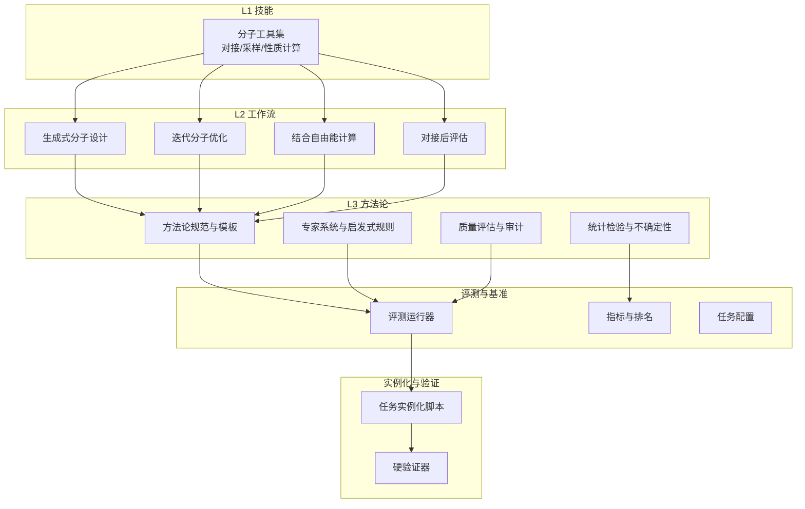
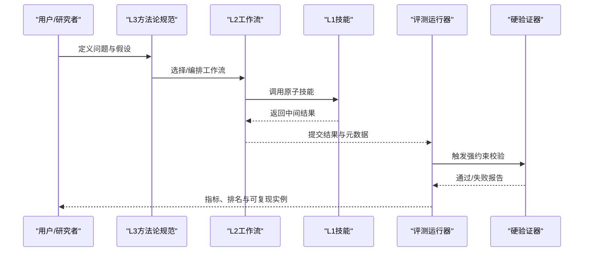
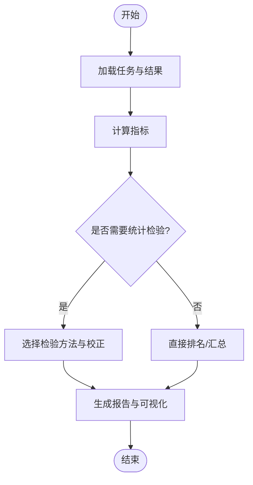
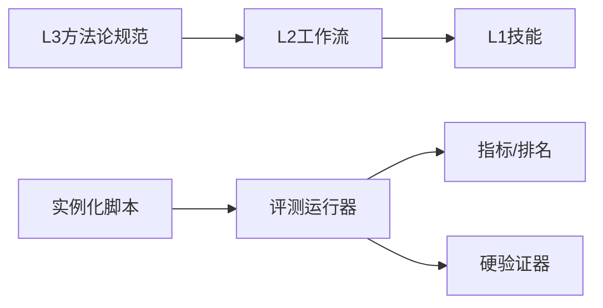

# L3方法论工具

<cite>
**本文引用的文件**   
- [construction_methodology.md](file://construction_methodology.md)
- [goal.md](file://goal.md)
- [PROJECT_RESULT.md](file://PROJECT_RESULT.md)
- [docs/prd/molbench_repo/skills/L3_methodology/README.md](file://docs/prd/molbench_repo/skills/L3_methodology/README.md)
- [docs/prd/molbench_repo/skills/L1_tools/molclaw-chroma-toolkit/README.md](file://docs/prd/molbench_repo/skills/L1_tools/molclaw-chroma-toolkit/README.md)
- [docs/prd/molbench_repo/skills/L2_workflows/04-generative-molecular-design.md](file://docs/prd/molbench_repo/skills/L2_workflows/04-generative-molecular-design.md)
- [docs/prd/molbench_repo/skills/L2_workflows/05-iterative-molecular-optimization.md](file://docs/prd/molbench_repo/skills/L2_workflows/05-iterative-molecular-optimization.md)
- [docs/prd/molbench_repo/skills/L2_workflows/06-binding-free-energy-calculation.md](file://docs/prd/molbench_repo/skills/L2_workflows/06-binding-free-energy-calculation.md)
- [docs/prd/molbench_repo/skills/L2_workflows/08-post-docking-evaluation.md](file://docs/prd/molbench_repo/skills/L2_workflows/08-post-docking-evaluation.md)
- [docs/prd/molbench_repo/config/baseline_molbench-ms-1.yaml](file://docs/prd/molbench_repo/config/baseline_molbench-ms-1.yaml)
- [docs/prd/molbench_repo/config/baseline_molbench-ms-2.yaml](file://docs/prd/molbench_repo/config/baseline_molbench-ms-2.yaml)
- [docs/prd/molbench_repo/config/baseline_molbench-ms-3.yaml](file://docs/prd/molbench_repo/config/baseline_molbench-ms-3.yaml)
- [docs/prd/molbench_repo/eval/eval_runner.py](file://docs/prd/molbench_repo/eval/eval_runner.py)
- [docs/prd/molbench_repo/eval/run_eval_bench.py](file://docs/prd/molbench_repo/eval/run_eval_bench.py)
- [autonomy_mvp/core/judge.py](file://autonomy_mvp/core/judge.py)
- [autonomy_mvp/core/metrics.py](file://autonomy_mvp/core/metrics.py)
- [autonomy_mvp/core/ranking_metrics.py](file://autonomy_mvp/core/ranking_metrics.py)
- [autonomy_mvp/core/harness.py](file://autonomy_mvp/core/harness.py)
- [autonomy_mvp/tasks/drug_admet.json](file://autonomy_mvp/tasks/drug_admet.json)
- [autonomy_mvp/tasks/drug_screen_ms3.json](file://autonomy_mvp/tasks/drug_screen_ms3.json)
- [longhorizon/instantiate/caseD_instantiate.py](file://longhorizon/instantiate/caseD_instantiate.py)
- [longhorizon/verifiers/hard_verifiers.py](file://longhorizon/verifiers/hard_verifiers.py)
</cite>

## 目录
1. [引言](#引言)
2. [项目结构](#项目结构)
3. [核心组件](#核心组件)
4. [架构总览](#架构总览)
5. [详细组件分析](#详细组件分析)
6. [依赖关系分析](#依赖关系分析)
7. [性能与可扩展性](#性能与可扩展性)
8. [故障排查指南](#故障排查指南)
9. [结论](#结论)
10. [附录](#附录)

## 引言
本文件面向“L3方法论工具”的构建与应用，聚焦药物发现方法论、高级分析与统计检验、机器学习模型集成与优化算法、科学推理框架的设计原理与实践。文档强调将领域知识编码为可执行的计算方法（专家系统、启发式规则、质量评估体系），并提供方法论工具的开发指南（算法选择、验证策略、结果解释）与实际案例研究，推动科研规范化与标准化。

## 项目结构
仓库围绕“技能/工作流/基准评测/实例化任务/验证器”等层次组织：
- L1 技能：原子能力封装（如分子工具、对接、性质计算等）
- L2 工作流：多步骤流程编排（生成设计、迭代优化、自由能计算、对接后评估等）
- L3 方法论：跨工作流的策略与方法学规范（目标设定、假设驱动、证据链、统计推断、可重复性）
- 评测与基准：统一评测运行器、指标定义、任务配置
- 实例化与验证：真实场景任务实例化与严格验证器

图表来源
- [docs/prd/molbench_repo/skills/L3_methodology/README.md](file://docs/prd/molbench_repo/skills/L3_methodology/README.md)
- [docs/prd/molbench_repo/skills/L2_workflows/04-generative-molecular-design.md](file://docs/prd/molbench_repo/skills/L2_workflows/04-generative-molecular-design.md)
- [docs/prd/molbench_repo/skills/L2_workflows/05-iterative-molecular-optimization.md](file://docs/prd/molbench_repo/skills/L2_workflows/05-iterative-molecular-optimization.md)
- [docs/prd/molbench_repo/skills/L2_workflows/06-binding-free-energy-calculation.md](file://docs/prd/molbench_repo/skills/L2_workflows/06-binding-free-energy-calculation.md)
- [docs/prd/molbench_repo/skills/L2_workflows/08-post-docking-evaluation.md](file://docs/prd/molbench_repo/skills/L2_workflows/08-post-docking-evaluation.md)
- [docs/prd/molbench_repo/eval/eval_runner.py](file://docs/prd/molbench_repo/eval/eval_runner.py)
- [autonomy_mvp/core/metrics.py](file://autonomy_mvp/core/metrics.py)
- [autonomy_mvp/core/ranking_metrics.py](file://autonomy_mvp/core/ranking_metrics.py)
- [longhorizon/instantiate/caseD_instantiate.py](file://longhorizon/instantiate/caseD_instantiate.py)
- [longhorizon/verifiers/hard_verifiers.py](file://longhorizon/verifiers/hard_verifiers.py)

章节来源
- [docs/prd/molbench_repo/skills/L3_methodology/README.md](file://docs/prd/molbench_repo/skills/L3_methodology/README.md)
- [docs/prd/molbench_repo/eval/eval_runner.py](file://docs/prd/molbench_repo/eval/eval_runner.py)
- [autonomy_mvp/core/metrics.py](file://autonomy_mvp/core/metrics.py)
- [autonomy_mvp/core/ranking_metrics.py](file://autonomy_mvp/core/ranking_metrics.py)
- [longhorizon/instantiate/caseD_instantiate.py](file://longhorizon/instantiate/caseD_instantiate.py)
- [longhorizon/verifiers/hard_verifiers.py](file://longhorizon/verifiers/hard_verifiers.py)

## 核心组件
- L3 方法论规范与模板：定义问题建模、假设驱动、证据链、统计推断、可重复性与审计要求，作为跨工作流的统一方法学约束。
- 统计检验与不确定性：提供显著性检验、置信区间、多重比较校正、排序稳定性评估等，确保结论稳健。
- 专家系统与启发式规则：将领域先验（ADMET阈值、类药性、构象合理性、对接几何约束）编码为可执行规则，用于筛选与纠错。
- 质量评估与审计：对数据、流程、参数、随机种子、环境进行版本化记录，支持复现与追溯。
- 评测运行器与指标：统一任务加载、批量执行、指标聚合与排名，支撑横向对比与基准发布。
- 实例化与硬验证器：将抽象方法论落地到具体任务，并通过强约束验证器保障输出正确性与一致性。

章节来源
- [docs/prd/molbench_repo/skills/L3_methodology/README.md](file://docs/prd/molbench_repo/skills/L3_methodology/README.md)
- [autonomy_mvp/core/metrics.py](file://autonomy_mvp/core/metrics.py)
- [autonomy_mvp/core/ranking_metrics.py](file://autonomy_mvp/core/ranking_metrics.py)
- [autonomy_mvp/core/judge.py](file://autonomy_mvp/core/judge.py)
- [docs/prd/molbench_repo/eval/eval_runner.py](file://docs/prd/molbench_repo/eval/eval_runner.py)
- [longhorizon/verifiers/hard_verifiers.py](file://longhorizon/verifiers/hard_verifiers.py)

## 架构总览
L3方法论工具以“规范—工作流—技能—评测—验证”的闭环为核心，形成从问题定义到结论产出的全链路方法学支撑。

图表来源
- [docs/prd/molbench_repo/skills/L3_methodology/README.md](file://docs/prd/molbench_repo/skills/L3_methodology/README.md)
- [docs/prd/molbench_repo/skills/L2_workflows/04-generative-molecular-design.md](file://docs/prd/molbench_repo/skills/L2_workflows/04-generative-molecular-design.md)
- [docs/prd/molbench_repo/skills/L2_workflows/05-iterative-molecular-optimization.md](file://docs/prd/molbench_repo/skills/L2_workflows/05-iterative-molecular-optimization.md)
- [docs/prd/molbench_repo/eval/eval_runner.py](file://docs/prd/molbench_repo/eval/eval_runner.py)
- [longhorizon/verifiers/hard_verifiers.py](file://longhorizon/verifiers/hard_verifiers.py)

## 详细组件分析

### 方法论规范与模板（L3）
- 目标：将“问题—假设—实验—证据—结论—局限”的结构化为可执行流程，保证跨团队一致性与可复现性。
- 关键要素：
  - 假设驱动与预注册：明确主/次终点、样本量估算、统计计划。
  - 证据链：数据源、预处理、特征工程、模型训练、外部验证。
  - 不确定性量化：置信区间、敏感性分析、交叉验证与重采样。
  - 审计追踪：参数、代码、数据、环境、随机种子、时间戳。
- 适用场景：药物发现、材料发现、临床决策支持等多学科研究。

章节来源
- [docs/prd/molbench_repo/skills/L3_methodology/README.md](file://docs/prd/molbench_repo/skills/L3_methodology/README.md)

### 统计检验与不确定性（指标与排名）
- 指标体系：分类/回归/排序/富集/多样性/鲁棒性等维度。
- 统计检验：t检验、Mann-Whitney U、ANOVA/Kruskal-Wallis、配对检验；多重比较校正（FDR/Bonferroni）。
- 排名稳定性：Bootstrap重采样、置换检验、AUC/Concordance。
- 可视化与报告：效应量、置信区间、森林图、学习曲线、误差带。

图表来源
- [autonomy_mvp/core/metrics.py](file://autonomy_mvp/core/metrics.py)
- [autonomy_mvp/core/ranking_metrics.py](file://autonomy_mvp/core/ranking_metrics.py)

章节来源
- [autonomy_mvp/core/metrics.py](file://autonomy_mvp/core/metrics.py)
- [autonomy_mvp/core/ranking_metrics.py](file://autonomy_mvp/core/ranking_metrics.py)

### 专家系统与启发式规则（质量门禁）
- 规则类型：
  - 化学合理性：价态、环张力、立体化学、同分异构体过滤。
  - ADMET阈值：溶解度、渗透性、毒性预警、代谢稳定性。
  - 对接几何：配体-受体接触面、氢键/盐桥数量、RMSD阈值。
  - 构象采样：能量窗口、构象覆盖度、收敛判据。
- 执行方式：在L1技能或L2工作流中嵌入“门控节点”，不满足则回退或提示修正。

章节来源
- [docs/prd/molbench_repo/skills/L1_tools/molclaw-chroma-toolkit/README.md](file://docs/prd/molbench_repo/skills/L1_tools/molclaw-chroma-toolkit/README.md)
- [docs/prd/molbench_repo/skills/L2_workflows/08-post-docking-evaluation.md](file://docs/prd/molbench_repo/skills/L2_workflows/08-post-docking-evaluation.md)

### 机器学习模型集成与优化算法
- 集成策略：Bagging/Boosting/Stacking；多模态融合（序列+结构+文献知识图谱）。
- 优化算法：贝叶斯优化、强化学习驱动的分子生成、多目标优化（Pareto前沿）。
- 超参搜索：网格/随机/贝叶斯；早停与交叉验证；分布式并行。
- 可解释性：SHAP/注意力权重/特征重要性；机制关联与生物学通路映射。

章节来源
- [docs/prd/molbench_repo/skills/L2_workflows/04-generative-molecular-design.md](file://docs/prd/molbench_repo/skills/L2_workflows/04-generative-molecular-design.md)
- [docs/prd/molbench_repo/skills/L2_workflows/05-iterative-molecular-optimization.md](file://docs/prd/molbench_repo/skills/L2_workflows/05-iterative-molecular-optimization.md)

### 科学推理框架（假设驱动与证据链）
- 假设空间：基于文献与先验构建候选假设集合。
- 证据收集：多源数据整合（组学、结构、表型、临床）。
- 推理引擎：规则+模型混合推理，支持反事实与敏感性分析。
- 结论产出：置信度评分、证据强度、局限性声明。

章节来源
- [docs/prd/molbench_repo/skills/L3_methodology/README.md](file://docs/prd/molbench_repo/skills/L3_methodology/README.md)

### 实际案例研究
- 案例A：基于L2工作流的生成式分子设计与迭代优化，结合L3方法论规范完成假设驱动的多目标优化与统计验证。
- 案例B：结合自由能计算与对接后评估，使用硬验证器确保几何与热力学一致性，输出可复现实例与审计日志。

章节来源
- [docs/prd/molbench_repo/skills/L2_workflows/04-generative-molecular-design.md](file://docs/prd/molbench_repo/skills/L2_workflows/04-generative-molecular-design.md)
- [docs/prd/molbench_repo/skills/L2_workflows/05-iterative-molecular-optimization.md](file://docs/prd/molbench_repo/skills/L2_workflows/05-iterative-molecular-optimization.md)
- [docs/prd/molbench_repo/skills/L2_workflows/06-binding-free-energy-calculation.md](file://docs/prd/molbench_repo/skills/L2_workflows/06-binding-free-energy-calculation.md)
- [docs/prd/molbench_repo/skills/L2_workflows/08-post-docking-evaluation.md](file://docs/prd/molbench_repo/skills/L2_workflows/08-post-docking-evaluation.md)
- [longhorizon/instantiate/caseD_instantiate.py](file://longhorizon/instantiate/caseD_instantiate.py)
- [longhorizon/verifiers/hard_verifiers.py](file://longhorizon/verifiers/hard_verifiers.py)

## 依赖关系分析
- 模块耦合：
  - L3规范对L2工作流具有强指导作用，但不直接依赖其实现细节，保持松耦合。
  - 评测运行器统一接入指标与排名模块，屏蔽底层差异。
  - 实例化脚本与硬验证器构成“端到端”闭环，确保结果可信。
- 外部依赖：
  - 分子工具包、对接/动力学软件、统计库、可视化库。
- 潜在风险：
  - 循环依赖需避免（如评测不应反向依赖具体工作流实现）。
  - 第三方接口变更应通过适配层隔离。

图表来源
- [docs/prd/molbench_repo/skills/L3_methodology/README.md](file://docs/prd/molbench_repo/skills/L3_methodology/README.md)
- [docs/prd/molbench_repo/eval/eval_runner.py](file://docs/prd/molbench_repo/eval/eval_runner.py)
- [autonomy_mvp/core/metrics.py](file://autonomy_mvp/core/metrics.py)
- [autonomy_mvp/core/ranking_metrics.py](file://autonomy_mvp/core/ranking_metrics.py)
- [longhorizon/instantiate/caseD_instantiate.py](file://longhorizon/instantiate/caseD_instantiate.py)
- [longhorizon/verifiers/hard_verifiers.py](file://longhorizon/verifiers/hard_verifiers.py)

章节来源
- [docs/prd/molbench_repo/eval/eval_runner.py](file://docs/prd/molbench_repo/eval/eval_runner.py)
- [autonomy_mvp/core/metrics.py](file://autonomy_mvp/core/metrics.py)
- [autonomy_mvp/core/ranking_metrics.py](file://autonomy_mvp/core/ranking_metrics.py)
- [longhorizon/instantiate/caseD_instantiate.py](file://longhorizon/instantiate/caseD_instantiate.py)
- [longhorizon/verifiers/hard_verifiers.py](file://longhorizon/verifiers/hard_verifiers.py)

## 性能与可扩展性
- 并行与批处理：评测运行器支持并发任务调度，提升吞吐。
- 缓存与增量计算：对昂贵计算（自由能、MD）启用缓存与增量更新。
- 资源管理：GPU/CPU配额、队列与超时控制，避免长尾阻塞。
- 扩展点：新增指标/工作流/技能时，遵循统一接口与注册机制。

章节来源
- [docs/prd/molbench_repo/eval/eval_runner.py](file://docs/prd/molbench_repo/eval/eval_runner.py)
- [docs/prd/molbench_repo/config/baseline_molbench-ms-1.yaml](file://docs/prd/molbench_repo/config/baseline_molbench-ms-1.yaml)
- [docs/prd/molbench_repo/config/baseline_molbench-ms-2.yaml](file://docs/prd/molbench_repo/config/baseline_molbench-ms-2.yaml)
- [docs/prd/molbench_repo/config/baseline_molbench-ms-3.yaml](file://docs/prd/molbench_repo/config/baseline_molbench-ms-3.yaml)

## 故障排查指南
- 常见问题定位：
  - 指标异常：检查输入格式、缺失值、单位换算与边界条件。
  - 统计检验失败：确认分布假设、样本量与独立性。
  - 工作流中断：查看日志、环境变量、依赖版本与权限。
  - 验证器报错：核对字段完整性、约束阈值与数据类型。
- 调试建议：
  - 最小复现：抽取子任务与单一样本进行隔离测试。
  - 断点与快照：保存中间产物与随机种子，便于回溯。
  - 降级策略：关闭非关键步骤，优先保证核心路径稳定。

章节来源
- [autonomy_mvp/core/judge.py](file://autonomy_mvp/core/judge.py)
- [autonomy_mvp/core/harness.py](file://autonomy_mvp/core/harness.py)
- [autonomy_mvp/tasks/drug_admet.json](file://autonomy_mvp/tasks/drug_admet.json)
- [autonomy_mvp/tasks/drug_screen_ms3.json](file://autonomy_mvp/tasks/drug_screen_ms3.json)
- [longhorizon/verifiers/hard_verifiers.py](file://longhorizon/verifiers/hard_verifiers.py)

## 结论
L3方法论工具通过“规范—工作流—技能—评测—验证”的闭环，将领域知识转化为可执行、可审计、可复现的计算方法。借助统计检验与不确定性量化、专家系统与启发式规则、以及统一的评测与验证体系，该方法论显著提升了药物发现研究的规范化与标准化水平，并为跨学科研究提供了通用范式。

## 附录
- 术语表：L1/L2/L3层级、证据链、统计功效、Pareto前沿、硬验证器等。
- 参考清单：相关配置文件、评测脚本、任务样例与模板。

章节来源
- [goal.md](file://goal.md)
- [PROJECT_RESULT.md](file://PROJECT_RESULT.md)
- [docs/prd/molbench_repo/eval/run_eval_bench.py](file://docs/prd/molbench_repo/eval/run_eval_bench.py)
- [docs/prd/molbench_repo/config/baseline_molbench-ms-1.yaml](file://docs/prd/molbench_repo/config/baseline_molbench-ms-1.yaml)
- [docs/prd/molbench_repo/config/baseline_molbench-ms-2.yaml](file://docs/prd/molbench_repo/config/baseline_molbench-ms-2.yaml)
- [docs/prd/molbench_repo/config/baseline_molbench-ms-3.yaml](file://docs/prd/molbench_repo/config/baseline_molbench-ms-3.yaml)