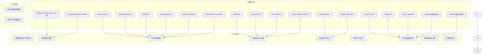
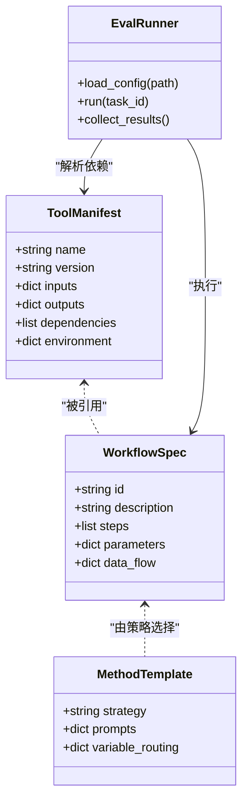
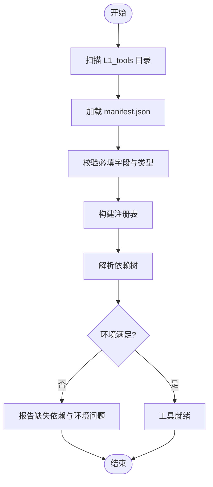
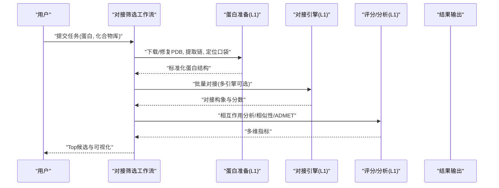
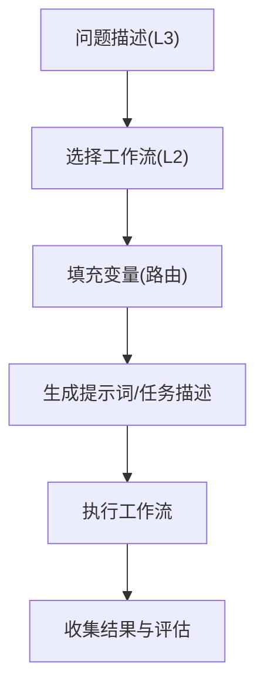
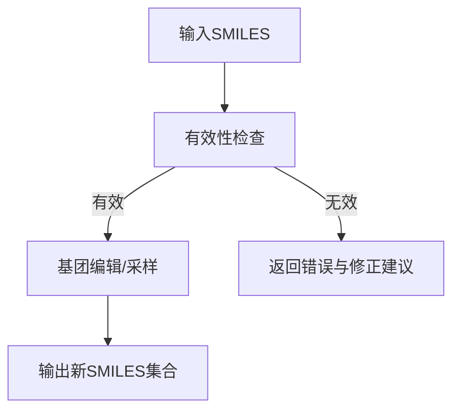
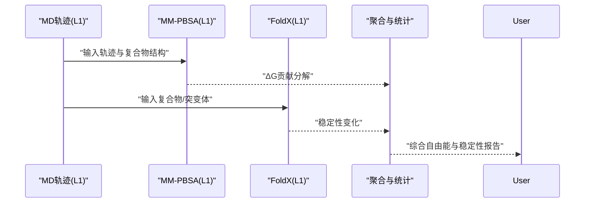
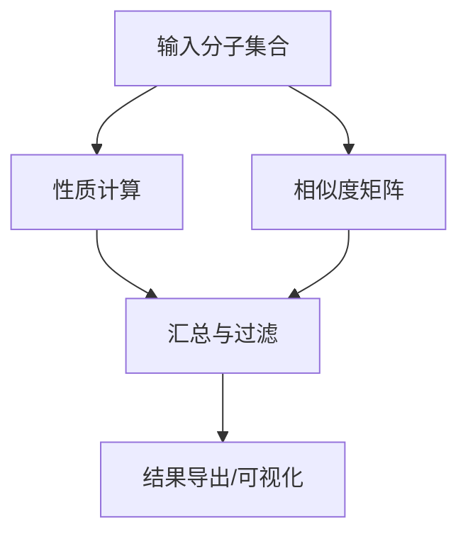
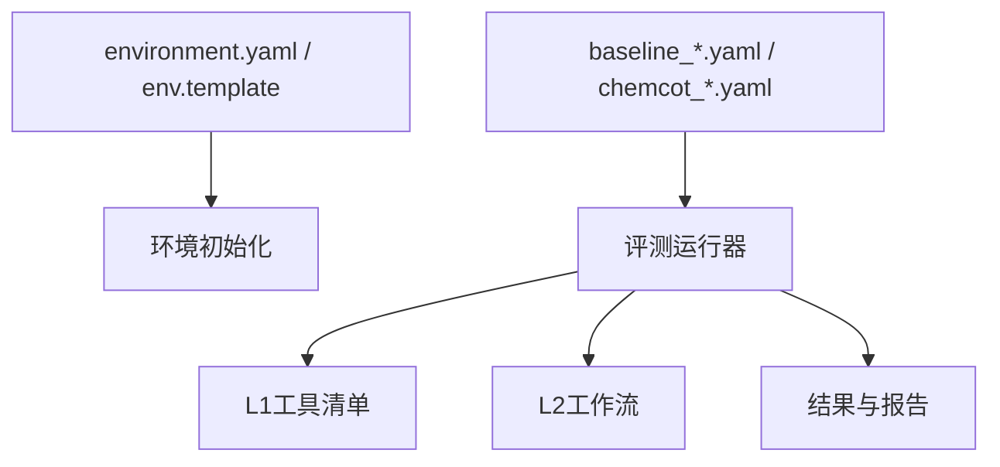

# 工具生态系统

<cite>
**本文引用的文件**   
- [README.md](file://docs/prd/molbench_repo/README.md)
- [REUSABLE_INDEX.md](file://docs/prd/molbench_repo/REUSABLE_INDEX.md)
- [env.template](file://docs/prd/molbench_repo/env.template)
- [environment.yaml](file://docs/prd/molbench_repo/environment.yaml)
- [tool_routing.md](file://docs/prd/molbench_repo/templates/tool_routing.md)
- [variable_routing.md](file://docs/prd/molbench_repo/templates/variable_routing.md)
- [template.py](file://docs/prd/molbench_repo/templates/template.py)
- [outliners.py](file://docs/prd/molbench_repo/templates/outliners.py)
- [eval_runner.py](file://docs/prd/molbench_repo/eval/eval_runner.py)
- [bench_loaders.py](file://docs/prd/molbench_repo/eval/bench_loaders.py)
- [run_eval_bench.py](file://docs/prd/molbench_repo/eval/run_eval_bench.py)
- [baseline_molbench-ms-1.yaml](file://docs/prd/molbench_repo/config/baseline_molbench-ms-1.yaml)
- [baseline_molbench-ms-2.yaml](file://docs/prd/molbench_repo/config/baseline_molbench-ms-2.yaml)
- [baseline_molbench-ms-3.yaml](file://docs/prd/molbench_repo/config/baseline_molbench-ms-3.yaml)
- [chemcot_mo_edit.yaml](file://docs/prd/molbench_repo/config/chemcot_mo_edit.yaml)
- [chemcot_mo_opt.yaml](file://docs/prd/molbench_repo/config/chemcot_mo_opt.yaml)
- [claude_template.yaml](file://docs/prd/molbench_repo/config/claude_template.yaml)
- [00-problem-discovery-and-feasibility-triage.md](file://docs/prd/molbench_repo/skills/L2_workflows/00-problem-discovery-and-feasibility-triage.md)
- [01-target-protein-preparation.md](file://docs/prd/molbench_repo/skills/L2_workflows/01-target-protein-preparation.md)
- [02-molecular-docking-screening.md](file://docs/prd/molbench_repo/skills/L2_workflows/02-molecular-docking-screening.md)
- [03-molecular-property-analysis-filtering.md](file://docs/prd/molbench_repo/skills/L2_workflows/03-molecular-property-analysis-filtering.md)
- [04-generative-molecular-design.md](file://docs/prd/molbench_repo/skills/L2_workflows/04-generative-molecular-design.md)
- [05-iterative-molecular-optimization.md](file://docs/prd/molbench_repo/skills/L2_workflows/05-iterative-molecular-optimization.md)
- [06-binding-free-energy-calculation.md](file://docs/prd/molbench_repo/skills/L2_workflows/06-binding-free-energy-calculation.md)
- [07-conformational-sampling-analysis.md](file://docs/prd/molbench_repo/skills/L2_workflows/07-conformational-sampling-analysis.md)
- [08-post-docking-evaluation.md](file://docs/prd/molbench_repo/skills/L2_workflows/08-post-docking-evaluation.md)
- [molclaw-chroma-toolkit/manifest.json](file://docs/prd/molbench_repo/skills/L1_tools/molclaw-chroma-toolkit/manifest.json)
- [molclaw-docking-screening/manifest.json](file://docs/prd/molbench_repo/skills/L1_tools/molclaw-docking-screening/manifest.json)
- [molclaw-openmm-tool/manifest.json](file://docs/prd/molbench_repo/skills/L1_tools/molclaw-openmm-tool/manifest.json)
- [molclaw-prolif-tool/manifest.json](file://docs/prd/molbench_repo/skills/L1_tools/molclaw-prolif-tool/manifest.json)
- [molclaw-equiscore-tool/manifest.json](file://docs/prd/molbench_repo/skills/L1_tools/molclaw-equiscore-tool/manifest.json)
- [molclaw-foldx-tool/manifest.json](file://docs/prd/molbench_repo/skills/L1_tools/molclaw-foldx-tool/manifest.json)
- [molclaw-hdock-tool/manifest.json](file://docs/prd/molbench_repo/skills/L1_tools/molclaw-hdock-tool/manifest.json)
- [molclaw-karmadock-tool/manifest.json](file://docs/prd/molbench_repo/skills/L1_tools/molclaw-karmadock-tool/manifest.json)
- [molclaw-prolif-md/manifest.json](file://docs/prd/molbench_repo/skills/L1_tools/molclaw-prolif-md/manifest.json)
- [molclaw-prolif-pdb/manifest.json](file://docs/prd/molbench_repo/skills/L1_tools/molclaw-prolif-pdb/manifest.json)
- [molclaw-prolif-protein-protein/manifest.json](file://docs/prd/molbench_repo/skills/L1_tools/molclaw-prolif-protein-protein/manifest.json)
- [molclaw-protein-openmm/manifest.json](file://docs/prd/molbench_repo/skills/L1_tools/molclaw-protein-openmm/manifest.json)
- [molclaw-protein-ligand-mmpbsa/manifest.json](file://docs/prd/molbench_repo/skills/L1_tools/molclaw-protein-ligand-mmpbsa/manifest.json)
- [molclaw-protein-protein-mmpbsa/manifest.json](file://docs/prd/molbench_repo/skills/L1_tools/molclaw-protein-protein-mmpbsa/manifest.json)
- [molclaw-quickvina-docking/manifest.json](file://docs/prd/molbench_repo/skills/L1_tools/molclaw-quickvina-docking/manifest.json)
- [molclaw-smiles-fg-editor/manifest.json](file://docs/prd/molbench_repo/skills/L1_tools/molclaw-smiles-fg-editor/manifest.json)
- [molclaw-smiles-valid-check/manifest.json](file://docs/prd/molbench_repo/skills/L1_tools/molclaw-smiles-valid-check/manifest.json)
- [molclaw-mol-basic-metrics/manifest.json](file://docs/prd/molbench_repo/skills/L1_tools/molclaw-mol-basic-metrics/manifest.json)
- [molclaw-mol-complexity-metrics/manifest.json](file://docs/prd/molbench_repo/skills/L1_tools/molclaw-mol-complexity-metrics/manifest.json)
- [molclaw-mol-hbond-metrics/manifest.json](file://docs/prd/molbench_repo/skills/L1_tools/molclaw-mol-hbond-metrics/manifest.json)
- [molclaw-mol-hydrophobicity-metrics/manifest.json](file://docs/prd/molbench_repo/skills/L1_tools/molclaw-mol-hydrophobicity-metrics/manifest.json)
- [molclaw-mol-opt-physchem/manifest.json](file://docs/prd/molbench_repo/skills/L1_tools/molclaw-mol-opt-physchem/manifest.json)
- [molclaw-mol-similarity/manifest.json](file://docs/prd/molbench_repo/skills/L1_tools/molclaw-mol-similarity/manifest.json)
- [molclaw-mol-structure-metrics/manifest.json](file://docs/prd/molbench_repo/skills/L1_tools/molclaw-mol-structure-metrics/manifest.json)
- [molclaw-mol-topology-metrics/manifest.json](file://docs/prd/molbench_repo/skills/L1_tools/molclaw-mol-topology-metrics/manifest.json)
- [molclaw-admet/manifest.json](file://docs/prd/molbench_repo/skills/L1_tools/molclaw-admet/manifest.json)
- [molclaw-boltz2-affinity/manifest.json](file://docs/prd/molbench_repo/skills/L1_tools/molclaw-boltz2-affinity/manifest.json)
- [molclaw-chai1-predict/manifest.json](file://docs/prd/molbench_repo/skills/L1_tools/molclaw-chai1-predict/manifest.json)
- [molclaw-compound-retrieve/manifest.json](file://docs/prd/molbench_repo/skills/L1_tools/molclaw-compound-retrieve/manifest.json)
- [molclaw-denovo-sampling/manifest.json](file://docs/prd/molbench_repo/skills/L1_tools/molclaw-denovo-sampling/manifest.json)
- [molclaw-diffdock-auto/manifest.json](file://docs/prd/molbench_repo/skills/L1_tools/molclaw-diffdock-auto/manifest.json)
- [molclaw-dleps/manifest.json](file://docs/prd/molbench_repo/skills/L1_tools/molclaw-dleps/manifest.json)
- [molclaw-drug-likeness/manifest.json](file://docs/prd/molbench_repo/skills/L1_tools/molclaw-drug-likeness/manifest.json)
- [molclaw-evobind-tool/manifest.json](file://docs/prd/molbench_repo/skills/L1_tools/molclaw-evobind-tool/manifest.json)
- [molclaw-extract-chains/manifest.json](file://docs/prd/molbench_repo/skills/L1_tools/molclaw-extract-chains/manifest.json)
- [molclaw-file-transfer/manifest.json](file://docs/prd/molbench_repo/skills/L1_tools/molclaw-file-transfer/manifest.json)
- [molclaw-fix-pdb/manifest.json](file://docs/prd/molbench_repo/skills/L1_tools/molclaw-fix-pdb/manifest.json)
- [molclaw-fpocket/manifest.json](file://docs/prd/molbench_repo/skills/L1_tools/molclaw-fpocket/manifest.json)
- [molclaw-fpocket-toolkit-base/manifest.json](file://docs/prd/molbench_repo/skills/L1_tools/molclaw-fpocket-toolkit-base/manifest.json)
- [molclaw-goca-tool/manifest.json](file://docs/prd/molbench_repo/skills/L1_tools/molclaw-goca-tool/manifest.json)
- [molclaw-interaction-visualizer/manifest.json](file://docs/prd/molbench_repo/skills/L1_tools/molclaw-interaction-visualizer/manifest.json)
- [molclaw-linker-sampling/manifest.json](file://docs/prd/molbench_repo/skills/L1_tools/molclaw-linker-sampling/manifest.json)
- [molclaw-pack-sidechains/manifest.json](file://docs/prd/molbench_repo/skills/L1_tools/molclaw-pack-sidechains/manifest.json)
- [molclaw-p2rank/manifest.json](file://docs/prd/molbench_repo/skills/L1_tools/molclaw-p2rank/manifest.json)
- [molclaw-pdbfixer/manifest.json](file://docs/prd/molbench_repo/skills/L1_tools/molclaw-pdbfixer/manifest.json)
- [molclaw-peptide-sampling/manifest.json](file://docs/prd/molbench_repo/skills/L1_tools/molclaw-peptide-sampling/manifest.json)
- [molclaw-prolif-docking/manifest.json](file://docs/prd/molbench_repo/skills/L1_tools/molclaw-prolif-docking/manifest.json)
- [molclaw-protein-sequence-retrieve/manifest.json](file://docs/prd/molbench_repo/skills/L1_tools/molclaw-protein-sequence-retrieve/manifest.json)
- [molclaw-protein-structure-retrieve/manifest.json](file://docs/prd/molbench_repo/skills/L1_tools/molclaw-protein-structure-retrieve/manifest.json)
- [molclaw-proteinmpnn-tool/manifest.json](file://docs/prd/molbench_repo/skills/L1_tools/molclaw-proteinmpnn-tool/manifest.json)
- [molclaw-pulchura-rebuild/manifest.json](file://docs/prd/molbench_repo/skills/L1_tools/molclaw-pulchura-rebuild/manifest.json)
- [molclaw-rgroup-sampling/manifest.json](file://docs/prd/molbench_repo/skills/L1_tools/molclaw-rgroup-sampling/manifest.json)
- [molclaw-run-bioemu/manifest.json](file://docs/prd/molbench_repo/skills/L1_tools/molclaw-run-bioemu/manifest.json)
- [molclaw-scp-server/manifest.json](file://docs/prd/molbench_repo/skills/L1_tools/molclaw-scp-server/manifest.json)
- [molclaw-sequence-valid-check/manifest.json](file://docs/prd/molbench_repo/skills/L1_tools/molclaw-sequence-valid-check/manifest.json)
- [molclaw-skill-template-writer/manifest.json](file://docs/prd/molbench_repo/skills/L1_tools/molclaw-skill-template-writer/manifest.json)
</cite>

## 目录
1. [引言](#引言)
2. [项目结构](#项目结构)
3. [核心组件](#核心组件)
4. [架构总览](#架构总览)
5. [详细组件分析](#详细组件分析)
6. [依赖分析](#依赖分析)
7. [性能考虑](#性能考虑)
8. [故障排查指南](#故障排查指南)
9. [结论](#结论)
10. [附录](#附录)

## 引言
本文件面向“工具生态系统”的三层架构：L1基础工具、L2工作流工具与L3方法论工具。目标是为科学计算（尤其是分子与材料）工作流提供模块化、可扩展、可组合的工具集，并通过统一的注册机制、版本管理与依赖解析实现灵活编排。文档将覆盖：
- L1基础工具：分子操作、物理化学计算、数据分析等原子能力
- L2工作流工具：端到端流程封装（如对接筛选、自由能计算、构象采样）
- L3方法论工具：研究方法论与模板化策略（问题发现、可行性评估、优化范式）
- 工具注册、版本管理、依赖解析与集成方式
- 开发指南、最佳实践与性能优化建议

## 项目结构
仓库围绕“技能（skills）”组织，分为三层：
- L1_tools：原子级工具，每个工具以独立目录与清单（manifest）描述其能力、输入输出、依赖与版本
- L2_workflows：工作流脚本或说明，串联多个L1工具形成完整任务流程
- L3_methodology：方法论与模板，定义研究范式、提示词与变量路由规则

图表来源
- [README.md](file://docs/prd/molbench_repo/README.md)
- [REUSABLE_INDEX.md](file://docs/prd/molbench_repo/REUSABLE_INDEX.md)
- [02-molecular-docking-screening.md](file://docs/prd/molbench_repo/skills/L2_workflows/02-molecular-docking-screening.md)
- [06-binding-free-energy-calculation.md](file://docs/prd/molbench_repo/skills/L2_workflows/06-binding-free-energy-calculation.md)
- [03-molecular-property-analysis-filtering.md](file://docs/prd/molbench_repo/skills/L2_workflows/03-molecular-property-analysis-filtering.md)

章节来源
- [README.md](file://docs/prd/molbench_repo/README.md)
- [REUSABLE_INDEX.md](file://docs/prd/molbench_repo/REUSABLE_INDEX.md)

## 核心组件
- 工具清单（manifest）：每个L1工具目录包含一个清单文件，用于声明工具名称、版本、输入输出模式、外部依赖与环境要求。这是工具注册与依赖解析的基础。
- 工作流说明（L2）：以Markdown形式描述步骤、参数、数据流转与调用顺序，便于人类阅读与自动化解析。
- 方法论模板（L3）：提供策略性指导、提示词模板与变量路由规则，驱动上层智能体或编排器进行任务规划与执行。
- 评测与基准：评估运行器与加载器负责读取基准配置、实例与结果，支撑可复现实验。

章节来源
- [eval_runner.py](file://docs/prd/molbench_repo/eval/eval_runner.py)
- [bench_loaders.py](file://docs/prd/molbench_repo/eval/bench_loaders.py)
- [run_eval_bench.py](file://docs/prd/molbench_repo/eval/run_eval_bench.py)

## 架构总览
整体采用“清单驱动 + 模板编排”的架构：
- 清单层（L1）：通过manifest统一描述工具元数据与依赖，支持注册表构建与版本选择
- 编排层（L2）：工作流以结构化说明串联L1工具，定义输入输出契约与中间产物
- 方法层（L3）：方法论模板与路由规则决定如何根据问题类型选择合适的工作流与工具组合

图表来源
- [eval_runner.py](file://docs/prd/molbench_repo/eval/eval_runner.py)
- [bench_loaders.py](file://docs/prd/molbench_repo/eval/bench_loaders.py)
- [run_eval_bench.py](file://docs/prd/molbench_repo/eval/run_eval_bench.py)

## 详细组件分析

### L1 基础工具：清单与注册机制
- 清单字段约定（基于现有manifest样例归纳）
  - 名称与版本：唯一标识与语义化版本，便于依赖解析与回退
  - 输入/输出：键名、类型、默认值、约束条件
  - 依赖：外部库、二进制工具、环境变量
  - 环境：Python版本、系统依赖、GPU/CPU需求
- 注册机制
  - 扫描L1_tools下所有子目录，加载manifest并构建全局注册表
  - 支持按名称、版本范围、能力标签检索
  - 冲突检测：同名不同版本的共存策略与优先级
- 依赖解析
  - 解析依赖树，检查可用性与版本兼容性
  - 失败时给出最小修复建议（安装缺失包、设置环境变量）

图表来源
- [molclaw-chroma-toolkit/manifest.json](file://docs/prd/molbench_repo/skills/L1_tools/molclaw-chroma-toolkit/manifest.json)
- [molclaw-docking-screening/manifest.json](file://docs/prd/molbench_repo/skills/L1_tools/molclaw-docking-screening/manifest.json)
- [molclaw-openmm-tool/manifest.json](file://docs/prd/molbench_repo/skills/L1_tools/molclaw-openmm-tool/manifest.json)
- [molclaw-prolif-tool/manifest.json](file://docs/prd/molbench_repo/skills/L1_tools/molclaw-prolif-tool/manifest.json)
- [molclaw-equiscore-tool/manifest.json](file://docs/prd/molbench_repo/skills/L1_tools/molclaw-equiscore-tool/manifest.json)
- [molclaw-foldx-tool/manifest.json](file://docs/prd/molbench_repo/skills/L1_tools/molclaw-foldx-tool/manifest.json)
- [molclaw-hdock-tool/manifest.json](file://docs/prd/molbench_repo/skills/L1_tools/molclaw-hdock-tool/manifest.json)
- [molclaw-karmadock-tool/manifest.json](file://docs/prd/molbench_repo/skills/L1_tools/molclaw-karmadock-tool/manifest.json)
- [molclaw-prolif-md/manifest.json](file://docs/prd/molbench_repo/skills/L1_tools/molclaw-prolif-md/manifest.json)
- [molclaw-prolif-pdb/manifest.json](file://docs/prd/molbench_repo/skills/L1_tools/molclaw-prolif-pdb/manifest.json)
- [molclaw-prolif-protein-protein/manifest.json](file://docs/prd/molbench_repo/skills/L1_tools/molclaw-prolif-protein-protein/manifest.json)
- [molclaw-protein-openmm/manifest.json](file://docs/prd/molbench_repo/skills/L1_tools/molclaw-protein-openmm/manifest.json)
- [molclaw-protein-ligand-mmpbsa/manifest.json](file://docs/prd/molbench_repo/skills/L1_tools/molclaw-protein-ligand-mmpbsa/manifest.json)
- [molclaw-protein-protein-mmpbsa/manifest.json](file://docs/prd/molbench_repo/skills/L1_tools/molclaw-protein-protein-mmpbsa/manifest.json)
- [molclaw-quickvina-docking/manifest.json](file://docs/prd/molbench_repo/skills/L1_tools/molclaw-quickvina-docking/manifest.json)
- [molclaw-smiles-fg-editor/manifest.json](file://docs/prd/molbench_repo/skills/L1_tools/molclaw-smiles-fg-editor/manifest.json)
- [molclaw-smiles-valid-check/manifest.json](file://docs/prd/molbench_repo/skills/L1_tools/molclaw-smiles-valid-check/manifest.json)
- [molclaw-mol-basic-metrics/manifest.json](file://docs/prd/molbench_repo/skills/L1_tools/molclaw-mol-basic-metrics/manifest.json)
- [molclaw-mol-complexity-metrics/manifest.json](file://docs/prd/molbench_repo/skills/L1_tools/molclaw-mol-complexity-metrics/manifest.json)
- [molclaw-mol-hbond-metrics/manifest.json](file://docs/prd/molbench_repo/skills/L1_tools/molclaw-mol-hbond-metrics/manifest.json)
- [molclaw-mol-hydrophobicity-metrics/file://docs/prd/molbench_repo/skills/L1_tools/molclaw-mol-hydrophobicity-metrics/manifest.json](file://docs/prd/molbench_repo/skills/L1_tools/molclaw-mol-hydrophobicity-metrics/manifest.json)
- [molclaw-mol-opt-physchem/manifest.json](file://docs/prd/molbench_repo/skills/L1_tools/molclaw-mol-opt-physchem/manifest.json)
- [molclaw-mol-similarity/manifest.json](file://docs/prd/molbench_repo/skills/L1_tools/molclaw-mol-similarity/manifest.json)
- [molclaw-mol-structure-metrics/manifest.json](file://docs/prd/molbench_repo/skills/L1_tools/molclaw-mol-structure-metrics/manifest.json)
- [molclaw-mol-topology-metrics/manifest.json](file://docs/prd/molbench_repo/skills/L1_tools/molclaw-mol-topology-metrics/manifest.json)
- [molclaw-admet/manifest.json](file://docs/prd/molbench_repo/skills/L1_tools/molclaw-admet/manifest.json)
- [molclaw-boltz2-affinity/manifest.json](file://docs/prd/molbench_repo/skills/L1_tools/molclaw-boltz2-affinity/manifest.json)
- [molclaw-chai1-predict/manifest.json](file://docs/prd/molbench_repo/skills/L1_tools/molclaw-chai1-predict/manifest.json)
- [molclaw-compound-retrieve/manifest.json](file://docs/prd/molbench_repo/skills/L1_tools/molclaw-compound-retrieve/manifest.json)
- [molclaw-denovo-sampling/manifest.json](file://docs/prd/molbench_repo/skills/L1_tools/molclaw-denovo-sampling/manifest.json)
- [molclaw-diffdock-auto/manifest.json](file://docs/prd/molbench_repo/skills/L1_tools/molclaw-diffdock-auto/manifest.json)
- [molclaw-dleps/manifest.json](file://docs/prd/molbench_repo/skills/L1_tools/molclaw-dleps/manifest.json)
- [molclaw-drug-likeness/manifest.json](file://docs/prd/molbench_repo/skills/L1_tools/molclaw-drug-likeness/manifest.json)
- [molclaw-evobind-tool/manifest.json](file://docs/prd/molbench_repo/skills/L1_tools/molclaw-evobind-tool/manifest.json)
- [molclaw-extract-chains/manifest.json](file://docs/prd/molbench_repo/skills/L1_tools/molclaw-extract-chains/manifest.json)
- [molclaw-file-transfer/manifest.json](file://docs/prd/molbench_repo/skills/L1_tools/molclaw-file-transfer/manifest.json)
- [molclaw-fix-pdb/manifest.json](file://docs/prd/molbench_repo/skills/L1_tools/molclaw-fix-pdb/manifest.json)
- [molclaw-fpocket/manifest.json](file://docs/prd/molbench_repo/skills/L1_tools/molclaw-fpocket/manifest.json)
- [molclaw-fpocket-toolkit-base/manifest.json](file://docs/prd/molbench_repo/skills/L1_tools/molclaw-fpocket-toolkit-base/manifest.json)
- [molclaw-goca-tool/manifest.json](file://docs/prd/molbench_repo/skills/L1_tools/molclaw-goca-tool/manifest.json)
- [molclaw-interaction-visualizer/manifest.json](file://docs/prd/molbench_repo/skills/L1_tools/molclaw-interaction-visualizer/manifest.json)
- [molclaw-linker-sampling/manifest.json](file://docs/prd/molbench_repo/skills/L1_tools/molclaw-linker-sampling/manifest.json)
- [molclaw-pack-sidechains/manifest.json](file://docs/prd/molbench_repo/skills/L1_tools/molclaw-pack-sidechains/manifest.json)
- [molclaw-p2rank/manifest.json](file://docs/prd/molbench_repo/skills/L1_tools/molclaw-p2rank/manifest.json)
- [molclaw-pdbfixer/manifest.json](file://docs/prd/molbench_repo/skills/L1_tools/molclaw-pdbfixer/manifest.json)
- [molclaw-peptide-sampling/manifest.json](file://docs/prd/molbench_repo/skills/L1_tools/molclaw-peptide-sampling/manifest.json)
- [molclaw-prolif-docking/manifest.json](file://docs/prd/molbench_repo/skills/L1_tools/molclaw-prolif-docking/manifest.json)
- [molclaw-protein-sequence-retrieve/manifest.json](file://docs/prd/molbench_repo/skills/L1_tools/molclaw-protein-sequence-retrieve/manifest.json)
- [molclaw-protein-structure-retrieve/manifest.json](file://docs/prd/molbench_repo/skills/L1_tools/molclaw-protein-structure-retrieve/manifest.json)
- [molclaw-proteinmpnn-tool/manifest.json](file://docs/prd/molbench_repo/skills/L1_tools/molclaw-proteinmpnn-tool/manifest.json)
- [molclaw-pulchura-rebuild/manifest.json](file://docs/prd/molbench_repo/skills/L1_tools/molclaw-pulchura-rebuild/manifest.json)
- [molclaw-rgroup-sampling/manifest.json](file://docs/prd/molbench_repo/skills/L1_tools/molclaw-rgroup-sampling/manifest.json)
- [molclaw-run-bioemu/manifest.json](file://docs/prd/molbench_repo/skills/L1_tools/molclaw-run-bioemu/manifest.json)
- [molclaw-scp-server/manifest.json](file://docs/prd/molbench_repo/skills/L1_tools/molclaw-scp-server/manifest.json)
- [molclaw-sequence-valid-check/manifest.json](file://docs/prd/molbench_repo/skills/L1_tools/molclaw-sequence-valid-check/manifest.json)
- [molclaw-skill-template-writer/manifest.json](file://docs/prd/molbench_repo/skills/L1_tools/molclaw-skill-template-writer/manifest.json)

章节来源
- [molclaw-chroma-toolkit/manifest.json](file://docs/prd/molbench_repo/skills/L1_tools/molclaw-chroma-toolkit/manifest.json)
- [molclaw-docking-screening/manifest.json](file://docs/prd/molbench_repo/skills/L1_tools/molclaw-docking-screening/manifest.json)
- [molclaw-openmm-tool/manifest.json](file://docs/prd/molbench_repo/skills/L1_tools/molclaw-openmm-tool/manifest.json)
- [molclaw-prolif-tool/manifest.json](file://docs/prd/molbench_repo/skills/L1_tools/molclaw-prolif-tool/manifest.json)
- [molclaw-equiscore-tool/manifest.json](file://docs/prd/molbench_repo/skills/L1_tools/molclaw-equiscore-tool/manifest.json)
- [molclaw-foldx-tool/manifest.json](file://docs/prd/molbench_repo/skills/L1_tools/molclaw-foldx-tool/manifest.json)
- [molclaw-hdock-tool/manifest.json](file://docs/prd/molbench_repo/skills/L1_tools/molclaw-hdock-tool/manifest.json)
- [molclaw-karmadock-tool/manifest.json](file://docs/prd/molbench_repo/skills/L1_tools/molclaw-karmadock-tool/manifest.json)
- [molclaw-prolif-md/manifest.json](file://docs/prd/molbench_repo/skills/L1_tools/molclaw-prolif-md/manifest.json)
- [molclaw-prolif-pdb/manifest.json](file://docs/prd/molbench_repo/skills/L1_tools/molclaw-prolif-pdb/manifest.json)
- [molclaw-prolif-protein-protein/manifest.json](file://docs/prd/molbench_repo/skills/L1_tools/molclaw-prolif-protein-protein/manifest.json)
- [molclaw-protein-openmm/manifest.json](file://docs/prd/molbench_repo/skills/L1_tools/molclaw-protein-openmm/manifest.json)
- [molclaw-protein-ligand-mmpbsa/manifest.json](file://docs/prd/molbench_repo/skills/L1_tools/molclaw-protein-ligand-mmpbsa/manifest.json)
- [molclaw-protein-protein-mmpbsa/manifest.json](file://docs/prd/molbench_repo/skills/L1_tools/molclaw-protein-protein-mmpbsa/manifest.json)
- [molclaw-quickvina-docking/manifest.json](file://docs/prd/molbench_repo/skills/L1_tools/molclaw-quickvina-docking/manifest.json)
- [molclaw-smiles-fg-editor/manifest.json](file://docs/prd/molbench_repo/skills/L1_tools/molclaw-smiles-fg-editor/manifest.json)
- [molclaw-smiles-valid-check/manifest.json](file://docs/prd/molbench_repo/skills/L1_tools/molclaw-smiles-valid-check/manifest.json)
- [molclaw-mol-basic-metrics/manifest.json](file://docs/prd/molbench_repo/skills/L1_tools/molclaw-mol-basic-metrics/manifest.json)
- [molclaw-mol-complexity-metrics/manifest.json](file://docs/prd/molbench_repo/skills/L1_tools/molclaw-mol-complexity-metrics/manifest.json)
- [molclaw-mol-hbond-metrics/manifest.json](file://docs/prd/molbench_repo/skills/L1_tools/molclaw-mol-hbond-metrics/manifest.json)
- [molclaw-mol-hydrophobicity-metrics/manifest.json](file://docs/prd/molbench_repo/skills/L1_tools/molclaw-mol-hydrophobicity-metrics/manifest.json)
- [molclaw-mol-opt-physchem/manifest.json](file://docs/prd/molbench_repo/skills/L1_tools/molclaw-mol-opt-physchem/manifest.json)
- [molclaw-mol-similarity/manifest.json](file://docs/prd/molbench_repo/skills/L1_tools/molclaw-mol-similarity/manifest.json)
- [molclaw-mol-structure-metrics/manifest.json](file://docs/prd/molbench_repo/skills/L1_tools/molclaw-mol-structure-metrics/manifest.json)
- [molclaw-mol-topology-metrics/manifest.json](file://docs/prd/molbench_repo/skills/L1_tools/molclaw-mol-topology-metrics/manifest.json)
- [molclaw-admet/manifest.json](file://docs/prd/molbench_repo/skills/L1_tools/molclaw-admet/manifest.json)
- [molclaw-boltz2-affinity/manifest.json](file://docs/prd/molbench_repo/skills/L1_tools/molclaw-boltz2-affinity/manifest.json)
- [molclaw-chai1-predict/manifest.json](file://docs/prd/molbench_repo/skills/L1_tools/molclaw-chai1-predict/manifest.json)
- [molclaw-compound-retrieve/manifest.json](file://docs/prd/molbench_repo/skills/L1_tools/molclaw-compound-retrieve/manifest.json)
- [molclaw-denovo-sampling/manifest.json](file://docs/prd/molbench_repo/skills/L1_tools/molclaw-denovo-sampling/manifest.json)
- [molclaw-diffdock-auto/manifest.json](file://docs/prd/molbench_repo/skills/L1_tools/molclaw-diffdock-auto/manifest.json)
- [molclaw-dleps/manifest.json](file://docs/prd/molbench_repo/skills/L1_tools/molclaw-dleps/manifest.json)
- [molclaw-drug-likeness/manifest.json](file://docs/prd/molbench_repo/skills/L1_tools/molclaw-drug-likeness/manifest.json)
- [molclaw-evobind-tool/manifest.json](file://docs/prd/molbench_repo/skills/L1_tools/molclaw-evobind-tool/manifest.json)
- [molclaw-extract-chains/manifest.json](file://docs/prd/molbench_repo/skills/L1_tools/molclaw-extract-chains/manifest.json)
- [molclaw-file-transfer/manifest.json](file://docs/prd/molbench_repo/skills/L1_tools/molclaw-file-transfer/manifest.json)
- [molclaw-fix-pdb/manifest.json](file://docs/prd/molbench_repo/skills/L1_tools/molclaw-fix-pdb/manifest.json)
- [molclaw-fpocket/manifest.json](file://docs/prd/molbench_repo/skills/L1_tools/molclaw-fpocket/manifest.json)
- [molclaw-fpocket-toolkit-base/manifest.json](file://docs/prd/molbench_repo/skills/L1_tools/molclaw-fpocket-toolkit-base/manifest.json)
- [molclaw-goca-tool/manifest.json](file://docs/prd/molbench_repo/skills/L1_tools/molclaw-goca-tool/manifest.json)
- [molclaw-interaction-visualizer/manifest.json](file://docs/prd/molbench_repo/skills/L1_tools/molclaw-interaction-visualizer/manifest.json)
- [molclaw-linker-sampling/manifest.json](file://docs/prd/molbench_repo/skills/L1_tools/molclaw-linker-sampling/manifest.json)
- [molclaw-pack-sidechains/manifest.json](file://docs/prd/molbench_repo/skills/L1_tools/molclaw-pack-sidechains/manifest.json)
- [molclaw-p2rank/manifest.json](file://docs/prd/molbench_repo/skills/L1_tools/molclaw-p2rank/manifest.json)
- [molclaw-pdbfixer/manifest.json](file://docs/prd/molbench_repo/skills/L1_tools/molclaw-pdbfixer/manifest.json)
- [molclaw-peptide-sampling/manifest.json](file://docs/prd/molbench_repo/skills/L1_tools/molclaw-peptide-sampling/manifest.json)
- [molclaw-prolif-docking/manifest.json](file://docs/prd/molbench_repo/skills/L1_tools/molclaw-prolif-docking/manifest.json)
- [molclaw-protein-sequence-retrieve/manifest.json](file://docs/prd/molbench_repo/skills/L1_tools/molclaw-protein-sequence-retrieve/manifest.json)
- [molclaw-protein-structure-retrieve/manifest.json](file://docs/prd/molbench_repo/skills/L1_tools/molclaw-protein-structure-retrieve/manifest.json)
- [molclaw-proteinmpnn-tool/manifest.json](file://docs/prd/molbench_repo/skills/L1_tools/molclaw-proteinmpnn-tool/manifest.json)
- [molclaw-pulchura-rebuild/manifest.json](file://docs/prd/molbench_repo/skills/L1_tools/molclaw-pulchura-rebuild/manifest.json)
- [molclaw-rgroup-sampling/manifest.json](file://docs/prd/molbench_repo/skills/L1_tools/molclaw-rgroup-sampling/manifest.json)
- [molclaw-run-bioemu/manifest.json](file://docs/prd/molbench_repo/skills/L1_tools/molclaw-run-bioemu/manifest.json)
- [molclaw-scp-server/manifest.json](file://docs/prd/molbench_repo/skills/L1_tools/molclaw-scp-server/manifest.json)
- [molclaw-sequence-valid-check/manifest.json](file://docs/prd/molbench_repo/skills/L1_tools/molclaw-sequence-valid-check/manifest.json)
- [molclaw-skill-template-writer/manifest.json](file://docs/prd/molbench_repo/skills/L1_tools/molclaw-skill-template-writer/manifest.json)

### L2 工作流工具：对接筛选与自由能计算
- 对接筛选工作流
  - 典型步骤：蛋白准备 → 小分子预处理 → 对接计算 → 结果排序与过滤
  - 关键L1工具：蛋白序列/结构获取、PDB修复、口袋识别、对接引擎（QuickVina/HDOCK/KarDock/DiffDock）、相互作用分析（ProLIF/EQuiScore）
- 自由能计算工作流
  - 典型步骤：体系准备 → 平衡MD（OpenMM）→ 轨迹分析（ProLIF-MD）→ MM-PBSA（配体-蛋白/蛋白-蛋白）→ FoldX稳定性评估
  - 关键L1工具：OpenMM、ProLIF、MMPBSA、FoldX

图表来源
- [02-molecular-docking-screening.md](file://docs/prd/molbench_repo/skills/L2_workflows/02-molecular-docking-screening.md)
- [06-binding-free-energy-calculation.md](file://docs/prd/molbench_repo/skills/L2_workflows/06-binding-free-energy-calculation.md)
- [molclaw-prolif-tool/manifest.json](file://docs/prd/molbench_repo/skills/L1_tools/molclaw-prolif-tool/manifest.json)
- [molclaw-equiscore-tool/manifest.json](file://docs/prd/molbench_repo/skills/L1_tools/molclaw-equiscore-tool/manifest.json)
- [molclaw-quickvina-docking/manifest.json](file://docs/prd/molbench_repo/skills/L1_tools/molclaw-quickvina-docking/manifest.json)
- [molclaw-hdock-tool/manifest.json](file://docs/prd/molbench_repo/skills/L1_tools/molclaw-hdock-tool/manifest.json)
- [molclaw-karmadock-tool/manifest.json](file://docs/prd/molbench_repo/skills/L1_tools/molclaw-karmadock-tool/manifest.json)
- [molclaw-diffdock-auto/manifest.json](file://docs/prd/molbench_repo/skills/L1_tools/molclaw-diffdock-auto/manifest.json)
- [molclaw-prolif-md/manifest.json](file://docs/prd/molbench_repo/skills/L1_tools/molclaw-prolif-md/manifest.json)
- [molclaw-protein-ligand-mmpbsa/manifest.json](file://docs/prd/molbench_repo/skills/L1_tools/molclaw-protein-ligand-mmpbsa/manifest.json)
- [molclaw-protein-protein-mmpbsa/manifest.json](file://docs/prd/molbench_repo/skills/L1_tools/molclaw-protein-protein-mmpbsa/manifest.json)
- [molclaw-foldx-tool/manifest.json](file://docs/prd/molbench_repo/skills/L1_tools/molclaw-foldx-tool/manifest.json)
- [molclaw-openmm-tool/manifest.json](file://docs/prd/molbench_repo/skills/L1_tools/molclaw-openmm-tool/manifest.json)

章节来源
- [02-molecular-docking-screening.md](file://docs/prd/molbench_repo/skills/L2_workflows/02-molecular-docking-screening.md)
- [06-binding-free-energy-calculation.md](file://docs/prd/molbench_repo/skills/L2_workflows/06-binding-free-energy-calculation.md)

### L3 方法论工具：模板与变量路由
- 方法论模板
  - 提供策略性步骤、提示词与决策分支，适配不同问题域（药物发现、材料设计）
- 变量路由
  - 将上游输出映射为下游输入，确保数据在工具与工作流间稳定传递
- 模板引擎
  - 基于模板类与大纲生成器，动态组装提示词与任务描述

图表来源
- [tool_routing.md](file://docs/prd/molbench_repo/templates/tool_routing.md)
- [variable_routing.md](file://docs/prd/molbench_repo/templates/variable_routing.md)
- [template.py](file://docs/prd/molbench_repo/templates/template.py)
- [outliners.py](file://docs/prd/molbench_repo/templates/outliners.py)

章节来源
- [tool_routing.md](file://docs/prd/molbench_repo/templates/tool_routing.md)
- [variable_routing.md](file://docs/prd/molbench_repo/templates/variable_routing.md)
- [template.py](file://docs/prd/molbench_repo/templates/template.py)
- [outliners.py](file://docs/prd/molbench_repo/templates/outliners.py)

### 分子操作工具：SMILES编辑与有效性检查
- SMILES基团编辑：支持官能团替换、连接子采样、R基团采样
- 有效性检查：语法与化学合理性验证，避免无效分子进入后续流程
- 适用场景：生成式设计、迭代优化、多样性探索

图表来源
- [molclaw-smiles-fg-editor/manifest.json](file://docs/prd/molbench_repo/skills/L1_tools/molclaw-smiles-fg-editor/manifest.json)
- [molclaw-smiles-valid-check/manifest.json](file://docs/prd/molbench_repo/skills/L1_tools/molclaw-smiles-valid-check/manifest.json)
- [molclaw-linker-sampling/manifest.json](file://docs/prd/molbench_repo/skills/L1_tools/molclaw-linker-sampling/manifest.json)
- [molclaw-rgroup-sampling/manifest.json](file://docs/prd/molbench_repo/skills/L1_tools/molclaw-rgroup-sampling/manifest.json)
- [molclaw-denovo-sampling/manifest.json](file://docs/prd/molbench_repo/skills/L1_tools/molclaw-denovo-sampling/manifest.json)

章节来源
- [molclaw-smiles-fg-editor/manifest.json](file://docs/prd/molbench_repo/skills/L1_tools/molclaw-smiles-fg-editor/manifest.json)
- [molclaw-smiles-valid-check/manifest.json](file://docs/prd/molbench_repo/skills/L1_tools/molclaw-smiles-valid-check/manifest.json)
- [molclaw-linker-sampling/manifest.json](file://docs/prd/molbench_repo/skills/L1_tools/molclaw-linker-sampling/manifest.json)
- [molclaw-rgroup-sampling/manifest.json](file://docs/prd/molbench_repo/skills/L1_tools/molclaw-rgroup-sampling/manifest.json)
- [molclaw-denovo-sampling/manifest.json](file://docs/prd/molbench_repo/skills/L1_tools/molclaw-denovo-sampling/manifest.json)

### 物理化学计算：MM-PBSA与FoldX
- MM-PBSA：基于分子动力学轨迹计算结合自由能（配体-蛋白、蛋白-蛋白）
- FoldX：蛋白质稳定性与突变效应评估
- 适用场景：高精度打分、机制解释、实验验证前筛选

图表来源
- [molclaw-protein-ligand-mmpbsa/manifest.json](file://docs/prd/molbench_repo/skills/L1_tools/molclaw-protein-ligand-mmpbsa/manifest.json)
- [molclaw-protein-protein-mmpbsa/manifest.json](file://docs/prd/molbench_repo/skills/L1_tools/molclaw-protein-protein-mmpbsa/manifest.json)
- [molclaw-foldx-tool/manifest.json](file://docs/prd/molbench_repo/skills/L1_tools/molclaw-foldx-tool/manifest.json)
- [molclaw-prolif-md/manifest.json](file://docs/prd/molbench_repo/skills/L1_tools/molclaw-prolif-md/manifest.json)

章节来源
- [molclaw-protein-ligand-mmpbsa/manifest.json](file://docs/prd/molbench_repo/skills/L1_tools/molclaw-protein-ligand-mmpbsa/manifest.json)
- [molclaw-protein-protein-mmpbsa/manifest.json](file://docs/prd/molbench_repo/skills/L1_tools/molclaw-protein-protein-mmpbsa/manifest.json)
- [molclaw-foldx-tool/manifest.json](file://docs/prd/molbench_repo/skills/L1_tools/molclaw-foldx-tool/manifest.json)
- [molclaw-prolif-md/manifest.json](file://docs/prd/molbench_repo/skills/L1_tools/molclaw-prolif-md/manifest.json)

### 数据分析管道：性质与相似度度量
- 分子基本性质、复杂度、氢键、疏水性、拓扑与结构度量
- 相似度计算：Tanimoto/Fingerprint等
- 适用场景：初筛、多样性控制、聚类与可视化

图表来源
- [molclaw-mol-basic-metrics/manifest.json](file://docs/prd/molbench_repo/skills/L1_tools/molclaw-mol-basic-metrics/manifest.json)
- [molclaw-mol-complexity-metrics/manifest.json](file://docs/prd/molbench_repo/skills/L1_tools/molclaw-mol-complexity-metrics/manifest.json)
- [molclaw-mol-hbond-metrics/manifest.json](file://docs/prd/molbench_repo/skills/L1_tools/molclaw-mol-hbond-metrics/manifest.json)
- [molclaw-mol-hydrophobicity-metrics/manifest.json](file://docs/prd/molbench_repo/skills/L1_tools/molclaw-mol-hydrophobicity-metrics/manifest.json)
- [molclaw-mol-structure-metrics/manifest.json](file://docs/prd/molbench_repo/skills/L1_tools/molclaw-mol-structure-metrics/manifest.json)
- [molclaw-mol-topology-metrics/manifest.json](file://docs/prd/molbench_repo/skills/L1_tools/molclaw-mol-topology-metrics/manifest.json)
- [molclaw-mol-similarity/manifest.json](file://docs/prd/molbench_repo/skills/L1_tools/molclaw-mol-similarity/manifest.json)

章节来源
- [molclaw-mol-basic-metrics/manifest.json](file://docs/prd/molbench_repo/skills/L1_tools/molclaw-mol-basic-metrics/manifest.json)
- [molclaw-mol-complexity-metrics/manifest.json](file://docs/prd/molbench_repo/skills/L1_tools/molclaw-mol-complexity-metrics/manifest.json)
- [molclaw-mol-hbond-metrics/manifest.json](file://docs/prd/molbench_repo/skills/L1_tools/molclaw-mol-hbond-metrics/manifest.json)
- [molclaw-mol-hydrophobicity-metrics/manifest.json](file://docs/prd/molbench_repo/skills/L1_tools/molclaw-mol-hydrophobicity-metrics/manifest.json)
- [molclaw-mol-structure-metrics/manifest.json](file://docs/prd/molbench_repo/skills/L1_tools/molclaw-mol-structure-metrics/manifest.json)
- [molclaw-mol-topology-metrics/manifest.json](file://docs/prd/molbench_repo/skills/L1_tools/molclaw-mol-topology-metrics/manifest.json)
- [molclaw-mol-similarity/manifest.json](file://docs/prd/molbench_repo/skills/L1_tools/molclaw-mol-similarity/manifest.json)

## 依赖分析
- 环境配置
  - environment.yaml与env.template提供Conda/环境依赖声明，便于一键创建隔离环境
- 基准配置
  - baseline_*.yaml与chemcot_*.yaml定义任务、数据集、工具版本与参数
- 评测运行器
  - eval_runner与bench_loaders负责加载配置、实例化任务、执行与收集结果

图表来源
- [environment.yaml](file://docs/prd/molbench_repo/environment.yaml)
- [env.template](file://docs/prd/molbench_repo/env.template)
- [baseline_molbench-ms-1.yaml](file://docs/prd/molbench_repo/config/baseline_molbench-ms-1.yaml)
- [baseline_molbench-ms-2.yaml](file://docs/prd/molbench_repo/config/baseline_molbench-ms-2.yaml)
- [baseline_molbench-ms-3.yaml](file://docs/prd/molbench_repo/config/baseline_molbench-ms-3.yaml)
- [chemcot_mo_edit.yaml](file://docs/prd/molbench_repo/config/chemcot_mo_edit.yaml)
- [chemcot_mo_opt.yaml](file://docs/prd/molbench_repo/config/chemcot_mo_opt.yaml)
- [claude_template.yaml](file://docs/prd/molbench_repo/config/claude_template.yaml)
- [eval_runner.py](file://docs/prd/molbench_repo/eval/eval_runner.py)
- [bench_loaders.py](file://docs/prd/molbench_repo/eval/bench_loaders.py)
- [run_eval_bench.py](file://docs/prd/molbench_repo/eval/run_eval_bench.py)

章节来源
- [environment.yaml](file://docs/prd/molbench_repo/environment.yaml)
- [env.template](file://docs/prd/molbench_repo/env.template)
- [baseline_molbench-ms-1.yaml](file://docs/prd/molbench_repo/config/baseline_molbench-ms-1.yaml)
- [baseline_molbench-ms-2.yaml](file://docs/prd/molbench_repo/config/baseline_molbench-ms-2.yaml)
- [baseline_molbench-ms-3.yaml](file://docs/prd/molbench_repo/config/baseline_molbench-ms-3.yaml)
- [chemcot_mo_edit.yaml](file://docs/prd/molbench_repo/config/chemcot_mo_edit.yaml)
- [chemcot_mo_opt.yaml](file://docs/prd/molbench_repo/config/chemcot_mo_opt.yaml)
- [claude_template.yaml](file://docs/prd/molbench_repo/config/claude_template.yaml)
- [eval_runner.py](file://docs/prd/molbench_repo/eval/eval_runner.py)
- [bench_loaders.py](file://docs/prd/molbench_repo/eval/bench_loaders.py)
- [run_eval_bench.py](file://docs/prd/molbench_repo/eval/run_eval_bench.py)

## 性能考虑
- 并行与批处理
  - 对接与性质计算适合大规模并行；建议使用任务队列与资源池管理
- 缓存与复用
  - 对重复输入（如PDB修复、标准构象）启用结果缓存，减少I/O与CPU开销
- GPU加速
  - 深度学习相关工具（如DiffDock、Boltz2）需GPU；合理分配显存与批次大小
- 内存与磁盘
  - MD轨迹与MM-PBSA计算占用大；使用临时目录与增量写入，避免OOM
- 网络与远程
  - 序列/结构检索与SCP传输需考虑带宽与重试策略

[本节为通用指导，不直接分析具体文件]

## 故障排查指南
- 环境缺失
  - 检查environment.yaml与env.template，确认依赖已安装且版本匹配
- 清单校验失败
  - 核对manifest必填字段与类型，确保输入输出契约一致
- 工作流执行中断
  - 查看中间产物与日志，确认上游工具输出是否符合下游期望
- 评测结果异常
  - 使用评测运行器重新加载配置与实例，逐步缩小问题范围

章节来源
- [eval_runner.py](file://docs/prd/molbench_repo/eval/eval_runner.py)
- [bench_loaders.py](file://docs/prd/molbench_repo/eval/bench_loaders.py)
- [run_eval_bench.py](file://docs/prd/molbench_repo/eval/run_eval_bench.py)

## 结论
本工具生态系统通过清单驱动的L1工具、结构化编排的L2工作流与方法论模板化的L3策略，构建了高度模块化与可扩展的科学计算平台。统一的注册机制、版本管理与依赖解析保障了工具的互操作性与可维护性。配合评测与基准框架，可实现从问题发现到结果评估的闭环。

[本节为总结性内容，不直接分析具体文件]

## 附录
- 开发指南
  - 新增L1工具：编写manifest，明确输入输出与依赖；遵循命名与版本规范
  - 新增L2工作流：以Markdown描述步骤与数据流；复用已有L1工具
  - 新增L3方法论：定义策略与提示词模板；完善变量路由规则
- 最佳实践
  - 保持接口稳定与向后兼容；提供清晰的错误信息与修复建议
  - 使用环境变量与配置文件管理敏感信息；避免硬编码路径
  - 为耗时操作提供进度与断点续跑能力
- 性能优化建议
  - 批处理与并行化；缓存中间结果；按需加载模型与数据
  - 监控资源使用，设置超时与重试；合理划分任务粒度

[本节为通用指导，不直接分析具体文件]