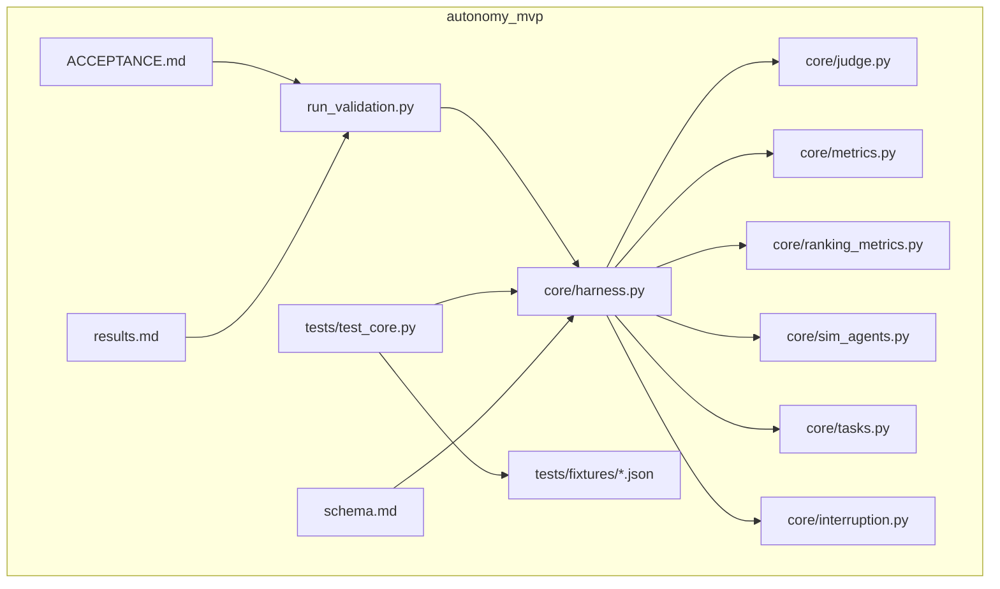
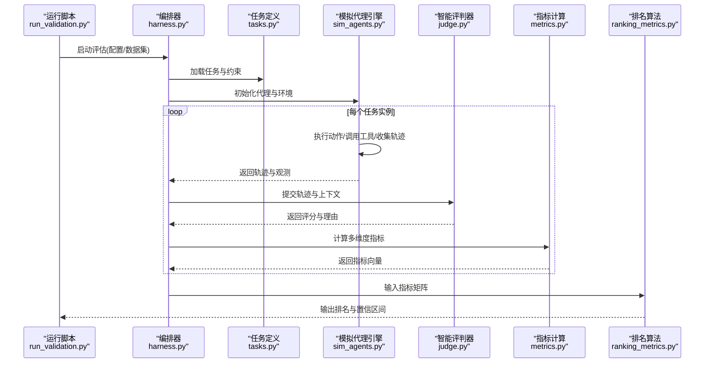
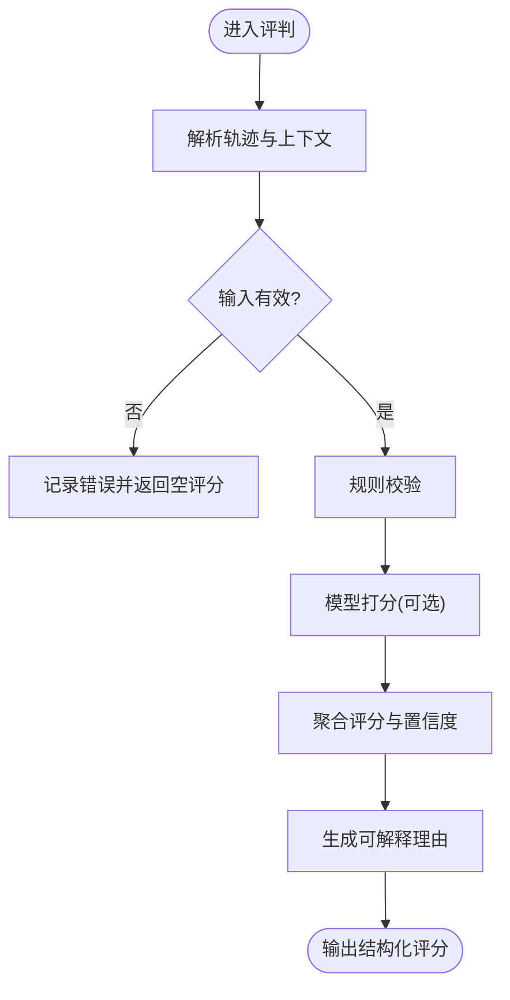
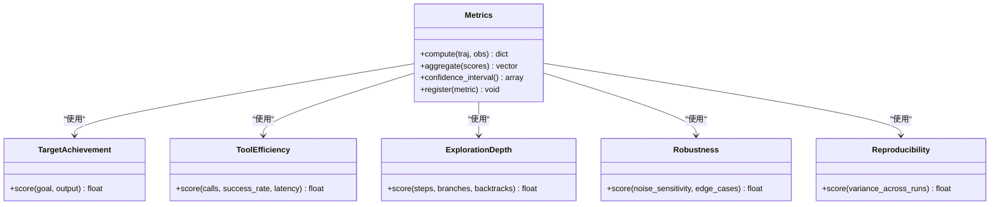
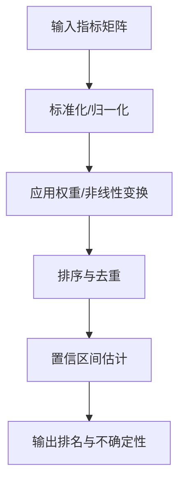
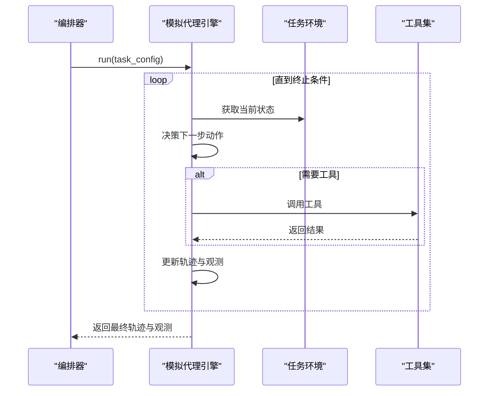
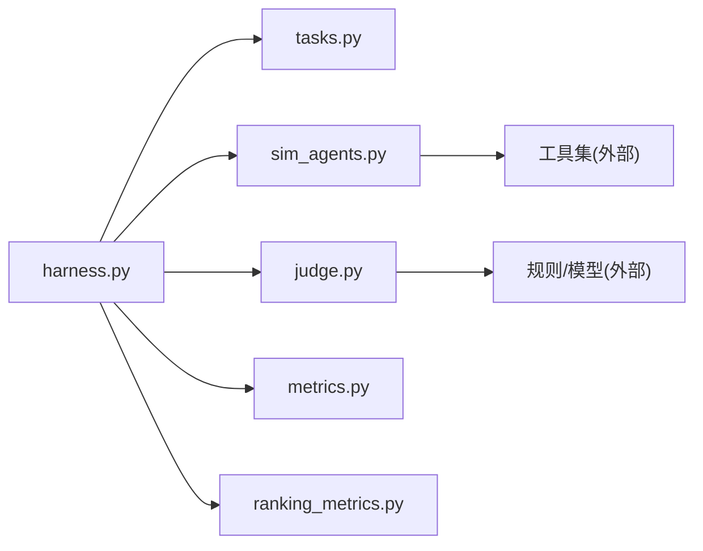

# 自主性评估系统

<cite>
**本文引用的文件**   
- [autonomy_mvp/core/judge.py](file://autonomy_mvp/core/judge.py)
- [autonomy_mvp/core/metrics.py](file://autonomy_mvp/core/metrics.py)
- [autonomy_mvp/core/ranking_metrics.py](file://autonomy_mvp/core/ranking_metrics.py)
- [autonomy_mvp/core/sim_agents.py](file://autonomy_mvp/core/sim_agents.py)
- [autonomy_mvp/core/harness.py](file://autonomy_mvp/core/harness.py)
- [autonomy_mvp/core/interruption.py](file://autonomy_mvp/core/interruption.py)
- [autonomy_mvp/core/tasks.py](file://autonomy_mvp/core/tasks.py)
- [autonomy_mvp/run_validation.py](file://autonomy_mvp/run_validation.py)
- [autonomy_mvp/ACCEPTANCE.md](file://autonomy_mvp/ACCEPTANCE.md)
- [autonomy_mvp/schema.md](file://autonomy_mvp/schema.md)
- [autonomy_mvp/results.md](file://autonomy_mvp/results.md)
- [autonomy_mvp/tests/test_core.py](file://autonomy_mvp/tests/test_core.py)
- [autonomy_mvp/tests/fixtures/fixture_drugscreen.json](file://autonomy_mvp/tests/fixtures/fixture_drugscreen.json)
- [autonomy_mvp/tests/fixtures/fixture_materials.json](file://autonomy_mvp/tests/fixtures/fixture_materials.json)
</cite>

## 目录
1. [简介](#简介)
2. [项目结构](#项目结构)
3. [核心组件](#核心组件)
4. [架构总览](#架构总览)
5. [详细组件分析](#详细组件分析)
6. [依赖关系分析](#依赖关系分析)
7. [性能考量](#性能考量)
8. [故障排查指南](#故障排查指南)
9. [结论](#结论)
10. [附录](#附录)

## 简介
本文件面向“自主性评估系统”，聚焦AI代理的自主决策能力评估。系统围绕以下关键能力展开：智能评判器（judge）、多维度指标计算（metrics）、排名算法（ranking_metrics）与模拟代理引擎（sim_agents）。文档将解释评估流程、评分标准、置信度计算与结果分析方法，并给出药物发现等场景下的具体示例。同时提供配置选项、自定义评估器与扩展方法，强调系统在衡量独立思考、问题解决与工具使用能力方面的独特价值。

## 项目结构
autonomy_mvp为核心模块，采用分层组织：
- core：评估内核（评判器、指标、排名、模拟代理、任务编排、中断处理）
- tasks：领域任务定义与数据
- tests：单元测试与测试夹具
- 根脚本：运行验证与结果汇总

图表来源
- [autonomy_mvp/core/judge.py](file://autonomy_mvp/core/judge.py)
- [autonomy_mvp/core/metrics.py](file://autonomy_mvp/core/metrics.py)
- [autonomy_mvp/core/ranking_metrics.py](file://autonomy_mvp/core/ranking_metrics.py)
- [autonomy_mvp/core/sim_agents.py](file://autonomy_mvp/core/sim_agents.py)
- [autonomy_mvp/core/harness.py](file://autonomy_mvp/core/harness.py)
- [autonomy_mvp/core/interruption.py](file://autonomy_mvp/core/interruption.py)
- [autonomy_mvp/core/tasks.py](file://autonomy_mvp/core/tasks.py)
- [autonomy_mvp/run_validation.py](file://autonomy_mvp/run_validation.py)
- [autonomy_mvp/tests/test_core.py](file://autonomy_mvp/tests/test_core.py)
- [autonomy_mvp/schema.md](file://autonomy_mvp/schema.md)
- [autonomy_mvp/ACCEPTANCE.md](file://autonomy_mvp/ACCEPTANCE.md)
- [autonomy_mvp/results.md](file://autonomy_mvp/results.md)

章节来源
- [autonomy_mvp/core/harness.py](file://autonomy_mvp/core/harness.py)
- [autonomy_mvp/run_validation.py](file://autonomy_mvp/run_validation.py)
- [autonomy_mvp/schema.md](file://autonomy_mvp/schema.md)
- [autonomy_mvp/ACCEPTANCE.md](file://autonomy_mvp/ACCEPTANCE.md)

## 核心组件
- 智能评判器（judge）：对代理行为与输出进行质量判定，支持规则与模型驱动策略，输出结构化评分与理由。
- 多维度指标（metrics）：覆盖目标达成度、工具调用效率、探索深度、鲁棒性与可复现性等维度，提供标准化度量与聚合。
- 排名算法（ranking_metrics）：基于多指标加权或排序规则生成代理间相对排名，支持稳健统计与置信区间估计。
- 模拟代理引擎（sim_agents）：驱动受试代理在任务环境中执行动作、调用工具、产生轨迹，并捕获必要观测用于评估。
- 编排与中断（harness, interruption）：统一调度评估流程、资源管理、超时与中断恢复，确保评估稳定可控。
- 任务定义（tasks）：描述任务目标、约束、环境接口与评测用例，便于跨领域复用。

章节来源
- [autonomy_mvp/core/judge.py](file://autonomy_mvp/core/judge.py)
- [autonomy_mvp/core/metrics.py](file://autonomy_mvp/core/metrics.py)
- [autonomy_mvp/core/ranking_metrics.py](file://autonomy_mvp/core/ranking_metrics.py)
- [autonomy_mvp/core/sim_agents.py](file://autonomy_mvp/core/sim_agents.py)
- [autonomy_mvp/core/harness.py](file://autonomy_mvp/core/harness.py)
- [autonomy_mvp/core/interruption.py](file://autonomy_mvp/core/interruption.py)
- [autonomy_mvp/core/tasks.py](file://autonomy_mvp/core/tasks.py)

## 架构总览
评估系统以“编排器”为中心，串联任务加载、模拟执行、评判打分、指标聚合与排名输出。评判器既可基于规则也可接入外部模型；指标层保证多维一致性；排名层提供可比性；模拟引擎屏蔽环境差异。

图表来源
- [autonomy_mvp/run_validation.py](file://autonomy_mvp/run_validation.py)
- [autonomy_mvp/core/harness.py](file://autonomy_mvp/core/harness.py)
- [autonomy_mvp/core/tasks.py](file://autonomy_mvp/core/tasks.py)
- [autonomy_mvp/core/sim_agents.py](file://autonomy_mvp/core/sim_agents.py)
- [autonomy_mvp/core/judge.py](file://autonomy_mvp/core/judge.py)
- [autonomy_mvp/core/metrics.py](file://autonomy_mvp/core/metrics.py)
- [autonomy_mvp/core/ranking_metrics.py](file://autonomy_mvp/core/ranking_metrics.py)

## 详细组件分析

### 智能评判器（judge）
- 功能要点
  - 接收代理轨迹、工具调用日志与最终输出，结合任务规范进行质量判定。
  - 支持规则引擎与模型驱动两种模式，可组合使用以提升稳定性与泛化性。
  - 输出结构化评分、置信度与可解释理由，便于后续分析与审计。
- 设计模式
  - 策略模式：不同评判策略可插拔替换。
  - 责任链：按维度逐项校验，失败快速短路。
- 复杂度与优化
  - 时间复杂度主要取决于轨迹长度与规则数量；可通过缓存与并行化提升吞吐。
  - 空间复杂度受轨迹规模影响，建议流式处理与增量评分。
- 错误处理
  - 对缺失字段、非法动作、工具异常进行容错与降级，记录诊断信息。

图表来源
- [autonomy_mvp/core/judge.py](file://autonomy_mvp/core/judge.py)

章节来源
- [autonomy_mvp/core/judge.py](file://autonomy_mvp/core/judge.py)

### 多维度指标（metrics）
- 指标体系
  - 目标达成度：是否满足任务硬性约束与软性期望。
  - 工具使用效率：调用次数、成功率、耗时与冗余度。
  - 探索深度：分支尝试、回溯与迭代轮次。
  - 鲁棒性：对噪声、缺失信息与边界条件的稳定性。
  - 可复现性：多次运行的方差与一致性。
- 计算方法
  - 归一化与加权聚合，支持动态权重与自适应调整。
  - 置信区间估计：基于Bootstrap或解析近似，提供不确定性量化。
- 扩展点
  - 新增指标需实现统一接口，自动纳入聚合流水线。

图表来源
- [autonomy_mvp/core/metrics.py](file://autonomy_mvp/core/metrics.py)

章节来源
- [autonomy_mvp/core/metrics.py](file://autonomy_mvp/core/metrics.py)

### 排名算法（ranking_metrics）
- 算法要点
  - 多指标加权排序，支持线性与非线性聚合。
  - 稳健统计：剔除异常值、计算中位数与分位数。
  - 置信区间：对排名稳定性进行量化，避免过拟合单一样本。
- 可扩展性
  - 支持自定义聚合函数与排序规则，便于领域适配。

图表来源
- [autonomy_mvp/core/ranking_metrics.py](file://autonomy_mvp/core/ranking_metrics.py)

章节来源
- [autonomy_mvp/core/ranking_metrics.py](file://autonomy_mvp/core/ranking_metrics.py)

### 模拟代理引擎（sim_agents）
- 职责
  - 驱动受试代理在任务环境中执行动作、调用工具、维护状态。
  - 捕获完整轨迹、工具调用日志与中间观测，供评判与指标使用。
- 特性
  - 支持异步与并发执行，提高吞吐。
  - 内置中断与超时控制，保障长时任务的稳定性。
- 与编排器交互
  - 通过统一接口暴露run、reset、step等方法，便于替换不同代理实现。

图表来源
- [autonomy_mvp/core/sim_agents.py](file://autonomy_mvp/core/sim_agents.py)
- [autonomy_mvp/core/harness.py](file://autonomy_mvp/core/harness.py)

章节来源
- [autonomy_mvp/core/sim_agents.py](file://autonomy_mvp/core/sim_agents.py)
- [autonomy_mvp/core/harness.py](file://autonomy_mvp/core/harness.py)

### 编排与中断（harness, interruption）
- 编排器
  - 负责任务加载、资源分配、循环执行与结果汇总。
  - 提供配置注入、日志记录与断点续跑能力。
- 中断处理
  - 支持信号中断、超时与异常恢复，确保长时间评估的可靠性。

章节来源
- [autonomy_mvp/core/harness.py](file://autonomy_mvp/core/harness.py)
- [autonomy_mvp/core/interruption.py](file://autonomy_mvp/core/interruption.py)

### 任务定义（tasks）
- 内容
  - 任务目标、约束、环境接口、评测用例与样例数据。
  - 支持JSON/YAML等多格式，便于版本管理与共享。
- 示例
  - 药物筛选与材料属性预测等任务，提供基准数据与参考实现。

章节来源
- [autonomy_mvp/core/tasks.py](file://autonomy_mvp/core/tasks.py)
- [autonomy_mvp/tests/fixtures/fixture_drugscreen.json](file://autonomy_mvp/tests/fixtures/fixture_drugscreen.json)
- [autonomy_mvp/tests/fixtures/fixture_materials.json](file://autonomy_mvp/tests/fixtures/fixture_materials.json)

## 依赖关系分析
- 模块耦合
  - harness作为中心协调者，依赖tasks、sim_agents、judge、metrics与ranking_metrics。
  - sim_agents依赖环境与工具集，judge依赖任务规范与上下文。
- 外部依赖
  - 工具调用可能涉及外部API或服务，需考虑网络与权限问题。
- 潜在循环依赖
  - 通过接口抽象与分层避免循环引用。

图表来源
- [autonomy_mvp/core/harness.py](file://autonomy_mvp/core/harness.py)
- [autonomy_mvp/core/tasks.py](file://autonomy_mvp/core/tasks.py)
- [autonomy_mvp/core/sim_agents.py](file://autonomy_mvp/core/sim_agents.py)
- [autonomy_mvp/core/judge.py](file://autonomy_mvp/core/judge.py)
- [autonomy_mvp/core/metrics.py](file://autonomy_mvp/core/metrics.py)
- [autonomy_mvp/core/ranking_metrics.py](file://autonomy_mvp/core/ranking_metrics.py)

章节来源
- [autonomy_mvp/core/harness.py](file://autonomy_mvp/core/harness.py)

## 性能考量
- 批处理与并行
  - 对独立任务实例进行并行执行，提升吞吐。
  - 指标计算与排名阶段向量化处理，减少Python循环开销。
- 内存与I/O
  - 大轨迹流式处理，避免一次性加载导致内存峰值。
  - 结果落盘与增量写入，支持断点续跑。
- 评判器优化
  - 规则缓存与模型请求合并，降低延迟。
  - 早停机制：当关键维度不达标时提前结束评估。

[本节为通用指导，无需特定文件来源]

## 故障排查指南
- 常见问题
  - 任务加载失败：检查任务文件格式与必填字段。
  - 工具调用异常：确认权限、网络与依赖库安装。
  - 评判器报错：核对轨迹结构与上下文完整性。
  - 指标计算异常：检查数值范围与缺失值处理。
  - 排名不稳定：增加样本量或调整权重策略。
- 调试建议
  - 启用详细日志与轨迹回放。
  - 使用测试夹具验证最小可复现场景。
  - 逐步隔离问题模块，定位根因。

章节来源
- [autonomy_mvp/tests/test_core.py](file://autonomy_mvp/tests/test_core.py)
- [autonomy_mvp/schema.md](file://autonomy_mvp/schema.md)

## 结论
自主性评估系统通过评判器、指标、排名与模拟引擎的协同，提供了系统化、可解释且可扩展的AI代理自主性评估方案。其核心价值在于：
- 多维度量化代理的独立思考、问题解决与工具使用能力。
- 提供置信度与可解释性，支撑严谨的比较与改进。
- 模块化设计便于领域定制与持续演进。

[本节为总结性内容，无需特定文件来源]

## 附录
- 运行与验收
  - 使用run_validation.py启动评估，遵循ACCEPTANCE.md中的验收标准。
  - 结果汇总与报告生成见results.md。
- 数据与配置
  - schema.md定义输入输出格式与校验规则。
  - 测试夹具提供最小可运行样例，便于本地验证。

章节来源
- [autonomy_mvp/run_validation.py](file://autonomy_mvp/run_validation.py)
- [autonomy_mvp/ACCEPTANCE.md](file://autonomy_mvp/ACCEPTANCE.md)
- [autonomy_mvp/results.md](file://autonomy_mvp/results.md)
- [autonomy_mvp/schema.md](file://autonomy_mvp/schema.md)
- [autonomy_mvp/tests/fixtures/fixture_drugscreen.json](file://autonomy_mvp/tests/fixtures/fixture_drugscreen.json)
- [autonomy_mvp/tests/fixtures/fixture_materials.json](file://autonomy_mvp/tests/fixtures/fixture_materials.json)