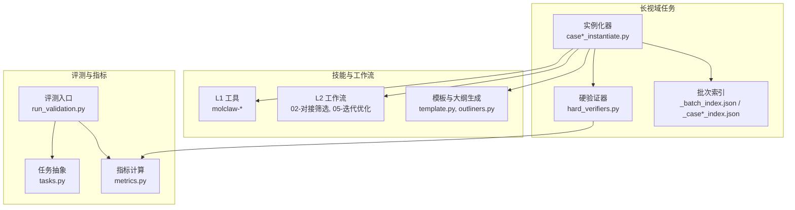
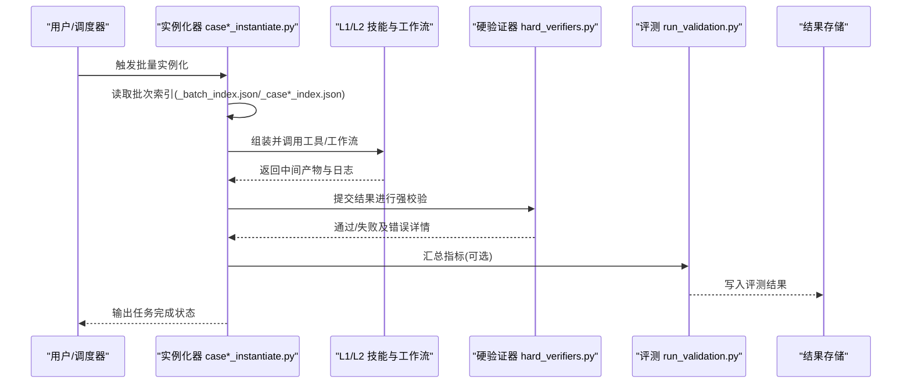
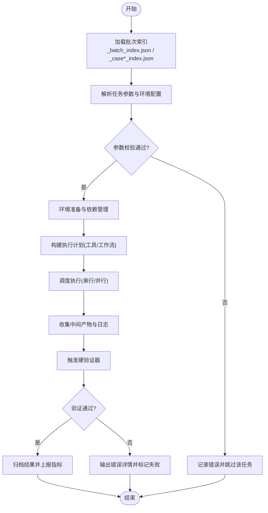
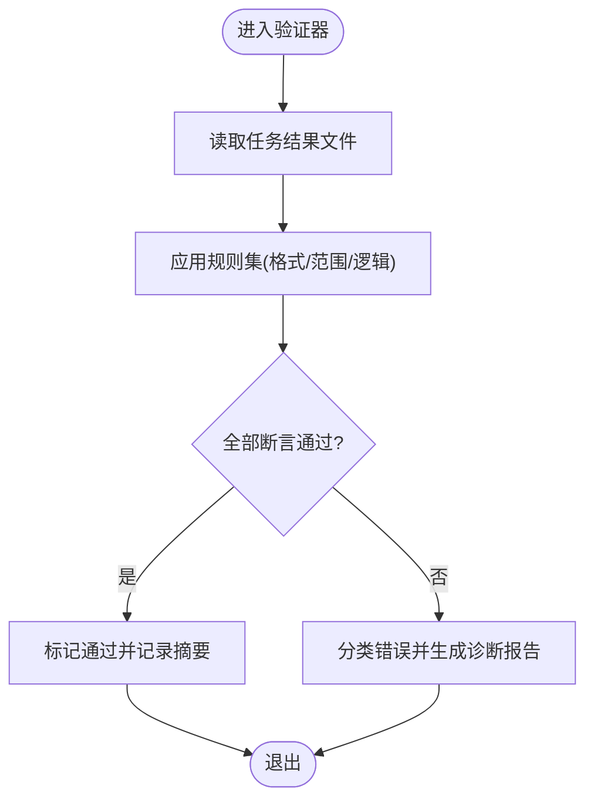
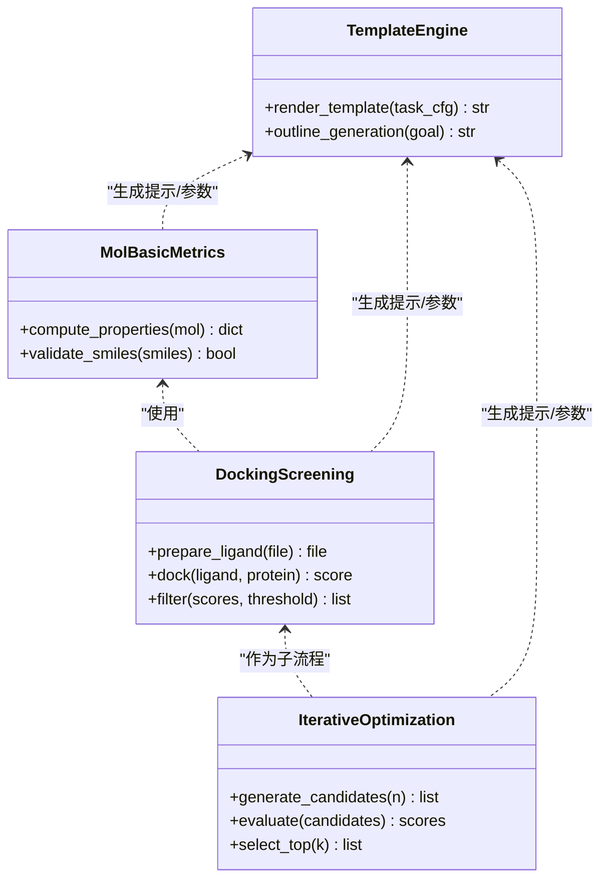
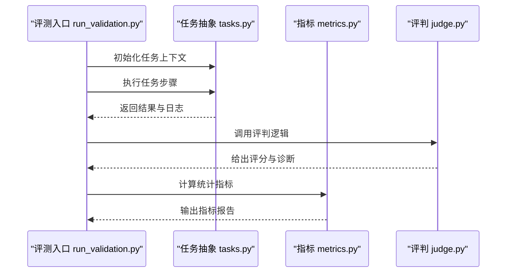
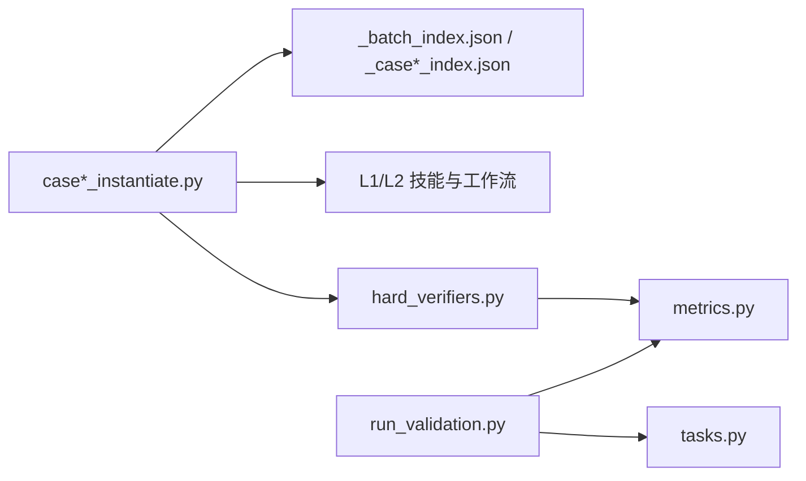

# 长视域任务平台

<cite>
**本文引用的文件**   
- [longhorizon/instantiate/case1_instantiate.py](file://longhorizon/instantiate/case1_instantiate.py)
- [longhorizon/instantiate/case2_instantiate.py](file://longhorizon/instantiate/case2_instantiate.py)
- [longhorizon/instantiate/case3_instantiate.py](file://longhorizon/instantiate/case3_instantiate.py)
- [longhorizon/instantiate/caseD_instantiate.py](file://longhorizon/instantiate/caseD_instantiate.py)
- [longhorizon/instantiate/caseE_instantiate.py](file://longhorizon/instantiate/caseE_instantiate.py)
- [longhorizon/instantiate/caseF_instantiate.py](file://longhorizon/instantiate/caseF_instantiate.py)
- [longhorizon/verifiers/hard_verifiers.py](file://longhorizon/verifiers/hard_verifiers.py)
- [longhorizon/instantiate/instances/_batch_index.json](file://longhorizon/instantiate/instances/_batch_index.json)
- [longhorizon/instantiate/instances/_case2_index.json](file://longhorizon/instantiate/instances/_case2_index.json)
- [longhorizon/instantiate/instances/_case3_index.json](file://longhorizon/instantiate/instances/_case3_index.json)
- [longhorizon/instantiate/README_case3_机理模拟.md](file://longhorizon/instantiate/README_case3_机理模拟.md)
- [longhorizon/instantiate/README_caseD_闭环优化.md](file://longhorizon/instantiate/README_caseD_闭环优化.md)
- [longhorizon/instantiate/README_caseE_逆合成.md](file://longhorizon/instantiate/README_caseE_逆合成.md)
- [longhorizon/instantiate/README_caseF_靶点验证.md](file://longhorizon/instantiate/README_caseF_靶点验证.md)
- [autonomy_mvp/core/tasks.py](file://autonomy_mvp/core/tasks.py)
- [autonomy_mvp/core/judge.py](file://autonomy_mvp/core/judge.py)
- [autonomy_mvp/core/metrics.py](file://autonomy_mvp/core/metrics.py)
- [autonomy_mvp/run_validation.py](file://autonomy_mvp/run_validation.py)
- [docs/molbench_repo/skills/L1_tools/molclaw-mol-basic-metrics/molclaw-mol-basic-metrics.yaml](file://docs/molbench_repo/skills/L1_tools/molclaw-mol-basic-metrics/molclaw-mol-basic-metrics.yaml)
- [docs/molbench_repo/skills/L1_tools/molclaw-smiles-valid-check/molclaw-smiles-valid-check.yaml](file://docs/molbench_repo/skills/L1_tools/molclaw-smiles-valid-check/molclaw-smiles-valid-check.yaml)
- [docs/molbench_repo/skills/L1_tools/molclaw-docking-screening/molclaw-docking-screening.yaml](file://docs/molbench_repo/skills/L1_tools/molclaw-docking-screening/molclaw-docking-screening.yaml)
- [docs/molbench_repo/skills/L2_workflows/02-molecular-docking-screening.md](file://docs/molbench_repo/skills/L2_workflows/02-molecular-docking-screening.md)
- [docs/molbench_repo/skills/L2_workflows/05-iterative-molecular-optimization.md](file://docs/molbench_repo/skills/L2_workflows/05-iterative-molecular-optimization.md)
- [docs/molbench_repo/templates/template.py](file://docs/molbench_repo/templates/template.py)
- [docs/molbench_repo/templates/outliners.py](file://docs/molbench_repo/templates/outliners.py)
</cite>

## 目录
1. [简介](#简介)
2. [项目结构](#项目结构)
3. [核心组件](#核心组件)
4. [架构总览](#架构总览)
5. [详细组件分析](#详细组件分析)
6. [依赖关系分析](#依赖关系分析)
7. [性能考量](#性能考量)
8. [故障排查指南](#故障排查指南)
9. [结论](#结论)
10. [附录](#附录)

## 简介
本文件面向“长视域任务平台”，聚焦复杂多步骤科学任务的定义、实例化与执行机制。平台围绕材料发现、药物筛选、机理模拟等典型场景，提供：
- 统一的任务实例化器（case*_instantiate.py），负责参数配置、环境准备、依赖管理与执行调度；
- 强校验系统（hard_verifiers.py），实现结果检查与错误处理；
- 可复用的技能与工作流模板（molbench_repo），支撑分子性质计算、对接筛选、迭代优化等流程；
- 评测与指标体系（autonomy_mvp），用于一致性、正确性与效率评估。

平台优势在于对需要长时间推理和多步操作的科学问题具备稳定编排能力，支持大规模批量化运行与严格验证。

## 项目结构
仓库采用按领域与职责分层组织的方式：
- longhorizon：长视域任务的核心实现，包含实例化脚本与硬验证器；
- docs/molbench_repo：工具技能与工作流模板、评测配置与示例数据；
- autonomy_mvp：通用评测框架与指标；
- task1~task7：各子任务实验与记录。

图表来源
- [longhorizon/instantiate/case1_instantiate.py](file://longhorizon/instantiate/case1_instantiate.py)
- [longhorizon/instantiate/case2_instantiate.py](file://longhorizon/instantiate/case2_instantiate.py)
- [longhorizon/instantiate/case3_instantiate.py](file://longhorizon/instantiate/case3_instantiate.py)
- [longhorizon/instantiate/caseD_instantiate.py](file://longhorizon/instantiate/caseD_instantiate.py)
- [longhorizon/instantiate/caseE_instantiate.py](file://longhorizon/instantiate/caseE_instantiate.py)
- [longhorizon/instantiate/caseF_instantiate.py](file://longhorizon/instantiate/caseF_instantiate.py)
- [longhorizon/verifiers/hard_verifiers.py](file://longhorizon/verifiers/hard_verifiers.py)
- [longhorizon/instantiate/instances/_batch_index.json](file://longhorizon/instantiate/instances/_batch_index.json)
- [longhorizon/instantiate/instances/_case2_index.json](file://longhorizon/instantiate/instances/_case2_index.json)
- [longhorizon/instantiate/instances/_case3_index.json](file://longhorizon/instantiate/instances/_case3_index.json)
- [docs/molbench_repo/skills/L1_tools/molclaw-mol-basic-metrics/molclaw-mol-basic-metrics.yaml](file://docs/molbench_repo/skills/L1_tools/molclaw-mol-basic-metrics/molclaw-mol-basic-metrics.yaml)
- [docs/molbench_repo/skills/L1_tools/molclaw-smiles-valid-check/molclaw-smiles-valid-check.yaml](file://docs/molbench_repo/skills/L1_tools/molclaw-smiles-valid-check/molclaw-smiles-valid-check.yaml)
- [docs/molbench_repo/skills/L1_tools/molclaw-docking-screening/molclaw-docking-screening.yaml](file://docs/molbench_repo/skills/L1_tools/molclaw-docking-screening/molclaw-docking-screening.yaml)
- [docs/molbench_repo/skills/L2_workflows/02-molecular-docking-screening.md](file://docs/molbench_repo/skills/L2_workflows/02-molecular-docking-screening.md)
- [docs/molbench_repo/skills/L2_workflows/05-iterative-molecular-optimization.md](file://docs/molbench_repo/skills/L2_workflows/05-iterative-molecular-optimization.md)
- [docs/molbench_repo/templates/template.py](file://docs/molbench_repo/templates/template.py)
- [docs/molbench_repo/templates/outliners.py](file://docs/molbench_repo/templates/outliners.py)
- [autonomy_mvp/run_validation.py](file://autonomy_mvp/run_validation.py)
- [autonomy_mvp/core/tasks.py](file://autonomy_mvp/core/tasks.py)
- [autonomy_mvp/core/metrics.py](file://autonomy_mvp/core/metrics.py)

章节来源
- [longhorizon/instantiate/case1_instantiate.py](file://longhorizon/instantiate/case1_instantiate.py)
- [longhorizon/instantiate/case2_instantiate.py](file://longhorizon/instantiate/case2_instantiate.py)
- [longhorizon/instantiate/case3_instantiate.py](file://longhorizon/instantiate/case3_instantiate.py)
- [longhorizon/instantiate/caseD_instantiate.py](file://longhorizon/instantiate/caseD_instantiate.py)
- [longhorizon/instantiate/caseE_instantiate.py](file://longhorizon/instantiate/caseE_instantiate.py)
- [longhorizon/instantiate/caseF_instantiate.py](file://longhorizon/instantiate/caseF_instantiate.py)
- [longhorizon/verifiers/hard_verifiers.py](file://longhorizon/verifiers/hard_verifiers.py)
- [longhorizon/instantiate/instances/_batch_index.json](file://longhorizon/instantiate/instances/_batch_index.json)
- [longhorizon/instantiate/instances/_case2_index.json](file://longhorizon/instantiate/instances/_case2_index.json)
- [longhorizon/instantiate/instances/_case3_index.json](file://longhorizon/instantiate/instances/_case3_index.json)
- [autonomy_mvp/run_validation.py](file://autonomy_mvp/run_validation.py)
- [autonomy_mvp/core/tasks.py](file://autonomy_mvp/core/tasks.py)
- [autonomy_mvp/core/metrics.py](file://autonomy_mvp/core/metrics.py)

## 核心组件
- 任务实例化器（case*_instantiate.py）
  - 功能：读取批次索引，解析任务参数与环境配置，组装技能/工作流调用序列，提交执行并落盘中间产物与日志。
  - 关键流程：加载索引 → 参数校验 → 环境准备 → 依赖安装/缓存 → 调度执行 → 结果归档。
- 硬验证器（hard_verifiers.py）
  - 功能：对最终输出进行强约束检查，包括格式、数值范围、逻辑一致性与外部工具返回码判定。
  - 关键流程：读取结果 → 规则匹配 → 断言/阈值比较 → 错误分类与报告。
- 技能与工作流（molbench_repo）
  - L1 工具：分子基础度量、SMILES 合法性检查、对接筛选等。
  - L2 工作流：对接筛选流水线、迭代分子优化等。
  - 模板：统一任务描述与大纲生成，便于批量复用。
- 评测与指标（autonomy_mvp）
  - 评测入口：run_validation.py 驱动任务执行与评分。
  - 任务抽象：tasks.py 定义任务接口与生命周期。
  - 指标：metrics.py 提供准确率、鲁棒性、耗时等统计。

章节来源
- [longhorizon/instantiate/case1_instantiate.py](file://longhorizon/instantiate/case1_instantiate.py)
- [longhorizon/instantiate/case2_instantiate.py](file://longhorizon/instantiate/case2_instantiate.py)
- [longhorizon/instantiate/case3_instantiate.py](file://longhorizon/instantiate/case3_instantiate.py)
- [longhorizon/instantiate/caseD_instantiate.py](file://longhorizon/instantiate/caseD_instantiate.py)
- [longhorizon/instantiate/caseE_instantiate.py](file://longhorizon/instantiate/caseE_instantiate.py)
- [longhorizon/instantiate/caseF_instantiate.py](file://longhorizon/instantiate/caseF_instantiate.py)
- [longhorizon/verifiers/hard_verifiers.py](file://longhorizon/verifiers/hard_verifiers.py)
- [docs/molbench_repo/skills/L1_tools/molclaw-mol-basic-metrics/molclaw-mol-basic-metrics.yaml](file://docs/molbench_repo/skills/L1_tools/molclaw-mol-basic-metrics/molclaw-mol-basic-metrics.yaml)
- [docs/molbench_repo/skills/L1_tools/molclaw-smiles-valid-check/molclaw-smiles-valid-check.yaml](file://docs/molbench_repo/skills/L1_tools/molclaw-smiles-valid-check/molclaw-smiles-valid-check.yaml)
- [docs/molbench_repo/skills/L1_tools/molclaw-docking-screening/molclaw-docking-screening.yaml](file://docs/molbench_repo/skills/L1_tools/molclaw-docking-screening/molclaw-docking-screening.yaml)
- [docs/molbench_repo/skills/L2_workflows/02-molecular-docking-screening.md](file://docs/molbench_repo/skills/L2_workflows/02-molecular-docking-screening.md)
- [docs/molbench_repo/skills/L2_workflows/05-iterative-molecular-optimization.md](file://docs/molbench_repo/skills/L2_workflows/05-iterative-molecular-optimization.md)
- [docs/molbench_repo/templates/template.py](file://docs/molbench_repo/templates/template.py)
- [docs/molbench_repo/templates/outliners.py](file://docs/molbench_repo/templates/outliners.py)
- [autonomy_mvp/run_validation.py](file://autonomy_mvp/run_validation.py)
- [autonomy_mvp/core/tasks.py](file://autonomy_mvp/core/tasks.py)
- [autonomy_mvp/core/metrics.py](file://autonomy_mvp/core/metrics.py)

## 架构总览
平台以“实例化器 + 验证器”为核心，结合“技能/工作流模板”和“评测指标”，形成端到端的长视域任务流水线。

图表来源
- [longhorizon/instantiate/case1_instantiate.py](file://longhorizon/instantiate/case1_instantiate.py)
- [longhorizon/instantiate/case2_instantiate.py](file://longhorizon/instantiate/case2_instantiate.py)
- [longhorizon/instantiate/case3_instantiate.py](file://longhorizon/instantiate/case3_instantiate.py)
- [longhorizon/instantiate/caseD_instantiate.py](file://longhorizon/instantiate/caseD_instantiate.py)
- [longhorizon/instantiate/caseE_instantiate.py](file://longhorizon/instantiate/caseE_instantiate.py)
- [longhorizon/instantiate/caseF_instantiate.py](file://longhorizon/instantiate/caseF_instantiate.py)
- [longhorizon/verifiers/hard_verifiers.py](file://longhorizon/verifiers/hard_verifiers.py)
- [longhorizon/instantiate/instances/_batch_index.json](file://longhorizon/instantiate/instances/_batch_index.json)
- [longhorizon/instantiate/instances/_case2_index.json](file://longhorizon/instantiate/instances/_case2_index.json)
- [longhorizon/instantiate/instances/_case3_index.json](file://longhorizon/instantiate/instances/_case3_index.json)
- [autonomy_mvp/run_validation.py](file://autonomy_mvp/run_validation.py)

## 详细组件分析

### 任务实例化器（case*_instantiate.py）
- 设计要点
  - 参数配置：从 JSON 索引中读取任务元数据（输入源、目标属性、阈值、资源限制等）。
  - 环境设置：根据任务类型选择 Python 环境、外部工具路径与模型权重缓存。
  - 依赖管理：按需安装或拉取工具包，避免重复下载；对网络不可用场景提供离线回退策略。
  - 执行调度：串行/并行混合调度，支持断点续跑与幂等重试。
- 关键流程
  - 加载索引 → 参数校验 → 环境初始化 → 依赖检查/安装 → 构建任务图 → 调度执行 → 结果归档 → 触发验证。
- 适用案例
  - 材料发现（case1）、高通量筛选（case2）、机理模拟（case3）、闭环优化（caseD）、逆合成（caseE）、靶点验证（caseF）。

图表来源
- [longhorizon/instantiate/case1_instantiate.py](file://longhorizon/instantiate/case1_instantiate.py)
- [longhorizon/instantiate/case2_instantiate.py](file://longhorizon/instantiate/case2_instantiate.py)
- [longhorizon/instantiate/case3_instantiate.py](file://longhorizon/instantiate/case3_instantiate.py)
- [longhorizon/instantiate/caseD_instantiate.py](file://longhorizon/instantiate/caseD_instantiate.py)
- [longhorizon/instantiate/caseE_instantiate.py](file://longhorizon/instantiate/caseE_instantiate.py)
- [longhorizon/instantiate/caseF_instantiate.py](file://longhorizon/instantiate/caseF_instantiate.py)
- [longhorizon/instantiate/instances/_batch_index.json](file://longhorizon/instantiate/instances/_batch_index.json)
- [longhorizon/instantiate/instances/_case2_index.json](file://longhorizon/instantiate/instances/_case2_index.json)
- [longhorizon/instantiate/instances/_case3_index.json](file://longhorizon/instantiate/instances/_case3_index.json)

章节来源
- [longhorizon/instantiate/case1_instantiate.py](file://longhorizon/instantiate/case1_instantiate.py)
- [longhorizon/instantiate/case2_instantiate.py](file://longhorizon/instantiate/case2_instantiate.py)
- [longhorizon/instantiate/case3_instantiate.py](file://longhorizon/instantiate/case3_instantiate.py)
- [longhorizon/instantiate/caseD_instantiate.py](file://longhorizon/instantiate/caseD_instantiate.py)
- [longhorizon/instantiate/caseE_instantiate.py](file://longhorizon/instantiate/caseE_instantiate.py)
- [longhorizon/instantiate/caseF_instantiate.py](file://longhorizon/instantiate/caseF_instantiate.py)
- [longhorizon/instantiate/instances/_batch_index.json](file://longhorizon/instantiate/instances/_batch_index.json)
- [longhorizon/instantiate/instances/_case2_index.json](file://longhorizon/instantiate/instances/_case2_index.json)
- [longhorizon/instantiate/instances/_case3_index.json](file://longhorizon/instantiate/instances/_case3_index.json)

### 硬验证器（hard_verifiers.py）
- 设计要点
  - 规则引擎：基于声明式规则（字段存在性、类型、取值范围、逻辑关系）进行断言。
  - 结果检查：对比期望输出与实际输出，支持近似相等、集合包含、排序稳定性等。
  - 错误处理：将错误分类为“格式错误/数值越界/逻辑不一致/外部工具异常”，并生成结构化报告。
- 关键流程
  - 读取结果 → 应用规则集 → 逐项断言 → 聚合错误 → 输出通过/失败与诊断信息。

图表来源
- [longhorizon/verifiers/hard_verifiers.py](file://longhorizon/verifiers/hard_verifiers.py)

章节来源
- [longhorizon/verifiers/hard_verifiers.py](file://longhorizon/verifiers/hard_verifiers.py)

### 技能与工作流模板（molbench_repo）
- L1 工具
  - molclaw-mol-basic-metrics：分子基础性质计算（如分子量、LogP、极性表面积等）。
  - molclaw-smiles-valid-check：SMILES 字符串合法性校验。
  - molclaw-docking-screening：分子对接筛选流程封装。
- L2 工作流
  - 02-molecular-docking-screening：对接筛选流水线（预处理→对接→打分→过滤）。
  - 05-iterative-molecular-optimization：迭代优化（生成→评估→反馈→再优化）。
- 模板与大纲
  - template.py/outliners.py：统一任务描述、变量路由与大纲生成，提升可复用性。

图表来源
- [docs/molbench_repo/skills/L1_tools/molclaw-mol-basic-metrics/molclaw-mol-basic-metrics.yaml](file://docs/molbench_repo/skills/L1_tools/molclaw-mol-basic-metrics/molclaw-mol-basic-metrics.yaml)
- [docs/molbench_repo/skills/L1_tools/molclaw-smiles-valid-check/molclaw-smiles-valid-check.yaml](file://docs/molbench_repo/skills/L1_tools/molclaw-smiles-valid-check/molclaw-smiles-valid-check.yaml)
- [docs/molbench_repo/skills/L1_tools/molclaw-docking-screening/molclaw-docking-screening.yaml](file://docs/molbench_repo/skills/L1_tools/molclaw-docking-screening/molclaw-docking-screening.yaml)
- [docs/molbench_repo/skills/L2_workflows/02-molecular-docking-screening.md](file://docs/molbench_repo/skills/L2_workflows/02-molecular-docking-screening.md)
- [docs/molbench_repo/skills/L2_workflows/05-iterative-molecular-optimization.md](file://docs/molbench_repo/skills/L2_workflows/05-iterative-molecular-optimization.md)
- [docs/molbench_repo/templates/template.py](file://docs/molbench_repo/templates/template.py)
- [docs/molbench_repo/templates/outliners.py](file://docs/molbench_repo/templates/outliners.py)

章节来源
- [docs/molbench_repo/skills/L1_tools/molclaw-mol-basic-metrics/molclaw-mol-basic-metrics.yaml](file://docs/molbench_repo/skills/L1_tools/molclaw-mol-basic-metrics/molclaw-mol-basic-metrics.yaml)
- [docs/molbench_repo/skills/L1_tools/molclaw-smiles-valid-check/molclaw-smiles-valid-check.yaml](file://docs/molbench_repo/skills/L1_tools/molclaw-smiles-valid-check/molclaw-smiles-valid-check.yaml)
- [docs/molbench_repo/skills/L1_tools/molclaw-docking-screening/molclaw-docking-screening.yaml](file://docs/molbench_repo/skills/L1_tools/molclaw-docking-screening/molclaw-docking-screening.yaml)
- [docs/molbench_repo/skills/L2_workflows/02-molecular-docking-screening.md](file://docs/molbench_repo/skills/L2_workflows/02-molecular-docking-screening.md)
- [docs/molbench_repo/skills/L2_workflows/05-iterative-molecular-optimization.md](file://docs/molbench_repo/skills/L2_workflows/05-iterative-molecular-optimization.md)
- [docs/molbench_repo/templates/template.py](file://docs/molbench_repo/templates/template.py)
- [docs/molbench_repo/templates/outliners.py](file://docs/molbench_repo/templates/outliners.py)

### 评测与指标（autonomy_mvp）
- 评测入口：run_validation.py 负责加载任务、执行并汇总指标。
- 任务抽象：tasks.py 定义任务生命周期与钩子（准备、执行、清理、评估）。
- 指标：metrics.py 提供准确性、鲁棒性、耗时、吞吐等统计。

图表来源
- [autonomy_mvp/run_validation.py](file://autonomy_mvp/run_validation.py)
- [autonomy_mvp/core/tasks.py](file://autonomy_mvp/core/tasks.py)
- [autonomy_mvp/core/metrics.py](file://autonomy_mvp/core/metrics.py)
- [autonomy_mvp/core/judge.py](file://autonomy_mvp/core/judge.py)

章节来源
- [autonomy_mvp/run_validation.py](file://autonomy_mvp/run_validation.py)
- [autonomy_mvp/core/tasks.py](file://autonomy_mvp/core/tasks.py)
- [autonomy_mvp/core/metrics.py](file://autonomy_mvp/core/metrics.py)
- [autonomy_mvp/core/judge.py](file://autonomy_mvp/core/judge.py)

### 具体案例实现细节
- 材料发现（超导体/半导体带隙）
  - 输入：元素组合与目标属性；输出：候选结构与预测值。
  - 工具链：结构生成→性质预测→阈值过滤→结果归档。
  - 参考：[longhorizon/instantiate/case1_instantiate.py](file://longhorizon/instantiate/case1_instantiate.py)、[longhorizon/instantiate/instances/mat1_*](file://longhorizon/instantiate/instances/mat1_Ca-Si-O_funnel.json)。
- 药物筛选（MS3 级别）
  - 输入：化合物库与靶点蛋白；输出：对接得分与命中列表。
  - 工具链：SMILES 校验→对接→打分→过滤→可视化。
  - 参考：[longhorizon/instantiate/case2_instantiate.py](file://longhorizon/instantiate/case2_instantiate.py)、[docs/molbench_repo/skills/L2_workflows/02-molecular-docking-screening.md](file://docs/molbench_repo/skills/L2_workflows/02-molecular-docking-screening.md)。
- 机理模拟（药物-靶点相互作用）
  - 输入：药物与突变位点；输出：结合自由能变化与机制解释。
  - 工具链：构象采样→MM-PBSA/自由能微扰→统计分析。
  - 参考：[longhorizon/instantiate/case3_instantiate.py](file://longhorizon/instantiate/case3_instantiate.py)、[longhorizon/instantiate/README_case3_机理模拟.md](file://longhorizon/instantiate/README_case3_机理模拟.md)。
- 闭环优化（BaTiO 等材料）
  - 输入：初始配方与目标性能；输出：优化后配方与收敛曲线。
  - 工具链：生成→评估→反馈→再优化→收敛判断。
  - 参考：[longhorizon/instantiate/caseD_instantiate.py](file://longhorizon/instantiate/caseD_instantiate.py)、[longhorizon/instantiate/README_caseD_闭环优化.md](file://longhorizon/instantiate/README_caseD_闭环优化.md)。
- 逆合成（常见药物分子）
  - 输入：目标分子；输出：合成路线与可行性评分。
  - 工具链： retrosynthesis 规划→反应可行性→成本估算。
  - 参考：[longhorizon/instantiate/caseE_instantiate.py](file://longhorizon/instantiate/caseE_instantiate.py)、[longhorizon/instantiate/README_caseE_逆合成.md](file://longhorizon/instantiate/README_caseE_逆合成.md)。
- 靶点验证（疾病相关靶点）
  - 输入：疾病与候选靶点；输出：证据强度与优先级排序。
  - 工具链：文献检索→特征抽取→证据聚合→排序。
  - 参考：[longhorizon/instantiate/caseF_instantiate.py](file://longhorizon/instantiate/caseF_instantiate.py)、[longhorizon/instantiate/README_caseF_靶点验证.md](file://longhorizon/instantiate/README_caseF_靶点验证.md)。

章节来源
- [longhorizon/instantiate/case1_instantiate.py](file://longhorizon/instantiate/case1_instantiate.py)
- [longhorizon/instantiate/case2_instantiate.py](file://longhorizon/instantiate/case2_instantiate.py)
- [longhorizon/instantiate/case3_instantiate.py](file://longhorizon/instantiate/case3_instantiate.py)
- [longhorizon/instantiate/caseD_instantiate.py](file://longhorizon/instantiate/caseD_instantiate.py)
- [longhorizon/instantiate/caseE_instantiate.py](file://longhorizon/instantiate/caseE_instantiate.py)
- [longhorizon/instantiate/caseF_instantiate.py](file://longhorizon/instantiate/caseF_instantiate.py)
- [longhorizon/instantiate/README_case3_机理模拟.md](file://longhorizon/instantiate/README_case3_机理模拟.md)
- [longhorizon/instantiate/README_caseD_闭环优化.md](file://longhorizon/instantiate/README_caseD_闭环优化.md)
- [longhorizon/instantiate/README_caseE_逆合成.md](file://longhorizon/instantiate/README_caseE_逆合成.md)
- [longhorizon/instantiate/README_caseF_靶点验证.md](file://longhorizon/instantiate/README_caseF_靶点验证.md)
- [docs/molbench_repo/skills/L2_workflows/02-molecular-docking-screening.md](file://docs/molbench_repo/skills/L2_workflows/02-molecular-docking-screening.md)

## 依赖关系分析
- 组件耦合
  - 实例化器与索引文件强耦合（JSON 结构变更需同步更新解析逻辑）。
  - 验证器与结果格式强耦合（新增字段需在规则集中补充）。
  - 技能/工作流通过 YAML/Markdown 描述暴露接口，降低耦合度。
- 外部依赖
  - 分子工具链（molclaw-*）与外部程序（对接软件、MD 工具）需预装或容器化。
  - 评测框架（autonomy_mvp）提供统一入口与指标计算。

图表来源
- [longhorizon/instantiate/case1_instantiate.py](file://longhorizon/instantiate/case1_instantiate.py)
- [longhorizon/instantiate/case2_instantiate.py](file://longhorizon/instantiate/case2_instantiate.py)
- [longhorizon/instantiate/case3_instantiate.py](file://longhorizon/instantiate/case3_instantiate.py)
- [longhorizon/instantiate/caseD_instantiate.py](file://longhorizon/instantiate/caseD_instantiate.py)
- [longhorizon/instantiate/caseE_instantiate.py](file://longhorizon/instantiate/caseE_instantiate.py)
- [longhorizon/instantiate/caseF_instantiate.py](file://longhorizon/instantiate/caseF_instantiate.py)
- [longhorizon/instantiate/instances/_batch_index.json](file://longhorizon/instantiate/instances/_batch_index.json)
- [longhorizon/instantiate/instances/_case2_index.json](file://longhorizon/instantiate/instances/_case2_index.json)
- [longhorizon/instantiate/instances/_case3_index.json](file://longhorizon/instantiate/instances/_case3_index.json)
- [longhorizon/verifiers/hard_verifiers.py](file://longhorizon/verifiers/hard_verifiers.py)
- [autonomy_mvp/run_validation.py](file://autonomy_mvp/run_validation.py)
- [autonomy_mvp/core/tasks.py](file://autonomy_mvp/core/tasks.py)
- [autonomy_mvp/core/metrics.py](file://autonomy_mvp/core/metrics.py)

章节来源
- [longhorizon/instantiate/case1_instantiate.py](file://longhorizon/instantiate/case1_instantiate.py)
- [longhorizon/instantiate/case2_instantiate.py](file://longhorizon/instantiate/case2_instantiate.py)
- [longhorizon/instantiate/case3_instantiate.py](file://longhorizon/instantiate/case3_instantiate.py)
- [longhorizon/instantiate/caseD_instantiate.py](file://longhorizon/instantiate/caseD_instantiate.py)
- [longhorizon/instantiate/caseE_instantiate.py](file://longhorizon/instantiate/caseE_instantiate.py)
- [longhorizon/instantiate/caseF_instantiate.py](file://longhorizon/instantiate/caseF_instantiate.py)
- [longhorizon/instantiate/instances/_batch_index.json](file://longhorizon/instantiate/instances/_batch_index.json)
- [longhorizon/instantiate/instances/_case2_index.json](file://longhorizon/instantiate/instances/_case2_index.json)
- [longhorizon/instantiate/instances/_case3_index.json](file://longhorizon/instantiate/instances/_case3_index.json)
- [longhorizon/verifiers/hard_verifiers.py](file://longhorizon/verifiers/hard_verifiers.py)
- [autonomy_mvp/run_validation.py](file://autonomy_mvp/run_validation.py)
- [autonomy_mvp/core/tasks.py](file://autonomy_mvp/core/tasks.py)
- [autonomy_mvp/core/metrics.py](file://autonomy_mvp/core/metrics.py)

## 性能考量
- 并行与批处理
  - 在实例化器中启用并发执行，合理设置并发度以避免 I/O 与 GPU/CPU 瓶颈。
  - 利用批次索引进行分片处理，提高吞吐与容错能力。
- 缓存与增量计算
  - 对工具输出与中间结果进行缓存，避免重复计算。
  - 对大文件（如 PDB、轨迹）采用增量读取与流式处理。
- 资源隔离
  - 使用容器或虚拟环境隔离不同任务的环境依赖，减少冲突。
- 监控与告警
  - 记录关键指标（CPU/GPU 利用率、内存占用、I/O 等待），设置阈值告警。

## 故障排查指南
- 常见问题
  - 参数缺失或类型错误：检查批次索引与任务配置的一致性。
  - 依赖未安装或版本不兼容：确认环境准备阶段是否成功安装所需包。
  - 外部工具返回码非零：查看工具日志与输入文件格式是否正确。
  - 验证失败：对照规则集定位具体断言失败项，修正结果或调整阈值。
- 定位方法
  - 查看实例化器与验证器的日志输出，定位失败步骤。
  - 使用最小数据集复现问题，逐步缩小范围。
  - 开启更详细的调试模式，捕获中间产物与堆栈信息。

章节来源
- [longhorizon/instantiate/case1_instantiate.py](file://longhorizon/instantiate/case1_instantiate.py)
- [longhorizon/instantiate/case2_instantiate.py](file://longhorizon/instantiate/case2_instantiate.py)
- [longhorizon/instantiate/case3_instantiate.py](file://longhorizon/instantiate/case3_instantiate.py)
- [longhorizon/instantiate/caseD_instantiate.py](file://longhorizon/instantiate/caseD_instantiate.py)
- [longhorizon/instantiate/caseE_instantiate.py](file://longhorizon/instantiate/caseE_instantiate.py)
- [longhorizon/instantiate/caseF_instantiate.py](file://longhorizon/instantiate/caseF_instantiate.py)
- [longhorizon/verifiers/hard_verifiers.py](file://longhorizon/verifiers/hard_verifiers.py)

## 结论
长视域任务平台通过统一的实例化器与强验证器，结合可复用的技能与工作流模板，有效支撑材料发现、药物筛选、机理模拟等复杂科学任务。其批量化、可观测、可恢复的特性，使其在处理需要长时间推理和多步操作的科学问题时具备显著优势。

## 附录
- 任务模板与自定义验证器
  - 模板：使用 template.py/outliners.py 生成统一任务描述与大纲，便于批量复用。
  - 自定义验证器：在 hard_verifiers.py 中扩展规则集，支持新字段与新断言逻辑。
- 最佳实践
  - 明确输入/输出契约，保持 JSON 索引与结果格式稳定。
  - 对长耗时步骤增加进度与心跳日志，便于中断恢复。
  - 对关键阈值与参数进行敏感性分析，确保结果稳健。