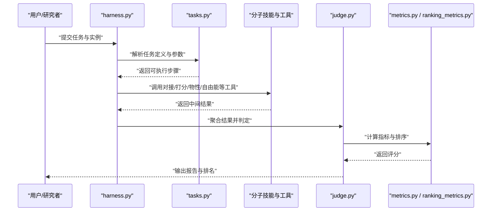
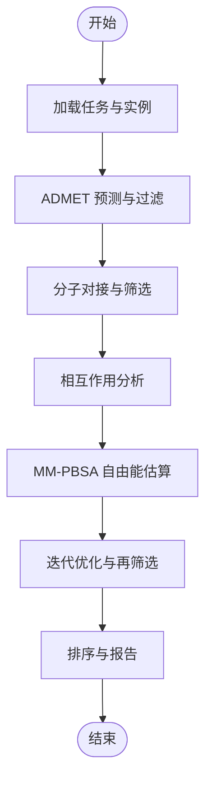
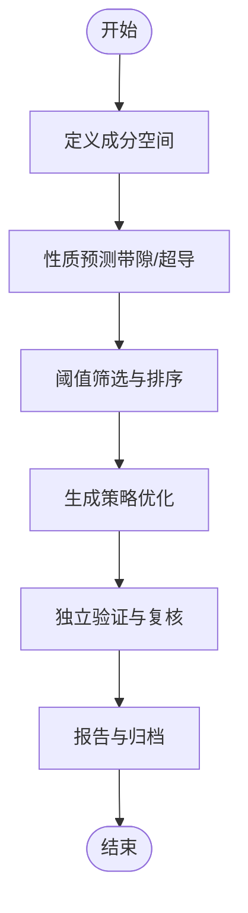
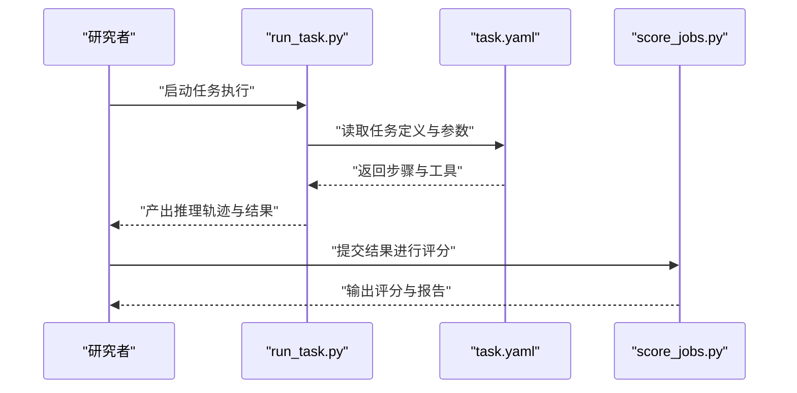
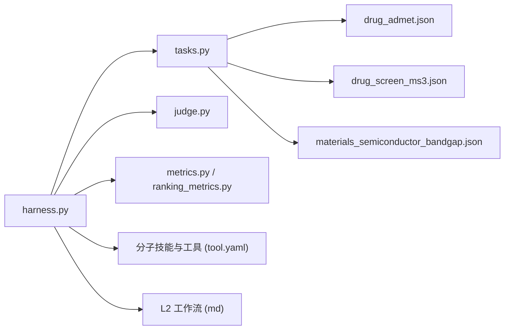

# 应用领域与应用场景

<cite>
**本文引用的文件**   
- [autonomy_mvp/core/harness.py](file://autonomy_mvp/core/harness.py)
- [autonomy_mvp/core/judge.py](file://autonomy_mvp/core/judge.py)
- [autonomy_mvp/core/metrics.py](file://autonomy_mvp/core/metrics.py)
- [autonomy_mvp/core/ranking_metrics.py](file://autonomy_mvp/core/ranking_metrics.py)
- [autonomy_mvp/core/tasks.py](file://autonomy_mvp/core/tasks.py)
- [autonomy_mvp/tasks/drug_admet.json](file://autonomy_mvp/tasks/drug_admet.json)
- [autonomy_mvp/tasks/drug_screen_ms3.json](file://autonomy_mvp/tasks/drug_screen_ms3.json)
- [autonomy_mvp/tasks/materials_semiconductor_bandgap.json](file://autonomy_mvp/tasks/materials_semiconductor_bandgap.json)
- [longhorizon/instantiate/instances/drug2_BACE1.json](file://longhorizon/instantiate/instances/drug2_BACE1.json)
- [longhorizon/instantiate/instances/drug2_DPP-4.json](file://longhorizon/instantiate/instances/drug2_DPP-4.json)
- [longhorizon/instantiate/instances/drug2_EGFR.json](file://longhorizon/instantiate/instances/drug2_EGFR.json)
- [longhorizon/instantiate/instances/drug2_GLP-1R.json](file://longhorizon/instantiate/instances/drug2_GLP-1R.json)
- [longhorizon/instantiate/instances/drug2_mTOR.json](file://longhorizon/instantiate/instances/drug2_mTOR.json)
- [longhorizon/instantiate/instances/mat1_Ca-Si-O_funnel.json](file://longhorizon/instantiate/instances/mat1_Ca-Si-O_funnel.json)
- [longhorizon/instantiate/instances/mat1_Li-Fe-O_funnel.json](file://longhorizon/instantiate/instances/mat1_Li-Fe-O_funnel.json)
- [longhorizon/instantiate/instances/mat1_Na-Nb-O_funnel.json](file://longhorizon/instantiate/instances/mat1_Na-Nb-O_funnel.json)
- [longhorizon/instantiate/instances/mat1_superconductor_premium.json](file://longhorizon/instantiate/instances/mat1_superconductor_premium.json)
- [longhorizon/instantiate/instances/mech3_Crizotinib-ALK+_NSCLC.json](file://longhorizon/instantiate/instances/mech3_Crizotinib-ALK+_NSCLC.json)
- [longhorizon/instantiate/instances/mech3_Dasatinib-CML.json](file://longhorizon/instantiate/instances/mech3_Dasatinib-CML.json)
- [longhorizon/instantiate/instances/mech3_Gefitinib-EGFR+_NSCLC.json](file://longhorizon/instantiate/instances/mech3_Gefitinib-EGFR+_NSCLC.json)
- [longhorizon/instantiate/instances/mech3_Trastuzumab-HER2+_breast_cancer.json](file://longhorizon/instantiate/instances/mech3_Trastuzumab-HER2+_breast_cancer.json)
- [longhorizon/instantiate/instances/mech3_Vemurafenib-BRAF_V600E_melanoma.json](file://longhorizon/instantiate/instances/mech3_Vemurafenib-BRAF_V600E_melanoma.json)
- [longhorizon/instantiate/instances/targetF_ABL1-CML.json](file://longhorizon/instantiate/instances/targetF_ABL1-CML.json)
- [longhorizon/instantiate/instances/targetF_ALK-NSCLC.json](file://longhorizon/instantiate/instances/targetF_ALK-NSCLC.json)
- [longhorizon/instantiate/instances/targetF_BRAF-Melanoma.json](file://longhorizon/instantiate/instances/targetF_BRAF-Melanoma.json)
- [longhorizon/instantiate/instances/targetF_BTK-CLL.json](file://longhorizon/instantiate/instances/targetF_BTK-CLL.json)
- [longhorizon/instantiate/instances/targetF_EGFR-NSCLC.json](file://longhorizon/instantiate/instances/targetF_EGFR-NSCLC.json)
- [longhorizon/instantiate/instances/targetF_ERBB2-BreastCancer.json](file://longhorizon/instantiate/instances/targetF_ERBB2-BreastCancer.json)
- [longhorizon/case1_材料发现_超导体.md](file://longhorizon/case1_材料发现_超导体.md)
- [longhorizon/caseD_材料闭环优化_BaTiO.md](file://longhorizon/caseD_材料闭环优化_BaTiO.md)
- [docs/prd/molbench_repo/skills/L1_tools/molclaw-docking-screening/tool.yaml](file://docs/prd/molbench_repo/skills/L1_tools/molclaw-docking-screening/tool.yaml)
- [docs/prd/molbench_repo/skills/L1_tools/molclaw-equiscore-tool/tool.yaml](file://docs/prd/molbench_repo/skills/L1_tools/molclaw-equiscore-tool/tool.yaml)
- [docs/prd/molbench_repo/skills/L1_tools/molclaw-prolif-tool/tool.yaml](file://docs/prd/molbench_repo/skills/L1_tools/molclaw-prolif-tool/tool.yaml)
- [docs/prd/molbench_repo/skills/L1_tools/molclaw-mol-basic-metrics/tool.yaml](file://docs/prd/molbench_repo/skills/L1_tools/molclaw-mol-basic-metrics/tool.yaml)
- [docs/prd/molbench_repo/skills/L1_tools/molclaw-mol-opt-physchem/tool.yaml](file://docs/prd/molbench_repo/skills/L1_tools/molclaw-mol-opt-physchem/tool.yaml)
- [docs/prd/molbench_repo/skills/L1_tools/molclaw-protein-ligand-mmpbsa/tool.yaml](file://docs/prd/molbench_repo/skills/L1_tools/molclaw-protein-ligand-mmpbsa/tool.yaml)
- [docs/prd/molbench_repo/skills/L2_workflows/02-molecular-docking-screening.md](file://docs/prd/molbench_repo/skills/L2_workflows/02-molecular-docking-screening.md)
- [docs/prd/molbench_repo/skills/L2_workflows/05-iterative-molecular-optimization.md](file://docs/prd/molbench_repo/skills/L2_workflows/05-iterative-molecular-optimization.md)
- [task3/B_ms3_screening_prototype/ms3_screening_eval.py](file://task3/B_ms3_screening_prototype/ms3_screening_eval.py)
- [task3/B_ms3_screening_prototype/results.md](file://task3/B_ms3_screening_prototype/results.md)
- [task7/poc3_physicianbench/PhysicianBench/scripts/run_task.py](file://task7/poc3_physicianbench/PhysicianBench/scripts/run_task.py)
- [task7/poc3_physicianbench/PhysicianBench/scripts/score_jobs.py](file://task7/poc3_physicianbench/PhysicianBench/scripts/score_jobs.py)
- [task7/poc3_physicianbench/PhysicianBench/tasks/v1/aberrant_drug_screen/task.yaml](file://task7/poc3_physicianbench/PhysicianBench/tasks/v1/aberrant_drug_screen/task.yaml)
- [task7/poc4_pharmabench/run_poc4.py](file://task7/poc4_pharmabench/run_poc4.py)
- [task7/poc4_pharmabench/method.md](file://task7/poc4_pharmabench/method.md)
</cite>

## 目录
1. [引言](#引言)
2. [项目结构](#项目结构)
3. [核心组件](#核心组件)
4. [架构总览](#架构总览)
5. [详细组件分析](#详细组件分析)
6. [依赖分析](#依赖分析)
7. [性能考虑](#性能考虑)
8. [故障排查指南](#故障排查指南)
9. [结论](#结论)
10. [附录](#附录)

## 引言
本文件聚焦于科学计算基准测试框架在三大核心领域的应用：药物发现、材料科学与生物医学。我们基于仓库中的任务定义、实例配置、技能与工具集、评测脚本与案例文档，系统梳理各领域的典型工作流、关键挑战与解决方案，并通过实际案例展示方法论迁移与技术复用路径，说明该框架如何加速科研进程与创新突破。

## 项目结构
仓库围绕“任务—实例—评测—技能/工具—案例”的层次组织：
- 自主评估与评测内核：提供统一的任务编排、评分与指标体系
- 领域任务与实例：以 JSON 描述具体任务与参数化实例
- 分子计算技能与工具：覆盖对接筛选、打分、性质计算、自由能估算等
- 长周期案例：面向材料发现与闭环优化的端到端流程
- 生物医学评测：面向临床推理与药物安全性的任务执行与评分

```mermaid
graph TB
subgraph "评测内核"
H["harness.py"]
J["judge.py"]
M["metrics.py"]
RM["ranking_metrics.py"]
T["tasks.py"]
end
subgraph "领域任务与实例"
D1["drug_admet.json"]
D2["drug_screen_ms3.json"]
M1["materials_semiconductor_bandgap.json"]
LHI["longhorizon/instantiate/instances/*.json"]
end
subgraph "分子技能与工具"
S1["molclaw-docking-screening/tool.yaml"]
S2["molclaw-equiscore-tool/tool.yaml"]
S3["molclaw-prolif-tool/tool.yaml"]
S4["molclaw-mol-basic-metrics/tool.yaml"]
S5["molclaw-mol-opt-physchem/tool.yaml"]
S6["molclaw-protein-ligand-mmpbsa/tool.yaml"]
W1["02-molecular-docking-screening.md"]
W2["05-iterative-molecular-optimization.md"]
end
subgraph "长周期案例"
C1["case1_材料发现_超导体.md"]
C2["caseD_材料闭环优化_BaTiO.md"]
end
subgraph "生物医学评测"
P3T["poc3 run_task.py"]
P3S["poc3 score_jobs.py"]
P3Y["poc3 tasks/v1/aberrant_drug_screen/task.yaml"]
P4R["poc4 run_poc4.py"]
P4M["poc4 method.md"]
end
H --> J
H --> M
H --> RM
H --> T
T --> D1
T --> D2
T --> M1
T --> LHI
H --> S1
H --> S2
H --> S3
H --> S4
H --> S5
H --> S6
H --> W1
H --> W2
H --> C1
H --> C2
H --> P3T
H --> P3S
H --> P3Y
H --> P4R
H --> P4M
```

图表来源
- [autonomy_mvp/core/harness.py](file://autonomy_mvp/core/harness.py)
- [autonomy_mvp/core/judge.py](file://autonomy_mvp/core/judge.py)
- [autonomy_mvp/core/metrics.py](file://autonomy_mvp/core/metrics.py)
- [autonomy_mvp/core/ranking_metrics.py](file://autonomy_mvp/core/ranking_metrics.py)
- [autonomy_mvp/core/tasks.py](file://autonomy_mvp/core/tasks.py)
- [autonomy_mvp/tasks/drug_admet.json](file://autonomy_mvp/tasks/drug_admet.json)
- [autonomy_mvp/tasks/drug_screen_ms3.json](file://autonomy_mvp/tasks/drug_screen_ms3.json)
- [autonomy_mvp/tasks/materials_semiconductor_bandgap.json](file://autonomy_mvp/tasks/materials_semiconductor_bandgap.json)
- [docs/prd/molbench_repo/skills/L1_tools/molclaw-docking-screening/tool.yaml](file://docs/prd/molbench_repo/skills/L1_tools/molclaw-docking-screening/tool.yaml)
- [docs/prd/molbench_repo/skills/L1_tools/molclaw-equiscore-tool/tool.yaml](file://docs/prd/molbench_repo/skills/L1_tools/molclaw-equiscore-tool/tool.yaml)
- [docs/prd/molbench_repo/skills/L1_tools/molclaw-prolif-tool/tool.yaml](file://docs/prd/molbench_repo/skills/L1_tools/molclaw-prolif-tool/tool.yaml)
- [docs/prd/molbench_repo/skills/L1_tools/molclaw-mol-basic-metrics/tool.yaml](file://docs/prd/molbench_repo/skills/L1_tools/molclaw-mol-basic-metrics/tool.yaml)
- [docs/prd/molbench_repo/skills/L1_tools/molclaw-mol-opt-physchem/tool.yaml](file://docs/prd/molbench_repo/skills/L1_tools/molclaw-mol-opt-physchem/tool.yaml)
- [docs/prd/molbench_repo/skills/L1_tools/molclaw-protein-ligand-mmpbsa/tool.yaml](file://docs/prd/molbench_repo/skills/L1_tools/molclaw-protein-ligand-mmpbsa/tool.yaml)
- [docs/prd/molbench_repo/skills/L2_workflows/02-molecular-docking-screening.md](file://docs/prd/molbench_repo/skills/L2_workflows/02-molecular-docking-screening.md)
- [docs/prd/molbench_repo/skills/L2_workflows/05-iterative-molecular-optimization.md](file://docs/prd/molbench_repo/skills/L2_workflows/05-iterative-molecular-optimization.md)
- [longhorizon/case1_材料发现_超导体.md](file://longhorizon/case1_材料发现_超导体.md)
- [longhorizon/caseD_材料闭环优化_BaTiO.md](file://longhorizon/caseD_材料闭环优化_BaTiO.md)
- [task7/poc3_physicianbench/PhysicianBench/scripts/run_task.py](file://task7/poc3_physicianbench/PhysicianBench/scripts/run_task.py)
- [task7/poc3_physicianbench/PhysicianBench/scripts/score_jobs.py](file://task7/poc3_physicianbench/PhysicianBench/scripts/score_jobs.py)
- [task7/poc3_physicianbench/PhysicianBench/tasks/v1/aberrant_drug_screen/task.yaml](file://task7/poc3_physicianbench/PhysicianBench/tasks/v1/aberrant_drug_screen/task.yaml)
- [task7/poc4_pharmabench/run_poc4.py](file://task7/poc4_pharmabench/run_poc4.py)
- [task7/poc4_pharmabench/method.md](file://task7/poc4_pharmabench/method.md)

章节来源
- [autonomy_mvp/core/harness.py](file://autonomy_mvp/core/harness.py)
- [autonomy_mvp/core/judge.py](file://autonomy_mvp/core/judge.py)
- [autonomy_mvp/core/metrics.py](file://autonomy_mvp/core/metrics.py)
- [autonomy_mvp/core/ranking_metrics.py](file://autonomy_mvp/core/ranking_metrics.py)
- [autonomy_mvp/core/tasks.py](file://autonomy_mvp/core/tasks.py)

## 核心组件
- 任务编排与执行：通过统一入口加载任务与实例，驱动工具链与工作流执行
- 评判与指标：提供可组合的评分函数与排序指标，支持多目标权衡
- 领域任务与实例：以结构化数据定义任务目标、输入输出与约束
- 分子技能与工具：封装对接、打分、物性计算、结合自由能估算等能力
- 长周期案例：将多步流程串联为可复现的端到端研究范式
- 生物医学评测：面向临床推理与药物安全性任务的运行与评分

章节来源
- [autonomy_mvp/core/harness.py](file://autonomy_mvp/core/harness.py)
- [autonomy_mvp/core/judge.py](file://autonomy_mvp/core/judge.py)
- [autonomy_mvp/core/metrics.py](file://autonomy_mvp/core/metrics.py)
- [autonomy_mvp/core/ranking_metrics.py](file://autonomy_mvp/core/ranking_metrics.py)
- [autonomy_mvp/core/tasks.py](file://autonomy_mvp/core/tasks.py)

## 架构总览
下图展示了从任务到工具再到评测的整体调用关系，体现跨领域的方法复用。

图表来源
- [autonomy_mvp/core/harness.py](file://autonomy_mvp/core/harness.py)
- [autonomy_mvp/core/tasks.py](file://autonomy_mvp/core/tasks.py)
- [autonomy_mvp/core/judge.py](file://autonomy_mvp/core/judge.py)
- [autonomy_mvp/core/metrics.py](file://autonomy_mvp/core/metrics.py)
- [autonomy_mvp/core/ranking_metrics.py](file://autonomy_mvp/core/ranking_metrics.py)
- [docs/prd/molbench_repo/skills/L1_tools/molclaw-docking-screening/tool.yaml](file://docs/prd/molbench_repo/skills/L1_tools/molclaw-docking-screening/tool.yaml)
- [docs/prd/molbench_repo/skills/L1_tools/molclaw-equiscore-tool/tool.yaml](file://docs/prd/molbench_repo/skills/L1_tools/molclaw-equiscore-tool/tool.yaml)
- [docs/prd/molbench_repo/skills/L1_tools/molclaw-prolif-tool/tool.yaml](file://docs/prd/molbench_repo/skills/L1_tools/molclaw-prolif-tool/tool.yaml)
- [docs/prd/molbench_repo/skills/L1_tools/molclaw-mol-basic-metrics/tool.yaml](file://docs/prd/molbench_repo/skills/L1_tools/molclaw-mol-basic-metrics/tool.yaml)
- [docs/prd/molbench_repo/skills/L1_tools/molclaw-mol-opt-physchem/tool.yaml](file://docs/prd/molbench_repo/skills/L1_tools/molclaw-mol-opt-physchem/tool.yaml)
- [docs/prd/molbench_repo/skills/L1_tools/molclaw-protein-ligand-mmpbsa/tool.yaml](file://docs/prd/molbench_repo/skills/L1_tools/molclaw-protein-ligand-mmpbsa/tool.yaml)

## 详细组件分析

### 药物发现（ADMET 与虚拟筛选）
- 典型工作流
  - ADMET 预测与过滤：利用基础物性与药代动力学指标进行初筛
  - 分子对接与筛选：对候选化合物库进行大规模对接与打分
  - 相互作用分析与自由能估算：使用蛋白-配体相互作用分析与 MM-PBSA 估算结合自由能
  - 迭代优化：基于多目标指标进行结构优化与再筛选
- 关键挑战与解决方案
  - 高维多目标权衡：通过排序指标与加权评分实现平衡
  - 工具链一致性：以标准化 YAML 工具描述确保接口一致
  - 大规模并行：通过批量实例与并行执行提升吞吐
- 实际案例与成功实践
  - 基于 MS3 的虚拟筛选原型与评测脚本，形成端到端验证闭环
  - 针对多个靶点（如 BACE1、EGFR、GLP-1R、mTOR、DPP-4）的实例化任务，支撑多靶点比较研究

图表来源
- [autonomy_mvp/tasks/drug_admet.json](file://autonomy_mvp/tasks/drug_admet.json)
- [autonomy_mvp/tasks/drug_screen_ms3.json](file://autonomy_mvp/tasks/drug_screen_ms3.json)
- [docs/prd/molbench_repo/skills/L1_tools/molclaw-mol-basic-metrics/tool.yaml](file://docs/prd/molbench_repo/skills/L1_tools/molclaw-mol-basic-metrics/tool.yaml)
- [docs/prd/molbench_repo/skills/L1_tools/molclaw-mol-opt-physchem/tool.yaml](file://docs/prd/molbench_repo/skills/L1_tools/molclaw-mol-opt-physchem/tool.yaml)
- [docs/prd/molbench_repo/skills/L1_tools/molclaw-docking-screening/tool.yaml](file://docs/prd/molbench_repo/skills/L1_tools/molclaw-docking-screening/tool.yaml)
- [docs/prd/molbench_repo/skills/L1_tools/molclaw-prolif-tool/tool.yaml](file://docs/prd/molbench_repo/skills/L1_tools/molclaw-prolif-tool/tool.yaml)
- [docs/prd/molbench_repo/skills/L1_tools/molclaw-protein-ligand-mmpbsa/tool.yaml](file://docs/prd/molbench_repo/skills/L1_tools/molclaw-protein-ligand-mmpbsa/tool.yaml)
- [docs/prd/molbench_repo/skills/L2_workflows/02-molecular-docking-screening.md](file://docs/prd/molbench_repo/skills/L2_workflows/02-molecular-docking-screening.md)
- [docs/prd/molbench_repo/skills/L2_workflows/05-iterative-molecular-optimization.md](file://docs/prd/molbench_repo/skills/L2_workflows/05-iterative-molecular-optimization.md)
- [task3/B_ms3_screening_prototype/ms3_screening_eval.py](file://task3/B_ms3_screening_prototype/ms3_screening_eval.py)
- [task3/B_ms3_screening_prototype/results.md](file://task3/B_ms3_screening_prototype/results.md)
- [longhorizon/instantiate/instances/drug2_BACE1.json](file://longhorizon/instantiate/instances/drug2_BACE1.json)
- [longhorizon/instantiate/instances/drug2_DPP-4.json](file://longhorizon/instantiate/instances/drug2_DPP-4.json)
- [longhorizon/instantiate/instances/drug2_EGFR.json](file://longhorizon/instantiate/instances/drug2_EGFR.json)
- [longhorizon/instantiate/instances/drug2_GLP-1R.json](file://longhorizon/instantiate/instances/drug2_GLP-1R.json)
- [longhorizon/instantiate/instances/drug2_mTOR.json](file://longhorizon/instantiate/instances/drug2_mTOR.json)

章节来源
- [autonomy_mvp/tasks/drug_admet.json](file://autonomy_mvp/tasks/drug_admet.json)
- [autonomy_mvp/tasks/drug_screen_ms3.json](file://autonomy_mvp/tasks/drug_screen_ms3.json)
- [docs/prd/molbench_repo/skills/L1_tools/molclaw-docking-screening/tool.yaml](file://docs/prd/molbench_repo/skills/L1_tools/molclaw-docking-screening/tool.yaml)
- [docs/prd/molbench_repo/skills/L1_tools/molclaw-equiscore-tool/tool.yaml](file://docs/prd/molbench_repo/skills/L1_tools/molclaw-equiscore-tool/tool.yaml)
- [docs/prd/molbench_repo/skills/L1_tools/molclaw-prolif-tool/tool.yaml](file://docs/prd/molbench_repo/skills/L1_tools/molclaw-prolif-tool/tool.yaml)
- [docs/prd/molbench_repo/skills/L1_tools/molclaw-mol-basic-metrics/tool.yaml](file://docs/prd/molbench_repo/skills/L1_tools/molclaw-mol-basic-metrics/tool.yaml)
- [docs/prd/molbench_repo/skills/L1_tools/molclaw-mol-opt-physchem/tool.yaml](file://docs/prd/molbench_repo/skills/L1_tools/molclaw-mol-opt-physchem/tool.yaml)
- [docs/prd/molbench_repo/skills/L1_tools/molclaw-protein-ligand-mmpbsa/tool.yaml](file://docs/prd/molbench_repo/skills/L1_tools/molclaw-protein-ligand-mmpbsa/tool.yaml)
- [docs/prd/molbench_repo/skills/L2_workflows/02-molecular-docking-screening.md](file://docs/prd/molbench_repo/skills/L2_workflows/02-molecular-docking-screening.md)
- [docs/prd/molbench_repo/skills/L2_workflows/05-iterative-molecular-optimization.md](file://docs/prd/molbench_repo/skills/L2_workflows/05-iterative-molecular-optimization.md)
- [task3/B_ms3_screening_prototype/ms3_screening_eval.py](file://task3/B_ms3_screening_prototype/ms3_screening_eval.py)
- [task3/B_ms3_screening_prototype/results.md](file://task3/B_ms3_screening_prototype/results.md)
- [longhorizon/instantiate/instances/drug2_BACE1.json](file://longhorizon/instantiate/instances/drug2_BACE1.json)
- [longhorizon/instantiate/instances/drug2_DPP-4.json](file://longhorizon/instantiate/instances/drug2_DPP-4.json)
- [longhorizon/instantiate/instances/drug2_EGFR.json](file://longhorizon/instantiate/instances/drug2_EGFR.json)
- [longhorizon/instantiate/instances/drug2_GLP-1R.json](file://longhorizon/instantiate/instances/drug2_GLP-1R.json)
- [longhorizon/instantiate/instances/drug2_mTOR.json](file://longhorizon/instantiate/instances/drug2_mTOR.json)

### 材料科学（半导体带隙与超导体发现）
- 典型工作流
  - 成分空间探索：以元素组合与化学式作为搜索空间
  - 性质预测与筛选：预测带隙或超导相关性质并进行阈值筛选
  - 闭环优化：根据反馈调整生成策略，迭代改进候选材料
- 关键挑战与解决方案
  - 高维离散空间：采用漏斗式搜索与优先级排序降低复杂度
  - 多尺度建模：结合不同精度模型进行粗筛与精算
  - 可复现性：以实例化 JSON 固化实验条件与参数
- 实际案例与成功实践
  - 超导体优先实例与 Ca-Si-O、Li-Fe-O、Na-Nb-O 等材料体系的漏斗式实例
  - 材料闭环优化 BaTiO 案例，展示从设计到验证的完整链路

图表来源
- [autonomy_mvp/tasks/materials_semiconductor_bandgap.json](file://autonomy_mvp/tasks/materials_semiconductor_bandgap.json)
- [longhorizon/instantiate/instances/mat1_Ca-Si-O_funnel.json](file://longhorizon/instantiate/instances/mat1_Ca-Si-O_funnel.json)
- [longhorizon/instantiate/instances/mat1_Li-Fe-O_funnel.json](file://longhorizon/instantiate/instances/mat1_Li-Fe-O_funnel.json)
- [longhorizon/instantiate/instances/mat1_Na-Nb-O_funnel.json](file://longhorizon/instantiate/instances/mat1_Na-Nb-O_funnel.json)
- [longhorizon/instantiate/instances/mat1_superconductor_premium.json](file://longhorizon/instantiate/instances/mat1_superconductor_premium.json)
- [longhorizon/case1_材料发现_超导体.md](file://longhorizon/case1_材料发现_超导体.md)
- [longhorizon/caseD_材料闭环优化_BaTiO.md](file://longhorizon/caseD_材料闭环优化_BaTiO.md)

章节来源
- [autonomy_mvp/tasks/materials_semiconductor_bandgap.json](file://autonomy_mvp/tasks/materials_semiconductor_bandgap.json)
- [longhorizon/instantiate/instances/mat1_Ca-Si-O_funnel.json](file://longhorizon/instantiate/instances/mat1_Ca-Si-O_funnel.json)
- [longhorizon/instantiate/instances/mat1_Li-Fe-O_funnel.json](file://longhorizon/instantiate/instances/mat1_Li-Fe-O_funnel.json)
- [longhorizon/instantiate/instances/mat1_Na-Nb-O_funnel.json](file://longhorizon/instantiate/instances/mat1_Na-Nb-O_funnel.json)
- [longhorizon/instantiate/instances/mat1_superconductor_premium.json](file://longhorizon/instantiate/instances/mat1_superconductor_premium.json)
- [longhorizon/case1_材料发现_超导体.md](file://longhorizon/case1_材料发现_超导体.md)
- [longhorizon/caseD_材料闭环优化_BaTiO.md](file://longhorizon/caseD_材料闭环优化_BaTiO.md)

### 生物医学（临床推理与药物安全性）
- 典型工作流
  - 任务定义与执行：以 YAML 任务描述驱动 Agent 执行推理与决策
  - 结果评分与汇总：按预设规则对输出进行评分与汇总
  - 药物安全性评估：在异常用药筛查等场景中验证方案合理性
- 关键挑战与解决方案
  - 复杂上下文理解：通过结构化任务与提示模板增强稳定性
  - 合规与可解释性：评分脚本保证过程可追溯与结果可审计
  - 多任务批处理：统一运行与评分脚本提升效率
- 实际案例与成功实践
  - 异常用药筛查任务（aberrant_drug_screen）的端到端执行与评分
  - Pharmabench 原型用于药物性质预测与评估，形成方法学对比

图表来源
- [task7/poc3_physicianbench/PhysicianBench/scripts/run_task.py](file://task7/poc3_physicianbench/PhysicianBench/scripts/run_task.py)
- [task7/poc3_physicianbench/PhysicianBench/scripts/score_jobs.py](file://task7/poc3_physicianbench/PhysicianBench/scripts/score_jobs.py)
- [task7/poc3_physicianbench/PhysicianBench/tasks/v1/aberrant_drug_screen/task.yaml](file://task7/poc3_physicianbench/PhysicianBench/tasks/v1/aberrant_drug_screen/task.yaml)
- [task7/poc4_pharmabench/run_poc4.py](file://task7/poc4_pharmabench/run_poc4.py)
- [task7/poc4_pharmabench/method.md](file://task7/poc4_pharmabench/method.md)

章节来源
- [task7/poc3_physicianbench/PhysicianBench/scripts/run_task.py](file://task7/poc3_physicianbench/PhysicianBench/scripts/run_task.py)
- [task7/poc3_physicianbench/PhysicianBench/scripts/score_jobs.py](file://task7/poc3_physicianbench/PhysicianBench/scripts/score_jobs.py)
- [task7/poc3_physicianbench/PhysicianBench/tasks/v1/aberrant_drug_screen/task.yaml](file://task7/poc3_physicianbench/PhysicianBench/tasks/v1/aberrant_drug_screen/task.yaml)
- [task7/poc4_pharmabench/run_poc4.py](file://task7/poc4_pharmabench/run_poc4.py)
- [task7/poc4_pharmabench/method.md](file://task7/poc4_pharmabench/method.md)

### 方法论迁移与技术复用
- 跨领域通用模式
  - 任务—实例—工具—评测的统一抽象，使工作流在不同领域间快速迁移
  - 排序与多目标指标在药物发现与材料科学中均适用
  - 闭环优化思想从材料科学迁移至药物设计的迭代优化
- 技术复用示例
  - 分子物性与对接工具在药物发现与生物医学安全性评估中共同使用
  - 漏斗式搜索与优先级排序在材料发现与虚拟筛选中共享
  - 长周期案例的可复现性规范适用于所有领域

[本节为概念性总结，不直接分析具体文件]

## 依赖分析
- 组件耦合与内聚
  - 评测内核与任务定义低耦合，便于扩展新领域任务
  - 工具以 YAML 描述，保持接口稳定与可替换性
- 直接与间接依赖
  - harness 依赖 tasks、judge、metrics；tasks 依赖领域任务 JSON
  - 分子技能与工具被工作流与评测环节共同引用
- 外部集成点
  - 分子模拟与对接工具、物性计算模块、自由能估算模块
  - 生物医学任务的外部数据集与评分规则

图表来源
- [autonomy_mvp/core/harness.py](file://autonomy_mvp/core/harness.py)
- [autonomy_mvp/core/tasks.py](file://autonomy_mvp/core/tasks.py)
- [autonomy_mvp/core/judge.py](file://autonomy_mvp/core/judge.py)
- [autonomy_mvp/core/metrics.py](file://autonomy_mvp/core/metrics.py)
- [autonomy_mvp/core/ranking_metrics.py](file://autonomy_mvp/core/ranking_metrics.py)
- [autonomy_mvp/tasks/drug_admet.json](file://autonomy_mvp/tasks/drug_admet.json)
- [autonomy_mvp/tasks/drug_screen_ms3.json](file://autonomy_mvp/tasks/drug_screen_ms3.json)
- [autonomy_mvp/tasks/materials_semiconductor_bandgap.json](file://autonomy_mvp/tasks/materials_semiconductor_bandgap.json)
- [docs/prd/molbench_repo/skills/L1_tools/molclaw-docking-screening/tool.yaml](file://docs/prd/molbench_repo/skills/L1_tools/molclaw-docking-screening/tool.yaml)
- [docs/prd/molbench_repo/skills/L2_workflows/02-molecular-docking-screening.md](file://docs/prd/molbench_repo/skills/L2_workflows/02-molecular-docking-screening.md)

章节来源
- [autonomy_mvp/core/harness.py](file://autonomy_mvp/core/harness.py)
- [autonomy_mvp/core/tasks.py](file://autonomy_mvp/core/tasks.py)
- [autonomy_mvp/core/judge.py](file://autonomy_mvp/core/judge.py)
- [autonomy_mvp/core/metrics.py](file://autonomy_mvp/core/metrics.py)
- [autonomy_mvp/core/ranking_metrics.py](file://autonomy_mvp/core/ranking_metrics.py)
- [autonomy_mvp/tasks/drug_admet.json](file://autonomy_mvp/tasks/drug_admet.json)
- [autonomy_mvp/tasks/drug_screen_ms3.json](file://autonomy_mvp/tasks/drug_screen_ms3.json)
- [autonomy_mvp/tasks/materials_semiconductor_bandgap.json](file://autonomy_mvp/tasks/materials_semiconductor_bandgap.json)
- [docs/prd/molbench_repo/skills/L1_tools/molclaw-docking-screening/tool.yaml](file://docs/prd/molbench_repo/skills/L1_tools/molclaw-docking-screening/tool.yaml)
- [docs/prd/molbench_repo/skills/L2_workflows/02-molecular-docking-screening.md](file://docs/prd/molbench_repo/skills/L2_workflows/02-molecular-docking-screening.md)

## 性能考虑
- 并行与批处理：通过批量实例与并行执行提升吞吐，缩短整体时间
- 分层筛选：先粗后精，减少昂贵计算的调用次数
- 缓存与复用：对重复计算的结果进行缓存，避免冗余
- 资源管理：合理分配 GPU/CPU 资源，避免瓶颈

[本节提供一般性指导，不直接分析具体文件]

## 故障排查指南
- 常见问题定位
  - 任务定义错误：检查 JSON/YAML 结构与字段完整性
  - 工具不可用：确认工具路径与环境变量配置
  - 评分不一致：核对评分脚本与规则版本
- 调试建议
  - 分步执行：逐层验证每个工具的输出
  - 日志收集：保留中间结果与错误堆栈
  - 最小复现：构造最小实例以隔离问题

章节来源
- [task3/B_ms3_screening_prototype/ms3_screening_eval.py](file://task3/B_ms3_screening_prototype/ms3_screening_eval.py)
- [task3/B_ms3_screening_prototype/results.md](file://task3/B_ms3_screening_prototype/results.md)
- [task7/poc3_physicianbench/PhysicianBench/scripts/run_task.py](file://task7/poc3_physicianbench/PhysicianBench/scripts/run_task.py)
- [task7/poc3_physicianbench/PhysicianBench/scripts/score_jobs.py](file://task7/poc3_physicianbench/PhysicianBench/scripts/score_jobs.py)

## 结论
该框架通过统一的评测内核、标准化的任务与工具描述、以及丰富的领域实例与案例，实现了在药物发现、材料科学与生物医学三大领域的广泛应用。其模块化设计与可复现性规范，使得方法论能够跨领域迁移与技术复用，显著加速科研进程与创新突破。

[本节为总结性内容，不直接分析具体文件]

## 附录
- 多靶点药物发现实例清单
  - [longhorizon/instantiate/instances/drug2_BACE1.json](file://longhorizon/instantiate/instances/drug2_BACE1.json)
  - [longhorizon/instantiate/instances/drug2_DPP-4.json](file://longhorizon/instantiate/instances/drug2_DPP-4.json)
  - [longhorizon/instantiate/instances/drug2_EGFR.json](file://longhorizon/instantiate/instances/drug2_EGFR.json)
  - [longhorizon/instantiate/instances/drug2_GLP-1R.json](file://longhorizon/instantiate/instances/drug2_GLP-1R.json)
  - [longhorizon/instantiate/instances/drug2_mTOR.json](file://longhorizon/instantiate/instances/drug2_mTOR.json)
- 机理模拟与靶向验证实例清单
  - [longhorizon/instantiate/instances/mech3_Crizotinib-ALK+_NSCLC.json](file://longhorizon/instantiate/instances/mech3_Crizotinib-ALK+_NSCLC.json)
  - [longhorizon/instantiate/instances/mech3_Dasatinib-CML.json](file://longhorizon/instantiate/instances/mech3_Dasatinib-CML.json)
  - [longhorizon/instantiate/instances/mech3_Gefitinib-EGFR+_NSCLC.json](file://longhorizon/instantiate/instances/mech3_Gefitinib-EGFR+_NSCLC.json)
  - [longhorizon/instantiate/instances/mech3_Trastuzumab-HER2+_breast_cancer.json](file://longhorizon/instantiate/instances/mech3_Trastuzumab-HER2+_breast_cancer.json)
  - [longhorizon/instantiate/instances/mech3_Vemurafenib-BRAF_V600E_melanoma.json](file://longhorizon/instantiate/instances/mech3_Vemurafenib-BRAF_V600E_melanoma.json)
  - [longhorizon/instantiate/instances/targetF_ABL1-CML.json](file://longhorizon/instantiate/instances/targetF_ABL1-CML.json)
  - [longhorizon/instantiate/instances/targetF_ALK-NSCLC.json](file://longhorizon/instantiate/instances/targetF_ALK-NSCLC.json)
  - [longhorizon/instantiate/instances/targetF_BRAF-Melanoma.json](file://longhorizon/instantiate/instances/targetF_BRAF-Melanoma.json)
  - [longhorizon/instantiate/instances/targetF_BTK-CLL.json](file://longhorizon/instantiate/instances/targetF_BTK-CLL.json)
  - [longhorizon/instantiate/instances/targetF_EGFR-NSCLC.json](file://longhorizon/instantiate/instances/targetF_EGFR-NSCLC.json)
  - [longhorizon/instantiate/instances/targetF_ERBB2-BreastCancer.json](file://longhorizon/instantiate/instances/targetF_ERBB2-BreastCancer.json)