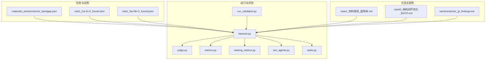
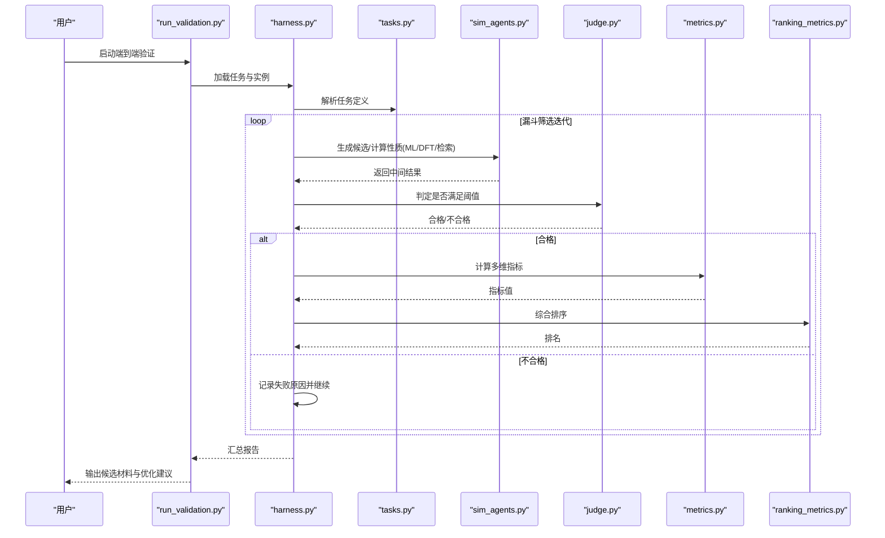
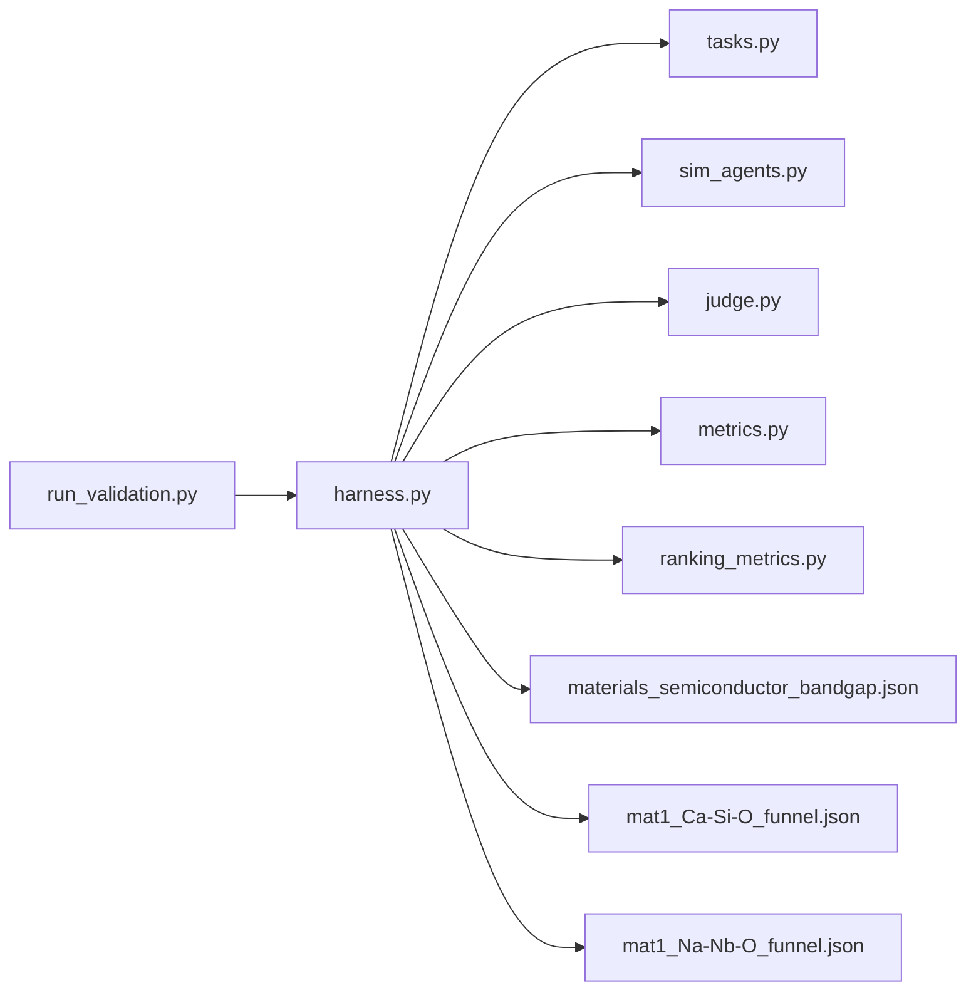
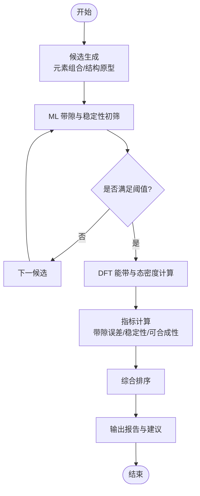

# 半导体材料发现

<cite>
**本文引用的文件**   
- [autonomy_mvp/tasks/materials_semiconductor_bandgap.json](file://autonomy_mvp/tasks/materials_semiconductor_bandgap.json)
- [longhorizon/instantiate/instances/mat1_Ca-Si-O_funnel.json](file://longhorizon/instantiate/instances/mat1_Ca-Si-O_funnel.json)
- [longhorizon/instantiate/instances/mat1_Na-Nb-O_funnel.json](file://longhorizon/instantiate/instances/mat1_Na-Nb-O_funnel.json)
- [longhorizon/case1_材料发现_超导体.md](file://longhorizon/case1_材料发现_超导体.md)
- [longhorizon/caseD_材料闭环优化_BaTiO.md](file://longhorizon/caseD_材料闭环优化_BaTiO.md)
- [autonomy_mvp/core/harness.py](file://autonomy_mvp/core/harness.py)
- [autonomy_mvp/core/judge.py](file://autonomy_mvp/core/judge.py)
- [autonomy_mvp/core/metrics.py](file://autonomy_mvp/core/metrics.py)
- [autonomy_mvp/core/ranking_metrics.py](file://autonomy_mvp/core/ranking_metrics.py)
- [autonomy_mvp/core/sim_agents.py](file://autonomy_mvp/core/sim_agents.py)
- [autonomy_mvp/core/tasks.py](file://autonomy_mvp/core/tasks.py)
- [autonomy_mvp/run_validation.py](file://autonomy_mvp/run_validation.py)
- [autonomy_mvp/schema.md](file://autonomy_mvp/schema.md)
- [autonomy_mvp/ACCEPTANCE.md](file://autonomy_mvp/ACCEPTANCE.md)
- [autonomy_mvp/results.md](file://autonomy_mvp/results.md)
- [autonomy_mvp/results_real.md](file://autonomy_mvp/results_real.md)
- [docs/search/semiconductor_gt_findings.md](file://docs/search/semiconductor_gt_findings.md)
</cite>

## 目录
1. [简介](#简介)
2. [项目结构](#项目结构)
3. [核心组件](#核心组件)
4. [架构总览](#架构总览)
5. [详细组件分析](#详细组件分析)
6. [依赖关系分析](#依赖关系分析)
7. [性能与可扩展性](#性能与可扩展性)
8. [故障排查指南](#故障排查指南)
9. [结论](#结论)
10. [附录](#附录)

## 简介
本文件面向“半导体材料发现”应用，聚焦带隙预测模型、能带结构计算与电子性质分析方法，并以 Ca-Si-O、Na-Nb-O 等体系为例，阐述设计原理与优化策略。文档同时覆盖高通量筛选流程、DFT 计算集成与机器学习辅助设计方法，并展示如何通过长视域任务平台实现自动化发现与性能优化。此外，还包含材料表征数据处理、能带图分析与载流子迁移率计算的实践要点。

## 项目结构
仓库围绕“长视域任务编排 + 评测与验证”组织：
- 任务定义与数据：在 autonomy_mvp/tasks 下提供半导体带隙相关任务；在 longhorizon/instantiate/instances 下提供具体材料体系的实例化配置（如 Ca-Si-O、Na-Nb-O）。
- 运行与评测：autonomy_mvp/core 提供任务执行、评判、指标与代理模拟等基础设施；run_validation.py 串联端到端验证流程。
- 案例与方法说明：longhorizon 下的 case*.md 提供方法论与实践路径；docs/search 提供领域调研与基准发现摘要。

图表来源
- [autonomy_mvp/tasks/materials_semiconductor_bandgap.json](file://autonomy_mvp/tasks/materials_semiconductor_bandgap.json)
- [longhorizon/instantiate/instances/mat1_Ca-Si-O_funnel.json](file://longhorizon/instantiate/instances/mat1_Ca-Si-O_funnel.json)
- [longhorizon/instantiate/instances/mat1_Na-Nb-O_funnel.json](file://longhorizon/instantiate/instances/mat1_Na-Nb-O_funnel.json)
- [autonomy_mvp/core/harness.py](file://autonomy_mvp/core/harness.py)
- [autonomy_mvp/core/judge.py](file://autonomy_mvp/core/judge.py)
- [autonomy_mvp/core/metrics.py](file://autonomy_mvp/core/metrics.py)
- [autonomy_mvp/core/ranking_metrics.py](file://autonomy_mvp/core/ranking_metrics.py)
- [autonomy_mvp/core/sim_agents.py](file://autonomy_mvp/core/sim_agents.py)
- [autonomy_mvp/core/tasks.py](file://autonomy_mvp/core/tasks.py)
- [autonomy_mvp/run_validation.py](file://autonomy_mvp/run_validation.py)
- [longhorizon/case1_材料发现_超导体.md](file://longhorizon/case1_材料发现_超导体.md)
- [longhorizon/caseD_材料闭环优化_BaTiO.md](file://longhorizon/caseD_材料闭环优化_BaTiO.md)
- [docs/search/semiconductor_gt_findings.md](file://docs/search/semiconductor_gt_findings.md)

章节来源
- [autonomy_mvp/tasks/materials_semiconductor_bandgap.json](file://autonomy_mvp/tasks/materials_semiconductor_bandgap.json)
- [longhorizon/instantiate/instances/mat1_Ca-Si-O_funnel.json](file://longhorizon/instantiate/instances/mat1_Ca-Si-O_funnel.json)
- [longhorizon/instantiate/instances/mat1_Na-Nb-O_funnel.json](file://longhorizon/instantiate/instances/mat1_Na-Nb-O_funnel.json)
- [autonomy_mvp/core/harness.py](file://autonomy_mvp/core/harness.py)
- [autonomy_mvp/core/judge.py](file://autonomy_mvp/core/judge.py)
- [autonomy_mvp/core/metrics.py](file://autonomy_mvp/core/metrics.py)
- [autonomy_mvp/core/ranking_metrics.py](file://autonomy_mvp/core/ranking_metrics.py)
- [autonomy_mvp/core/sim_agents.py](file://autonomy_mvp/core/sim_agents.py)
- [autonomy_mvp/core/tasks.py](file://autonomy_mvp/core/tasks.py)
- [autonomy_mvp/run_validation.py](file://autonomy_mvp/run_validation.py)
- [longhorizon/case1_材料发现_超导体.md](file://longhorizon/case1_材料发现_超导体.md)
- [longhorizon/caseD_材料闭环优化_BaTiO.md](file://longhorizon/caseD_材料闭环优化_BaTiO.md)
- [docs/search/semiconductor_gt_findings.md](file://docs/search/semiconductor_gt_findings.md)

## 核心组件
- 任务与实例
  - materials_semiconductor_bandgap.json：定义半导体带隙相关的任务描述、输入输出规范与评估目标。
  - mat1_Ca-Si-O_funnel.json / mat1_Na-Nb-O_funnel.json：针对 Ca-Si-O、Na-Nb-O 的漏斗式筛选实例，包含候选生成、过滤阈值、排序与回溯策略的配置。
- 运行与评测
  - harness.py：任务编排与执行入口，负责加载任务/实例、调度工具链、收集中间结果与最终报告。
  - judge.py：判定器，依据任务定义对候选材料进行合格性判断与打分。
  - metrics.py / ranking_metrics.py：指标与排序度量，用于带隙、稳定性、可合成性等维度的量化比较。
  - sim_agents.py：代理模拟层，封装 DFT 计算、ML 预测、文献检索等外部能力调用。
  - tasks.py：任务抽象与注册，统一接口以支持多任务并行与复用。
  - run_validation.py：端到端验证脚本，串联上述模块完成一次完整的高通量筛选与评测。
- 方法与案例
  - case1_材料发现_超导体.md / caseD_材料闭环优化_BaTiO.md：提供从问题定义到闭环优化的方法论与步骤参考。
  - semiconductor_gt_findings.md：半导体领域基准与基线发现汇总，指导模型选择与阈值设定。

章节来源
- [autonomy_mvp/tasks/materials_semiconductor_bandgap.json](file://autonomy_mvp/tasks/materials_semiconductor_bandgap.json)
- [longhorizon/instantiate/instances/mat1_Ca-Si-O_funnel.json](file://longhorizon/instantiate/instances/mat1_Ca-Si-O_funnel.json)
- [longhorizon/instantiate/instances/mat1_Na-Nb-O_funnel.json](file://longhorizon/instantiate/instances/mat1_Na-Nb-O_funnel.json)
- [autonomy_mvp/core/harness.py](file://autonomy_mvp/core/harness.py)
- [autonomy_mvp/core/judge.py](file://autonomy_mvp/core/judge.py)
- [autonomy_mvp/core/metrics.py](file://autonomy_mvp/core/metrics.py)
- [autonomy_mvp/core/ranking_metrics.py](file://autonomy_mvp/core/ranking_metrics.py)
- [autonomy_mvp/core/sim_agents.py](file://autonomy_mvp/core/sim_agents.py)
- [autonomy_mvp/core/tasks.py](file://autonomy_mvp/core/tasks.py)
- [autonomy_mvp/run_validation.py](file://autonomy_mvp/run_validation.py)
- [longhorizon/case1_材料发现_超导体.md](file://longhorizon/case1_材料发现_超导体.md)
- [longhorizon/caseD_材料闭环优化_BaTiO.md](file://longhorizon/caseD_材料闭环优化_BaTiO.md)
- [docs/search/semiconductor_gt_findings.md](file://docs/search/semiconductor_gt_findings.md)

## 架构总览
系统采用“任务驱动 + 漏斗式筛选 + 多源工具集成”的架构：上层通过任务与实例声明目标与约束，中间由编排器协调代理层调用 ML/DFT/检索等工具，底层产出结构化结果并由评判与指标模块完成质量评估与排序。

图表来源
- [autonomy_mvp/run_validation.py](file://autonomy_mvp/run_validation.py)
- [autonomy_mvp/core/harness.py](file://autonomy_mvp/core/harness.py)
- [autonomy_mvp/core/tasks.py](file://autonomy_mvp/core/tasks.py)
- [autonomy_mvp/core/sim_agents.py](file://autonomy_mvp/core/sim_agents.py)
- [autonomy_mvp/core/judge.py](file://autonomy_mvp/core/judge.py)
- [autonomy_mvp/core/metrics.py](file://autonomy_mvp/core/metrics.py)
- [autonomy_mvp/core/ranking_metrics.py](file://autonomy_mvp/core/ranking_metrics.py)

## 详细组件分析

### 半导体带隙任务与实例
- 任务定义（materials_semiconductor_bandgap.json）
  - 明确目标：预测与优化半导体带隙，兼顾稳定性与可合成性。
  - 输入输出：输入为化学式/结构信息，输出为带隙值、能带特征、稳定性评分与可合成性概率。
  - 评估维度：误差指标（如 MAE/RMSE）、排序一致性（如 AUC/Kendall τ）、阈值命中率。
- 漏斗实例（Ca-Si-O、Na-Nb-O）
  - 候选生成：基于元素组合与已知结构原型空间采样。
  - 快速筛选：ML 带隙预测与稳定性初筛。
  - 精算阶段：DFT 能带结构与态密度计算。
  - 决策与回溯：根据阈值与排序动态调整搜索空间。

章节来源
- [autonomy_mvp/tasks/materials_semiconductor_bandgap.json](file://autonomy_mvp/tasks/materials_semiconductor_bandgap.json)
- [longhorizon/instantiate/instances/mat1_Ca-Si-O_funnel.json](file://longhorizon/instantiate/instances/mat1_Ca-Si-O_funnel.json)
- [longhorizon/instantiate/instances/mat1_Na-Nb-O_funnel.json](file://longhorizon/instantiate/instances/mat1_Na-Nb-O_funnel.json)

### 编排与评测核心
- 编排器（harness.py）
  - 职责：读取任务与实例，管理并发与重试，维护状态机（生成→筛选→精算→排序→报告）。
  - 关键行为：错误捕获、日志记录、中间产物持久化。
- 判定器（judge.py）
  - 职责：将原始计算结果映射为合格性标签与基础分数，支撑后续排序。
- 指标与排序（metrics.py、ranking_metrics.py）
  - 职责：计算带隙误差、稳定性得分、可合成性评分，并进行加权排序与鲁棒性检验。
- 代理层（sim_agents.py）
  - 职责：封装外部工具（ML 预测、DFT 计算、文献/数据库检索），提供统一接口与超时/重试策略。
- 任务抽象（tasks.py）
  - 职责：定义任务接口、参数校验与默认配置，便于扩展新任务。
- 端到端验证（run_validation.py）
  - 职责：串联以上模块，输出完整报告与可视化素材。

章节来源
- [autonomy_mvp/core/harness.py](file://autonomy_mvp/core/harness.py)
- [autonomy_mvp/core/judge.py](file://autonomy_mvp/core/judge.py)
- [autonomy_mvp/core/metrics.py](file://autonomy_mvp/core/metrics.py)
- [autonomy_mvp/core/ranking_metrics.py](file://autonomy_mvp/core/ranking_metrics.py)
- [autonomy_mvp/core/sim_agents.py](file://autonomy_mvp/core/sim_agents.py)
- [autonomy_mvp/core/tasks.py](file://autonomy_mvp/core/tasks.py)
- [autonomy_mvp/run_validation.py](file://autonomy_mvp/run_validation.py)

### 方法论与案例参考
- 超导体材料发现（case1_材料发现_超导体.md）
  - 提供从问题拆解、数据准备、模型训练到实验验证的完整链路，可作为半导体任务的模板。
- BaTiO 闭环优化（caseD_材料闭环优化_BaTiO.md）
  - 展示“设计—计算—反馈—再设计”的闭环流程，适用于带隙与迁移率的协同优化。

章节来源
- [longhorizon/case1_材料发现_超导体.md](file://longhorizon/case1_材料发现_超导体.md)
- [longhorizon/caseD_材料闭环优化_BaTiO.md](file://longhorizon/caseD_材料闭环优化_BaTiO.md)

### 半导体领域基准与基线
- 基准发现（semiconductor_gt_findings.md）
  - 汇总主流数据集、常用模型与基线结果，指导阈值设置与模型选型。

章节来源
- [docs/search/semiconductor_gt_findings.md](file://docs/search/semiconductor_gt_findings.md)

## 依赖关系分析
- 内部依赖
  - run_validation.py 依赖 harness.py；harness.py 依赖 tasks.py、sim_agents.py、judge.py、metrics.py、ranking_metrics.py。
  - 实例与任务 JSON 作为输入被 harness.py 解析消费。
- 外部依赖（概念层面）
  - ML 预测服务：用于快速带隙估计与稳定性初筛。
  - DFT 计算集群：用于高精度能带结构与态密度计算。
  - 文献/数据库检索：用于可合成性与热力学稳定性先验。

图表来源
- [autonomy_mvp/run_validation.py](file://autonomy_mvp/run_validation.py)
- [autonomy_mvp/core/harness.py](file://autonomy_mvp/core/harness.py)
- [autonomy_mvp/core/tasks.py](file://autonomy_mvp/core/tasks.py)
- [autonomy_mvp/core/sim_agents.py](file://autonomy_mvp/core/sim_agents.py)
- [autonomy_mvp/core/judge.py](file://autonomy_mvp/core/judge.py)
- [autonomy_mvp/core/metrics.py](file://autonomy_mvp/core/metrics.py)
- [autonomy_mvp/core/ranking_metrics.py](file://autonomy_mvp/core/ranking_metrics.py)
- [autonomy_mvp/tasks/materials_semiconductor_bandgap.json](file://autonomy_mvp/tasks/materials_semiconductor_bandgap.json)
- [longhorizon/instantiate/instances/mat1_Ca-Si-O_funnel.json](file://longhorizon/instantiate/instances/mat1_Ca-Si-O_funnel.json)
- [longhorizon/instantiate/instances/mat1_Na-Nb-O_funnel.json](file://longhorizon/instantiate/instances/mat1_Na-Nb-O_funnel.json)

## 性能与可扩展性
- 并发与批处理
  - 在代理层对 ML/DFT 调用进行并发控制与队列化，避免资源争用与超时。
- 缓存与去重
  - 对重复结构或等价计算进行指纹去重与结果缓存，显著降低冗余计算。
- 分层筛选
  - 先用低成本 ML 粗筛，再用高成本 DFT 精算，提高整体吞吐。
- 可扩展性
  - 通过 tasks.py 的任务抽象与 sim_agents.py 的工具注册机制，新增任务与工具无需改动核心编排逻辑。

[本节为通用指导，不直接分析具体文件]

## 故障排查指南
- 常见问题定位
  - 任务加载失败：检查任务与实例 JSON 的字段完整性与类型。
  - 工具调用异常：查看代理层的超时、重试与错误码；确认外部服务可用性。
  - 指标计算异常：核对单位换算、缺失值处理与排序权重配置。
- 诊断与回滚
  - 利用编排器的中间产物与日志，定位失败节点；必要时回滚至上一稳定版本。
- 验收标准
  - 参考 ACCEPTANCE.md 与 schema.md 中的验收条目，确保输出格式与质量达标。

章节来源
- [autonomy_mvp/ACCEPTANCE.md](file://autonomy_mvp/ACCEPTANCE.md)
- [autonomy_mvp/schema.md](file://autonomy_mvp/schema.md)
- [autonomy_mvp/results.md](file://autonomy_mvp/results.md)
- [autonomy_mvp/results_real.md](file://autonomy_mvp/results_real.md)

## 结论
本方案以任务与实例驱动为核心，结合漏斗式筛选与多源工具集成，实现了半导体材料（尤其是 Ca-Si-O、Na-Nb-O 体系）的自动化发现与优化。通过 ML 快速初筛与 DFT 高精度精算的分层策略，系统在效率与准确性之间取得良好平衡。配合完善的评测与验收体系，可在长视域任务平台上持续迭代，形成“数据—模型—计算—验证”的闭环。

[本节为总结性内容，不直接分析具体文件]

## 附录

### 高通量筛选流程（流程图）

[此图为概念流程示意，不直接映射具体源码文件]

### 材料体系设计要点（Ca-Si-O、Na-Nb-O）
- Ca-Si-O
  - 关注 Si-O 四面体网络与 Ca 掺杂对局域电子态的影响；通过掺杂浓度与氧空位调控带隙与载流子类型。
- Na-Nb-O
  - Nb 的 d 轨道参与导带底，Na 占据间隙位影响晶格常数与能带色散；需兼顾热力学稳定性与可合成窗口。

[本节为概念性内容，不直接分析具体文件]

### 能带图分析与载流子迁移率计算要点
- 能带图分析
  - 识别价带顶与导带底的 Kohn-Sham 能级位置，分析有效质量与带边态密度。
- 迁移率估算
  - 基于有效质量与形变势理论，结合声子散射模型进行近似估算；注意温度与缺陷浓度的影响。

[本节为概念性内容，不直接分析具体文件]