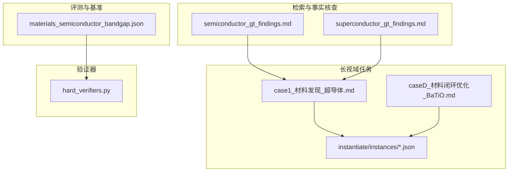
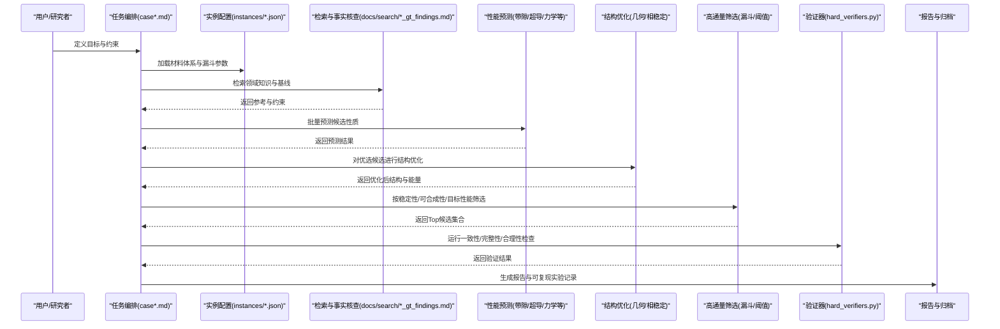
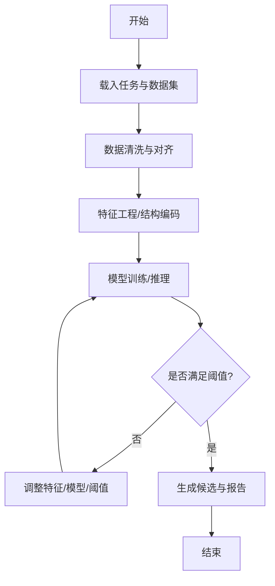
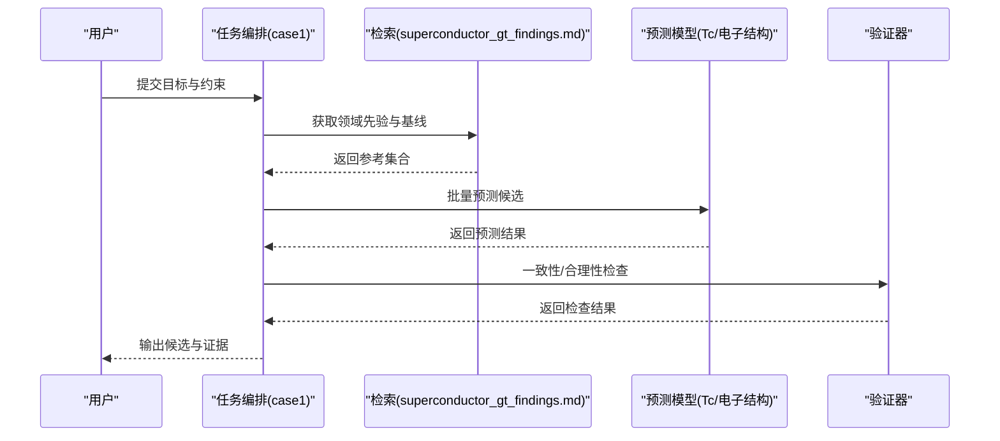
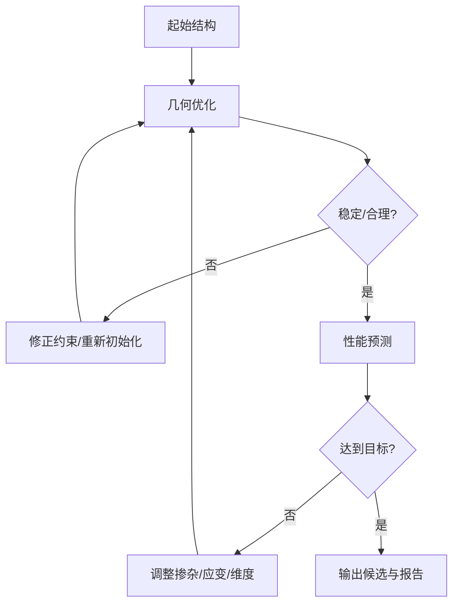
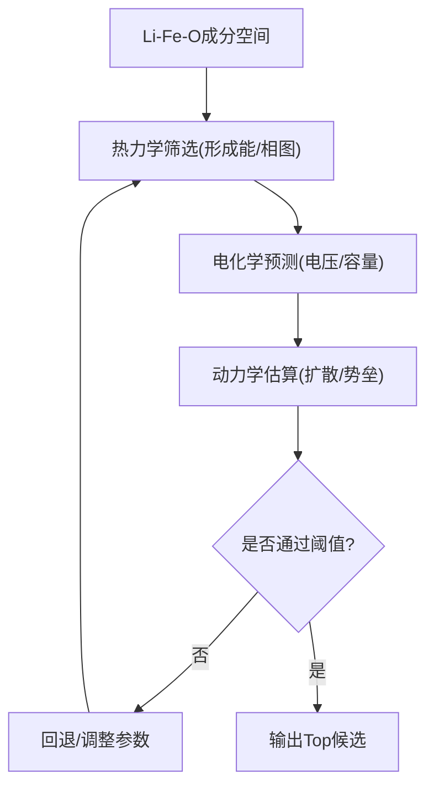
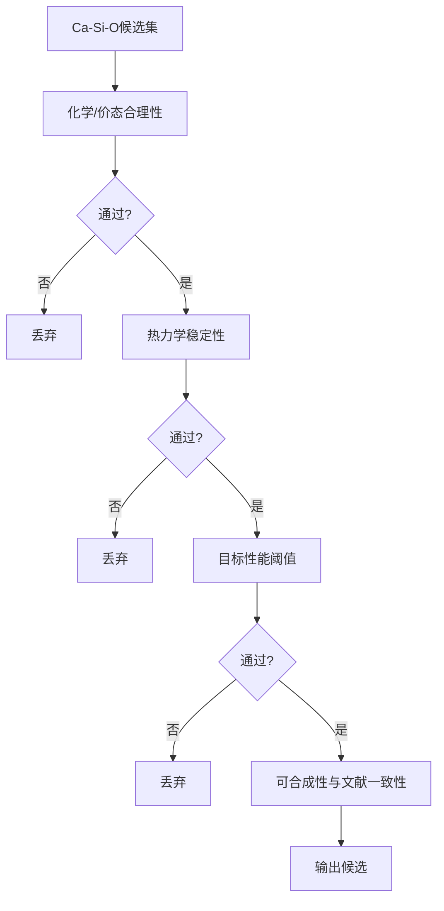
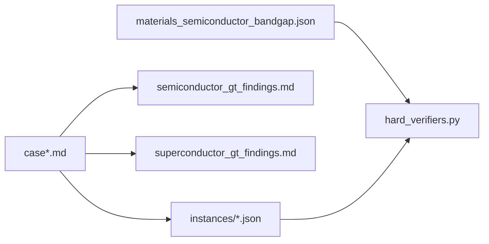

# 材料科学应用

<cite>
**本文引用的文件**   
- [longhorizon/case1_材料发现_超导体.md](file://longhorizon/case1_材料发现_超导体.md)
- [longhorizon/caseD_材料闭环优化_BaTiO.md](file://longhorizon/caseD_材料闭环优化_BaTiO.md)
- [longhorizon/instantiate/instances/mat1_Ca-Si-O_funnel.json](file://longhorizon/instantiate/instances/mat1_Ca-Si-O_funnel.json)
- [longhorizon/instantiate/instances/mat1_Li-Fe-O_funnel.json](file://longhorizon/instantiate/instances/mat1_Li-Fe-O_funnel.json)
- [longhorizon/instantiate/instances/mat1_superconductor_premium.json](file://longhorizon/instantiate/instances/mat1_superconductor_premium.json)
- [autonomy_mvp/tasks/materials_semiconductor_bandgap.json](file://autonomy_mvp/tasks/materials_semiconductor_bandgap.json)
- [docs/search/semiconductor_gt_findings.md](file://docs/search/semiconductor_gt_findings.md)
- [docs/search/superconductor_gt_findings.md](file://docs/search/superconductor_gt_findings.md)
- [longhorizon/verifiers/hard_verifiers.py](file://longhorizon/verifiers/hard_verifiers.py)
</cite>

## 目录
1. [引言](#引言)
2. [项目结构](#项目结构)
3. [核心组件](#核心组件)
4. [架构总览](#架构总览)
5. [详细组件分析](#详细组件分析)
6. [依赖关系分析](#依赖关系分析)
7. [性能与可扩展性](#性能与可扩展性)
8. [故障排查指南](#故障排查指南)
9. [结论](#结论)
10. [附录](#附录)

## 引言
本文件面向材料科学应用场景，聚焦半导体带隙预测、超导体发现、钙钛矿材料设计、电池材料优化等方向。围绕“材料性能预测模型、晶体结构优化算法与高通量筛选方法”，结合Ca-Si-O、Li-Fe-O等具体体系案例，展示如何通过长视域任务平台实现从问题定义、数据准备、自动化执行到结果评估的端到端流程，并给出表征数据处理与分析建议。

## 项目结构
仓库中与材料科学相关的核心内容分布在以下位置：
- 长视域任务实例与说明：longhorizon/case*.md 与 longhorizon/instantiate/instances/*.json
- 材料相关评测与基准：autonomy_mvp/tasks/materials_semiconductor_bandgap.json
- 领域知识检索与事实核查：docs/search/*_gt_findings.md
- 验证器与质量把关：longhorizon/verifiers/hard_verifiers.py

图表来源
- [longhorizon/case1_材料发现_超导体.md](file://longhorizon/case1_材料发现_超导体.md)
- [longhorizon/caseD_材料闭环优化_BaTiO.md](file://longhorizon/caseD_材料闭环优化_BaTiO.md)
- [longhorizon/instantiate/instances/mat1_Ca-Si-O_funnel.json](file://longhorizon/instantiate/instances/mat1_Ca-Si-O_funnel.json)
- [longhorizon/instantiate/instances/mat1_Li-Fe-O_funnel.json](file://longhorizon/instantiate/instances/mat1_Li-Fe-O_funnel.json)
- [longhorizon/instantiate/instances/mat1_superconductor_premium.json](file://longhorizon/instantiate/instances/mat1_superconductor_premium.json)
- [autonomy_mvp/tasks/materials_semiconductor_bandgap.json](file://autonomy_mvp/tasks/materials_semiconductor_bandgap.json)
- [docs/search/semiconductor_gt_findings.md](file://docs/search/semiconductor_gt_findings.md)
- [docs/search/superconductor_gt_findings.md](file://docs/search/superconductor_gt_findings.md)
- [longhorizon/verifiers/hard_verifiers.py](file://longhorizon/verifiers/hard_verifiers.py)

章节来源
- [longhorizon/case1_材料发现_超导体.md](file://longhorizon/case1_材料发现_超导体.md)
- [longhorizon/caseD_材料闭环优化_BaTiO.md](file://longhorizon/caseD_材料闭环优化_BaTiO.md)
- [longhorizon/instantiate/instances/mat1_Ca-Si-O_funnel.json](file://longhorizon/instantiate/instances/mat1_Ca-Si-O_funnel.json)
- [longhorizon/instantiate/instances/mat1_Li-Fe-O_funnel.json](file://longhorizon/instantiate/instances/mat1_Li-Fe-O_funnel.json)
- [longhorizon/instantiate/instances/mat1_superconductor_premium.json](file://longhorizon/instantiate/instances/mat1_superconductor_premium.json)
- [autonomy_mvp/tasks/materials_semiconductor_bandgap.json](file://autonomy_mvp/tasks/materials_semiconductor_bandgap.json)
- [docs/search/semiconductor_gt_findings.md](file://docs/search/semiconductor_gt_findings.md)
- [docs/search/superconductor_gt_findings.md](file://docs/search/superconductor_gt_findings.md)
- [longhorizon/verifiers/hard_verifiers.py](file://longhorizon/verifiers/hard_verifiers.py)

## 核心组件
- 长视域任务编排与实例化
  - 通过case文档定义研究目标、步骤与验收标准；通过JSON实例描述材料体系、搜索空间与筛选漏斗参数。
- 材料体系与筛选漏斗
  - Ca-Si-O、Li-Fe-O、Ba-Ti-O等体系以funnel或premium形式组织，便于按稳定性、合成可行性、目标性能进行分层过滤。
- 半导体带隙预测任务
  - 提供任务定义与评测入口，用于驱动模型训练/推理与指标计算。
- 事实核查与检索增强
  - 针对半导体与超导体的领域知识检索结果，辅助任务规划与结果校验。
- 验证器
  - 对输出进行一致性、完整性与合理性检查，保障自动化流程的可信度。

章节来源
- [longhorizon/case1_材料发现_超导体.md](file://longhorizon/case1_材料发现_超导体.md)
- [longhorizon/caseD_材料闭环优化_BaTiO.md](file://longhorizon/caseD_材料闭环优化_BaTiO.md)
- [longhorizon/instantiate/instances/mat1_Ca-Si-O_funnel.json](file://longhorizon/instantiate/instances/mat1_Ca-Si-O_funnel.json)
- [longhorizon/instantiate/instances/mat1_Li-Fe-O_funnel.json](file://longhorizon/instantiate/instances/mat1_Li-Fe-O_funnel.json)
- [longhorizon/instantiate/instances/mat1_superconductor_premium.json](file://longhorizon/instantiate/instances/mat1_superconductor_premium.json)
- [autonomy_mvp/tasks/materials_semiconductor_bandgap.json](file://autonomy_mvp/tasks/materials_semiconductor_bandgap.json)
- [docs/search/semiconductor_gt_findings.md](file://docs/search/semiconductor_gt_findings.md)
- [docs/search/superconductor_gt_findings.md](file://docs/search/superconductor_gt_findings.md)
- [longhorizon/verifiers/hard_verifiers.py](file://longhorizon/verifiers/hard_verifiers.py)

## 架构总览
下图展示了材料发现自动化流水线的关键环节：任务定义→数据与检索→候选生成→性能预测→结构优化→高通量筛选→验证与报告。

图表来源
- [longhorizon/case1_材料发现_超导体.md](file://longhorizon/case1_材料发现_超导体.md)
- [longhorizon/caseD_材料闭环优化_BaTiO.md](file://longhorizon/caseD_材料闭环优化_BaTiO.md)
- [longhorizon/instantiate/instances/mat1_Ca-Si-O_funnel.json](file://longhorizon/instantiate/instances/mat1_Ca-Si-O_funnel.json)
- [longhorizon/instantiate/instances/mat1_Li-Fe-O_funnel.json](file://longhorizon/instantiate/instances/mat1_Li-Fe-O_funnel.json)
- [longhorizon/instantiate/instances/mat1_superconductor_premium.json](file://longhorizon/instantiate/instances/mat1_superconductor_premium.json)
- [docs/search/semiconductor_gt_findings.md](file://docs/search/semiconductor_gt_findings.md)
- [docs/search/superconductor_gt_findings.md](file://docs/search/superconductor_gt_findings.md)
- [longhorizon/verifiers/hard_verifiers.py](file://longhorizon/verifiers/hard_verifiers.py)

## 详细组件分析

### 半导体带隙预测任务
- 任务定位：为特定材料族或化学空间构建带隙预测工作流，包括数据准备、特征工程、模型训练/推理与误差分析。
- 关键输入：任务定义与评测入口（含数据集路径、指标、阈值）。
- 关键输出：带隙预测值、不确定性估计、排序列表与可视化。
- 典型流程：
  - 数据清洗与去重
  - 结构编码（如元素占比、晶体学描述符）
  - 模型选择（图神经网络/树模型/物理先验融合）
  - 交叉验证与外部验证
  - 错误分析与改进策略

章节来源
- [autonomy_mvp/tasks/materials_semiconductor_bandgap.json](file://autonomy_mvp/tasks/materials_semiconductor_bandgap.json)
- [docs/search/semiconductor_gt_findings.md](file://docs/search/semiconductor_gt_findings.md)

### 超导体发现任务
- 任务定位：在给定化学空间内寻找高临界温度或潜在超导相，结合文献与数据库进行事实核查与优先级排序。
- 关键输入：候选材料清单、已知超导体系先验、实验/计算观测。
- 关键输出：候选排序、证据链（理论+实验）、可合成性评估。
- 典型流程：
  - 基于成分/结构的初筛
  - 第一性原理/机器学习预测Tc与电子态密度
  - 与检索到的事实对照，剔除矛盾项
  - 综合评分与推荐

图表来源
- [longhorizon/case1_材料发现_超导体.md](file://longhorizon/case1_材料发现_超导体.md)
- [docs/search/superconductor_gt_findings.md](file://docs/search/superconductor_gt_findings.md)
- [longhorizon/verifiers/hard_verifiers.py](file://longhorizon/verifiers/hard_verifiers.py)

章节来源
- [longhorizon/case1_材料发现_超导体.md](file://longhorizon/case1_材料发现_超导体.md)
- [docs/search/superconductor_gt_findings.md](file://docs/search/superconductor_gt_findings.md)

### 钙钛矿材料设计（以BaTiO为例）
- 任务定位：围绕BaTiO及其掺杂/缺陷空间，进行结构优化与性能提升（介电、铁电、光学等）。
- 关键输入：初始结构、掺杂方案、边界条件与目标函数。
- 关键输出：稳定结构、形成能/应力、目标性能预测与对比。
- 典型流程：
  - 结构生成与对称性约束
  - 几何优化与声子稳定性检查
  - 性能预测（介电常数、极化强度等）
  - 多目标权衡与候选收敛

章节来源
- [longhorizon/caseD_材料闭环优化_BaTiO.md](file://longhorizon/caseD_材料闭环优化_BaTiO.md)

### 电池材料优化（Li-Fe-O体系）
- 任务定位：在Li-Fe-O三元空间中探索高容量、高电压、长循环的正极/电解质候选，兼顾热力学稳定性与动力学可及性。
- 关键输入：成分网格、合成窗口、目标性能（比容量、电压、扩散系数）。
- 关键输出：候选材料清单、稳定性与可合成性评估、实验优先顺序。
- 典型流程：
  - 成分枚举与相图约束
  - 形成能与脱嵌电位预测
  - 动力学估算（离子迁移势垒）
  - 漏斗式筛选与排序

章节来源
- [longhorizon/instantiate/instances/mat1_Li-Fe-O_funnel.json](file://longhorizon/instantiate/instances/mat1_Li-Fe-O_funnel.json)

### 高通量筛选漏斗（Ca-Si-O体系）
- 任务定位：在Ca-Si-O体系中建立多级筛选漏斗，快速收敛至稳定且具备目标特性的候选。
- 关键输入：组成范围、结构类型先验、稳定性与性能阈值。
- 关键输出：通过漏斗的候选集与决策依据。
- 典型流程：
  - 初筛：化学计量与价态合理性
  - 二筛：热力学稳定性（相对分解能）
  - 三筛：目标性能（如带隙、介电常数）
  - 终筛：可合成性与文献一致性

章节来源
- [longhorizon/instantiate/instances/mat1_Ca-Si-O_funnel.json](file://longhorizon/instantiate/instances/mat1_Ca-Si-O_funnel.json)

### 验证与质量控制（硬验证器）
- 职责：对自动化产出的结果进行一致性、完整性与合理性检查，降低误报与幻觉风险。
- 常见检查项：字段完整性、数值范围、逻辑自洽、与检索事实的一致性。
- 集成方式：作为流水线末端的强制关卡，未通过则阻断报告生成并提示修复。

章节来源
- [longhorizon/verifiers/hard_verifiers.py](file://longhorizon/verifiers/hard_verifiers.py)

## 依赖关系分析
- 任务编排依赖实例配置：case文档驱动instances中的材料体系与漏斗参数。
- 检索增强依赖事实核查：semiconductor/superconductor的gt findings为任务规划与结果校验提供参考。
- 验证器贯穿全流程：对中间与最终产出进行质量把关。

图表来源
- [longhorizon/case1_材料发现_超导体.md](file://longhorizon/case1_材料发现_超导体.md)
- [longhorizon/caseD_材料闭环优化_BaTiO.md](file://longhorizon/caseD_材料闭环优化_BaTiO.md)
- [longhorizon/instantiate/instances/mat1_Ca-Si-O_funnel.json](file://longhorizon/instantiate/instances/mat1_Ca-Si-O_funnel.json)
- [longhorizon/instantiate/instances/mat1_Li-Fe-O_funnel.json](file://longhorizon/instantiate/instances/mat1_Li-Fe-O_funnel.json)
- [longhorizon/instantiate/instances/mat1_superconductor_premium.json](file://longhorizon/instantiate/instances/mat1_superconductor_premium.json)
- [autonomy_mvp/tasks/materials_semiconductor_bandgap.json](file://autonomy_mvp/tasks/materials_semiconductor_bandgap.json)
- [docs/search/semiconductor_gt_findings.md](file://docs/search/semiconductor_gt_findings.md)
- [docs/search/superconductor_gt_findings.md](file://docs/search/superconductor_gt_findings.md)
- [longhorizon/verifiers/hard_verifiers.py](file://longhorizon/verifiers/hard_verifiers.py)

## 性能与可扩展性
- 并行化：对独立候选的预测与优化任务进行批处理与并发执行，缩短整体周期。
- 缓存与复用：对重复查询的结构描述符、模型权重与中间结果进行缓存，避免重复计算。
- 增量更新：当新增数据或新模型可用时，仅对受影响分支进行增量重算。
- 资源控制：设置超时、重试与熔断策略，防止单点失败拖垮整条流水线。

## 故障排查指南
- 常见问题
  - 任务参数缺失或不合法：检查instances中漏斗阈值与边界条件。
  - 检索结果不一致：核对gt findings的来源与时间戳，必要时更新检索策略。
  - 验证失败：根据验证器反馈定位缺失字段或越界数值，修正后再提交。
- 定位步骤
  - 查看任务日志与中间产物
  - 缩小范围至单个候选或单一属性进行复现
  - 使用最小可复现示例隔离问题
- 恢复策略
  - 回滚至上一个稳定版本
  - 降级模型或放宽阈值以恢复流水线
  - 补充数据或修正标注后重试

章节来源
- [longhorizon/verifiers/hard_verifiers.py](file://longhorizon/verifiers/hard_verifiers.py)

## 结论
本仓库提供了面向材料科学的长视域任务平台能力，覆盖半导体带隙预测、超导体发现、钙钛矿设计与电池材料优化等场景。通过任务编排、实例化配置、检索增强与严格验证，可实现从候选生成到报告输出的自动化闭环。建议在后续迭代中持续完善数据治理、模型可解释性与实验对接，以提升发现效率与可信度。

## 附录
- 术语
  - 漏斗筛选：按多级阈值逐步淘汰候选的高通量方法
  - 事实核查：将计算/预测结果与权威来源对照，确保一致性与可靠性
  - 闭环优化：以目标为导向，自动迭代结构/成分直至满足约束
- 建议实践
  - 明确目标函数与约束，避免过度拟合
  - 引入物理先验与不确定性量化
  - 建立可追溯的实验与计算记录