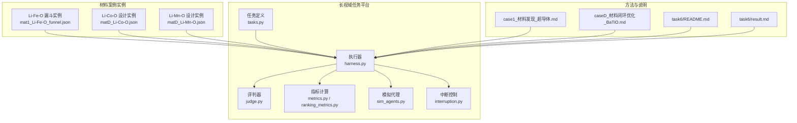
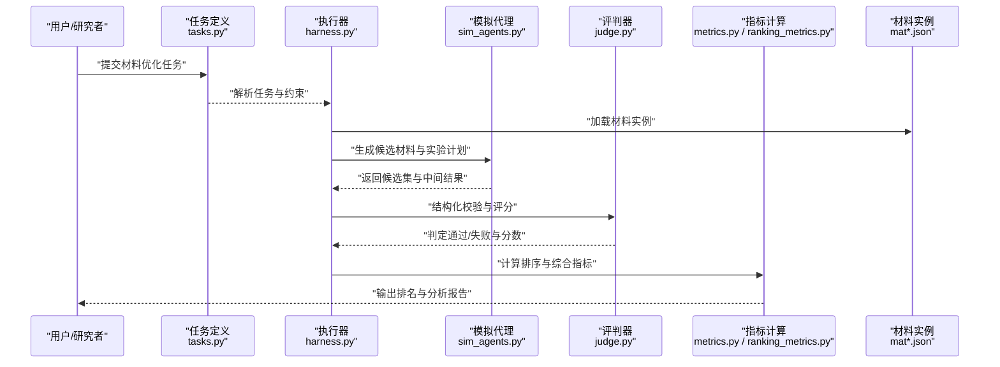
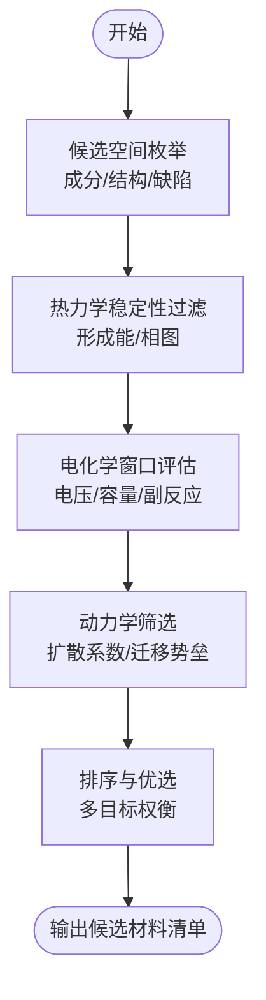
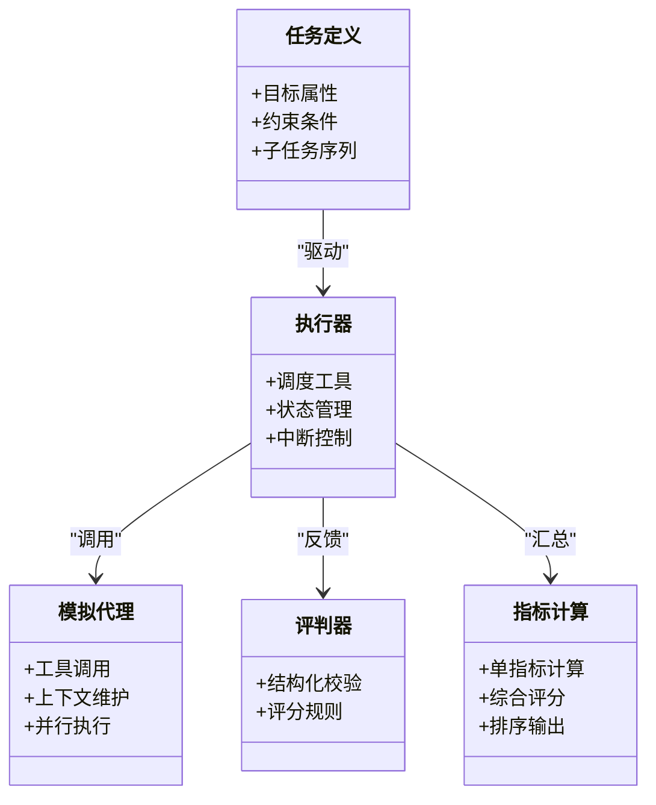
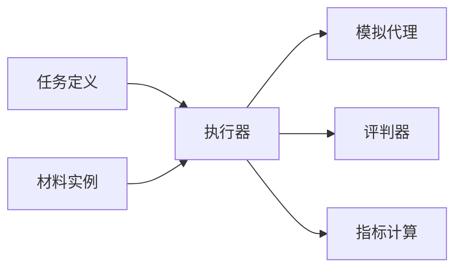

# 电池材料优化

<cite>
**本文引用的文件**   
- [longhorizon/instantiate/instances/mat1_Li-Fe-O_funnel.json](file://longhorizon/instantiate/instances/mat1_Li-Fe-O_funnel.json)
- [longhorizon/instantiate/instances/matD_Li-Co-O.json](file://longhorizon/instantiate/instances/matD_Li-Co-O.json)
- [longhorizon/instantiate/instances/matD_Li-Mn-O.json](file://longhorizon/instantiate/instances/matD_Li-Mn-O.json)
- [longhorizon/case1_材料发现_超导体.md](file://longhorizon/case1_材料发现_超导体.md)
- [longhorizon/caseD_材料闭环优化_BaTiO.md](file://longhorizon/caseD_材料闭环优化_BaTiO.md)
- [autonomy_mvp/core/tasks.py](file://autonomy_mvp/core/tasks.py)
- [autonomy_mvp/core/harness.py](file://autonomy_mvp/core/harness.py)
- [autonomy_mvp/core/judge.py](file://autonomy_mvp/core/judge.py)
- [autonomy_mvp/core/metrics.py](file://autonomy_mvp/core/metrics.py)
- [autonomy_mvp/core/ranking_metrics.py](file://autonomy_mvp/core/ranking_metrics.py)
- [autonomy_mvp/core/sim_agents.py](file://autonomy_mvp/core/sim_agents.py)
- [autonomy_mvp/core/interruption.py](file://autonomy_mvp/core/interruption.py)
- [autonomy_mvp/schema.md](file://autonomy_mvp/schema.md)
- [autonomy_mvp/ACCEPTANCE.md](file://autonomy_mvp/ACCEPTANCE.md)
- [task6/README.md](file://task6/README.md)
- [task6/result.md](file://task6/result.md)
</cite>

## 目录
1. [引言](#引言)
2. [项目结构](#项目结构)
3. [核心组件](#核心组件)
4. [架构总览](#架构总览)
5. [详细组件分析](#详细组件分析)
6. [依赖关系分析](#依赖关系分析)
7. [性能与可扩展性](#性能与可扩展性)
8. [故障排查指南](#故障排查指南)
9. [结论](#结论)
10. [附录](#附录)

## 引言
本文件面向“电池材料优化”应用，聚焦锂离子电池正极、负极与电解质的设计与优化。围绕Li-Fe-O、Li-Co-O、Li-Mn-O等锂系材料体系，系统阐述电化学性能分析与结构稳定性研究的方法论，涵盖离子扩散动力学建模、电极反应机理刻画与容量衰减机制分析；并展示如何通过长视域任务平台实现材料虚拟筛选与性能预测，以及电化学测试数据（循环伏安曲线、阻抗谱）的分析处理流程。文档同时结合仓库中的实例与评测框架，给出可落地的工程化路径与最佳实践。

## 项目结构
仓库包含长视域任务编排、材料案例实例、评测与验收规范等关键模块：
- 长视域任务编排与执行：autonomy_mvp 提供任务定义、执行器、评判与指标计算能力，支撑多步推理与工具调用。
- 材料案例实例：longhorizon/instantiate/instances 下包含 Li-Fe-O、Li-Co-O、Li-Mn-O 等材料体系的漏斗式筛选与材料设计任务实例。
- 方法论与案例说明：longhorizon 下的 case 文档提供了材料发现与闭环优化的整体思路与步骤。
- 任务6相关说明：task6 提供任务背景、结果与补充说明，便于理解长视域任务在材料领域的落地方式。

图表来源
- [autonomy_mvp/core/tasks.py](file://autonomy_mvp/core/tasks.py)
- [autonomy_mvp/core/harness.py](file://autonomy_mvp/core/harness.py)
- [autonomy_mvp/core/judge.py](file://autonomy_mvp/core/judge.py)
- [autonomy_mvp/core/metrics.py](file://autonomy_mvp/core/metrics.py)
- [autonomy_mvp/core/ranking_metrics.py](file://autonomy_mvp/core/ranking_metrics.py)
- [autonomy_mvp/core/sim_agents.py](file://autonomy_mvp/core/sim_agents.py)
- [autonomy_mvp/core/interruption.py](file://autonomy_mvp/core/interruption.py)
- [longhorizon/instantiate/instances/mat1_Li-Fe-O_funnel.json](file://longhorizon/instantiate/instances/mat1_Li-Fe-O_funnel.json)
- [longhorizon/instantiate/instances/matD_Li-Co-O.json](file://longhorizon/instantiate/instances/matD_Li-Co-O.json)
- [longhorizon/instantiate/instances/matD_Li-Mn-O.json](file://longhorizon/instantiate/instances/matD_Li-Mn-O.json)
- [longhorizon/case1_材料发现_超导体.md](file://longhorizon/case1_材料发现_超导体.md)
- [longhorizon/caseD_材料闭环优化_BaTiO.md](file://longhorizon/caseD_材料闭环优化_BaTiO.md)
- [task6/README.md](file://task6/README.md)
- [task6/result.md](file://task6/result.md)

章节来源
- [autonomy_mvp/core/tasks.py](file://autonomy_mvp/core/tasks.py)
- [autonomy_mvp/core/harness.py](file://autonomy_mvp/core/harness.py)
- [autonomy_mvp/core/judge.py](file://autonomy_mvp/core/judge.py)
- [autonomy_mvp/core/metrics.py](file://autonomy_mvp/core/metrics.py)
- [autonomy_mvp/core/ranking_metrics.py](file://autonomy_mvp/core/ranking_metrics.py)
- [autonomy_mvp/core/sim_agents.py](file://autonomy_mvp/core/sim_agents.py)
- [autonomy_mvp/core/interruption.py](file://autonomy_mvp/core/interruption.py)
- [longhorizon/instantiate/instances/mat1_Li-Fe-O_funnel.json](file://longhorizon/instantiate/instances/mat1_Li-Fe-O_funnel.json)
- [longhorizon/instantiate/instances/matD_Li-Co-O.json](file://longhorizon/instantiate/instances/matD_Li-Co-O.json)
- [longhorizon/instantiate/instances/matD_Li-Mn-O.json](file://longhorizon/instantiate/instances/matD_Li-Mn-O.json)
- [longhorizon/case1_材料发现_超导体.md](file://longhorizon/case1_材料发现_超导体.md)
- [longhorizon/caseD_材料闭环优化_BaTiO.md](file://longhorizon/caseD_材料闭环优化_BaTiO.md)
- [task6/README.md](file://task6/README.md)
- [task6/result.md](file://task6/result.md)

## 核心组件
- 任务定义与编排：通过任务描述与子任务分解，驱动长视域工作流在多步推理中完成材料筛选、性能评估与迭代优化。
- 执行器与代理：执行器负责调度工具与模型交互，模拟代理封装工具调用与状态管理，支持并行与中断控制。
- 评判与指标：评判器对输出进行结构化校验与评分，指标模块提供排序与综合评估能力。
- 材料实例：以 JSON 形式定义材料体系的任务目标、约束条件、候选空间与评价标准，便于自动化运行与复现。

章节来源
- [autonomy_mvp/schema.md](file://autonomy_mvp/schema.md)
- [autonomy_mvp/ACCEPTANCE.md](file://autonomy_mvp/ACCEPTANCE.md)
- [autonomy_mvp/core/tasks.py](file://autonomy_mvp/core/tasks.py)
- [autonomy_mvp/core/harness.py](file://autonomy_mvp/core/harness.py)
- [autonomy_mvp/core/judge.py](file://autonomy_mvp/core/judge.py)
- [autonomy_mvp/core/metrics.py](file://autonomy_mvp/core/metrics.py)
- [autonomy_mvp/core/ranking_metrics.py](file://autonomy_mvp/core/ranking_metrics.py)
- [autonomy_mvp/core/sim_agents.py](file://autonomy_mvp/core/sim_agents.py)
- [autonomy_mvp/core/interruption.py](file://autonomy_mvp/core/interruption.py)

## 架构总览
下图展示了从任务到执行、评判与指标的全链路流程，并结合材料实例的输入与输出。

图表来源
- [autonomy_mvp/core/tasks.py](file://autonomy_mvp/core/tasks.py)
- [autonomy_mvp/core/harness.py](file://autonomy_mvp/core/harness.py)
- [autonomy_mvp/core/sim_agents.py](file://autonomy_mvp/core/sim_agents.py)
- [autonomy_mvp/core/judge.py](file://autonomy_mvp/core/judge.py)
- [autonomy_mvp/core/metrics.py](file://autonomy_mvp/core/metrics.py)
- [autonomy_mvp/core/ranking_metrics.py](file://autonomy_mvp/core/ranking_metrics.py)
- [longhorizon/instantiate/instances/mat1_Li-Fe-O_funnel.json](file://longhorizon/instantiate/instances/mat1_Li-Fe-O_funnel.json)
- [longhorizon/instantiate/instances/matD_Li-Co-O.json](file://longhorizon/instantiate/instances/matD_Li-Co-O.json)
- [longhorizon/instantiate/instances/matD_Li-Mn-O.json](file://longhorizon/instantiate/instances/matD_Li-Mn-O.json)

## 详细组件分析

### 材料体系与任务实例（Li-Fe-O、Li-Co-O、Li-Mn-O）
- Li-Fe-O 漏斗式筛选：用于在大规模候选空间中逐步收敛高能量密度、高稳定性的正极材料，典型流程包括成分空间枚举、热力学稳定性过滤、电化学窗口评估与动力学筛选。
- Li-Co-O 与 Li-Mn-O 材料设计：针对层状结构与相变行为，结合掺杂与表面包覆策略，提升循环寿命与倍率性能；实例定义了目标属性、约束边界与评价指标。

图表来源
- [longhorizon/instantiate/instances/mat1_Li-Fe-O_funnel.json](file://longhorizon/instantiate/instances/mat1_Li-Fe-O_funnel.json)
- [longhorizon/instantiate/instances/matD_Li-Co-O.json](file://longhorizon/instantiate/instances/matD_Li-Co-O.json)
- [longhorizon/instantiate/instances/matD_Li-Mn-O.json](file://longhorizon/instantiate/instances/matD_Li-Mn-O.json)

章节来源
- [longhorizon/instantiate/instances/mat1_Li-Fe-O_funnel.json](file://longhorizon/instantiate/instances/mat1_Li-Fe-O_funnel.json)
- [longhorizon/instantiate/instances/matD_Li-Co-O.json](file://longhorizon/instantiate/instances/matD_Li-Co-O.json)
- [longhorizon/instantiate/instances/matD_Li-Mn-O.json](file://longhorizon/instantiate/instances/matD_Li-Mn-O.json)

### 长视域任务平台（任务编排、执行与评判）
- 任务定义：明确材料优化目标（如比容量、电压平台、循环稳定性）、搜索空间与约束条件，并将复杂问题拆解为可执行的子任务序列。
- 执行器：协调工具调用、模型推理与外部数据库/仿真接口，维护任务状态与上下文，支持中断与重试。
- 评判与指标：对输出进行格式与逻辑校验，计算单指标与综合得分，并提供排序与可视化报告。

图表来源
- [autonomy_mvp/core/tasks.py](file://autonomy_mvp/core/tasks.py)
- [autonomy_mvp/core/harness.py](file://autonomy_mvp/core/harness.py)
- [autonomy_mvp/core/sim_agents.py](file://autonomy_mvp/core/sim_agents.py)
- [autonomy_mvp/core/judge.py](file://autonomy_mvp/core/judge.py)
- [autonomy_mvp/core/metrics.py](file://autonomy_mvp/core/metrics.py)
- [autonomy_mvp/core/ranking_metrics.py](file://autonomy_mvp/core/ranking_metrics.py)

章节来源
- [autonomy_mvp/core/tasks.py](file://autonomy_mvp/core/tasks.py)
- [autonomy_mvp/core/harness.py](file://autonomy_mvp/core/harness.py)
- [autonomy_mvp/core/sim_agents.py](file://autonomy_mvp/core/sim_agents.py)
- [autonomy_mvp/core/judge.py](file://autonomy_mvp/core/judge.py)
- [autonomy_mvp/core/metrics.py](file://autonomy_mvp/core/metrics.py)
- [autonomy_mvp/core/ranking_metrics.py](file://autonomy_mvp/core/ranking_metrics.py)

### 方法论与案例说明（材料发现与闭环优化）
- 材料发现：基于高通量筛选与机器学习辅助，快速定位潜在高性能材料，并通过实验验证与反馈修正模型。
- 闭环优化：将计算、仿真与实验数据整合，形成“设计—评估—优化”的迭代回路，持续提升材料性能与稳定性。

章节来源
- [longhorizon/case1_材料发现_超导体.md](file://longhorizon/case1_材料发现_超导体.md)
- [longhorizon/caseD_材料闭环优化_BaTiO.md](file://longhorizon/caseD_材料闭环优化_BaTiO.md)
- [task6/README.md](file://task6/README.md)
- [task6/result.md](file://task6/result.md)

## 依赖关系分析
- 模块耦合：任务定义与执行器强耦合，执行器与代理、评判器、指标模块松耦合，便于替换与扩展。
- 外部依赖：材料实例作为输入源，评判与指标模块对外部评分规则与排序算法有依赖。
- 循环依赖：当前结构未发现明显循环依赖，但需确保工具调用与状态管理的解耦。

图表来源
- [autonomy_mvp/core/tasks.py](file://autonomy_mvp/core/tasks.py)
- [autonomy_mvp/core/harness.py](file://autonomy_mvp/core/harness.py)
- [autonomy_mvp/core/sim_agents.py](file://autonomy_mvp/core/sim_agents.py)
- [autonomy_mvp/core/judge.py](file://autonomy_mvp/core/judge.py)
- [autonomy_mvp/core/metrics.py](file://autonomy_mvp/core/metrics.py)
- [autonomy_mvp/core/ranking_metrics.py](file://autonomy_mvp/core/ranking_metrics.py)
- [longhorizon/instantiate/instances/mat1_Li-Fe-O_funnel.json](file://longhorizon/instantiate/instances/mat1_Li-Fe-O_funnel.json)
- [longhorizon/instantiate/instances/matD_Li-Co-O.json](file://longhorizon/instantiate/instances/matD_Li-Co-O.json)
- [longhorizon/instantiate/instances/matD_Li-Mn-O.json](file://longhorizon/instantiate/instances/matD_Li-Mn-O.json)

章节来源
- [autonomy_mvp/core/tasks.py](file://autonomy_mvp/core/tasks.py)
- [autonomy_mvp/core/harness.py](file://autonomy_mvp/core/harness.py)
- [autonomy_mvp/core/sim_agents.py](file://autonomy_mvp/core/sim_agents.py)
- [autonomy_mvp/core/judge.py](file://autonomy_mvp/core/judge.py)
- [autonomy_mvp/core/metrics.py](file://autonomy_mvp/core/metrics.py)
- [autonomy_mvp/core/ranking_metrics.py](file://autonomy_mvp/core/ranking_metrics.py)

## 性能与可扩展性
- 并行执行：利用模拟代理的并行能力加速候选材料评估，提高吞吐率。
- 中断与恢复：支持任务中断与状态保存，避免长时间运行的资源浪费。
- 指标扩展：新增指标与排序规则时，仅需扩展指标模块，不影响主流程。

[本节为通用指导，不直接分析具体文件]

## 故障排查指南
- 任务解析失败：检查任务定义是否符合 schema，确认字段完整性与类型正确。
- 工具调用异常：查看代理日志与中断记录，确认外部接口可用性与权限配置。
- 评判与指标错误：核对评分规则与排序算法的参数设置，确保输入数据格式一致。

章节来源
- [autonomy_mvp/schema.md](file://autonomy_mvp/schema.md)
- [autonomy_mvp/core/interruption.py](file://autonomy_mvp/core/interruption.py)
- [autonomy_mvp/core/judge.py](file://autonomy_mvp/core/judge.py)
- [autonomy_mvp/core/metrics.py](file://autonomy_mvp/core/metrics.py)
- [autonomy_mvp/core/ranking_metrics.py](file://autonomy_mvp/core/ranking_metrics.py)

## 结论
本方案以长视域任务平台为核心，结合材料实例与评测框架，构建了从任务定义、执行、评判到指标输出的完整闭环。针对 Li-Fe-O、Li-Co-O、Li-Mn-O 等锂系材料体系，提供了系统化的筛选与优化路径，并可扩展到负极与电解质材料的设计与验证。通过模块化架构与可扩展指标体系，该方案具备良好的工程落地能力与持续演进潜力。

[本节为总结性内容，不直接分析具体文件]

## 附录
- 术语表
  - 长视域任务：需要多步推理与工具调用的复杂任务。
  - 漏斗式筛选：通过多级过滤逐步缩小候选空间的策略。
  - 循环伏安曲线：反映电极材料氧化还原行为的电化学测试方法。
  - 阻抗谱：用于分析界面与体相动力学的电化学测试方法。
- 参考案例
  - 材料发现与闭环优化方法论参见 case 文档。
  - 任务6的背景与结果说明参见 task6 相关文件。

章节来源
- [longhorizon/case1_材料发现_超导体.md](file://longhorizon/case1_材料发现_超导体.md)
- [longhorizon/caseD_材料闭环优化_BaTiO.md](file://longhorizon/caseD_材料闭环优化_BaTiO.md)
- [task6/README.md](file://task6/README.md)
- [task6/result.md](file://task6/result.md)