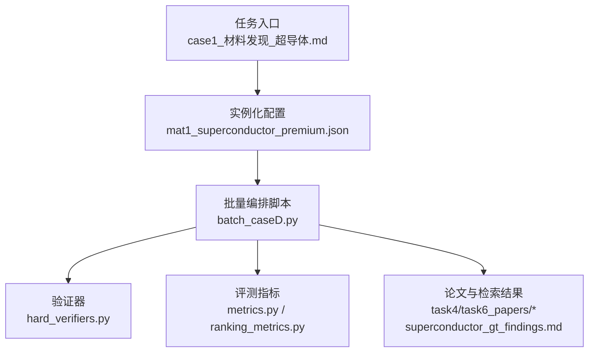
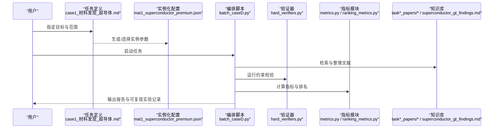
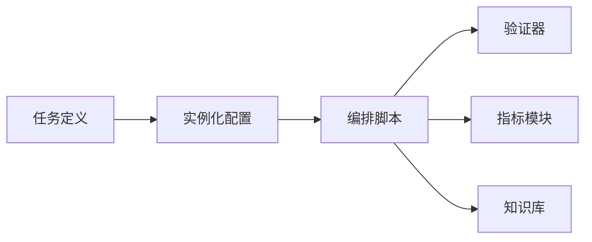

# 超导材料设计

<cite>
**本文引用的文件**   
- [longhorizon/case1_材料发现_超导体.md](file://longhorizon/case1_材料发现_超导体.md)
- [longhorizon/instantiate/instances/mat1_superconductor_premium.json](file://longhorizon/instantiate/instances/mat1_superconductor_premium.json)
- [longhorizon/instantiate/batch_caseD.py](file://longhorizon/instantiate/batch_caseD.py)
- [longhorizon/verifiers/hard_verifiers.py](file://longhorizon/verifiers/hard_verifiers.py)
- [task4/papers/task4_papers/2304.05376.xml](file://docs/prd/task4_papers/2304.05376.xml)
- [task4/papers/task4_papers/2310.03302.xml](file://docs/prd/task4_papers/2310.03302.xml)
- [task4/papers/task4_papers/2405.16205.xml](file://docs/prd/task4_papers/2405.16205.xml)
- [task4/papers/task4_papers/2407.01725.html](file://docs/prd/task4_papers/2407.01725.html)
- [task4/papers/task4_papers/2407.10362.xml](file://docs/prd/task4_papers/2407.10362.xml)
- [task4/papers/task4_papers/2410.05080.html](file://docs/prd/task4_papers/2410.05080.html)
- [task4/papers/task4_papers/2412.14161.html](file://docs/prd/task4_papers/2412.14161.html)
- [task4/papers/task4_papers/2501.14654.xml](file://docs/prd/task4_papers/2501.14654.xml)
- [task6/papers/task6_papers/2308.14920.xml](file://docs/prd/task6_papers/2308.14920.xml)
- [task6/papers/task6_papers/2310.19796.xml](file://docs/prd/task6_papers/2310.19796.xml)
- [task6/papers/task6_papers/2401.13178.xml](file://docs/prd/task6_papers/2401.13178.xml)
- [task6/papers/task6_papers/2409.0714.xml](file://docs/prd/task6_papers/2409.0714.xml)
- [task6/papers/task6_papers/2411.00177.xml](file://docs/prd/task6_papers/2411.00177.xml)
- [task6/papers/task6_papers/2505.23802.xml](file://docs/prd/task6_papers/2505.23802.xml)
- [task6/papers/task6_papers/2601.21800.xml](file://docs/prd/task6_papers/2601.21800.xml)
- [task6/papers/task6_papers/2602.00663.xml](file://docs/prd/task6_papers/2602.00663.xml)
- [task6/papers/task6_papers/2602.21230.xml](file://docs/prd/task6_papers/2602.21230.xml)
- [task6/papers/task6_papers/2604.27470.xml](file://docs/prd/task6_papers/2604.27470.xml)
- [task6/papers/task6_papers/2605.00803.xml](file://docs/prd/task6_papers/2605.00803.xml)
- [task6/papers/task6_papers/2605.02240.xml](file://docs/prd/task6_papers/2605.02240.xml)
- [task6/papers/task6_papers/2605.15461.xml](file://docs/prd/task6_papers/2605.15461.xml)
- [task6/papers/task6_papers/2605.15766.xml](file://docs/prd/task6_papers/2605.15766.xml)
- [docs/search/superconductor_gt_findings.md](file://docs/search/superconductor_gt_findings.md)
- [autonomy_mvp/core/tasks.py](file://autonomy_mvp/core/tasks.py)
- [autonomy_mvp/core/judge.py](file://autonomy_mvp/core/judge.py)
- [autonomy_mvp/core/metrics.py](file://autonomy_mvp/core/metrics.py)
- [autonomy_mvp/core/ranking_metrics.py](file://autonomy_mvp/core/ranking_metrics.py)
- [autonomy_mvp/core/harness.py](file://autonomy_mvp/core/harness.py)
- [autonomy_mvp/core/interruption.py](file://autonomy_mvp/core/interruption.py)
- [autonomy_mvp/core/sim_agents.py](file://autonomy_mvp/core/sim_agents.py)
</cite>

## 目录
1. [引言](#引言)
2. [项目结构](#项目结构)
3. [核心组件](#核心组件)
4. [架构总览](#架构总览)
5. [详细组件分析](#详细组件分析)
6. [依赖关系分析](#依赖关系分析)
7. [性能与可扩展性](#性能与可扩展性)
8. [故障排查指南](#故障排查指南)
9. [结论](#结论)
10. [附录](#附录)

## 引言
本文件面向“超导材料设计”的长视域任务平台，聚焦高温超导体发现、临界温度预测与超导机制分析。内容覆盖：
- 铜氧化物与铁基超导体等典型体系的晶体结构与电子配对理论（含BCS框架）
- 基于长视域任务的逆向设计与性能预测工作流
- 表征技术（磁化率测量、电阻率测试）的数据分析方法
- 平台层面的编排、验证与评估流程

## 项目结构
仓库围绕“长视域任务”组织，包含案例定义、实例化脚本、验证器、评测指标以及大量论文素材与搜索结果。与超导材料相关的关键位置包括：
- 案例说明与任务定义：longhorizon/case1_材料发现_超导体.md
- 任务实例配置：longhorizon/instantiate/instances/mat1_superconductor_premium.json
- 批量执行与编排：longhorizon/instantiate/batch_caseD.py
- 验证器与评测：longhorizon/verifiers/hard_verifiers.py、autonomy_mvp/core/*
- 论文与搜索资料：docs/prd/task*_papers/*、docs/search/superconductor_gt_findings.md

图表来源
- [longhorizon/case1_材料发现_超导体.md](file://longhorizon/case1_材料发现_超导体.md)
- [longhorizon/instantiate/instances/mat1_superconductor_premium.json](file://longhorizon/instantiate/instances/mat1_superconductor_premium.json)
- [longhorizon/instantiate/batch_caseD.py](file://longhorizon/instantiate/batch_caseD.py)
- [longhorizon/verifiers/hard_verifiers.py](file://longhorizon/verifiers/hard_verifiers.py)
- [autonomy_mvp/core/metrics.py](file://autonomy_mvp/core/metrics.py)
- [autonomy_mvp/core/ranking_metrics.py](file://autonomy_mvp/core/ranking_metrics.py)
- [docs/search/superconductor_gt_findings.md](file://docs/search/superconductor_gt_findings.md)

章节来源
- [longhorizon/case1_材料发现_超导体.md](file://longhorizon/case1_材料发现_超导体.md)
- [longhorizon/instantiate/instances/mat1_superconductor_premium.json](file://longhorizon/instantiate/instances/mat1_superconductor_premium.json)
- [longhorizon/instantiate/batch_caseD.py](file://longhorizon/instantiate/batch_caseD.py)
- [longhorizon/verifiers/hard_verifiers.py](file://longhorizon/verifiers/hard_verifiers.py)
- [autonomy_mvp/core/metrics.py](file://autonomy_mvp/core/metrics.py)
- [autonomy_mvp/core/ranking_metrics.py](file://autonomy_mvp/core/ranking_metrics.py)
- [docs/search/superconductor_gt_findings.md](file://docs/search/superconductor_gt_findings.md)

## 核心组件
- 任务编排与实例化
  - 通过实例化配置文件驱动具体任务参数与数据路径，由批量脚本统一调度。
- 验证与评测
  - 硬验证器负责关键约束检查；指标模块提供数值型与排序型度量。
- 知识与证据
  - 论文集合与搜索结果作为知识源，支撑文献综述、对比分析与趋势总结。

章节来源
- [longhorizon/instantiate/instances/mat1_superconductor_premium.json](file://longhorizon/instantiate/instances/mat1_superconductor_premium.json)
- [longhorizon/instantiate/batch_caseD.py](file://longhorizon/instantiate/batch_caseD.py)
- [longhorizon/verifiers/hard_verifiers.py](file://longhorizon/verifiers/hard_verifiers.py)
- [autonomy_mvp/core/metrics.py](file://autonomy_mvp/core/metrics.py)
- [autonomy_mvp/core/ranking_metrics.py](file://autonomy_mvp/core/ranking_metrics.py)

## 架构总览
下图展示从任务定义到执行、验证与产出的端到端流程，并标注与源码文件的对应关系。

图表来源
- [longhorizon/case1_材料发现_超导体.md](file://longhorizon/case1_材料发现_超导体.md)
- [longhorizon/instantiate/instances/mat1_superconductor_premium.json](file://longhorizon/instantiate/instances/mat1_superconductor_premium.json)
- [longhorizon/instantiate/batch_caseD.py](file://longhorizon/instantiate/batch_caseD.py)
- [longhorizon/verifiers/hard_verifiers.py](file://longhorizon/verifiers/hard_verifiers.py)
- [autonomy_mvp/core/metrics.py](file://autonomy_mvp/core/metrics.py)
- [autonomy_mvp/core/ranking_metrics.py](file://autonomy_mvp/core/ranking_metrics.py)
- [docs/search/superconductor_gt_findings.md](file://docs/search/superconductor_gt_findings.md)

## 详细组件分析

### 任务定义与实例化
- 任务定义文件给出研究目标、范围与产出要求，是长视域任务的起点。
- 实例化配置文件承载具体参数（如体系、数据集、实验设置），供编排脚本读取。
- 建议将“高温超导体发现”“临界温度预测”“机制分析”拆分为子任务，便于并行与复用。

章节来源
- [longhorizon/case1_材料发现_超导体.md](file://longhorizon/case1_材料发现_超导体.md)
- [longhorizon/instantiate/instances/mat1_superconductor_premium.json](file://longhorizon/instantiate/instances/mat1_superconductor_premium.json)

### 编排与执行
- 批量脚本负责加载实例、调用工具链、触发验证与评测，并汇总结果。
- 建议在编排层引入重试与断点续跑，提升稳定性与可复现性。

章节来源
- [longhorizon/instantiate/batch_caseD.py](file://longhorizon/instantiate/batch_caseD.py)

### 验证与评测
- 硬验证器用于对关键约束进行判定（例如数据完整性、格式规范、阈值条件）。
- 指标模块提供连续值度量与排序度量，支持多目标优化场景下的综合评估。

章节来源
- [longhorizon/verifiers/hard_verifiers.py](file://longhorizon/verifiers/hard_verifiers.py)
- [autonomy_mvp/core/metrics.py](file://autonomy_mvp/core/metrics.py)
- [autonomy_mvp/core/ranking_metrics.py](file://autonomy_mvp/core/ranking_metrics.py)

### 知识管理与检索
- 论文集合与搜索结果构成知识底座，可用于：
  - 高温超导体发现脉络梳理
  - 临界温度预测模型与方法学对比
  - 铜氧化物与铁基体系的结构—性能关联总结
- 建议建立结构化索引（主题、方法、体系、年份、关键结论），以支撑快速检索与对比。

章节来源
- [docs/search/superconductor_gt_findings.md](file://docs/search/superconductor_gt_findings.md)
- [docs/prd/task4_papers/2304.05376.xml](file://docs/prd/task4_papers/2304.05376.xml)
- [docs/prd/task4_papers/2310.03302.xml](file://docs/prd/task4_papers/2310.03302.xml)
- [docs/prd/task4_papers/2405.16205.xml](file://docs/prd/task4_papers/2405.16205.xml)
- [docs/prd/task4_papers/2407.01725.html](file://docs/prd/task4_papers/2407.01725.html)
- [docs/prd/task4_papers/2407.10362.xml](file://docs/prd/task4_papers/2407.10362.xml)
- [docs/prd/task4_papers/2410.05080.html](file://docs/prd/task4_papers/2410.05080.html)
- [docs/prd/task4_papers/2412.14161.html](file://docs/prd/task4_papers/2412.14161.html)
- [docs/prd/task4_papers/2501.14654.xml](file://docs/prd/task4_papers/2501.14654.xml)
- [docs/prd/task6_papers/2308.14920.xml](file://docs/prd/task6_papers/2308.14920.xml)
- [docs/prd/task6_papers/2310.19796.xml](file://docs/prd/task6_papers/2310.19796.xml)
- [docs/prd/task6_papers/2401.13178.xml](file://docs/prd/task6_papers/2401.13178.xml)
- [docs/prd/task6_papers/2409.0714.xml](file://docs/prd/task6_papers/2409.0714.xml)
- [docs/prd/task6_papers/2411.00177.xml](file://docs/prd/task6_papers/2411.00177.xml)
- [docs/prd/task6_papers/2505.23802.xml](file://docs/prd/task6_papers/2505.23802.xml)
- [docs/prd/task6_papers/2601.21800.xml](file://docs/prd/task6_papers/2601.21800.xml)
- [docs/prd/task6_papers/2602.00663.xml](file://docs/prd/task6_papers/2602.00663.xml)
- [docs/prd/task6_papers/2602.21230.xml](file://docs/prd/task6_papers/2602.21230.xml)
- [docs/prd/task6_papers/2604.27470.xml](file://docs/prd/task6_papers/2604.27470.xml)
- [docs/prd/task6_papers/2605.00803.xml](file://docs/prd/task6_papers/2605.00803.xml)
- [docs/prd/task6_papers/2605.02240.xml](file://docs/prd/task6_papers/2605.02240.xml)
- [docs/prd/task6_papers/2605.15461.xml](file://docs/prd/task6_papers/2605.15461.xml)
- [docs/prd/task6_papers/2605.15766.xml](file://docs/prd/task6_papers/2605.15766.xml)

### 超导物理与材料体系要点（概念性概述）
- 高温超导体发现脉络
  - 铜氧化物体系：层状钙钛矿结构、CuO2面主导强关联电子行为、掺杂调控载流子浓度与相图演化。
  - 铁基超导体：多层FeAs/FeSe平面、自旋涨落与轨道自由度参与配对的可能角色。
- 临界温度预测
  - 经验规则与机器学习结合：结构描述符（键长、配位、对称性）、电子结构特征（态密度、费米面拓扑）、化学环境（元素电负性、价态分布）。
  - 注意数据偏差与外推风险，强调交叉验证与不确定性量化。
- 超导机制分析
  - BCS框架：声子介导的电子配对、能隙与同位素效应；适用于传统低温超导体。
  - 非常规机制：铜氧化物与铁基体系中，自旋涨落、电荷序、轨道序与晶格耦合共同作用，配对对称性与维度效应显著。
- 晶体结构设计
  - 稳定层状结构、合理掺杂与应变工程、界面与异质结设计，用以调控载流子浓度与电子态。
- 表征与数据分析
  - 磁化率测量：识别迈斯纳效应、抗磁性转变与相变温度；需考虑退磁因子与背景扣除。
  - 电阻率测试：零阻转变宽度、上临界场与温度依赖、四探针法消除接触电阻影响。
  - 数据处理：平滑滤波、基线校正、峰值拟合、误差传播与统计显著性检验。

[本节为概念性内容，不直接分析具体代码文件]

## 依赖关系分析
- 编排层依赖实例化配置与知识库，驱动验证与评测。
- 验证器与指标模块相对独立，便于替换与扩展。
- 论文与搜索结果作为外部输入，增强任务的可解释性与可追溯性。

图表来源
- [longhorizon/case1_材料发现_超导体.md](file://longhorizon/case1_材料发现_超导体.md)
- [longhorizon/instantiate/instances/mat1_superconductor_premium.json](file://longhorizon/instantiate/instances/mat1_superconductor_premium.json)
- [longhorizon/instantiate/batch_caseD.py](file://longhorizon/instantiate/batch_caseD.py)
- [longhorizon/verifiers/hard_verifiers.py](file://longhorizon/verifiers/hard_verifiers.py)
- [autonomy_mvp/core/metrics.py](file://autonomy_mvp/core/metrics.py)
- [autonomy_mvp/core/ranking_metrics.py](file://autonomy_mvp/core/ranking_metrics.py)
- [docs/search/superconductor_gt_findings.md](file://docs/search/superconductor_gt_findings.md)

章节来源
- [longhorizon/instantiate/batch_caseD.py](file://longhorizon/instantiate/batch_caseD.py)
- [autonomy_mvp/core/metrics.py](file://autonomy_mvp/core/metrics.py)
- [autonomy_mvp/core/ranking_metrics.py](file://autonomy_mvp/core/ranking_metrics.py)

## 性能与可扩展性
- 并行化策略
  - 按任务实例或子任务拆分，利用批处理脚本并发执行，缩短整体周期。
- 缓存与增量更新
  - 对文献检索与预处理结果进行缓存，避免重复计算。
- 资源管理
  - 控制并发度与内存占用，防止长时间运行的任务出现阻塞或崩溃。
- 可观测性
  - 增加日志与中间产物快照，便于定位问题与回溯。

[本节为通用指导，不直接分析具体代码文件]

## 故障排查指南
- 常见错误与定位
  - 实例化配置缺失或字段类型不符：检查JSON结构与必填项。
  - 验证器失败：核对阈值与数据格式，确认边界条件。
  - 指标计算异常：检查输入数据范围与单位一致性。
- 调试建议
  - 启用最小可复现实例，逐步放大复杂度。
  - 在编排层加入断点与重试逻辑，捕获异常堆栈。
  - 使用知识库中的样例与基准结果进行对照。

章节来源
- [longhorizon/instantiate/instances/mat1_superconductor_premium.json](file://longhorizon/instantiate/instances/mat1_superconductor_premium.json)
- [longhorizon/verifiers/hard_verifiers.py](file://longhorizon/verifiers/hard_verifiers.py)
- [autonomy_mvp/core/metrics.py](file://autonomy_mvp/core/metrics.py)
- [autonomy_mvp/core/ranking_metrics.py](file://autonomy_mvp/core/ranking_metrics.py)

## 结论
本文件基于仓库中的任务定义、实例化配置、编排脚本、验证器与指标模块，构建了面向超导材料设计的长视域任务工作流。通过系统化的知识管理与严格的验证评测，可实现高温超导体发现、临界温度预测与机制分析的闭环推进。后续可在以下方面持续改进：
- 完善数据结构与描述符库，提升预测泛化能力
- 强化不确定性与误差分析，提高结论稳健性
- 扩展表征数据分析工具链，形成标准化处理流程

[本节为总结性内容，不直接分析具体代码文件]

## 附录
- 术语速查
  - 临界温度（Tc）：材料进入超导态的温度阈值
  - 迈斯纳效应：完全抗磁性现象
  - BCS理论：传统超导体的微观理论框架
  - 铜氧化物/铁基超导体：两类重要的高温超导体体系
- 参考路径
  - 任务定义与实例：见“任务定义与实例化”“编排与执行”
  - 验证与评测：见“验证与评测”
  - 知识来源：见“知识管理与检索”

[本节为补充信息，不直接分析具体代码文件]