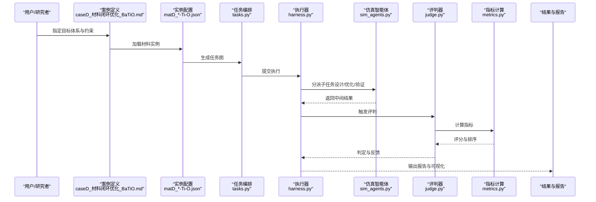
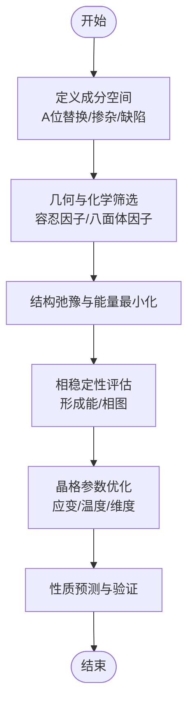
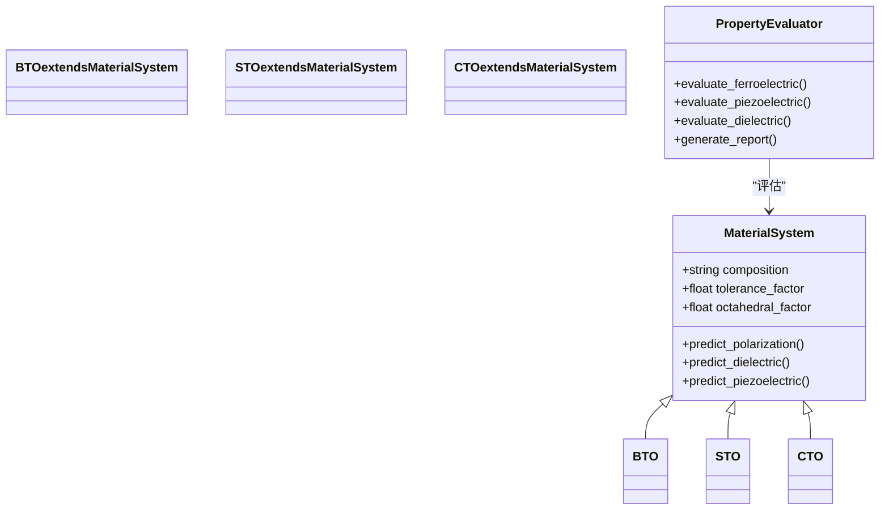
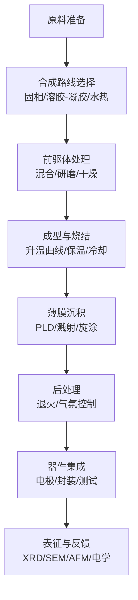
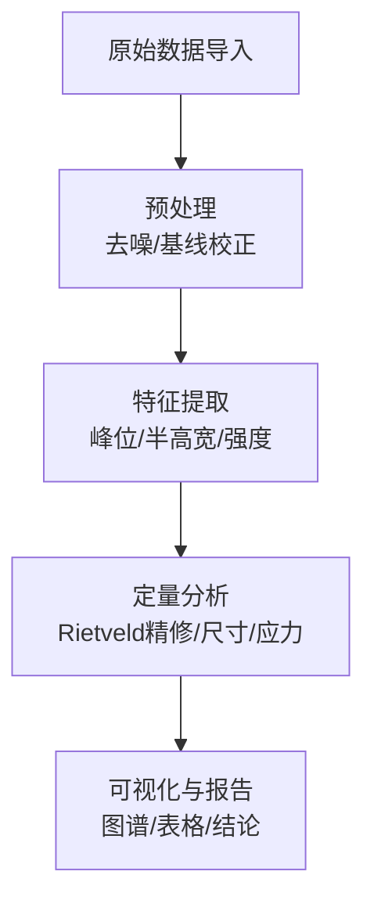
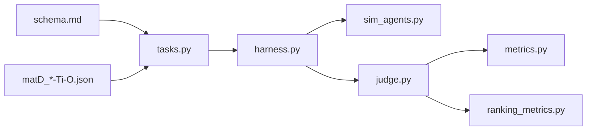

# 钙钛矿材料开发

<cite>
**本文引用的文件**   
- [longhorizon/caseD_材料闭环优化_BaTiO.md](file://longhorizon/caseD_材料闭环优化_BaTiO.md)
- [longhorizon/instantiate/instances/matD_Ba-Ti-O.json](file://longhorizon/instantiate/instances/matD_Ba-Ti-O.json)
- [longhorizon/instantiate/instances/matD_Sr-Ti-O.json](file://longhorizon/instantiate/instances/matD_Sr-Ti-O.json)
- [longhorizon/instantiate/instances/matD_Ca-Ti-O.json](file://longhorizon/instantiate/instances/matD_Ca-Ti-O.json)
- [autonomy_mvp/core/tasks.py](file://autonomy_mvp/core/tasks.py)
- [autonomy_mvp/core/harness.py](file://autonomy_mvp/core/harness.py)
- [autonomy_mvp/core/judge.py](file://autonomy_mvp/core/judge.py)
- [autonomy_mvp/core/metrics.py](file://autonomy_mvp/core/metrics.py)
- [autonomy_mvp/core/sim_agents.py](file://autonomy_mvp/core/sim_agents.py)
- [autonomy_mvp/core/interruption.py](file://autonomy_mvp/core/interruption.py)
- [autonomy_mvp/core/ranking_metrics.py](file://autonomy_mvp/core/ranking_metrics.py)
- [autonomy_mvp/schema.md](file://autonomy_mvp/schema.md)
- [autonomy_mvp/results.md](file://autonomy_mvp/results.md)
- [autonomy_mvp/run_validation.py](file://autonomy_mvp/run_validation.py)
- [task1/session_1/B_step_by_step.md](file://task1/session_1/B_step_by_step.md)
- [task1/session_1/A_result.json](file://task1/session_1/A_result.json)
- [task1/session_1/B_result.json](file://task1/session_1/B_result.json)
- [task1/session_2/B_step_by_step.md](file://task1/session_2/B_step_by_step.md)
- [task1/session_3/B_step_by_step.md](file://task1/session_3/B_step_by_step.md)
- [task1/session_4/B_step_by_step.md](file://task1/session_4/B_step_by_step.md)
- [task1/session_5/B_step_by_step.md](file://task1/session_5/B_step_by_step.md)
- [task1/session_6/B_step_by_step.md](file://task1/session_6/B_step_by_step.md)
- [task1/session_7/eval.md](file://task1/session_7/eval.md)
- [task1/session_8/A_all_at_once.md](file://task1/session_8/A_all_at_once.md)
- [task1/session_9/.raw/B_r1.json](file://task1/session_9/.raw/B_r1.json)
- [task1/session_10/prompts/single.txt](file://task1/session_10/prompts/single.txt)
- [task1/session_11/prompts/single.txt](file://task1/session_11/prompts/single.txt)
- [task1/session_12/prompts/single.txt](file://task1/session_12/prompts/single.txt)
- [task1/session_13/prompts/single.txt](file://task1/session_13/prompts/single.txt)
- [task1/analyze.py](file://task1/analyze.py)
- [task1/runner.py](file://task1/runner.py)
- [task1/runner2.py](file://task1/runner2.py)
- [task1/turn.py](file://task1/turn.py)
- [task1/verify6.py](file://task1/verify6.py)
- [task1/credentials.md](file://task1/credentials.md)
</cite>

## 目录
1. [引言](#引言)
2. [项目结构](#项目结构)
3. [核心组件](#核心组件)
4. [架构总览](#架构总览)
5. [详细组件分析](#详细组件分析)
6. [依赖关系分析](#依赖关系分析)
7. [性能与稳定性考量](#性能与稳定性考量)
8. [故障排查指南](#故障排查指南)
9. [结论](#结论)
10. [附录](#附录)

## 引言
本文件面向“钙钛矿材料开发”的长视域任务平台，聚焦ABO3型钙钛矿（以Ba-Ti-O、Sr-Ti-O、Ca-Ti-O等钛酸盐体系为代表）的材料设计、晶格参数优化与相稳定性分析；系统梳理铁电、压电与介电性能的研究路径；并给出合成方法、薄膜制备与器件集成的工程化流程。同时，展示如何通过长视域任务平台实现成分设计与性能预测，以及X射线衍射（XRD）、扫描电子显微镜（SEM）、原子力显微镜（AFM）等表征数据的分析方法。

## 项目结构
仓库围绕“长视域多智能体工作流”组织，包含：
- 案例与实例定义：针对Ba/Ti/O、Sr/Ti/O、Ca/Ti/O等体系的实例化配置与任务描述
- 核心运行框架：任务编排、执行器、评判与指标计算
- 会话与提示模板：多轮交互、步骤化引导与结果记录
- 评估与验证脚本：一致性检查、结果分析与回归验证

```mermaid
graph TB
subgraph "案例与实例"
caseD["caseD_材料闭环优化_BaTiO.md"]
instBTO["matD_Ba-Ti-O.json"]
instSTO["matD_Sr-Ti-O.json"]
instCTO["matD_Ca-Ti-O.json"]
end
subgraph "核心框架"
tasks["tasks.py"]
harness["harness.py"]
judge["judge.py"]
metrics["metrics.py"]
sim["sim_agents.py"]
interrupt["interruption.py"]
rank["ranking_metrics.py"]
schema["schema.md"]
end
subgraph "会话与提示"
s1b["session_1/B_step_by_step.md"]
s2b["session_2/B_step_by_step.md"]
s3b["session_3/B_step_by_step.md"]
s4b["session_4/B_step_by_step.md"]
s5b["session_5/B_step_by_step.md"]
s6b["session_6/B_step_by_step.md"]
s7e["session_7/eval.md"]
s8a["session_8/A_all_at_once.md"]
p10["session_10/prompts/single.txt"]
p11["session_11/prompts/single.txt"]
p12["session_12/prompts/single.txt"]
p13["session_13/prompts/single.txt"]
end
subgraph "运行与评估"
runv["run_validation.py"]
analyze["analyze.py"]
runner["runner.py"]
runner2["runner2.py"]
turn["turn.py"]
verify["verify6.py"]
cred["credentials.md"]
end
caseD --> instBTO
instBTO --> tasks
instSTO --> tasks
instCTO --> tasks
tasks --> harness
harness --> judge
harness --> metrics
harness --> sim
harness --> interrupt
judge --> rank
s1b --> runner
s2b --> runner
s3b --> runner
s4b --> runner
s5b --> runner
s6b --> runner
s7e --> analyze
s8a --> runner2
p10 --> turn
p11 --> turn
p12 --> turn
p13 --> turn
runv --> harness
analyze --> metrics
verify --> judge
cred --> runner
```



图表来源
- [longhorizon/caseD_材料闭环优化_BaTiO.md](file://longhorizon/caseD_材料闭环优化_BaTiO.md)
- [longhorizon/instantiate/instances/matD_Ba-Ti-O.json](file://longhorizon/instantiate/instances/matD_Ba-Ti-O.json)
- [longhorizon/instantiate/instances/matD_Sr-Ti-O.json](file://longhorizon/instantiate/instances/matD_Sr-Ti-O.json)
- [longhorizon/instantiate/instances/matD_Ca-Ti-O.json](file://longhorizon/instantiate/instances/matD_Ca-Ti-O.json)
- [autonomy_mvp/core/tasks.py](file://autonomy_mvp/core/tasks.py)
- [autonomy_mvp/core/harness.py](file://autonomy_mvp/core/harness.py)
- [autonomy_mvp/core/judge.py](file://autonomy_mvp/core/judge.py)
- [autonomy_mvp/core/metrics.py](file://autonomy_mvp/core/metrics.py)
- [autonomy_mvp/core/sim_agents.py](file://autonomy_mvp/core/sim_agents.py)
- [autonomy_mvp/core/interruption.py](file://autonomy_mvp/core/interruption.py)
- [autonomy_mvp/core/ranking_metrics.py](file://autonomy_mvp/core/ranking_metrics.py)
- [autonomy_mvp/schema.md](file://autonomy_mvp/schema.md)
- [task1/session_1/B_step_by_step.md](file://task1/session_1/B_step_by_step.md)
- [task1/session_2/B_step_by_step.md](file://task1/session_2/B_step_by_step.md)
- [task1/session_3/B_step_by_step.md](file://task1/session_3/B_step_by_step.md)
- [task1/session_4/B_step_by_step.md](file://task1/session_4/B_step_by_step.md)
- [task1/session_5/B_step_by_step.md](file://task1/session_5/B_step_by_step.md)
- [task1/session_6/B_step_by_step.md](file://task1/session_6/B_step_by_step.md)
- [task1/session_7/eval.md](file://task1/session_7/eval.md)
- [task1/session_8/A_all_at_once.md](file://task1/session_8/A_all_at_once.md)
- [task1/session_10/prompts/single.txt](file://task1/session_10/prompts/single.txt)
- [task1/session_11/prompts/single.txt](file://task1/session_11/prompts/single.txt)
- [task1/session_12/prompts/single.txt](file://task1/session_12/prompts/single.txt)
- [task1/session_13/prompts/single.txt](file://task1/session_13/prompts/single.txt)
- [autonomy_mvp/run_validation.py](file://autonomy_mvp/run_validation.py)
- [task1/analyze.py](file://task1/analyze.py)
- [task1/runner.py](file://task1/runner.py)
- [task1/runner2.py](file://task1/runner2.py)
- [task1/turn.py](file://task1/turn.py)
- [task1/verify6.py](file://task1/verify6.py)
- [task1/credentials.md](file://task1/credentials.md)

章节来源
- [longhorizon/caseD_材料闭环优化_BaTiO.md](file://longhorizon/caseD_材料闭环优化_BaTiO.md)
- [autonomy_mvp/core/tasks.py](file://autonomy_mvp/core/tasks.py)
- [autonomy_mvp/core/harness.py](file://autonomy_mvp/core/harness.py)
- [autonomy_mvp/schema.md](file://autonomy_mvp/schema.md)

## 核心组件
- 任务编排与实例化
  - 通过实例JSON定义材料体系（如Ba/Ti/O、Sr/Ti/O、Ca/Ti/O），并在任务层进行组合与调度
  - 支持将“材料发现/优化”抽象为可复用的任务单元，便于跨体系迁移
- 执行器与仿真智能体
  - 提供统一的执行环境，协调工具调用、状态管理与中断恢复
  - 支持并行与串行策略，适配不同算力与稳定性需求
- 评判与指标
  - 内置多维度指标（如收敛性、稳定性、性能提升幅度等），用于自动化评估
  - 提供排序与对比能力，支撑方案优选
- 会话与提示工程
  - 多轮对话式工作流，逐步推进“问题拆解—方案设计—实验计划—结果分析—迭代优化”
  - 提示模板标准化，保证可重复性与可审计性

章节来源
- [autonomy_mvp/core/tasks.py](file://autonomy_mvp/core/tasks.py)
- [autonomy_mvp/core/sim_agents.py](file://autonomy_mvp/core/sim_agents.py)
- [autonomy_mvp/core/judge.py](file://autonomy_mvp/core/judge.py)
- [autonomy_mvp/core/metrics.py](file://autonomy_mvp/core/metrics.py)
- [autonomy_mvp/core/ranking_metrics.py](file://autonomy_mvp/core/ranking_metrics.py)
- [autonomy_mvp/schema.md](file://autonomy_mvp/schema.md)

## 架构总览
下图展示了从“材料实例定义”到“任务编排—执行—评判—报告”的端到端流程，覆盖Ba/Sr/Ca钛酸盐体系的设计与优化闭环。



图表来源
- [longhorizon/caseD_材料闭环优化_BaTiO.md](file://longhorizon/caseD_材料闭环优化_BaTiO.md)
- [longhorizon/instantiate/instances/matD_Ba-Ti-O.json](file://longhorizon/instantiate/instances/matD_Ba-Ti-O.json)
- [longhorizon/instantiate/instances/matD_Sr-Ti-O.json](file://longhorizon/instantiate/instances/matD_Sr-Ti-O.json)
- [longhorizon/instantiate/instances/matD_Ca-Ti-O.json](file://longhorizon/instantiate/instances/matD_Ca-Ti-O.json)
- [autonomy_mvp/core/tasks.py](file://autonomy_mvp/core/tasks.py)
- [autonomy_mvp/core/harness.py](file://autonomy_mvp/core/harness.py)
- [autonomy_mvp/core/sim_agents.py](file://autonomy_mvp/core/sim_agents.py)
- [autonomy_mvp/core/judge.py](file://autonomy_mvp/core/judge.py)
- [autonomy_mvp/core/metrics.py](file://autonomy_mvp/core/metrics.py)

## 详细组件分析

### ABO3型钙钛矿材料设计与晶格参数优化
- 设计要点
  - 基于Goldschmidt容忍因子与八面体因子进行初筛，结合元素半径与价态匹配
  - 对Ba/Ti/O、Sr/Ti/O、Ca/Ti/O体系分别构建候选空间，考虑掺杂与缺陷工程
- 晶格参数优化
  - 采用第一性原理或经验势模型进行结构弛豫，关注a/b/c与α/β/γ变化
  - 引入应变工程（外延应力）与温度效应，评估相变边界
- 相稳定性分析
  - 计算形成能与相图投影，识别稳定/亚稳相
  - 结合声子谱与自由能分析，评估动力学稳定性



章节来源
- [longhorizon/instantiate/instances/matD_Ba-Ti-O.json](file://longhorizon/instantiate/instances/matD_Ba-Ti-O.json)
- [longhorizon/instantiate/instances/matD_Sr-Ti-O.json](file://longhorizon/instantiate/instances/matD_Sr-Ti-O.json)
- [longhorizon/instantiate/instances/matD_Ca-Ti-O.json](file://longhorizon/instantiate/instances/matD_Ca-Ti-O.json)
- [autonomy_mvp/core/tasks.py](file://autonomy_mvp/core/tasks.py)

### Ba-Ti-O、Sr-Ti-O、Ca-Ti-O的铁电、压电与介电性能研究
- 铁电性
  - 关注自发极化强度、矫顽场与居里温度；通过极化-电场回线评估
- 压电性
  - 提取d33/d31系数与机电耦合系数k；结合应变响应与谐振频率
- 介电性
  - 测量介电常数与损耗角正切，分析频散与温度依赖性
- 平台集成
  - 在任务图中嵌入“性能预测—实验验证—反馈优化”的闭环，自动产出对比报告



图表来源
- [longhorizon/instantiate/instances/matD_Ba-Ti-O.json](file://longhorizon/instantiate/instances/matD_Ba-Ti-O.json)
- [longhorizon/instantiate/instances/matD_Sr-Ti-O.json](file://longhorizon/instantiate/instances/matD_Sr-Ti-O.json)
- [longhorizon/instantiate/instances/matD_Ca-Ti-O.json](file://longhorizon/instantiate/instances/matD_Ca-Ti-O.json)
- [autonomy_mvp/core/metrics.py](file://autonomy_mvp/core/metrics.py)
- [autonomy_mvp/core/judge.py](file://autonomy_mvp/core/judge.py)

### 合成方法与薄膜制备技术
- 块体合成
  - 固相反应法、溶胶-凝胶法、水热/溶剂热法；控制氧分压与退火曲线
- 薄膜制备
  - 脉冲激光沉积（PLD）、磁控溅射、溶胶-凝胶旋涂、分子束外延（MBE）
  - 关键工艺：基底选择、温度梯度、氧压控制、退火与快速热退火（RTA）
- 器件集成
  - 电极图案化（顶电极/底电极）、光刻与刻蚀、封装与可靠性测试



章节来源
- [longhorizon/caseD_材料闭环优化_BaTiO.md](file://longhorizon/caseD_材料闭环优化_BaTiO.md)
- [task1/session_1/B_step_by_step.md](file://task1/session_1/B_step_by_step.md)
- [task1/session_2/B_step_by_step.md](file://task1/session_2/B_step_by_step.md)
- [task1/session_3/B_step_by_step.md](file://task1/session_3/B_step_by_step.md)
- [task1/session_4/B_step_by_step.md](file://task1/session_4/B_step_by_step.md)
- [task1/session_5/B_step_by_step.md](file://task1/session_5/B_step_by_step.md)
- [task1/session_6/B_step_by_step.md](file://task1/session_6/B_step_by_step.md)

### 长视域任务平台的成分设计与性能预测
- 任务分解
  - 将“成分设计—结构优化—性能预测—实验验证”拆分为可追踪的子任务
- 智能体协作
  - 规划者负责任务编排，执行者调用工具与数据源，评判者打分与排序
- 反馈闭环
  - 依据指标与专家规则进行自动反馈，驱动下一轮优化

```mermaid
sequenceDiagram
participant Planner as "规划者"
participant Executor as "执行者"
participant Tool as "工具/数据源"
participant Evaluator as "评判者"
participant Loop as "反馈循环"
Planner->>Executor : 下发子任务
Executor->>Tool : 查询/计算/模拟
Tool-->>Executor : 返回结果
Executor-->>Planner : 汇总进度
Planner->>Evaluator : 请求评估
Evaluator-->>Planner : 评分与建议
Planner->>Loop : 调整策略与参数
```

图表来源
- [autonomy_mvp/core/tasks.py](file://autonomy_mvp/core/tasks.py)
- [autonomy_mvp/core/harness.py](file://autonomy_mvp/core/harness.py)
- [autonomy_mvp/core/sim_agents.py](file://autonomy_mvp/core/sim_agents.py)
- [autonomy_mvp/core/judge.py](file://autonomy_mvp/core/judge.py)
- [autonomy_mvp/core/metrics.py](file://autonomy_mvp/core/metrics.py)

### XRD、SEM、AFM表征结果分析方法
- XRD
  - 物相鉴定与晶格参数精修；择优取向与织构分析；残余应力估算
- SEM
  - 形貌与截面观察；颗粒尺寸分布；界面质量与缺陷识别
- AFM
  - 表面粗糙度与台阶高度；畴结构与极化域成像；力学性能映射



章节来源
- [task1/session_7/eval.md](file://task1/session_7/eval.md)
- [task1/session_8/A_all_at_once.md](file://task1/session_8/A_all_at_once.md)

## 依赖关系分析
- 模块耦合
  - 任务编排与执行器强耦合，评判与指标模块相对独立，便于扩展新指标
- 外部依赖
  - 数据源与工具接口通过统一入口接入，降低直接耦合风险
- 潜在循环依赖
  - 当前结构未见明显循环；建议保持“编排—执行—评判”单向依赖



图表来源
- [autonomy_mvp/core/tasks.py](file://autonomy_mvp/core/tasks.py)
- [autonomy_mvp/core/harness.py](file://autonomy_mvp/core/harness.py)
- [autonomy_mvp/core/sim_agents.py](file://autonomy_mvp/core/sim_agents.py)
- [autonomy_mvp/core/judge.py](file://autonomy_mvp/core/judge.py)
- [autonomy_mvp/core/metrics.py](file://autonomy_mvp/core/metrics.py)
- [autonomy_mvp/core/ranking_metrics.py](file://autonomy_mvp/core/ranking_metrics.py)
- [autonomy_mvp/schema.md](file://autonomy_mvp/schema.md)
- [longhorizon/instantiate/instances/matD_Ba-Ti-O.json](file://longhorizon/instantiate/instances/matD_Ba-Ti-O.json)
- [longhorizon/instantiate/instances/matD_Sr-Ti-O.json](file://longhorizon/instantiate/instances/matD_Sr-Ti-O.json)
- [longhorizon/instantiate/instances/matD_Ca-Ti-O.json](file://longhorizon/instantiate/instances/matD_Ca-Ti-O.json)

章节来源
- [autonomy_mvp/core/tasks.py](file://autonomy_mvp/core/tasks.py)
- [autonomy_mvp/core/harness.py](file://autonomy_mvp/core/harness.py)
- [autonomy_mvp/core/judge.py](file://autonomy_mvp/core/judge.py)
- [autonomy_mvp/core/metrics.py](file://autonomy_mvp/core/metrics.py)
- [autonomy_mvp/core/ranking_metrics.py](file://autonomy_mvp/core/ranking_metrics.py)
- [autonomy_mvp/schema.md](file://autonomy_mvp/schema.md)

## 性能与稳定性考量
- 并行与阻塞
  - 合理设置并发度，避免资源争用与死锁；必要时降级为串行模式
- 中断与恢复
  - 利用中断机制保存检查点，确保长时间任务的容错与续跑
- 指标鲁棒性
  - 对异常值进行过滤与稳健统计，避免极端样本主导排序
- 可扩展性
  - 新增材料体系时，优先复用任务模板与指标库，减少重复开发

章节来源
- [autonomy_mvp/core/interruption.py](file://autonomy_mvp/core/interruption.py)
- [autonomy_mvp/core/metrics.py](file://autonomy_mvp/core/metrics.py)
- [autonomy_mvp/core/ranking_metrics.py](file://autonomy_mvp/core/ranking_metrics.py)

## 故障排查指南
- 常见错误定位
  - 任务未生成或为空：检查实例JSON与任务模板的一致性
  - 执行超时或挂起：查看中断日志与资源占用，调整并发与超时阈值
  - 指标异常：核对输入字段类型与范围，确认评判规则是否适用
- 调试与验证
  - 使用验证脚本进行端到端回归测试
  - 通过会话步骤文档与提示模板回溯决策链

章节来源
- [autonomy_mvp/run_validation.py](file://autonomy_mvp/run_validation.py)
- [task1/verify6.py](file://task1/verify6.py)
- [task1/session_1/B_step_by_step.md](file://task1/session_1/B_step_by_step.md)
- [task1/session_10/prompts/single.txt](file://task1/session_10/prompts/single.txt)
- [task1/session_11/prompts/single.txt](file://task1/session_11/prompts/single.txt)
- [task1/session_12/prompts/single.txt](file://task1/session_12/prompts/single.txt)
- [task1/session_13/prompts/single.txt](file://task1/session_13/prompts/single.txt)

## 结论
本仓库提供了面向钙钛矿材料开发的长视域任务平台，涵盖从材料设计、结构优化、性能预测到实验验证的完整闭环。通过对Ba/Ti/O、Sr/Ti/O、Ca/Ti/O等体系的系统化建模与自动化评估，显著提升了研发效率与可重复性。未来可在更多材料体系与更丰富的表征手段上扩展，持续完善指标与工具生态。

## 附录
- 运行与结果
  - 参考执行与结果文件，了解典型会话的输出格式与分析方式
- 凭证与环境
  - 按凭证文件配置必要的环境变量与访问密钥，确保工具可用

章节来源
- [autonomy_mvp/results.md](file://autonomy_mvp/results.md)
- [task1/analyze.py](file://task1/analyze.py)
- [task1/runner.py](file://task1/runner.py)
- [task1/runner2.py](file://task1/runner2.py)
- [task1/turn.py](file://task1/turn.py)
- [task1/credentials.md](file://task1/credentials.md)