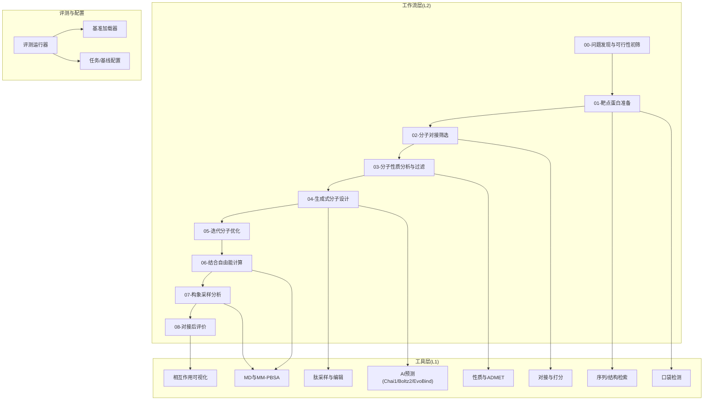
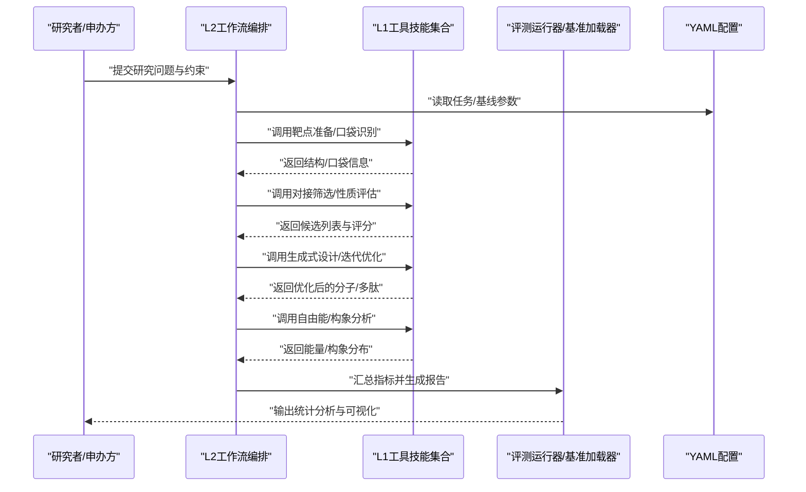
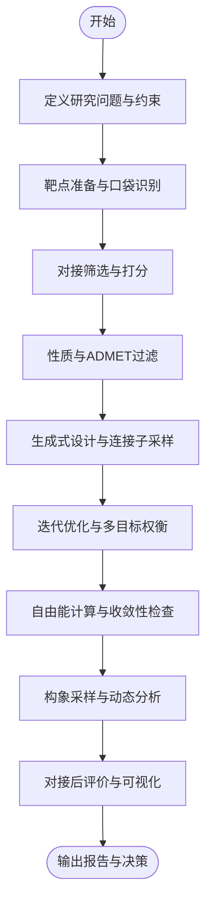
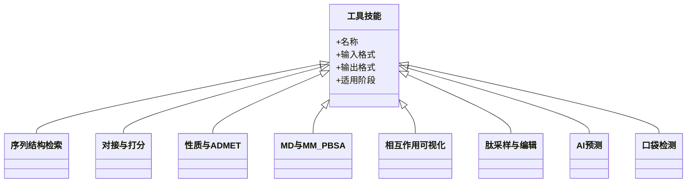
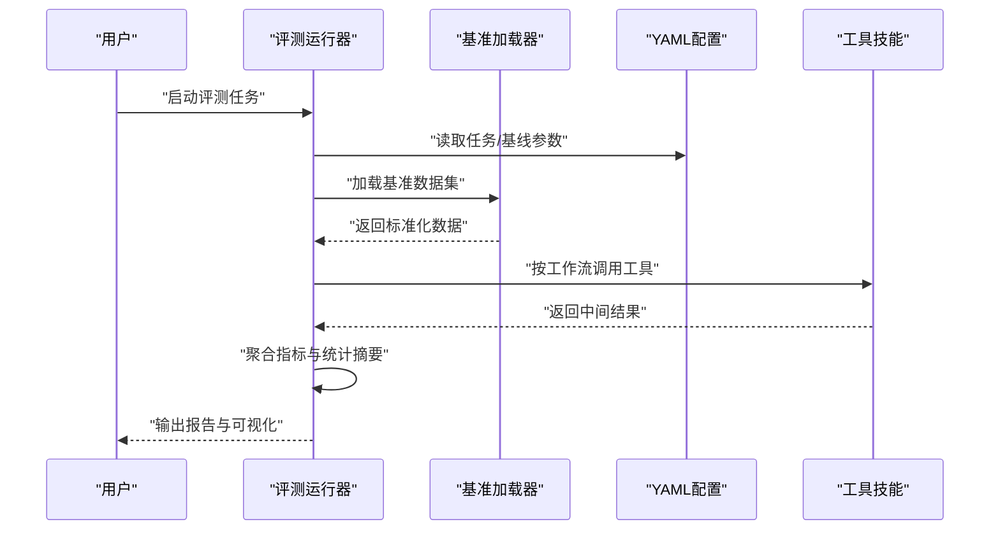
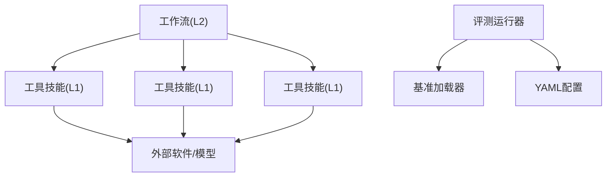

# 临床试验设计

<cite>
**本文引用的文件**   
- [README.md](file://docs/prd/molbench_repo/README.md)
- [REUSABLE_INDEX.md](file://docs/prd/molbench_repo/REUSABLE_INDEX.md)
- [system_prompt_FULL.md](file://docs/prd/molbench_repo/skills/system_prompt_FULL.md)
- [00-problem-discovery-and-feasibility-triage.md](file://docs/prd/molbench_repo/skills/L2_workflows/00-problem-discovery-and-feasibility-triage.md)
- [01-target-protein-preparation.md](file://docs/prd/molbench_repo/skills/L2_workflows/01-target-protein-preparation.md)
- [02-molecular-docking-screening.md](file://docs/prd/molbench_repo/skills/L2_workflows/02-molecular-docking-screening.md)
- [03-molecular-property-analysis-filtering.md](file://docs/prd/molbench_repo/skills/L2_workflows/03-molecular-property-analysis-filtering.md)
- [04-generative-molecular-design.md](file://docs/prd/molbench_repo/skills/L2_workflows/04-generative-molecular-design.md)
- [05-iterative-molecular-optimization.md](file://docs/prd/molbench_repo/skills/L2_workflows/05-iterative-molecular-optimization.md)
- [06-binding-free-energy-calculation.md](file://docs/prd/molbench_repo/skills/L2_workflows/06-binding-free-energy-calculation.md)
- [07-conformational-sampling-analysis.md](file://docs/prd/molbench_repo/skills/L2_workflows/07-conformational-sampling-analysis.md)
- [08-post-docking-evaluation.md](file://docs/prd/molbench_repo/skills/L2_workflows/08-post-docking-evaluation.md)
- [molclaw-peptide-sampling/skill.md](file://docs/prd/molbench_repo/skills/L1_tools/molclaw-peptide-sampling/skill.md)
- [molclaw-docking-screening/skill.md](file://docs/prd/molbench_repo/skills/L1_tools/molclaw-docking-screening/skill.md)
- [molclaw-prolif-tool/skill.md](file://docs/prd/molbench_repo/skills/L1_tools/molclaw-prolif-tool/skill.md)
- [molclaw-drug-likeness/skill.md](file://docs/prd/molbench_repo/skills/L1_tools/molclaw-drug-likeness/skill.md)
- [molclaw-admet/skill.md](file://docs/prd/molbench_repo/skills/L1_tools/molclaw-admet/skill.md)
- [molclaw-protein-ligand-mmpbsa/skill.md](file://docs/prd/molbench_repo/skills/L1_tools/molclaw-protein-ligand-mmpbsa/skill.md)
- [molclaw-protein-openmm/skill.md](file://docs/prd/molbench_repo/skills/L1_tools/molclaw-protein-openmm/skill.md)
- [molclaw-prolif-md/skill.md](file://docs/prd/molbench_repo/skills/L1_tools/molclaw-prolif-md/skill.md)
- [molclaw-prolif-pdb/skill.md](file://docs/prd/molbench_repo/skills/L1_tools/molclaw-prolif-pdb/skill.md)
- [molclaw-prolif-protein-protein/skill.md](file://docs/prd/molbench_repo/skills/L1_tools/molclaw-prolif-protein-protein/skill.md)
- [molclaw-protein-sequence-retrieve/skill.md](file://docs/prd/molbench_repo/skills/L1_tools/molclaw-protein-sequence-retrieve/skill.md)
- [molclaw-protein-structure-retrieve/skill.md](file://docs/prd/molbench_repo/skills/L1_tools/molclaw-protein-structure-retrieve/skill.md)
- [molclaw-chai1-predict/skill.md](file://docs/prd/molbench_repo/skills/L1_tools/molclaw-chai1-predict/skill.md)
- [molclaw-boltz2-affinity/skill.md](file://docs/prd/molbench_repo/skills/L1_tools/molclaw-boltz2-affinity/skill.md)
- [molclaw-evobind-tool/skill.md](file://docs/prd/molbench_repo/skills/L1_tools/molclaw-evobind-tool/skill.md)
- [molclaw-fpocket-toolkit-base/skill.md](file://docs/prd/molbench_repo/skills/L1_tools/molclaw-fpocket-toolkit-base/skill.md)
- [molclaw-fpocket/skill.md](file://docs/prd/molbench_repo/skills/L1_tools/molclaw-fpocket/skill.md)
- [molclaw-hdock-tool/skill.md](file://docs/prd/molbench_repo/skills/L1_tools/molclaw-hdock-tool/skill.md)
- [molclaw-karmadock-tool/skill.md](file://docs/prd/molbench_repo/skills/L1_tools/molclaw-karmadock-tool/skill.md)
- [molclaw-quickvina-docking/skill.md](file://docs/prd/molbench_repo/skills/L1_tools/molclaw-quickvina-docking/skill.md)
- [molclaw-prolif-docking/skill.md](file://docs/prd/molbench_repo/skills/L1_tools/molclaw-prolif-docking/skill.md)
- [molclaw-interaction-visualizer/skill.md](file://docs/prd/molbench_repo/skills/L1_tools/molclaw-interaction-visualizer/skill.md)
- [molclaw-linker-sampling/skill.md](file://docs/prd/molbench_repo/skills/L1_tools/molclaw-linker-sampling/skill.md)
- [molclaw-mol-basic-metrics/skill.md](file://docs/prd/molbench_repo/skills/L1_tools/molclaw-mol-basic-metrics/skill.md)
- [molclaw-mol-complexity-metrics/skill.md](file://docs/prd/molbench_repo/skills/L1_tools/molclaw-mol-complexity-metrics/skill.md)
- [molclaw-mol-hbond-metrics/skill.md](file://docs/prd/molbench_repo/skills/L1_tools/molclaw-mol-hbond-metrics/skill.md)
- [molclaw-mol-hydrophobicity-metrics/skill.md](file://docs/prd/molbench_repo/skills/L1_tools/molclaw-mol-hydrophobicity-metrics/skill.md)
- [molclaw-mol-opt-physchem/skill.md](file://docs/prd/molbench_repo/skills/L1_tools/molclaw-mol-opt-physchem/skill.md)
- [molclaw-mol-similarity/skill.md](file://docs/prd/molbench_repo/skills/L1_tools/molclaw-mol-similarity/skill.md)
- [molclaw-mol-structure-metrics/skill.md](file://docs/prd/molbench_repo/skills/L1_tools/molclaw-mol-structure-metrics/skill.md)
- [molclaw-mol-topology-metrics/skill.md](file://docs/prd/molbench_repo/skills/L1_tools/molclaw-mol-topology-metrics/skill.md)
- [molclaw-mol2mol-sampling/skill.md](file://docs/prd/molbench_repo/skills/L1_tools/molclaw-mol2mol-sampling/skill.md)
- [molclaw-p2rank/skill.md](file://docs/prd/molbench_repo/skills/L1_tools/molclaw-p2rank/skill.md)
- [molclaw-pack-sidechains/skill.md](file://docs/prd/molbench_repo/skills/L1_tools/molclaw-pack-sidechains/skill.md)
- [molclaw-pdbfixer/skill.md](file://docs/prd/molbench_repo/skills/L1_tools/molclaw-pdbfixer/skill.md)
- [molclaw-proteinmpnn-tool/skill.md](file://docs/prd/molbench_repo/skills/L1_tools/molclaw-proteinmpnn-tool/skill.md)
- [molclaw-pulchura-rebuild/skill.md](file://docs/prd/molbench_repo/skills/L1_tools/molclaw-pulchura-rebuild/skill.md)
- [molclaw-run-bioemu/skill.md](file://docs/prd/molbench_repo/skills/L1_tools/molclaw-run-bioemu/skill.md)
- [molclaw-scp-server/skill.md](file://docs/prd/molbench_repo/skills/L1_tools/molclaw-scp-server/skill.md)
- [molclaw-sequence-valid-check/skill.md](file://docs/prd/molbench_repo/skills/L1_tools/molclaw-sequence-valid-check/skill.md)
- [molclaw-smiles-fg-editor/skill.md](file://docs/prd/molbench_repo/skills/L1_tools/molclaw-smiles-fg-editor/skill.md)
- [molclaw-smiles-valid-check/skill.md](file://docs/prd/molbench_repo/skills/L1_tools/molclaw-smiles-valid-check/skill.md)
- [eval_runner.py](file://docs/prd/molbench_repo/eval/eval_runner.py)
- [run_eval_bench.py](file://docs/prd/molbench_repo/eval/run_eval_bench.py)
- [bench_loaders.py](file://docs/prd/molbench_repo/eval/bench_loaders.py)
- [baseline_molbench-ms-1.yaml](file://docs/prd/molbench_repo/config/baseline_molbench-ms-1.yaml)
- [baseline_molbench-ms-2.yaml](file://docs/prd/molbench_repo/config/baseline_molbench-ms-2.yaml)
- [baseline_molbench-ms-3.yaml](file://docs/prd/molbench_repo/config/baseline_molbench-ms-3.yaml)
- [chemcot_mo_edit.yaml](file://docs/prd/molbench_repo/config/chemcot_mo_edit.yaml)
- [chemcot_mo_opt.yaml](file://docs/prd/molbench_repo/config/chemcot_mo_opt.yaml)
- [claude_template.yaml](file://docs/prd/molbench_repo/config/claude_template.yaml)
- [task4_papers/2304.05376.xml](file://docs/prd/task4_papers/2304.05376.xml)
- [task4_papers/2310.03302.xml](file://docs/prd/task4_papers/2310.03302.xml)
- [task4_papers/2405.16205.xml](file://docs/prd/task4_papers/2405.16205.xml)
- [task4_papers/2407.01725.html](file://docs/prd/task4_papers/2407.01725.html)
- [task4_papers/2407.10362.xml](file://docs/prd/task4_papers/2407.10362.xml)
- [task4_papers/2407.18901.xml](file://docs/prd/task4_papers/2407.18901.xml)
- [task4_papers/2410.05080.html](file://docs/prd/task4_papers/2410.05080.html)
- [task4_papers/2412.14161.html](file://docs/prd/task4_papers/2412.14161.html)
- [task4_papers/2501.14654.xml](file://docs/prd/task4_papers/2501.14654.xml)
- [task6_papers/2308.14920.xml](file://docs/prd/task6_papers/2308.14920.xml)
- [task6_papers/2310.19796.xml](file://docs/prd/task6_papers/2310.19796.xml)
- [task6_papers/2401.13178.xml](file://docs/prd/task6_papers/2401.13178.xml)
- [task6_papers/2409.07314.xml](file://docs/prd/task6_papers/2409.07314.xml)
- [task6_papers/2411.00177.xml](file://docs/prd/task6_papers/2411.00177.xml)
- [task6_papers/2505.23802.xml](file://docs/prd/task6_papers/2505.23802.xml)
- [task6_papers/2512.13930.xml](file://docs/prd/task6_papers/2512.13930.xml)
- [task6_papers/2601.21800.xml](file://docs/prd/task6_papers/2601.21800.xml)
- [task6_papers/2602.00663.xml](file://docs/prd/task6_papers/2602.00663.xml)
- [task6_papers/2602.21230.xml](file://docs/prd/task6_papers/2602.21230.xml)
- [task6_papers/2604.27470.xml](file://docs/prd/task6_papers/2604.27470.xml)
- [task6_papers/2605.00803.xml](file://docs/prd/task6_papers/2605.00803.xml)
- [task6_papers/2605.02240.xml](file://docs/prd/task6_papers/2605.02240.xml)
- [task6_papers/2605.15766.xml](file://docs/prd/task6_papers/2605.15766.xml)
- [search/molbench_ms2_affinity_pool.md](file://docs/search/molbench_ms2_affinity_pool.md)
- [search/molbench_dataset_findings.md](file://docs/search/molbench_dataset_findings.md)
</cite>

## 目录
1. [引言](#引言)
2. [项目结构](#项目结构)
3. [核心组件](#核心组件)
4. [架构总览](#架构总览)
5. [详细组件分析](#详细组件分析)
6. [依赖分析](#依赖分析)
7. [性能考虑](#性能考虑)
8. [故障排查指南](#故障排查指南)
9. [结论](#结论)
10. [附录](#附录)

## 引言
本文件面向“临床试验设计”目标，结合仓库中已有的分子与肽-蛋白质结合剂工作流、工具技能集、评测框架与论文资料，系统化阐述：
- 基于AI的试验方案设计：从问题发现到可行性评估、靶点准备、对接筛选、性质过滤、生成式设计与迭代优化。
- 受试者筛选策略：以可计算替代终点（如亲和力、ADMET、构象采样）作为早期入组与分层依据，形成数据驱动的筛选流程。
- 疗效评估方法：对接评分、自由能计算、相互作用分析与可视化，支撑体外验证与临床前证据链。
- 工作流工具使用：覆盖靶点选择、分子设计、体外验证的关键步骤与工具组合。
- 自动化数据分析：评测运行器与基准加载器的集成方式，便于统计分析与方法学比较。
- 监管合规与GCP遵循：在方案模板与数据管理最佳实践层面给出落地建议。
- 试验方案模板与数据管理：提供结构化模板要点与数据治理规范。

## 项目结构
该仓库围绕“分子/材料基准评测与工具技能编排”构建，包含：
- 技能（L1工具）：涵盖序列/结构检索、对接、打分、性质评估、MD模拟、可视化等。
- 工作流（L2）：将多步工具串联为端到端流程，覆盖从问题发现到后对接评价的全链路。
- 评测框架（eval）：统一加载基准、执行评测、汇总结果。
- 配置（config）：不同任务/基线的参数化配置。
- 论文资料（task4/task6_papers）：用于方法学参考与证据支持。
- 搜索与发现（search）：数据集与亲和性池的发现总结。

图表来源
- [00-problem-discovery-and-feasibility-triage.md](file://docs/prd/molbench_repo/skills/L2_workflows/00-problem-discovery-and-feasibility-triage.md)
- [01-target-protein-preparation.md](file://docs/prd/molbench_repo/skills/L2_workflows/01-target-protein-preparation.md)
- [02-molecular-docking-screening.md](file://docs/prd/molbench_repo/skills/L2_workflows/02-molecular-docking-screening.md)
- [03-molecular-property-analysis-filtering.md](file://docs/prd/molbench_repo/skills/L2_workflows/03-molecular-property-analysis-filtering.md)
- [04-generative-molecular-design.md](file://docs/prd/molbench_repo/skills/L2_workflows/04-generative-molecular-design.md)
- [05-iterative-molecular-optimization.md](file://docs/prd/molbench_repo/skills/L2_workflows/05-iterative-molecular-optimization.md)
- [06-binding-free-energy-calculation.md](file://docs/prd/molbench_repo/skills/L2_workflows/06-binding-free-energy-calculation.md)
- [07-conformational-sampling-analysis.md](file://docs/prd/molbench_repo/skills/L2_workflows/07-conformational-sampling-analysis.md)
- [08-post-docking-evaluation.md](file://docs/prd/molbench_repo/skills/L2_workflows/08-post-docking-evaluation.md)
- [eval_runner.py](file://docs/prd/molbench_repo/eval/eval_runner.py)
- [bench_loaders.py](file://docs/prd/molbench_repo/eval/bench_loaders.py)
- [baseline_molbench-ms-1.yaml](file://docs/prd/molbench_repo/config/baseline_molbench-ms-1.yaml)

章节来源
- [README.md](file://docs/prd/molbench_repo/README.md)
- [REUSABLE_INDEX.md](file://docs/prd/molbench_repo/REUSABLE_INDEX.md)
- [system_prompt_FULL.md](file://docs/prd/molbench_repo/skills/system_prompt_FULL.md)

## 核心组件
- L2工作流：定义端到端流程节点与输入输出契约，确保从问题定义到最终评价的一致性。
- L1工具技能：封装具体算法/软件接口，提供标准化输入输出，便于编排与复用。
- 评测框架：统一基准加载、任务调度、指标汇总，支持多基线与对比实验。
- 配置系统：通过YAML集中管理参数，保证可重复性与跨环境一致性。

章节来源
- [00-problem-discovery-and-feasibility-triage.md](file://docs/prd/molbench_repo/skills/L2_workflows/00-problem-discovery-and-feasibility-triage.md)
- [eval_runner.py](file://docs/prd/molbench_repo/eval/eval_runner.py)
- [bench_loaders.py](file://docs/prd/molbench_repo/eval/bench_loaders.py)
- [baseline_molbench-ms-1.yaml](file://docs/prd/molbench_repo/config/baseline_molbench-ms-1.yaml)

## 架构总览
下图展示“AI驱动的工作流+工具技能+评测框架”的整体协作关系，以及其在临床试验设计中的映射：
- 问题发现与可行性评估对应“研究假设与方案制定”。
- 靶点准备与口袋识别对应“生物标志物与入组标准”。
- 对接筛选与性质过滤对应“候选药物/多肽的早期筛选与安全性评估”。
- 生成式设计与迭代优化对应“先导化合物优化与剂量探索”。
- 自由能与构象分析对应“机制研究与体外验证”。
- 对接后评价对应“统计分析与证据整合”。

图表来源
- [00-problem-discovery-and-feasibility-triage.md](file://docs/prd/molbench_repo/skills/L2_workflows/00-problem-discovery-and-feasibility-triage.md)
- [02-molecular-docking-screening.md](file://docs/prd/molbench_repo/skills/L2_workflows/02-molecular-docking-screening.md)
- [04-generative-molecular-design.md](file://docs/prd/molbench_repo/skills/L2_workflows/04-generative-molecular-design.md)
- [06-binding-free-energy-calculation.md](file://docs/prd/molbench_repo/skills/L2_workflows/06-binding-free-energy-calculation.md)
- [eval_runner.py](file://docs/prd/molbench_repo/eval/eval_runner.py)
- [bench_loaders.py](file://docs/prd/molbench_repo/eval/bench_loaders.py)
- [baseline_molbench-ms-1.yaml](file://docs/prd/molbench_repo/config/baseline_molbench-ms-1.yaml)

## 详细组件分析

### 工作流节点与工具映射
- 问题发现与可行性初筛：明确适应症、靶点优先级、入排标准雏形、关键替代终点。
- 靶点蛋白准备：序列/结构获取、修复、加氢、电荷分配、缺失残基重建。
- 分子对接筛选：网格/受体准备、对接引擎选择、打分函数、阈值筛选。
- 分子性质分析与过滤：理化性质、类药性、ADMET预测、毒性预警。
- 生成式分子设计：骨架扩展、连接子采样、多肽采样与编辑。
- 迭代分子优化：相似度约束、性质回归、多目标权衡。
- 结合自由能计算：MM-PBSA/GBSA、采样窗口、收敛性检查。
- 构象采样分析：MD轨迹、RMSD/RMSF、主成分分析、动态口袋演化。
- 对接后评价：相互作用指纹、氢键/疏水接触、可视化报告。

图表来源
- [00-problem-discovery-and-feasibility-triage.md](file://docs/prd/molbench_repo/skills/L2_workflows/00-problem-discovery-and-feasibility-triage.md)
- [01-target-protein-preparation.md](file://docs/prd/molbench_repo/skills/L2_workflows/01-target-protein-preparation.md)
- [02-molecular-docking-screening.md](file://docs/prd/molbench_repo/skills/L2_workflows/02-molecular-docking-screening.md)
- [03-molecular-property-analysis-filtering.md](file://docs/prd/molbench_repo/skills/L2_workflows/03-molecular-property-analysis-filtering.md)
- [04-generative-molecular-design.md](file://docs/prd/molbench_repo/skills/L2_workflows/04-generative-molecular-design.md)
- [05-iterative-molecular-optimization.md](file://docs/prd/molbench_repo/skills/L2_workflows/05-iterative-molecular-optimization.md)
- [06-binding-free-energy-calculation.md](file://docs/prd/molbench_repo/skills/L2_workflows/06-binding-free-energy-calculation.md)
- [07-conformational-sampling-analysis.md](file://docs/prd/molbench_repo/skills/L2_workflows/07-conformational-sampling-analysis.md)
- [08-post-docking-evaluation.md](file://docs/prd/molbench_repo/skills/L2_workflows/08-post-docking-evaluation.md)

章节来源
- [00-problem-discovery-and-feasibility-triage.md](file://docs/prd/molbench_repo/skills/L2_workflows/00-problem-discovery-and-feasibility-triage.md)
- [01-target-protein-preparation.md](file://docs/prd/molbench_repo/skills/L2_workflows/01-target-protein-preparation.md)
- [02-molecular-docking-screening.md](file://docs/prd/molbench_repo/skills/L2_workflows/02-molecular-docking-screening.md)
- [03-molecular-property-analysis-filtering.md](file://docs/prd/molbench_repo/skills/L2_workflows/03-molecular-property-analysis-filtering.md)
- [04-generative-molecular-design.md](file://docs/prd/molbench_repo/skills/L2_workflows/04-generative-molecular-design.md)
- [05-iterative-molecular-optimization.md](file://docs/prd/molbench_repo/skills/L2_workflows/05-iterative-molecular-optimization.md)
- [06-binding-free-energy-calculation.md](file://docs/prd/molbench_repo/skills/L2_workflows/06-binding-free-energy-calculation.md)
- [07-conformational-sampling-analysis.md](file://docs/prd/molbench_repo/skills/L2_workflows/07-conformational-sampling-analysis.md)
- [08-post-docking-evaluation.md](file://docs/prd/molbench_repo/skills/L2_workflows/08-post-docking-evaluation.md)

### 工具技能分类与职责
- 序列/结构检索：蛋白序列与结构获取、同源建模辅助。
- 对接与打分：快速对接、高精度对接、评分函数选择。
- 性质与ADMET：类药性、溶解度、渗透性、代谢稳定性、毒性。
- MD与MM-PBSA：轨迹采样、自由能分解、热力学循环。
- 相互作用可视化：氢键、盐桥、π-π堆积、接触图。
- 肽采样与编辑：环化、修饰、侧链重排。
- AI预测：Chai1、Boltz2、EvoBind等结合亲和力/复合物预测。
- 口袋检测：FPocket、P2Rank等位点发现。

图表来源
- [molclaw-protein-sequence-retrieve/skill.md](file://docs/prd/molbench_repo/skills/L1_tools/molclaw-protein-sequence-retrieve/skill.md)
- [molclaw-protein-structure-retrieve/skill.md](file://docs/prd/molbench_repo/skills/L1_tools/molclaw-protein-structure-retrieve/skill.md)
- [molclaw-docking-screening/skill.md](file://docs/prd/molbench_repo/skills/L1_tools/molclaw-docking-screening/skill.md)
- [molclaw-drug-likeness/skill.md](file://docs/prd/molbench_repo/skills/L1_tools/molclaw-drug-likeness/skill.md)
- [molclaw-admet/skill.md](file://docs/prd/molbench_repo/skills/L1_tools/molclaw-admet/skill.md)
- [molclaw-protein-ligand-mmpbsa/skill.md](file://docs/prd/molbench_repo/skills/L1_tools/molclaw-protein-ligand-mmpbsa/skill.md)
- [molclaw-protein-openmm/skill.md](file://docs/prd/molbench_repo/skills/L1_tools/molclaw-protein-openmm/skill.md)
- [molclaw-prolif-md/skill.md](file://docs/prd/molbench_repo/skills/L1_tools/molclaw-prolif-md/skill.md)
- [molclaw-interaction-visualizer/skill.md](file://docs/prd/molbench_repo/skills/L1_tools/molclaw-interaction-visualizer/skill.md)
- [molclaw-peptide-sampling/skill.md](file://docs/prd/molbench_repo/skills/L1_tools/molclaw-peptide-sampling/skill.md)
- [molclaw-chai1-predict/skill.md](file://docs/prd/molbench_repo/skills/L1_tools/molclaw-chai1-predict/skill.md)
- [molclaw-boltz2-affinity/skill.md](file://docs/prd/molbench_repo/skills/L1_tools/molclaw-boltz2-affinity/skill.md)
- [molclaw-evobind-tool/skill.md](file://docs/prd/molbench_repo/skills/L1_tools/molclaw-evobind-tool/skill.md)
- [molclaw-fpocket/skill.md](file://docs/prd/molbench_repo/skills/L1_tools/molclaw-fpocket/skill.md)
- [molclaw-p2rank/sskill.md](file://docs/prd/molbench_repo/skills/L1_tools/molclaw-p2rank/skill.md)

章节来源
- [molclaw-docking-screening/skill.md](file://docs/prd/molbench_repo/skills/L1_tools/molclaw-docking-screening/skill.md)
- [molclaw-drug-likeness/skill.md](file://docs/prd/molbench_repo/skills/L1_tools/molclaw-drug-likeness/skill.md)
- [molclaw-admet/skill.md](file://docs/prd/molbench_repo/skills/L1_tools/molclaw-admet/skill.md)
- [molclaw-protein-ligand-mmpbsa/skill.md](file://docs/prd/molbench_repo/skills/L1_tools/molclaw-protein-ligand-mmpbsa/skill.md)
- [molclaw-protein-openmm/skill.md](file://docs/prd/molbench_repo/skills/L1_tools/molclaw-protein-openmm/skill.md)
- [molclaw-prolif-md/skill.md](file://docs/prd/molbench_repo/skills/L1_tools/molclaw-prolif-md/skill.md)
- [molclaw-interaction-visualizer/skill.md](file://docs/prd/molbench_repo/skills/L1_tools/molclaw-interaction-visualizer/skill.md)
- [molclaw-peptide-sampling/skill.md](file://docs/prd/molbench_repo/skills/L1_tools/molclaw-peptide-sampling/skill.md)
- [molclaw-chai1-predict/skill.md](file://docs/prd/molbench_repo/skills/L1_tools/molclaw-chai1-predict/skill.md)
- [molclaw-boltz2-affinity/skill.md](file://docs/prd/molbench_repo/skills/L1_tools/molclaw-boltz2-affinity/skill.md)
- [molclaw-evobind-tool/sskill.md](file://docs/prd/molbench_repo/skills/L1_tools/molclaw-evobind-tool/skill.md)
- [molclaw-fpocket/skill.md](file://docs/prd/molbench_repo/skills/L1_tools/molclaw-fpocket/skill.md)
- [molclaw-p2rank/skill.md](file://docs/prd/molbench_repo/skills/L1_tools/molclaw-p2rank/skill.md)

### 自动化数据分析与统计
- 评测运行器负责加载基准、执行任务、收集指标与生成报告。
- 基准加载器提供统一的数据结构与字段约定，便于跨任务比较。
- 配置YAML集中管理参数，支持多基线并行与对比。

图表来源
- [eval_runner.py](file://docs/prd/molbench_repo/eval/eval_runner.py)
- [bench_loaders.py](file://docs/prd/molbench_repo/eval/bench_loaders.py)
- [baseline_molbench-ms-1.yaml](file://docs/prd/molbench_repo/config/baseline_molbench-ms-1.yaml)

章节来源
- [eval_runner.py](file://docs/prd/molbench_repo/eval/eval_runner.py)
- [bench_loaders.py](file://docs/prd/molbench_repo/eval/bench_loaders.py)
- [baseline_molbench-ms-1.yaml](file://docs/prd/molbench_repo/config/baseline_molbench-ms-1.yaml)

### 监管合规与GCP遵循要点
- 数据完整性：原始数据、中间产物、脚本与配置版本化归档，确保可追溯。
- 审计追踪：记录关键操作、参数变更与异常事件。
- 质量控制：设定阈值与复核规则，避免主观偏差。
- 隐私保护：对受试者相关数据进行去标识化处理。
- 方案文档：明确研究目的、假设、纳入排除标准、主要/次要终点、统计分析计划。

[本节为概念性内容，不直接分析具体文件]

### 试验方案模板与数据管理最佳实践
- 方案模板要点：背景与依据、目标与假设、入排标准、干预措施、观察期、终点指标、样本量估算、统计分析计划、风险管理、伦理审批。
- 数据管理：CRF设计、数据字典、逻辑核查、缺失值处理、数据锁定与备份、版本控制与权限管理。
- 报告输出：自动生成的统计摘要、可视化图表、结论与建议。

[本节为概念性内容，不直接分析具体文件]

## 依赖分析
- 工作流与工具的耦合：L2工作流通过标准化输入输出与L1工具解耦，降低替换成本。
- 评测框架与配置的解耦：评测运行器通过YAML配置驱动，便于扩展新基线与任务。
- 外部依赖：对接引擎、MD软件、AI模型等通过工具技能封装，屏蔽底层差异。

图表来源
- [00-problem-discovery-and-feasibility-triage.md](file://docs/prd/molbench_repo/skills/L2_workflows/00-problem-discovery-and-feasibility-triage.md)
- [eval_runner.py](file://docs/prd/molbench_repo/eval/eval_runner.py)
- [bench_loaders.py](file://docs/prd/molbench_repo/eval/bench_loaders.py)
- [baseline_molbench-ms-1.yaml](file://docs/prd/molbench_repo/config/baseline_molbench-ms-1.yaml)

章节来源
- [REUSABLE_INDEX.md](file://docs/prd/molbench_repo/REUSABLE_INDEX.md)
- [system_prompt_FULL.md](file://docs/prd/molbench_repo/skills/system_prompt_FULL.md)

## 性能考虑
- 并行化：对接与性质评估可并行执行，缩短整体周期。
- 缓存与复用：中间结构、口袋信息与预计算特征应缓存，避免重复计算。
- 资源调度：根据GPU/CPU资源动态分配任务，避免瓶颈。
- 收敛性检查：自由能与MD采样需监控收敛，必要时延长采样或调整参数。
- 阈值调优：对接打分与性质过滤阈值需基于历史数据校准，平衡召回与精度。

[本节为通用指导，不直接分析具体文件]

## 故障排查指南
- 工具调用失败：检查输入格式、路径权限、环境变量与依赖安装。
- 对接不收敛：调整网格范围、柔性设置、采样次数与随机种子。
- ADMET异常：核对SMILES有效性、质子化状态与溶剂模型。
- MM-PBSA发散：检查轨迹质量、能量截断与熵估计方法。
- 评测结果不一致：确认配置版本、基准数据哈希与运行日志。

章节来源
- [eval_runner.py](file://docs/prd/molbench_repo/eval/eval_runner.py)
- [bench_loaders.py](file://docs/prd/molbench_repo/eval/bench_loaders.py)
- [baseline_molbench-ms-1.yaml](file://docs/prd/molbench_repo/config/baseline_molbench-ms-1.yaml)

## 结论
通过将AI驱动的工作流与工具技能、评测框架有机结合，可在临床试验设计的早期阶段实现高效、可重复、可审计的方案制定与候选物筛选。配合严格的监管合规与数据管理实践，能够显著提升转化效率与证据质量。

[本节为总结性内容，不直接分析具体文件]

## 附录
- 论文资料索引：task4与task6下的XML/HTML文档可用于方法学参考与证据补充。
- 数据集与亲和性池：search目录下的发现总结有助于理解可用数据与潜在偏倚。

章节来源
- [task4_papers/2304.05376.xml](file://docs/prd/task4_papers/2304.05376.xml)
- [task4_papers/2310.03302.xml](file://docs/prd/task4_papers/2310.03302.xml)
- [task4_papers/2405.16205.xml](file://docs/prd/task4_papers/2405.16205.xml)
- [task4_papers/2407.01725.html](file://docs/prd/task4_papers/2407.01725.html)
- [task4_papers/2407.10362.xml](file://docs/prd/task4_papers/2407.10362.xml)
- [task4_papers/2407.18901.xml](file://docs/prd/task4_papers/2407.18901.xml)
- [task4_papers/2410.05080.html](file://docs/prd/task4_papers/2410.05080.html)
- [task4_papers/2412.14161.html](file://docs/prd/task4_papers/2412.14161.html)
- [task4_papers/2501.14654.xml](file://docs/prd/task4_papers/2501.14654.xml)
- [task6_papers/2308.14920.xml](file://docs/prd/task6_papers/2308.14920.xml)
- [task6_papers/2310.19796.xml](file://docs/prd/task6_papers/2310.19796.xml)
- [task6_papers/2401.13178.xml](file://docs/prd/task6_papers/2401.13178.xml)
- [task6_papers/2409.07314.xml](file://docs/prd/task6_papers/2409.07314.xml)
- [task6_papers/2411.00177.xml](file://docs/prd/task6_papers/2411.00177.xml)
- [task6_papers/2505.23802.xml](file://docs/prd/task6_papers/2505.23802.xml)
- [task6_papers/2512.13930.xml](file://docs/prd/task6_papers/2512.13930.xml)
- [task6_papers/2601.21800.xml](file://docs/prd/task6_papers/2601.21800.xml)
- [task6_papers/2602.00663.xml](file://docs/prd/task6_papers/2602.00663.xml)
- [task6_papers/2602.21230.xml](file://docs/prd/task6_papers/2602.21230.xml)
- [task6_papers/2604.27470.xml](file://docs/prd/task6_papers/2604.27470.xml)
- [task6_papers/2605.00803.xml](file://docs/prd/task6_papers/2605.00803.xml)
- [task6_papers/2605.02240.xml](file://docs/prd/task6_papers/2605.02240.xml)
- [task6_papers/2605.15766.xml](file://docs/prd/task6_papers/2605.15766.xml)
- [search/molbench_ms2_affinity_pool.md](file://docs/search/molbench_ms2_affinity_pool.md)
- [search/molbench_dataset_findings.md](file://docs/search/molbench_dataset_findings.md)