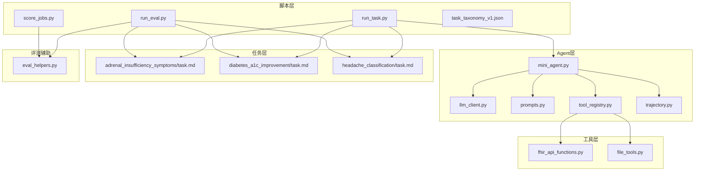
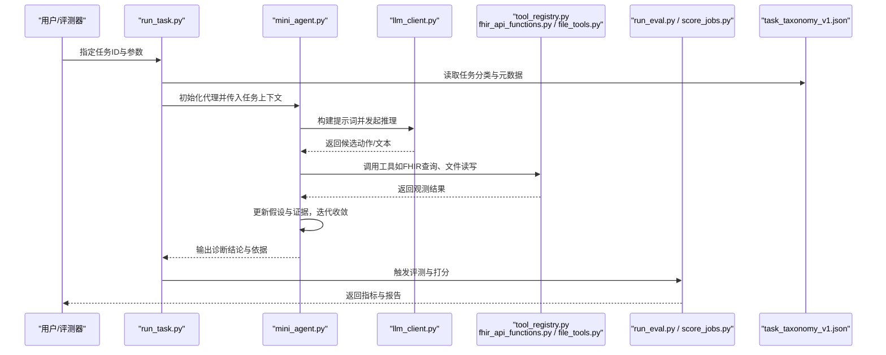
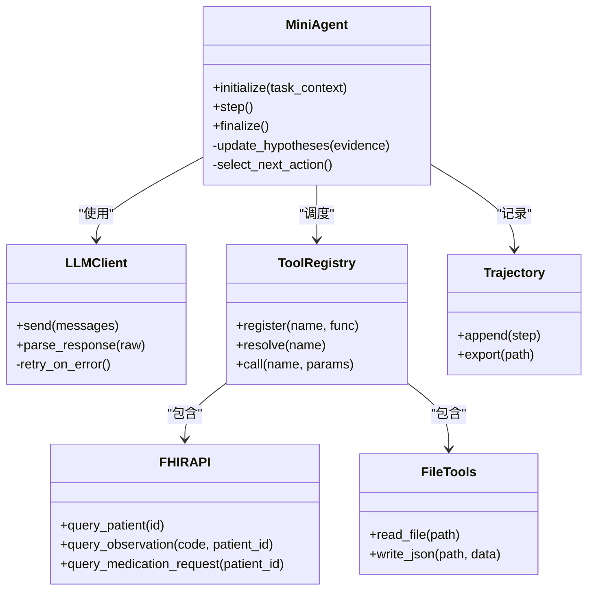
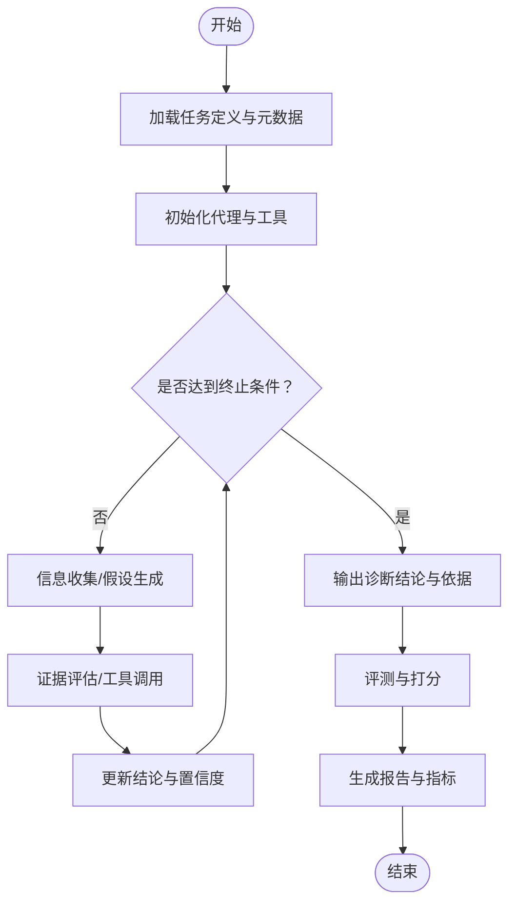
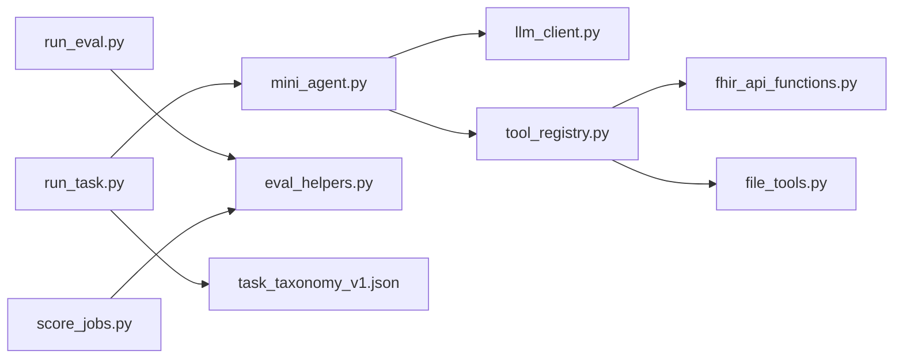

# 医疗诊断辅助

<cite>
**本文引用的文件**   
- [task7/poc3_physicianbench/PhysicianBench/README.md](file://task7/poc3_physicianbench/PhysicianBench/README.md)
- [task7/poc3_physicianbench/PhysicianBench/pyproject.toml](file://task7/poc3_physicianbench/PhysicianBench/pyproject.toml)
- [task7/poc3_physicianbench/PhysicianBench/conftest.py](file://task7/poc3_physicianbench/PhysicianBench/conftest.py)
- [task7/poc3_physicianbench/PhysicianBench/scripts/run_task.py](file://task7/poc3_physicianbench/PhysicianBench/scripts/run_task.py)
- [task7/poc3_physicianbench/PhysicianBench/scripts/run_eval.py](file://task7/poc3_physicianbench/PhysicianBench/scripts/run_eval.py)
- [task7/poc3_physicianbench/PhysicianBench/scripts/score_jobs.py](file://task7/poc3_physicianbench/PhysicianBench/scripts/score_jobs.py)
- [task7/poc3_physicianbench/PhysicianBench/scripts/task_taxonomy_v1.json](file://task7/poc3_physicianbench/PhysicianBench/scripts/task_taxonomy_v1.json)
- [task7/poc3_physicianbench/PhysicianBench/agent/llm_client.py](file://task7/poc3_physicianbench/PhysicianBench/agent/llm_client.py)
- [task7/poc3_physicianbench/PhysicianBench/agent/mini_agent.py](file://task7/poc3_physicianbench/PhysicianBench/agent/mini_agent.py)
- [task7/poc3_physicianbench/PhysicianBench/agent/prompts.py](file://task7/poc3_physicianbench/PhysicianBench/agent/prompts.py)
- [task7/poc3_physicianbench/PhysicianBench/agent/tool_registry.py](file://task7/poc3_physicianbench/PhysicianBench/agent/tool_registry.py)
- [task7/poc3_physicianbench/PhysicianBench/agent/trajectory.py](file://task7/poc3_physicianbench/PhysicianBench/agent/trajectory.py)
- [task7/poc3_physicianbench/PhysicianBench/tasks/v1/adrenal_insufficiency_symptoms/task.md](file://task7/poc3_physicianbench/PhysicianBench/tasks/v1/adrenal_insufficiency_symptoms/task.md)
- [task7/poc3_physicianbench/PhysicianBench/tasks/v1/diabetes_a1c_improvement/task.md](file://task7/poc3_physicianbench/PhysicianBench/tasks/v1/diabetes_a1c_improvement/task.md)
- [task7/poc3_physicianbench/PhysicianBench/tasks/v1/headache_classification/task.md](file://task7/poc3_physicianbench/PhysicianBench/tasks/v1/headache_classification/task.md)
- [task7/poc3_physicianbench/PhysicianBench/tools/fhir_api_functions.py](file://task7/poc3_physicianbench/PhysicianBench/tools/fhir_api_functions.py)
- [task7/poc3_physicianbench/PhysicianBench/tools/file_tools.py](file://task7/poc3_physicianbench/PhysicianBench/tools/file_tools.py)
- [task7/poc3_physicianbench/PhysicianBench/utils/eval_helpers.py](file://task7/poc3_physicianbench/PhysicianBench/utils/eval_helpers.py)
</cite>

## 目录
1. [简介](#简介)
2. [项目结构](#项目结构)
3. [核心组件](#核心组件)
4. [架构总览](#架构总览)
5. [详细组件分析](#详细组件分析)
6. [依赖关系分析](#依赖关系分析)
7. [性能与可扩展性](#性能与可扩展性)
8. [故障排查指南](#故障排查指南)
9. [结论](#结论)
10. [附录](#附录)

## 简介
本文件面向医疗诊断辅助场景，系统性梳理 PhysicianBench 框架在临床病例分析任务中的能力与实践路径。重点覆盖以下主题：
- 肾上腺功能不全症状诊断、糖尿病A1C改善评估、头痛分类等具体案例的任务设计与执行流程
- 患者病史采集、症状分析与鉴别诊断的标准化工作流
- AI代理如何模拟医生思维过程：信息收集、假设生成、证据评估与诊断结论
- 医疗数据隐私保护与HIPAA合规要点
- 任务配置示例与评估指标说明

## 项目结构
PhysicianBench 采用“任务驱动 + 工具化 + 可评测”的组织方式：
- agent：LLM客户端、微型代理、提示词模板、工具注册表、轨迹记录
- tasks/v1：按疾病/场景划分的任务定义（含任务描述、输入输出规范、评分规则）
- tools：FHIR接口封装与通用文件操作工具
- scripts：任务运行、评测、打分与任务分类索引脚本
- utils：评测辅助函数

图表来源
- [task7/poc3_physicianbench/PhysicianBench/scripts/run_task.py](file://task7/poc3_physicianbench/PhysicianBench/scripts/run_task.py)
- [task7/poc3_physicianbench/PhysicianBench/scripts/run_eval.py](file://task7/poc3_physicianbench/PhysicianBench/scripts/run_eval.py)
- [task7/poc3_physicianbench/PhysicianBench/scripts/score_jobs.py](file://task7/poc3_physicianbench/PhysicianBench/scripts/score_jobs.py)
- [task7/poc3_physicianbench/PhysicianBench/scripts/task_taxonomy_v1.json](file://task7/poc3_physicianbench/PhysicianBench/scripts/task_taxonomy_v1.json)
- [task7/poc3_physicianbench/PhysicianBench/agent/mini_agent.py](file://task7/poc3_physicianbench/PhysicianBench/agent/mini_agent.py)
- [task7/poc3_physicianbench/PhysicianBench/agent/llm_client.py](file://task7/poc3_physicianbench/PhysicianBench/agent/llm_client.py)
- [task7/poc3_physicianbench/PhysicianBench/agent/prompts.py](file://task7/poc3_physicianbench/PhysicianBench/agent/prompts.py)
- [task7/poc3_physicianbench/PhysicianBench/agent/tool_registry.py](file://task7/poc3_physicianbench/PhysicianBench/agent/tool_registry.py)
- [task7/poc3_physicianbench/PhysicianBench/agent/trajectory.py](file://task7/poc3_physicianbench/PhysicianBench/agent/trajectory.py)
- [task7/poc3_physicianbench/PhysicianBench/tools/fhir_api_functions.py](file://task7/poc3_physicianbench/PhysicianBench/tools/fhir_api_functions.py)
- [task7/poc3_physicianbench/PhysicianBench/tools/file_tools.py](file://task7/poc3_physicianbench/PhysicianBench/tools/file_tools.py)
- [task7/poc3_physicianbench/PhysicianBench/utils/eval_helpers.py](file://task7/poc3_physicianbench/PhysicianBench/utils/eval_helpers.py)
- [task7/poc3_physicianbench/PhysicianBench/tasks/v1/adrenal_insufficiency_symptoms/task.md](file://task7/poc3_physicianbench/PhysicianBench/tasks/v1/adrenal_insufficiency_symptoms/task.md)
- [task7/poc3_physicianbench/PhysicianBench/tasks/v1/diabetes_a1c_improvement/task.md](file://task7/poc3_physicianbench/PhysicianBench/tasks/v1/diabetes_a1c_improvement/task.md)
- [task7/poc3_physicianbench/PhysicianBench/tasks/v1/headache_classification/task.md](file://task7/poc3_physicianbench/PhysicianBench/tasks/v1/headache_classification/task.md)

章节来源
- [task7/poc3_physicianbench/PhysicianBench/README.md](file://task7/poc3_physicianbench/PhysicianBench/README.md)
- [task7/poc3_physicianbench/PhysicianBench/pyproject.toml](file://task7/poc3_physicianbench/PhysicianBench/pyproject.toml)

## 核心组件
- LLM客户端：统一封装大模型调用，负责消息编排、重试与结果解析
- 微型代理：实现“思考-行动-观察”循环，驱动信息收集、假设生成、证据评估与结论输出
- 提示词工程：将任务目标、约束条件、输出格式注入到对话上下文
- 工具注册表：集中管理可调用的外部能力（如FHIR查询、文件读写），支持按需扩展
- 轨迹记录：持久化每一步交互、工具调用与中间状态，便于审计与复现
- 任务定义：以结构化文档描述病例背景、输入输出、评分标准与合规要求
- 评测脚本：自动化执行任务、汇总结果并计算指标

章节来源
- [task7/poc3_physicianbench/PhysicianBench/agent/llm_client.py](file://task7/poc3_physicianbench/PhysicianBench/agent/llm_client.py)
- [task7/poc3_physicianbench/PhysicianBench/agent/mini_agent.py](file://task7/poc3_physicianbench/PhysicianBench/agent/mini_agent.py)
- [task7/poc3_physicianbench/PhysicianBench/agent/prompts.py](file://task7/poc3_physicianbench/PhysicianBench/agent/prompts.py)
- [task7/poc3_physicianbench/PhysicianBench/agent/tool_registry.py](file://task7/poc3_physicianbench/PhysicianBench/agent/tool_registry.py)
- [task7/poc3_physicianbench/PhysicianBench/agent/trajectory.py](file://task7/poc3_physicianbench/PhysicianBench/agent/trajectory.py)
- [task7/poc3_physicianbench/PhysicianBench/tasks/v1/adrenal_insufficiency_symptoms/task.md](file://task7/poc3_physicianbench/PhysicianBench/tasks/v1/adrenal_insufficiency_symptoms/task.md)
- [task7/poc3_physicianbench/PhysicianBench/tasks/v1/diabetes_a1c_improvement/task.md](file://task7/poc3_physicianbench/PhysicianBench/tasks/v1/diabetes_a1c_improvement/task.md)
- [task7/poc3_physicianbench/PhysicianBench/tasks/v1/headache_classification/task.md](file://task7/poc3_physicianbench/PhysicianBench/tasks/v1/headache_classification/task.md)

## 架构总览
下图展示从任务入口到工具调用、再到评测与打分的端到端流程。

图表来源
- [task7/poc3_physicianbench/PhysicianBench/scripts/run_task.py](file://task7/poc3_physicianbench/PhysicianBench/scripts/run_task.py)
- [task7/poc3_physicianbench/PhysicianBench/scripts/run_eval.py](file://task7/poc3_physicianbench/PhysicianBench/scripts/run_eval.py)
- [task7/poc3_physicianbench/PhysicianBench/scripts/score_jobs.py](file://task7/poc3_physicianbench/PhysicianBench/scripts/score_jobs.py)
- [task7/poc3_physicianbench/PhysicianBench/scripts/task_taxonomy_v1.json](file://task7/poc3_physicianbench/PhysicianBench/scripts/task_taxonomy_v1.json)
- [task7/poc3_physicianbench/PhysicianBench/agent/mini_agent.py](file://task7/poc3_physicianbench/PhysicianBench/agent/mini_agent.py)
- [task7/poc3_physicianbench/PhysicianBench/agent/llm_client.py](file://task7/poc3_physicianbench/PhysicianBench/agent/llm_client.py)
- [task7/poc3_physicianbench/PhysicianBench/agent/tool_registry.py](file://task7/poc3_physicianbench/PhysicianBench/agent/tool_registry.py)
- [task7/poc3_physicianbench/PhysicianBench/tools/fhir_api_functions.py](file://task7/poc3_physicianbench/PhysicianBench/tools/fhir_api_functions.py)
- [task7/poc3_physicianbench/PhysicianBench/tools/file_tools.py](file://task7/poc3_physicianbench/PhysicianBench/tools/file_tools.py)

## 详细组件分析

### 微型代理与工具链
- 代理职责：维护会话状态、生成下一步动作（提问、检查、推理）、整合工具反馈、输出结构化结论
- 工具链：通过注册表动态发现与调用；FHIR工具用于访问受控医疗数据源；文件工具用于读写本地数据集或中间产物
- 轨迹：记录每步意图、工具调用、返回结果与最终决策，支撑可解释性与审计

图表来源
- [task7/poc3_physicianbench/PhysicianBench/agent/mini_agent.py](file://task7/poc3_physicianbench/PhysicianBench/agent/mini_agent.py)
- [task7/poc3_physicianbench/PhysicianBench/agent/llm_client.py](file://task7/poc3_physicianbench/PhysicianBench/agent/llm_client.py)
- [task7/poc3_physicianbench/PhysicianBench/agent/tool_registry.py](file://task7/poc3_physicianbench/PhysicianBench/agent/tool_registry.py)
- [task7/poc3_physicianbench/PhysicianBench/tools/fhir_api_functions.py](file://task7/poc3_physicianbench/PhysicianBench/tools/fhir_api_functions.py)
- [task7/poc3_physicianbench/PhysicianBench/tools/file_tools.py](file://task7/poc3_physicianbench/PhysicianBench/tools/file_tools.py)
- [task7/poc3_physicianbench/PhysicianBench/agent/trajectory.py](file://task7/poc3_physicianbench/PhysicianBench/agent/trajectory.py)

章节来源
- [task7/poc3_physicianbench/PhysicianBench/agent/mini_agent.py](file://task7/poc3_physicianbench/PhysicianBench/agent/mini_agent.py)
- [task7/poc3_physicianbench/PhysicianBench/agent/tool_registry.py](file://task7/poc3_physicianbench/PhysicianBench/agent/tool_registry.py)
- [task7/poc3_physicianbench/PhysicianBench/agent/trajectory.py](file://task7/poc3_physicianbench/PhysicianBench/agent/trajectory.py)
- [task7/poc3_physicianbench/PhysicianBench/tools/fhir_api_functions.py](file://task7/poc3_physicianbench/PhysicianBench/tools/fhir_api_functions.py)
- [task7/poc3_physicianbench/PhysicianBench/tools/file_tools.py](file://task7/poc3_physicianbench/PhysicianBench/tools/file_tools.py)

### 任务定义与评测
- 任务文档：每个任务包含背景、输入输出约定、评分规则与注意事项
- 评测脚本：加载任务定义，执行推理，比对预期答案，计算准确率、一致性等指标
- 任务分类索引：提供任务族谱与标签，便于批量管理与检索

图表来源
- [task7/poc3_physicianbench/PhysicianBench/scripts/run_task.py](file://task7/poc3_physicianbench/PhysicianBench/scripts/run_task.py)
- [task7/poc3_physicianbench/PhysicianBench/scripts/run_eval.py](file://task7/poc3_physicianbench/PhysicianBench/scripts/run_eval.py)
- [task7/poc3_physicianbench/PhysicianBench/scripts/score_jobs.py](file://task7/poc3_physicianbench/PhysicianBench/scripts/score_jobs.py)
- [task7/poc3_physicianbench/PhysicianBench/scripts/task_taxonomy_v1.json](file://task7/poc3_physicianbench/PhysicianBench/scripts/task_taxonomy_v1.json)

章节来源
- [task7/poc3_physicianbench/PhysicianBench/tasks/v1/adrenal_insufficiency_symptoms/task.md](file://task7/poc3_physicianbench/PhysicianBench/tasks/v1/adrenal_insufficiency_symptoms/task.md)
- [task7/poc3_physicianbench/PhysicianBench/tasks/v1/diabetes_a1c_improvement/task.md](file://task7/poc3_physicianbench/PhysicianBench/tasks/v1/diabetes_a1c_improvement/task.md)
- [task7/poc3_physicianbench/PhysicianBench/tasks/v1/headache_classification/task.md](file://task7/poc3_physicianbench/PhysicianBench/tasks/v1/headache_classification/task.md)
- [task7/poc3_physicianbench/PhysicianBench/utils/eval_helpers.py](file://task7/poc3_physicianbench/PhysicianBench/utils/eval_helpers.py)

### 临床案例详解

#### 肾上腺功能不全症状诊断
- 目标：基于主诉与关键体征/实验室指标，识别潜在肾上腺功能不全线索，给出鉴别诊断与建议检查
- 关键步骤：
  - 病史采集：疲劳、低血压、色素沉着、电解质异常等
  - 假设生成：原发性/继发性肾上腺功能不全、药物影响、其他内分泌紊乱
  - 证据评估：ACTH刺激试验、皮质醇节律、电解质与影像学
  - 结论输出：诊断倾向、风险分层、进一步检查建议
- 评估要点：诊断准确性、必要检查完整性、风险提示充分性

章节来源
- [task7/poc3_physicianbench/PhysicianBench/tasks/v1/adrenal_insufficiency_symptoms/task.md](file://task7/poc3_physicianbench/PhysicianBench/tasks/v1/adrenal_insufficiency_symptoms/task.md)

#### 糖尿病A1C改善评估
- 目标：评估干预后糖化血红蛋白变化趋势，判断疗效与安全性
- 关键步骤：
  - 基线数据：A1C、用药史、合并症、生活方式
  - 随访对比：时间序列A1C、血糖监测、不良反应
  - 证据评估：达标率、波动性、低血糖事件
  - 结论输出：疗效判定、方案调整建议、随访计划
- 评估要点：趋势解读正确性、安全性考量、个性化建议合理性

章节来源
- [task7/poc3_physicianbench/PhysicianBench/tasks/v1/diabetes_a1c_improvement/task.md](file://task7/poc3_physicianbench/PhysicianBench/tasks/v1/diabetes_a1c_improvement/task.md)

#### 头痛分类
- 目标：区分偏头痛、紧张型头痛、丛集性头痛及其他继发性头痛
- 关键步骤：
  - 症状学：部位、性质、持续时间、伴随症状、诱因
  - 红旗征象：突发剧烈头痛、神经定位体征、发热等
  - 证据评估：量表评分、影像/实验室排除继发性原因
  - 结论输出：分类诊断、治疗策略、转诊指征
- 评估要点：分类准确性、红旗征象筛查、处置建议规范性

章节来源
- [task7/poc3_physicianbench/PhysicianBench/tasks/v1/headache_classification/task.md](file://task7/poc3_physicianbench/PhysicianBench/tasks/v1/headache_classification/task.md)

### 提示词与推理范式
- 角色设定：以临床专家视角进行结构化问诊与推理
- 约束条件：遵循循证指南、避免过度检查、强调安全边界
- 输出格式：诊断结论、依据清单、待确认问题、下一步计划
- 迭代机制：根据新证据修正假设，逐步收敛至最可能诊断

章节来源
- [task7/poc3_physicianbench/PhysicianBench/agent/prompts.py](file://task7/poc3_physicianbench/PhysicianBench/agent/prompts.py)

## 依赖关系分析
- 模块内聚：agent层聚焦推理与工具调度，tools层专注数据访问与I/O，tasks层定义业务语义，scripts层组织运行与评测
- 耦合点：
  - mini_agent 依赖 llm_client 与 tool_registry
  - tool_registry 聚合 fhir_api_functions 与 file_tools
  - run_task/run_eval 依赖 task_taxonomy 与 eval_helpers
- 外部集成：FHIR API 作为受控数据源，需满足鉴权与最小权限原则

图表来源
- [task7/poc3_physicianbench/PhysicianBench/scripts/run_task.py](file://task7/poc3_physicianbench/PhysicianBench/scripts/run_task.py)
- [task7/poc3_physicianbench/PhysicianBench/scripts/run_eval.py](file://task7/poc3_physicianbench/PhysicianBench/scripts/run_eval.py)
- [task7/poc3_physicianbench/PhysicianBench/scripts/score_jobs.py](file://task7/poc3_physicianbench/PhysicianBench/scripts/score_jobs.py)
- [task7/poc3_physicianbench/PhysicianBench/scripts/task_taxonomy_v1.json](file://task7/poc3_physicianbench/PhysicianBench/scripts/task_taxonomy_v1.json)
- [task7/poc3_physicianbench/PhysicianBench/agent/mini_agent.py](file://task7/poc3_physicianbench/PhysicianBench/agent/mini_agent.py)
- [task7/poc3_physicianbench/PhysicianBench/agent/llm_client.py](file://task7/poc3_physicianbench/PhysicianBench/agent/llm_client.py)
- [task7/poc3_physicianbench/PhysicianBench/agent/tool_registry.py](file://task7/poc3_physicianbench/PhysicianBench/agent/tool_registry.py)
- [task7/poc3_physicianbench/PhysicianBench/tools/fhir_api_functions.py](file://task7/poc3_physicianbench/PhysicianBench/tools/fhir_api_functions.py)
- [task7/poc3_physicianbench/PhysicianBench/tools/file_tools.py](file://task7/poc3_physicianbench/PhysicianBench/tools/file_tools.py)
- [task7/poc3_physicianbench/PhysicianBench/utils/eval_helpers.py](file://task7/poc3_physicianbench/PhysicianBench/utils/eval_helpers.py)

章节来源
- [task7/poc3_physicianbench/PhysicianBench/pyproject.toml](file://task7/poc3_physicianbench/PhysicianBench/pyproject.toml)
- [task7/poc3_physicianbench/PhysicianBench/conftest.py](file://task7/poc3_physicianbench/PhysicianBench/conftest.py)

## 性能与可扩展性
- 并行与批处理：通过脚本层对多任务进行并发执行与结果聚合
- 缓存与重试：LLM客户端应实现幂等请求与退避重试，降低网络抖动影响
- 工具优化：FHIR查询需分页与字段裁剪，减少不必要的数据传输
- 可插拔设计：新增任务仅需补充任务定义与可选评测规则，无需改动核心推理逻辑

[本节为通用指导，不直接分析具体文件]

## 故障排查指南
- 常见错误
  - LLM调用失败：检查网络、密钥、限流与重试策略
  - 工具不可用：确认注册表映射、权限与依赖服务可用性
  - 评测不一致：核对任务定义版本、随机种子与评测脚本参数
- 调试手段
  - 启用轨迹导出，逐条审查工具调用与中间结论
  - 使用评测辅助函数验证输入输出结构与类型
  - 隔离测试：单任务最小化复现，逐步引入外部依赖

章节来源
- [task7/poc3_physicianbench/PhysicianBench/agent/trajectory.py](file://task7/poc3_physicianbench/PhysicianBench/agent/trajectory.py)
- [task7/poc3_physicianbench/PhysicianBench/utils/eval_helpers.py](file://task7/poc3_physicianbench/PhysicianBench/utils/eval_helpers.py)

## 结论
PhysicianBench 以“任务-代理-工具-评测”的清晰分层，实现了可复现、可审计的医疗诊断辅助工作流。通过对肾上腺功能不全、糖尿病A1C改善与头痛分类等典型任务的系统化建模，框架有效模拟了医生的信息收集、假设生成、证据评估与结论输出过程。结合严格的隐私与合规要求，该体系可在保障数据安全的前提下，为临床决策提供高质量辅助。

[本节为总结性内容，不直接分析具体文件]

## 附录

### 任务配置示例（以JSON为例）
- 字段建议
  - task_id：唯一标识
  - name：任务名称
  - description：任务目标与范围
  - inputs：输入数据模式（如患者ID、时间窗口、指标代码）
  - outputs：期望输出模式（诊断结论、依据、建议）
  - rubric：评分维度与权重（准确性、完整性、安全性）
  - compliance：隐私与合规要求（脱敏、最小化、审计）
  - tools：所需工具列表（如FHIR查询、文件读写）
  - constraints：额外约束（如必须检查的红旗征象）

章节来源
- [task7/poc3_physicianbench/PhysicianBench/tasks/v1/adrenal_insufficiency_symptoms/task.md](file://task7/poc3_physicianbench/PhysicianBench/tasks/v1/adrenal_insufficiency_symptoms/task.md)
- [task7/poc3_physicianbench/PhysicianBench/tasks/v1/diabetes_a1c_improvement/task.md](file://task7/poc3_physicianbench/PhysicianBench/tasks/v1/diabetes_a1c_improvement/task.md)
- [task7/poc3_physicianbench/PhysicianBench/tasks/v1/headache_classification/task.md](file://task7/poc3_physicianbench/PhysicianBench/tasks/v1/headache_classification/task.md)

### 评估指标说明
- 诊断准确性：与金标准一致的比例
- 检查完整性：必要检查项覆盖率
- 安全性评分：是否遗漏红旗征象或高风险建议
- 可解释性：依据清单与推理链条的清晰度
- 效率指标：平均轮次、工具调用次数、耗时

章节来源
- [task7/poc3_physicianbench/PhysicianBench/utils/eval_helpers.py](file://task7/poc3_physicianbench/PhysicianBench/utils/eval_helpers.py)
- [task7/poc3_physicianbench/PhysicianBench/scripts/score_jobs.py](file://task7/poc3_physicianbench/PhysicianBench/scripts/score_jobs.py)

### 隐私与HIPAA合规要点
- 数据最小化：仅请求完成任务所需的字段
- 去标识化：在入库与评测前对患者信息进行脱敏
- 访问控制：最小权限原则、强认证与审计日志
- 传输加密：全链路TLS与密钥轮换
- 合规声明：明确用途、保留期限与删除策略

章节来源
- [task7/poc3_physicianbench/PhysicianBench/tools/fhir_api_functions.py](file://task7/poc3_physicianbench/PhysicianBench/tools/fhir_api_functions.py)
- [task7/poc3_physicianbench/PhysicianBench/agent/trajectory.py](file://task7/poc3_physicianbench/PhysicianBench/agent/trajectory.py)