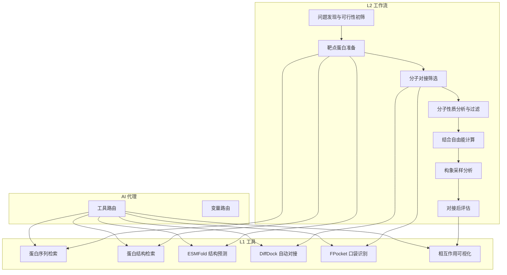
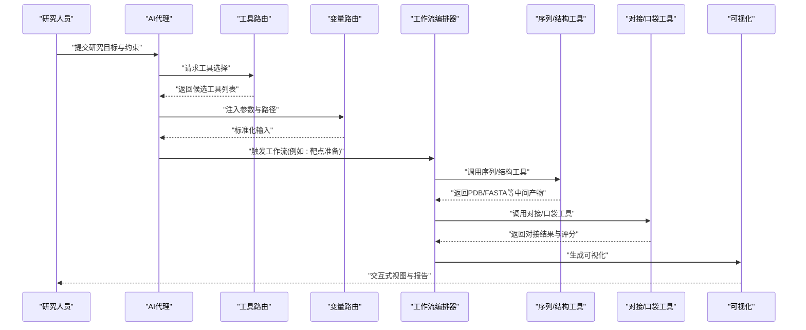
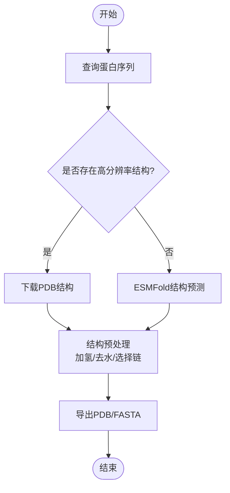
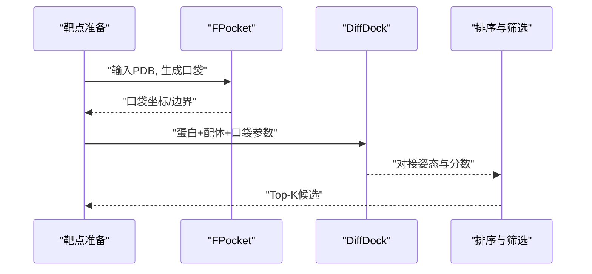
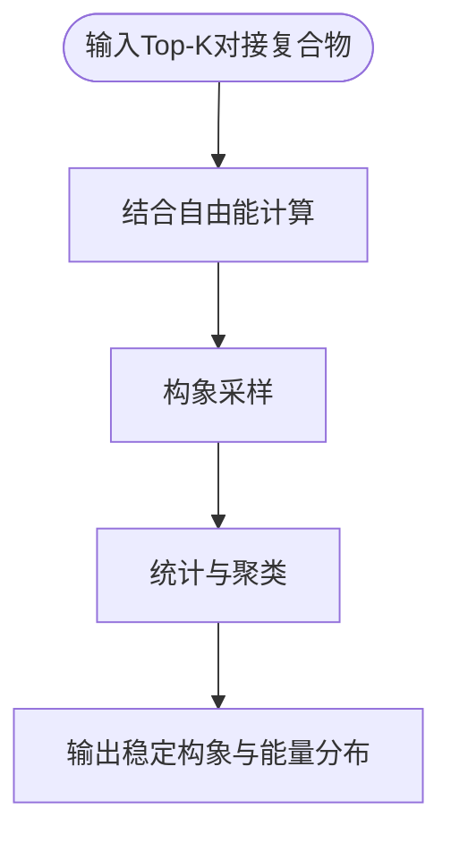
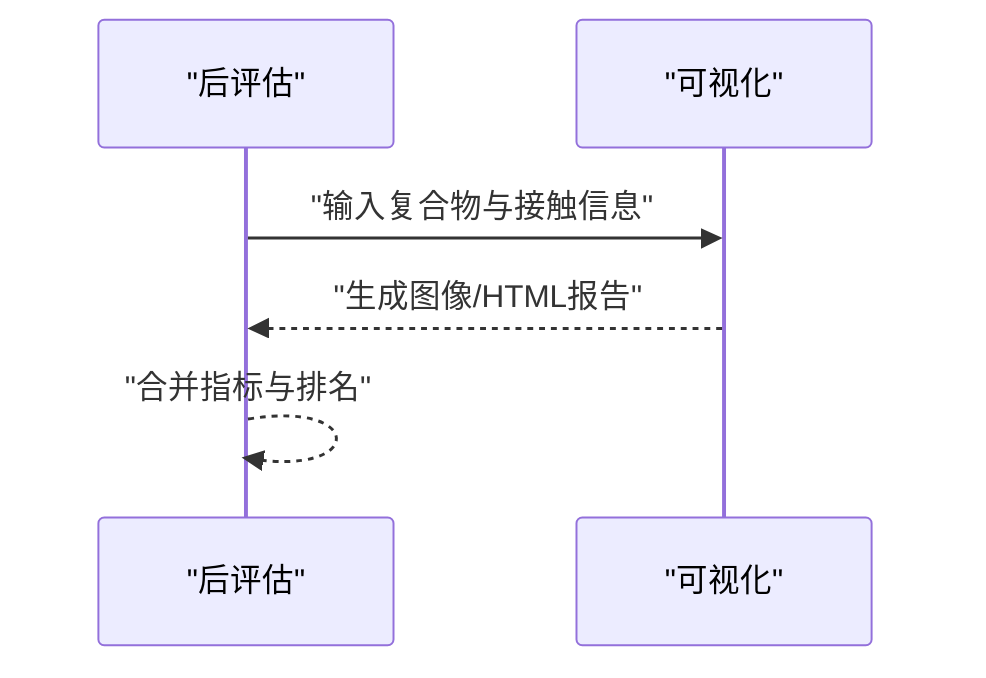
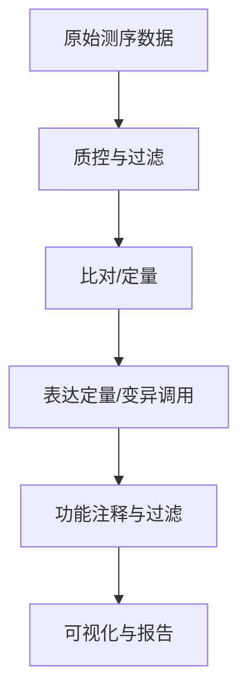
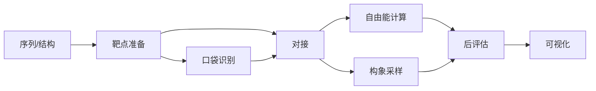

# 基因组学分析

<cite>
**本文引用的文件**   
- [docs/prd/molbench_repo/skills/L1_tools/molclaw-protein-sequence-retrieve/README.md](file://docs/prd/molbench_repo/skills/L1_tools/molclaw-protein-sequence-retrieve/README.md)
- [docs/prd/molbench_repo/skills/L1_tools/molclaw-protein-structure-retrieve/README.md](file://docs/prd/molbench_repo/skills/L1_tools/molclaw-protein-structure-retrieve/README.md)
- [docs/prd/molbench_repo/skills/L1_tools/molclaw-esmfold/README.md](file://docs/prd/molbench_repo/skills/L1_tools/molclaw-esmfold/README.md)
- [docs/prd/molbench_repo/skills/L1_tools/molclaw-diffdock-auto/README.md](file://docs/prd/molbench_repo/skills/L1_tools/molclaw-diffdock-auto/README.md)
- [docs/prd/molbench_repo/skills/L1_tools/molclaw-fpocket-toolkit-base/README.md](file://docs/prd/molbench_repo/skills/L1_tools/molclaw-fpocket-toolkit-base/README.md)
- [docs/prd/molbench_repo/skills/L1_tools/molclaw-interaction-visualizer/README.md](file://docs/prd/molbench_repo/skills/L1_tools/molclaw-interaction-visualizer/README.md)
- [docs/prd/molbench_repo/skills/L2_workflows/01-target-protein-preparation.md](file://docs/prd/molbench_repo/skills/L2_workflows/01-target-protein-preparation.md)
- [docs/prd/molbench_repo/skills/L2_workflows/02-molecular-docking-screening.md](file://docs/prd/molbench_repo/skills/L2_workflows/02-molecular-docking-screening.md)
- [docs/prd/molbench_repo/skills/L2_workflows/03-molecular-property-analysis-filtering.md](file://docs/prd/molbench_repo/skills/L2_workflows/03-molecular-property-analysis-filtering.md)
- [docs/prd/molbench_repo/skills/L2_workflows/06-binding-free-energy-calculation.md](file://docs/prd/molbench_repo/skills/L2_workflows/06-binding-free-energy-calculation.md)
- [docs/prd/molbench_repo/skills/L2_workflows/07-conformational-sampling-analysis.md](file://docs/prd/molbench_repo/skills/L2_workflows/07-conformational-sampling-analysis.md)
- [docs/prd/molbench_repo/skills/L2_workflows/08-post-docking-evaluation.md](file://docs/prd/molbench_repo/skills/L2_workflows/08-post-docking-evaluation.md)
- [docs/prd/molbench_repo/skills/L2_workflows/00-problem-discovery-and-feasibility-triage.md](file://docs/prd/molbench_repo/skills/L2_workflows/00-problem-discovery-and-feasibility-triage.md)
- [docs/prd/molbench_repo/templates/tool_routing.md](file://docs/prd/molbench_repo/templates/tool_routing.md)
- [docs/prd/molbench_repo/templates/variable_routing.md](file://docs/prd/molbench_repo/templates/variable_routing.md)
- [longhorizon/instantiate/caseF_instantiate.py](file://longhorizon/instantiate/caseF_instantiate.py)
- [longhorizon/instantiate/instances/targetF_ABL1-CML.json](file://longhorizon/instantiate/instances/targetF_ABL1-CML.json)
- [longhorizon/instantiate/instances/targetF_EGFR-NSCLC.json](file://longhorizon/instantiate/instances/targetF_EGFR-NSCLC.json)
- [longhorizon/instantiate/instances/targetF_BRAF-Melanoma.json](file://longhorizon/instantiate/instances/targetF_BRAF-Melanoma.json)
- [task4/papers/2304.05376.xml](file://task4/papers/2304.05376.xml)
- [task4/papers/2310.03302.xml](file://task4/papers/2310.03302.xml)
- [task4/papers/2405.16205.xml](file://task4/papers/2405.16205.xml)
- [task4/papers/2407.01725.html](file://task4/papers/2407.01725.html)
- [task4/papers/2407.10362.xml](file://task4/papers/2407.10362.xml)
- [task4/papers/2410.05080.html](file://task4/papers/2410.05080.html)
- [task4/papers/2412.14161.html](file://task4/papers/2412.14161.html)
- [task4/papers/2501.14654.xml](file://task4/papers/2501.14654.xml)
</cite>

## 目录
1. [简介](#简介)
2. [项目结构](#项目结构)
3. [核心组件](#核心组件)
4. [架构总览](#架构总览)
5. [详细组件分析](#详细组件分析)
6. [依赖关系分析](#依赖关系分析)
7. [性能与大规模数据处理](#性能与大规模数据处理)
8. [故障排查指南](#故障排查指南)
9. [结论](#结论)
10. [附录：分析与可视化示例](#附录分析与可视化示例)

## 简介
本文件面向基因组学与药物发现交叉场景，聚焦以下能力：
- 蛋白质序列检索与结构获取
- 分子对接筛选与结合自由能评估
- 构象采样与相互作用可视化
- AI代理驱动的分析流程编排与工具路由
- 面向大规模数据的处理策略与优化建议
- 典型分析流程与可视化输出示例

说明：仓库中未直接包含基因表达分析或变异检测的专用脚本；本文在“概念性概览”部分给出通用流程建议，并在“附录”提供可落地的可视化方案。

## 项目结构
与基因组学相关的能力主要分布在以下位置：
- L1 工具集：围绕蛋白序列/结构检索、结构预测、对接、口袋识别、相互作用可视化等原子能力
- L2 工作流：将L1工具组合为端到端任务（如靶点准备、对接筛选、性质过滤、自由能计算、构象采样、后对接评估）
- 模板与路由：AI代理的工具选择与变量注入机制
- 实例化脚本与目标案例：以具体疾病靶点为例的组织方式

图表来源
- [docs/prd/molbench_repo/skills/L1_tools/molclaw-protein-sequence-retrieve/README.md](file://docs/prd/molbench_repo/skills/L1_tools/molclaw-protein-sequence-retrieve/README.md)
- [docs/prd/molbench_repo/skills/L1_tools/molclaw-protein-structure-retrieve/README.md](file://docs/prd/molbench_repo/skills/L1_tools/molclaw-protein-structure-retrieve/README.md)
- [docs/prd/molbench_repo/skills/L1_tools/molclaw-esmfold/README.md](file://docs/prd/molbench_repo/skills/L1_tools/molclaw-esmfold/README.md)
- [docs/prd/molbench_repo/skills/L1_tools/molclaw-diffdock-auto/README.md](file://docs/prd/molbench_repo/skills/L1_tools/molclaw-diffdock-auto/README.md)
- [docs/prd/molbench_repo/skills/L1_tools/molclaw-fpocket-toolkit-base/README.md](file://docs/prd/molbench_repo/skills/L1_tools/molclaw-fpocket-toolkit-base/README.md)
- [docs/prd/molbench_repo/skills/L1_tools/molclaw-interaction-visualizer/README.md](file://docs/prd/molbench_repo/skills/L1_tools/molclaw-interaction-visualizer/README.md)
- [docs/prd/molbench_repo/skills/L2_workflows/01-target-protein-preparation.md](file://docs/prd/molbench_repo/skills/L2_workflows/01-target-protein-preparation.md)
- [docs/prd/molbench_repo/skills/L2_workflows/02-molecular-docking-screening.md](file://docs/prd/molbench_repo/skills/L2_workflows/02-molecular-docking-screening.md)
- [docs/prd/molbench_repo/skills/L2_workflows/03-molecular-property-analysis-filtering.md](file://docs/prd/molbench_repo/skills/L2_workflows/03-molecular-property-analysis-filtering.md)
- [docs/prd/molbench_repo/skills/L2_workflows/06-binding-free-energy-calculation.md](file://docs/prd/molbench_repo/skills/L2_workflows/06-binding-free-energy-calculation.md)
- [docs/prd/molbench_repo/skills/L2_workflows/07-conformational-sampling-analysis.md](file://docs/prd/molbench_repo/skills/L2_workflows/07-conformational-sampling-analysis.md)
- [docs/prd/molbench_repo/skills/L2_workflows/08-post-docking-evaluation.md](file://docs/prd/molbench_repo/skills/L2_workflows/08-post-docking-evaluation.md)
- [docs/prd/molbench_repo/templates/tool_routing.md](file://docs/prd/molbench_repo/templates/tool_routing.md)
- [docs/prd/molbench_repo/templates/variable_routing.md](file://docs/prd/molbench_repo/templates/variable_routing.md)

章节来源
- [docs/prd/molbench_repo/skills/L2_workflows/00-problem-discovery-and-feasibility-triage.md](file://docs/prd/molbench_repo/skills/L2_workflows/00-problem-discovery-and-feasibility-triage.md)
- [docs/prd/molbench_repo/skills/L2_workflows/01-target-protein-preparation.md](file://docs/prd/molbench_repo/skills/L2_workflows/01-target-protein-preparation.md)
- [docs/prd/molbench_repo/skills/L2_workflows/02-molecular-docking-screening.md](file://docs/prd/molbench_repo/skills/L2_workflows/02-molecular-docking-screening.md)
- [docs/prd/molbench_repo/skills/L2_workflows/03-molecular-property-analysis-filtering.md](file://docs/prd/molbench_repo/skills/L2_workflows/03-molecular-property-analysis-filtering.md)
- [docs/prd/molbench_repo/skills/L2_workflows/06-binding-free-energy-calculation.md](file://docs/prd/molbench_repo/skills/L2_workflows/06-binding-free-energy-calculation.md)
- [docs/prd/molbench_repo/skills/L2_workflows/07-conformational-sampling-analysis.md](file://docs/prd/molbench_repo/skills/L2_workflows/07-conformational-sampling-analysis.md)
- [docs/prd/molbench_repo/skills/L2_workflows/08-post-docking-evaluation.md](file://docs/prd/molbench_repo/skills/L2_workflows/08-post-docking-evaluation.md)
- [docs/prd/molbench_repo/templates/tool_routing.md](file://docs/prd/molbench_repo/templates/tool_routing.md)
- [docs/prd/molbench_repo/templates/variable_routing.md](file://docs/prd/molbench_repo/templates/variable_routing.md)

## 核心组件
- 蛋白序列检索：用于从公共数据库拉取目标蛋白的一级序列，支撑后续结构预测与比对
- 蛋白结构检索：获取同源或实验解析的三维结构，作为对接与可视化的基础
- ESMFold 结构预测：在无实验结构时，基于序列快速预测高质量三维结构
- DiffDock 自动对接：对候选小分子进行自动化对接打分与姿态生成
- FPocket 口袋识别：定位潜在配体结合位点，指导对接区域设置
- 相互作用可视化：展示蛋白-配体关键接触、氢键、疏水作用等，辅助结果解读

章节来源
- [docs/prd/molbench_repo/skills/L1_tools/molclaw-protein-sequence-retrieve/README.md](file://docs/prd/molbench_repo/skills/L1_tools/molclaw-protein-sequence-retrieve/README.md)
- [docs/prd/molbench_repo/skills/L1_tools/molclaw-protein-structure-retrieve/README.md](file://docs/prd/molbench_repo/skills/L1_tools/molclaw-protein-structure-retrieve/README.md)
- [docs/prd/molbench_repo/skills/L1_tools/molclaw-esmfold/README.md](file://docs/prd/molbench_repo/skills/L1_tools/molclaw-esmfold/README.md)
- [docs/prd/molbench_repo/skills/L1_tools/molclaw-diffdock-auto/README.md](file://docs/prd/molbench_repo/skills/L1_tools/molclaw-diffdock-auto/README.md)
- [docs/prd/molbench_repo/skills/L1_tools/molclaw-fpocket-toolkit-base/README.md](file://docs/prd/molbench_repo/skills/L1_tools/molclaw-fpocket-toolkit-base/README.md)
- [docs/prd/molbench_repo/skills/L1_tools/molclaw-interaction-visualizer/README.md](file://docs/prd/molbench_repo/skills/L1_tools/molclaw-interaction-visualizer/README.md)

## 架构总览
下图展示了AI代理如何根据任务描述自动选择工具并串联工作流，完成从“问题发现”到“对接后评估”的闭环。

图表来源
- [docs/prd/molbench_repo/templates/tool_routing.md](file://docs/prd/molbench_repo/templates/tool_routing.md)
- [docs/prd/molbench_repo/templates/variable_routing.md](file://docs/prd/molbench_repo/templates/variable_routing.md)
- [docs/prd/molbench_repo/skills/L2_workflows/01-target-protein-preparation.md](file://docs/prd/molbench_repo/skills/L2_workflows/01-target-protein-preparation.md)
- [docs/prd/molbench_repo/skills/L2_workflows/02-molecular-docking-screening.md](file://docs/prd/molbench_repo/skills/L2_workflows/02-molecular-docking-screening.md)
- [docs/prd/molbench_repo/skills/L2_workflows/08-post-docking-evaluation.md](file://docs/prd/molbench_repo/skills/L2_workflows/08-post-docking-evaluation.md)

## 详细组件分析

### 组件A：蛋白序列与结构管线
- 职责
  - 从权威数据库检索目标蛋白序列与结构
  - 无结构时通过ESMFold进行快速预测
  - 为后续对接准备标准格式与坐标
- 关键步骤
  - 序列检索与清洗
  - 结构下载或预测
  - 链/残基选择与缺失补全
  - 导出PDB/FASTA供下游使用

图表来源
- [docs/prd/molbench_repo/skills/L1_tools/molclaw-protein-sequence-retrieve/README.md](file://docs/prd/molbench_repo/skills/L1_tools/molclaw-protein-sequence-retrieve/README.md)
- [docs/prd/molbench_repo/skills/L1_tools/molclaw-protein-structure-retrieve/README.md](file://docs/prd/molbench_repo/skills/L1_tools/molclaw-protein-structure-retrieve/README.md)
- [docs/prd/molbench_repo/skills/L1_tools/molclaw-esmfold/README.md](file://docs/prd/molbench_repo/skills/L1_tools/molclaw-esmfold/README.md)
- [docs/prd/molbench_repo/skills/L2_workflows/01-target-protein-preparation.md](file://docs/prd/molbench_repo/skills/L2_workflows/01-target-protein-preparation.md)

章节来源
- [docs/prd/molbench_repo/skills/L1_tools/molclaw-protein-sequence-retrieve/README.md](file://docs/prd/molbench_repo/skills/L1_tools/molclaw-protein-sequence-retrieve/README.md)
- [docs/prd/molbench_repo/skills/L1_tools/molclaw-protein-structure-retrieve/README.md](file://docs/prd/molbench_repo/skills/L1_tools/molclaw-protein-structure-retrieve/README.md)
- [docs/prd/molbench_repo/skills/L1_tools/molclaw-esmfold/README.md](file://docs/prd/molbench_repo/skills/L1_tools/molclaw-esmfold/README.md)
- [docs/prd/molbench_repo/skills/L2_workflows/01-target-protein-preparation.md](file://docs/prd/molbench_repo/skills/L2_workflows/01-target-protein-preparation.md)

### 组件B：对接筛选与口袋识别
- 职责
  - 利用FPocket识别潜在结合口袋
  - 使用DiffDock进行自动化对接与打分
  - 产出对接姿态与初步评分，供排序与筛选
- 关键步骤
  - 口袋定位与边界框生成
  - 配体库准备与标准化
  - 批量对接与结果聚合
  - 按得分/几何约束筛选Top-K

图表来源
- [docs/prd/molbench_repo/skills/L1_tools/molclaw-fpocket-toolkit-base/README.md](file://docs/prd/molbench_repo/skills/L1_tools/molclaw-fpocket-toolkit-base/README.md)
- [docs/prd/molbench_repo/skills/L1_tools/molclaw-diffdock-auto/README.md](file://docs/prd/molbench_repo/skills/L1_tools/molclaw-diffdock-auto/README.md)
- [docs/prd/molbench_repo/skills/L2_workflows/02-molecular-docking-screening.md](file://docs/prd/molbench_repo/skills/L2_workflows/02-molecular-docking-screening.md)

章节来源
- [docs/prd/molbench_repo/skills/L1_tools/molclaw-fpocket-toolkit-base/README.md](file://docs/prd/molbench_repo/skills/L1_tools/molclaw-fpocket-toolkit-base/README.md)
- [docs/prd/molbench_repo/skills/L1_tools/molclaw-diffdock-auto/README.md](file://docs/prd/molbench_repo/skills/L1_tools/molclaw-diffdock-auto/README.md)
- [docs/prd/molbench_repo/skills/L2_workflows/02-molecular-docking-screening.md](file://docs/prd/molbench_repo/skills/L2_workflows/02-molecular-docking-screening.md)

### 组件C：结合自由能与构象采样
- 职责
  - 对Top候选进行更严谨的结合自由能估算
  - 开展构象采样以评估稳定性与多样性
- 关键步骤
  - MM/PBSA或类似方法估算ΔG
  - 短MD或增强采样探索构象空间
  - 汇总能量分布与代表性构象

图表来源
- [docs/prd/molbench_repo/skills/L2_workflows/06-binding-free-energy-calculation.md](file://docs/prd/molbench_repo/skills/L2_workflows/06-binding-free-energy-calculation.md)
- [docs/prd/molbench_repo/skills/L2_workflows/07-conformational-sampling-analysis.md](file://docs/prd/molbench_repo/skills/L2_workflows/07-conformational-sampling-analysis.md)

章节来源
- [docs/prd/molbench_repo/skills/L2_workflows/06-binding-free-energy-calculation.md](file://docs/prd/molbench_repo/skills/L2_workflows/06-binding-free-energy-calculation.md)
- [docs/prd/molbench_repo/skills/L2_workflows/07-conformational-sampling-analysis.md](file://docs/prd/molbench_repo/skills/L2_workflows/07-conformational-sampling-analysis.md)

### 组件D：相互作用可视化与后评估
- 职责
  - 生成蛋白-配体相互作用图
  - 综合对接评分、自由能与构象稳定性进行最终评估
- 关键步骤
  - 提取接触残基、氢键、盐桥、π-堆积等
  - 生成静态/交互式可视化
  - 汇总指标形成报告

图表来源
- [docs/prd/molbench_repo/skills/L1_tools/molclaw-interaction-visualizer/README.md](file://docs/prd/molbench_repo/skills/L1_tools/molclaw-interaction-visualizer/README.md)
- [docs/prd/molbench_repo/skills/L2_workflows/08-post-docking-evaluation.md](file://docs/prd/molbench_repo/skills/L2_workflows/08-post-docking-evaluation.md)

章节来源
- [docs/prd/molbench_repo/skills/L1_tools/molclaw-interaction-visualizer/README.md](file://docs/prd/molbench_repo/skills/L1_tools/molclaw-interaction-visualizer/README.md)
- [docs/prd/molbench_repo/skills/L2_workflows/08-post-docking-evaluation.md](file://docs/prd/molbench_repo/skills/L2_workflows/08-post-docking-evaluation.md)

### 概念性概览：基因表达分析与变异检测
说明：仓库未提供专门的表达/变异分析脚本，以下为通用实践建议，便于在现有管线基础上扩展。
- 基因表达分析
  - 数据源：RNA-seq原始reads或定量矩阵
  - 流程：质控→比对/定量→差异表达→通路富集→可视化（火山图、热图、PCA）
  - 输出：差异基因表、富集结果、可视化图表
- 变异检测
  - 数据源：WGS/WES测序数据
  - 流程：质控→比对→重复标记→变异调用→注释→过滤→优先级排序
  - 输出：VCF/注释表、致病性评分、候选变异清单

[本节为概念性内容，不直接分析具体代码文件]

## 依赖关系分析
- 工具层依赖
  - 序列/结构工具为对接与可视化提供上游输入
  - 口袋识别为对接提供搜索空间约束
  - 自由能与构象采样依赖对接结果
- 工作流耦合
  - 各工作流节点间通过标准化中间产物（PDB/FASTA/对接结果）解耦
- 代理路由
  - 工具路由与变量路由确保AI代理在不同任务下动态组装流程

图表来源
- [docs/prd/molbench_repo/skills/L2_workflows/01-target-protein-preparation.md](file://docs/prd/molbench_repo/skills/L2_workflows/01-target-protein-preparation.md)
- [docs/prd/molbench_repo/skills/L2_workflows/02-molecular-docking-screening.md](file://docs/prd/molbench_repo/skills/L2_workflows/02-molecular-docking-screening.md)
- [docs/prd/molbench_repo/skills/L2_workflows/06-binding-free-energy-calculation.md](file://docs/prd/molbench_repo/skills/L2_workflows/06-binding-free-energy-calculation.md)
- [docs/prd/molbench_repo/skills/L2_workflows/07-conformational-sampling-analysis.md](file://docs/prd/molbench_repo/skills/L2_workflows/07-conformational-sampling-analysis.md)
- [docs/prd/molbench_repo/skills/L2_workflows/08-post-docking-evaluation.md](file://docs/prd/molbench_repo/skills/L2_workflows/08-post-docking-evaluation.md)

章节来源
- [docs/prd/molbench_repo/templates/tool_routing.md](file://docs/prd/molbench_repo/templates/tool_routing.md)
- [docs/prd/molbench_repo/templates/variable_routing.md](file://docs/prd/molbench_repo/templates/variable_routing.md)

## 性能与大规模数据处理
- 并行与批处理
  - 对接与自由能计算天然适合并行化，建议按批次拆分任务，结合队列系统调度
- I/O与缓存
  - 复用已下载的PDB/FASTA与中间产物，避免重复网络请求
  - 对频繁访问的结构/口袋结果建立本地缓存
- 内存与精度权衡
  - 大规模对接优先采用近似打分或降采样策略，再对Top-K进行高精度重算
- GPU加速
  - 结构预测与深度学习对接可利用GPU资源，合理分配显存与批大小
- 监控与断点续跑
  - 记录每步输入输出哈希，支持失败重试与增量更新

[本节提供通用指导，不直接分析具体代码文件]

## 故障排查指南
- 常见问题
  - 序列/结构下载失败：检查网络与镜像源，增加重试与超时控制
  - 对接失败或空结果：确认蛋白/配体格式、电荷/质子化状态、口袋范围是否合理
  - 自由能计算发散：检查体系平衡、采样时长与力场参数
  - 可视化异常：核对原子编号、链标识与接触阈值
- 定位手段
  - 查看工作流日志与中间产物校验
  - 逐步回退至上一成功节点，最小化复现范围
  - 针对特定工具启用调试模式，输出详细诊断信息

[本节为通用排障建议，不直接分析具体代码文件]

## 结论
本项目以“原子工具 + 工作流 + AI代理路由”的方式，构建了从蛋白序列/结构获取到对接筛选、自由能与构象分析、可视化输出的完整闭环。对于基因表达与变异检测，可在该框架上扩展相应工具与工作流节点，实现多组学一体化分析。

[本节为总结性内容，不直接分析具体代码文件]

## 附录：分析与可视化示例
- 可视化输出建议
  - 蛋白-配体接触图：标注关键残基与相互作用类型
  - 对接姿态叠加：比较Top-K构象的空间重叠与差异
  - 自由能分布直方图与箱线图：对比不同候选的能量分布
  - 构象聚类树状图：展示采样结果的多样性
- 示例参考
  - 以ABL1、EGFR、BRAF等靶点为例，组织输入与中间产物，便于跨案例对比

章节来源
- [longhorizon/instantiate/caseF_instantiate.py](file://longhorizon/instantiate/caseF_instantiate.py)
- [longhorizon/instantiate/instances/targetF_ABL1-CML.json](file://longhorizon/instantiate/instances/targetF_ABL1-CML.json)
- [longhorizon/instantiate/instances/targetF_EGFR-NSCLC.json](file://longhorizon/instantiate/instances/targetF_EGFR-NSCLC.json)
- [longhorizon/instantiate/instances/targetF_BRAF-Melanoma.json](file://longhorizon/instantiate/instances/targetF_BRAF-Melanoma.json)