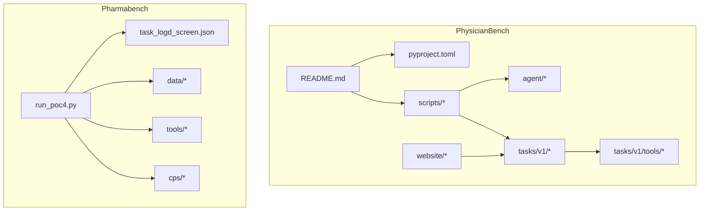
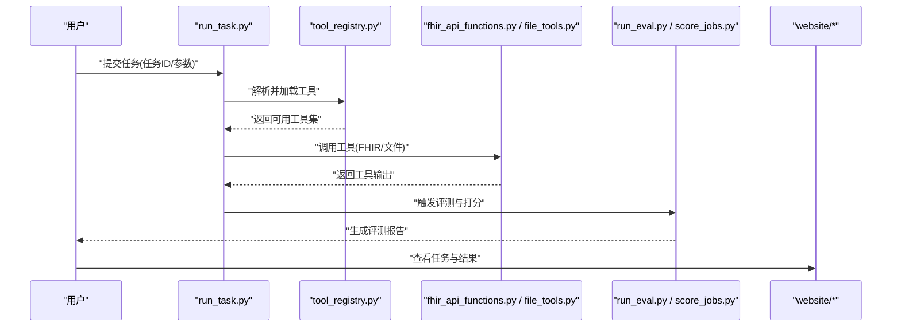
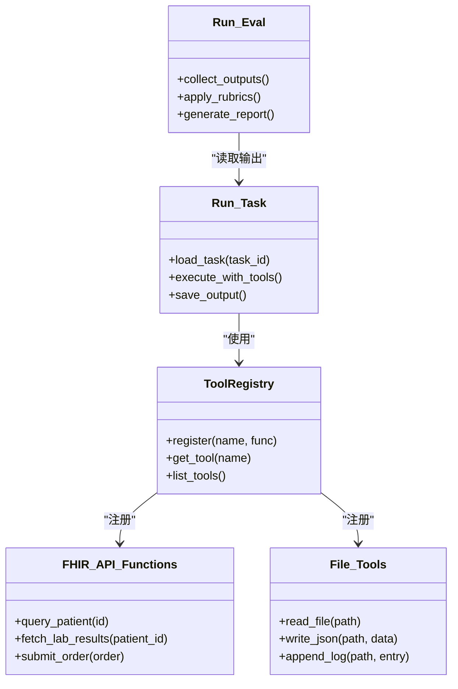
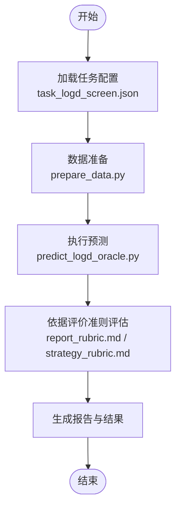
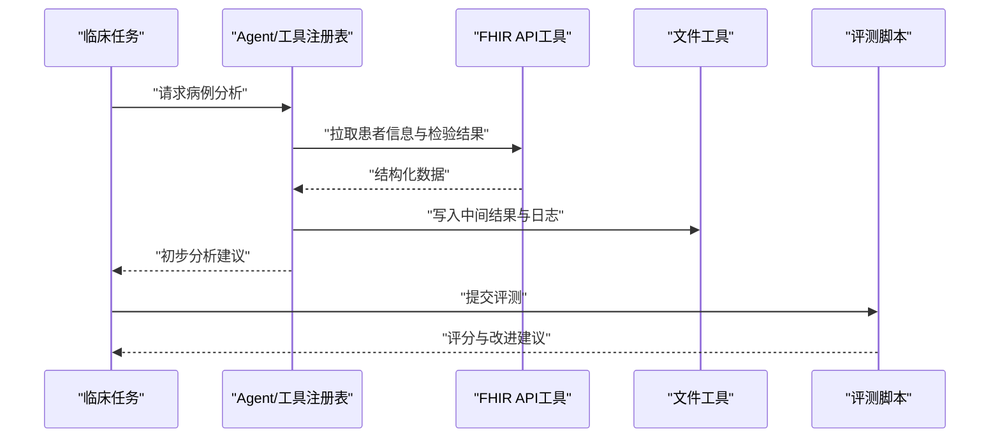
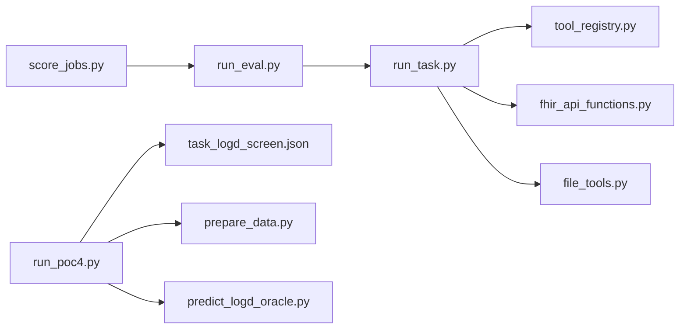

# 生物医学应用

<cite>
**本文引用的文件**   
- [task7/poc3_physicianbench/PhysicianBench/README.md](file://task7/poc3_physicianbench/PhysicianBench/README.md)
- [task7/poc3_physicianbench/PhysicianBench/pyproject.toml](file://task7/poc3_physicianbench/PhysicianBench/pyproject.toml)
- [task7/poc3_physicianbench/PhysicianBench/scripts/run_task.py](file://task7/poc3_physicianbench/PhysicianBench/scripts/run_task.py)
- [task7/poc3_physicianbench/PhysicianBench/scripts/run_eval.py](file://task7/poc3_physicianbench/PhysicianBench/scripts/run_eval.py)
- [task7/poc3_physicianbench/PhysicianBench/scripts/score_jobs.py](file://task7/poc3_physicianbench/PhysicianBench/scripts/score_jobs.py)
- [task7/poc3_physicianbench/PhysicianBench/scripts/task_taxonomy_v1.json](file://task7/poc3_physicianbench/PhysicianBench/scripts/task_taxonomy_v1.json)
- [task7/poc3_physicianbench/PhysicianBench/agent/tool_registry.py](file://task7/poc3_physicianbench/PhysicianBench/agent/tool_registry.py)
- [task7/poc3_physicianbench/PhysicianBench/agent/prompts.py](file://task7/poc3_physicianbench/PhysicianBench/agent/prompts.py)
- [task7/poc3_physicianbench/PhysicianBench/tasks/v1/tools/fhir_api_functions.py](file://task7/poc3_physicianbench/PhysicianBench/tasks/v1/tools/fhir_api_functions.py)
- [task7/poc3_physicianbench/PhysicianBench/tasks/v1/tools/file_tools.py](file://task7/poc3_physicianbench/PhysicianBench/tasks/v1/tools/file_tools.py)
- [task7/poc3_physicianbench/PhysicianBench/tasks/v1/abnormal_uterine_bleeding/task.yaml](file://task7/poc3_physicianbench/PhysicianBench/tasks/v1/abnormal_uterine_bleeding/task.yaml)
- [task7/poc3_physicianbench/PhysicianBench/tasks/v1/abnormal_uterine_bleeding/eval.yaml](file://task7/poc3_physicianbench/PhysicianBench/tasks/v1/abnormal_uterine_bleeding/eval.yaml)
- [task7/poc4_pharmabench/run_poc4.py](file://task7/poc4_pharmabench/run_poc4.py)
- [task7/poc4_pharmabench/task_logd_screen.json](file://task7/poc4_pharmabench/task_logd_screen.json)
- [task7/poc4_pharmabench/data/_logd_raw.csv](file://task7/poc4_pharmabench/data/_logd_raw.csv)
- [task7/poc4_pharmabench/data/logd_test_sample.csv](file://task7/poc4_pharmabench/data/logd_test_sample.csv)
- [task7/poc4_pharmabench/data/prepare_data.py](file://task7/poc4_pharmabench/data/prepare_data.py)
- [task7/poc4_pharmabench/tools/predict_logd_oracle.py](file://task7/poc4_pharmabench/tools/predict_logd_oracle.py)
- [task7/poc4_pharmabench/cps/report_rubric.md](file://task7/poc4_pharmabench/cps/report_rubric.md)
- [task7/poc4_pharmabench/cps/strategy_rubric.md](file://task7/poc4_pharmabench/cps/strategy_rubric.md)
</cite>

## 目录
1. [简介](#简介)
2. [项目结构](#项目结构)
3. [核心组件](#核心组件)
4. [架构总览](#架构总览)
5. [详细组件分析](#详细组件分析)
6. [依赖关系分析](#依赖关系分析)
7. [性能与可扩展性](#性能与可扩展性)
8. [故障排查指南](#故障排查指南)
9. [结论](#结论)
10. [附录](#附录)

## 简介
本文件面向生物医学应用场景，聚焦以下方向：
- 医疗诊断辅助：基于临床病例的任务化评测与工具链集成。
- 临床试验设计：以任务编排、评估指标与可复现实验流程为核心。
- 药物相互作用分析与安全性评估：结合ADMET与筛选任务的基准框架。
- 基因组学分析：通过工具链与数据准备流程支持序列/结构相关任务（概念性说明）。
- PhysicianBench 医疗基准测试框架：使用方法、任务类型与评测流程。
- Pharmabench 药物研发基准：LogD预测、药效评估等任务示例。
- 医疗数据隐私保护与合规：在基准评测中如何落地隐私与合规要求。

## 项目结构
仓库围绕“多任务基准”组织，其中与生物医学相关的两个关键子工程为：
- task7/poc3_physicianbench/PhysicianBench：医疗诊断辅助与临床决策的基准框架，包含任务定义、工具注册、评测脚本与网站前端。
- task7/poc4_pharmabench：药物研发场景的基准示例，包含LogD预测任务、数据准备与评测脚本。

图表来源
- [task7/poc3_physicianbench/PhysicianBench/README.md](file://task7/poc3_physicianbench/PhysicianBench/README.md)
- [task7/poc3_physicianbench/PhysicianBench/pyproject.toml](file://task7/poc3_physicianbench/PhysicianBench/pyproject.toml)
- [task7/poc3_physicianbench/PhysicianBench/scripts/run_task.py](file://task7/poc3_physicianbench/PhysicianBench/scripts/run_task.py)
- [task7/poc3_physicianbench/PhysicianBench/scripts/run_eval.py](file://task7/poc3_physicianbench/PhysicianBench/scripts/run_eval.py)
- [task7/poc3_physicianbench/PhysicianBench/agent/tool_registry.py](file://task7/poc3_physicianbench/PhysicianBench/agent/tool_registry.py)
- [task7/poc3_physicianbench/PhysicianBench/tasks/v1/tools/fhir_api_functions.py](file://task7/poc3_physicianbench/PhysicianBench/tasks/v1/tools/fhir_api_functions.py)
- [task7/poc3_physicianbench/PhysicianBench/tasks/v1/tools/file_tools.py](file://task7/poc3_physicianbench/PhysicianBench/tasks/v1/tools/file_tools.py)
- [task7/poc4_pharmabench/run_poc4.py](file://task7/poc4_pharmabench/run_poc4.py)
- [task7/poc4_pharmabench/task_logd_screen.json](file://task7/poc4_pharmabench/task_logd_screen.json)
- [task7/poc4_pharmabench/data/prepare_data.py](file://task7/poc4_pharmabench/data/prepare_data.py)
- [task7/poc4_pharmabench/tools/predict_logd_oracle.py](file://task7/poc4_pharmabench/tools/predict_logd_oracle.py)

章节来源
- [task7/poc3_physicianbench/PhysicianBench/README.md](file://task7/poc3_physicianbench/PhysicianBench/README.md)
- [task7/poc4_pharmabench/run_poc4.py](file://task7/poc4_pharmabench/run_poc4.py)

## 核心组件
- PhysicianBench 核心能力
  - 任务定义与分类：通过任务清单与分类表组织临床场景。
  - 工具注册与调用：统一工具注册表，支持FHIR API与文件操作等工具。
  - 运行与评测：提供任务执行与结果评分脚本，形成端到端评测流水线。
  - 网站与可视化：提供Web界面用于任务浏览与结果展示。
- Pharmabench 核心能力
  - 任务配置：JSON描述任务集合与参数。
  - 数据准备：CSV原始数据与预处理脚本。
  - 工具与评估：预测工具与报告/策略评价准则。

章节来源
- [task7/poc3_physicianbench/PhysicianBench/scripts/task_taxonomy_v1.json](file://task7/poc3_physicianbench/PhysicianBench/scripts/task_taxonomy_v1.json)
- [task7/poc3_physicianbench/PhysicianBench/agent/tool_registry.py](file://task7/poc3_physicianbench/PhysicianBench/agent/tool_registry.py)
- [task7/poc3_physicianbench/PhysicianBench/tasks/v1/tools/fhir_api_functions.py](file://task7/poc3_physicianbench/PhysicianBench/tasks/v1/tools/fhir_api_functions.py)
- [task7/poc3_physicianbench/PhysicianBench/tasks/v1/tools/file_tools.py](file://task7/poc3_physicianbench/PhysicianBench/tasks/v1/tools/file_tools.py)
- [task7/poc4_pharmabench/task_logd_screen.json](file://task7/poc4_pharmabench/task_logd_screen.json)
- [task7/poc4_pharmabench/data/prepare_data.py](file://task7/poc4_pharmabench/data/prepare_data.py)
- [task7/poc4_pharmabench/tools/predict_logd_oracle.py](file://task7/poc4_pharmabench/tools/predict_logd_oracle.py)

## 架构总览
下图展示了从任务配置到执行、再到评测与可视化的整体流程。

图表来源
- [task7/poc3_physicianbench/PhysicianBench/scripts/run_task.py](file://task7/poc3_physicianbench/PhysicianBench/scripts/run_task.py)
- [task7/poc3_physicianbench/PhysicianBench/scripts/run_eval.py](file://task7/poc3_physicianbench/PhysicianBench/scripts/run_eval.py)
- [task7/poc3_physicianbench/PhysicianBench/scripts/score_jobs.py](file://task7/poc3_physicianbench/PhysicianBench/scripts/score_jobs.py)
- [task7/poc3_physicianbench/PhysicianBench/agent/tool_registry.py](file://task7/poc3_physicianbench/PhysicianBench/agent/tool_registry.py)
- [task7/poc3_physicianbench/PhysicianBench/tasks/v1/tools/fhir_api_functions.py](file://task7/poc3_physicianbench/PhysicianBench/tasks/v1/tools/fhir_api_functions.py)
- [task7/poc3_physicianbench/PhysicianBench/tasks/v1/tools/file_tools.py](file://task7/poc3_physicianbench/PhysicianBench/tasks/v1/tools/file_tools.py)

## 详细组件分析

### PhysicianBench 任务与工具体系
- 任务定义
  - 每个临床任务由任务描述与评测规则组成，典型路径如异常子宫出血任务。
  - 任务清单与分类有助于批量管理与评测。
- 工具注册
  - 统一的工具注册表负责发现与加载工具，便于扩展新工具。
  - FHIR API工具用于访问标准化医疗数据接口；文件工具用于读写本地数据。
- 运行与评测
  - run_task.py 负责任务执行与日志记录。
  - run_eval.py 与 score_jobs.py 负责结果收集与评分汇总。

图表来源
- [task7/poc3_physicianbench/PhysicianBench/agent/tool_registry.py](file://task7/poc3_physicianbench/PhysicianBench/agent/tool_registry.py)
- [task7/poc3_physicianbench/PhysicianBench/tasks/v1/tools/fhir_api_functions.py](file://task7/poc3_physicianbench/PhysicianBench/tasks/v1/tools/fhir_api_functions.py)
- [task7/poc3_physicianbench/PhysicianBench/tasks/v1/tools/file_tools.py](file://task7/poc3_physicianbench/PhysicianBench/tasks/v1/tools/file_tools.py)
- [task7/poc3_physicianbench/PhysicianBench/scripts/run_task.py](file://task7/poc3_physicianbench/PhysicianBench/scripts/run_task.py)
- [task7/poc3_physicianbench/PhysicianBench/scripts/run_eval.py](file://task7/poc3_physicianbench/PhysicianBench/scripts/run_eval.py)

章节来源
- [task7/poc3_physicianbench/PhysicianBench/tasks/v1/abnormal_uterine_bleeding/task.yaml](file://task7/poc3_physicianbench/PhysicianBench/tasks/v1/abnormal_uterine_bleeding/task.yaml)
- [task7/poc3_physicianbench/PhysicianBench/tasks/v1/abnormal_uterine_bleeding/eval.yaml](file://task7/poc3_physicianbench/PhysicianBench/tasks/v1/abnormal_uterine_bleeding/eval.yaml)
- [task7/poc3_physicianbench/PhysicianBench/scripts/task_taxonomy_v1.json](file://task7/poc3_physicianbench/PhysicianBench/scripts/task_taxonomy_v1.json)
- [task7/poc3_physicianbench/PhysicianBench/agent/tool_registry.py](file://task7/poc3_physicianbench/PhysicianBench/agent/tool_registry.py)
- [task7/poc3_physicianbench/PhysicianBench/tasks/v1/tools/fhir_api_functions.py](file://task7/poc3_physicianbench/PhysicianBench/tasks/v1/tools/fhir_api_functions.py)
- [task7/poc3_physicianbench/PhysicianBench/tasks/v1/tools/file_tools.py](file://task7/poc3_physicianbench/PhysicianBench/tasks/v1/tools/file_tools.py)
- [task7/poc3_physicianbench/PhysicianBench/scripts/run_task.py](file://task7/poc3_physicianbench/PhysicianBench/scripts/run_task.py)
- [task7/poc3_physicianbench/PhysicianBench/scripts/run_eval.py](file://task7/poc3_physicianbench/PhysicianBench/scripts/run_eval.py)
- [task7/poc3_physicianbench/PhysicianBench/scripts/score_jobs.py](file://task7/poc3_physicianbench/PhysicianBench/scripts/score_jobs.py)

### Pharmabench LogD 预测任务
- 任务配置
  - JSON任务清单定义待测化合物与参数。
- 数据准备
  - CSV原始数据与测试样本，配合预处理脚本完成清洗与格式转换。
- 工具与评估
  - 预测工具实现LogD值计算或查询。
  - 报告与策略评价准则用于质量把控。

图表来源
- [task7/poc4_pharmabench/task_logd_screen.json](file://task7/poc4_pharmabench/task_logd_screen.json)
- [task7/poc4_pharmabench/data/prepare_data.py](file://task7/poc4_pharmabench/data/prepare_data.py)
- [task7/poc4_pharmabench/tools/predict_logd_oracle.py](file://task7/poc4_pharmabench/tools/predict_logd_oracle.py)
- [task7/poc4_pharmabench/cps/report_rubric.md](file://task7/poc4_pharmabench/cps/report_rubric.md)
- [task7/poc4_pharmabench/cps/strategy_rubric.md](file://task7/poc4_pharmabench/cps/strategy_rubric.md)

章节来源
- [task7/poc4_pharmabench/run_poc4.py](file://task7/poc4_pharmabench/run_poc4.py)
- [task7/poc4_pharmabench/task_logd_screen.json](file://task7/poc4_pharmabench/task_logd_screen.json)
- [task7/poc4_pharmabench/data/_logd_raw.csv](file://task7/poc4_pharmabench/data/_logd_raw.csv)
- [task7/poc4_pharmabench/data/logd_test_sample.csv](file://task7/poc4_pharmabench/data/logd_test_sample.csv)
- [task7/poc4_pharmabench/data/prepare_data.py](file://task7/poc4_pharmabench/data/prepare_data.py)
- [task7/poc4_pharmabench/tools/predict_logd_oracle.py](file://task7/poc4_pharmabench/tools/predict_logd_oracle.py)
- [task7/poc4_pharmabench/cps/report_rubric.md](file://task7/poc4_pharmabench/cps/report_rubric.md)
- [task7/poc4_pharmabench/cps/strategy_rubric.md](file://task7/poc4_pharmabench/cps/strategy_rubric.md)

### 临床应用任务类型与使用方法
- 临床病例分析
  - 通过任务定义与工具调用，模拟医生对病例进行信息检索、检验结果解读与鉴别诊断。
- 治疗方案推荐
  - 结合指南与患者特征，利用工具获取证据并生成推荐方案。
- 药物安全性评估
  - 借助FHIR工具查询用药史与不良反应，结合评测规则进行风险评估。

图表来源
- [task7/poc3_physicianbench/PhysicianBench/agent/tool_registry.py](file://task7/poc3_physicianbench/PhysicianBench/agent/tool_registry.py)
- [task7/poc3_physicianbench/PhysicianBench/tasks/v1/tools/fhir_api_functions.py](file://task7/poc3_physicianbench/PhysicianBench/tasks/v1/tools/fhir_api_functions.py)
- [task7/poc3_physicianbench/PhysicianBench/tasks/v1/tools/file_tools.py](file://task7/poc3_physicianbench/PhysicianBench/tasks/v1/tools/file_tools.py)
- [task7/poc3_physicianbench/PhysicianBench/scripts/run_eval.py](file://task7/poc3_physicianbench/PhysicianBench/scripts/run_eval.py)

章节来源
- [task7/poc3_physicianbench/PhysicianBench/tasks/v1/abnormal_uterine_bleeding/task.yaml](file://task7/poc3_physicianbench/PhysicianBench/tasks/v1/abnormal_uterine_bleeding/task.yaml)
- [task7/poc3_physicianbench/PhysicianBench/tasks/v1/abnormal_uterine_bleeding/eval.yaml](file://task7/poc3_physicianbench/PhysicianBench/tasks/v1/abnormal_uterine_bleeding/eval.yaml)
- [task7/poc3_physicianbench/PhysicianBench/scripts/run_task.py](file://task7/poc3_physicianbench/PhysicianBench/scripts/run_task.py)
- [task7/poc3_physicianbench/PhysicianBench/scripts/run_eval.py](file://task7/poc3_physicianbench/PhysicianBench/scripts/run_eval.py)

### 临床试验设计与药物相互作用分析
- 试验设计
  - 通过任务编排与评测指标，构建可复现的试验流程，支持入排标准、终点选择与统计分析。
- 药物相互作用
  - 结合ADMET与筛选任务，评估候选药物的药代动力学与潜在相互作用风险。

章节来源
- [task7/poc3_physicianbench/PhysicianBench/scripts/task_taxonomy_v1.json](file://task7/poc3_physicianbench/PhysicianBench/scripts/task_taxonomy_v1.json)
- [task7/poc4_pharmabench/task_logd_screen.json](file://task7/poc4_pharmabench/task_logd_screen.json)

### 基因组学分析（概念性说明）
- 在本仓库中，基因组学分析更多体现为工具链与数据处理流程的通用能力，例如：
  - 数据准备与清洗：CSV/JSON数据的规范化处理。
  - 工具扩展：通过工具注册表接入外部算法与服务。
  - 评测与可视化：统一评测与结果展示。
- 实际实现需结合具体数据集与算法库，按现有模式扩展即可。

[本节为概念性说明，不直接分析具体文件]

## 依赖关系分析
- PhysicianBench
  - 运行脚本依赖工具注册表与任务定义。
  - 工具层依赖FHIR API与文件系统。
  - 评测脚本依赖任务输出与评分规则。
- Pharmabench
  - 运行脚本依赖任务配置、数据准备与预测工具。
  - 评价准则作为质量保障输入。

图表来源
- [task7/poc3_physicianbench/PhysicianBench/scripts/run_task.py](file://task7/poc3_physicianbench/PhysicianBench/scripts/run_task.py)
- [task7/poc3_physicianbench/PhysicianBench/agent/tool_registry.py](file://task7/poc3_physicianbench/PhysicianBench/agent/tool_registry.py)
- [task7/poc3_physicianbench/PhysicianBench/tasks/v1/tools/fhir_api_functions.py](file://task7/poc3_physicianbench/PhysicianBench/tasks/v1/tools/fhir_api_functions.py)
- [task7/poc3_physicianbench/PhysicianBench/tasks/v1/tools/file_tools.py](file://task7/poc3_physicianbench/PhysicianBench/tasks/v1/tools/file_tools.py)
- [task7/poc3_physicianbench/PhysicianBench/scripts/run_eval.py](file://task7/poc3_physicianbench/PhysicianBench/scripts/run_eval.py)
- [task7/poc3_physicianbench/PhysicianBench/scripts/score_jobs.py](file://task7/poc3_physicianbench/PhysicianBench/scripts/score_jobs.py)
- [task7/poc4_pharmabench/run_poc4.py](file://task7/poc4_pharmabench/run_poc4.py)
- [task7/poc4_pharmabench/task_logd_screen.json](file://task7/poc4_pharmabench/task_logd_screen.json)
- [task7/poc4_pharmabench/data/prepare_data.py](file://task7/poc4_pharmabench/data/prepare_data.py)
- [task7/poc4_pharmabench/tools/predict_logd_oracle.py](file://task7/poc4_pharmabench/tools/predict_logd_oracle.py)

章节来源
- [task7/poc3_physicianbench/PhysicianBench/pyproject.toml](file://task7/poc3_physicianbench/PhysicianBench/pyproject.toml)
- [task7/poc4_pharmabench/pyproject.toml](file://task7/poc4_pharmabench/pyproject.toml)

## 性能与可扩展性
- 并行与批处理
  - 通过任务清单与批处理脚本提升吞吐，适合大规模评测。
- 工具缓存与复用
  - 对FHIR查询与文件IO进行缓存可减少重复开销。
- 模块化扩展
  - 工具注册表与任务定义的解耦便于新增领域工具与任务。

[本节提供一般性指导，不直接分析具体文件]

## 故障排查指南
- 常见问题定位
  - 任务未找到：检查任务ID与任务清单一致性。
  - 工具不可用：确认工具注册表是否成功加载对应工具。
  - FHIR连接失败：检查网络与认证配置。
  - 数据格式错误：核对CSV/JSON字段与预处理脚本期望一致。
- 日志与输出
  - 查看任务执行日志与评测报告，定位失败步骤。

章节来源
- [task7/poc3_physicianbench/PhysicianBench/scripts/run_task.py](file://task7/poc3_physicianbench/PhysicianBench/scripts/run_task.py)
- [task7/poc3_physicianbench/PhysicianBench/scripts/run_eval.py](file://task7/poc3_physicianbench/PhysicianBench/scripts/run_eval.py)
- [task7/poc3_physicianbench/PhysicianBench/scripts/score_jobs.py](file://task7/poc3_physicianbench/PhysicianBench/scripts/score_jobs.py)
- [task7/poc4_pharmabench/run_poc4.py](file://task7/poc4_pharmabench/run_poc4.py)

## 结论
- PhysicianBench 提供了完整的医疗诊断辅助基准框架，涵盖任务定义、工具集成、评测与可视化。
- Pharmabench 展示了药物研发中的LogD预测与评估流程，具备可扩展的数据与工具生态。
- 在医疗数据隐私与合规方面，应遵循最小化采集、脱敏处理、访问控制与审计追踪等原则，并在评测环境中严格隔离敏感数据。

[本节为总结性内容，不直接分析具体文件]

## 附录
- 快速上手
  - 安装与依赖：参考各子工程的配置文件与环境说明。
  - 运行任务：使用任务执行脚本提交任务ID与参数。
  - 评测与报告：使用评测脚本生成评分与报告。
- 扩展指南
  - 新增工具：在工具注册表中声明并实现接口。
  - 新增任务：编写任务定义与评测规则，加入任务清单。

章节来源
- [task7/poc3_physicianbench/PhysicianBench/README.md](file://task7/poc3_physicianbench/PhysicianBench/README.md)
- [task7/poc3_physicianbench/PhysicianBench/pyproject.toml](file://task7/poc3_physicianbench/PhysicianBench/pyproject.toml)
- [task7/poc4_pharmabench/pyproject.toml](file://task7/poc4_pharmabench/pyproject.toml)