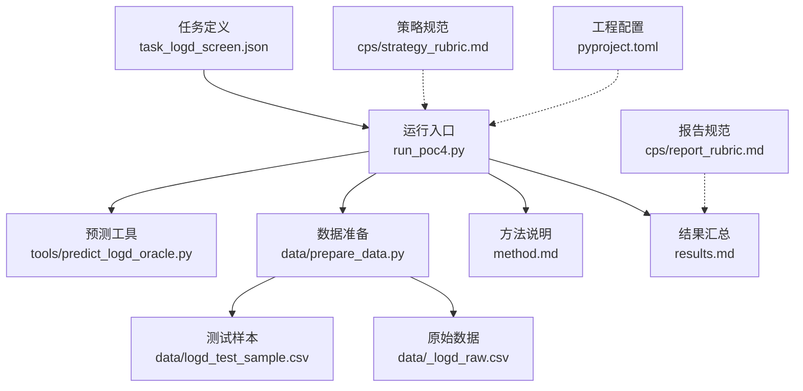
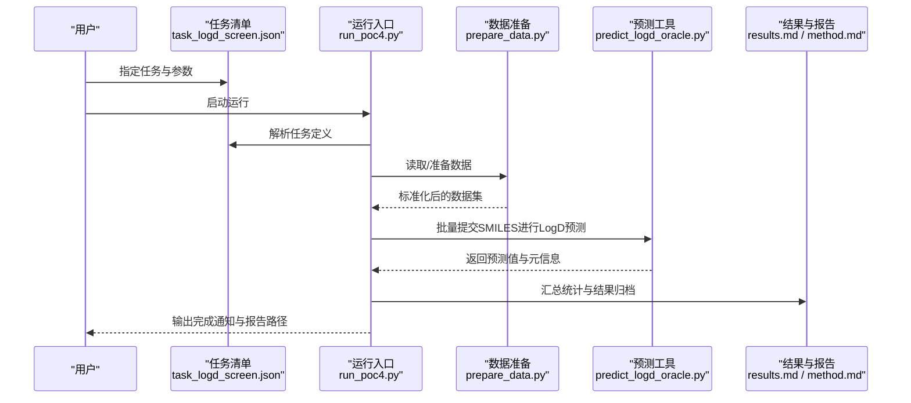
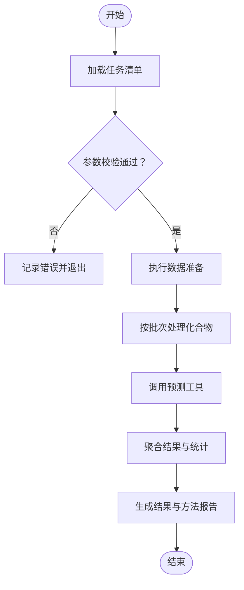
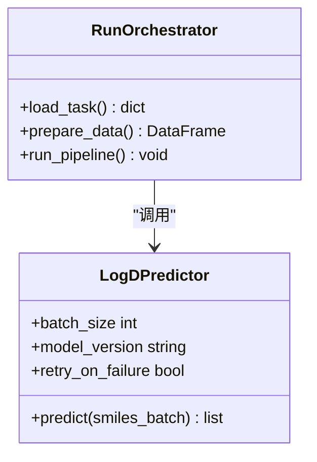
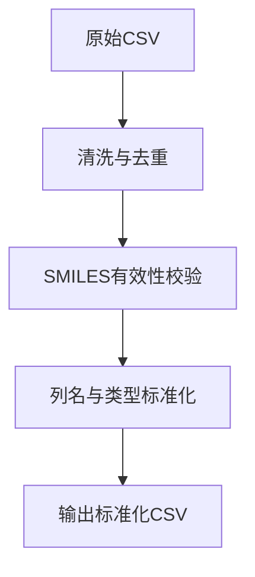
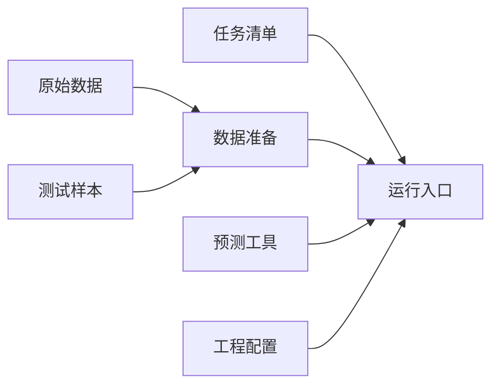

# 药物研发加速

<cite>
**本文引用的文件**   
- [task_logd_screen.json](file://task7/poc4_pharmabench/task_logd_screen.json)
- [run_poc4.py](file://task7/poc4_pharmabench/run_poc4.py)
- [predict_logd_oracle.py](file://task7/poc4_pharmabench/tools/predict_logd_oracle.py)
- [prepare_data.py](file://task7/poc4_pharmabench/data/prepare_data.py)
- [logd_test_sample.csv](file://task7/poc4_pharmabench/data/logd_test_sample.csv)
- [_logd_raw.csv](file://task7/poc4_pharmabench/data/_logd_raw.csv)
- [method.md](file://task7/poc4_pharmabench/method.md)
- [results.md](file://task7/poc4_pharmabench/results.md)
- [report_rubric.md](file://task7/poc4_pharmabench/cps/report_rubric.md)
- [strategy_rubric.md](file://task7/poc4_pharmabench/cps/strategy_rubric.md)
- [pyproject.toml](file://task7/poc4_pharmabench/pyproject.toml)
</cite>

## 目录
1. [简介](#简介)
2. [项目结构](#项目结构)
3. [核心组件](#核心组件)
4. [架构总览](#架构总览)
5. [详细组件分析](#详细组件分析)
6. [依赖关系分析](#依赖关系分析)
7. [性能与可扩展性](#性能与可扩展性)
8. [故障排查指南](#故障排查指南)
9. [结论](#结论)
10. [附录](#附录)

## 简介
本文件面向药物化学家与计算药物发现工程师，系统化阐述基于 Pharmabench 框架的药物研发加速能力，重点覆盖 LogD 预测、药效评估与药物性质优化。文档提供从输入数据准备、参数配置、工具调用到结果解读的完整流程，并给出质量控制与报告规范建议，帮助团队在候选分子筛选与优化中高效利用 AI 工具提升成药性。

## 项目结构
Pharmabench 相关实现位于 task7/poc4_pharmabench 目录，围绕“LogD 筛选”任务组织：
- 任务定义与运行入口：任务清单 JSON、主运行脚本
- 工具层：LogD 预测 Oracle（可替换为不同模型或后端）
- 数据层：原始数据与测试样本准备脚本
- 方法说明与结果汇总：方法文档、结果报告
- 质量与策略规范：报告评分细则、策略评分细则
- 工程化配置：Python 项目元数据与依赖

图表来源
- [task_logd_screen.json](file://task7/poc4_pharmabench/task_logd_screen.json)
- [run_poc4.py](file://task7/poc4_pharmabench/run_poc4.py)
- [predict_logd_oracle.py](file://task7/poc4_pharmabench/tools/predict_logd_oracle.py)
- [prepare_data.py](file://task7/poc4_pharmabench/data/prepare_data.py)
- [logd_test_sample.csv](file://task7/poc4_pharmabench/data/logd_test_sample.csv)
- [_logd_raw.csv](file://task7/poc4_pharmabench/data/_logd_raw.csv)
- [method.md](file://task7/poc4_pharmabench/method.md)
- [results.md](file://task7/poc4_pharmabench/results.md)
- [report_rubric.md](file://task7/poc4_pharmabench/cps/report_rubric.md)
- [strategy_rubric.md](file://task7/poc4_pharmabench/cps/strategy_rubric.md)
- [pyproject.toml](file://task7/poc4_pharmabench/pyproject.toml)

章节来源
- [task_logd_screen.json](file://task7/poc4_pharmabench/task_logd_screen.json)
- [run_poc4.py](file://task7/poc4_pharmabench/run_poc4.py)
- [predict_logd_oracle.py](file://task7/poc4_pharmabench/tools/predict_logd_oracle.py)
- [prepare_data.py](file://task7/poc4_pharmabench/data/prepare_data.py)
- [logd_test_sample.csv](file://task7/poc4_pharmabench/data/logd_test_sample.csv)
- [_logd_raw.csv](file://task7/poc4_pharmabench/data/_logd_raw.csv)
- [method.md](file://task7/poc4_pharmabench/method.md)
- [results.md](file://task7/poc4_pharmabench/results.md)
- [report_rubric.md](file://task7/poc4_pharmabench/cps/report_rubric.md)
- [strategy_rubric.md](file://task7/poc4_pharmabench/cps/strategy_rubric.md)
- [pyproject.toml](file://task7/poc4_pharmabench/pyproject.toml)

## 核心组件
- 任务定义与编排
  - 通过任务清单 JSON 描述待执行的筛选任务（如化合物集合、目标属性、阈值等），由运行入口加载并调度。
- 预测工具（Oracle）
  - 封装 LogD 预测接口，支持批量 SMILES 输入与结果输出；可通过配置切换不同模型或后端。
- 数据准备
  - 将原始数据集清洗、标准化为模型可用的 CSV 格式，包含必要的标识列与特征列。
- 方法与结果
  - 方法文档记录实验设计、参数选择与评估指标；结果文件汇总关键统计与可视化摘要。
- 质量与策略规范
  - 报告评分细则与策略评分细则用于统一产出物质量与策略合理性评价。

章节来源
- [task_logd_screen.json](file://task7/poc4_pharmabench/task_logd_screen.json)
- [run_poc4.py](file://task7/poc4_pharmabench/run_poc4.py)
- [predict_logd_oracle.py](file://task7/poc4_pharmabench/tools/predict_logd_oracle.py)
- [prepare_data.py](file://task7/poc4_pharmabench/data/prepare_data.py)
- [method.md](file://task7/poc4_pharmabench/method.md)
- [results.md](file://task7/poc4_pharmabench/results.md)
- [report_rubric.md](file://task7/poc4_pharmabench/cps/report_rubric.md)
- [strategy_rubric.md](file://task7/poc4_pharmabench/cps/strategy_rubric.md)

## 架构总览
整体流程以“任务驱动 + 工具编排”为核心：任务清单驱动运行入口，运行入口负责数据读取、预处理、调用预测工具、聚合结果与生成报告。

图表来源
- [task_logd_screen.json](file://task7/poc4_pharmabench/task_logd_screen.json)
- [run_poc4.py](file://task7/poc4_pharmabench/run_poc4.py)
- [prepare_data.py](file://task7/poc4_pharmabench/data/prepare_data.py)
- [predict_logd_oracle.py](file://task7/poc4_pharmabench/tools/predict_logd_oracle.py)
- [results.md](file://task7/poc4_pharmabench/results.md)
- [method.md](file://task7/poc4_pharmabench/method.md)

## 详细组件分析

### 任务清单与运行入口
- 任务清单
  - 定义筛选范围、目标属性（如 LogD）、阈值与批次大小等，便于复现实验与横向对比。
- 运行入口
  - 负责解析任务清单、协调数据准备与预测工具、管理并发与错误重试、汇总结果与生成报告。

图表来源
- [task_logd_screen.json](file://task7/poc4_pharmabench/task_logd_screen.json)
- [run_poc4.py](file://task7/poc4_pharmabench/run_poc4.py)
- [prepare_data.py](file://task7/poc4_pharmabench/data/prepare_data.py)
- [predict_logd_oracle.py](file://task7/poc4_pharmabench/tools/predict_logd_oracle.py)

章节来源
- [task_logd_screen.json](file://task7/poc4_pharmabench/task_logd_screen.json)
- [run_poc4.py](file://task7/poc4_pharmabench/run_poc4.py)

### 预测工具（LogD Oracle）
- 功能要点
  - 接收 SMILES 列表，返回对应 LogD 预测值及置信度/元数据（若可用）。
  - 支持批量推理与失败重试，便于大规模筛选。
- 使用方式
  - 通过运行入口传入 SMILES 批次；可按需设置模型版本、批大小与超时等参数。
- 扩展点
  - 可替换为不同模型后端（本地模型、云端 API、多模型集成），保持接口一致。

图表来源
- [predict_logd_oracle.py](file://task7/poc4_pharmabench/tools/predict_logd_oracle.py)
- [run_poc4.py](file://task7/poc4_pharmabench/run_poc4.py)

章节来源
- [predict_logd_oracle.py](file://task7/poc4_pharmabench/tools/predict_logd_oracle.py)
- [run_poc4.py](file://task7/poc4_pharmabench/run_poc4.py)

### 数据准备与输入格式
- 数据来源
  - 原始数据与测试样本分别存放于 data 目录，供数据准备脚本清洗与转换。
- 输入格式
  - 标准 CSV 包含唯一标识列与 SMILES 列；必要时包含其他元数据（如来源、批次）。
- 处理流程
  - 去重与有效性检查、缺失值处理、列名标准化、导出为模型可读格式。

图表来源
- [prepare_data.py](file://task7/poc4_pharmabench/data/prepare_data.py)
- [_logd_raw.csv](file://task7/poc4_pharmabench/data/_logd_raw.csv)
- [logd_test_sample.csv](file://task7/poc4_pharmabench/data/logd_test_sample.csv)

章节来源
- [prepare_data.py](file://task7/poc4_pharmabench/data/prepare_data.py)
- [_logd_raw.csv](file://task7/poc4_pharmabench/data/_logd_raw.csv)
- [logd_test_sample.csv](file://task7/poc4_pharmabench/data/logd_test_sample.csv)

### 结果解读与报告规范
- 结果内容
  - 包含每个化合物的 LogD 预测值、排序与阈值筛选结果、统计摘要（均值、分位数、分布）。
- 报告规范
  - 依据报告评分细则，要求明确实验目的、数据与参数、方法步骤、结果与局限性、可复现性信息。
- 策略规范
  - 依据策略评分细则，强调筛选策略的合理性、迭代优化思路与风险控制。

章节来源
- [results.md](file://task7/poc4_pharmabench/results.md)
- [report_rubric.md](file://task7/poc4_pharmabench/cps/report_rubric.md)
- [strategy_rubric.md](file://task7/poc4_pharmabench/cps/strategy_rubric.md)

## 依赖关系分析
- 模块耦合
  - 运行入口依赖任务清单与数据准备模块；数据准备模块依赖原始数据与测试样本；预测工具独立封装，便于替换。
- 外部依赖
  - Python 环境与第三方库由 pyproject.toml 声明，确保环境一致性。

图表来源
- [task_logd_screen.json](file://task7/poc4_pharmabench/task_logd_screen.json)
- [run_poc4.py](file://task7/poc4_pharmabench/run_poc4.py)
- [prepare_data.py](file://task7/poc4_pharmabench/data/prepare_data.py)
- [predict_logd_oracle.py](file://task7/poc4_pharmabench/tools/predict_logd_oracle.py)
- [pyproject.toml](file://task7/poc4_pharmabench/pyproject.toml)

章节来源
- [pyproject.toml](file://task7/poc4_pharmabench/pyproject.toml)

## 性能与可扩展性
- 批量与并发
  - 合理设置批大小与并发度，平衡吞吐与资源占用；对预测工具增加重试与限流机制以提升鲁棒性。
- 缓存与复用
  - 对重复 SMILES 的预测结果进行缓存，避免重复计算。
- 可插拔模型
  - 通过统一接口接入多种 LogD 模型或集成多个模型的加权预测，提高泛化性与稳定性。

[本节为通用指导，不直接分析具体文件]

## 故障排查指南
- 常见问题
  - 输入 SMILES 无效或缺失：检查数据准备阶段的校验逻辑与输出列名。
  - 预测工具超时或失败：确认网络与后端可用性，调整批大小与重试策略。
  - 结果缺失或异常：核对任务清单参数与阈值设置，检查日志与中间产物。
- 定位方法
  - 查看运行入口日志与结果文件；对照报告规范逐项核查。

章节来源
- [run_poc4.py](file://task7/poc4_pharmabench/run_poc4.py)
- [results.md](file://task7/poc4_pharmabench/results.md)
- [report_rubric.md](file://task7/poc4_pharmabench/cps/report_rubric.md)

## 结论
Pharmabench 在该仓库中以“任务驱动 + 工具编排”的方式实现了 LogD 预测驱动的化合物筛选流程。通过标准化的数据准备、可插拔的预测工具与统一的报告规范，团队可以快速开展高通量筛选与迭代优化，提升候选分子的成药性评估效率与质量。

[本节为总结性内容，不直接分析具体文件]

## 附录
- 快速上手
  - 准备数据：使用数据准备脚本将原始数据转换为标准 CSV。
  - 配置任务：编辑任务清单，设定筛选范围与阈值。
  - 运行流程：执行运行入口脚本，查看结果与方法报告。
- 最佳实践
  - 小批量验证后再扩大规模；保留中间产物与日志；定期更新模型与基准集。

[本节为操作指引，不直接分析具体文件]