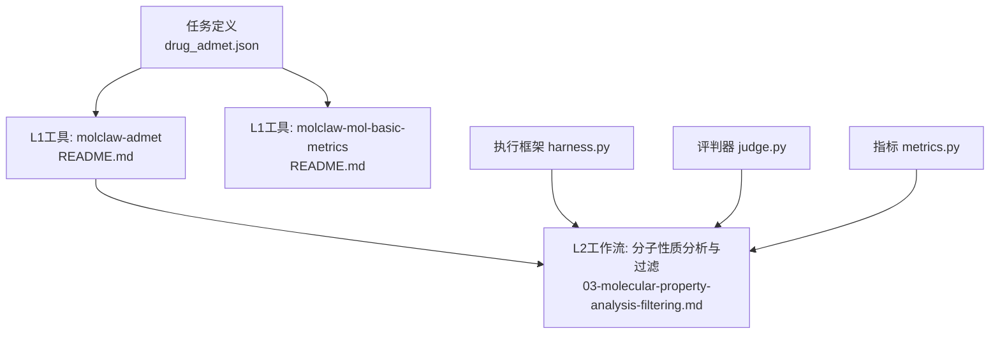
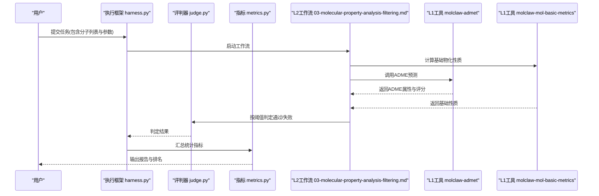
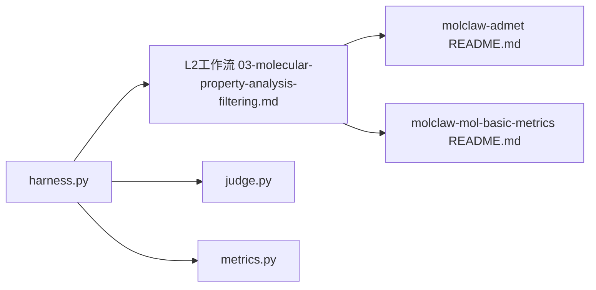

# ADME性质预测

<cite>
**本文引用的文件**   
- [autonomy_mvp/tasks/drug_admet.json](file://autonomy_mvp/tasks/drug_admet.json)
- [docs/molbench_repo/skills/L1_tools/molclaw-admet/README.md](file://docs/molbench_repo/skills/L1_tools/molclaw-admet/README.md)
- [docs/molbench_repo/skills/L1_tools/molclaw-mol-basic-metrics/README.md](file://docs/molbench_repo/skills/L1_tools/molclaw-mol-basic-metrics/README.md)
- [docs/molbench_repo/skills/L2_workflows/03-molecular-property-analysis-filtering.md](file://docs/molbench_repo/skills/L2_workflows/03-molecular-property-analysis-filtering.md)
- [autonomy_mvp/core/harness.py](file://autonomy_mvp/core/harness.py)
- [autonomy_mvp/core/judge.py](file://autonomy_mvp/core/judge.py)
- [autonomy_mvp/core/metrics.py](file://autonomy_mvp/core/metrics.py)
</cite>

## 目录
1. [简介](#简介)
2. [项目结构](#项目结构)
3. [核心组件](#核心组件)
4. [架构总览](#架构总览)
5. [详细组件分析](#详细组件分析)
6. [依赖关系分析](#依赖关系分析)
7. [性能考虑](#性能考虑)
8. [故障排查指南](#故障排查指南)
9. [结论](#结论)
10. [附录](#附录)

## 简介
本文件面向使用 molclaw-admet 工具进行药物候选分子 ADME（吸收、分布、代谢、排泄）性质预测与评估的读者，提供从计算方法、模型与评估标准到输入输出格式、参数设置、集成方式、性能优化与常见问题解决的完整说明。文档同时给出实际案例流程，帮助快速完成从分子列表到ADME筛选结果的端到端工作流。

## 项目结构
围绕ADME能力的相关资源主要分布在以下位置：
- 任务定义与示例数据：autonomy_mvp/tasks/drug_admet.json
- L1工具技能说明：docs/molbench_repo/skills/L1_tools/molclaw-admet/README.md
- 基础物化性质工具：docs/molbench_repo/skills/L1_tools/molclaw-mol-basic-metrics/README.md
- L2工作流编排：docs/molbench_repo/skills/L2_workflows/03-molecular-property-analysis-filtering.md
- 评测与执行框架：autonomy_mvp/core/harness.py、judge.py、metrics.py

图示来源
- [autonomy_mvp/tasks/drug_admet.json](file://autonomy_mvp/tasks/drug_admet.json)
- [docs/molbench_repo/skills/L1_tools/molclaw-admet/README.md](file://docs/molbench_repo/skills/L1_tools/molclaw-admet/README.md)
- [docs/molbench_repo/skills/L1_tools/molclaw-mol-basic-metrics/README.md](file://docs/molbench_repo/skills/L1_tools/molclaw-mol-basic-metrics/README.md)
- [docs/molbench_repo/skills/L2_workflows/03-molecular-property-analysis-filtering.md](file://docs/molbench_repo/skills/L2_workflows/03-molecular-property-analysis-filtering.md)
- [autonomy_mvp/core/harness.py](file://autonomy_mvp/core/harness.py)
- [autonomy_mvp/core/judge.py](file://autonomy_mvp/core/judge.py)
- [autonomy_mvp/core/metrics.py](file://autonomy_mvp/core/metrics.py)

章节来源
- [autonomy_mvp/tasks/drug_admet.json](file://autonomy_mvp/tasks/drug_admet.json)
- [docs/molbench_repo/skills/L1_tools/molclaw-admet/README.md](file://docs/molbench_repo/skills/L1_tools/molclaw-admet/README.md)
- [docs/molbench_repo/skills/L1_tools/molclaw-mol-basic-metrics/README.md](file://docs/molbench_repo/skills/L1_tools/molclaw-mol-basic-metrics/README.md)
- [docs/molbench_repo/skills/L2_workflows/03-molecular-property-analysis-filtering.md](file://docs/molbench_repo/skills/L2_workflows/03-molecular-property-analysis-filtering.md)
- [autonomy_mvp/core/harness.py](file://autonomy_mvp/core/harness.py)
- [autonomy_mvp/core/judge.py](file://autonomy_mvp/core/judge.py)
- [autonomy_mvp/core/metrics.py](file://autonomy_mvp/core/metrics.py)

## 核心组件
- molclaw-admet：用于计算与预测ADME相关性质的工具技能，提供标准化输入/输出接口与可配置参数。
- molclaw-mol-basic-metrics：计算分子基本物化性质（如分子量、LogP、HBA/HBD、TPSA等），常作为ADME前置或并行步骤。
- L2工作流“分子性质分析与过滤”：将多个L1工具串联，形成从SMILES/结构到ADME评分与筛选的流水线。
- 评测与执行框架：harness负责任务调度与结果收集；judge负责判定是否通过阈值；metrics提供统计与汇总指标。

章节来源
- [docs/molbench_repo/skills/L1_tools/molclaw-admet/README.md](file://docs/molbench_repo/skills/L1_tools/molclaw-admet/README.md)
- [docs/molbench_repo/skills/L1_tools/molclaw-mol-basic-metrics/README.md](file://docs/molbench_repo/skills/L1_tools/molclaw-mol-basic-metrics/README.md)
- [docs/molbench_repo/skills/L2_workflows/03-molecular-property-analysis-filtering.md](file://docs/molbench_repo/skills/L2_workflows/03-molecular-property-analysis-filtering.md)
- [autonomy_mvp/core/harness.py](file://autonomy_mvp/core/harness.py)
- [autonomy_mvp/core/judge.py](file://autonomy_mvp/core/judge.py)
- [autonomy_mvp/core/metrics.py](file://autonomy_mvp/core/metrics.py)

## 架构总览
下图展示了从任务定义到工具调用、再到结果评判与指标汇总的整体流程。

图示来源
- [autonomy_mvp/core/harness.py](file://autonomy_mvp/core/harness.py)
- [autonomy_mvp/core/judge.py](file://autonomy_mvp/core/judge.py)
- [autonomy_mvp/core/metrics.py](file://autonomy_mvp/core/metrics.py)
- [docs/molbench_repo/skills/L2_workflows/03-molecular-property-analysis-filtering.md](file://docs/molbench_repo/skills/L2_workflows/03-molecular-property-analysis-filtering.md)
- [docs/molbench_repo/skills/L1_tools/molclaw-admet/README.md](file://docs/molbench_repo/skills/L1_tools/molclaw-admet/README.md)
- [docs/molbench_repo/skills/L1_tools/molclaw-mol-basic-metrics/README.md](file://docs/molbench_repo/skills/L1_tools/molclaw-mol-basic-metrics/README.md)

## 详细组件分析

### 吸收(Absorption)
- 计算方法与常用指标
  - 肠道吸收通常以Caco-2渗透性、MDCK渗透性或人类口服生物利用度(FoB)为代理指标；也可结合LogP、分子量、氢键供体/受体数、拓扑极性表面积(TPSA)等经验规则进行初筛。
  - 常见经验规则包括Lipinski五规则、Veber规则等，用于判断口服可开发性。
- 预测模型
  - 基于QSAR或机器学习模型的分类/回归预测，输出概率或连续值，并附带置信度或不确定性估计。
- 评估标准
  - 分类任务：准确率、召回率、F1、ROC-AUC、PR-AUC。
  - 回归任务：MAE、RMSE、R²、Spearman/Pearson相关系数。
  - 阈值决策：根据业务目标设定吸收合格阈值（例如FoB≥30%）。

章节来源
- [docs/molbench_repo/skills/L1_tools/molclaw-admet/README.md](file://docs/molbench_repo/skills/L1_tools/molclaw-admet/README.md)
- [docs/molbench_repo/skills/L1_tools/molclaw-mol-basic-metrics/README.md](file://docs/molbench_repo/skills/L1_tools/molclaw-mol-basic-metrics/README.md)
- [docs/molbench_repo/skills/L2_workflows/03-molecular-property-analysis-filtering.md](file://docs/molbench_repo/skills/L2_workflows/03-molecular-property-analysis-filtering.md)

### 分布(Distribution)
- 计算方法与常用指标
  - 血浆蛋白结合率(PPB)、表观分布容积(Vd)、血脑屏障穿透(BBB)等。
  - 经验特征：LogD(pH 7.4)、电荷状态、TPSA、脂溶性/水溶性平衡。
- 预测模型
  - 针对PPB、Vd、BBB的QSAR/ML模型，输出百分比或类别标签，并提供区间估计。
- 评估标准
  - 分类：AUC、F1、校准曲线。
  - 回归：MAE/RMSE、相关性指标。
  - 临床相关性：与已知药物的分布特性对比，进行外部验证。

章节来源
- [docs/molbench_repo/skills/L1_tools/molclaw-admet/README.md](file://docs/molbench_repo/skills/L1_tools/molclaw-admet/README.md)
- [docs/molbench_repo/skills/L1_tools/molclaw-mol-basic-metrics/README.md](file://docs/molbench_repo/skills/L1_tools/molclaw-mol-basic-metrics/README.md)
- [docs/molbench_repo/skills/L2_workflows/03-molecular-property-analysis-filtering.md](file://docs/molbench_repo/skills/L2_workflows/03-molecular-property-analysis-filtering.md)

### 代谢(Metabolism)
- 计算方法与常用指标
  - 主要关注CYP450亚型抑制/诱导风险、代谢稳定性、I期/II相代谢位点预测。
  - 常用指标：IC50/Ki预测、抑制类别、代谢热点打分。
- 预测模型
  - 多任务学习或集成模型，对多种CYP亚型分别预测，支持批量处理。
- 评估标准
  - 分类：AUC、F1、混淆矩阵。
  - 回归：MAE/RMSE、误差分布分析。
  - 安全性阈值：抑制强度分级与风险等级划分。

章节来源
- [docs/molbench_repo/skills/L1_tools/molclaw-admet/README.md](file://docs/molbench_repo/skills/L1_tools/molclaw-admet/README.md)
- [docs/molbench_repo/skills/L1_tools/molclaw-mol-basic-metrics/README.md](file://docs/molbench_repo/skills/L1_tools/molclaw-mol-basic-metrics/README.md)
- [docs/molbench_repo/skills/L2_workflows/03-molecular-property-analysis-filtering.md](file://docs/molbench_repo/skills/L2_workflows/03-molecular-property-analysis-filtering.md)

### 排泄(Excretion)
- 计算方法与常用指标
  - 肾清除率、胆汁排泄比例、半衰期估算、转运体影响（如OATP、P-gp）。
  - 经验特征：分子大小、极性、离子化程度、脂溶性。
- 预测模型
  - QSAR/ML模型输出清除率或排泄途径概率，支持不确定性量化。
- 评估标准
  - 回归：MAE/RMSE、相关性。
  - 分类：排泄途径正确率、风险分层一致性。

章节来源
- [docs/molbench_repo/skills/L1_tools/molclaw-admet/README.md](file://docs/molbench_repo/skills/L1_tools/molclaw-admet/README.md)
- [docs/molbench_repo/skills/L1_tools/molclaw-mol-basic-metrics/README.md](file://docs/molbench_repo/skills/L1_tools/molclaw-mol-basic-metrics/README.md)
- [docs/molbench_repo/skills/L2_workflows/03-molecular-property-analysis-filtering.md](file://docs/molbench_repo/skills/L2_workflows/03-molecular-property-analysis-filtering.md)

### molclaw-admet 工具使用指南
- 关键参数设置
  - 输入源：SMILES字符串列表或结构化分子文件路径。
  - 预测目标：选择需要计算的ADME子项（如吸收、分布、代谢、排泄）。
  - 阈值与策略：为各子项设置通过/拒绝阈值，支持加权综合评分。
  - 并行与批大小：控制并发度与批次大小，提升吞吐。
  - 随机种子与版本：保证结果可复现。
- 输入数据格式要求
  - SMILES列名固定、无空值、字符集合法；必要时提供分子ID列以便追踪。
  - 可选字段：pH、盐形式、互变异构体枚举开关等。
- 输出结果解读
  - 每个分子对应一行记录，包含各ADME属性的预测值、置信区间、类别标签与综合评分。
  - 通过/失败标记由阈值判定生成，便于下游筛选与排序。
- 与molclaw-mol-basic-metrics集成
  - 在L2工作流中先运行基础性质计算，再传入admet模块，实现“基础性质→ADME评分→过滤”的流水线。

章节来源
- [docs/molbench_repo/skills/L1_tools/molclaw-admet/README.md](file://docs/molbench_repo/skills/L1_tools/molclaw-admet/README.md)
- [docs/molbench_repo/skills/L1_tools/molclaw-mol-basic-metrics/README.md](file://docs/molbench_repo/skills/L1_tools/molclaw-mol-basic-metrics/README.md)
- [docs/molbench_repo/skills/L2_workflows/03-molecular-property-analysis-filtering.md](file://docs/molbench_repo/skills/L2_workflows/03-molecular-property-analysis-filtering.md)

### 实际案例：药物候选分子的ADME性质评估流程
- 场景概述
  - 输入一批候选分子的SMILES，经过基础性质计算与ADME预测，得到综合评分与通过/失败判定，输出筛选后的分子清单与分析报告。
- 步骤要点
  - 准备数据：确保SMILES有效且唯一，必要时去重与标准化。
  - 配置参数：设置各ADME子项阈值与权重，确定并行度。
  - 执行工作流：调用L2工作流，自动编排基础性质与ADME预测。
  - 结果解析：查看每个分子的属性、置信度与判定结果，导出CSV/JSON。
  - 质量检查：核对缺失值、异常值与边界情况，必要时调整阈值。
- 参考文件
  - 任务定义与示例数据位于任务文件中，可作为模板修改。

章节来源
- [autonomy_mvp/tasks/drug_admet.json](file://autonomy_mvp/tasks/drug_admet.json)
- [docs/molbench_repo/skills/L2_workflows/03-molecular-property-analysis-filtering.md](file://docs/molbench_repo/skills/L2_workflows/03-molecular-property-analysis-filtering.md)

### 与分子基本性质计算工具的集成使用方法
- 集成方式
  - 在L2工作流中，先调用molclaw-mol-basic-metrics计算基础性质，再将结果作为上下文传递给molclaw-admet。
- 典型字段
  - 分子量、LogP、HBA/HBD、TPSA、芳香环数、旋转键数等，这些字段常用于ADME经验规则与阈值判定。
- 注意事项
  - 字段命名一致性与单位统一；缺失字段需回填默认值或跳过相应规则。

章节来源
- [docs/molbench_repo/skills/L1_tools/molclaw-mol-basic-metrics/README.md](file://docs/molbench_repo/skills/L1_tools/molclaw-mol-basic-metrics/README.md)
- [docs/molbench_repo/skills/L2_workflows/03-molecular-property-analysis-filtering.md](file://docs/molbench_repo/skills/L2_workflows/03-molecular-property-analysis-filtering.md)

## 依赖关系分析
- 组件耦合
  - L2工作流协调两个L1工具，形成松耦合的管道式架构。
  - 执行框架与评判器、指标模块解耦，便于替换与扩展。
- 外部依赖
  - 化学信息学库（用于SMILES解析与基础性质计算）、预测模型后端（本地或远程服务）。
- 潜在循环依赖
  - 当前设计为单向数据流，避免循环依赖。

图示来源
- [autonomy_mvp/core/harness.py](file://autonomy_mvp/core/harness.py)
- [autonomy_mvp/core/judge.py](file://autonomy_mvp/core/judge.py)
- [autonomy_mvp/core/metrics.py](file://autonomy_mvp/core/metrics.py)
- [docs/molbench_repo/skills/L2_workflows/03-molecular-property-analysis-filtering.md](file://docs/molbench_repo/skills/L2_workflows/03-molecular-property-analysis-filtering.md)
- [docs/molbench_repo/skills/L1_tools/molclaw-admet/README.md](file://docs/molbench_repo/skills/L1_tools/molclaw-admet/README.md)
- [docs/molbench_repo/skills/L1_tools/molclaw-mol-basic-metrics/README.md](file://docs/molbench_repo/skills/L1_tools/molclaw-mol-basic-metrics/README.md)

章节来源
- [autonomy_mvp/core/harness.py](file://autonomy_mvp/core/harness.py)
- [autonomy_mvp/core/judge.py](file://autonomy_mvp/core/judge.py)
- [autonomy_mvp/core/metrics.py](file://autonomy_mvp/core/metrics.py)
- [docs/molbench_repo/skills/L2_workflows/03-molecular-property-analysis-filtering.md](file://docs/molbench_repo/skills/L2_workflows/03-molecular-property-analysis-filtering.md)
- [docs/molbench_repo/skills/L1_tools/molclaw-admet/README.md](file://docs/molbench_repo/skills/L1_tools/molclaw-admet/README.md)
- [docs/molbench_repo/skills/L1_tools/molclaw-mol-basic-metrics/README.md](file://docs/molbench_repo/skills/L1_tools/molclaw-mol-basic-metrics/README.md)

## 性能考虑
- 批处理与并行
  - 合理设置批大小与并发度，避免内存溢出与I/O瓶颈。
- 缓存与复用
  - 对重复SMILES或相同参数组合启用缓存，减少重复计算。
- 模型加载与预热
  - 首次加载模型时进行预热，降低冷启动延迟。
- I/O优化
  - 使用高效序列化格式（如Parquet/JSON Lines），减少磁盘读写开销。
- 监控与限流
  - 监控CPU/GPU利用率、队列长度与错误率，动态调整资源。

[本节为通用指导，不直接分析具体文件]

## 故障排查指南
- 输入数据问题
  - SMILES无效或缺失：检查列名与格式，进行去重与标准化。
  - 单位不一致：确认LogP、TPSA等字段单位统一。
- 工具调用失败
  - 超时或连接错误：检查网络与服务可用性，增加重试与退避策略。
  - 内存不足：减小批大小或增加资源配额。
- 结果异常
  - 大量缺失或NaN：检查上游基础性质计算是否成功，补齐必要字段。
  - 阈值不合理：根据数据集分布重新校准阈值。
- 日志与定位
  - 开启详细日志，记录输入摘要、中间结果与错误堆栈，便于回溯。

章节来源
- [autonomy_mvp/core/judge.py](file://autonomy_mvp/core/judge.py)
- [autonomy_mvp/core/metrics.py](file://autonomy_mvp/core/metrics.py)
- [docs/molbench_repo/skills/L2_workflows/03-molecular-property-analysis-filtering.md](file://docs/molbench_repo/skills/L2_workflows/03-molecular-property-analysis-filtering.md)

## 结论
通过将molclaw-admet与molclaw-mol-basic-metrics整合进L2工作流，并结合执行框架与评判器，可实现高效、可扩展的ADME性质预测与筛选流水线。建议在实际项目中持续校准阈值与模型，完善监控与日志，以提升鲁棒性与可维护性。

[本节为总结性内容，不直接分析具体文件]

## 附录
- 术语表
  - ADME：吸收、分布、代谢、排泄。
  - QSAR：定量构效关系。
  - TPSA：拓扑极性表面积。
  - LogP/LogD：分配系数/分布系数。
- 参考文件
  - 任务定义与示例数据：[autonomy_mvp/tasks/drug_admet.json](file://autonomy_mvp/tasks/drug_admet.json)
  - L1工具说明：[docs/molbench_repo/skills/L1_tools/molclaw-admet/README.md](file://docs/molbench_repo/skills/L1_tools/molclaw-admet/README.md)、[docs/molbench_repo/skills/L1_tools/molclaw-mol-basic-metrics/README.md](file://docs/molbench_repo/skills/L1_tools/molclaw-mol-basic-metrics/README.md)
  - L2工作流：[docs/molbench_repo/skills/L2_workflows/03-molecular-property-analysis-filtering.md](file://docs/molbench_repo/skills/L2_workflows/03-molecular-property-analysis-filtering.md)
  - 执行与评判：[autonomy_mvp/core/harness.py](file://autonomy_mvp/core/harness.py)、[autonomy_mvp/core/judge.py](file://autonomy_mvp/core/judge.py)、[autonomy_mvp/core/metrics.py](file://autonomy_mvp/core/metrics.py)