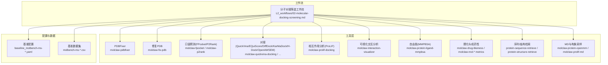
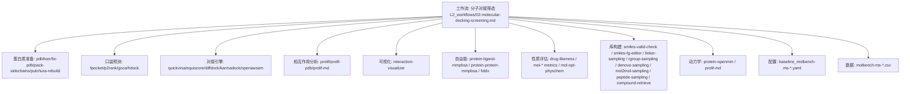
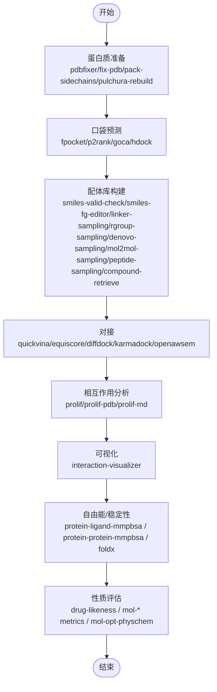
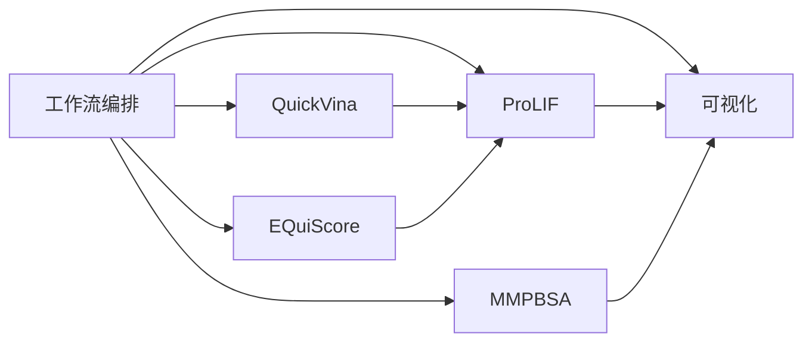

# 分子对接与筛选

<cite>
**本文引用的文件**   
- [docs/molbench_repo/skills/L2_workflows/02-molecular-docking-screening.md](file://docs/molbench_repo/skills/L2_workflows/02-molecular-docking-screening.md)
- [docs/molbench_repo/skills/L1_tools/molclaw-quickvina-docking/README.md](file://docs/molbench_repo/skills/L1_tools/molclaw-quickvina-docking/README.md)
- [docs/molbench_repo/skills/L1_tools/molclaw-prolif-docking/README.md](file://docs/molbench_repo/skills/L1_tools/molclaw-prolif-docking/README.md)
- [docs/molbench_repo/skills/L1_tools/molclaw-interaction-visualizer/README.md](file://docs/molbench_repo/skills/L1_tools/molclaw-interaction-visualizer/README.md)
- [docs/molbench_repo/skills/L1_tools/molclaw-fpocket-toolkit-base/README.md](file://docs/molbench_repo/skills/L1_tools/molclaw-fpocket-toolkit-base/README.md)
- [docs/molbench_repo/skills/L1_tools/molclaw-pdbfixer/README.md](file://docs/molbench_repo/skills/L1_tools/molclaw-pdbfixer/README.md)
- [docs/molbench_repo/skills/L1_tools/molclaw-fix-pdb/README.md](file://docs/molbench_repo/skills/L1_tools/molclaw-fix-pdb/README.md)
- [docs/molbench_repo/skills/L1_tools/molclaw-equiscore-docking/README.md](file://docs/molbench_repo/skills/L1_tools/molclaw-equiscore-docking/README.md)
- [docs/molbench_repo/skills/L1_tools/molclaw-protein-ligand-mmpbsa/README.md](file://docs/molbench_repo/skills/L1_tools/molclaw-protein-ligand-mmpbsa/README.md)
- [docs/molbench_repo/skills/L1_tools/molclaw-drug-likeness/README.md](file://docs/molbench_repo/skills/L1_tools/molclaw-drug-likeness/README.md)
- [docs/molbench_repo/skills/L1_tools/molclaw-mol-basic-metrics/README.md](file://docs/molbench_repo/skills/L1_tools/molclaw-mol-basic-metrics/README.md)
- [docs/molbench_repo/skills/L1_tools/molclaw-mol-hbond-metrics/README.md](file://docs/molbench_repo/skills/L1_tools/molclaw-mol-hbond-metrics/README.md)
- [docs/molbench_repo/skills/L1_tools/molclaw-mol-hydrophobicity-metrics/README.md](file://docs/molbench_repo/skills/L1_tools/molclaw-mol-hydrophobicity-metrics/README.md)
- [docs/molbench_repo/skills/L1_tools/molclaw-mol-similarity/README.md](file://docs/molbench_repo/skills/L1_tools/molclaw-mol-similarity/README.md)
- [docs/molbench_repo/skills/L1_tools/molclaw-mol-topology-metrics/README.md](file://docs/molbench_repo/skills/L1_tools/molclaw-mol-topology-metrics/README.md)
- [docs/molbench_repo/skills/L1_tools/molclaw-mol-structure-metrics/README.md](file://docs/molbench_repo/skills/L1_tools/molclaw-mol-structure-metrics/README.md)
- [docs/molbench_repo/skills/L1_tools/molclaw-mol-complexity-metrics/README.md](file://docs/molbench_repo/skills/L1_tools/molclaw-mol-complexity-metrics/README.md)
- [docs/molbench_repo/skills/L1_tools/molclaw-mol-opt-physchem/README.md](file://docs/molbench_repo/skills/L1_tools/molclaw-mol-opt-physchem/README.md)
- [docs/molbench_repo/skills/L1_tools/molclaw-mol-charge-metrics/README.md](file://docs/molbench_repo/skills/L1_tools/molclaw-mol-charge-metrics/README.md)
- [docs/molbench_repo/skills/L1_tools/molclaw-chroma-toolkit/README.md](file://docs/molbench_repo/skills/L1_tools/molclaw-chroma-toolkit/README.md)
- [docs/molbench_repo/skills/L1_tools/molclaw-smiles-valid-check/README.md](file://docs/molbench_repo/skills/L1_tools/molclaw-smiles-valid-check/README.md)
- [docs/molbench_repo/skills/L1_tools/molclaw-sequence-valid-check/README.md](file://docs/molbench_repo/skills/L1_tools/molclaw-sequence-valid-check/README.md)
- [docs/molbench_repo/skills/L1_tools/molclaw-extract-chains/README.md](file://docs/molbench_repo/skills/L1_tools/molclaw-extract-chains/README.md)
- [docs/molbench_repo/skills/L1_tools/molclaw-pack-sidechains/README.md](file://docs/molbench_repo/skills/L1_tools/molclaw-pack-sidechains/README.md)
- [docs/molbench_repo/skills/L1_tools/molclaw-p2rank/README.md](file://docs/molbench_repo/skills/L1_tools/molclaw-p2rank/README.md)
- [docs/molbench_repo/skills/L1_tools/molclaw-fpocket/README.md](file://docs/molbench_repo/skills/L1_tools/molclaw-fpocket/README.md)
- [docs/molbench_repo/skills/L1_tools/molclaw-goca-tool/README.md](file://docs/molbench_repo/skills/L1_tools/molclaw-goca-tool/README.md)
- [docs/molbench_repo/skills/L1_tools/molclaw-hdock-tool/README.md](file://docs/molbench_repo/skills/L1_tools/molclaw-hdock-tool/README.md)
- [docs/molbench_repo/skills/L1_tools/molclaw-karmadock-tool/README.md](file://docs/molbench_repo/skills/L1_tools/molclaw-karmadock-tool/README.md)
- [docs/molbench_repo/skills/L1_tools/molclaw-openawsem-tool/README.md](file://docs/molbench_repo/skills/L1_tools/molclaw-openawsem-tool/README.md)
- [docs/molbench_repo/skills/L1_tools/molclaw-prolif-tool/README.md](file://docs/molbench_repo/skills/L1_tools/molclaw-prolif-tool/README.md)
- [docs/molbench_repo/skills/L1_tools/molclaw-prolif-md/README.md](file://docs/molbench_repo/skills/L1_tools/molclaw-prolif-md/README.md)
- [docs/molbench_repo/skills/L1_tools/molclaw-prolif-pdb/README.md](file://docs/molbench_repo/skills/L1_tools/molclaw-prolif-pdb/README.md)
- [docs/molbench_repo/skills/L1_tools/molclaw-protein-protein-mmpbsa/README.md](file://docs/molbench_repo/skills/L1_tools/molclaw-protein-protein-mmpbsa/README.md)
- [docs/molbench_repo/skills/L1_tools/molclaw-protein-openmm/README.md](file://docs/molbench_repo/skills/L1_tools/molclaw-protein-openmm/README.md)
- [docs/molbench_repo/skills/L1_tools/molclaw-protein-sequence-retrieve/README.md](file://docs/molbench_repo/skills/L1_tools/molclaw-protein-sequence-retrieve/README.md)
- [docs/molbench_repo/skills/L1_tools/molclaw-protein-structure-retrieve/README.md](file://docs/molbench_repo/skills/L1_tools/molclaw-protein-structure-retrieve/README.md)
- [docs/molbench_repo/skills/L1_tools/molclaw-proteinmpnn-tool/README.md](file://docs/molbench_repo/skills/L1_tools/molclaw-proteinmpnn-tool/README.md)
- [docs/molbench_repo/skills/L1_tools/molclaw-pulchura-rebuild/README.md](file://docs/molbench_repo/skills/L1_tools/molclaw-pulchura-rebuild/README.md)
- [docs/molbench_repo/skills/L1_tools/molclaw-run-bioemu/README.md](file://docs/molbench_repo/skills/L1_tools/molclaw-run-bioemu/README.md)
- [docs/molbench_repo/skills/L1_tools/molclaw-scp-server/README.md](file://docs/molbench_repo/skills/L1_tools/molclaw-scp-server/README.md)
- [docs/molbench_repo/skills/L1_tools/molclaw-linker-sampling/README.md](file://docs/molbench_repo/skills/L1_tools/molclaw-linker-sampling/README.md)
- [docs/molbench_repo/skills/L1_tools/molclaw-rgroup-sampling/README.md](file://docs/molbench_repo/skills/L1_tools/molclaw-rgroup-sampling/README.md)
- [docs/molbench_repo/skills/L1_tools/molclaw-mol2mol-sampling/README.md](file://docs/molbench_repo/skills/L1_tools/molclaw-mol2mol-sampling/README.md)
- [docs/molbench_repo/skills/L1_tools/molclaw-peptide-sampling/README.md](file://docs/molbench_repo/skills/L1_tools/molclaw-peptide-sampling/README.md)
- [docs/molbench_repo/skills/L1_tools/molclaw-smiles-fg-editor/README.md](file://docs/molbench_repo/skills/L1_tools/molclaw-smiles-fg-editor/README.md)
- [docs/molbench_repo/skills/L1_tools/molclaw-diffdock-auto/README.md](file://docs/molbench_repo/skills/L1_tools/molclaw-diffdock-auto/README.md)
- [docs/molbench_repo/skills/L1_tools/molclaw-evobind-tool/README.md](file://docs/molbench_repo/skills/L1_tools/molclaw-evobind-tool/README.md)
- [docs/molbench_repo/skills/L1_tools/molclaw-equiscore-tool/README.md](file://docs/molbench_repo/skills/L1_tools/molclaw-equiscore-tool/README.md)
- [docs/molbench_repo/skills/L1_tools/molclaw-foldx-tool/README.md](file://docs/molbench_repo/skills/L1_tools/molclaw-foldx-tool/README.md)
- [docs/molbench_repo/skills/L1_tools/molclaw-chai1-predict/README.md](file://docs/molbench_repo/skills/L1_tools/molclaw-chai1-predict/README.md)
- [docs/molbench_repo/skills/L1_tools/molclaw-compound-retrieve/README.md](file://docs/molbench_repo/skills/L1_tools/molclaw-compound-retrieve/README.md)
- [docs/molbench_repo/skills/L1_tools/molclaw-denovo-sampling/README.md](file://docs/molbench_repo/skills/L1_tools/molclaw-denovo-sampling/README.md)
- [docs/molbench_repo/skills/L1_tools/molclaw-boltz2-affinity/README.md](file://docs/molbench_repo/skills/L1_tools/molclaw-boltz2-affinity/README.md)
- [docs/molbench_repo/skills/L1_tools/molclaw-esmfold/README.md](file://docs/molbench_repo/skills/L1_tools/molclaw-esmfold/README.md)
- [docs/molbench_repo/skills/L1_tools/molclaw-file-transfer/README.md](file://docs/molbench_repo/skills/L1_tools/molclaw-file-transfer/README.md)
- [docs/molbench_repo/skills/L1_tools/molclaw-skill-template-writer/README.md](file://docs/molbench_repo/skills/L1_tools/molclaw-skill-template-writer/README.md)
- [docs/molbench_repo/skills/L3_methodology/README.md](file://docs/molbench_repo/skills/L3_methodology/README.md)
- [docs/molbench_repo/config/baseline_molbench-ms-1.yaml](file://docs/molbench_repo/config/baseline_molbench-ms-1.yaml)
- [docs/molbench_repo/config/baseline_molbench-ms-2.yaml](file://docs/molbench_repo/config/baseline_molbench-ms-2.yaml)
- [docs/molbench_repo/config/baseline_molbench-ms-3.yaml](file://docs/molbench_repo/config/baseline_molbench-ms-3.yaml)
- [docs/molbench_repo/data_full/molbench-ms-1/molbench-ms-1.csv](file://docs/molbench_repo/data_full/molbench-ms-1/molbench-ms-1.csv)
- [docs/molbench_repo/data_full/molbench-ms-2/molbench-ms-2.csv](file://docs/molbench_repo/data_full/molbench-ms-2/molbench-ms-2.csv)
- [docs/molbench_repo/data_full/molbench-ms-3/molbench-ms-3.csv](file://docs/molbench_repo/data_full/molbench-ms-3/molbench-ms-3.csv)
- [longhorizon/instantiate/instances/drug2_BACE1.json](file://longhorizon/instantiate/instances/drug2_BACE1.json)
</cite>

## 目录
1. [简介](#简介)
2. [项目结构](#项目结构)
3. [核心组件](#核心组件)
4. [架构总览](#架构总览)
5. [详细组件分析](#详细组件分析)
6. [依赖关系分析](#依赖关系分析)
7. [性能考虑](#性能考虑)
8. [故障排查指南](#故障排查指南)
9. [结论](#结论)
10. [附录](#附录)

## 简介
本文件围绕“分子对接与筛选”主题，系统阐述对接基本原理、算法选择与评分函数设计，给出从蛋白质准备、配体库构建、对接参数优化到结果分析的完整工作流。结合仓库中提供的技能与工具链（如 QuickVina、ProLIF、EQuiScore、MMPBSA、P2Rank/FPocket、OpenMM 等），并以 BACE1 抑制剂设计为例，展示端到端流程。文档同时提供可视化分析与亲和力评估方法、大规模筛选的性能调优策略与最佳实践。

## 项目结构
本项目在 docs/molbench_repo 下以“技能（skills）+ 工作流（workflows）+ 配置（config）+ 数据（data_full）”组织对接与筛选相关能力：
- L2_workflows：高层级工作流编排，包含“分子对接筛选”等步骤化流程说明
- L1_tools：原子化工具技能，覆盖蛋白准备、口袋预测、对接引擎、相互作用分析、自由能计算、性质评估、采样生成等
- config：基准与任务配置文件，定义数据集、指标与运行参数
- data_full：对接筛选基准数据集（CSV）

图表来源
- [docs/molbench_repo/skills/L2_workflows/02-molecular-docking-screening.md](file://docs/molbench_repo/skills/L2_workflows/02-molecular-docking-screening.md)
- [docs/molbench_repo/skills/L1_tools/molclaw-quickvina-docking/README.md](file://docs/molbench_repo/skills/L1_tools/molclaw-quickvina-docking/README.md)
- [docs/molbench_repo/skills/L1_tools/molclaw-prolif-docking/README.md](file://docs/molbench_repo/skills/L1_tools/molclaw-prolif-docking/README.md)
- [docs/molbench_repo/skills/L1_tools/molclaw-interaction-visualizer/README.md](file://docs/molbench_repo/skills/L1_tools/molclaw-interaction-visualizer/README.md)
- [docs/molbench_repo/skills/L1_tools/molclaw-fpocket-toolkit-base/README.md](file://docs/molbench_repo/skills/L1_tools/molclaw-fpocket-toolkit-base/README.md)
- [docs/molbench_repo/skills/L1_tools/molclaw-p2rank/README.md](file://docs/molbench_repo/skills/L1_tools/molclaw-p2rank/README.md)
- [docs/molbench_repo/skills/L1_tools/molclaw-equiscore-docking/README.md](file://docs/molbench_repo/skills/L1_tools/molclaw-equiscore-docking/README.md)
- [docs/molbench_repo/skills/L1_tools/molclaw-protein-ligand-mmpbsa/README.md](file://docs/molbench_repo/skills/L1_tools/molclaw-protein-ligand-mmpbsa/README.md)
- [docs/molbench_repo/skills/L1_tools/molclaw-drug-likeness/README.md](file://docs/molbench_repo/skills/L1_tools/molclaw-drug-likeness/README.md)
- [docs/molbench_repo/skills/L1_tools/molclaw-mol-basic-metrics/README.md](file://docs/molbench_repo/skills/L1_tools/molclaw-mol-basic-metrics/README.md)
- [docs/molbench_repo/skills/L1_tools/molclaw-mol-hbond-metrics/README.md](file://docs/molbench_repo/skills/L1_tools/molclaw-mol-hbond-metrics/README.md)
- [docs/molbench_repo/skills/L1_tools/molclaw-mol-hydrophobicity-metrics/README.md](file://docs/molbench_repo/skills/L1_tools/molclaw-mol-hydrophobicity-metrics/README.md)
- [docs/molbench_repo/skills/L1_tools/molclaw-mol-similarity/README.md](file://docs/molbench_repo/skills/L1_tools/molclaw-mol-similarity/README.md)
- [docs/molbench_repo/skills/L1_tools/molclaw-mol-topology-metrics/README.md](file://docs/molbench_repo/skills/L1_tools/molclaw-mol-topology-metrics/README.md)
- [docs/molbench_repo/skills/L1_tools/molclaw-mol-structure-metrics/README.md](file://docs/molbench_repo/skills/L1_tools/molclaw-mol-structure-metrics/README.md)
- [docs/molbench_repo/skills/L1_tools/molclaw-mol-complexity-metrics/README.md](file://docs/molbench_repo/skills/L1_tools/molclaw-mol-complexity-metrics/README.md)
- [docs/molbench_repo/skills/L1_tools/molclaw-mol-opt-physchem/README.md](file://docs/molbench_repo/skills/L1_tools/molclaw-mol-opt-physchem/README.md)
- [docs/molbench_repo/skills/L1_tools/molclaw-mol-charge-metrics/README.md](file://docs/molbench_repo/skills/L1_tools/molclaw-mol-charge-metrics/README.md)
- [docs/molbench_repo/skills/L1_tools/molclaw-chroma-toolkit/README.md](file://docs/molbench_repo/skills/L1_tools/molclaw-chroma-toolkit/README.md)
- [docs/molbench_repo/skills/L1_tools/molclaw-smiles-valid-check/README.md](file://docs/molbench_repo/skills/L1_tools/molclaw-smiles-valid-check/README.md)
- [docs/molbench_repo/skills/L1_tools/molclaw-sequence-valid-check/README.md](file://docs/molbench_repo/skills/L1_tools/molclaw-sequence-valid-check/README.md)
- [docs/molbench_repo/skills/L1_tools/molclaw-extract-chains/README.md](file://docs/molbench_repo/skills/L1_tools/molclaw-extract-chains/README.md)
- [docs/molbench_repo/skills/L1_tools/molclaw-pack-sidechains/README.md](file://docs/molbench_repo/skills/L1_tools/molclaw-pack-sidechains/README.md)
- [docs/molbench_repo/skills/L1_tools/molclaw-fpocket/README.md](file://docs/molbench_repo/skills/L1_tools/molclaw-fpocket/README.md)
- [docs/molbench_repo/skills/L1_tools/molclaw-hdock-tool/README.md](file://docs/molbench_repo/skills/L1_tools/molclaw-hdock-tool/README.md)
- [docs/molbench_repo/skills/L1_tools/molclaw-karmadock-tool/README.md](file://docs/molbench_repo/skills/L1_tools/molclaw-karmadock-tool/README.md)
- [docs/molbench_repo/skills/L1_tools/molclaw-openawsem-tool/README.md](file://docs/molbench_repo/skills/L1_tools/molclaw-openawsem-tool/README.md)
- [docs/molbench_repo/skills/L1_tools/molclaw-prolif-tool/README.md](file://docs/molbench_repo/skills/L1_tools/molclaw-prolif-tool/README.md)
- [docs/molbench_repo/skills/L1_tools/molclaw-prolif-md/README.md](file://docs/molbench_repo/skills/L1_tools/molclaw-prolif-md/README.md)
- [docs/molbench_repo/skills/L1_tools/molclaw-prolif-pdb/README.md](file://docs/molbench_repo/skills/L1_tools/molclaw-prolif-pdb/README.md)
- [docs/molbench_repo/skills/L1_tools/molclaw-protein-openmm/README.md](file://docs/molbench_repo/skills/L1_tools/molclaw-protein-openmm/README.md)
- [docs/molbench_repo/skills/L1_tools/molclaw-protein-sequence-retrieve/README.md](file://docs/molbench_repo/skills/L1_tools/molclaw-protein-sequence-retrieve/README.md)
- [docs/molbench_repo/skills/L1_tools/molclaw-protein-structure-retrieve/README.md](file://docs/molbench_repo/skills/L1_tools/molclaw-protein-structure-retrieve/README.md)
- [docs/molbench_repo/skills/L1_tools/molclaw-proteinmpnn-tool/README.md](file://docs/molbench_repo/skills/L1_tools/molclaw-proteinmpnn-tool/README.md)
- [docs/molbench_repo/skills/L1_tools/molclaw-pulchura-rebuild/README.md](file://docs/molbench_repo/skills/L1_tools/molclaw-pulchura-rebuild/README.md)
- [docs/molbench_repo/skills/L1_tools/molclaw-run-bioemu/README.md](file://docs/molbench_repo/skills/L1_tools/molclaw-run-bioemu/README.md)
- [docs/molbench_repo/skills/L1_tools/molclaw-linker-sampling/README.md](file://docs/molbench_repo/skills/L1_tools/molclaw-linker-sampling/README.md)
- [docs/molbench_repo/skills/L1_tools/molclaw-rgroup-sampling/README.md](file://docs/molbench_repo/skills/L1_tools/molclaw-rgroup-sampling/README.md)
- [docs/molbench_repo/skills/L1_tools/molclaw-mol2mol-sampling/README.md](file://docs/molbench_repo/skills/L1_tools/molclaw-mol2mol-sampling/README.md)
- [docs/molbench_repo/skills/L1_tools/molclaw-peptide-sampling/README.md](file://docs/molbench_repo/skills/L1_tools/molclaw-peptide-sampling/README.md)
- [docs/molbench_repo/skills/L1_tools/molclaw-smiles-fg-editor/README.md](file://docs/molbench_repo/skills/L1_tools/molclaw-smiles-fg-editor/README.md)
- [docs/molbench_repo/skills/L1_tools/molclaw-diffdock-auto/README.md](file://docs/molbench_repo/skills/L1_tools/molclaw-diffdock-auto/README.md)
- [docs/molbench_repo/skills/L1_tools/molclaw-evobind-tool/README.md](file://docs/molbench_repo/skills/L1_tools/molclaw-evobind-tool/README.md)
- [docs/molbench_repo/skills/L1_tools/molclaw-equiscore-tool/README.md](file://docs/molbench_repo/skills/L1_tools/molclaw-equiscore-tool/README.md)
- [docs/molbench_repo/skills/L1_tools/molclaw-foldx-tool/README.md](file://docs/molbench_repo/skills/L1_tools/molclaw-foldx-tool/README.md)
- [docs/molbench_repo/skills/L1_tools/molclaw-chai1-predict/README.md](file://docs/molbench_repo/skills/L1_tools/molclaw-chai1-predict/README.md)
- [docs/molbench_repo/skills/L1_tools/molclaw-compound-retrieve/README.md](file://docs/molbench_repo/skills/L1_tools/molclaw-compound-retrieve/README.md)
- [docs/molbench_repo/skills/L1_tools/molclaw-denovo-sampling/README.md](file://docs/molbench_repo/skills/L1_tools/molclaw-denovo-sampling/README.md)
- [docs/molbench_repo/skills/L1_tools/molclaw-boltz2-affinity/README.md](file://docs/molbench_repo/skills/L1_tools/molclaw-boltz2-affinity/README.md)
- [docs/molbench_repo/skills/L1_tools/molclaw-esmfold/README.md](file://docs/molbench_repo/skills/L1_tools/molclaw-esmfold/README.md)
- [docs/molbench_repo/skills/L1_tools/molclaw-file-transfer/README.md](file://docs/molbench_repo/skills/L1_tools/molclaw-file-transfer/README.md)
- [docs/molbench_repo/skills/L1_tools/molclaw-skill-template-writer/README.md](file://docs/molbench_repo/skills/L1_tools/molclaw-skill-template-writer/README.md)
- [docs/molbench_repo/config/baseline_molbench-ms-1.yaml](file://docs/molbench_repo/config/baseline_molbench-ms-1.yaml)
- [docs/molbench_repo/config/baseline_molbench-ms-2.yaml](file://docs/molbench_repo/config/baseline_molbench-ms-2.yaml)
- [docs/molbench_repo/config/baseline_molbench-ms-3.yaml](file://docs/molbench_repo/config/baseline_molbench-ms-3.yaml)
- [docs/molbench_repo/data_full/molbench-ms-1/molbench-ms-1.csv](file://docs/molbench_repo/data_full/molbench-ms-1/molbench-ms-1.csv)
- [docs/molbench_repo/data_full/molbench-ms-2/molbench-ms-2.csv](file://docs/molbench_repo/data_full/molbench-ms-2/molbench-ms-2.csv)
- [docs/molbench_repo/data_full/molbench-ms-3/molbench-ms-3.csv](file://docs/molbench_repo/data_full/molbench-ms-3/molbench-ms-3.csv)

章节来源
- [docs/molbench_repo/skills/L2_workflows/02-molecular-docking-screening.md](file://docs/molbench_repo/skills/L2_workflows/02-molecular-docking-screening.md)
- [docs/molbench_repo/skills/L1_tools/molclaw-quickvina-docking/README.md](file://docs/molbench_repo/skills/L1_tools/molclaw-quickvina-docking/README.md)
- [docs/molbench_repo/skills/L1_tools/molclaw-prolif-docking/README.md](file://docs/molbench_repo/skills/L1_tools/molclaw-prolif-docking/README.md)
- [docs/molbench_repo/skills/L1_tools/molclaw-interaction-visualizer/README.md](file://docs/molbench_repo/skills/L1_tools/molclaw-interaction-visualizer/README.md)
- [docs/molbench_repo/skills/L1_tools/molclaw-fpocket-toolkit-base/README.md](file://docs/molbench_repo/skills/L1_tools/molclaw-fpocket-toolkit-base/README.md)
- [docs/molbench_repo/skills/L1_tools/molclaw-p2rank/README.md](file://docs/molbench_repo/skills/L1_tools/molclaw-p2rank/README.md)
- [docs/molbench_repo/skills/L1_tools/molclaw-equiscore-docking/README.md](file://docs/molbench_repo/skills/L1_tools/molclaw-equiscore-docking/README.md)
- [docs/molbench_repo/skills/L1_tools/molclaw-protein-ligand-mmpbsa/README.md](file://docs/molbench_repo/skills/L1_tools/molclaw-protein-ligand-mmpbsa/README.md)
- [docs/molbench_repo/skills/L1_tools/molclaw-drug-likeness/README.md](file://docs/molbench_repo/skills/L1_tools/molclaw-drug-likeness/README.md)
- [docs/molbench_repo/skills/L1_tools/molclaw-mol-basic-metrics/README.md](file://docs/molbench_repo/skills/L1_tools/molclaw-mol-basic-metrics/README.md)
- [docs/molbench_repo/skills/L1_tools/molclaw-mol-hbond-metrics/README.md](file://docs/molbench_repo/skills/L1_tools/molclaw-mol-hbond-metrics/README.md)
- [docs/molbench_repo/skills/L1_tools/molclaw-mol-hydrophobicity-metrics/README.md](file://docs/molbench_repo/skills/L1_tools/molclaw-mol-hydrophobicity-metrics/README.md)
- [docs/molbench_repo/skills/L1_tools/molclaw-mol-similarity/README.md](file://docs/molbench_repo/skills/L1_tools/molclaw-mol-similarity/README.md)
- [docs/molbench_repo/skills/L1_tools/molclaw-mol-topology-metrics/README.md](file://docs/molbench_repo/skills/L1_tools/molclaw-mol-topology-metrics/README.md)
- [docs/molbench_repo/skills/L1_tools/molclaw-mol-structure-metrics/README.md](file://docs/molbench_repo/skills/L1_tools/molclaw-mol-structure-metrics/README.md)
- [docs/molbench_repo/skills/L1_tools/molclaw-mol-complexity-metrics/README.md](file://docs/molbench_repo/skills/L1_tools/molclaw-mol-complexity-metrics/README.md)
- [docs/molbench_repo/skills/L1_tools/molclaw-mol-opt-physchem/README.md](file://docs/molbench_repo/skills/L1_tools/molclaw-mol-opt-physchem/README.md)
- [docs/molbench_repo/skills/L1_tools/molclaw-mol-charge-metrics/README.md](file://docs/molbench_repo/skills/L1_tools/molclaw-mol-charge-metrics/README.md)
- [docs/molbench_repo/skills/L1_tools/molclaw-chroma-toolkit/README.md](file://docs/molbench_repo/skills/L1_tools/molclaw-chroma-toolkit/README.md)
- [docs/molbench_repo/skills/L1_tools/molclaw-smiles-valid-check/README.md](file://docs/molbench_repo/skills/L1_tools/molclaw-smiles-valid-check/README.md)
- [docs/molbench_repo/skills/L1_tools/molclaw-sequence-valid-check/README.md](file://docs/molbench_repo/skills/L1_tools/molclaw-sequence-valid-check/README.md)
- [docs/molbench_repo/skills/L1_tools/molclaw-extract-chains/README.md](file://docs/molbench_repo/skills/L1_tools/molclaw-extract-chains/README.md)
- [docs/molbench_repo/skills/L1_tools/molclaw-pack-sidechains/README.md](file://docs/molbench_repo/skills/L1_tools/molclaw-pack-sidechains/README.md)
- [docs/molbench_repo/skills/L1_tools/molclaw-fpocket/README.md](file://docs/molbench_repo/skills/L1_tools/molclaw-fpocket/README.md)
- [docs/molbench_repo/skills/L1_tools/molclaw-hdock-tool/README.md](file://docs/molbench_repo/skills/L1_tools/molclaw-hdock-tool/README.md)
- [docs/molbench_repo/skills/L1_tools/molclaw-karmadock-tool/README.md](file://docs/molbench_repo/skills/L1_tools/molclaw-karmadock-tool/README.md)
- [docs/molbench_repo/skills/L1_tools/molclaw-openawsem-tool/README.md](file://docs/molbench_repo/skills/L1_tools/molclaw-openawsem-tool/README.md)
- [docs/molbench_repo/skills/L1_tools/molclaw-prolif-tool/README.md](file://docs/molbench_repo/skills/L1_tools/molclaw-prolif-tool/README.md)
- [docs/molbench_repo/skills/L1_tools/molclaw-prolif-md/README.md](file://docs/molbench_repo/skills/L1_tools/molclaw-prolif-md/README.md)
- [docs/molbench_repo/skills/L1_tools/molclaw-prolif-pdb/README.md](file://docs/molbench_repo/skills/L1_tools/molclaw-prolif-pdb/README.md)
- [docs/molbench_repo/skills/L1_tools/molclaw-protein-openmm/README.md](file://docs/molbench_repo/skills/L1_tools/molclaw-protein-openmm/README.md)
- [docs/molbench_repo/skills/L1_tools/molclaw-protein-sequence-retrieve/README.md](file://docs/molbench_repo/skills/L1_tools/molclaw-protein-sequence-retrieve/README.md)
- [docs/molbench_repo/skills/L1_tools/molclaw-protein-structure-retrieve/README.md](file://docs/molbench_repo/skills/L1_tools/molclaw-protein-structure-retrieve/README.md)
- [docs/molbench_repo/skills/L1_tools/molclaw-proteinmpnn-tool/README.md](file://docs/molbench_repo/skills/L1_tools/molclaw-proteinmpnn-tool/README.md)
- [docs/molbench_repo/skills/L1_tools/molclaw-pulchura-rebuild/README.md](file://docs/molbench_repo/skills/L1_tools/molclaw-pulchura-rebuild/README.md)
- [docs/molbench_repo/skills/L1_tools/molclaw-run-bioemu/README.md](file://docs/molbench_repo/skills/L1_tools/molclaw-run-bioemu/README.md)
- [docs/molbench_repo/skills/L1_tools/molclaw-linker-sampling/README.md](file://docs/molbench_repo/skills/L1_tools/molclaw-linker-sampling/README.md)
- [docs/molbench_repo/skills/L1_tools/molclaw-rgroup-sampling/README.md](file://docs/molbench_repo/skills/L1_tools/molclaw-rgroup-sampling/README.md)
- [docs/molbench_repo/skills/L1_tools/molclaw-mol2mol-sampling/README.md](file://docs/molbench_repo/skills/L1_tools/molclaw-mol2mol-sampling/README.md)
- [docs/molbench_repo/skills/L1_tools/molclaw-peptide-sampling/README.md](file://docs/molbench_repo/skills/L1_tools/molclaw-peptide-sampling/README.md)
- [docs/molbench_repo/skills/L1_tools/molclaw-smiles-fg-editor/README.md](file://docs/molbench_repo/skills/L1_tools/molclaw-smiles-fg-editor/README.md)
- [docs/molbench_repo/skills/L1_tools/molclaw-diffdock-auto/README.md](file://docs/molbench_repo/skills/L1_tools/molclaw-diffdock-auto/README.md)
- [docs/molbench_repo/skills/L1_tools/molclaw-evobind-tool/README.md](file://docs/molbench_repo/skills/L1_tools/molclaw-evobind-tool/README.md)
- [docs/molbench_repo/skills/L1_tools/molclaw-equiscore-tool/README.md](file://docs/molbench_repo/skills/L1_tools/molclaw-equiscore-tool/README.md)
- [docs/molbench_repo/skills/L1_tools/molclaw-foldx-tool/README.md](file://docs/molbench_repo/skills/L1_tools/molclaw-foldx-tool/README.md)
- [docs/molbench_repo/skills/L1_tools/molclaw-chai1-predict/README.md](file://docs/molbench_repo/skills/L1_tools/molclaw-chai1-predict/README.md)
- [docs/molbench_repo/skills/L1_tools/molclaw-compound-retrieve/README.md](file://docs/molbench_repo/skills/L1_tools/molclaw-compound-retrieve/README.md)
- [docs/molbench_repo/skills/L1_tools/molclaw-denovo-sampling/README.md](file://docs/molbench_repo/skills/L1_tools/molclaw-denovo-sampling/README.md)
- [docs/molbench_repo/skills/L1_tools/molclaw-boltz2-affinity/README.md](file://docs/molbench_repo/skills/L1_tools/molclaw-boltz2-affinity/README.md)
- [docs/molbench_repo/skills/L1_tools/molclaw-esmfold/README.md](file://docs/molbench_repo/skills/L1_tools/molclaw-esmfold/README.md)
- [docs/molbench_repo/skills/L1_tools/molclaw-file-transfer/README.md](file://docs/molbench_repo/skills/L1_tools/molclaw-file-transfer/README.md)
- [docs/molbench_repo/skills/L1_tools/molclaw-skill-template-writer/README.md](file://docs/molbench_repo/skills/L1_tools/molclaw-skill-template-writer/README.md)
- [docs/molbench_repo/config/baseline_molbench-ms-1.yaml](file://docs/molbench_repo/config/baseline_molbench-ms-1.yaml)
- [docs/molbench_repo/config/baseline_molbench-ms-2.yaml](file://docs/molbench_repo/config/baseline_molbench-ms-2.yaml)
- [docs/molbench_repo/config/baseline_molbench-ms-3.yaml](file://docs/molbench_repo/config/baseline_molbench-ms-3.yaml)
- [docs/molbench_repo/data_full/molbench-ms-1/molbench-ms-1.csv](file://docs/molbench_repo/data_full/molbench-ms-1/molbench-ms-1.csv)
- [docs/molbench_repo/data_full/molbench-ms-2/molbench-ms-2.csv](file://docs/molbench_repo/data_full/molbench-ms-2/molbench-ms-2.csv)
- [docs/molbench_repo/data_full/molbench-ms-3/molbench-ms-3.csv](file://docs/molbench_repo/data_full/molbench-ms-3/molbench-ms-3.csv)

## 核心组件
- 蛋白质准备
  - 序列/结构获取：protein-sequence-retrieve、protein-structure-retrieve
  - 结构修复与加氢：pdbfixer、fix-pdb
  - 侧链重排与重建：pack-sidechains、pulchura-rebuild
- 口袋预测与定位
  - FPocket 工具包基础：fpocket-toolkit-base、fpocket
  - P2Rank 位点打分：p2rank
  - GOCA/H-Dock 辅助：goca-tool、hdock-tool
- 对接引擎与采样
  - QuickVina：quickvina-docking
  - EQuiScore：equiscore-docking、equiscore-tool
  - DiffDock Auto：diffdock-auto
  - KarMaDock：karmadock-tool
  - OpenAWSEM：openawsem-tool
- 相互作用分析与可视化
  - ProLIF 对接分析：prolif-docking、prolif-tool、prolif-pdb、prolif-md
  - 可视化交互：interaction-visualizer
- 自由能与稳定性评估
  - 蛋白-配体 MMPBSA：protein-ligand-mmpbsa
  - 蛋白-蛋白 MMPBSA：protein-protein-mmpbsa
  - FoldX 稳定性：foldx-tool
- 理化性质与成药性
  - 成药性：drug-likeness
  - 基本/拓扑/结构/复杂度/电荷/氢键/疏水性/物化优化：mol-* metrics、mol-opt-physchem
- 化合物库与生成
  - SMILES 校验与编辑：smiles-valid-check、smiles-fg-editor
  - 片段/连接子/R基团/多肽/去 novo 采样：linker-sampling、rgroup-sampling、peptide-sampling、denovo-sampling、mol2mol-sampling
  - 化合物检索：compound-retrieve
- 动力学与构象采样
  - OpenMM：protein-openmm
  - ProLIF-MD：prolif-md
- 其他支撑
  - 文件传输：file-transfer
  - 模板与编排：skill-template-writer
  - 序列有效性检查：sequence-valid-check
  - 结构预测/生成：chai1-predict、esmfold、run-bioemu

章节来源
- [docs/molbench_repo/skills/L1_tools/molclaw-protein-sequence-retrieve/README.md](file://docs/molbench_repo/skills/L1_tools/molclaw-protein-sequence-retrieve/README.md)
- [docs/molbench_repo/skills/L1_tools/molclaw-protein-structure-retrieve/README.md](file://docs/molbench_repo/skills/L1_tools/molclaw-protein-structure-retrieve/README.md)
- [docs/molbench_repo/skills/L1_tools/molclaw-pdbfixer/README.md](file://docs/molbench_repo/skills/L1_tools/molclaw-pdbfixer/README.md)
- [docs/molbench_repo/skills/L1_tools/molclaw-fix-pdb/README.md](file://docs/molbench_repo/skills/L1_tools/molclaw-fix-pdb/README.md)
- [docs/molbench_repo/skills/L1_tools/molclaw-pack-sidechains/README.md](file://docs/molbench_repo/skills/L1_tools/molclaw-pack-sidechains/README.md)
- [docs/molbench_repo/skills/L1_tools/molclaw-pulchura-rebuild/README.md](file://docs/molbench_repo/skills/L1_tools/molclaw-pulchura-rebuild/README.md)
- [docs/molbench_repo/skills/L1_tools/molclaw-fpocket-toolkit-base/README.md](file://docs/molbench_repo/skills/L1_tools/molclaw-fpocket-toolkit-base/README.md)
- [docs/molbench_repo/skills/L1_tools/molclaw-fpocket/README.md](file://docs/molbench_repo/skills/L1_tools/molclaw-fpocket/README.md)
- [docs/molbench_repo/skills/L1_tools/molclaw-p2rank/README.md](file://docs/molbench_repo/skills/L1_tools/molclaw-p2rank/README.md)
- [docs/molbench_repo/skills/L1_tools/molclaw-goca-tool/README.md](file://docs/molbench_repo/skills/L1_tools/molclaw-goca-tool/README.md)
- [docs/molbench_repo/skills/L1_tools/molclaw-hdock-tool/README.md](file://docs/molbench_repo/skills/L1_tools/molclaw-hdock-tool/README.md)
- [docs/molbench_repo/skills/L1_tools/molclaw-quickvina-docking/README.md](file://docs/molbench_repo/skills/L1_tools/molclaw-quickvina-docking/README.md)
- [docs/molbench_repo/skills/L1_tools/molclaw-equiscore-docking/README.md](file://docs/molbench_repo/skills/L1_tools/molclaw-equiscore-docking/README.md)
- [docs/molbench_repo/skills/L1_tools/molclaw-equiscore-tool/README.md](file://docs/molbench_repo/skills/L1_tools/molclaw-equiscore-tool/README.md)
- [docs/molbench_repo/skills/L1_tools/molclaw-diffdock-auto/README.md](file://docs/molbench_repo/skills/L1_tools/molclaw-diffdock-auto/README.md)
- [docs/molbench_repo/skills/L1_tools/molclaw-karmadock-tool/README.md](file://docs/molbench_repo/skills/L1_tools/molclaw-karmadock-tool/README.md)
- [docs/molbench_repo/skills/L1_tools/molclaw-openawsem-tool/README.md](file://docs/molbench_repo/skills/L1_tools/molclaw-openawsem-tool/README.md)
- [docs/molbench_repo/skills/L1_tools/molclaw-prolif-docking/README.md](file://docs/molbench_repo/skills/L1_tools/molclaw-prolif-docking/README.md)
- [docs/molbench_repo/skills/L1_tools/molclaw-prolif-tool/README.md](file://docs/molbench_repo/skills/L1_tools/molclaw-prolif-tool/README.md)
- [docs/molbench_repo/skills/L1_tools/molclaw-prolif-pdb/README.md](file://docs/molbench_repo/skills/L1_tools/molclaw-prolif-pdb/README.md)
- [docs/molbench_repo/skills/L1_tools/molclaw-prolif-md/README.md](file://docs/molbench_repo/skills/L1_tools/molclaw-prolif-md/README.md)
- [docs/molbench_repo/skills/L1_tools/molclaw-interaction-visualizer/README.md](file://docs/molbench_repo/skills/L1_tools/molclaw-interaction-visualizer/README.md)
- [docs/molbench_repo/skills/L1_tools/molclaw-protein-ligand-mmpbsa/README.md](file://docs/molbench_repo/skills/L1_tools/molclaw-protein-ligand-mmpbsa/README.md)
- [docs/molbench_repo/skills/L1_tools/molclaw-protein-protein-mmpbsa/README.md](file://docs/molbench_repo/skills/L1_tools/molclaw-protein-protein-mmpbsa/README.md)
- [docs/molbench_repo/skills/L1_tools/molclaw-foldx-tool/README.md](file://docs/molbench_repo/skills/L1_tools/molclaw-foldx-tool/README.md)
- [docs/molbench_repo/skills/L1_tools/molclaw-drug-likeness/README.md](file://docs/molbench_repo/skills/L1_tools/molclaw-drug-likeness/README.md)
- [docs/molbench_repo/skills/L1_tools/molclaw-mol-basic-metrics/README.md](file://docs/molbench_repo/skills/L1_tools/molclaw-mol-basic-metrics/README.md)
- [docs/molbench_repo/skills/L1_tools/molclaw-mol-topology-metrics/README.md](file://docs/molbench_repo/skills/L1_tools/molclaw-mol-topology-metrics/README.md)
- [docs/molbench_repo/skills/L1_tools/molclaw-mol-structure-metrics/README.md](file://docs/molbench_repo/skills/L1_tools/molclaw-mol-structure-metrics/README.md)
- [docs/molbench_repo/skills/L1_tools/molclaw-mol-complexity-metrics/README.md](file://docs/molbench_repo/skills/L1_tools/molclaw-mol-complexity-metrics/README.md)
- [docs/molbench_repo/skills/L1_tools/molclaw-mol-charge-metrics/README.md](file://docs/molbench_repo/skills/L1_tools/molclaw-mol-charge-metrics/README.md)
- [docs/molbench_repo/skills/L1_tools/molclaw-mol-hbond-metrics/README.md](file://docs/molbench_repo/skills/L1_tools/molclaw-mol-hbond-metrics/README.md)
- [docs/molbench_repo/skills/L1_tools/molclaw-mol-hydrophobicity-metrics/README.md](file://docs/molbench_repo/skills/L1_tools/molclaw-mol-hydrophobicity-metrics/README.md)
- [docs/molbench_repo/skills/L1_tools/molclaw-mol-opt-physchem/README.md](file://docs/molbench_repo/skills/L1_tools/molclaw-mol-opt-physchem/README.md)
- [docs/molbench_repo/skills/L1_tools/molclaw-smiles-valid-check/README.md](file://docs/molbench_repo/skills/L1_tools/molclaw-smiles-valid-check/README.md)
- [docs/molbench_repo/skills/L1_tools/molclaw-smiles-fg-editor/README.md](file://docs/molbench_repo/skills/L1_tools/molclaw-smiles-fg-editor/README.md)
- [docs/molbench_repo/skills/L1_tools/molclaw-linker-sampling/README.md](file://docs/molbench_repo/skills/L1_tools/molclaw-linker-sampling/README.md)
- [docs/molbench_repo/skills/L1_tools/molclaw-rgroup-sampling/README.md](file://docs/molbench_repo/skills/L1_tools/molclaw-rgroup-sampling/README.md)
- [docs/molbench_repo/skills/L1_tools/molclaw-peptide-sampling/README.md](file://docs/molbench_repo/skills/L1_tools/molclaw-peptide-sampling/README.md)
- [docs/molbench_repo/skills/L1_tools/molclaw-denovo-sampling/README.md](file://docs/molbench_repo/skills/L1_tools/molclaw-denovo-sampling/README.md)
- [docs/molbench_repo/skills/L1_tools/molclaw-mol2mol-sampling/README.md](file://docs/molbench_repo/skills/L1_tools/molclaw-mol2mol-sampling/README.md)
- [docs/molbench_repo/skills/L1_tools/molclaw-compound-retrieve/README.md](file://docs/molbench_repo/skills/L1_tools/molclaw-compound-retrieve/README.md)
- [docs/molbench_repo/skills/L1_tools/molclaw-protein-openmm/README.md](file://docs/molbench_repo/skills/L1_tools/molclaw-protein-openmm/README.md)
- [docs/molbench_repo/skills/L1_tools/molclaw-chroma-toolkit/README.md](file://docs/molbench_repo/skills/L1_tools/molclaw-chroma-toolkit/README.md)
- [docs/molbench_repo/skills/L1_tools/molclaw-file-transfer/README.md](file://docs/molbench_repo/skills/L1_tools/molclaw-file-transfer/README.md)
- [docs/molbench_repo/skills/L1_tools/molclaw-skill-template-writer/README.md](file://docs/molbench_repo/skills/L1_tools/molclaw-skill-template-writer/README.md)
- [docs/molbench_repo/skills/L1_tools/molclaw-sequence-valid-check/README.md](file://docs/molbench_repo/skills/L1_tools/molclaw-sequence-valid-check/README.md)
- [docs/molbench_repo/skills/L1_tools/molclaw-chai1-predict/README.md](file://docs/molbench_repo/skills/L1_tools/molclaw-chai1-predict/README.md)
- [docs/molbench_repo/skills/L1_tools/molclaw-esmfold/README.md](file://docs/molbench_repo/skills/L1_tools/molclaw-esmfold/README.md)
- [docs/molbench_repo/skills/L1_tools/molclaw-run-bioemu/README.md](file://docs/molbench_repo/skills/L1_tools/molclaw-run-bioemu/README.md)

## 架构总览
对接筛选整体由“工作流编排 + 工具技能 + 配置/数据”三层构成。工作流将各工具串联为可重复执行的流水线；工具技能提供标准化输入输出契约；配置与数据驱动不同靶点与库的批量执行。

图表来源
- [docs/molbench_repo/skills/L2_workflows/02-molecular-docking-screening.md](file://docs/molbench_repo/skills/L2_workflows/02-molecular-docking-screening.md)
- [docs/molbench_repo/skills/L1_tools/molclaw-quickvina-docking/README.md](file://docs/molbench_repo/skills/L1_tools/molclaw-quickvina-docking/README.md)
- [docs/molbench_repo/skills/L1_tools/molclaw-prolif-docking/README.md](file://docs/molbench_repo/skills/L1_tools/molclaw-prolif-docking/README.md)
- [docs/molbench_repo/skills/L1_tools/molclaw-interaction-visualizer/README.md](file://docs/molbench_repo/skills/L1_tools/molclaw-interaction-visualizer/README.md)
- [docs/molbench_repo/skills/L1_tools/molclaw-fpocket-toolkit-base/README.md](file://docs/molbench_repo/skills/L1_tools/molclaw-fpocket-toolkit-base/README.md)
- [docs/molbench_repo/skills/L1_tools/molclaw-p2rank/README.md](file://docs/molbench_repo/skills/L1_tools/molclaw-p2rank/README.md)
- [docs/molbench_repo/skills/L1_tools/molclaw-equiscore-docking/README.md](file://docs/molbench_repo/skills/L1_tools/molclaw-equiscore-docking/README.md)
- [docs/molbench_repo/skills/L1_tools/molclaw-protein-ligand-mmpbsa/README.md](file://docs/molbench_repo/skills/L1_tools/molclaw-protein-ligand-mmpbsa/README.md)
- [docs/molbench_repo/skills/L1_tools/molclaw-drug-likeness/README.md](file://docs/molbench_repo/skills/L1_tools/molclaw-drug-likeness/README.md)
- [docs/molbench_repo/skills/L1_tools/molclaw-mol-basic-metrics/README.md](file://docs/molbench_repo/skills/L1_tools/molclaw-mol-basic-metrics/README.md)
- [docs/molbench_repo/skills/L1_tools/molclaw-mol-hbond-metrics/README.md](file://docs/molbench_repo/skills/L1_tools/molclaw-mol-hbond-metrics/README.md)
- [docs/molbench_repo/skills/L1_tools/molclaw-mol-hydrophobicity-metrics/README.md](file://docs/molbench_repo/skills/L1_tools/molclaw-mol-hydrophobicity-metrics/README.md)
- [docs/molbench_repo/skills/L1_tools/molclaw-mol-similarity/README.md](file://docs/molbench_repo/skills/L1_tools/molclaw-mol-similarity/README.md)
- [docs/molbench_repo/skills/L1_tools/molclaw-mol-topology-metrics/README.md](file://docs/molbench_repo/skills/L1_tools/molclaw-mol-topology-metrics/README.md)
- [docs/molbench_repo/skills/L1_tools/molclaw-mol-structure-metrics/README.md](file://docs/molbench_repo/skills/L1_tools/molclaw-mol-structure-metrics/README.md)
- [docs/molbench_repo/skills/L1_tools/molclaw-mol-complexity-metrics/README.md](file://docs/molbench_repo/skills/L1_tools/molclaw-mol-complexity-metrics/README.md)
- [docs/molbench_repo/skills/L1_tools/molclaw-mol-opt-physchem/README.md](file://docs/molbench_repo/skills/L1_tools/molclaw-mol-opt-physchem/README.md)
- [docs/molbench_repo/skills/L1_tools/molclaw-mol-charge-metrics/README.md](file://docs/molbench_repo/skills/L1_tools/molclaw-mol-charge-metrics/README.md)
- [docs/molbench_repo/skills/L1_tools/molclaw-chroma-toolkit/README.md](file://docs/molbench_repo/skills/L1_tools/molclaw-chroma-toolkit/README.md)
- [docs/molbench_repo/skills/L1_tools/molclaw-smiles-valid-check/README.md](file://docs/molbench_repo/skills/L1_tools/molclaw-smiles-valid-check/README.md)
- [docs/molbench_repo/skills/L1_tools/molclaw-sequence-valid-check/README.md](file://docs/molbench_repo/skills/L1_tools/molclaw-sequence-valid-check/README.md)
- [docs/molbench_repo/skills/L1_tools/molclaw-extract-chains/README.md](file://docs/molbench_repo/skills/L1_tools/molclaw-extract-chains/README.md)
- [docs/molbench_repo/skills/L1_tools/molclaw-pack-sidechains/README.md](file://docs/molbench_repo/skills/L1_tools/molclaw-pack-sidechains/README.md)
- [docs/molbench_repo/skills/L1_tools/molclaw-fpocket/README.md](file://docs/molbench_repo/skills/L1_tools/molclaw-fpocket/README.md)
- [docs/molbench_repo/skills/L1_tools/molclaw-hdock-tool/README.md](file://docs/molbench_repo/skills/L1_tools/molclaw-hdock-tool/README.md)
- [docs/molbench_repo/skills/L1_tools/molclaw-karmadock-tool/README.md](file://docs/molbench_repo/skills/L1_tools/molclaw-karmadock-tool/README.md)
- [docs/molbench_repo/skills/L1_tools/molclaw-openawsem-tool/README.md](file://docs/molbench_repo/skills/L1_tools/molclaw-openawsem-tool/README.md)
- [docs/molbench_repo/skills/L1_tools/molclaw-prolif-tool/README.md](file://docs/molbench_repo/skills/L1_tools/molclaw-prolif-tool/README.md)
- [docs/molbench_repo/skills/L1_tools/molclaw-prolif-md/README.md](file://docs/molbench_repo/skills/L1_tools/molclaw-prolif-md/README.md)
- [docs/molbench_repo/skills/L1_tools/molclaw-prolif-pdb/README.md](file://docs/molbench_repo/skills/L1_tools/molclaw-prolif-pdb/README.md)
- [docs/molbench_repo/skills/L1_tools/molclaw-protein-openmm/README.md](file://docs/molbench_repo/skills/L1_tools/molclaw-protein-openmm/README.md)
- [docs/molbench_repo/skills/L1_tools/molclaw-protein-sequence-retrieve/README.md](file://docs/molbench_repo/skills/L1_tools/molclaw-protein-sequence-retrieve/README.md)
- [docs/molbench_repo/skills/L1_tools/molclaw-protein-structure-retrieve/README.md](file://docs/molbench_repo/skills/L1_tools/molclaw-protein-structure-retrieve/README.md)
- [docs/molbench_repo/skills/L1_tools/molclaw-proteinmpnn-tool/README.md](file://docs/molbench_repo/skills/L1_tools/molclaw-proteinmpnn-tool/README.md)
- [docs/molbench_repo/skills/L1_tools/molclaw-pulchura-rebuild/README.md](file://docs/molbench_repo/skills/L1_tools/molclaw-pulchura-rebuild/README.md)
- [docs/molbench_repo/skills/L1_tools/molclaw-run-bioemu/README.md](file://docs/molbench_repo/skills/L1_tools/molclaw-run-bioemu/README.md)
- [docs/molbench_repo/skills/L1_tools/molclaw-linker-sampling/README.md](file://docs/molbench_repo/skills/L1_tools/molclaw-linker-sampling/README.md)
- [docs/molbench_repo/skills/L1_tools/molclaw-rgroup-sampling/README.md](file://docs/molbench_repo/skills/L1_tools/molclaw-rgroup-sampling/README.md)
- [docs/molbench_repo/skills/L1_tools/molclaw-mol2mol-sampling/README.md](file://docs/molbench_repo/skills/L1_tools/molclaw-mol2mol-sampling/README.md)
- [docs/molbench_repo/skills/L1_tools/molclaw-peptide-sampling/README.md](file://docs/molbench_repo/skills/L1_tools/molclaw-peptide-sampling/README.md)
- [docs/molbench_repo/skills/L1_tools/molclaw-smiles-fg-editor/README.md](file://docs/molbench_repo/skills/L1_tools/molclaw-smiles-fg-editor/README.md)
- [docs/molbench_repo/skills/L1_tools/molclaw-diffdock-auto/README.md](file://docs/molbench_repo/skills/L1_tools/molclaw-diffdock-auto/README.md)
- [docs/molbench_repo/skills/L1_tools/molclaw-evobind-tool/README.md](file://docs/molbench_repo/skills/L1_tools/molclaw-evobind-tool/README.md)
- [docs/molbench_repo/skills/L1_tools/molclaw-equiscore-tool/README.md](file://docs/molbench_repo/skills/L1_tools/molclaw-equiscore-tool/README.md)
- [docs/molbench_repo/skills/L1_tools/molclaw-foldx-tool/README.md](file://docs/molbench_repo/skills/L1_tools/molclaw-foldx-tool/README.md)
- [docs/molbench_repo/skills/L1_tools/molclaw-chai1-predict/README.md](file://docs/molbench_repo/skills/L1_tools/molclaw-chai1-predict/README.md)
- [docs/molbench_repo/skills/L1_tools/molclaw-compound-retrieve/README.md](file://docs/molbench_repo/skills/L1_tools/molclaw-compound-retrieve/README.md)
- [docs/molbench_repo/skills/L1_tools/molclaw-denovo-sampling/README.md](file://docs/molbench_repo/skills/L1_tools/molclaw-denovo-sampling/README.md)
- [docs/molbench_repo/skills/L1_tools/molclaw-boltz2-affinity/README.md](file://docs/molbench_repo/skills/L1_tools/molclaw-boltz2-affinity/README.md)
- [docs/molbench_repo/skills/L1_tools/molclaw-esmfold/README.md](file://docs/molbench_repo/skills/L1_tools/molclaw-esmfold/README.md)
- [docs/molbench_repo/skills/L1_tools/molclaw-file-transfer/README.md](file://docs/molbench_repo/skills/L1_tools/molclaw-file-transfer/README.md)
- [docs/molbench_repo/skills/L1_tools/molclaw-skill-template-writer/README.md](file://docs/molbench_repo/skills/L1_tools/molclaw-skill-template-writer/README.md)
- [docs/molbench_repo/config/baseline_molbench-ms-1.yaml](file://docs/molbench_repo/config/baseline_molbench-ms-1.yaml)
- [docs/molbench_repo/config/baseline_molbench-ms-2.yaml](file://docs/molbench_repo/config/baseline_molbench-ms-2.yaml)
- [docs/molbench_repo/config/baseline_molbench-ms-3.yaml](file://docs/molbench_repo/config/baseline_molbench-ms-3.yaml)
- [docs/molbench_repo/data_full/molbench-ms-1/molbench-ms-1.csv](file://docs/molbench_repo/data_full/molbench-ms-1/molbench-ms-1.csv)
- [docs/molbench_repo/data_full/molbench-ms-2/molbench-ms-2.csv](file://docs/molbench_repo/data_full/molbench-ms-2/molbench-ms-2.csv)
- [docs/molbench_repo/data_full/molbench-ms-3/molbench-ms-3.csv](file://docs/molbench_repo/data_full/molbench-ms-3/molbench-ms-3.csv)

## 详细组件分析

### 分子对接基本原理与算法选择
- 基本原理
  - 构象搜索：在结合口袋内对配体的平动、转动、二面角进行采样
  - 评分函数：经验/力场/知识型或机器学习模型，用于近似结合自由能
  - 结合模式识别：氢键、疏水接触、π-π堆积、盐桥、卤键等
- 算法选择建议
  - 快速初筛：QuickVina（速度高、精度适中）
  - 高精度再评分：EQuiScore（基于物理/统计的评分）
  - 无先验口袋/全局对接：DiffDock Auto、KarMaDock
  - 粗粒化/长程作用：OpenAWSEM
  - 辅助口袋定位：FPocket、P2Rank、GOCA、H-Dock

章节来源
- [docs/molbench_repo/skills/L1_tools/molclaw-quickvina-docking/README.md](file://docs/molbench_repo/skills/L1_tools/molclaw-quickvina-docking/README.md)
- [docs/molbench_repo/skills/L1_tools/molclaw-equiscore-docking/README.md](file://docs/molbench_repo/skills/L1_tools/molclaw-equiscore-docking/README.md)
- [docs/molbench_repo/skills/L1_tools/molclaw-diffdock-auto/README.md](file://docs/molbench_repo/skills/L1_tools/molclaw-diffdock-auto/README.md)
- [docs/molbench_repo/skills/L1_tools/molclaw-karmadock-tool/README.md](file://docs/molbench_repo/skills/L1_tools/molclaw-karmadock-tool/README.md)
- [docs/molbench_repo/skills/L1_tools/molclaw-openawsem-tool/README.md](file://docs/molbench_repo/skills/L1_tools/molclaw-openawsem-tool/README.md)
- [docs/molbench_repo/skills/L1_tools/molclaw-fpocket-toolkit-base/README.md](file://docs/molbench_repo/skills/L1_tools/molclaw-fpocket-toolkit-base/README.md)
- [docs/molbench_repo/skills/L1_tools/molclaw-p2rank/README.md](file://docs/molbench_repo/skills/L1_tools/molclaw-p2rank/README.md)
- [docs/molbench_repo/skills/L1_tools/molclaw-goca-tool/README.md](file://docs/molbench_repo/skills/L1_tools/molclaw-goca-tool/README.md)
- [docs/molbench_repo/skills/L1_tools/molclaw-hdock-tool/README.md](file://docs/molbench_repo/skills/L1_tools/molclaw-hdock-tool/README.md)

### 评分函数设计与选择
- 类型
  - 经验/半经验：侧重几何与接触项
  - 力场/能量项：范德华、静电、溶剂化
  - 机器学习：特征工程或端到端模型
- 设计要点
  - 训练集代表性、过拟合控制、跨靶点泛化
  - 与采样器一致性：避免评分与采样空间不匹配
  - 可解释性：便于机制分析与结构优化指导

章节来源
- [docs/molbench_repo/skills/L1_tools/molclaw-equiscore-docking/README.md](file://docs/molbench_repo/skills/L1_tools/molclaw-equiscore-docking/README.md)
- [docs/molbench_repo/skills/L1_tools/molclaw-equiscore-tool/README.md](file://docs/molbench_repo/skills/L1_tools/molclaw-equiscore-tool/README.md)

### 完整工作流程（蛋白质准备→配体库→对接→分析）

图表来源
- [docs/molbench_repo/skills/L2_workflows/02-molecular-docking-screening.md](file://docs/molbench_repo/skills/L2_workflows/02-molecular-docking-screening.md)
- [docs/molbench_repo/skills/L1_tools/molclaw-pdbfixer/README.md](file://docs/molbench_repo/skills/L1_tools/molclaw-pdbfixer/README.md)
- [docs/molbench_repo/skills/L1_tools/molclaw-fix-pdb/README.md](file://docs/molbench_repo/skills/L1_tools/molclaw-fix-pdb/README.md)
- [docs/molbench_repo/skills/L1_tools/molclaw-pack-sidechains/README.md](file://docs/molbench_repo/skills/L1_tools/molclaw-pack-sidechains/README.md)
- [docs/molbench_repo/skills/L1_tools/molclaw-pulchura-rebuild/README.md](file://docs/molbench_repo/skills/L1_tools/molclaw-pulchura-rebuild/README.md)
- [docs/molbench_repo/skills/L1_tools/molclaw-fpocket-toolkit-base/README.md](file://docs/molbench_repo/skills/L1_tools/molclaw-fpocket-toolkit-base/README.md)
- [docs/molbench_repo/skills/L1_tools/molclaw-p2rank/README.md](file://docs/molbench_repo/skills/L1_tools/molclaw-p2rank/README.md)
- [docs/molbench_repo/skills/L1_tools/molclaw-goca-tool/README.md](file://docs/molbench_repo/skills/L1_tools/molclaw-goca-tool/README.md)
- [docs/molbench_repo/skills/L1_tools/molclaw-hdock-tool/README.md](file://docs/molbench_repo/skills/L1_tools/molclaw-hdock-tool/README.md)
- [docs/molbench_repo/skills/L1_tools/molclaw-smiles-valid-check/README.md](file://docs/molbench_repo/skills/L1_tools/molclaw-smiles-valid-check/README.md)
- [docs/molbench_repo/skills/L1_tools/molclaw-smiles-fg-editor/README.md](file://docs/molbench_repo/skills/L1_tools/molclaw-smiles-fg-editor/README.md)
- [docs/molbench_repo/skills/L1_tools/molclaw-linker-sampling/README.md](file://docs/molbench_repo/skills/L1_tools/molclaw-linker-sampling/README.md)
- [docs/molbench_repo/skills/L1_tools/molclaw-rgroup-sampling/README.md](file://docs/molbench_repo/skills/L1_tools/molclaw-rgroup-sampling/README.md)
- [docs/molbench_repo/skills/L1_tools/molclaw-denovo-sampling/README.md](file://docs/molbench_repo/skills/L1_tools/molclaw-denovo-sampling/README.md)
- [docs/molbench_repo/skills/L1_tools/molclaw-mol2mol-sampling/README.md](file://docs/molbench_repo/skills/L1_tools/molclaw-mol2mol-sampling/README.md)
- [docs/molbench_repo/skills/L1_tools/molclaw-peptide-sampling/README.md](file://docs/molbench_repo/skills/L1_tools/molclaw-peptide-sampling/README.md)
- [docs/molbench_repo/skills/L1_tools/molclaw-compound-retrieve/README.md](file://docs/molbench_repo/skills/L1_tools/molclaw-compound-retrieve/README.md)
- [docs/molbench_repo/skills/L1_tools/molclaw-quickvina-docking/README.md](file://docs/molbench_repo/skills/L1_tools/molclaw-quickvina-docking/README.md)
- [docs/molbench_repo/skills/L1_tools/molclaw-equiscore-docking/README.md](file://docs/molbench_repo/skills/L1_tools/molclaw-equiscore-docking/README.md)
- [docs/molbench_repo/skills/L1_tools/molclaw-diffdock-auto/README.md](file://docs/molbench_repo/skills/L1_tools/molclaw-diffdock-auto/README.md)
- [docs/molbench_repo/skills/L1_tools/molclaw-karmadock-tool/README.md](file://docs/molbench_repo/skills/L1_tools/molclaw-karmadock-tool/README.md)
- [docs/molbench_repo/skills/L1_tools/molclaw-openawsem-tool/README.md](file://docs/molbench_repo/skills/L1_tools/molclaw-openawsem-tool/README.md)
- [docs/molbench_repo/skills/L1_tools/molclaw-prolif-docking/README.md](file://docs/molbench_repo/skills/L1_tools/molclaw-prolif-docking/README.md)
- [docs/molbench_repo/skills/L1_tools/molclaw-prolif-pdb/README.md](file://docs/molbench_repo/skills/L1_tools/molclaw-prolif-pdb/README.md)
- [docs/molbench_repo/skills/L1_tools/molclaw-prolif-md/README.md](file://docs/molbench_repo/skills/L1_tools/molclaw-prolif-md/README.md)
- [docs/molbench_repo/skills/L1_tools/molclaw-interaction-visualizer/README.md](file://docs/molbench_repo/skills/L1_tools/molclaw-interaction-visualizer/README.md)
- [docs/molbench_repo/skills/L1_tools/molclaw-protein-ligand-mmpbsa/README.md](file://docs/molbench_repo/skills/L1_tools/molclaw-protein-ligand-mmpbsa/README.md)
- [docs/molbench_repo/skills/L1_tools/molclaw-protein-protein-mmpbsa/README.md](file://docs/molbench_repo/skills/L1_tools/molclaw-protein-protein-mmpbsa/README.md)
- [docs/molbench_repo/skills/L1_tools/molclaw-foldx-tool/README.md](file://docs/molbench_repo/skills/L1_tools/molclaw-foldx-tool/README.md)
- [docs/molbench_repo/skills/L1_tools/molclaw-drug-likeness/README.md](file://docs/molbench_repo/skills/L1_tools/molclaw-drug-likeness/README.md)
- [docs/molbench_repo/skills/L1_tools/molclaw-mol-basic-metrics/README.md](file://docs/molbench_repo/skills/L1_tools/molclaw-mol-basic-metrics/README.md)
- [docs/molbench_repo/skills/L1_tools/molclaw-mol-hbond-metrics/README.md](file://docs/molbench_repo/skills/L1_tools/molclaw-mol-hbond-metrics/README.md)
- [docs/molbench_repo/skills/L1_tools/molclaw-mol-hydrophobicity-metrics/README.md](file://docs/molbench_repo/skills/L1_tools/molclaw-mol-hydrophobicity-metrics/README.md)
- [docs/molbench_repo/skills/L1_tools/molclaw-mol-similarity/README.md](file://docs/molbench_repo/skills/L1_tools/molclaw-mol-similarity/README.md)
- [docs/molbench_repo/skills/L1_tools/molclaw-mol-topology-metrics/README.md](file://docs/molbench_repo/skills/L1_tools/molclaw-mol-topology-metrics/README.md)
- [docs/molbench_repo/skills/L1_tools/molclaw-mol-structure-metrics/README.md](file://docs/molbench_repo/skills/L1_tools/molclaw-mol-structure-metrics/README.md)
- [docs/molbench_repo/skills/L1_tools/molclaw-mol-complexity-metrics/README.md](file://docs/molbench_repo/skills/L1_tools/molclaw-mol-complexity-metrics/README.md)
- [docs/molbench_repo/skills/L1_tools/molclaw-mol-opt-physchem/README.md](file://docs/molbench_repo/skills/L1_tools/molclaw-mol-opt-physchem/README.md)
- [docs/molbench_repo/skills/L1_tools/molclaw-mol-charge-metrics/README.md](file://docs/molbench_repo/skills/L1_tools/molclaw-mol-charge-metrics/README.md)

章节来源
- [docs/molbench_repo/skills/L2_workflows/02-molecular-docking-screening.md](file://docs/molbench_repo/skills/L2_workflows/02-molecular-docking-screening.md)

### 使用 QuickVina 进行对接
- 输入：预处理后的蛋白PDB、配体SDF/MOL2或SMILES（经转换）
- 关键参数：搜索空间中心与大小、柔性处理、并行度、随机种子
- 输出：对接构象、得分、日志
- 典型用法：在工作流中作为主对接引擎，配合 ProLIF 进行相互作用解析

章节来源
- [docs/molbench_repo/skills/L1_tools/molclaw-quickvina-docking/README.md](file://docs/molbench_repo/skills/L1_tools/molclaw-quickvina-docking/README.md)
- [docs/molbench_repo/skills/L1_tools/molclaw-prolif-docking/README.md](file://docs/molbench_repo/skills/L1_tools/molclaw-prolif-docking/README.md)

### 结果可视化与结合亲和力评估
- 可视化：通过 interaction-visualizer 查看氢键、疏水接触、π-π堆积、盐桥等
- 相互作用量化：ProLIF 提取并统计各类接触频率与强度
- 亲和力评估：
  - 初筛：对接得分排序
  - 精评：EQuiScore 再评分
  - 自由能：MMPBSA 计算 ΔG_bind
  - 稳定性：FoldX 突变/复合物稳定性评估

章节来源
- [docs/molbench_repo/skills/L1_tools/molclaw-interaction-visualizer/README.md](file://docs/molbench_repo/skills/L1_tools/molclaw-interaction-visualizer/README.md)
- [docs/molbench_repo/skills/L1_tools/molclaw-prolif-docking/README.md](file://docs/molbench_repo/skills/L1_tools/molclaw-prolif-docking/README.md)
- [docs/molbench_repo/skills/L1_tools/molclaw-equiscore-docking/README.md](file://docs/molbench_repo/skills/L1_tools/molclaw-equiscore-docking/README.md)
- [docs/molbench_repo/skills/L1_tools/molclaw-protein-ligand-mmpbsa/README.md](file://docs/molbench_repo/skills/L1_tools/molclaw-protein-ligand-mmpbsa/README.md)
- [docs/molbench_repo/skills/L1_tools/molclaw-foldx-tool/README.md](file://docs/molbench_repo/skills/L1_tools/molclaw-foldx-tool/README.md)

### BACE1 抑制剂设计案例（端到端）
- 目标：针对 BACE1 的抑制剂发现与优化
- 流程要点
  - 蛋白质准备：从结构数据库获取BACE1结构，进行修复、加氢、侧链优化
  - 口袋确定：FPocket/P2Rank 定位活性位点
  - 配体库：从公开库检索或内部库构建，SMILES 校验与官能团编辑
  - 对接筛选：QuickVina 初筛 → EQuiScore 再评分 → ProLIF 相互作用分析
  - 自由能与稳定性：MMPBSA 与 FoldX 验证
  - 性质过滤：成药性与理化性质筛选
  - 可视化与报告：interaction-visualizer 输出关键相互作用图
- 参考实例：longhorizon/instantiate/instances/drug2_BACE1.json

章节来源
- [docs/molbench_repo/skills/L1_tools/molclaw-protein-structure-retrieve/README.md](file://docs/molbench_repo/skills/L1_tools/molclaw-protein-structure-retrieve/README.md)
- [docs/molbench_repo/skills/L1_tools/molclaw-pdbfixer/README.md](file://docs/molbench_repo/skills/L1_tools/molclaw-pdbfixer/README.md)
- [docs/molbench_repo/skills/L1_tools/molclaw-fix-pdb/README.md](file://docs/molbench_repo/skills/L1_tools/molclaw-fix-pdb/README.md)
- [docs/molbench_repo/skills/L1_tools/molclaw-pack-sidechains/README.md](file://docs/molbench_repo/skills/L1_tools/molclaw-pack-sidechains/README.md)
- [docs/molbench_repo/skills/L1_tools/molclaw-pulchura-rebuild/README.md](file://docs/molbench_repo/skills/L1_tools/molclaw-pulchura-rebuild/README.md)
- [docs/molbench_repo/skills/L1_tools/molclaw-fpocket-toolkit-base/README.md](file://docs/molbench_repo/skills/L1_tools/molclaw-fpocket-toolkit-base/README.md)
- [docs/molbench_repo/skills/L1_tools/molclaw-p2rank/README.md](file://docs/molbench_repo/skills/L1_tools/molclaw-p2rank/README.md)
- [docs/molbench_repo/skills/L1_tools/molclaw-compound-retrieve/README.md](file://docs/molbench_repo/skills/L1_tools/molclaw-compound-retrieve/README.md)
- [docs/molbench_repo/skills/L1_tools/molclaw-smiles-valid-check/README.md](file://docs/molbench_repo/skills/L1_tools/molclaw-smiles-valid-check/README.md)
- [docs/molbench_repo/skills/L1_tools/molclaw-smiles-fg-editor/README.md](file://docs/molbench_repo/skills/L1_tools/molclaw-smiles-fg-editor/README.md)
- [docs/molbench_repo/skills/L1_tools/molclaw-quickvina-docking/README.md](file://docs/molbench_repo/skills/L1_tools/molclaw-quickvina-docking/README.md)
- [docs/molbench_repo/skills/L1_tools/molclaw-equiscore-docking/README.md](file://docs/molbench_repo/skills/L1_tools/molclaw-equiscore-docking/README.md)
- [docs/molbench_repo/skills/L1_tools/molclaw-prolif-docking/README.md](file://docs/molbench_repo/skills/L1_tools/molclaw-prolif-docking/README.md)
- [docs/molbench_repo/skills/L1_tools/molclaw-interaction-visualizer/README.md](file://docs/molbench_repo/skills/L1_tools/molclaw-interaction-visualizer/README.md)
- [docs/molbench_repo/skills/L1_tools/molclaw-protein-ligand-mmpbsa/README.md](file://docs/molbench_repo/skills/L1_tools/molclaw-protein-ligand-mmpbsa/README.md)
- [docs/molbench_repo/skills/L1_tools/molclaw-foldx-tool/README.md](file://docs/molbench_repo/skills/L1_tools/molclaw-foldx-tool/README.md)
- [docs/molbench_repo/skills/L1_tools/molclaw-drug-likeness/README.md](file://docs/molbench_repo/skills/L1_tools/molclaw-drug-likeness/README.md)
- [docs/molbench_repo/skills/L1_tools/molclaw-mol-basic-metrics/README.md](file://docs/molbench_repo/skills/L1_tools/molclaw-mol-basic-metrics/README.md)
- [docs/molbench_repo/skills/L1_tools/molclaw-mol-opt-physchem/README.md](file://docs/molbench_repo/skills/L1_tools/molclaw-mol-opt-physchem/README.md)
- [longhorizon/instantiate/instances/drug2_BACE1.json](file://longhorizon/instantiate/instances/drug2_BACE1.json)

## 依赖关系分析
- 耦合与内聚
  - 工作流对工具技能的强依赖，但通过标准化输入输出解耦
  - 工具间低耦合，便于替换（如用 EQuiScore 替代 QuickVina）
- 外部依赖
  - 结构数据库、化学信息学库、MD 引擎、可视化后端
- 潜在循环依赖
  - 通过工作流顺序调用避免循环
- 接口契约
  - 统一文件命名与路径约定，便于自动化编排

图表来源
- [docs/molbench_repo/skills/L2_workflows/02-molecular-docking-screening.md](file://docs/molbench_repo/skills/L2_workflows/02-molecular-docking-screening.md)
- [docs/molbench_repo/skills/L1_tools/molclaw-quickvina-docking/README.md](file://docs/molbench_repo/skills/L1_tools/molclaw-quickvina-docking/README.md)
- [docs/molbench_repo/skills/L1_tools/molclaw-equiscore-docking/README.md](file://docs/molbench_repo/skills/L1_tools/molclaw-equiscore-docking/README.md)
- [docs/molbench_repo/skills/L1_tools/molclaw-prolif-docking/README.md](file://docs/molbench_repo/skills/L1_tools/molclaw-prolif-docking/README.md)
- [docs/molbench_repo/skills/L1_tools/molclaw-interaction-visualizer/README.md](file://docs/molbench_repo/skills/L1_tools/molclaw-interaction-visualizer/README.md)
- [docs/molbench_repo/skills/L1_tools/molclaw-protein-ligand-mmpbsa/README.md](file://docs/molbench_repo/skills/L1_tools/molclaw-protein-ligand-mmpbsa/README.md)

章节来源
- [docs/molbench_repo/skills/L2_workflows/02-molecular-docking-screening.md](file://docs/molbench_repo/skills/L2_workflows/02-molecular-docking-screening.md)

## 性能考虑
- 并行与批处理
  - 按配体或按批次并行对接，充分利用多核/GPU资源
  - 使用队列与任务调度避免内存峰值
- 预计算与缓存
  - 蛋白网格/势能场预计算，减少重复IO
  - 中间结果缓存（对接构象、相互作用矩阵）
- 降维与分层筛选
  - 先用快速打分/规则过滤小分子，再进行高精度对接
  - 分阶段阈值逐步收紧
- 资源监控
  - 记录CPU/GPU/内存/IO占用，定位瓶颈
- 数值稳定与收敛
  - 合理设置收敛阈值与步数，避免过度采样

[本节为通用性能建议，无需特定文件引用]

## 故障排查指南
- 常见问题
  - 蛋白结构缺失原子/链号异常：使用 pdbfixer/fix-pdb 修复
  - 口袋定位失败：切换 FPocket/P2Rank/GOCA/H-Dock 组合
  - 对接崩溃或超时：降低采样规模、调整搜索空间、增加超时重试
  - 相互作用分析报错：确认配体与蛋白原子编号一致、格式兼容
  - 自由能计算失败：检查轨迹质量、周期性边界条件、离子浓度
- 诊断手段
  - 查看工具日志与退出码
  - 使用可视化检查关键构象
  - 对比不同工具的评分分布，识别异常样本

章节来源
- [docs/molbench_repo/skills/L1_tools/molclaw-pdbfixer/README.md](file://docs/molbench_repo/skills/L1_tools/molclaw-pdbfixer/README.md)
- [docs/molbench_repo/skills/L1_tools/molclaw-fix-pdb/README.md](file://docs/molbench_repo/skills/L1_tools/molclaw-fix-pdb/README.md)
- [docs/molbench_repo/skills/L1_tools/molclaw-fpocket-toolkit-base/README.md](file://docs/molbench_repo/skills/L1_tools/molclaw-fpocket-toolkit-base/README.md)
- [docs/molbench_repo/skills/L1_tools/molclaw-p2rank/README.md](file://docs/molbench_repo/skills/L1_tools/molclaw-p2rank/README.md)
- [docs/molbench_repo/skills/L1_tools/molclaw-goca-tool/README.md](file://docs/molbench_repo/skills/L1_tools/molclaw-goca-tool/README.md)
- [docs/molbench_repo/skills/L1_tools/molclaw-hdock-tool/README.md](file://docs/molbench_repo/skills/L1_tools/molclaw-hdock-tool/README.md)
- [docs/molbench_repo/skills/L1_tools/molclaw-quickvina-docking/README.md](file://docs/molbench_repo/skills/L1_tools/molclaw-quickvina-docking/README.md)
- [docs/molbench_repo/skills/L1_tools/molclaw-prolif-docking/README.md](file://docs/molbench_repo/skills/L1_tools/molclaw-prolif-docking/README.md)
- [docs/molbench_repo/skills/L1_tools/molclaw-interaction-visualizer/README.md](file://docs/molbench_repo/skills/L1_tools/molclaw-interaction-visualizer/README.md)
- [docs/molbench_repo/skills/L1_tools/molclaw-protein-ligand-mmpbsa/README.md](file://docs/molbench_repo/skills/L1_tools/molclaw-protein-ligand-mmpbsa/README.md)

## 结论
本方案以模块化技能与工作流为核心，构建了从蛋白准备、口袋定位、对接筛选、相互作用分析到自由能与性质评估的完整闭环。通过 QuickVina、EQuiScore、ProLIF、MMPBSA、FoldX 等工具的组合，既保证效率又兼顾精度。BACE1 案例展示了端到端落地路径。建议在大规模筛选中采用分层筛选与并行化策略，并结合可视化与多维指标进行稳健决策。

[本节为总结性内容，无需特定文件引用]

## 附录
- 基准与配置
  - 基准配置：baseline_molbench-ms-1.yaml、baseline_molbench-ms-2.yaml、baseline_molbench-ms-3.yaml
  - 基准数据：molbench-ms-1.csv、molbench-ms-2.csv、molbench-ms-3.csv
- 方法论参考
  - L3_methodology 提供方法与规范参考

章节来源
- [docs/molbench_repo/config/baseline_molbench-ms-1.yaml](file://docs/molbench_repo/config/baseline_molbench-ms-1.yaml)
- [docs/molbench_repo/config/baseline_molbench-ms-2.yaml](file://docs/molbench_repo/config/baseline_molbench-ms-2.yaml)
- [docs/molbench_repo/config/baseline_molbench-ms-3.yaml](file://docs/molbench_repo/config/baseline_molbench-ms-3.yaml)
- [docs/molbench_repo/data_full/molbench-ms-1/molbench-ms-1.csv](file://docs/molbench_repo/data_full/molbench-ms-1/molbench-ms-1.csv)
- [docs/molbench_repo/data_full/molbench-ms-2/molbench-ms-2.csv](file://docs/molbench_repo/data_full/molbench-ms-2/molbench-ms-2.csv)
- [docs/molbench_repo/data_full/molbench-ms-3/molbench-ms-3.csv](file://docs/molbench_repo/data_full/molbench-ms-3/molbench-ms-3.csv)
- [docs/molbench_repo/skills/L3_methodology/README.md](file://docs/molbench_repo/skills/L3_methodology/README.md)