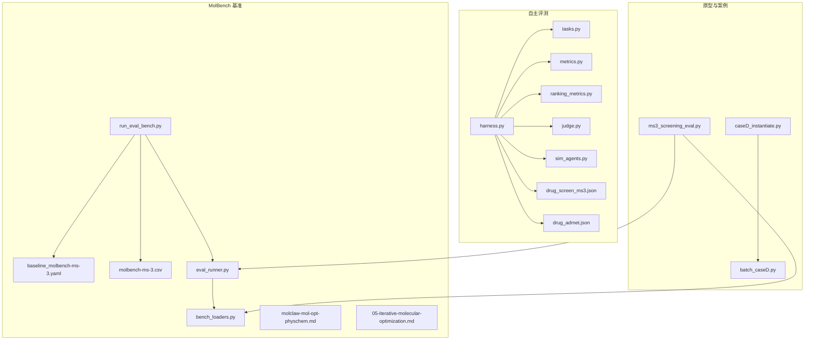
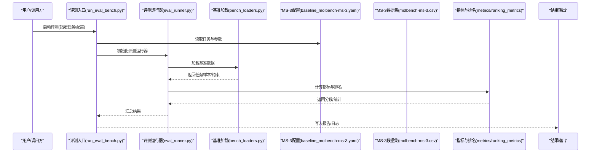
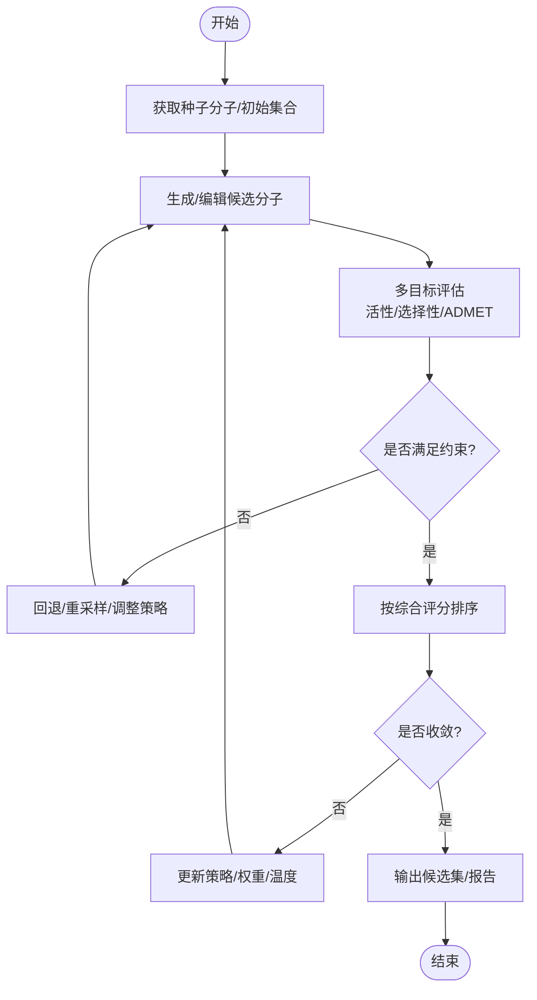
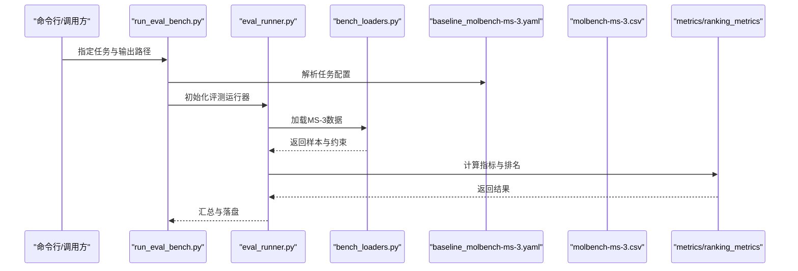
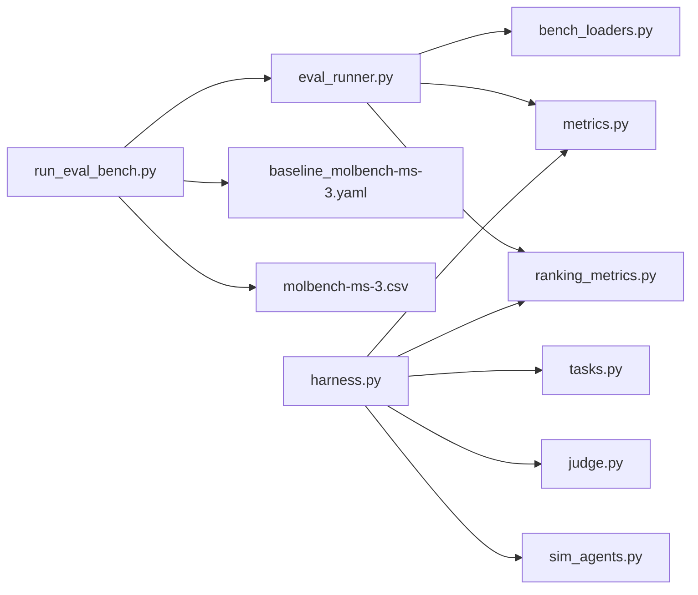

# 药物优化

<cite>
**本文引用的文件**   
- [autonomy_mvp/core/harness.py](file://autonomy_mvp/core/harness.py)
- [autonomy_mvp/core/tasks.py](file://autonomy_mvp/core/tasks.py)
- [autonomy_mvp/core/metrics.py](file://autonomy_mvp/core/metrics.py)
- [autonomy_mvp/core/ranking_metrics.py](file://autonomy_mvp/core/ranking_metrics.py)
- [autonomy_mvp/core/judge.py](file://autonomy_mvp/core/judge.py)
- [autonomy_mvp/core/sim_agents.py](file://autonomy_mvp/core/sim_agents.py)
- [autonomy_mvp/tasks/drug_screen_ms3.json](file://autonomy_mvp/tasks/drug_screen_ms3.json)
- [autonomy_mvp/tasks/drug_admet.json](file://autonomy_mvp/tasks/drug_admet.json)
- [docs/molbench_repo/config/baseline_molbench-ms-3.yaml](file://docs/molbench_repo/config/baseline_molbench-ms-3.yaml)
- [docs/molbench_repo/data_full/molbench-ms-3/molbench-ms-3.csv](file://docs/molbench_repo/data_full/molbench-ms-3/molbench-ms-3.csv)
- [docs/molbench_repo/eval/eval_runner.py](file://docs/molbench_repo/eval/eval_runner.py)
- [docs/molbench_repo/eval/bench_loaders.py](file://docs/molbench_repo/eval/bench_loaders.py)
- [docs/molbench_repo/eval/run_eval_bench.py](file://docs/molbench_repo/eval/run_eval_bench.py)
- [docs/molbench_repo/skills/L1_tools/molclaw-mol-opt-physchem/molclaw-mol-opt-physchem.md](file://docs/molbench_repo/skills/L1_tools/molclaw-mol-opt-physchem/molclaw-mol-opt-physchem.md)
- [docs/molbench_repo/skills/L2_workflows/05-iterative-molecular-optimization.md](file://docs/molbench_repo/skills/L2_workflows/05-iterative-molecular-optimization.md)
- [task3/B_ms3_screening_prototype/ms3_screening_eval.py](file://task3/B_ms3_screening_prototype/ms3_screening_eval.py)
- [longhorizon/instantiate/caseD_instantiate.py](file://longhorizon/instantiate/caseD_instantiate.py)
- [longhorizon/instantiate/batch_caseD.py](file://longhorizon/instantiate/batch_caseD.py)
</cite>

## 目录
1. [简介](#简介)
2. [项目结构](#项目结构)
3. [核心组件](#核心组件)
4. [架构总览](#架构总览)
5. [详细组件分析](#详细组件分析)
6. [依赖关系分析](#依赖关系分析)
7. [性能与并行策略](#性能与并行策略)
8. [故障排查指南](#故障排查指南)
9. [结论](#结论)
10. [附录](#附录)

## 简介
本文件围绕“多目标药物优化”主题，系统阐述活性提升、选择性增强、毒性降低等多目标的平衡策略；给出从初始化合物到多轮优化的迭代分子优化工作流；结合MolBench MS3基准的任务配置与评估流程，展示生成式模型驱动的结构优化方法；并给出多目标评分函数设计、权重调整、监控指标与收敛性分析方法，以及大规模任务的并行计算与资源管理建议。

## 项目结构
仓库中与药物优化相关的代码与资料主要分布在以下区域：
- 自主评测与任务编排：autonomy_mvp（包含任务定义、评测运行器、指标与模拟智能体）
- MolBench 文档与工具链：docs/molbench_repo（含MS-3基准数据、评测脚本、技能与L2工作流）
- 原型评测实现：task3/B_ms3_screening_prototype（MS3筛选原型评估）
- 闭环优化案例：longhorizon/instantiate（批量实例化与批处理脚本）

图表来源
- [autonomy_mvp/core/harness.py](file://autonomy_mvp/core/harness.py)
- [autonomy_mvp/core/tasks.py](file://autonomy_mvp/core/tasks.py)
- [autonomy_mvp/core/metrics.py](file://autonomy_mvp/core/metrics.py)
- [autonomy_mvp/core/ranking_metrics.py](file://autonomy_mvp/core/ranking_metrics.py)
- [autonomy_mvp/core/judge.py](file://autonomy_mvp/core/judge.py)
- [autonomy_mvp/core/sim_agents.py](file://autonomy_mvp/core/sim_agents.py)
- [autonomy_mvp/tasks/drug_screen_ms3.json](file://autonomy_mvp/tasks/drug_screen_ms3.json)
- [autonomy_mvp/tasks/drug_admet.json](file://autonomy_mvp/tasks/drug_admet.json)
- [docs/molbench_repo/config/baseline_molbench-ms-3.yaml](file://docs/molbench_repo/config/baseline_molbench-ms-3.yaml)
- [docs/molbench_repo/data_full/molbench-ms-3/molbench-ms-3.csv](file://docs/molbench_repo/data_full/molbench-ms-3/molbench-ms-3.csv)
- [docs/molbench_repo/eval/eval_runner.py](file://docs/molbench_repo/eval/eval_runner.py)
- [docs/molbench_repo/eval/bench_loaders.py](file://docs/molbench_repo/eval/bench_loaders.py)
- [docs/molbench_repo/eval/run_eval_bench.py](file://docs/molbench_repo/eval/run_eval_bench.py)
- [docs/molbench_repo/skills/L1_tools/molclaw-mol-opt-physchem/molclaw-mol-opt-physchem.md](file://docs/molbench_repo/skills/L1_tools/molclaw-mol-opt-physchem/molclaw-mol-opt-physchem.md)
- [docs/molbench_repo/skills/L2_workflows/05-iterative-molecular-optimization.md](file://docs/molbench_repo/skills/L2_workflows/05-iterative-molecular-optimization.md)
- [task3/B_ms3_screening_prototype/ms3_screening_eval.py](file://task3/B_ms3_screening_prototype/ms3_screening_eval.py)
- [longhorizon/instantiate/caseD_instantiate.py](file://longhorizon/instantiate/caseD_instantiate.py)
- [longhorizon/instantiate/batch_caseD.py](file://longhorizon/instantiate/batch_caseD.py)

章节来源
- [autonomy_mvp/core/harness.py](file://autonomy_mvp/core/harness.py)
- [autonomy_mvp/core/tasks.py](file://autonomy_mvp/core/tasks.py)
- [docs/molbench_repo/eval/run_eval_bench.py](file://docs/molbench_repo/eval/run_eval_bench.py)
- [docs/molbench_repo/eval/eval_runner.py](file://docs/molbench_repo/eval/eval_runner.py)
- [docs/molbench_repo/eval/bench_loaders.py](file://docs/molbench_repo/eval/bench_loaders.py)

## 核心组件
- 任务编排与评测运行器
  - 负责加载任务配置、执行评测流程、汇总结果与排名。
  - 关键入口包括评测运行脚本与评测Runner，配合基准数据与配置文件完成端到端评估。
- 指标与排名
  - 提供基础指标计算与排序统计，用于衡量优化效果与候选集质量。
- 判定与模拟智能体
  - 提供对生成结果的判定逻辑与模拟智能体，便于在自动化管线中驱动决策与动作。
- 任务定义
  - 以JSON形式描述药物筛选与ADMET相关任务，作为评测输入与约束条件。

章节来源
- [autonomy_mvp/core/harness.py](file://autonomy_mvp/core/harness.py)
- [autonomy_mvp/core/metrics.py](file://autonomy_mvp/core/metrics.py)
- [autonomy_mvp/core/ranking_metrics.py](file://autonomy_mvp/core/ranking_metrics.py)
- [autonomy_mvp/core/judge.py](file://autonomy_mvp/core/judge.py)
- [autonomy_mvp/core/sim_agents.py](file://autonomy_mvp/core/sim_agents.py)
- [autonomy_mvp/tasks/drug_screen_ms3.json](file://autonomy_mvp/tasks/drug_screen_ms3.json)
- [autonomy_mvp/tasks/drug_admet.json](file://autonomy_mvp/tasks/drug_admet.json)

## 架构总览
下图展示了从任务配置到评测执行的端到端流程，以及MolBench MS3基准的数据与评测链路。

图表来源
- [docs/molbench_repo/eval/run_eval_bench.py](file://docs/molbench_repo/eval/run_eval_bench.py)
- [docs/molbench_repo/eval/eval_runner.py](file://docs/molbench_repo/eval/eval_runner.py)
- [docs/molbench_repo/eval/bench_loaders.py](file://docs/molbench_repo/eval/bench_loaders.py)
- [docs/molbench_repo/config/baseline_molbench-ms-3.yaml](file://docs/molbench_repo/config/baseline_molbench-ms-3.yaml)
- [docs/molbench_repo/data_full/molbench-ms-3/molbench-ms-3.csv](file://docs/molbench_repo/data_full/molbench-ms-3/molbench-ms-3.csv)
- [autonomy_mvp/core/metrics.py](file://autonomy_mvp/core/metrics.py)
- [autonomy_mvp/core/ranking_metrics.py](file://autonomy_mvp/core/ranking_metrics.py)

## 详细组件分析

### 多目标药物优化理论基础与平衡策略
- 目标维度
  - 活性优化：提高与靶点的结合亲和力或抑制能力。
  - 选择性提升：增强对目标靶点相对于脱靶的区分度。
  - 毒性降低：改善ADMET属性，如溶解度、渗透性、代谢稳定性、毒理风险等。
- 平衡策略
  - 加权聚合：为各子目标设定权重，形成单一综合评分，便于排序与选择。
  - 约束优先：将安全性或成药性设为硬约束，仅在可行域内优化活性与选择性。
  - 分层优化：先满足约束再优化主目标，或在不同阶段动态调整权重。
  - 多样性探索：通过采样策略维持结构多样性，避免陷入局部最优。

章节来源
- [docs/molbench_repo/skills/L1_tools/molclaw-mol-opt-physchem/molclaw-mol-opt-physchem.md](file://docs/molbench_repo/skills/L1_tools/molclaw-mol-opt-physchem/molclaw-mol-opt-physchem.md)
- [autonomy_mvp/tasks/drug_admet.json](file://autonomy_mvp/tasks/drug_admet.json)

### 迭代分子优化工作流程
- 典型步骤
  - 初始化合物设计与筛选：基于种子分子或虚拟库进行初筛。
  - 生成与变异：使用生成式模型或编辑工具产生候选结构。
  - 多目标评估：计算活性、选择性、ADMET等指标。
  - 选择与回溯：依据评分与约束选择候选，必要时回退或重采样。
  - 收敛判断：监控指标变化趋势与稳定性，达到阈值后停止。
- 工作流参考
  - L2工作流文档提供了迭代优化的步骤说明与最佳实践。

图表来源
- [docs/molbench_repo/skills/L2_workflows/05-iterative-molecular-optimization.md](file://docs/molbench_repo/skills/L2_workflows/05-iterative-molecular-optimization.md)

章节来源
- [docs/molbench_repo/skills/L2_workflows/05-iterative-molecular-optimization.md](file://docs/molbench_repo/skills/L2_workflows/05-iterative-molecular-optimization.md)

### MolBench MS3基准中的药物优化案例
- 任务与数据
  - MS-3基准提供任务配置与数据集，用于评估药物筛选与优化能力。
  - 评测入口脚本支持加载配置与数据，驱动评测运行器与指标计算。
- 任务配置要点
  - 在配置文件中定义任务名称、评估指标、约束阈值与采样参数。
  - 数据集CSV包含任务样本与基线信息，供评测加载与对比。
- 原型评估
  - 原型脚本演示了MS3筛选评估的基本流程，可作为扩展与定制的基础。

图表来源
- [docs/molbench_repo/eval/run_eval_bench.py](file://docs/molbench_repo/eval/run_eval_bench.py)
- [docs/molbench_repo/eval/eval_runner.py](file://docs/molbench_repo/eval/eval_runner.py)
- [docs/molbench_repo/eval/bench_loaders.py](file://docs/molbench_repo/eval/bench_loaders.py)
- [docs/molbench_repo/config/baseline_molbench-ms-3.yaml](file://docs/molbench_repo/config/baseline_molbench-ms-3.yaml)
- [docs/molbench_repo/data_full/molbench-ms-3/molbench-ms-3.csv](file://docs/molbench_repo/data_full/molbench-ms-3/molbench-ms-3.csv)
- [autonomy_mvp/core/metrics.py](file://autonomy_mvp/core/metrics.py)
- [autonomy_mvp/core/ranking_metrics.py](file://autonomy_mvp/core/ranking_metrics.py)

章节来源
- [docs/molbench_repo/eval/run_eval_bench.py](file://docs/molbench_repo/eval/run_eval_bench.py)
- [docs/molbench_repo/eval/eval_runner.py](file://docs/molbench_repo/eval/eval_runner.py)
- [docs/molbench_repo/eval/bench_loaders.py](file://docs/molbench_repo/eval/bench_loaders.py)
- [docs/molbench_repo/config/baseline_molbench-ms-3.yaml](file://docs/molbench_repo/config/baseline_molbench-ms-3.yaml)
- [docs/molbench_repo/data_full/molbench-ms-3/molbench-ms-3.csv](file://docs/molbench_repo/data_full/molbench-ms-3/molbench-ms-3.csv)
- [task3/B_ms3_screening_prototype/ms3_screening_eval.py](file://task3/B_ms3_screening_prototype/ms3_screening_eval.py)

### 生成式模型驱动的分子结构优化
- 生成与编辑
  - 使用生成式模型或SMILES编辑工具进行结构变异，保持化学合理性与可合成性。
  - 物理化学性质工具可用于快速过滤与引导搜索方向。
- 策略建议
  - 在早期阶段采用高多样性采样，后期逐步收紧约束以提升可行性。
  - 结合领域知识（如片段替换、骨架跃迁）提高命中概率。

章节来源
- [docs/molbench_repo/skills/L1_tools/molclaw-mol-opt-physchem/molclaw-mol-opt-physchem.md](file://docs/molbench_repo/skills/L1_tools/molclaw-mol-opt-physchem/molclaw-mol-opt-physchem.md)
- [docs/molbench_repo/skills/L2_workflows/05-iterative-molecular-optimization.md](file://docs/molbench_repo/skills/L2_workflows/05-iterative-molecular-optimization.md)

### 多目标评分函数设计与权重调整
- 设计原则
  - 明确主目标与辅助目标，设置合理的权重比例。
  - 引入惩罚项处理越界或高风险属性。
  - 对数值型指标进行归一化，避免量纲差异导致偏差。
- 权重调整
  - 根据前期实验反馈动态调权，或使用自适应策略（如随迭代次数衰减）。
  - 在约束严格时，优先保证可行性，再逐步提升主目标权重。

章节来源
- [autonomy_mvp/core/metrics.py](file://autonomy_mvp/core/metrics.py)
- [autonomy_mvp/core/ranking_metrics.py](file://autonomy_mvp/core/ranking_metrics.py)

### 监控指标与收敛性分析
- 监控指标
  - 每轮最佳/平均评分、达标率、多样性度量（如Tanimoto相似度分布）、失败率。
- 收敛性分析
  - 观察指标时间序列的平滑趋势与方差，结合早停条件（连续若干轮无显著改进）。
  - 对权重与温度等超参进行敏感性分析，确保稳定收敛。

章节来源
- [autonomy_mvp/core/metrics.py](file://autonomy_mvp/core/metrics.py)
- [autonomy_mvp/core/ranking_metrics.py](file://autonomy_mvp/core/ranking_metrics.py)

### 大规模药物优化任务的并行计算与资源管理
- 并行策略
  - 任务级并行：对不同种子或不同任务独立运行，最大化吞吐。
  - 批次调度：将候选分子分组提交，控制并发度以避免资源争用。
- 资源管理
  - 限制GPU/CPU并发数，设置超时与重试机制。
  - 记录日志与中间结果，支持断点续跑与回溯。
- 案例参考
  - 闭环优化案例的实例化与批处理脚本展示了批量任务的组织方式。

章节来源
- [longhorizon/instantiate/caseD_instantiate.py](file://longhorizon/instantiate/caseD_instantiate.py)
- [longhorizon/instantiate/batch_caseD.py](file://longhorizon/instantiate/batch_caseD.py)

## 依赖关系分析
- 模块耦合
  - 评测入口依赖评测运行器与基准加载器；评测运行器依赖指标与排名模块。
  - 任务定义与ADMET任务JSON为评测提供输入与约束。
- 外部集成点
  - MolBench配置与数据集作为外部输入源。
  - 技能与L2工作流文档提供方法论指导与工具链参考。

图表来源
- [docs/molbench_repo/eval/run_eval_bench.py](file://docs/molbench_repo/eval/run_eval_bench.py)
- [docs/molbench_repo/eval/eval_runner.py](file://docs/molbench_repo/eval/eval_runner.py)
- [docs/molbench_repo/eval/bench_loaders.py](file://docs/molbench_repo/eval/bench_loaders.py)
- [autonomy_mvp/core/harness.py](file://autonomy_mvp/core/harness.py)
- [autonomy_mvp/core/tasks.py](file://autonomy_mvp/core/tasks.py)
- [autonomy_mvp/core/metrics.py](file://autonomy_mvp/core/metrics.py)
- [autonomy_mvp/core/ranking_metrics.py](file://autonomy_mvp/core/ranking_metrics.py)
- [autonomy_mvp/core/judge.py](file://autonomy_mvp/core/judge.py)
- [autonomy_mvp/core/sim_agents.py](file://autonomy_mvp/core/sim_agents.py)

## 性能与并行策略
- 并行化建议
  - 将不同任务或不同种子分子并行评估，利用多进程或多线程提升吞吐。
  - 对耗时评估（如对接或自由能计算）进行队列化与限流。
- 资源分配
  - 根据硬件规模设置并发上限，避免内存溢出或显存不足。
  - 使用检查点与增量计算减少重复开销。
- 监控与诊断
  - 记录每步耗时与错误率，定位瓶颈与异常节点。
  - 对长尾任务设置超时与降级策略。

[本节为通用指导，不直接分析具体文件]

## 故障排查指南
- 常见问题
  - 任务配置缺失或字段不完整：检查配置文件与任务JSON的必填项。
  - 数据加载失败：确认数据集路径与格式正确，权限与编码无误。
  - 指标计算异常：核对归一化与阈值设置，检查空值与非法字符。
- 定位方法
  - 查看评测运行器与基准加载器的日志输出。
  - 使用最小样例复现问题，逐步缩小范围。
  - 对生成与编辑环节增加校验与回滚逻辑。

章节来源
- [docs/molbench_repo/eval/eval_runner.py](file://docs/molbench_repo/eval/eval_runner.py)
- [docs/molbench_repo/eval/bench_loaders.py](file://docs/molbench_repo/eval/bench_loaders.py)
- [autonomy_mvp/core/judge.py](file://autonomy_mvp/core/judge.py)

## 结论
本文件梳理了多目标药物优化的理论框架与实践路径，结合MolBench MS3基准与评测体系，给出了从任务配置、数据加载、指标计算到结果输出的完整流程。通过迭代优化工作流、生成式模型与多目标评分函数的协同，可在活性、选择性与毒性之间取得良好平衡。同时，针对大规模任务提出了并行与资源管理策略，并提供监控与收敛性分析方法，助力高效、稳健的药物优化实践。

## 附录
- 术语表
  - 活性：分子与靶点结合的强度或抑制能力。
  - 选择性：对目标靶点相对于其他靶点的偏好程度。
  - ADMET：吸收、分布、代谢、排泄与毒性属性的统称。
- 参考工作流
  - 迭代分子优化工作流文档提供了步骤与注意事项。
  - 物理化学性质工具文档提供了快速评估与过滤的方法。

章节来源
- [docs/molbench_repo/skills/L2_workflows/05-iterative-molecular-optimization.md](file://docs/molbench_repo/skills/L2_workflows/05-iterative-molecular-optimization.md)
- [docs/molbench_repo/skills/L1_tools/molclaw-mol-opt-physchem/molclaw-mol-opt-physchem.md](file://docs/molbench_repo/skills/L1_tools/molclaw-mol-opt-physchem/molclaw-mol-opt-physchem.md)