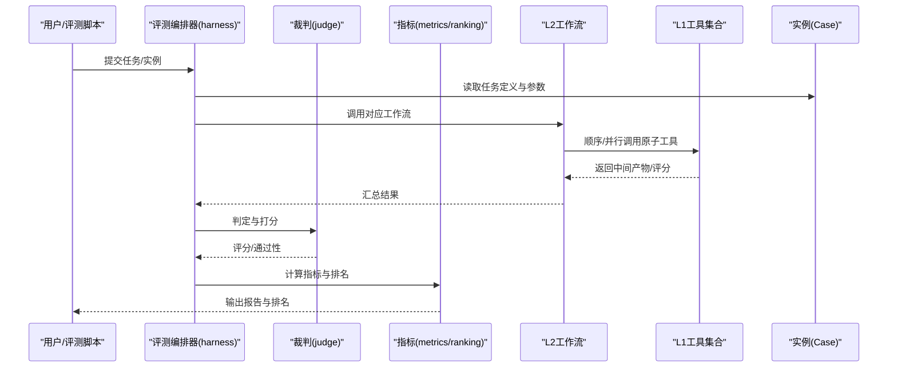
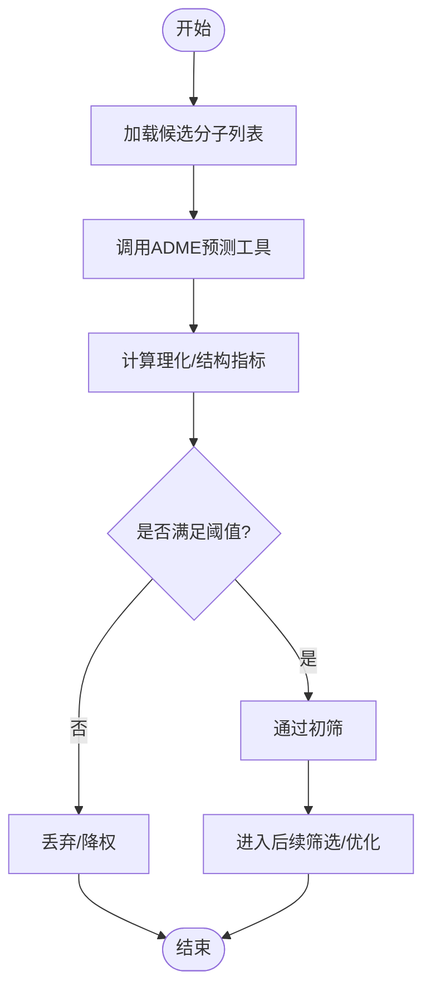
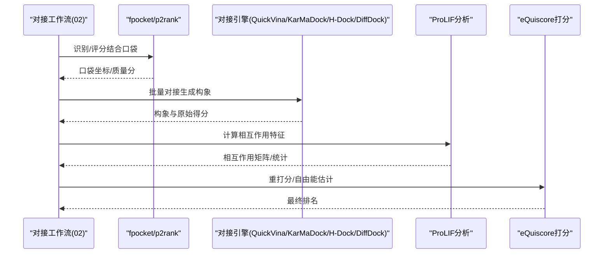
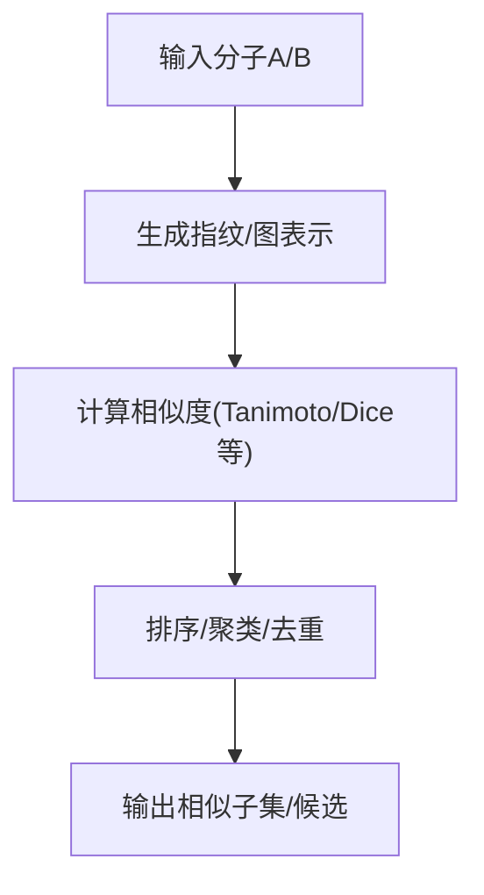
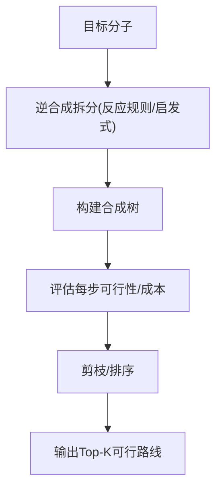
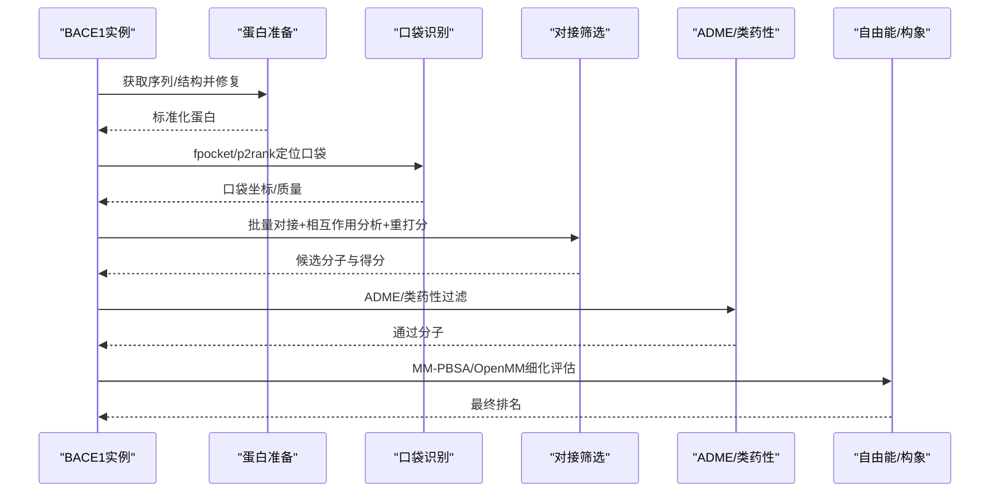
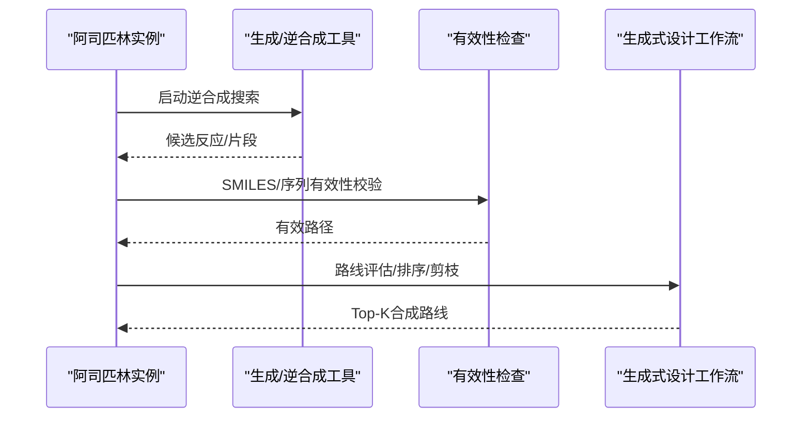
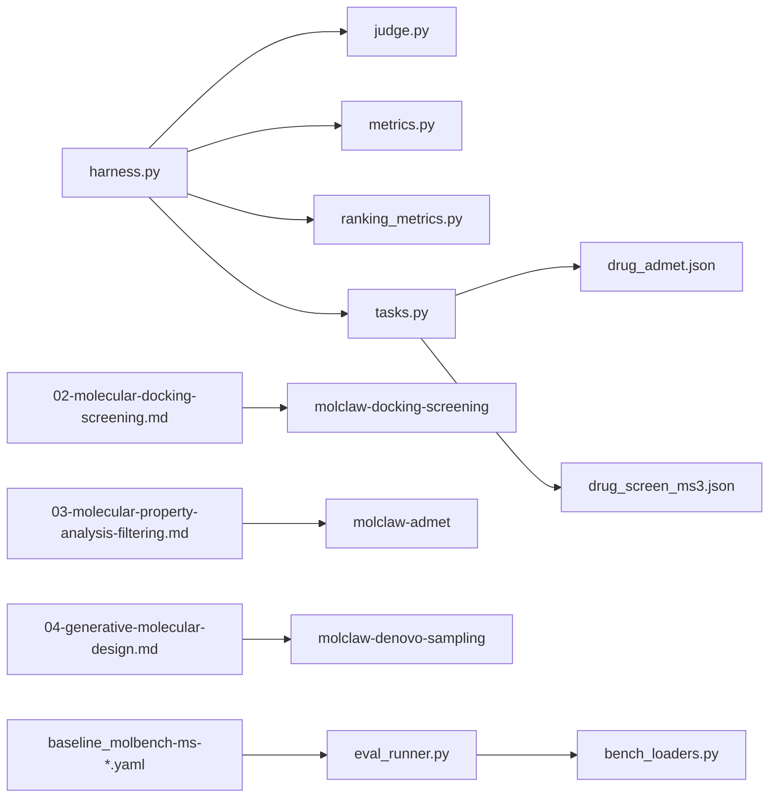

# 药物发现应用

<cite>
**本文引用的文件**   
- [autonomy_mvp/core/harness.py](file://autonomy_mvp/core/harness.py)
- [autonomy_mvp/core/judge.py](file://autonomy_mvp/core/judge.py)
- [autonomy_mvp/core/metrics.py](file://autonomy_mvp/core/metrics.py)
- [autonomy_mvp/core/ranking_metrics.py](file://autonomy_mvp/core/ranking_metrics.py)
- [autonomy_mvp/core/sim_agents.py](file://autonomy_mvp/core/sim_agents.py)
- [autonomy_mvp/core/tasks.py](file://autonomy_mvp/core/tasks.py)
- [autonomy_mvp/tasks/drug_admet.json](file://autonomy_mvp/tasks/drug_admet.json)
- [autonomy_mvp/tasks/drug_screen_ms3.json](file://autonomy_mvp/tasks/drug_screen_ms3.json)
- [longhorizon/instantiate/instances/drug2_BACE1.json](file://longhorizon/instantiate/instances/drug2_BACE1.json)
- [longhorizon/instantiate/instances/retroE_aspirin.json](file://longhorizon/instantiate/instances/retroE_aspirin.json)
- [docs/prd/molbench_repo/skills/L1_tools/molclaw-admet/README.md](file://docs/prd/molbench_repo/skills/L1_tools/molclaw-admet/README.md)
- [docs/prd/molbench_repo/skills/L1_tools/molclaw-docking-screening/README.md](file://docs/prd/molbench_repo/skills/L1_tools/molclaw-docking-screening/README.md)
- [docs/prd/molbench_repo/skills/L1_tools/molclaw-mol-similarity/README.md](file://docs/prd/molbench_repo/skills/L1_tools/molclaw-mol-similarity/README.md)
- [docs/prd/molbench_repo/skills/L1_tools/molclaw-equiscore-tool/README.md](file://docs/prd/molbench_repo/skills/L1_tools/molclaw-equiscore-tool/README.md)
- [docs/prd/molbench_repo/skills/L1_tools/molclaw-prolif-tool/README.md](file://docs/prd/molbench_repo/skills/L1_tools/molclaw-prolif-tool/README.md)
- [docs/prd/molbench_repo/skills/L1_tools/molclaw-quickvina-docking/README.md](file://docs/prd/molbench_repo/skills/L1_tools/molclaw-quickvina-docking/README.md)
- [docs/prd/molbench_repo/skills/L1_tools/molclaw-fpocket-toolkit-base/README.md](file://docs/prd/molbench_repo/skills/L1_tools/molclaw-fpocket-toolkit-base/README.md)
- [docs/prd/molbench_repo/skills/L1_tools/molclaw-p2rank/README.md](file://docs/prd/molbench_repo/skills/L1_tools/molclaw-p2rank/README.md)
- [docs/prd/molbench_repo/skills/L1_tools/molclaw-chai1-predict/README.md](file://docs/prd/molbench_repo/skills/L1_tools/molclaw-chai1-predict/README.md)
- [docs/prd/molbench_repo/skills/L1_tools/molclaw-boltz2-affinity/README.md](file://docs/prd/molbench_repo/skills/L1_tools/molclaw-boltz2-affinity/README.md)
- [docs/prd/molbench_repo/skills/L1_tools/molclaw-openawsem-tool/README.md](file://docs/prd/molbench_repo/skills/L1_tools/molclaw-openawsem-tool/README.md)
- [docs/prd/molbench_repo/skills/L1_tools/molclaw-esmfold/README.md](file://docs/prd/molbench_repo/skills/L1_tools/molclaw-esmfold/README.md)
- [docs/prd/molbench_repo/skills/L1_tools/molclaw-protein-sequence-retrieve/README.md](file://docs/prd/molbench_repo/skills/L1_tools/molclaw-protein-sequence-retrieve/README.md)
- [docs/prd/molbench_repo/skills/L1_tools/molclaw-protein-structure-retrieve/README.md](file://docs/prd/molbench_repo/skills/L1_tools/molclaw-protein-structure-retrieve/README.md)
- [docs/prd/molbench_repo/skills/L1_tools/molclaw-compound-retrieve/README.md](file://docs/prd/molbench_repo/skills/L1_tools/molclaw-compound-retrieve/README.md)
- [docs/prd/molbench_repo/skills/L1_tools/molclaw-smiles-valid-check/README.md](file://docs/prd/molbench_repo/skills/L1_tools/molclaw-smiles-valid-check/README.md)
- [docs/prd/molbench_repo/skills/L1_tools/molclaw-smiles-fg-editor/README.md](file://docs/prd/molbench_repo/skills/L1_tools/molclaw-smiles-fg-editor/README.md)
- [docs/prd/molbench_repo/skills/L1_tools/molclaw-mol-basic-metrics/README.md](file://docs/prd/molbench_repo/skills/L1_tools/molclaw-mol-basic-metrics/README.md)
- [docs/prd/molbench_repo/skills/L1_tools/molclaw-mol-hydrophobicity-metrics/README.md](file://docs/prd/molbench_repo/skills/L1_tools/molclaw-mol-hydrophobicity-metrics/README.md)
- [docs/prd/molbench_repo/skills/L1_tools/molclaw-mol-hbond-metrics/README.md](file://docs/prd/molbench_repo/skills/L1_tools/molclaw-mol-hbond-metrics/README.md)
- [docs/prd/molbench_repo/skills/L1_tools/molclaw-mol-complexity-metrics/README.md](file://docs/prd/molbench_repo/skills/L1_tools/molclaw-mol-complexity-metrics/README.md)
- [docs/prd/molbench_repo/skills/L1_tools/molclaw-mol-topology-metrics/README.md](file://docs/prd/molbench_repo/skills/L1_tools/molclaw-mol-topology-metrics/README.md)
- [docs/prd/molbench_repo/skills/L1_tools/molclaw-mol-structure-metrics/README.md](file://docs/prd/molbench_repo/skills/L1_tools/molclaw-mol-structure-metrics/README.md)
- [docs/prd/molbench_repo/skills/L1_tools/molclaw-mol-opt-physchem/README.md](file://docs/prd/molbench_repo/skills/L1_tools/molclaw-mol-opt-physchem/README.md)
- [docs/prd/molbench_repo/skills/L1_tools/molclaw-mol2mol-sampling/README.md](file://docs/prd/molbench_repo/skills/L1_tools/molclaw-mol2mol-sampling/README.md)
- [docs/prd/molbench_repo/skills/L1_tools/molclaw-linker-sampling/README.md](file://docs/prd/molbench_repo/skills/L1_tools/molclaw-linker-sampling/README.md)
- [docs/prd/molbench_repo/skills/L1_tools/molclaw-rgroup-sampling/README.md](file://docs/prd/molbench_repo/skills/L1_tools/molclaw-rgroup-sampling/README.md)
- [docs/prd/molbench_repo/skills/L1_tools/molclaw-denovo-sampling/README.md](file://docs/prd/molbench_repo/skills/L1_tools/molclaw-denovo-sampling/README.md)
- [docs/prd/molbench_repo/skills/L1_tools/molclaw-peptide-sampling/README.md](file://docs/prd/molbench_repo/skills/L1_tools/molclaw-peptide-sampling/README.md)
- [docs/prd/molbench_repo/skills/L1_tools/molclaw-interaction-visualizer/README.md](file://docs/prd/molbench_repo/skills/L1_tools/molclaw-interaction-visualizer/README.md)
- [docs/prd/molbench_repo/skills/L1_tools/molclaw-fix-pdb/README.md](file://docs/prd/molbench_repo/skills/L1_tools/molclaw-fix-pdb/README.md)
- [docs/prd/molbench_repo/skills/L1_tools/molclaw-extract-chains/README.md](file://docs/prd/molbench_repo/skills/L1_tools/molclaw-extract-chains/README.md)
- [docs/prd/molbench_repo/skills/L1_tools/molclaw-pack-sidechains/README.md](file://docs/prd/molbench_repo/skills/L1_tools/molclaw-pack-sidechains/README.md)
- [docs/prd/molbench_repo/skills/L1_tools/molclaw-prolif-md/README.md](file://docs/prd/molbench_repo/skills/L1_tools/molclaw-prolif-md/README.md)
- [docs/prd/molbench_repo/skills/L1_tools/molclaw-prolif-protein-protein/README.md](file://docs/prd/molbench_repo/skills/L1_tools/molclaw-prolif-protein-protein/README.md)
- [docs/prd/molbench_repo/skills/L1_tools/molclaw-prolif-pdb/README.md](file://docs/prd/molbench_repo/skills/L1_tools/molclaw-prolif-pdb/README.md)
- [docs/prd/molbench_repo/skills/L1_tools/molclaw-protein-ligand-mmpbsa/README.md](file://docs/prd/molbench_repo/skills/L1_tools/molclaw-protein-ligand-mmpbsa/README.md)
- [docs/prd/molbench_repo/skills/L1_tools/molclaw-protein-protein-mmpbsa/README.md](file://docs/prd/molbench_repo/skills/L1_tools/molclaw-protein-protein-mmpbsa/README.md)
- [docs/prd/molbench_repo/skills/L1_tools/molclaw-protein-openmm/README.md](file://docs/prd/molbench_repo/skills/L1_tools/molclaw-protein-openmm/README.md)
- [docs/prd/molbench_repo/skills/L1_tools/molclaw-run-bioemu/README.md](file://docs/prd/molbench_repo/skills/L1_tools/molclaw-run-bioemu/README.md)
- [docs/prd/molbench_repo/skills/L1_tools/molclaw-goca-tool/README.md](file://docs/prd/molbench_repo/skills/L1_tools/molclaw-goca-tool/README.md)
- [docs/prd/molbench_repo/skills/L1_tools/molclaw-karmadock-tool/README.md](file://docs/prd/molbench_repo/skills/L1_tools/molclaw-karmadock-tool/README.md)
- [docs/prd/molbench_repo/skills/L1_tools/molclaw-hdock-tool/README.md](file://docs/prd/molbench_repo/skills/L1_tools/molclaw-hdock-tool/README.md)
- [docs/prd/molbench_repo/skills/L1_tools/molclaw-foldx-tool/README.md](file://docs/prd/molbench_repo/skills/L1_tools/molclaw-foldx-tool/README.md)
- [docs/prd/molbench_repo/skills/L1_tools/molclaw-evobind-tool/README.md](file://docs/prd/prd/molbench_repo/skills/L1_tools/molclaw-evobind-tool/README.md)
- [docs/prd/molbench_repo/skills/L1_tools/molclaw-file-transfer/README.md](file://docs/prd/molbench_repo/skills/L1_tools/molclaw-file-transfer/README.md)
- [docs/prd/molbench_repo/skills/L1_tools/molclaw-scp-server/README.md](file://docs/prd/molbench_repo/skills/L1_tools/molclaw-scp-server/README.md)
- [docs/prd/molbench_repo/skills/L1_tools/molclaw-sequence-valid-check/README.md](file://docs/prd/molbench_repo/skills/L1_tools/molclaw-sequence-valid-check/README.md)
- [docs/prd/molbench_repo/skills/L1_tools/molclaw-pulchura-rebuild/README.md](file://docs/prd/molbench_repo/skills/L1_tools/molclaw-pulchura-rebuild/README.md)
- [docs/prd/molbench_repo/skills/L1_tools/molclaw-diffdock-auto/README.md](file://docs/prd/molbench_repo/skills/L1_tools/molclaw-diffdock-auto/README.md)
- [docs/prd/molbench_repo/skills/L1_tools/molclaw-equiscore-docking/README.md](file://docs/prd/molbench_repo/skills/L1_tools/molclaw-equiscore-docking/README.md)
- [docs/prd/molbench_repo/skills/L1_tools/molclaw-dleps/README.md](file://docs/prd/molbench_repo/skills/L1_tools/molclaw-dleps/README.md)
- [docs/prd/molbench_repo/skills/L1_tools/molclaw-drug-likeness/README.md](file://docs/prd/molbench_repo/skills/L1_tools/molclaw-drug-likeness/README.md)
- [docs/prd/molbench_repo/skills/L2_workflows/00-problem-discovery-and-feasibility-triage.md](file://docs/prd/molbench_repo/skills/L2_workflows/00-problem-discovery-and-feasibility-triage.md)
- [docs/prd/molbench_repo/skills/L2_workflows/01-target-protein-preparation.md](file://docs/prd/molbench_repo/skills/L2_workflows/01-target-protein-preparation.md)
- [docs/prd/molbench_repo/skills/L2_workflows/02-molecular-docking-screening.md](file://docs/prd/molbench_repo/skills/L2_workflows/02-molecular-docking-screening.md)
- [docs/prd/molbench_repo/skills/L2_workflows/03-molecular-property-analysis-filtering.md](file://docs/prd/molbench_repo/skills/L2_workflows/03-molecular-property-analysis-filtering.md)
- [docs/prd/molbench_repo/skills/L2_workflows/04-generative-molecular-design.md](file://docs/prd/molbench_repo/skills/L2_workflows/04-generative-molecular-design.md)
- [docs/prd/molbench_repo/skills/L2_workflows/05-iterative-molecular-optimization.md](file://docs/prd/molbench_repo/skills/L2_workflows/05-iterative-molecular-optimization.md)
- [docs/prd/molbench_repo/skills/L2_workflows/06-binding-free-energy-calculation.md](file://docs/prd/molbench_repo/skills/L2_workflows/06-binding-free-energy-calculation.md)
- [docs/prd/molbench_repo/skills/L2_workflows/07-conformational-sampling-analysis.md](file://docs/prd/molbench_repo/skills/L2_workflows/07-conformational-sampling-analysis.md)
- [docs/prd/molbench_repo/skills/L2_workflows/08-post-docking-evaluation.md](file://docs/prd/molbench_repo/skills/L2_workflows/08-post-docking-evaluation.md)
- [docs/prd/molbench_repo/skills/L3_methodology/README.md](file://docs/prd/molbench_repo/skills/L3_methodology/README.md)
- [docs/prd/molbench_repo/templates/tool_routing.md](file://docs/prd/molbench_repo/templates/tool_routing.md)
- [docs/prd/molbench_repo/templates/variable_routing.md](file://docs/prd/molbench_repo/templates/variable_routing.md)
- [docs/prd/molbench_repo/templates/outliners.py](file://docs/prd/molbench_repo/templates/outliners.py)
- [docs/prd/molbench_repo/templates/template.py](file://docs/prd/molbench_repo/templates/template.py)
- [docs/prd/molbench_repo/templates/answer_format.md](file://docs/prd/molbench_repo/templates/answer_format.md)
- [docs/prd/molbench_repo/eval/bench_loaders.py](file://docs/prd/molbench_repo/eval/bench_loaders.py)
- [docs/prd/molbench_repo/eval/eval_runner.py](file://docs/prd/molbench_repo/eval/eval_runner.py)
- [docs/prd/molbench_repo/eval/run_eval_bench.py](file://docs/prd/molbench_repo/eval/run_eval_bench.py)
- [docs/prd/molbench_repo/config/baseline_molbench-ms-1.yaml](file://docs/prd/molbench_repo/config/baseline_molbench-ms-1.yaml)
- [docs/prd/molbench_repo/config/baseline_molbench-ms-2.yaml](file://docs/prd/molbench_repo/config/baseline_molbench-ms-2.yaml)
- [docs/prd/molbench_repo/config/baseline_molbench-ms-3.yaml](file://docs/prd/molbench_repo/config/baseline_molbench-ms-3.yaml)
- [docs/prd/molbench_repo/config/chemcot_mo_edit.yaml](file://docs/prd/molbench_repo/config/chemcot_mo_edit.yaml)
- [docs/prd/molbench_repo/config/chemcot_mo_opt.yaml](file://docs/prd/molbench_repo/config/chemcot_mo_opt.yaml)
- [docs/prd/molbench_repo/config/claude_template.yaml](file://docs/prd/molbench_repo/config/claude_template.yaml)
- [docs/prd/molbench_repo/data_full/molbench-mo/manifest.json](file://docs/prd/molbench_repo/data_full/molbench-mo/manifest.json)
- [docs/prd/molbench_repo/data_full/molbench-ms-1/molbench-ms-1.csv](file://docs/prd/molbench_repo/data_full/molbench-ms-1/molbench-ms-1.csv)
- [docs/prd/molbench_repo/data_full/molbench-ms-2/molbench-ms-2.csv](file://docs/prd/molbench_repo/data_full/molbench-ms-2/molbench-ms-2.csv)
- [docs/prd/molbench_repo/data_full/molbench-ms-3/molbench-ms-3.csv](file://docs/prd/molbench_repo/data_full/molbench-ms-3/molbench-ms-3.csv)
- [docs/prd/molbench_repo/REUSABLE_INDEX.md](file://docs/prd/molbench_repo/REUSABLE_INDEX.md)
- [docs/prd/molbench_repo/README.md](file://docs/prd/molbench_repo/README.md)
</cite>

## 目录
1. [引言](#引言)
2. [项目结构](#项目结构)
3. [核心组件](#核心组件)
4. [架构总览](#架构总览)
5. [详细组件分析](#详细组件分析)
6. [依赖分析](#依赖分析)
7. [性能考虑](#性能考虑)
8. [故障排查指南](#故障排查指南)
9. [结论](#结论)
10. [附录](#附录)

## 引言
本文件面向药物发现应用场景，系统性阐述以下四大核心任务的工作流程、关键算法与评估指标：
- ADME性质预测
- 分子对接筛选
- 药物相似性分析
- 逆合成规划

同时结合具体案例（BACE1抑制剂设计、阿司匹林逆合成），展示如何利用工具生态中的L1基础工具与L2工作流工具完成复杂研发任务，并给出性能优化策略与最佳实践。

## 项目结构
仓库围绕“评测框架 + 技能工具集 + 基准数据 + 实例化用例”组织：
- autonomy_mvp：评测与任务编排核心（harness、judge、metrics、tasks等）
- docs/prd/molbench_repo：工具技能（L1）、工作流（L2）、方法论（L3）、模板与评测配置
- longhorizon/instantiate/instances：真实场景实例（如BACE1、阿司匹林逆合成）
- 其他任务与实验记录：用于验证与对比

```mermaid
graph TB
subgraph "评测与任务"
H["harness.py"]
J["judge.py"]
M["metrics.py"]
RM["ranking_metrics.py"]
T["tasks.py"]
SA["sim_agents.py"]
end
subgraph "任务定义"
A["drug_admet.json"]
S["drug_screen_ms3.json"]
end
subgraph "工具技能(L1)"
L1A["molclaw-admet"]
L1D["molclaw-docking-screening"]
L1SIM["molclaw-mol-similarity"]
L1EQ["molclaw-equiscore-tool"]
L1PL["molclaw-prolif-tool"]
L1QV["molclaw-quickvina-docking"]
L1FP["molclaw-fpocket-toolkit-base"]
L1P2R["molclaw-p2rank"]
L1C1["molclaw-chai1-predict"]
L1B2["molclaw-boltz2-affinity"]
L1OA["molclaw-openawsem-tool"]
L1ESM["molclaw-esmfold"]
L1PSR["molclaw-protein-sequence-retrieve"]
L1PSJ["molclaw-protein-structure-retrieve"]
L1CR["molclaw-compound-retrieve"]
L1SMV["molclaw-smiles-valid-check"]
L1SME["molclaw-smiles-fg-editor"]
L1BM["molclaw-mol-basic-metrics"]
L1HY["molclaw-mol-hydrophobicity-metrics"]
L1HB["molclaw-mol-hbond-metrics"]
L1CM["molclaw-mol-complexity-metrics"]
L1TP["molclaw-mol-topology-metrics"]
L1ST["molclaw-mol-structure-metrics"]
L1PC["molclaw-mol-opt-physchem"]
L1M2M["molclaw-mol2mol-sampling"]
L1LNK["molclaw-linker-sampling"]
L1RG["molclaw-rgroup-sampling"]
L1DN["molclaw-denovo-sampling"]
L1PEP["molclaw-peptide-sampling"]
L1VIS["molclaw-interaction-visualizer"]
L1FIX["molclaw-fix-pdb"]
L1EX["molclaw-extract-chains"]
L1PK["molclaw-pack-sidechains"]
L1MD["molclaw-prolif-md"]
L1PP["molclaw-prolif-protein-protein"]
L1PPDB["molclaw-prolif-pdb"]
L1ML["molclaw-protein-ligand-mmpbsa"]
L1PPMS["molclaw-protein-protein-mmpbsa"]
L1OM["molclaw-protein-openmm"]
L1BE["molclaw-run-bioemu"]
L1GO["molclaw-goca-tool"]
L1KD["molclaw-karmadock-tool"]
L1HD["molclaw-hdock-tool"]
L1FX["molclaw-foldx-tool"]
L1EV["molclaw-evobind-tool"]
L1FT["molclaw-file-transfer"]
L1SC["molclaw-scp-server"]
L1SEQ["molclaw-sequence-valid-check"]
L1PR["molclaw-pulchura-rebuild"]
L1DD["molclaw-diffdock-auto"]
L1ED["molclaw-equiscore-docking"]
L1DL["molclaw-dleps"]
L1DLK["molclaw-drug-likeness"]
end
subgraph "工作流(L2)"
W0["00-problem-discovery-and-feasibility-triage.md"]
W1["01-target-protein-preparation.md"]
W2["02-molecular-docking-screening.md"]
W3["03-molecular-property-analysis-filtering.md"]
W4["04-generative-molecular-design.md"]
W5["05-iterative-molecular-optimization.md"]
W6["06-binding-free-energy-calculation.md"]
W7["07-conformational-sampling-analysis.md"]
W8["08-post-docking-evaluation.md"]
end
subgraph "实例"
BACE["drug2_BACE1.json"]
ASP["retroE_aspirin.json"]
end
H --> J
H --> M
H --> RM
H --> T
H --> SA
T --> A
T --> S
W2 --> L1D
W2 --> L1QV
W2 --> L1FP
W2 --> L1P2R
W2 --> L1PL
W3 --> L1A
W3 --> L1BM
W3 --> L1HY
W3 --> L1HB
W3 --> L1CM
W3 --> L1TP
W3 --> L1ST
W3 --> L1PC
W4 --> L1DN
W4 --> L1M2M
W4 --> L1LNK
W4 --> L1RG
W4 --> L1PEP
W5 --> L1EQ
W5 --> L1ED
W5 --> L1KD
W5 --> L1HD
W5 --> L1DD
W6 --> L1ML
W6 --> L1PPMS
W6 --> L1OM
W7 --> L1MD
W8 --> L1PL
W8 --> L1VIS
BACE --> W2
BACE --> W3
ASP --> W4
```

图表来源
- [autonomy_mvp/core/harness.py](file://autonomy_mvp/core/harness.py)
- [autonomy_mvp/core/judge.py](file://autonomy_mvp/core/judge.py)
- [autonomy_mvp/core/metrics.py](file://autonomy_mvp/core/metrics.py)
- [autonomy_mvp/core/ranking_metrics.py](file://autonomy_mvp/core/ranking_metrics.py)
- [autonomy_mvp/core/tasks.py](file://autonomy_mvp/core/tasks.py)
- [autonomy_mvp/core/sim_agents.py](file://autonomy_mvp/core/sim_agents.py)
- [autonomy_mvp/tasks/drug_admet.json](file://autonomy_mvp/tasks/drug_admet.json)
- [autonomy_mvp/tasks/drug_screen_ms3.json](file://autonomy_mvp/tasks/drug_screen_ms3.json)
- [docs/prd/molbench_repo/skills/L2_workflows/02-molecular-docking-screening.md](file://docs/prd/molbench_repo/skills/L2_workflows/02-molecular-docking-screening.md)
- [docs/prd/molbench_repo/skills/L2_workflows/03-molecular-property-analysis-filtering.md](file://docs/prd/molbench_repo/skills/L2_workflows/03-molecular-property-analysis-filtering.md)
- [docs/prd/molbench_repo/skills/L2_workflows/04-generative-molecular-design.md](file://docs/prd/molbench_repo/skills/L2_workflows/04-generative-molecular-design.md)
- [docs/prd/molbench_repo/skills/L2_workflows/05-iterative-molecular-optimization.md](file://docs/prd/molbench_repo/skills/L2_workflows/05-iterative-molecular-optimization.md)
- [docs/prd/molbench_repo/skills/L2_workflows/06-binding-free-energy-calculation.md](file://docs/prd/molbench_repo/skills/L2_workflows/06-binding-free-energy-calculation.md)
- [docs/prd/molbench_repo/skills/L2_workflows/07-conformational-sampling-analysis.md](file://docs/prd/molbench_repo/skills/L2_workflows/07-conformational-sampling-analysis.md)
- [docs/prd/molbench_repo/skills/L2_workflows/08-post-docking-evaluation.md](file://docs/prd/molbench_repo/skills/L2_workflows/08-post-docking-evaluation.md)
- [longhorizon/instantiate/instances/drug2_BACE1.json](file://longhorizon/instantiate/instances/drug2_BACE1.json)
- [longhorizon/instantiate/instances/retroE_aspirin.json](file://longhorizon/instantiate/instances/retroE_aspirin.json)

章节来源
- [autonomy_mvp/core/harness.py](file://autonomy_mvp/core/harness.py)
- [autonomy_mvp/core/judge.py](file://autonomy_mvp/core/judge.py)
- [autonomy_mvp/core/metrics.py](file://autonomy_mvp/core/metrics.py)
- [autonomy_mvp/core/ranking_metrics.py](file://autonomy_mvp/core/ranking_metrics.py)
- [autonomy_mvp/core/tasks.py](file://autonomy_mvp/core/tasks.py)
- [autonomy_mvp/core/sim_agents.py](file://autonomy_mvp/core/sim_agents.py)
- [autonomy_mvp/tasks/drug_admet.json](file://autonomy_mvp/tasks/drug_admet.json)
- [autonomy_mvp/tasks/drug_screen_ms3.json](file://autonomy_mvp/tasks/drug_screen_ms3.json)
- [docs/prd/molbench_repo/skills/L2_workflows/02-molecular-docking-screening.md](file://docs/prd/molbench_repo/skills/L2_workflows/02-molecular-docking-screening.md)
- [docs/prd/molbench_repo/skills/L2_workflows/03-molecular-property-analysis-filtering.md](file://docs/prd/molbench_repo/skills/L2_workflows/03-molecular-property-analysis-filtering.md)
- [docs/prd/molbench_repo/skills/L2_workflows/04-generative-molecular-design.md](file://docs/prd/molbench_repo/skills/L2_workflows/04-generative-molecular-design.md)
- [docs/prd/molbench_repo/skills/L2_workflows/05-iterative-molecular-optimization.md](file://docs/prd/molbench_repo/skills/L2_workflows/05-iterative-molecular-optimization.md)
- [docs/prd/molbench_repo/skills/L2_workflows/06-binding-free-energy-calculation.md](file://docs/prd/molbench_repo/skills/L2_workflows/06-binding-free-energy-calculation.md)
- [docs/prd/molbench_repo/skills/L2_workflows/07-conformational-sampling-analysis.md](file://docs/prd/molbench_repo/skills/L2_workflows/07-conformational-sampling-analysis.md)
- [docs/prd/molbench_repo/skills/L2_workflows/08-post-docking-evaluation.md](file://docs/prd/molbench_repo/skills/L2_workflows/08-post-docking-evaluation.md)
- [longhorizon/instantiate/instances/drug2_BACE1.json](file://longhorizon/instantiate/instances/drug2_BACE1.json)
- [longhorizon/instantiate/instances/retroE_aspirin.json](file://longhorizon/instantiate/instances/retroE_aspirin.json)

## 核心组件
- 评测编排器（Harness）：负责加载任务、驱动执行、收集结果、触发评估与排名。
- 裁判（Judge）：对输出进行判定与打分，支撑可复现实验。
- 指标模块（Metrics/Ranking Metrics）：提供ADME、对接、相似性等任务的量化评估与排序方法。
- 任务定义（Tasks）：以JSON形式描述任务输入、约束与期望输出，便于批量运行与回归测试。
- 模拟代理（Sim Agents）：在离线或受限环境下模拟Agent行为，加速迭代。

章节来源
- [autonomy_mvp/core/harness.py](file://autonomy_mvp/core/harness.py)
- [autonomy_mvp/core/judge.py](file://autonomy_mvp/core/judge.py)
- [autonomy_mvp/core/metrics.py](file://autonomy_mvp/core/metrics.py)
- [autonomy_mvp/core/ranking_metrics.py](file://autonomy_mvp/core/ranking_metrics.py)
- [autonomy_mvp/core/tasks.py](file://autonomy_mvp/core/tasks.py)
- [autonomy_mvp/core/sim_agents.py](file://autonomy_mvp/core/sim_agents.py)

## 架构总览
整体架构由“评测内核 + 技能工具（L1） + 工作流（L2） + 实例（Case）”构成：
- 评测内核负责统一调度与度量
- L1工具提供原子能力（ADME、对接、相似性、采样、可视化等）
- L2工作流将L1组合为端到端流程（筛选、优化、自由能计算、构象分析等）
- 实例将真实问题（BACE1、阿司匹林逆合成）映射到工作流与工具链

图表来源
- [autonomy_mvp/core/harness.py](file://autonomy_mvp/core/harness.py)
- [autonomy_mvp/core/judge.py](file://autonomy_mvp/core/judge.py)
- [autonomy_mvp/core/metrics.py](file://autonomy_mvp/core/metrics.py)
- [autonomy_mvp/core/ranking_metrics.py](file://autonomy_mvp/core/ranking_metrics.py)
- [docs/prd/molbench_repo/skills/L2_workflows/02-molecular-docking-screening.md](file://docs/prd/molbench_repo/skills/L2_workflows/02-molecular-docking-screening.md)
- [docs/prd/molbench_repo/skills/L2_workflows/03-molecular-property-analysis-filtering.md](file://docs/prd/molbench_repo/skills/L2_workflows/03-molecular-property-analysis-filtering.md)
- [docs/prd/molbench_repo/skills/L2_workflows/04-generative-molecular-design.md](file://docs/prd/molbench_repo/skills/L2_workflows/04-generative-molecular-design.md)
- [docs/prd/molbench_repo/skills/L2_workflows/05-iterative-molecular-optimization.md](file://docs/prd/molbench_repo/skills/L2_workflows/05-iterative-molecular-optimization.md)
- [docs/prd/molbench_repo/skills/L2_workflows/06-binding-free-energy-calculation.md](file://docs/prd/molbench_repo/skills/L2_workflows/06-binding-free-energy-calculation.md)
- [docs/prd/molbench_repo/skills/L2_workflows/07-conformational-sampling-analysis.md](file://docs/prd/molbench_repo/skills/L2_workflows/07-conformational-sampling-analysis.md)
- [docs/prd/molbench_repo/skills/L2_workflows/08-post-docking-evaluation.md](file://docs/prd/molbench_repo/skills/L2_workflows/08-post-docking-evaluation.md)

## 详细组件分析

### ADME性质预测
- 目标：快速评估候选分子的吸收、分布、代谢、排泄等性质，辅助早期筛选。
- 关键L1工具：
  - molclaw-admet：ADME性质预测
  - molclaw-mol-basic-metrics / hydrophobicity / hbond / complexity / topology / structure / opt-physchem：理化与结构特征提取
  - molclaw-drug-likeness：类药性评估
- 典型L2工作流：
  - 03-molecular-property-analysis-filtering：基于多指标阈值与权重进行过滤
- 常用指标：
  - QED、LogP、HBA/HBD、分子量、拓扑复杂度、可合成性近似值等
- 实际案例：
  - 在BACE1筛选管线中，先以ADME与类药性进行粗筛，再进入对接阶段

图表来源
- [docs/prd/molbench_repo/skills/L1_tools/molclaw-admet/README.md](file://docs/prd/molbench_repo/skills/L1_tools/molclaw-admet/README.md)
- [docs/prd/molbench_repo/skills/L1_tools/molclaw-mol-basic-metrics/README.md](file://docs/prd/molbench_repo/skills/L1_tools/molclaw-mol-basic-metrics/README.md)
- [docs/prd/molbench_repo/skills/L1_tools/molclaw-mol-hydrophobicity-metrics/README.md](file://docs/prd/molbench_repo/skills/L1_tools/molclaw-mol-hydrophobicity-metrics/README.md)
- [docs/prd/molbench_repo/skills/L1_tools/molclaw-mol-hbond-metrics/README.md](file://docs/prd/molbench_repo/skills/L1_tools/molclaw-mol-hbond-metrics/README.md)
- [docs/prd/molbench_repo/skills/L1_tools/molclaw-mol-complexity-metrics/README.md](file://docs/prd/molbench_repo/skills/L1_tools/molclaw-mol-complexity-metrics/README.md)
- [docs/prd/molbench_repo/skills/L1_tools/molclaw-mol-topology-metrics/README.md](file://docs/prd/molbench_repo/skills/L1_tools/molclaw-mol-topology-metrics/README.md)
- [docs/prd/molbench_repo/skills/L1_tools/molclaw-mol-structure-metrics/README.md](file://docs/prd/molbench_repo/skills/L1_tools/molclaw-mol-structure-metrics/README.md)
- [docs/prd/molbench_repo/skills/L1_tools/molclaw-mol-opt-physchem/README.md](file://docs/prd/molbench_repo/skills/L1_tools/molclaw-mol-opt-physchem/README.md)
- [docs/prd/molbench_repo/skills/L1_tools/molclaw-drug-likeness/README.md](file://docs/prd/molbench_repo/skills/L1_tools/molclaw-drug-likeness/README.md)
- [docs/prd/molbench_repo/skills/L2_workflows/03-molecular-property-analysis-filtering.md](file://docs/prd/molbench_repo/skills/L2_workflows/03-molecular-property-analysis-filtering.md)

章节来源
- [autonomy_mvp/tasks/drug_admet.json](file://autonomy_mvp/tasks/drug_admet.json)
- [docs/prd/molbench_repo/skills/L1_tools/molclaw-admet/README.md](file://docs/prd/molbench_repo/skills/L1_tools/molclaw-admet/README.md)
- [docs/prd/molbench_repo/skills/L2_workflows/03-molecular-property-analysis-filtering.md](file://docs/prd/molbench_repo/skills/L2_workflows/03-molecular-property-analysis-filtering.md)

### 分子对接筛选
- 目标：在靶点结合口袋内搜索小分子构象与取向，评估结合亲和力与相互作用模式。
- 关键L1工具：
  - molclaw-docking-screening：对接筛选封装
  - molclaw-quickvina-docking：快速对接引擎
  - molclaw-fpocket-toolkit-base / molclaw-p2rank：口袋识别与打分
  - molclaw-prolif-tool：相互作用分析
  - molclaw-equiscore-tool / molclaw-equiscore-docking：结合能估算
  - molclaw-karmadock-tool / molclaw-hdock-tool / molclaw-diffdock-auto：多种对接方法
- 典型L2工作流：
  - 02-molecular-docking-screening：从蛋白准备、口袋定位、对接、打分到后处理的完整流程
- 常用指标：
  - 对接得分、结合自由能估计、相互作用数量/强度、配体-受体重叠度等

图表来源
- [docs/prd/molbench_repo/skills/L2_workflows/02-molecular-docking-screening.md](file://docs/prd/molbench_repo/skills/L2_workflows/02-molecular-docking-screening.md)
- [docs/prd/molbench_repo/skills/L1_tools/molclaw-docking-screening/README.md](file://docs/prd/molbench_repo/skills/L1_tools/molclaw-docking-screening/README.md)
- [docs/prd/molbench_repo/skills/L1_tools/molclaw-quickvina-docking/README.md](file://docs/prd/molbench_repo/skills/L1_tools/molclaw-quickvina-docking/README.md)
- [docs/prd/molbench_repo/skills/L1_tools/molclaw-fpocket-toolkit-base/README.md](file://docs/prd/molbench_repo/skills/L1_tools/molclaw-fpocket-toolkit-base/README.md)
- [docs/prd/molbench_repo/skills/L1_tools/molclaw-p2rank/README.md](file://docs/prd/molbench_repo/skills/L1_tools/molclaw-p2rank/README.md)
- [docs/prd/molbench_repo/skills/L1_tools/molclaw-prolif-tool/README.md](file://docs/prd/molbench_repo/skills/L1_tools/molclaw-prolif-tool/README.md)
- [docs/prd/molbench_repo/skills/L1_tools/molclaw-equiscore-tool/README.md](file://docs/prd/molbench_repo/skills/L1_tools/molclaw-equiscore-tool/README.md)
- [docs/prd/molbench_repo/skills/L1_tools/molclaw-karmadock-tool/README.md](file://docs/prd/molbench_repo/skills/L1_tools/molclaw-karmadock-tool/README.md)
- [docs/prd/molbench_repo/skills/L1_tools/molclaw-hdock-tool/README.md](file://docs/prd/molbench_repo/skills/L1_tools/molclaw-hdock-tool/README.md)
- [docs/prd/molbench_repo/skills/L1_tools/molclaw-diffdock-auto/README.md](file://docs/prd/molbench_repo/skills/L1_tools/molclaw-diffdock-auto/README.md)
- [docs/prd/molbench_repo/skills/L1_tools/molclaw-equiscore-docking/README.md](file://docs/prd/molbench_repo/skills/L1_tools/molclaw-equiscore-docking/README.md)

章节来源
- [autonomy_mvp/tasks/drug_screen_ms3.json](file://autonomy_mvp/tasks/drug_screen_ms3.json)
- [docs/prd/molbench_repo/skills/L2_workflows/02-molecular-docking-screening.md](file://docs/prd/molbench_repo/skills/L2_workflows/02-molecular-docking-screening.md)

### 药物相似性分析
- 目标：基于指纹或图表示计算分子间相似度，支持虚拟库去重、骨架跃迁分析与类似物检索。
- 关键L1工具：
  - molclaw-mol-similarity：相似度计算
  - molclaw-compound-retrieve：化合物检索
  - molclaw-mol2mol-sampling / linker-sampling / rgroup-sampling：骨架/连接基/取代基变换
- 常用指标：
  - Tanimoto系数、Dice系数、MACCS指纹匹配、图核相似度等

图表来源
- [docs/prd/molbench_repo/skills/L1_tools/molclaw-mol-similarity/README.md](file://docs/prd/molbench_repo/skills/L1_tools/molclaw-mol-similarity/README.md)
- [docs/prd/molbench_repo/skills/L1_tools/molclaw-compound-retrieve/README.md](file://docs/prd/molbench_repo/skills/L1_tools/molclaw-compound-retrieve/README.md)
- [docs/prd/molbench_repo/skills/L1_tools/molclaw-mol2mol-sampling/README.md](file://docs/prd/molbench_repo/skills/L1_tools/molclaw-mol2mol-sampling/README.md)
- [docs/prd/molbench_repo/skills/L1_tools/molclaw-linker-sampling/README.md](file://docs/prd/molbench_repo/skills/L1_tools/molclaw-linker-sampling/README.md)
- [docs/prd/molbench_repo/skills/L1_tools/molclaw-rgroup-sampling/README.md](file://docs/prd/molbench_repo/skills/L1_tools/molclaw-rgroup-sampling/README.md)

章节来源
- [docs/prd/molbench_repo/skills/L1_tools/molclaw-mol-similarity/README.md](file://docs/prd/molbench_repo/skills/L1_tools/molclaw-mol-similarity/README.md)

### 逆合成规划
- 目标：从目标分子出发，逆向推导可行的合成路线，评估步骤数、成本与可行性。
- 关键L1工具：
  - 合成树搜索与反应规则相关工具（示例：dleps、openawsem、bioemu等可用于生成/评估）
  - 序列/结构校验工具（smiles-valid-check、sequence-valid-check）
- 典型L2工作流：
  - 04-generative-molecular-design：包含生成与优化的闭环，可适配逆合成探索
- 常用指标：
  - 路线深度、步骤成功率、可用起始原料比例、合成可及性评分等

图表来源
- [docs/prd/molbench_repo/skills/L2_workflows/04-generative-molecular-design.md](file://docs/prd/molbench_repo/skills/L2_workflows/04-generative-molecular-design.md)
- [docs/prd/molbench_repo/skills/L1_tools/molclaw-dleps/README.md](file://docs/prd/molbench_repo/skills/L1_tools/molclaw-dleps/README.md)
- [docs/prd/molbench_repo/skills/L1_tools/molclaw-openawsem-tool/README.md](file://docs/prd/molbench_repo/skills/L1_tools/molclaw-openawsem-tool/README.md)
- [docs/prd/molbench_repo/skills/L1_tools/molclaw-run-bioemu/README.md](file://docs/prd/molbench_repo/skills/L1_tools/molclaw-run-bioemu/README.md)
- [docs/prd/molbench_repo/skills/L1_tools/molclaw-smiles-valid-check/README.md](file://docs/prd/molbench_repo/skills/L1_tools/molclaw-smiles-valid-check/README.md)
- [docs/prd/molbench_repo/skills/L1_tools/molclaw-sequence-valid-check/README.md](file://docs/prd/molbench_repo/skills/L1_tools/molclaw-sequence-valid-check/README.md)

章节来源
- [longhorizon/instantiate/instances/retroE_aspirin.json](file://longhorizon/instantiate/instances/retroE_aspirin.json)
- [docs/prd/molbench_repo/skills/L2_workflows/04-generative-molecular-design.md](file://docs/prd/molbench_repo/skills/L2_workflows/04-generative-molecular-design.md)

### 案例研究一：BACE1抑制剂设计
- 目标：针对BACE1靶点，完成从蛋白准备、口袋定位、对接筛选到性质评估的端到端流程。
- 关键步骤：
  - 蛋白准备与序列/结构获取（protein-sequence-retrieve、protein-structure-retrieve、fix-pdb、extract-chains、pack-sidechains）
  - 口袋识别（fpocket、p2rank）
  - 对接筛选（quickvina、karMadock、h-Dock、diffDock；ProLIF分析；eQuiscore重打分）
  - ADME与类药性过滤（admet、drug-likeness、理化指标）
  - 自由能与构象分析（MM-PBSA、OpenMM、ProLIF-MD）
- 参考实例：
  - drug2_BACE1.json

图表来源
- [longhorizon/instantiate/instances/drug2_BACE1.json](file://longhorizon/instantiate/instances/drug2_BACE1.json)
- [docs/prd/molbench_repo/skills/L1_tools/molclaw-protein-sequence-retrieve/README.md](file://docs/prd/molbench_repo/skills/L1_tools/molclaw-protein-sequence-retrieve/README.md)
- [docs/prd/molbench_repo/skills/L1_tools/molclaw-protein-structure-retrieve/README.md](file://docs/prd/molbench_repo/skills/L1_tools/molclaw-protein-structure-retrieve/README.md)
- [docs/prd/molbench_repo/skills/L1_tools/molclaw-fix-pdb/README.md](file://docs/prd/molbench_repo/skills/L1_tools/molclaw-fix-pdb/README.md)
- [docs/prd/molbench_repo/skills/L1_tools/molclaw-extract-chains/README.md](file://docs/prd/molbench_repo/skills/L1_tools/molclaw-extract-chains/README.md)
- [docs/prd/molbench_repo/skills/L1_tools/molclaw-pack-sidechains/README.md](file://docs/prd/molbench_repo/skills/L1_tools/molclaw-pack-sidechains/README.md)
- [docs/prd/molbench_repo/skills/L1_tools/molclaw-fpocket-toolkit-base/README.md](file://docs/prd/molbench_repo/skills/L1_tools/molclaw-fpocket-toolkit-base/README.md)
- [docs/prd/molbench_repo/skills/L1_tools/molclaw-p2rank/README.md](file://docs/prd/molbench_repo/skills/L1_tools/molclaw-p2rank/README.md)
- [docs/prd/molbench_repo/skills/L1_tools/molclaw-quickvina-docking/README.md](file://docs/prd/molbench_repo/skills/L1_tools/molclaw-quickvina-docking/README.md)
- [docs/prd/molbench_repo/skills/L1_tools/molclaw-karmadock-tool/README.md](file://docs/prd/molbench_repo/skills/L1_tools/molclaw-karmadock-tool/README.md)
- [docs/prd/molbench_repo/skills/L1_tools/molclaw-hdock-tool/README.md](file://docs/prd/molbench_repo/skills/L1_tools/molclaw-hdock-tool/README.md)
- [docs/prd/molbench_repo/skills/L1_tools/molclaw-diffdock-auto/README.md](file://docs/prd/molbench_repo/skills/L1_tools/molclaw-diffdock-auto/README.md)
- [docs/prd/molbench_repo/skills/L1_tools/molclaw-prolif-tool/README.md](file://docs/prd/molbench_repo/skills/L1_tools/molclaw-prolif-tool/README.md)
- [docs/prd/molbench_repo/skills/L1_tools/molclaw-equiscore-tool/README.md](file://docs/prd/molbench_repo/skills/L1_tools/molclaw-equiscore-tool/README.md)
- [docs/prd/molbench_repo/skills/L1_tools/molclaw-admet/README.md](file://docs/prd/molbench_repo/skills/L1_tools/molclaw-admet/README.md)
- [docs/prd/molbench_repo/skills/L1_tools/molclaw-drug-likeness/README.md](file://docs/prd/molbench_repo/skills/L1_tools/molclaw-drug-likeness/README.md)
- [docs/prd/molbench_repo/skills/L1_tools/molclaw-protein-ligand-mmpbsa/README.md](file://docs/prd/molbench_repo/skills/L1_tools/molclaw-protein-ligand-mmpbsa/README.md)
- [docs/prd/molbench_repo/skills/L1_tools/molclaw-protein-openmm/README.md](file://docs/prd/molbench_repo/skills/L1_tools/molclaw-protein-openmm/README.md)

章节来源
- [longhorizon/instantiate/instances/drug2_BACE1.json](file://longhorizon/instantiate/instances/drug2_BACE1.json)
- [docs/prd/molbench_repo/skills/L2_workflows/02-molecular-docking-screening.md](file://docs/prd/molbench_repo/skills/L2_workflows/02-molecular-docking-screening.md)
- [docs/prd/molbench_repo/skills/L2_workflows/03-molecular-property-analysis-filtering.md](file://docs/prd/molbench_repo/skills/L2_workflows/03-molecular-property-analysis-filtering.md)
- [docs/prd/molbench_repo/skills/L2_workflows/06-binding-free-energy-calculation.md](file://docs/prd/molbench_repo/skills/L2_workflows/06-binding-free-energy-calculation.md)
- [docs/prd/molbench_repo/skills/L2_workflows/07-conformational-sampling-analysis.md](file://docs/prd/molbench_repo/skills/L2_workflows/07-conformational-sampling-analysis.md)

### 案例研究二：阿司匹林逆合成
- 目标：以阿司匹林为目标分子，生成可行合成路线并进行可行性评估。
- 关键步骤：
  - 使用生成/逆合成相关工具构建合成树
  - 利用SMILES/序列有效性检查确保化学合理性
  - 结合工作流进行路线排序与剪枝
- 参考实例：
  - retroE_aspirin.json

图表来源
- [longhorizon/instantiate/instances/retroE_aspirin.json](file://longhorizon/instantiate/instances/retroE_aspirin.json)
- [docs/prd/molbench_repo/skills/L2_workflows/04-generative-molecular-design.md](file://docs/prd/molbench_repo/skills/L2_workflows/04-generative-molecular-design.md)
- [docs/prd/molbench_repo/skills/L1_tools/molclaw-smiles-valid-check/README.md](file://docs/prd/molbench_repo/skills/L1_tools/molclaw-smiles-valid-check/README.md)
- [docs/prd/molbench_repo/skills/L1_tools/molclaw-sequence-valid-check/README.md](file://docs/prd/molbench_repo/skills/L1_tools/molclaw-sequence-valid-check/README.md)

章节来源
- [longhorizon/instantiate/instances/retroE_aspirin.json](file://longhorizon/instantiate/instances/retroE_aspirin.json)
- [docs/prd/molbench_repo/skills/L2_workflows/04-generative-molecular-design.md](file://docs/prd/molbench_repo/skills/L2_workflows/04-generative-molecular-design.md)

## 依赖分析
- 评测内核与任务：
  - harness依赖judge与metrics，tasks定义驱动执行
- 工作流与工具：
  - L2工作流通过模板与路由机制（tool_routing、variable_routing）组装L1工具
- 数据与配置：
  - eval模块与config提供基准数据集与评测配置

图表来源
- [autonomy_mvp/core/harness.py](file://autonomy_mvp/core/harness.py)
- [autonomy_mvp/core/judge.py](file://autonomy_mvp/core/judge.py)
- [autonomy_mvp/core/metrics.py](file://autonomy_mvp/core/metrics.py)
- [autonomy_mvp/core/ranking_metrics.py](file://autonomy_mvp/core/ranking_metrics.py)
- [autonomy_mvp/core/tasks.py](file://autonomy_mvp/core/tasks.py)
- [autonomy_mvp/tasks/drug_admet.json](file://autonomy_mvp/tasks/drug_admet.json)
- [autonomy_mvp/tasks/drug_screen_ms3.json](file://autonomy_mvp/tasks/drug_screen_ms3.json)
- [docs/prd/molbench_repo/skills/L2_workflows/02-molecular-docking-screening.md](file://docs/prd/molbench_repo/skills/L2_workflows/02-molecular-docking-screening.md)
- [docs/prd/molbench_repo/skills/L2_workflows/03-molecular-property-analysis-filtering.md](file://docs/prd/molbench_repo/skills/L2_workflows/03-molecular-property-analysis-filtering.md)
- [docs/prd/molbench_repo/skills/L2_workflows/04-generative-molecular-design.md](file://docs/prd/molbench_repo/skills/L2_workflows/04-generative-molecular-design.md)
- [docs/prd/molbench_repo/eval/eval_runner.py](file://docs/prd/molbench_repo/eval/eval_runner.py)
- [docs/prd/molbench_repo/eval/bench_loaders.py](file://docs/prd/molbench_repo/eval/bench_loaders.py)
- [docs/prd/molbench_repo/config/baseline_molbench-ms-1.yaml](file://docs/prd/molbench_repo/config/baseline_molbench-ms-1.yaml)
- [docs/prd/molbench_repo/config/baseline_molbench-ms-2.yaml](file://docs/prd/molbench_repo/config/baseline_molbench-ms-2.yaml)
- [docs/prd/molbench_repo/config/baseline_molbench-ms-3.yaml](file://docs/prd/molbench_repo/config/baseline_molbench-ms-3.yaml)

章节来源
- [docs/prd/molbench_repo/templates/tool_routing.md](file://docs/prd/molbench_repo/templates/tool_routing.md)
- [docs/prd/molbench_repo/templates/variable_routing.md](file://docs/prd/molbench_repo/templates/variable_routing.md)
- [docs/prd/molbench_repo/eval/eval_runner.py](file://docs/prd/molbench_repo/eval/eval_runner.py)
- [docs/prd/molbench_repo/eval/bench_loaders.py](file://docs/prd/molbench_repo/eval/bench_loaders.py)
- [docs/prd/molbench_repo/config/baseline_molbench-ms-1.yaml](file://docs/prd/molbench_repo/config/baseline_molbench-ms-1.yaml)
- [docs/prd/molbench_repo/config/baseline_molbench-ms-2.yaml](file://docs/prd/molbench_repo/config/baseline_molbench-ms-2.yaml)
- [docs/prd/molbench_repo/config/baseline_molbench-ms-3.yaml](file://docs/prd/molbench_repo/config/baseline_molbench-ms-3.yaml)

## 性能考虑
- 并行与批处理：
  - 对接与ADME预测适合大规模并行；建议按批次提交，避免单进程阻塞
- 资源管理：
  - 合理设置GPU/CPU配额；对高耗时的MM-PBSA/OpenMM仅在Top-N候选上执行
- 缓存与复用：
  - 对重复计算的理化指标与指纹进行缓存；对接构象可持久化以便后续分析
- 早停与剪枝：
  - 在筛选阶段采用多级阈值（ADME→对接→重打分→自由能）逐步缩小候选集
- 监控与诊断：
  - 使用interactions可视化工具与日志记录定位瓶颈与异常

[本节为通用指导，不直接分析具体文件]

## 故障排查指南
- 常见问题：
  - 输入格式错误（SMILES无效、PDB缺失氢原子）：使用smiles-valid-check与fix-pdb预处理
  - 对接失败或无结果：检查口袋坐标与边界框；尝试不同对接引擎
  - 指标计算异常：确认理化指标工具版本与依赖一致
- 调试建议：
  - 启用工作流中间产物保存；逐步回放各L1工具输出
  - 使用sim_agents在离线环境复现问题

章节来源
- [autonomy_mvp/core/sim_agents.py](file://autonomy_mvp/core/sim_agents.py)
- [docs/prd/molbench_repo/skills/L1_tools/molclaw-smiles-valid-check/README.md](file://docs/prd/molbench_repo/skills/L1_tools/molclaw-smiles-valid-check/README.md)
- [docs/prd/molbench_repo/skills/L1_tools/molclaw-fix-pdb/README.md](file://docs/prd/molbench_repo/skills/L1_tools/molclaw-fix-pdb/README.md)

## 结论
本仓库提供了从评测内核到工具生态与实例化的完整药物发现解决方案。通过L1原子工具与L2工作流的组合，能够高效完成ADME预测、对接筛选、相似性分析与逆合成规划等核心任务。结合BACE1抑制剂设计与阿司匹林逆合成案例，展示了端到端的工程化落地路径。建议在真实项目中遵循多级筛选、并行批处理与资源管控的最佳实践，以获得更高的吞吐与更稳健的结果。

[本节为总结性内容，不直接分析具体文件]

## 附录
- 模板与说明：
  - tool_routing、variable_routing、outliners、template、answer_format
- 方法与索引：
  - L3_methodology、REUSABLE_INDEX、README
- 数据与清单：
  - data_full/molbench-mo/manifest.json、ms-1/2/3 CSV

章节来源
- [docs/prd/molbench_repo/templates/tool_routing.md](file://docs/prd/molbench_repo/templates/tool_routing.md)
- [docs/prd/molbench_repo/templates/variable_routing.md](file://docs/prd/molbench_repo/templates/variable_routing.md)
- [docs/prd/molbench_repo/templates/outliners.py](file://docs/prd/molbench_repo/templates/outliners.py)
- [docs/prd/molbench_repo/templates/template.py](file://docs/prd/molbench_repo/templates/template.py)
- [docs/prd/molbench_repo/templates/answer_format.md](file://docs/prd/molbench_repo/templates/answer_format.md)
- [docs/prd/molbench_repo/skills/L3_methodology/README.md](file://docs/prd/molbench_repo/skills/L3_methodology/README.md)
- [docs/prd/molbench_repo/REUSABLE_INDEX.md](file://docs/prd/molbench_repo/REUSABLE_INDEX.md)
- [docs/prd/molbench_repo/README.md](file://docs/prd/molbench_repo/README.md)
- [docs/prd/molbench_repo/data_full/molbench-mo/manifest.json](file://docs/prd/molbench_repo/data_full/molbench-mo/manifest.json)
- [docs/prd/molbench_repo/data_full/molbench-ms-1/molbench-ms-1.csv](file://docs/prd/molbench_repo/data_full/molbench-ms-1/molbench-ms-1.csv)
- [docs/prd/molbench_repo/data_full/molbench-ms-2/molbench-ms-2.csv](file://docs/prd/molbench_repo/data_full/molbench-ms-2/molbench-ms-2.csv)
- [docs/prd/molbench_repo/data_full/molbench-ms-3/molbench-ms-3.csv](file://docs/prd/molbench_repo/data_full/molbench-ms-3/molbench-ms-3.csv)