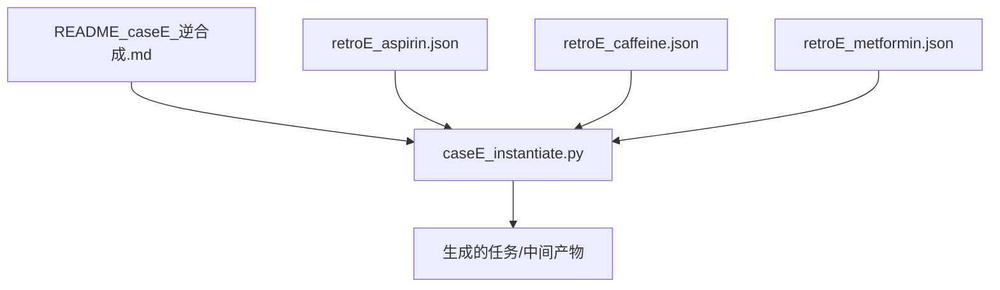
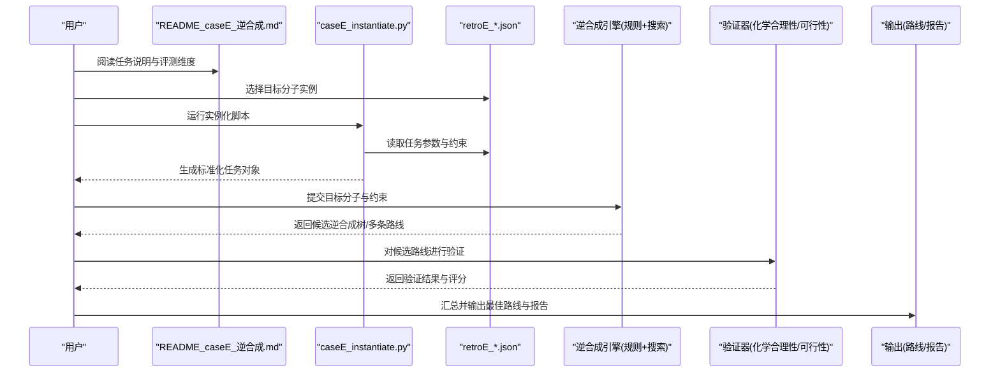
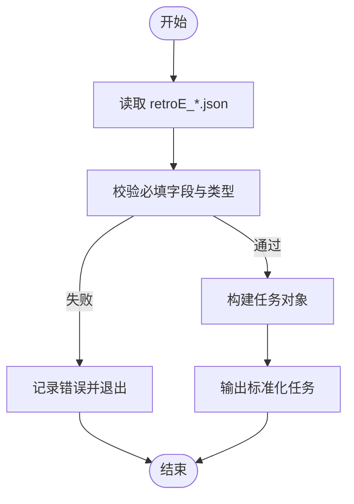
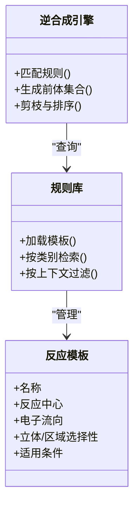
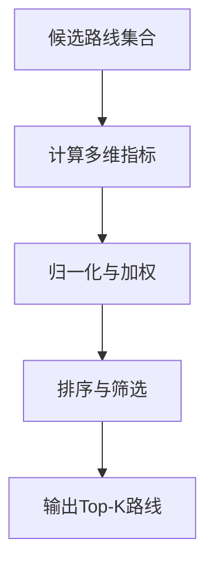
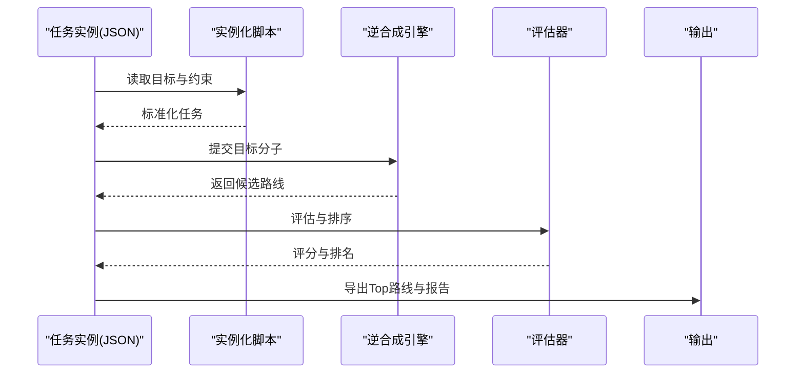
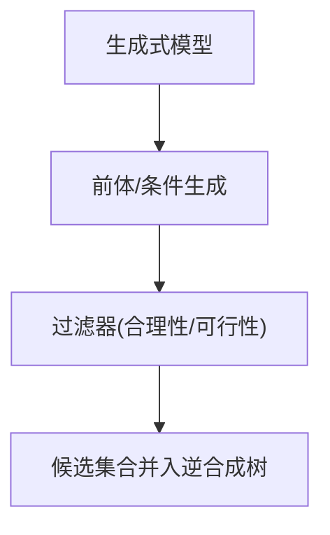
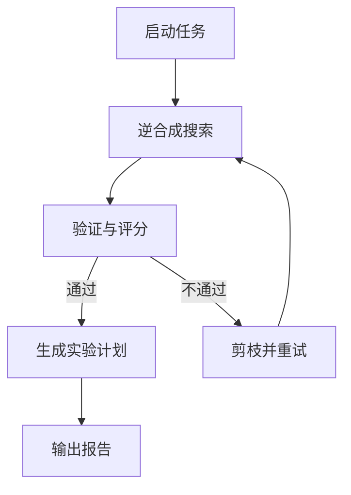
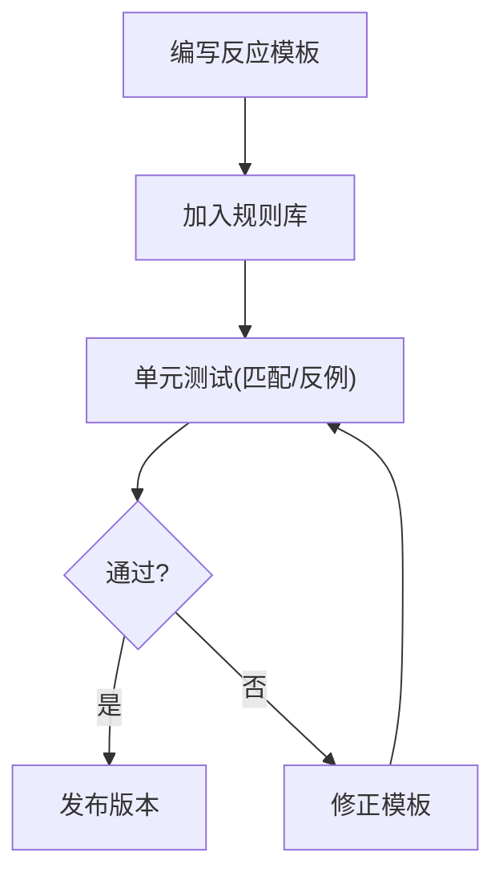
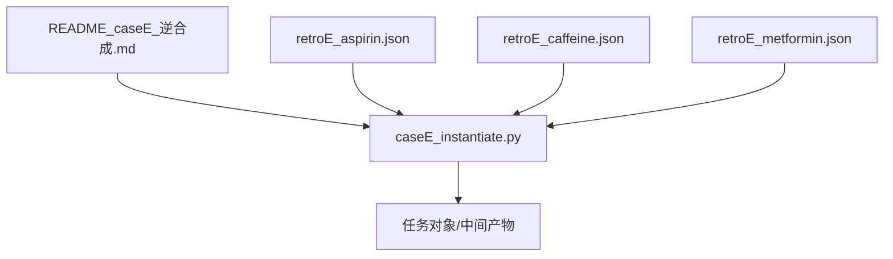

# 逆合成规划

<cite>
**本文引用的文件**   
- [README_caseE_逆合成.md](file://longhorizon/instantiate/README_caseE_逆合成.md)
- [retroE_aspirin.json](file://longhorizon/instantiate/instances/retroE_aspirin.json)
- [retroE_caffeine.json](file://longhorizon/instantiate/instances/retroE_caffeine.json)
- [retroE_metformin.json](file://longhorizon/instantiate/instances/retroE_metformin.json)
- [caseE_instantiate.py](file://longhorizon/instantiate/caseE_instantiate.py)
</cite>

## 目录
1. [引言](#引言)
2. [项目结构](#项目结构)
3. [核心组件](#核心组件)
4. [架构总览](#架构总览)
5. [详细组件分析](#详细组件分析)
6. [依赖关系分析](#依赖关系分析)
7. [性能与可扩展性](#性能与可扩展性)
8. [故障排查指南](#故障排查指南)
9. [结论](#结论)
10. [附录](#附录)

## 引言
本文件围绕“逆合成规划”能力，系统阐述从目标分子出发逆向推导合成路径的理论基础、规则库组织方式、路线评估方法以及自动化执行与验证流程。结合仓库中提供的经典药物案例（阿司匹林、咖啡因、二甲双胍），说明如何构建可执行的逆合成工作流，并给出数据库使用与自定义反应规则的扩展建议。

## 项目结构
与逆合成相关的实例数据与脚本集中在 longhorizon/instantiate 目录下：
- README_caseE_逆合成.md：任务背景、目标与整体说明
- instances/*.json：各目标分子的逆合成任务定义与输入数据
- caseE_instantiate.py：用于生成或准备逆合成任务的实例化脚本

图示来源
- [README_caseE_逆合成.md](file://longhorizon/instantiate/README_caseE_逆合成.md)
- [caseE_instantiate.py](file://longhorizon/instantiate/caseE_instantiate.py)
- [retroE_aspirin.json](file://longhorizon/instantiate/instances/retroE_aspirin.json)
- [retroE_caffeine.json](file://longhorizon/instantiate/instances/retroE_caffeine.json)
- [retroE_metformin.json](file://longhorizon/instantiate/instances/retroE_metformin.json)

章节来源
- [README_caseE_逆合成.md](file://longhorizon/instantiate/README_caseE_逆合成.md)
- [caseE_instantiate.py](file://longhorizon/instantiate/caseE_instantiate.py)
- [retroE_aspirin.json](file://longhorizon/instantiate/instances/retroE_aspirin.json)
- [retroE_caffeine.json](file://longhorizon/instantiate/instances/retroE_caffeine.json)
- [retroE_metformin.json](file://longhorizon/instantiate/instances/retroE_metformin.json)

## 核心组件
- 任务定义与输入数据
  - 每个目标分子对应一个 JSON 实例，包含目标结构、起始原料约束、期望的逆合成深度、评分指标等元信息。
  - 示例文件：retroE_aspirin.json、retroE_caffeine.json、retroE_metformin.json。
- 实例化脚本
  - caseE_instantiate.py 负责读取任务描述与实例数据，生成标准化的任务对象或中间表示，供后续推理与执行管线消费。
- 文档说明
  - README_caseE_逆合成.md 提供任务范围、预期输出与评测维度的总体说明。

章节来源
- [README_caseE_逆合成.md](file://longhorizon/instantiate/README_caseE_逆合成.md)
- [caseE_instantiate.py](file://longhorizon/instantiate/caseE_instantiate.py)
- [retroE_aspirin.json](file://longhorizon/instantiate/instances/retroE_aspirin.json)
- [retroE_caffeine.json](file://longhorizon/instantiate/instances/retroE_caffeine.json)
- [retroE_metformin.json](file://longhorizon/instantiate/instances/retroE_metformin.json)

## 架构总览
逆合成规划的整体流程由“任务实例化 → 规则匹配与树搜索 → 路线评估与排序 → 自动执行与验证”构成。下图展示了从 JSON 实例到最终可执行合成路线的关键环节。

图示来源
- [README_caseE_逆合成.md](file://longhorizon/instantiate/README_caseE_逆合成.md)
- [caseE_instantiate.py](file://longhorizon/instantiate/caseE_instantiate.py)
- [retroE_aspirin.json](file://longhorizon/instantiate/instances/retroE_aspirin.json)
- [retroE_caffeine.json](file://longhorizon/instantiate/instances/retroE_caffeine.json)
- [retroE_metformin.json](file://longhorizon/instantiate/instances/retroE_metformin.json)

## 详细组件分析

### 任务实例化与数据模型
- 作用
  - 将分散的 JSON 实例统一为内部任务对象，便于后续流水线调用。
- 关键职责
  - 解析目标分子结构与约束条件
  - 校验必填字段与格式
  - 生成可被逆合成引擎消费的输入
- 典型输入字段（概念性）
  - 目标分子标识/结构
  - 起始原料可用性与成本标签
  - 最大逆合成深度
  - 评分权重（步骤数、原子经济性、安全性、环境影响等）

图示来源
- [caseE_instantiate.py](file://longhorizon/instantiate/caseE_instantiate.py)
- [retroE_aspirin.json](file://longhorizon/instantiate/instances/retroE_aspirin.json)
- [retroE_caffeine.json](file://longhorizon/instantiate/instances/retroE_caffeine.json)
- [retroE_metformin.json](file://longhorizon/instantiate/instances/retroE_metformin.json)

章节来源
- [caseE_instantiate.py](file://longhorizon/instantiate/caseE_instantiate.py)
- [retroE_aspirin.json](file://longhorizon/instantiate/instances/retroE_aspirin.json)
- [retroE_caffeine.json](file://longhorizon/instantiate/instances/retroE_caffeine.json)
- [retroE_metformin.json](file://longhorizon/instantiate/instances/retroE_metformin.json)

### 逆合成分析与规则库
- 理论基础
  - 基于官能团转换与键断裂策略，将目标分子逐步拆解为更简单的子结构，直至到达可购起始原料或简单中间体。
- 规则库组织
  - 以反应模板为核心，包含反应中心、电子流向、立体化学与区域选择性约束。
  - 可按类别（缩合、取代、加成、重排等）与复杂度分层管理。
- 检索与匹配
  - 子结构匹配 + 环境上下文过滤（溶剂、温度、催化剂等可选）。
  - 多候选规则并行生成，再进行可行性剪枝。

图示来源
- [README_caseE_逆合成.md](file://longhorizon/instantiate/README_caseE_逆合成.md)

章节来源
- [README_caseE_逆合成.md](file://longhorizon/instantiate/README_caseE_逆合成.md)

### 合成路线评估方法
- 评估维度（概念性）
  - 步骤数与收敛度
  - 原子经济性与收率预估
  - 起始原料可得性与成本
  - 安全与环境风险（毒性、三废、能耗）
  - 立体/区域选择性控制难度
- 评分策略
  - 加权打分与多目标优化
  - 蒙特卡洛采样下的鲁棒性评估
  - 与历史成功路线相似度作为先验

[本节为通用方法论说明，不直接分析具体文件]

### 经典药物案例：阿司匹林、咖啡因、二甲双胍
- 数据来源
  - retroE_aspirin.json、retroE_caffeine.json、retroE_metformin.json 分别定义了三个目标分子的逆合成任务。
- 任务要点（概念性）
  - 指定目标分子与约束
  - 限定起始原料范围与成本阈值
  - 设定最大逆合成深度与评分权重
- 执行流程
  - 通过实例化脚本生成任务对象
  - 驱动逆合成引擎生成候选树
  - 评估并输出推荐路线

图示来源
- [retroE_aspirin.json](file://longhorizon/instantiate/instances/retroE_aspirin.json)
- [retroE_caffeine.json](file://longhorizon/instantiate/instances/retroE_caffeine.json)
- [retroE_metformin.json](file://longhorizon/instantiate/instances/retroE_metformin.json)
- [caseE_instantiate.py](file://longhorizon/instantiate/caseE_instantiate.py)

章节来源
- [retroE_aspirin.json](file://longhorizon/instantiate/instances/retroE_aspirin.json)
- [retroE_caffeine.json](file://longhorizon/instantiate/instances/retroE_caffeine.json)
- [retroE_metformin.json](file://longhorizon/instantiate/instances/retroE_metformin.json)
- [caseE_instantiate.py](file://longhorizon/instantiate/caseE_instantiate.py)

### 生成式分子设计在逆合成中的应用
- 角色定位
  - 当规则库无法覆盖某些复杂转化时，利用生成式模型补全缺失的前体或新反应路径。
- 应用模式
  - 前体生成：根据目标片段与反应类型，生成合理前体候选
  - 反应条件建议：结合文献与经验数据，推荐溶剂、温度、催化剂
  - 多样性探索：在保持化学合理性的前提下，扩大搜索空间
- 集成方式
  - 作为规则匹配的补充模块，参与候选生成与再筛选

[本节为通用方法论说明，不直接分析具体文件]

### 自动化执行与验证
- 执行编排
  - 基于实例化脚本产出任务对象，驱动逆合成与评估流水线
- 验证策略
  - 化学合理性检查（价态、环张力、立体一致性）
  - 热力学/动力学可行性估算
  - 安全与环境风险评估
- 输出物
  - 结构化路线（节点=分子，边=反应）
  - 评分与排名
  - 可复现实验计划（试剂、条件、步骤顺序）

[本节为通用方法论说明，不直接分析具体文件]

### 逆合成数据库使用指南
- 数据组织
  - 以 JSON 实例为单位，每个文件对应一个目标分子的任务定义
- 使用步骤
  - 选择目标分子对应的 JSON 文件
  - 运行实例化脚本生成任务对象
  - 将任务对象提交至逆合成引擎
- 注意事项
  - 确保必填字段完整
  - 合理设置搜索深度与评分权重
  - 关注起始原料的可得性与成本约束

章节来源
- [README_caseE_逆合成.md](file://longhorizon/instantiate/README_caseE_逆合成.md)
- [caseE_instantiate.py](file://longhorizon/instantiate/caseE_instantiate.py)
- [retroE_aspirin.json](file://longhorizon/instantiate/instances/retroE_aspirin.json)
- [retroE_caffeine.json](file://longhorizon/instantiate/instances/retroE_caffeine.json)
- [retroE_metformin.json](file://longhorizon/instantiate/instances/retroE_metformin.json)

### 自定义反应规则的添加方法
- 新增模板
  - 定义反应中心、电子流向、立体/区域选择性约束与适用条件
- 入库与索引
  - 将模板加入规则库并按类别建立索引
- 测试与回归
  - 使用已知反应样例进行匹配测试
  - 评估对现有路线质量的影响
- 发布与版本管理
  - 记录变更日志与版本标签，便于回溯

[本节为通用方法论说明，不直接分析具体文件]

## 依赖关系分析
- 文件间依赖
  - caseE_instantiate.py 依赖 README_caseE_逆合成.md 的任务说明与 retroE_*.json 的数据定义
  - retroE_*.json 之间相互独立，但共享相同的任务范式
- 外部依赖（概念性）
  - 逆合成引擎（规则匹配与搜索）
  - 验证器（化学合理性/可行性）
  - 评估器（多维度评分）

图示来源
- [README_caseE_逆合成.md](file://longhorizon/instantiate/README_caseE_逆合成.md)
- [caseE_instantiate.py](file://longhorizon/instantiate/caseE_instantiate.py)
- [retroE_aspirin.json](file://longhorizon/instantiate/instances/retroE_aspirin.json)
- [retroE_caffeine.json](file://longhorizon/instantiate/instances/retroE_caffeine.json)
- [retroE_metformin.json](file://longhorizon/instantiate/instances/retroE_metformin.json)

章节来源
- [README_caseE_逆合成.md](file://longhorizon/instantiate/README_caseE_逆合成.md)
- [caseE_instantiate.py](file://longhorizon/instantiate/caseE_instantiate.py)
- [retroE_aspirin.json](file://longhorizon/instantiate/instances/retroE_aspirin.json)
- [retroE_caffeine.json](file://longhorizon/instantiate/instances/retroE_caffeine.json)
- [retroE_metformin.json](file://longhorizon/instantiate/instances/retroE_metformin.json)

## 性能与可扩展性
- 搜索空间控制
  - 限制最大深度与分支因子，避免组合爆炸
- 并行化
  - 规则匹配与候选生成阶段支持并行
- 缓存与复用
  - 对常见片段与反应进行缓存，减少重复计算
- 增量更新
  - 规则库与数据库增量更新，避免全量重建

[本节为通用方法论说明，不直接分析具体文件]

## 故障排查指南
- 常见问题
  - JSON 实例字段缺失或类型错误
  - 规则库未覆盖目标转化
  - 搜索深度过大导致超时
- 诊断步骤
  - 检查实例化脚本的输入校验与日志
  - 缩小搜索范围或调整评分权重
  - 增加相关反应模板或放宽约束
- 恢复策略
  - 回退到上一稳定版本
  - 使用已知成功案例进行回归测试

章节来源
- [README_caseE_逆合成.md](file://longhorizon/instantiate/README_caseE_逆合成.md)
- [caseE_instantiate.py](file://longhorizon/instantiate/caseE_instantiate.py)

## 结论
本仓库提供了逆合成规划的实例化入口与三类经典药物的任务定义，配合统一的文档说明，形成了从数据到任务对象的标准化链路。在此基础上，可通过扩展规则库、引入生成式设计与完善评估验证体系，进一步提升逆合成的覆盖率与实用性。

## 附录
- 术语
  - 逆合成：从目标分子逆向推导合成路径的方法学
  - 反应模板：描述反应中心与电子流向的规则单元
  - 起始原料：可直接购买或易得的简单分子
- 参考实践
  - 使用 retroE_*.json 作为任务模板
  - 通过 caseE_instantiate.py 快速生成任务对象
  - 依据 README_caseE_逆合成.md 中的评测维度进行路线比较