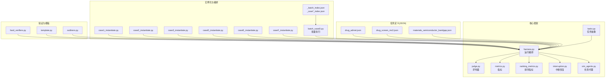
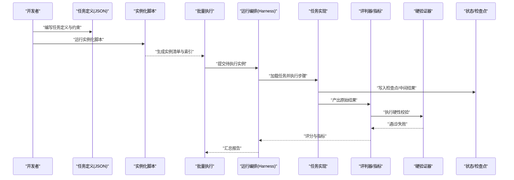
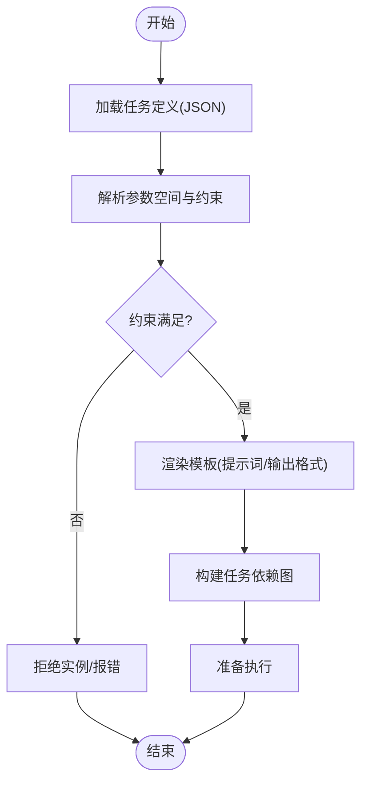
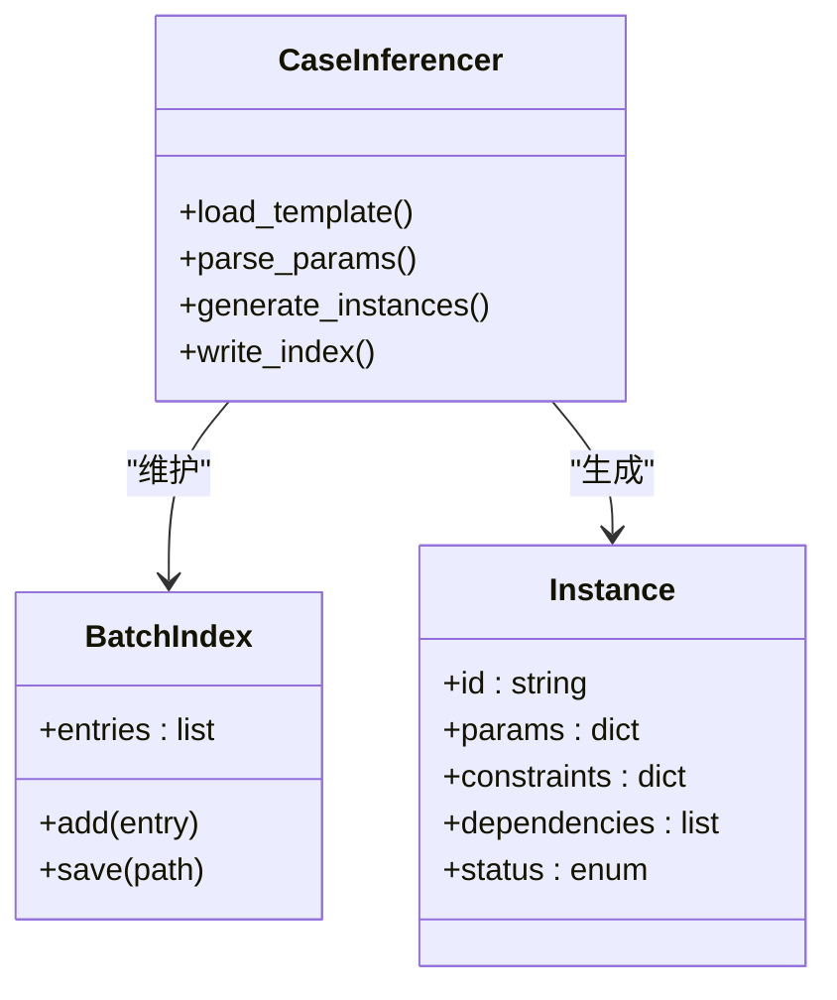
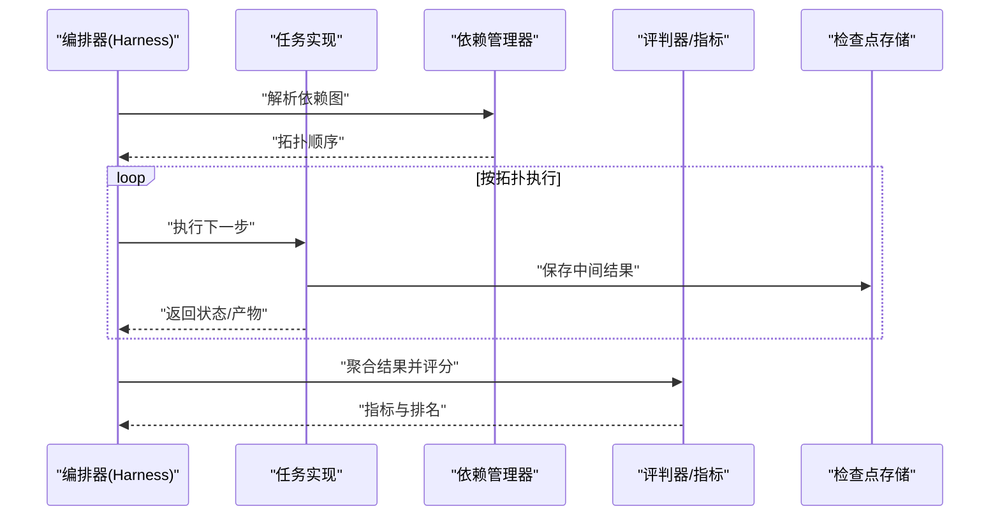
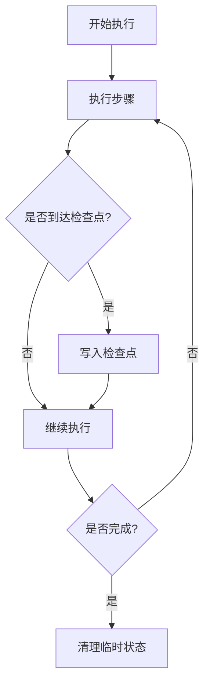
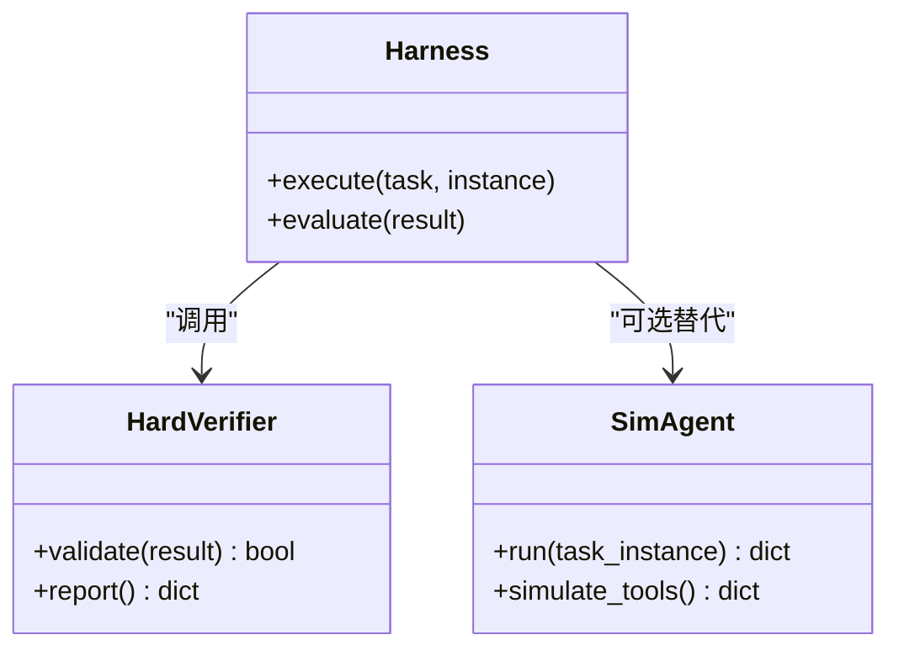
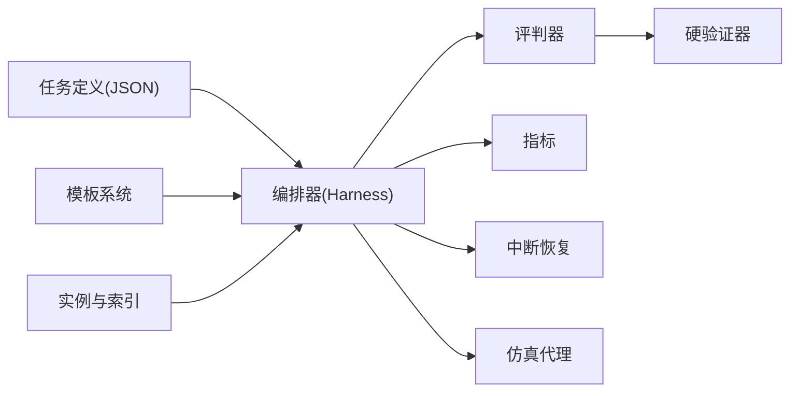

# 任务扩展机制

<cite>
**本文引用的文件**   
- [autonomy_mvp/core/tasks.py](file://autonomy_mvp/core/tasks.py)
- [autonomy_mvp/core/harness.py](file://autonomy_mvp/core/harness.py)
- [autonomy_mvp/core/interruption.py](file://autonomy_mvp/core/interruption.py)
- [autonomy_mvp/core/judge.py](file://autonomy_mvp/core/judge.py)
- [autonomy_mvp/core/metrics.py](file://autonomy_mvp/core/metrics.py)
- [autonomy_mvp/core/ranking_metrics.py](file://autonomy_mvp/core/ranking_metrics.py)
- [autonomy_mvp/core/sim_agents.py](file://autonomy_mvp/core/sim_agents.py)
- [autonomy_mvp/tasks/drug_admet.json](file://autonomy_mvp/tasks/drug_admet.json)
- [autonomy_mvp/tasks/drug_screen_ms3.json](file://autonomy_mvp/tasks/drug_screen_ms3.json)
- [autonomy_mvp/tasks/materials_semiconductor_bandgap.json](file://autonomy_mvp/tasks/materials_semiconductor_bandgap.json)
- [longhorizon/instantiate/case1_instantiate.py](file://longhorizon/instantiate/case1_instantiate.py)
- [longhorizon/instantiate/case2_instantiate.py](file://longhorizon/instantiate/case2_instantiate.py)
- [longhorizon/instantiate/case3_instantiate.py](file://longhorizon/instantiate/case3_instantiate.py)
- [longhorizon/instantiate/caseD_instantiate.py](file://longhorizon/instantiate/caseD_instantiate.py)
- [longhorizon/instantiate/caseE_instantiate.py](file://longhorizon/instantiate/caseE_instantiate.py)
- [longhorizon/instantiate/caseF_instantiate.py](file://longhorizon/instantiate/caseF_instantiate.py)
- [longhorizon/instantiate/batch_caseD.py](file://longhorizon/instantiate/batch_caseD.py)
- [longhorizon/instantiate/instances/_batch_index.json](file://longhorizon/instantiate/instances/_batch_index.json)
- [longhorizon/instantiate/instances/_case2_index.json](file://longhorizon/instantiate/instances/_case2_index.json)
- [longhorizon/instantiate/instances/_case3_index.json](file://longhorizon/instantiate/instances/_case3_index.json)
- [longhorizon/instantiate/instances/_caseE_index.json](file://longhorizon/instantiate/instances/_caseE_index.json)
- [longhorizon/instantiate/instances/_caseF_index.json](file://longhorizon/instantiate/instances/_caseF_index.json)
- [longhorizon/instantiate/instances/_b3_audit.json](file://longhorizon/instantiate/instances/_b3_audit.json)
- [longhorizon/instantiate/instances/drug2_BACE1.json](file://longhorizon/instantiate/instances/drug2_BACE1.json)
- [longhorizon/instantiate/instances/mat1_Ca-Si-O_funnel.json](file://longhorizon/instantiate/instances/mat1_Ca-Si-O_funnel.json)
- [longhorizon/instantiate/instances/mech3_Crizotinib-ALK+_NSCLC.json](file://longhorizon/instantiate/instances/mech3_Crizotinib-ALK+_NSCLC.json)
- [longhorizon/instantiate/instances/targetF_ABL1-CML.json](file://longhorizon/instantiate/instances/targetF_ABL1-CML.json)
- [longhorizon/instantiate/README_case3_机理模拟.md](file://longhorizon/instantiate/README_case3_机理模拟.md)
- [longhorizon/instantiate/README_caseD_闭环优化.md](file://longhorizon/instantiate/README_caseD_闭环优化.md)
- [longhorizon/instantiate/README_caseE_逆合成.md](file://longhorizon/instantiate/README_caseE_逆合成.md)
- [longhorizon/instantiate/README_caseF_靶点验证.md](file://longhorizon/instantiate/README_caseF_靶点验证.md)
- [longhorizon/verifiers/hard_verifiers.py](file://longhorizon/verifiers/hard_verifiers.py)
- [docs/molbench_repo/templates/template.py](file://docs/molbench_repo/templates/template.py)
- [docs/molbench_repo/templates/outliners.py](file://docs/molbench_repo/templates/outliners.py)
</cite>

## 目录
1. [引言](#引言)
2. [项目结构](#项目结构)
3. [核心组件](#核心组件)
4. [架构总览](#架构总览)
5. [详细组件分析](#详细组件分析)
6. [依赖关系分析](#依赖关系分析)
7. [性能与并行策略](#性能与并行策略)
8. [故障排查指南](#故障排查指南)
9. [结论](#结论)
10. [附录：任务开发示例](#附录：任务开发示例)

## 引言
本文件围绕“任务扩展机制”展开，系统化阐述任务定义框架、实例化引擎与工作流编排体系。目标是为研究人员提供从材料发现到药物筛选等长视域任务的完整定制能力，包括：
- 如何创建新的长视域任务类型
- 如何定义任务约束条件与执行环境
- 任务依赖管理、状态跟踪与中断恢复
- 模板系统、批量执行与并行处理策略

## 项目结构
仓库采用“核心框架 + 多领域任务 + 实例化与编排”的分层组织方式：
- 核心框架（autonomy_mvp/core）：定义任务抽象、评估器、指标、中断恢复与仿真代理等基础能力
- 任务定义（autonomy_mvp/tasks）：以 JSON 描述具体任务（如药物 ADMET、MS3 筛选、半导体能带隙）
- 实例化与编排（longhorizon/instantiate）：按案例生成可执行的实例清单与索引，支持批量与并行
- 验证器（longhorizon/verifiers）：硬校验逻辑，用于结果一致性或阈值判定
- 模板系统（docs/molbench_repo/templates）：通用模板与大纲生成工具，辅助任务提示词与输出格式标准化

图表来源
- [autonomy_mvp/core/tasks.py](file://autonomy_mvp/core/tasks.py)
- [autonomy_mvp/core/harness.py](file://autonomy_mvp/core/harness.py)
- [autonomy_mvp/core/interruption.py](file://autonomy_mvp/core/interruption.py)
- [autonomy_mvp/core/judge.py](file://autonomy_mvp/core/judge.py)
- [autonomy_mvp/core/metrics.py](file://autonomy_mvp/core/metrics.py)
- [autonomy_mvp/core/ranking_metrics.py](file://autonomy_mvp/core/ranking_metrics.py)
- [autonomy_mvp/core/sim_agents.py](file://autonomy_mvp/core/sim_agents.py)
- [autonomy_mvp/tasks/drug_admet.json](file://autonomy_mvp/tasks/drug_admet.json)
- [autonomy_mvp/tasks/drug_screen_ms3.json](file://autonomy_mvp/tasks/drug_screen_ms3.json)
- [autonomy_mvp/tasks/materials_semiconductor_bandgap.json](file://autonomy_mvp/tasks/materials_semiconductor_bandgap.json)
- [longhorizon/instantiate/case1_instantiate.py](file://longhorizon/instantiate/case1_instantiate.py)
- [longhorizon/instantiate/case2_instantiate.py](file://longhorizon/instantiate/case2_instantiate.py)
- [longhorizon/instantiate/case3_instantiate.py](file://longhorizon/instantiate/case3_instantiate.py)
- [longhorizon/instantiate/caseD_instantiate.py](file://longhorizon/instantiate/caseD_instantiate.py)
- [longhorizon/instantiate/caseE_instantiate.py](file://longhorizon/instantiate/caseE_instantiate.py)
- [longhorizon/instantiate/caseF_instantiate.py](file://longhorizon/instantiate/caseF_instantiate.py)
- [longhorizon/instantiate/batch_caseD.py](file://longhorizon/instantiate/batch_caseD.py)
- [longhorizon/instantiate/instances/_batch_index.json](file://longhorizon/instantiate/instances/_batch_index.json)
- [longhorizon/instantiate/instances/_case2_index.json](file://longhorizon/instantiate/instances/_case2_index.json)
- [longhorizon/instantiate/instances/_case3_index.json](file://longhorizon/instantiate/instances/_case3_index.json)
- [longhorizon/instantiate/instances/_caseE_index.json](file://longhorizon/instantiate/instances/_caseE_index.json)
- [longhorizon/instantiate/instances/_caseF_index.json](file://longhorizon/instantiate/instances/_caseF_index.json)
- [longhorizon/instantiate/instances/_b3_audit.json](file://longhorizon/instantiate/instances/_b3_audit.json)
- [longhorizon/verifiers/hard_verifiers.py](file://longhorizon/verifiers/hard_verifiers.py)
- [docs/molbench_repo/templates/template.py](file://docs/molbench_repo/templates/template.py)
- [docs/molbench_repo/templates/outliners.py](file://docs/molbench_repo/templates/outliners.py)

章节来源
- [autonomy_mvp/core/tasks.py](file://autonomy_mvp/core/tasks.py)
- [autonomy_mvp/core/harness.py](file://autonomy_mvp/core/harness.py)
- [autonomy_mvp/core/interruption.py](file://autonomy_mvp/core/interruption.py)
- [autonomy_mvp/core/judge.py](file://autonomy_mvp/core/judge.py)
- [autonomy_mvp/core/metrics.py](file://autonomy_mvp/core/metrics.py)
- [autonomy_mvp/core/ranking_metrics.py](file://autonomy_mvp/core/ranking_metrics.py)
- [autonomy_mvp/core/sim_agents.py](file://autonomy_mvp/core/sim_agents.py)
- [autonomy_mvp/tasks/drug_admet.json](file://autonomy_mvp/tasks/drug_admet.json)
- [autonomy_mvp/tasks/drug_screen_ms3.json](file://autonomy_mvp/tasks/drug_screen_ms3.json)
- [autonomy_mvp/tasks/materials_semiconductor_bandgap.json](file://autonomy_mvp/tasks/materials_semiconductor_bandgap.json)
- [longhorizon/instantiate/case1_instantiate.py](file://longhorizon/instantiate/case1_instantiate.py)
- [longhorizon/instantiate/case2_instantiate.py](file://longhorizon/instantiate/case2_instantiate.py)
- [longhorizon/instantiate/case3_instantiate.py](file://longhorizon/instantiate/case3_instantiate.py)
- [longhorizon/instantiate/caseD_instantiate.py](file://longhorizon/instantiate/caseD_instantiate.py)
- [longhorizon/instantiate/caseE_instantiate.py](file://longhorizon/instantiate/caseE_instantiate.py)
- [longhorizon/instantiate/caseF_instantiate.py](file://longhorizon/instantiate/caseF_instantiate.py)
- [longhorizon/instantiate/batch_caseD.py](file://longhorizon/instantiate/batch_caseD.py)
- [longhorizon/instantiate/instances/_batch_index.json](file://longhorizon/instantiate/instances/_batch_index.json)
- [longhorizon/instantiate/instances/_case2_index.json](file://longhorizon/instantiate/instances/_case2_index.json)
- [longhorizon/instantiate/instances/_case3_index.json](file://longhorizon/instantiate/instances/_case3_index.json)
- [longhorizon/instantiate/instances/_caseE_index.json](file://longhorizon/instantiate/instances/_caseE_index.json)
- [longhorizon/instantiate/instances/_caseF_index.json](file://longhorizon/instantiate/instances/_caseF_index.json)
- [longhorizon/instantiate/instances/_b3_audit.json](file://longhorizon/instantiate/instances/_b3_audit.json)
- [longhorizon/verifiers/hard_verifiers.py](file://longhorizon/verifiers/hard_verifiers.py)
- [docs/molbench_repo/templates/template.py](file://docs/molbench_repo/templates/template.py)
- [docs/molbench_repo/templates/outliners.py](file://docs/molbench_repo/templates/outliners.py)

## 核心组件
- 任务抽象与注册：通过统一的任务接口定义输入、步骤、约束与输出规范，便于新增任务类型时复用基础设施
- 运行编排（Harness）：负责加载任务定义、解析依赖、调度子任务、收集中间结果、触发评估与指标计算
- 中断恢复：持久化任务状态与检查点，支持异常退出后从最近检查点继续执行
- 评判器与指标：将原始输出映射为可比较的评分，支持多种度量与排序指标
- 仿真代理：在无需外部工具的情况下对任务进行快速验证与回归测试
- 任务定义（JSON）：声明式描述任务元数据、参数空间、约束条件与评估规则
- 实例化与索引：根据模板与参数表生成具体实例清单，并维护批次索引以便批量执行
- 验证器：提供硬性校验逻辑（如阈值、格式、一致性），确保结果可信
- 模板系统：标准化提示词、输出格式与大纲，降低重复劳动

章节来源
- [autonomy_mvp/core/tasks.py](file://autonomy_mvp/core/tasks.py)
- [autonomy_mvp/core/harness.py](file://autonomy_mvp/core/harness.py)
- [autonomy_mvp/core/interruption.py](file://autonomy_mvp/core/interruption.py)
- [autonomy_mvp/core/judge.py](file://autonomy_mvp/core/judge.py)
- [autonomy_mvp/core/metrics.py](file://autonomy_mvp/core/metrics.py)
- [autonomy_mvp/core/ranking_metrics.py](file://autonomy_mvp/core/ranking_metrics.py)
- [autonomy_mvp/core/sim_agents.py](file://autonomy_mvp/core/sim_agents.py)
- [autonomy_mvp/tasks/drug_admet.json](file://autonomy_mvp/tasks/drug_admet.json)
- [autonomy_mvp/tasks/drug_screen_ms3.json](file://autonomy_mvp/tasks/drug_screen_ms3.json)
- [autonomy_mvp/tasks/materials_semiconductor_bandgap.json](file://autonomy_mvp/tasks/materials_semiconductor_bandgap.json)
- [longhorizon/instantiate/case1_instantiate.py](file://longhorizon/instantiate/case1_instantiate.py)
- [longhorizon/instantiate/case2_instantiate.py](file://longhorizon/instantiate/case2_instantiate.py)
- [longhorizon/instantiate/case3_instantiate.py](file://longhorizon/instantiate/case3_instantiate.py)
- [longhorizon/instantiate/caseD_instantiate.py](file://longhorizon/instantiate/caseD_instantiate.py)
- [longhorizon/instantiate/caseE_instantiate.py](file://longhorizon/instantiate/caseE_instantiate.py)
- [longhorizon/instantiate/caseF_instantiate.py](file://longhorizon/instantiate/caseF_instantiate.py)
- [longhorizon/instantiate/batch_caseD.py](file://longhorizon/instantiate/batch_caseD.py)
- [longhorizon/instantiate/instances/_batch_index.json](file://longhorizon/instantiate/instances/_batch_index.json)
- [longhorizon/instantiate/instances/_case2_index.json](file://longhorizon/instantiate/instances/_case2_index.json)
- [longhorizon/instantiate/instances/_case3_index.json](file://longhorizon/instantiate/instances/_case3_index.json)
- [longhorizon/instantiate/instances/_caseE_index.json](file://longhorizon/instantiate/instances/_caseE_index.json)
- [longhorizon/instantiate/instances/_caseF_index.json](file://longhorizon/instantiate/instances/_caseF_index.json)
- [longhorizon/instantiate/instances/_b3_audit.json](file://longhorizon/instantiate/instances/_b3_audit.json)
- [longhorizon/verifiers/hard_verifiers.py](file://longhorizon/verifiers/hard_verifiers.py)
- [docs/molbench_repo/templates/template.py](file://docs/molbench_repo/templates/template.py)
- [docs/molbench_repo/templates/outliners.py](file://docs/molbench_repo/templates/outliners.py)

## 架构总览
下图展示了从任务定义到实例化、执行、评估与报告的全链路流程。

图表来源
- [autonomy_mvp/core/harness.py](file://autonomy_mvp/core/harness.py)
- [autonomy_mvp/core/judge.py](file://autonomy_mvp/core/judge.py)
- [autonomy_mvp/core/metrics.py](file://autonomy_mvp/core/metrics.py)
- [autonomy_mvp/core/ranking_metrics.py](file://autonomy_mvp/core/ranking_metrics.py)
- [autonomy_mvp/core/interruption.py](file://autonomy_mvp/core/interruption.py)
- [longhorizon/instantiate/case1_instantiate.py](file://longhorizon/instantiate/case1_instantiate.py)
- [longhorizon/instantiate/case2_instantiate.py](file://longhorizon/instantiate/case2_instantiate.py)
- [longhorizon/instantiate/case3_instantiate.py](file://longhorizon/instantiate/case3_instantiate.py)
- [longhorizon/instantiate/caseD_instantiate.py](file://longhorizon/instantiate/caseD_instantiate.py)
- [longhorizon/instantiate/caseE_instantiate.py](file://longhorizon/instantiate/caseE_instantiate.py)
- [longhorizon/instantiate/caseF_instantiate.py](file://longhorizon/instantiate/caseF_instantiate.py)
- [longhorizon/instantiate/batch_caseD.py](file://longhorizon/instantiate/batch_caseD.py)
- [longhorizon/instantiate/instances/_batch_index.json](file://longhorizon/instantiate/instances/_batch_index.json)
- [longhorizon/instantiate/instances/_case2_index.json](file://longhorizon/instantiate/instances/_case2_index.json)
- [longhorizon/instantiate/instances/_case3_index.json](file://longhorizon/instantiate/instances/_case3_index.json)
- [longhorizon/instantiate/instances/_caseE_index.json](file://longhorizon/instantiate/instances/_caseE_index.json)
- [longhorizon/instantiate/instances/_caseF_index.json](file://longhorizon/instantiate/instances/_caseF_index.json)
- [longhorizon/instantiate/instances/_b3_audit.json](file://longhorizon/instantiate/instances/_b3_audit.json)
- [longhorizon/verifiers/hard_verifiers.py](file://longhorizon/verifiers/hard_verifiers.py)

## 详细组件分析

### 任务定义框架（JSON 驱动）
- 设计要点
  - 使用 JSON 声明任务元数据、参数空间、约束条件、依赖关系与评估规则
  - 支持多任务类型（材料发现、药物筛选、机理模拟、逆合成、靶点验证等）
  - 通过模板系统统一提示词与输出格式，减少重复工作
- 关键文件
  - 任务定义：[drug_admet.json](file://autonomy_mvp/tasks/drug_admet.json)、[drug_screen_ms3.json](file://autonomy_mvp/tasks/drug_screen_ms3.json)、[materials_semiconductor_bandgap.json](file://autonomy_mvp/tasks/materials_semiconductor_bandgap.json)
  - 模板系统：[template.py](file://docs/molbench_repo/templates/template.py)、[outliners.py](file://docs/molbench_repo/templates/outliners.py)

图表来源
- [autonomy_mvp/tasks/drug_admet.json](file://autonomy_mvp/tasks/drug_admet.json)
- [autonomy_mvp/tasks/drug_screen_ms3.json](file://autonomy_mvp/tasks/drug_screen_ms3.json)
- [autonomy_mvp/tasks/materials_semiconductor_bandgap.json](file://autonomy_mvp/tasks/materials_semiconductor_bandgap.json)
- [docs/molbench_repo/templates/template.py](file://docs/molbench_repo/templates/template.py)
- [docs/molbench_repo/templates/outliners.py](file://docs/molbench_repo/templates/outliners.py)

章节来源
- [autonomy_mvp/tasks/drug_admet.json](file://autonomy_mvp/tasks/drug_admet.json)
- [autonomy_mvp/tasks/drug_screen_ms3.json](file://autonomy_mvp/tasks/drug_screen_ms3.json)
- [autonomy_mvp/tasks/materials_semiconductor_bandgap.json](file://autonomy_mvp/tasks/materials_semiconductor_bandgap.json)
- [docs/molbench_repo/templates/template.py](file://docs/molbench_repo/templates/template.py)
- [docs/molbench_repo/templates/outliners.py](file://docs/molbench_repo/templates/outliners.py)

### 实例化引擎（按案例生成实例）
- 设计要点
  - 每个案例对应一个实例化脚本，负责读取模板与参数表，生成具体实例 JSON 与索引
  - 索引文件（_batch_index.json、_case*_index.json）用于批量执行与进度追踪
- 关键文件
  - 实例化脚本：[case1_instantiate.py](file://longhorizon/instantiate/case1_instantiate.py)、[case2_instantiate.py](file://longhorizon/instantiate/case2_instantiate.py)、[case3_instantiate.py](file://longhorizon/instantiate/case3_instantiate.py)、[caseD_instantiate.py](file://longhorizon/instantiate/caseD_instantiate.py)、[caseE_instantiate.py](file://longhorizon/instantiate/caseE_instantiate.py)、[caseF_instantiate.py](file://longhorizon/instantiate/caseF_instantiate.py)
  - 索引与样例实例：[_batch_index.json](file://longhorizon/instantiate/instances/_batch_index.json)、[_case2_index.json](file://longhorizon/instantiate/instances/_case2_index.json)、[_case3_index.json](file://longhorizon/instantiate/instances/_case3_index.json)、[_caseE_index.json](file://longhorizon/instantiate/instances/_caseE_index.json)、[_caseF_index.json](file://longhorizon/instantiate/instances/_caseF_index.json)、[_b3_audit.json](file://longhorizon/instantiate/instances/_b3_audit.json)、[drug2_BACE1.json](file://longhorizon/instantiate/instances/drug2_BACE1.json)、[mat1_Ca-Si-O_funnel.json](file://longhorizon/instantiate/instances/mat1_Ca-Si-O_funnel.json)、[mech3_Crizotinib-ALK+_NSCLC.json](file://longhorizon/instantiate/instances/mech3_Crizotinib-ALK+_NSCLC.json)、[targetF_ABL1-CML.json](file://longhorizon/instantiate/instances/targetF_ABL1-CML.json)

图表来源
- [longhorizon/instantiate/case1_instantiate.py](file://longhorizon/instantiate/case1_instantiate.py)
- [longhorizon/instantiate/case2_instantiate.py](file://longhorizon/instantiate/case2_instantiate.py)
- [longhorizon/instantiate/case3_instantiate.py](file://longhorizon/instantiate/case3_instantiate.py)
- [longhorizon/instantiate/caseD_instantiate.py](file://longhorizon/instantiate/caseD_instantiate.py)
- [longhorizon/instantiate/caseE_instantiate.py](file://longhorizon/instantiate/caseE_instantiate.py)
- [longhorizon/instantiate/caseF_instantiate.py](file://longhorizon/instantiate/caseF_instantiate.py)
- [longhorizon/instantiate/instances/_batch_index.json](file://longhorizon/instantiate/instances/_batch_index.json)
- [longhorizon/instantiate/instances/_case2_index.json](file://longhorizon/instantiate/instances/_case2_index.json)
- [longhorizon/instantiate/instances/_case3_index.json](file://longhorizon/instantiate/instances/_case3_index.json)
- [longhorizon/instantiate/instances/_caseE_index.json](file://longhorizon/instantiate/instances/_caseE_index.json)
- [longhorizon/instantiate/instances/_caseF_index.json](file://longhorizon/instantiate/instances/_caseF_index.json)
- [longhorizon/instantiate/instances/_b3_audit.json](file://longhorizon/instantiate/instances/_b3_audit.json)
- [longhorizon/instantiate/instances/drug2_BACE1.json](file://longhorizon/instantiate/instances/drug2_BACE1.json)
- [longhorizon/instantiate/instances/mat1_Ca-Si-O_funnel.json](file://longhorizon/instantiate/instances/mat1_Ca-Si-O_funnel.json)
- [longhorizon/instantiate/instances/mech3_Crizotinib-ALK+_NSCLC.json](file://longhorizon/instantiate/instances/mech3_Crizotinib-ALK+_NSCLC.json)
- [longhorizon/instantiate/instances/targetF_ABL1-CML.json](file://longhorizon/instantiate/instances/targetF_ABL1-CML.json)

章节来源
- [longhorizon/instantiate/case1_instantiate.py](file://longhorizon/instantiate/case1_instantiate.py)
- [longhorizon/instantiate/case2_instantiate.py](file://longhorizon/instantiate/case2_instantiate.py)
- [longhorizon/instantiate/case3_instantiate.py](file://longhorizon/instantiate/case3_instantiate.py)
- [longhorizon/instantiate/caseD_instantiate.py](file://longhorizon/instantiate/caseD_instantiate.py)
- [longhorizon/instantiate/caseE_instantiate.py](file://longhorizon/instantiate/caseE_instantiate.py)
- [longhorizon/instantiate/caseF_instantiate.py](file://longhorizon/instantiate/caseF_instantiate.py)
- [longhorizon/instantiate/instances/_batch_index.json](file://longhorizon/instantiate/instances/_batch_index.json)
- [longhorizon/instantiate/instances/_case2_index.json](file://longhorizon/instantiate/instances/_case2_index.json)
- [longhorizon/instantiate/instances/_case3_index.json](file://longhorizon/instantiate/instances/_case3_index.json)
- [longhorizon/instantiate/instances/_caseE_index.json](file://longhorizon/instantiate/instances/_caseE_index.json)
- [longhorizon/instantiate/instances/_caseF_index.json](file://longhorizon/instantiate/instances/_caseF_index.json)
- [longhorizon/instantiate/instances/_b3_audit.json](file://longhorizon/instantiate/instances/_b3_audit.json)
- [longhorizon/instantiate/instances/drug2_BACE1.json](file://longhorizon/instantiate/instances/drug2_BACE1.json)
- [longhorizon/instantiate/instances/mat1_Ca-Si-O_funnel.json](file://longhorizon/instantiate/instances/mat1_Ca-Si-O_funnel.json)
- [longhorizon/instantiate/instances/mech3_Crizotinib-ALK+_NSCLC.json](file://longhorizon/instantiate/instances/mech3_Crizotinib-ALK+_NSCLC.json)
- [longhorizon/instantiate/instances/targetF_ABL1-CML.json](file://longhorizon/instantiate/instances/targetF_ABL1-CML.json)

### 工作流编排系统（Harness）
- 设计要点
  - 统一入口：加载任务定义与实例，解析依赖图，调度执行
  - 状态跟踪：记录每步执行状态、中间产物与错误信息
  - 评估集成：调用评判器与指标模块，生成最终评分
- 关键文件
  - 编排核心：[harness.py](file://autonomy_mvp/core/harness.py)
  - 评判器与指标：[judge.py](file://autonomy_mvp/core/judge.py)、[metrics.py](file://autonomy_mvp/core/metrics.py)、[ranking_metrics.py](file://autonomy_mvp/core/ranking_metrics.py)

图表来源
- [autonomy_mvp/core/harness.py](file://autonomy_mvp/core/harness.py)
- [autonomy_mvp/core/judge.py](file://autonomy_mvp/core/judge.py)
- [autonomy_mvp/core/metrics.py](file://autonomy_mvp/core/metrics.py)
- [autonomy_mvp/core/ranking_metrics.py](file://autonomy_mvp/core/ranking_metrics.py)

章节来源
- [autonomy_mvp/core/harness.py](file://autonomy_mvp/core/harness.py)
- [autonomy_mvp/core/judge.py](file://autonomy_mvp/core/judge.py)
- [autonomy_mvp/core/metrics.py](file://autonomy_mvp/core/metrics.py)
- [autonomy_mvp/core/ranking_metrics.py](file://autonomy_mvp/core/ranking_metrics.py)

### 中断恢复机制
- 设计要点
  - 在执行过程中定期写入检查点，包含当前步骤、已产生结果与上下文
  - 重启时从最近检查点恢复，避免重复计算
- 关键文件
  - 中断恢复：[interruption.py](file://autonomy_mvp/core/interruption.py)

图表来源
- [autonomy_mvp/core/interruption.py](file://autonomy_mvp/core/interruption.py)

章节来源
- [autonomy_mvp/core/interruption.py](file://autonomy_mvp/core/interruption.py)

### 验证器与仿真代理
- 设计要点
  - 硬验证器：对结果进行严格校验（如阈值、格式、一致性）
  - 仿真代理：在无外部工具环境下快速验证任务流程
- 关键文件
  - 硬验证器：[hard_verifiers.py](file://longhorizon/verifiers/hard_verifiers.py)
  - 仿真代理：[sim_agents.py](file://autonomy_mvp/core/sim_agents.py)

图表来源
- [longhorizon/verifiers/hard_verifiers.py](file://longhorizon/verifiers/hard_verifiers.py)
- [autonomy_mvp/core/sim_agents.py](file://autonomy_mvp/core/sim_agents.py)
- [autonomy_mvp/core/harness.py](file://autonomy_mvp/core/harness.py)

章节来源
- [longhorizon/verifiers/hard_verifiers.py](file://longhorizon/verifiers/hard_verifiers.py)
- [autonomy_mvp/core/sim_agents.py](file://autonomy_mvp/core/sim_agents.py)
- [autonomy_mvp/core/harness.py](file://autonomy_mvp/core/harness.py)

## 依赖关系分析
- 组件耦合
  - 编排器（Harness）强依赖任务抽象、评判器与指标；弱依赖中断恢复与仿真代理
  - 实例化脚本仅依赖模板系统与参数表，输出实例与索引
  - 验证器独立于执行路径，作为后置校验环节
- 外部依赖
  - 任务定义（JSON）与模板系统（Python）共同决定任务行为
  - 索引文件（JSON）驱动批量执行与进度追踪

图表来源
- [autonomy_mvp/core/harness.py](file://autonomy_mvp/core/harness.py)
- [autonomy_mvp/core/judge.py](file://autonomy_mvp/core/judge.py)
- [autonomy_mvp/core/metrics.py](file://autonomy_mvp/core/metrics.py)
- [autonomy_mvp/core/interruption.py](file://autonomy_mvp/core/interruption.py)
- [autonomy_mvp/core/sim_agents.py](file://autonomy_mvp/core/sim_agents.py)
- [longhorizon/verifiers/hard_verifiers.py](file://longhorizon/verifiers/hard_verifiers.py)
- [docs/molbench_repo/templates/template.py](file://docs/molbench_repo/templates/template.py)
- [longhorizon/instantiate/instances/_batch_index.json](file://longhorizon/instantiate/instances/_batch_index.json)

章节来源
- [autonomy_mvp/core/harness.py](file://autonomy_mvp/core/harness.py)
- [autonomy_mvp/core/judge.py](file://autonomy_mvp/core/judge.py)
- [autonomy_mvp/core/metrics.py](file://autonomy_mvp/core/metrics.py)
- [autonomy_mvp/core/interruption.py](file://autonomy_mvp/core/interruption.py)
- [autonomy_mvp/core/sim_agents.py](file://autonomy_mvp/core/sim_agents.py)
- [longhorizon/verifiers/hard_verifiers.py](file://longhorizon/verifiers/hard_verifiers.py)
- [docs/molbench_repo/templates/template.py](file://docs/molbench_repo/templates/template.py)
- [longhorizon/instantiate/instances/_batch_index.json](file://longhorizon/instantiate/instances/_batch_index.json)

## 性能与并行策略
- 批量执行
  - 通过批量脚本与索引文件协调多个实例的执行与汇总
  - 关键文件：[batch_caseD.py](file://longhorizon/instantiate/batch_caseD.py)、[_batch_index.json](file://longhorizon/instantiate/instances/_batch_index.json)
- 并行处理
  - 建议基于实例间无共享状态的特性进行并发执行
  - 结合检查点机制，提升容错性与吞吐
- 资源控制
  - 限制并发度以避免资源争用
  - 对耗时步骤进行异步化与缓存

章节来源
- [longhorizon/instantiate/batch_caseD.py](file://longhorizon/instantiate/batch_caseD.py)
- [longhorizon/instantiate/instances/_batch_index.json](file://longhorizon/instantiate/instances/_batch_index.json)

## 故障排查指南
- 常见问题
  - 实例化失败：检查参数表与模板变量是否匹配
  - 依赖解析错误：确认任务定义中的依赖关系正确且无环
  - 评估失败：核对评判器与指标配置，确保输出格式一致
  - 中断恢复无效：检查检查点写入权限与路径
- 定位方法
  - 查看实例日志与中间结果
  - 使用仿真代理复现问题
  - 启用硬验证器输出诊断信息

章节来源
- [autonomy_mvp/core/harness.py](file://autonomy_mvp/core/harness.py)
- [autonomy_mvp/core/judge.py](file://autonomy_mvp/core/judge.py)
- [autonomy_mvp/core/metrics.py](file://autonomy_mvp/core/metrics.py)
- [autonomy_mvp/core/interruption.py](file://autonomy_mvp/core/interruption.py)
- [longhorizon/verifiers/hard_verifiers.py](file://longhorizon/verifiers/hard_verifiers.py)

## 结论
本任务扩展机制以 JSON 驱动的任务定义为核心，配合实例化引擎与工作流编排系统，实现了从材料发现到药物筛选等多领域长视域任务的灵活定制。通过模板系统、依赖管理、状态跟踪与中断恢复，研究人员可以高效地扩展新任务类型，并在大规模场景中稳定执行与评估。

## 附录：任务开发示例
以下示例展示从材料发现任务到药物筛选任务的完整开发过程，涵盖任务定义、实例化、执行与评估的关键步骤。

- 材料发现任务（半导体能带隙）
  - 任务定义：参考 [materials_semiconductor_bandgap.json](file://autonomy_mvp/tasks/materials_semiconductor_bandgap.json)
  - 实例化：参考 [case1_instantiate.py](file://longhorizon/instantiate/case1_instantiate.py)
  - 说明文档：参考 [README_case3_机理模拟.md](file://longhorizon/instantiate/README_case3_机理模拟.md)

- 药物筛选任务（MS3 筛选）
  - 任务定义：参考 [drug_screen_ms3.json](file://autonomy_mvp/tasks/drug_screen_ms3.json)
  - 实例化：参考 [case2_instantiate.py](file://longhorizon/instantiate/case2_instantiate.py)
  - 说明文档：参考 [README_caseD_闭环优化.md](file://longhorizon/instantiate/README_caseD_闭环优化.md)

- 逆合成任务
  - 实例化：参考 [caseE_instantiate.py](file://longhorizon/instantiate/caseE_instantiate.py)
  - 说明文档：参考 [README_caseE_逆合成.md](file://longhorizon/instantiate/README_caseE_逆合成.md)

- 靶点验证任务
  - 实例化：参考 [caseF_instantiate.py](file://longhorizon/instantiate/caseF_instantiate.py)
  - 说明文档：参考 [README_caseF_靶点验证.md](file://longhorizon/instantiate/README_caseF_靶点验证.md)

- 批量执行与并行
  - 批量脚本：参考 [batch_caseD.py](file://longhorizon/instantiate/batch_caseD.py)
  - 索引文件：参考 [_batch_index.json](file://longhorizon/instantiate/instances/_batch_index.json)、[_case2_index.json](file://longhorizon/instantiate/instances/_case2_index.json)、[_case3_index.json](file://longhorizon/instantiate/instances/_case3_index.json)、[_caseE_index.json](file://longhorizon/instantiate/instances/_caseE_index.json)、[_caseF_index.json](file://longhorizon/instantiate/instances/_caseF_index.json)

- 模板与输出格式
  - 模板系统：参考 [template.py](file://docs/molbench_repo/templates/template.py)、[outliners.py](file://docs/molbench_repo/templates/outliners.py)

章节来源
- [autonomy_mvp/tasks/materials_semiconductor_bandgap.json](file://autonomy_mvp/tasks/materials_semiconductor_bandgap.json)
- [autonomy_mvp/tasks/drug_screen_ms3.json](file://autonomy_mvp/tasks/drug_screen_ms3.json)
- [longhorizon/instantiate/case1_instantiate.py](file://longhorizon/instantiate/case1_instantiate.py)
- [longhorizon/instantiate/case2_instantiate.py](file://longhorizon/instantiate/case2_instantiate.py)
- [longhorizon/instantiate/caseE_instantiate.py](file://longhorizon/instantiate/caseE_instantiate.py)
- [longhorizon/instantiate/caseF_instantiate.py](file://longhorizon/instantiate/caseF_instantiate.py)
- [longhorizon/instantiate/batch_caseD.py](file://longhorizon/instantiate/batch_caseD.py)
- [longhorizon/instantiate/instances/_batch_index.json](file://longhorizon/instantiate/instances/_batch_index.json)
- [longhorizon/instantiate/instances/_case2_index.json](file://longhorizon/instantiate/instances/_case2_index.json)
- [longhorizon/instantiate/instances/_case3_index.json](file://longhorizon/instantiate/instances/_case3_index.json)
- [longhorizon/instantiate/instances/_caseE_index.json](file://longhorizon/instantiate/instances/_caseE_index.json)
- [longhorizon/instantiate/instances/_caseF_index.json](file://longhorizon/instantiate/instances/_caseF_index.json)
- [docs/molbench_repo/templates/template.py](file://docs/molbench_repo/templates/template.py)
- [docs/molbench_repo/templates/outliners.py](file://docs/molbench_repo/templates/outliners.py)