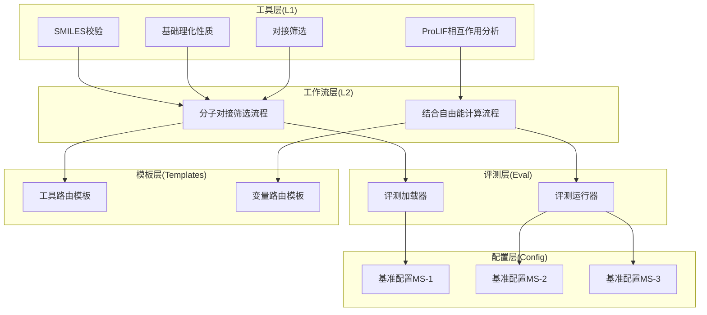
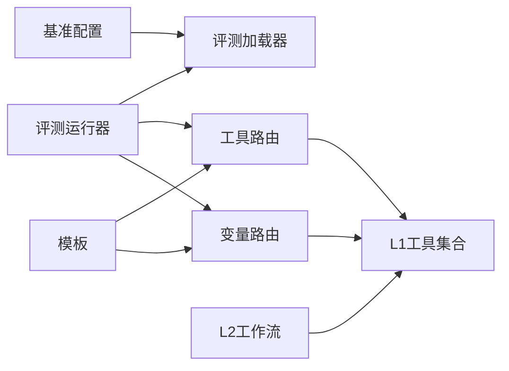

# 工具扩展机制

<cite>
**本文档引用的文件**   
- [docs/molbench_repo/skills/L1_tools/README.md](file://docs/molbench_repo/skills/L1_tools/README.md)
- [docs/molbench_repo/skills/L1_tools/molclaw-smiles-valid-check/README.md](file://docs/molbench_repo/skills/L1_tools/molclaw-smiles-valid-check/README.md)
- [docs/molbench_repo/skills/L1_tools/molclaw-mol-basic-metrics/README.md](file://docs/molbench_repo/skills/L1_tools/molclaw-mol-basic-metrics/README.md)
- [docs/molbench_repo/skills/L1_tools/molclaw-docking-screening/README.md](file://docs/molbench_repo/skills/L1_tools/molclaw-docking-screening/README.md)
- [docs/molbench_repo/skills/L1_tools/molclaw-prolif-tool/README.md](file://docs/molbench_repo/skills/L1_tools/molclaw-prolif-tool/README.md)
- [docs/molbench_repo/skills/L2_workflows/02-molecular-docking-screening.md](file://docs/molbench_repo/skills/L2_workflows/02-molecular-docking-screening.md)
- [docs/molbench_repo/skills/L2_workflows/06-binding-free-energy-calculation.md](file://docs/molbench_repo/skills/L2_workflows/06-binding-free-energy-calculation.md)
- [docs/molbench_repo/templates/tool_routing.md](file://docs/molbench_repo/templates/tool_routing.md)
- [docs/molbench_repo/templates/variable_routing.md](file://docs/molbench_repo/templates/variable_routing.md)
- [docs/molbench_repo/config/baseline_molbench-ms-1.yaml](file://docs/molbench_repo/config/baseline_molbench-ms-1.yaml)
- [docs/molbench_repo/config/baseline_molbench-ms-2.yaml](file://docs/molbench_repo/config/baseline_molbench-ms-2.yaml)
- [docs/molbench_repo/config/baseline_molbench-ms-3.yaml](file://docs/molbench_repo/config/baseline_molbench-ms-3.yaml)
- [docs/molbench_repo/eval/eval_runner.py](file://docs/molbench_repo/eval/eval_runner.py)
- [docs/molbench_repo/eval/bench_loaders.py](file://docs/molbench_repo/eval/bench_loaders.py)
- [docs/molbench_repo/eval/run_eval_bench.py](file://docs/molbench_repo/eval/run_eval_bench.py)
- [autonomy_mvp/core/harness.py](file://autonomy_mvp/core/harness.py)
- [autonomy_mvp/core/tasks.py](file://autonomy_mvp/core/tasks.py)
- [autonomy_mvp/tests/test_core.py](file://autonomy_mvp/tests/test_core.py)
</cite>

## 目录
1. [简介](#简介)
2. [项目结构](#项目结构)
3. [核心组件](#核心组件)
4. [架构总览](#架构总览)
5. [详细组件分析](#详细组件分析)
6. [依赖关系分析](#依赖关系分析)
7. [性能考量](#性能考量)
8. [故障排查指南](#故障排查指南)
9. [结论](#结论)
10. [附录](#附录)

## 简介
本文件面向希望为科学计算平台扩展“工具”的开发者，系统阐述工具的注册系统、接口规范与调用机制，并给出从简单分子操作到复杂对接计算的完整开发示例。内容覆盖输入输出定义、错误处理、依赖管理、性能优化、版本管理、参数验证、文档生成、测试策略与调试技巧，帮助开发者快速构建高质量、可维护、可复用的工具。

## 项目结构
仓库围绕“工具（L1）—工作流（L2）—评测（Eval）—配置（Config）—模板（Templates）”分层组织：
- L1 工具：原子能力封装，如SMILES校验、基础理化性质计算、对接筛选等
- L2 工作流：由多个L1工具编排而成的端到端流程，如分子对接筛选、结合自由能计算
- Eval：基准评测加载器与运行器，统一执行评测任务
- Config：不同基准场景的配置清单，声明工具链、参数与数据路径
- Templates：工具路由与变量路由模板，用于自动生成或拼装调用上下文

图表来源
- [docs/molbench_repo/skills/L1_tools/molclaw-smiles-valid-check/README.md](file://docs/molbench_repo/skills/L1_tools/molclaw-smiles-valid-check/README.md)
- [docs/molbench_repo/skills/L1_tools/molclaw-mol-basic-metrics/README.md](file://docs/molbench_repo/skills/L1_tools/molclaw-mol-basic-metrics/README.md)
- [docs/molbench_repo/skills/L1_tools/molclaw-docking-screening/README.md](file://docs/molbench_repo/skills/L1_tools/molclaw-docking-screening/README.md)
- [docs/molbench_repo/skills/L1_tools/molclaw-prolif-tool/README.md](file://docs/molbench_repo/skills/L1_tools/molclaw-prolif-tool/README.md)
- [docs/molbench_repo/skills/L2_workflows/02-molecular-docking-screening.md](file://docs/molbench_repo/skills/L2_workflows/02-molecular-docking-screening.md)
- [docs/molbench_repo/skills/L2_workflows/06-binding-free-energy-calculation.md](file://docs/molbench_repo/skills/L2_workflows/06-binding-free-energy-calculation.md)
- [docs/molbench_repo/eval/bench_loaders.py](file://docs/molbench_repo/eval/bench_loaders.py)
- [docs/molbench_repo/eval/eval_runner.py](file://docs/molbench_repo/eval/eval_runner.py)
- [docs/molbench_repo/config/baseline_molbench-ms-1.yaml](file://docs/molbench_repo/config/baseline_molbench-ms-1.yaml)
- [docs/molbench_repo/config/baseline_molbench-ms-2.yaml](file://docs/molbench_repo/config/baseline_molbench-ms-2.yaml)
- [docs/molbench_repo/config/baseline_molbench-ms-3.yaml](file://docs/molbench_repo/config/baseline_molbench-ms-3.yaml)
- [docs/molbench_repo/templates/tool_routing.md](file://docs/molbench_repo/templates/tool_routing.md)
- [docs/molbench_repo/templates/variable_routing.md](file://docs/molbench_repo/templates/variable_routing.md)

章节来源
- [docs/molbench_repo/skills/L1_tools/README.md](file://docs/molbench_repo/skills/L1_tools/README.md)
- [docs/molbench_repo/skills/L2_workflows/02-molecular-docking-screening.md](file://docs/molbench_repo/skills/L2_workflows/02-molecular-docking-screening.md)
- [docs/molbench_repo/eval/run_eval_bench.py](file://docs/molbench_repo/eval/run_eval_bench.py)

## 核心组件
- 工具注册系统
  - 通过统一的元数据描述工具名称、版本、输入输出模式、依赖与环境要求，便于自动发现与路由分发
  - 支持按能力域分类（如SMILES校验、理化性质、对接、相互作用分析），便于检索与组合
- 接口规范
  - 输入：结构化参数（类型、必填/可选、默认值、取值范围、单位）
  - 输出：标准化结果对象（指标、中间产物、日志、状态码）
  - 错误：统一异常类型与错误码，包含可诊断信息
- 调用机制
  - 工具路由：根据任务上下文选择合适工具与参数
  - 变量路由：将上游步骤的输出映射为下游工具的输入
  - 工作流编排：顺序、条件分支、并行与重试

章节来源
- [docs/molbench_repo/templates/tool_routing.md](file://docs/molbench_repo/templates/tool_routing.md)
- [docs/molbench_repo/templates/variable_routing.md](file://docs/molbench_repo/templates/variable_routing.md)
- [docs/molbench_repo/skills/L1_tools/molclaw-smiles-valid-check/README.md](file://docs/molbench_repo/skills/L1_tools/molclaw-smiles-valid-check/README.md)
- [docs/molbench_repo/skills/L1_tools/molclaw-mol-basic-metrics/README.md](file://docs/molbench_repo/skills/L1_tools/molclaw-mol-basic-metrics/README.md)
- [docs/molbench_repo/skills/L1_tools/molclaw-docking-screening/README.md](file://docs/molbench_repo/skills/L1_tools/molclaw-docking-screening/README.md)
- [docs/molbench_repo/skills/L1_tools/molclaw-prolif-tool/README.md](file://docs/molbench_repo/skills/L1_tools/molclaw-prolif-tool/README.md)

## 架构总览
下图展示从评测配置到工具执行的端到端流程：评测加载器读取基准配置，解析工具链与工作流；评测运行器驱动工具路由与变量路由，依次调用L1工具并编排L2工作流；最终汇总结果与指标。

```mermaid
sequenceDiagram
participant User as "用户"
participant Runner as "评测运行器"
participant Loader as "评测加载器"
participant Router as "工具路由"
participant VarRouter as "变量路由"
participant Tool as "L1工具"
participant Workflow as "L2工作流"
User->>Runner : 启动评测(指定基准配置)
Runner->>Loader : 加载基准配置与数据集
Loader-->>Runner : 返回任务清单与工具链
Runner->>Router : 解析工具路由(名称/版本/参数)
Router-->>Runner : 返回工具实例与调用契约
loop 遍历任务
Runner->>VarRouter : 映射上游输出到下游输入
VarRouter-->>Runner : 返回已绑定的参数集
alt 单工具任务
Runner->>Tool : 调用工具(参数校验/执行/错误处理)
Tool-->>Runner : 返回结果与日志
else 多工具工作流
Runner->>Workflow : 执行工作流(顺序/并行/重试)
Workflow-->>Runner : 返回聚合结果
end
Runner->>Runner : 记录指标与中间产物
end
Runner-->>User : 输出评测报告与可视化
```

图表来源
- [docs/molbench_repo/eval/eval_runner.py](file://docs/molbench_repo/eval/eval_runner.py)
- [docs/molbench_repo/eval/bench_loaders.py](file://docs/molbench_repo/eval/bench_loaders.py)
- [docs/molbench_repo/templates/tool_routing.md](file://docs/molbench_repo/templates/tool_routing.md)
- [docs/molbench_repo/templates/variable_routing.md](file://docs/molbench_repo/templates/variable_routing.md)
- [docs/molbench_repo/skills/L2_workflows/02-molecular-docking-screening.md](file://docs/molbench_repo/skills/L2_workflows/02-molecular-docking-screening.md)
- [docs/molbench_repo/skills/L2_workflows/06-binding-free-energy-calculation.md](file://docs/molbench_repo/skills/L2_workflows/06-binding-free-energy-calculation.md)

## 详细组件分析

### 工具注册与元数据
- 工具元数据字段建议
  - 名称、版本、描述、领域标签
  - 输入模式：参数名、类型、是否必填、默认值、约束（范围/枚举/正则）
  - 输出模式：指标、文件路径、结构化对象、日志
  - 依赖：外部库、二进制、环境变量、许可证
  - 资源需求：CPU/GPU、内存、磁盘、超时
- 注册入口
  - 在工具目录中提供说明文档与配置文件，集中描述上述字段
  - 评测配置引用工具名称与版本，实现解耦

章节来源
- [docs/molbench_repo/skills/L1_tools/molclaw-smiles-valid-check/README.md](file://docs/molbench_repo/skills/L1_tools/molclaw-smiles-valid-check/README.md)
- [docs/molbench_repo/skills/L1_tools/molclaw-mol-basic-metrics/README.md](file://docs/molbench_repo/skills/L1_tools/molclaw-mol-basic-metrics/README.md)
- [docs/molbench_repo/skills/L1_tools/molclaw-docking-screening/README.md](file://docs/molbench_repo/skills/L1_tools/molclaw-docking-screening/README.md)
- [docs/molbench_repo/skills/L1_tools/molclaw-prolif-tool/README.md](file://docs/molbench_repo/skills/L1_tools/molclaw-prolif-tool/README.md)

### 接口规范与调用契约
- 输入参数校验
  - 类型检查、必填校验、取值范围与格式验证
  - 失败时返回明确错误码与修复建议
- 输出标准化
  - 统一结果结构：状态、指标字典、产物路径、日志摘要
  - 对大型产物采用路径引用而非内联内容
- 错误处理
  - 区分参数错误、运行时错误、外部依赖不可用
  - 支持重试与降级策略（例如切换备选算法）

章节来源
- [docs/molbench_repo/templates/tool_routing.md](file://docs/molbench_repo/templates/tool_routing.md)
- [docs/molbench_repo/templates/variable_routing.md](file://docs/molbench_repo/templates/variable_routing.md)

### 工具路由与变量路由
- 工具路由
  - 基于工具名称与版本匹配具体实现
  - 支持按环境能力（GPU/内存）动态选择最优实现
- 变量路由
  - 将上游步骤的输出键映射到下游输入键
  - 支持转换函数（单位换算、格式转换、过滤）

章节来源
- [docs/molbench_repo/templates/tool_routing.md](file://docs/molbench_repo/templates/tool_routing.md)
- [docs/molbench_repo/templates/variable_routing.md](file://docs/molbench_repo/templates/variable_routing.md)

### 工作流编排（L2）
- 典型流程
  - 分子对接筛选：SMILES校验→构象生成→对接打分→排序与筛选
  - 结合自由能计算：对接准备→MM/PBSA或类似方法→统计与分析
- 编排特性
  - 顺序执行、条件分支、并行执行、失败重试、断点续跑
  - 中间产物缓存与增量更新

章节来源
- [docs/molbench_repo/skills/L2_workflows/02-molecular-docking-screening.md](file://docs/molbench_repo/skills/L2_workflows/02-molecular-docking-screening.md)
- [docs/molbench_repo/skills/L2_workflows/06-binding-free-energy-calculation.md](file://docs/molbench_repo/skills/L2_workflows/06-binding-free-energy-calculation.md)

### 评测加载与运行
- 评测加载器
  - 读取基准配置与数据集，解析任务清单与工具链
  - 校验依赖可用性与资源配额
- 评测运行器
  - 驱动工具路由与变量路由，执行任务
  - 收集指标、日志与产物，生成报告

章节来源
- [docs/molbench_repo/eval/bench_loaders.py](file://docs/molbench_repo/eval/bench_loaders.py)
- [docs/molbench_repo/eval/eval_runner.py](file://docs/molbench_repo/eval/eval_runner.py)
- [docs/molbench_repo/eval/run_eval_bench.py](file://docs/molbench_repo/eval/run_eval_bench.py)

### 配置与版本管理
- 基准配置
  - 使用YAML声明工具链、参数、数据路径与资源限制
  - 不同基准（MS-1/MS-2/MS-3）对应不同配置
- 版本管理
  - 工具版本语义化（主.次.修订），兼容性与破坏性变更需升级主版本
  - 评测配置锁定工具版本，确保可复现

章节来源
- [docs/molbench_repo/config/baseline_molbench-ms-1.yaml](file://docs/molbench_repo/config/baseline_molbench-ms-1.yaml)
- [docs/molbench_repo/config/baseline_molbench-ms-2.yaml](file://docs/molbench_repo/config/baseline_molbench-ms-2.yaml)
- [docs/molbench_repo/config/baseline_molbench-ms-3.yaml](file://docs/molbench_repo/config/baseline_molbench-ms-3.yaml)

### 工具开发示例
- 简单工具：SMILES有效性校验
  - 输入：SMILES字符串、可选的严格模式
  - 输出：布尔结果、错误消息、规范化后的SMILES
  - 错误处理：非法字符、价态异常、环闭合问题
- 中等工具：基础理化性质计算
  - 输入：SMILES或分子文件、计算方法、力场
  - 输出：分子量、LogP、HBA/HBD、TPSA、旋转键数等
  - 性能优化：缓存指纹与属性、批量计算
- 复杂工具：分子对接筛选
  - 输入：配体SMILES、受体PDB、搜索空间、评分函数
  - 输出：对接构象、打分、结合位点、可视化文件
  - 依赖管理：外部程序路径、GPU可用性、内存阈值
- 高级工具：ProLIF相互作用分析
  - 输入：复合物结构、残基列表、相互作用类型
  - 输出：氢键、盐桥、π-π堆积、疏水接触统计
  - 错误处理：结构缺失、原子索引越界、对称性处理

章节来源
- [docs/molbench_repo/skills/L1_tools/molclaw-smiles-valid-check/README.md](file://docs/molbench_repo/skills/L1_tools/molclaw-smiles-valid-check/README.md)
- [docs/molbench_repo/skills/L1_tools/molclaw-mol-basic-metrics/README.md](file://docs/molbench_repo/skills/L1_tools/molclaw-mol-basic-metrics/README.md)
- [docs/molbench_repo/skills/L1_tools/molclaw-docking-screening/README.md](file://docs/molbench_repo/skills/L1_tools/molclaw-docking-screening/README.md)
- [docs/molbench_repo/skills/L1_tools/molclaw-prolif-tool/README.md](file://docs/molbench_repo/skills/L1_tools/molclaw-prolif-tool/README.md)

### 参数验证与文档生成
- 参数验证
  - 使用JSON Schema或Pydantic风格定义输入模式
  - 在工具入口处进行强校验，失败即早返回
- 文档生成
  - 从工具元数据自动生成API文档与使用说明
  - 包含示例输入输出、错误码说明、依赖安装指引

章节来源
- [docs/molbench_repo/templates/tool_routing.md](file://docs/molbench_repo/templates/tool_routing.md)
- [docs/molbench_repo/templates/variable_routing.md](file://docs/molbench_repo/templates/variable_routing.md)

### 测试策略与调试技巧
- 单元测试
  - 针对输入校验、边界条件、异常路径编写用例
  - 使用固定夹具数据保证稳定性
- 集成测试
  - 模拟真实工作流，验证工具间数据流转
  - 覆盖依赖不可用与资源不足场景
- 回归测试
  - 基准配置驱动，确保新版本不改变关键指标
- 调试技巧
  - 开启详细日志与追踪ID
  - 使用最小可复现实例逐步定位问题

章节来源
- [autonomy_mvp/tests/test_core.py](file://autonomy_mvp/tests/test_core.py)
- [autonomy_mvp/core/harness.py](file://autonomy_mvp/core/harness.py)
- [autonomy_mvp/core/tasks.py](file://autonomy_mvp/core/tasks.py)

## 依赖关系分析
- 组件耦合
  - 评测运行器依赖评测加载器与工具路由
  - 工作流编排依赖L1工具与变量路由
  - 配置层与模板层为上层提供声明式描述
- 外部依赖
  - 化学信息学库（如RDKit）、对接引擎、MD框架、可视化工具
  - 环境变量与二进制路径需在工具元数据中声明

图表来源
- [docs/molbench_repo/eval/eval_runner.py](file://docs/molbench_repo/eval/eval_runner.py)
- [docs/molbench_repo/eval/bench_loaders.py](file://docs/molbench_repo/eval/bench_loaders.py)
- [docs/molbench_repo/templates/tool_routing.md](file://docs/molbench_repo/templates/tool_routing.md)
- [docs/molbench_repo/templates/variable_routing.md](file://docs/molbench_repo/templates/variable_routing.md)

章节来源
- [docs/molbench_repo/eval/run_eval_bench.py](file://docs/molbench_repo/eval/run_eval_bench.py)
- [docs/molbench_repo/config/baseline_molbench-ms-1.yaml](file://docs/molbench_repo/config/baseline_molbench-ms-1.yaml)
- [docs/molbench_repo/config/baseline_molbench-ms-2.yaml](file://docs/molbench_repo/config/baseline_molbench-ms-2.yaml)
- [docs/molbench_repo/config/baseline_molbench-ms-3.yaml](file://docs/molbench_repo/config/baseline_molbench-ms-3.yaml)

## 性能考量
- 批处理与缓存
  - 对重复输入进行指纹缓存与结果缓存
  - 批量计算理化性质与对接打分
- 并行与异步
  - 独立任务并行执行，共享资源加锁
  - I/O密集型任务使用异步I/O
- 资源控制
  - 设置内存与时间上限，避免OOM与长时间阻塞
  - GPU显存管理与设备选择
- 增量更新
  - 仅重新计算变化部分，利用中间产物缓存

[本节为通用指导，无需特定文件来源]

## 故障排查指南
- 常见问题
  - 工具未注册或版本不匹配：检查工具元数据与评测配置
  - 依赖缺失或路径错误：确认环境变量与二进制路径
  - 参数校验失败：查看输入模式与错误码
  - 资源不足：调整并发度与资源配额
- 诊断步骤
  - 启用详细日志与追踪ID
  - 使用最小可复现实例隔离问题
  - 分阶段执行工作流定位失败节点

章节来源
- [autonomy_mvp/core/harness.py](file://autonomy_mvp/core/harness.py)
- [autonomy_mvp/core/tasks.py](file://autonomy_mvp/core/tasks.py)
- [autonomy_mvp/tests/test_core.py](file://autonomy_mvp/tests/test_core.py)

## 结论
通过统一的工具注册系统、清晰的接口规范与灵活的调用机制，开发者可以快速构建从简单到复杂的科学计算工具，并以工作流方式编排成端到端解决方案。配合完善的配置管理、参数验证、文档生成与测试策略，能够显著提升工具的可维护性、可复用性与可复现性。

[本节为总结性内容，无需特定文件来源]

## 附录
- 最佳实践清单
  - 明确输入输出模式与错误码
  - 使用语义化版本与锁定配置
  - 提供最小可复现实例与夹具数据
  - 自动化测试覆盖单元、集成与回归
  - 性能基准与资源监控
- 参考示例路径
  - SMILES校验工具：[molclaw-smiles-valid-check/README.md](file://docs/molbench_repo/skills/L1_tools/molclaw-smiles-valid-check/README.md)
  - 基础理化性质工具：[molclaw-mol-basic-metrics/README.md](file://docs/molbench_repo/skills/L1_tools/molclaw-mol-basic-metrics/README.md)
  - 对接筛选工具：[molclaw-docking-screening/README.md](file://docs/molbench_repo/skills/L1_tools/molclaw-docking-screening/README.md)
  - ProLIF工具：[molclaw-prolif-tool/README.md](file://docs/molbench_repo/skills/L1_tools/molclaw-prolif-tool/README.md)
  - 对接工作流：[02-molecular-docking-screening.md](file://docs/molbench_repo/skills/L2_workflows/02-molecular-docking-screening.md)
  - 自由能工作流：[06-binding-free-energy-calculation.md](file://docs/molbench_repo/skills/L2_workflows/06-binding-free-energy-calculation.md)

[本节为附录内容，无需特定文件来源]